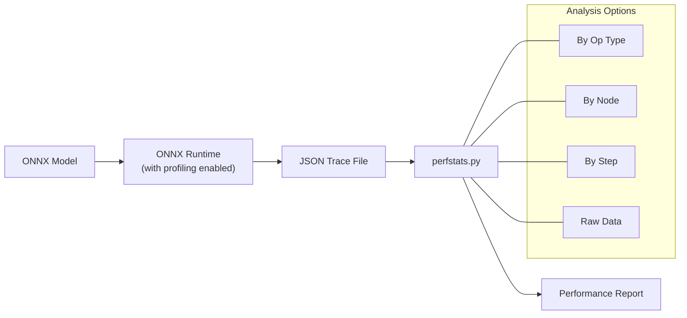
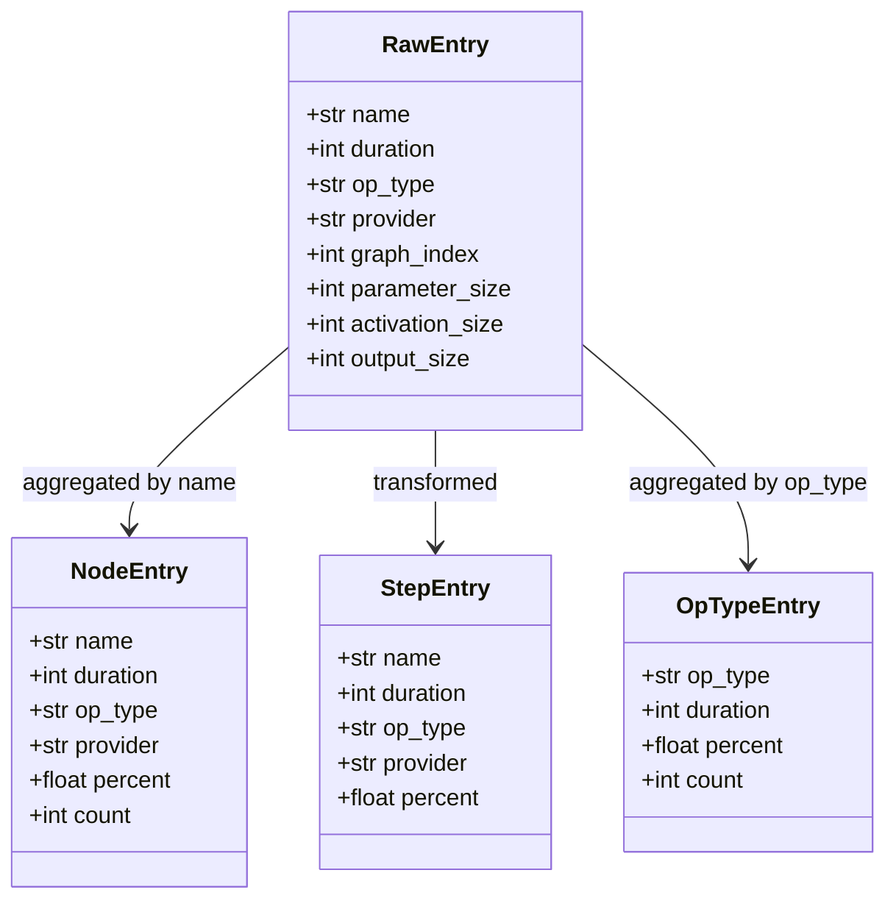
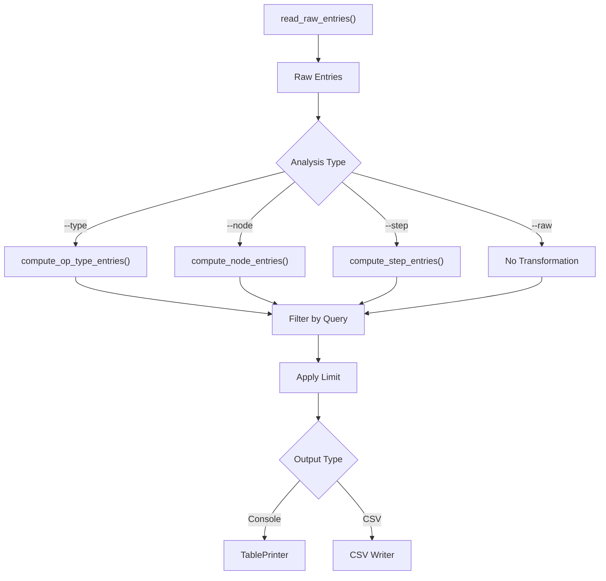
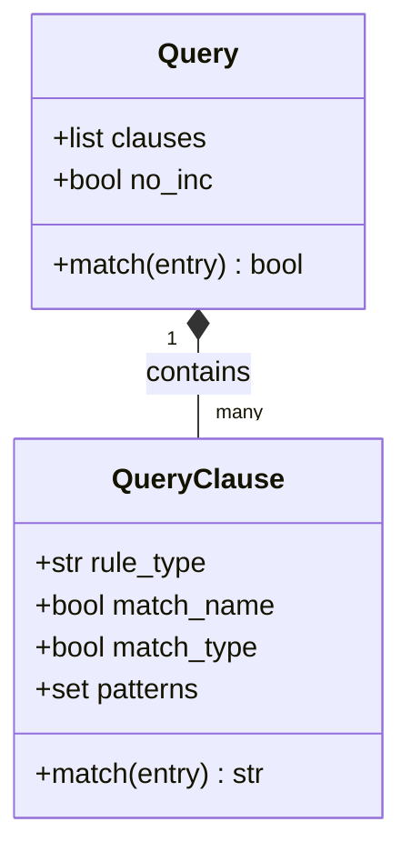
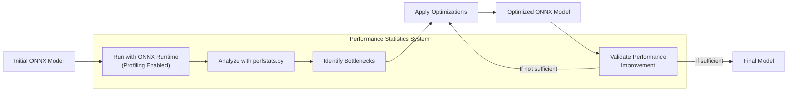

<!-- source: DeepWiki mcp.deepwiki.com · repo microsoft/onnxconverter-common · page 5.6 Performance Statistics · fetched 2026-10-26 -->

# Performance Statistics

<details>
<summary>Relevant source files</summary>

The following files were used as context for generating this wiki page:

- [onnxconverter_common/perfstats.py](onnxconverter_common/perfstats.py)

</details>


The Performance Statistics system in `onnxconverter-common` provides tools for analyzing and interpreting profiling data generated by ONNX Runtime. This module enables developers to identify performance bottlenecks, optimize model execution, and understand resource utilization patterns by parsing and presenting execution metrics in various useful formats.

## Overview

The `perfstats.py` module is a standalone utility that parses profiling trace files from ONNX Runtime and presents the performance data in a structured, readable format. It can analyze execution times by operation type, node, or execution step, helping users identify which parts of their model consume the most computational resources.



Sources: [onnxconverter_common/perfstats.py:6-40]()

## Generating Profiling Data

Before using the Performance Statistics tool, you need to generate profiling data from ONNX Runtime. This involves enabling profiling in the session options when creating an ONNX Runtime inference session.

```python
import onnxruntime as ort

# Enable profiling in session options
sess_options = ort.SessionOptions()
sess_options.enable_profiling = True

# Create session with profiling enabled
session = ort.InferenceSession(onnx_model_path, sess_options)

# Run inference
session.run(None, feed_dict)

# End profiling and get the profile file path
profile_file = session.end_profiling()
print(profile_file)  # This outputs the path to the JSON trace file
```

Sources: [onnxconverter_common/perfstats.py:24-33]()

## Internal Data Structures

The Performance Statistics system uses several internal data structures to represent and process profiling data. These are organized as named tuples for efficient data handling and presentation.



Sources: [onnxconverter_common/perfstats.py:59-71]()

## Data Processing Flow

The Performance Statistics system processes the raw profiling data through several transformation steps to produce meaningful analysis. The flow depends on the analysis type selected by the user.



Sources: [onnxconverter_common/perfstats.py:74-142](), [onnxconverter_common/perfstats.py:250-295]()

## Command-Line Interface

The Performance Statistics tool provides a comprehensive command-line interface with several options for customizing the analysis and output.

| Option | Flag | Description |
|--------|------|-------------|
| Type Analysis | `-t`, `--type` | Group execution time by operation type |
| Node Analysis | `-n`, `--node` | Group execution time by node |
| Step Analysis | `-s`, `--step` | Show times for each execution step |
| Raw Data | `-r`, `--raw` | Show unsorted raw data |
| Data Only | `-d`, `--data-only` | Exclude headers from output |
| Query | `-q`, `--query` | Filter entries with a query expression |
| Limit | `-l`, `--limit` | Limit the number of results shown |
| Output | `-o`, `--output` | Write results to a CSV file |

Sources: [onnxconverter_common/perfstats.py:145-168]()

## Analysis Types

The Performance Statistics tool offers several ways to analyze and view the profiling data:

### Type Analysis

Groups execution time by operation type (e.g., Conv, Add, MatMul), showing the total duration, percentage of total execution time, and count for each operation type. This is useful for identifying which operation types are the most computationally intensive.

```
op_type               duration    percent     count
--------------------  ----------  ----------  ----------
MemcpyFromHost        3388472     66.0656981  193
Conv                  1205958     23.5127978  5
Loop                  451989      8.81251751  5
Add                   23115       0.45067765  3482
Concat                14228       0.27740608  323
```

Sources: [onnxconverter_common/perfstats.py:100-111]()

### Node Analysis

Groups execution time by node, showing the total duration, operation type, provider, percentage of total execution time, and execution count for each node. This helps identify specific bottleneck nodes in the model.

Sources: [onnxconverter_common/perfstats.py:84-97]()

### Step Analysis

Shows the execution time for each individual step in the execution sequence, sorted by duration. This provides a chronological view of the model execution.

Sources: [onnxconverter_common/perfstats.py:74-81]()

### Raw Data Analysis

Displays the raw profiling data without any transformation, showing all the details recorded by the ONNX Runtime profiler.

Sources: [onnxconverter_common/perfstats.py:114-142]()

## Query System

The Performance Statistics tool includes a powerful query system to filter results based on node names, operation types, or a combination of criteria.



The query syntax supports:
- Including entries with specific node names: `n=NodeName`
- Including entries with specific operation types: `t=OpType`
- Excluding entries with specific node names: `n!=NodeName`
- Excluding entries with specific operation types: `t!=OpType`
- Combining multiple conditions with semicolons: `t=Conv;n!=NodeName`

Sources: [onnxconverter_common/perfstats.py:171-199]()

## Usage Examples

Here are some common use cases for the Performance Statistics tool:

1. List operations by type, showing the 5 most time-consuming operation types:
   ```
   python -m onnxconverter_common.perfstats -t -l 5 trace.json
   ```

2. List all nodes, sorted by execution time:
   ```
   python -m onnxconverter_common.perfstats -n trace.json
   ```

3. List only convolution nodes:
   ```
   python -m onnxconverter_common.perfstats -n trace.json -q t=Conv
   ```

4. List all non-convolution nodes:
   ```
   python -m onnxconverter_common.perfstats -n trace.json -q t!=Conv
   ```

5. List convolution nodes except those with a specific name:
   ```
   python -m onnxconverter_common.perfstats -n trace.json -q t=Conv;n!=NodeName
   ```

6. Export results to a CSV file:
   ```
   python -m onnxconverter_common.perfstats -t trace.json -o results.csv
   ```

Sources: [onnxconverter_common/perfstats.py:48-55]()

## Output Formatting

The Performance Statistics tool formats output for console display using the `TablePrinter` class, which automatically adjusts column widths based on terminal size and content. For CSV output, it uses Python's built-in `csv` module.

Sources: [onnxconverter_common/perfstats.py:202-247](), [onnxconverter_common/perfstats.py:281-294]()

## Integration with ONNX Optimization Workflow

The Performance Statistics tool plays a crucial role in the ONNX model optimization workflow, providing insights that guide optimization efforts.



Sources: [onnxconverter_common/perfstats.py:6-40]()

## Common Performance Bottlenecks

When analyzing ONNX model performance, several common bottlenecks can be identified:

1. **Memory Transfers**: Operations like `MemcpyFromHost` often consume significant time, indicating data transfer overhead between CPU and execution devices.

2. **Compute-Intensive Operations**: Operations like `Conv` (convolution) and `MatMul` (matrix multiplication) are typically computationally expensive.

3. **Suboptimal Graph Structure**: Excessive number of small operations or unnecessary data format conversions can impact performance.

4. **Provider Selection**: The execution provider (e.g., CPU, CUDA, DirectML) can significantly impact operation performance.

Sources: [onnxconverter_common/perfstats.py:15-22](), [onnxconverter_common/perfstats.py:35-39]()

## Summary

The Performance Statistics system in `onnxconverter-common` provides a powerful tool for analyzing and understanding the performance characteristics of ONNX models. By parsing and presenting profiling data in various formats, it helps developers identify bottlenecks, optimize model execution, and improve overall performance.

Sources: [onnxconverter_common/perfstats.py:6-40]()

---

