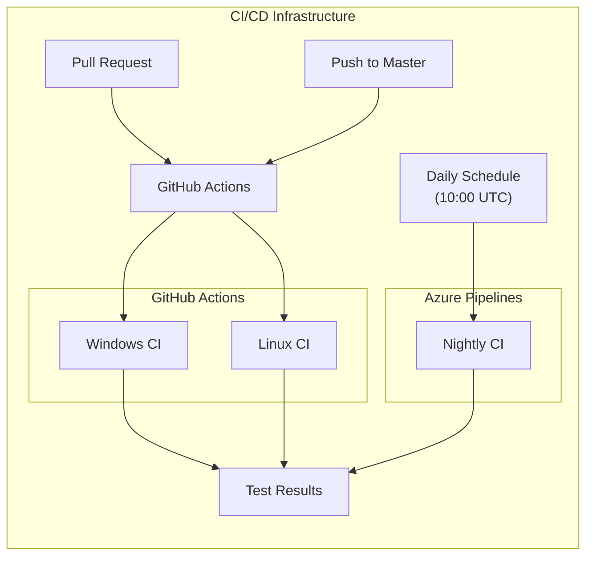
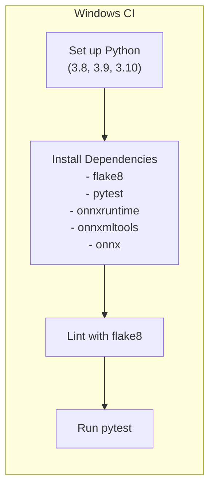
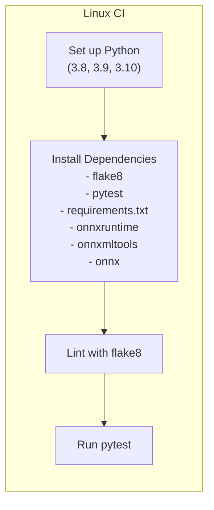
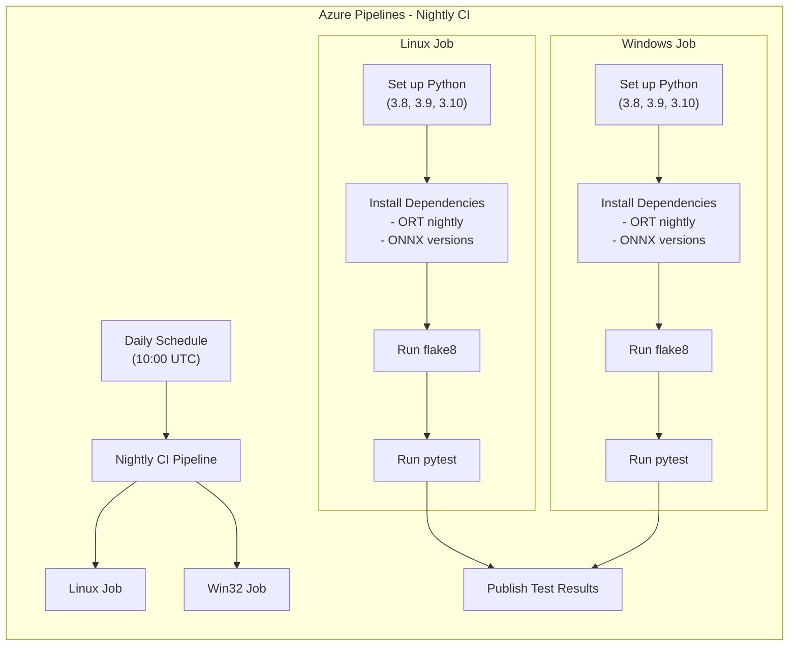
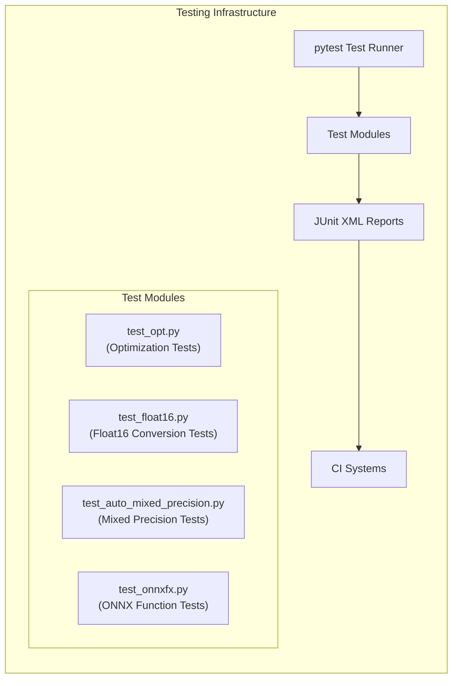
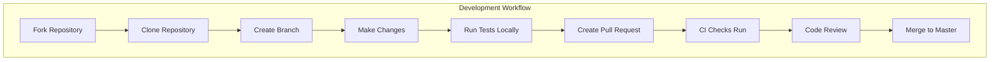

<!-- source: DeepWiki mcp.deepwiki.com · repo microsoft/onnxconverter-common · page 6 Development and CI/CD · fetched 2026-10-26 -->

# Development and CI/CD

<details>
<summary>Relevant source files</summary>

The following files were used as context for generating this wiki page:

- [.azure-pipelines/nightly-CI.yml](.azure-pipelines/nightly-CI.yml)
- [.github/workflows/linux-CI.yml](.github/workflows/linux-CI.yml)
- [.github/workflows/windows-CI.yml](.github/workflows/windows-CI.yml)
- [.vscode/launch.json](.vscode/launch.json)

</details>


This page documents the development environment, continuous integration (CI) pipelines, and continuous deployment (CD) processes used in the onnxconverter-common repository. It covers the setup of CI/CD systems, testing infrastructure, and development workflow to ensure code quality and reliability.

For information about the overall package structure, see [Package Structure](#1.2). For details on testing specific components, see the relevant component documentation.

## Development Environment Setup

The onnxconverter-common repository is a Python package that can be developed in various environments. The recommended way to set up a development environment is to clone the repository and install it in development mode.

```bash
git clone https://github.com/microsoft/onnxconverter-common.git
cd onnxconverter-common
pip install -e .
```

### VS Code Configuration

The repository includes VS Code configuration for debugging:

```json
{
    "version": "0.2.0",
    "configurations": [
        {
            "name": "Python Debugger: Current File",
            "type": "debugpy",
            "request": "launch",
            "program": "${file}",
            "console": "integratedTerminal",
            "justMyCode": false
        }
    ]
}
```

This configuration allows for debugging Python files with access to third-party library source code (`justMyCode: false`).

Sources: [.vscode/launch.json:1-16]()

## CI/CD Infrastructure

The onnxconverter-common repository uses both GitHub Actions and Azure Pipelines for continuous integration and continuous deployment.



### GitHub Actions Workflows

The repository uses GitHub Actions for CI on both Windows and Linux platforms. These workflows are triggered on:
- Push to the master branch
- Pull requests to the master branch

#### Windows CI Workflow

The Windows CI workflow runs tests on Windows using multiple Python versions:



The Windows CI workflow:
1. Sets up multiple Python environments (3.8, 3.9, 3.10)
2. Installs dependencies including onnxruntime, onnxmltools, and specific ONNX versions
3. Runs linting checks using flake8
4. Executes tests using pytest

Sources: [.github/workflows/windows-CI.yml:1-53]()

#### Linux CI Workflow

The Linux CI workflow follows a similar pattern to the Windows workflow:



The Linux CI workflow matches the Windows workflow but runs in a Linux environment.

Sources: [.github/workflows/linux-CI.yml:1-55]()

### Azure Pipelines

The repository uses Azure Pipelines for nightly CI builds to test against the latest versions of dependencies, particularly onnxruntime nightly builds.



Key aspects of the Nightly CI pipeline:
1. Runs daily at 10:00 UTC
2. Tests on both Linux and Windows platforms
3. Tests with multiple Python versions (3.8, 3.9, 3.10)
4. Uses onnxruntime nightly builds from TestPyPI
5. Tests with specific ONNX versions appropriate for each Python version
6. Runs flake8 linting checks
7. Runs pytest tests
8. Publishes test results

Sources: [.azure-pipelines/nightly-CI.yml:1-144]()

## Testing Infrastructure

The onnxconverter-common repository uses pytest for testing. The tests are organized to validate the functionality of different components of the package.



### Test Execution in CI

All CI pipelines execute tests using pytest with the following pattern:

```bash
pytest tests --doctest-modules --junitxml=junit/test-results.xml
```

This command:
1. Runs all tests in the `tests` directory
2. Runs doctests in all modules
3. Generates JUnit XML reports for test results processing by CI systems

Test results are published to the CI system for visibility and tracking.

Sources: [.github/workflows/windows-CI.yml:50-52](), [.github/workflows/linux-CI.yml:52-54](), [.azure-pipelines/nightly-CI.yml:65-67]()

## Code Quality Tools

The repository uses several tools to maintain code quality:

1. **flake8**: Linting tool used to enforce Python coding standards
2. **pytest**: Testing framework for unit and integration tests

### Linting with flake8

The GitHub Actions workflows run flake8 in two passes:
1. Strict pass for critical errors: `flake8 . --count --select=E9,F63,F7,F82 --show-source --statistics`
2. Warning pass for style issues: `flake8 . --count --exit-zero --max-complexity=10 --max-line-length=127 --statistics`

Azure Pipelines uses a simpler flake8 check: `python -m flake8 onnxconverter_common`

Sources: [.github/workflows/windows-CI.yml:44-49](), [.github/workflows/linux-CI.yml:46-51](), [.azure-pipelines/nightly-CI.yml:59-62]()

## Development Workflow

The typical development workflow for contributing to onnxconverter-common is as follows:



### Local Testing

Before submitting a pull request, developers should run tests locally to ensure their changes don't break existing functionality:

```bash
# Install dependencies
pip install -e .
pip install pytest flake8

# Run linting
flake8 onnxconverter_common

# Run tests
pytest tests
```

### Pull Request Process

1. Fork the repository on GitHub
2. Create a feature branch for your changes
3. Make and commit your changes
4. Ensure all tests pass locally
5. Create a pull request to the master branch
6. Wait for CI checks to complete
7. Address any review comments
8. Once approved, the changes will be merged

## Release Process

The release process for onnxconverter-common is not explicitly defined in the provided files. However, based on typical Python package practices, it likely involves:

1. Version bumping in the package metadata
2. Creating a release tag in GitHub
3. Building the package
4. Publishing to PyPI

The package follows semantic versioning, and releases are managed through the GitHub repository.

---

