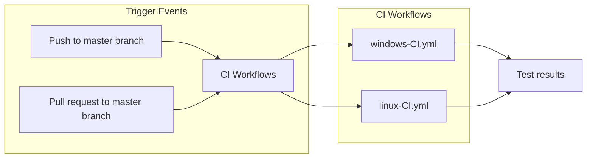
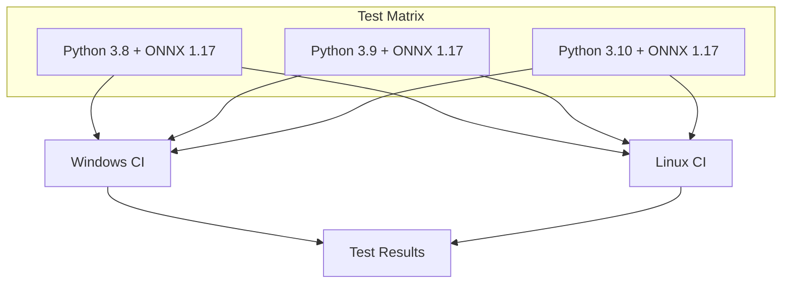
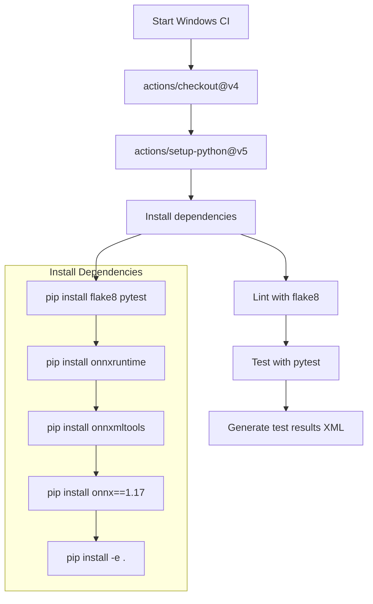
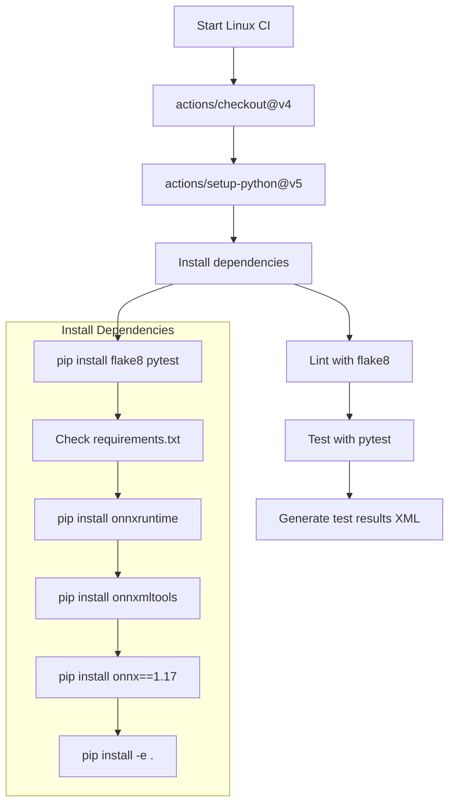
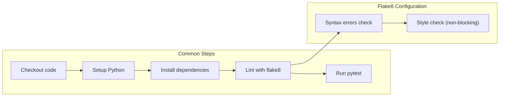
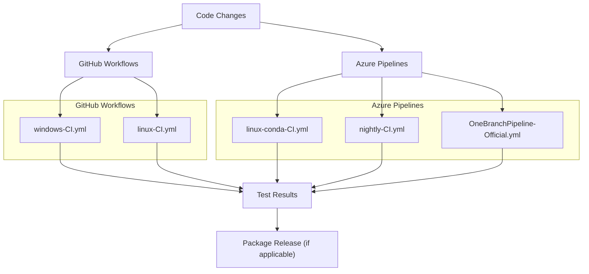

<!-- source: DeepWiki mcp.deepwiki.com · repo microsoft/onnxconverter-common · page 6.1 GitHub Workflows · fetched 2026-10-26 -->

# GitHub Workflows

<details>
<summary>Relevant source files</summary>

The following files were used as context for generating this wiki page:

- [.github/workflows/linux-CI.yml](.github/workflows/linux-CI.yml)
- [.github/workflows/windows-CI.yml](.github/workflows/windows-CI.yml)
- [.vscode/launch.json](.vscode/launch.json)

</details>


## Purpose and Scope

This document details the GitHub Actions workflows used in the onnxconverter-common repository for continuous integration (CI). These workflows automatically test the codebase across multiple platforms and Python environments whenever code changes are pushed or pull requests are made, ensuring code quality and compatibility. For information about Azure Pipelines used in the project, see [Azure Pipelines](#6.2).

Sources: [.github/workflows/windows-CI.yml:1-12](), [.github/workflows/linux-CI.yml:1-12]()

## Workflow Overview

The repository utilizes two primary GitHub Actions workflows:

1. **Windows CI Workflow** - Tests the codebase on Windows environments
2. **Linux CI Workflow** - Tests the codebase on Linux environments

Both workflows follow a similar structure but target different operating systems, ensuring cross-platform compatibility of the onnxconverter-common package.

### Workflow Trigger Events



**Diagram: GitHub Workflow Trigger Events**

Sources: [.github/workflows/windows-CI.yml:7-11](), [.github/workflows/linux-CI.yml:7-11]()

## Test Matrix Strategy

Both workflows implement a matrix strategy that tests the codebase across multiple Python versions while controlling the ONNX version used. This ensures compatibility with various Python environments that users might have.



**Diagram: Test Matrix Configuration**

Sources: [.github/workflows/windows-CI.yml:17-28](), [.github/workflows/linux-CI.yml:17-28]()

The following table details the test matrix configuration:

| Python Version | ONNX Version | Windows | Linux |
|----------------|--------------|---------|-------|
| 3.8            | 1.17         | ✓       | ✓     |
| 3.9            | 1.17         | ✓       | ✓     |
| 3.10           | 1.17         | ✓       | ✓     |

Sources: [.github/workflows/windows-CI.yml:20-28](), [.github/workflows/linux-CI.yml:20-28]()

## Windows CI Workflow

The Windows CI workflow runs on the latest Windows environment and executes a series of steps to validate the codebase.



**Diagram: Windows CI Workflow Process**

Sources: [.github/workflows/windows-CI.yml:16-52]()

### Key Steps in Windows CI

1. **Checkout Code**: Uses `actions/checkout@v4` to fetch the repository code
2. **Setup Python**: Configures the specified Python version using `actions/setup-python@v5`
3. **Install Dependencies**: Installs required packages and development dependencies
4. **Lint Code**: Performs syntax checking with flake8
5. **Run Tests**: Executes tests using pytest and generates XML reports

Sources: [.github/workflows/windows-CI.yml:30-52]()

## Linux CI Workflow

The Linux CI workflow runs on the latest Ubuntu environment and follows steps similar to the Windows workflow with minor platform-specific differences.



**Diagram: Linux CI Workflow Process**

Sources: [.github/workflows/linux-CI.yml:16-54]()

### Key Steps in Linux CI

1. **Checkout Code**: Uses `actions/checkout@v4` to fetch the repository code
2. **Setup Python**: Configures the specified Python version using `actions/setup-python@v5`
3. **Install Dependencies**: Installs required packages and checks for requirements.txt
4. **Lint Code**: Performs syntax checking with flake8
5. **Run Tests**: Executes tests using pytest and generates XML reports

Sources: [.github/workflows/linux-CI.yml:31-54]()

## Common Components Between Workflows

Despite targeting different operating systems, both workflows share several common configuration elements and steps.

### Shared Configuration

- **Trigger Events**: Both workflows trigger on push to master and pull requests to master
- **Permissions**: Both use read-only permission for repository contents
- **Matrix Strategy**: Both test against Python 3.8, 3.9, and 3.10 with ONNX 1.17

### Shared Steps



**Diagram: Common Workflow Components**

Sources: [.github/workflows/windows-CI.yml:30-52](), [.github/workflows/linux-CI.yml:31-54]()

### Linting Process

Both workflows use flake8 for code quality checks with identical configuration:

1. **Syntax Error Check**: Stops the build if Python syntax errors or undefined names are found
   ```
   flake8 . --count --select=E9,F63,F7,F82 --show-source --statistics
   ```

2. **Style Check**: Treats style issues as warnings (non-blocking)
   ```
   flake8 . --count --exit-zero --max-complexity=10 --max-line-length=127 --statistics
   ```

Sources: [.github/workflows/windows-CI.yml:44-49](), [.github/workflows/linux-CI.yml:46-51]()

### Testing Process

Both workflows use pytest to run the test suite:

```
pytest tests --doctest-modules --junitxml=junit/test-results-onnxutils.xml
```

Key aspects of the test command:
- Includes doctests in modules
- Generates JUnit XML report for test results

Sources: [.github/workflows/windows-CI.yml:50-52](), [.github/workflows/linux-CI.yml:52-54]()

## Integration with the Broader CI/CD System

The GitHub workflows represent one component of the broader CI/CD system, which also includes Azure Pipelines as detailed in [Azure Pipelines](#6.2).



**Diagram: CI/CD System Integration**

Sources: [.github/workflows/windows-CI.yml:1-52](), [.github/workflows/linux-CI.yml:1-54]()

## Dependencies

Both workflows install the following key dependencies:

| Dependency | Purpose |
|------------|---------|
| flake8 | Code quality checking |
| pytest | Test execution |
| onnxruntime | ONNX model execution and validation |
| onnxmltools | ONNX conversion tools |
| onnx | Core ONNX functionality |

Sources: [.github/workflows/windows-CI.yml:36-43](), [.github/workflows/linux-CI.yml:38-45]()

## Conclusion

The GitHub Workflows in the onnxconverter-common repository provide continuous integration capabilities across multiple platforms and Python versions. They ensure that code changes maintain compatibility and quality through automated testing and linting. These workflows work alongside the Azure Pipelines system to form a comprehensive CI/CD infrastructure for the project. For more details on the testing approach used in these workflows, see [Testing Infrastructure](#6.3).

---

