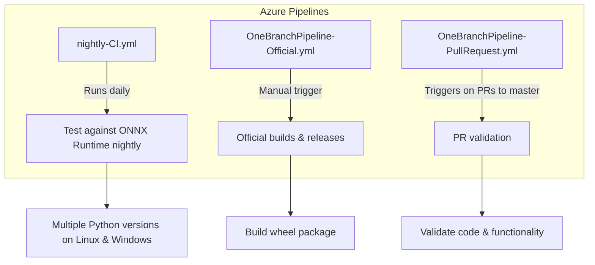
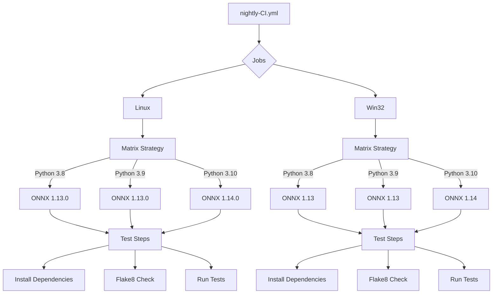
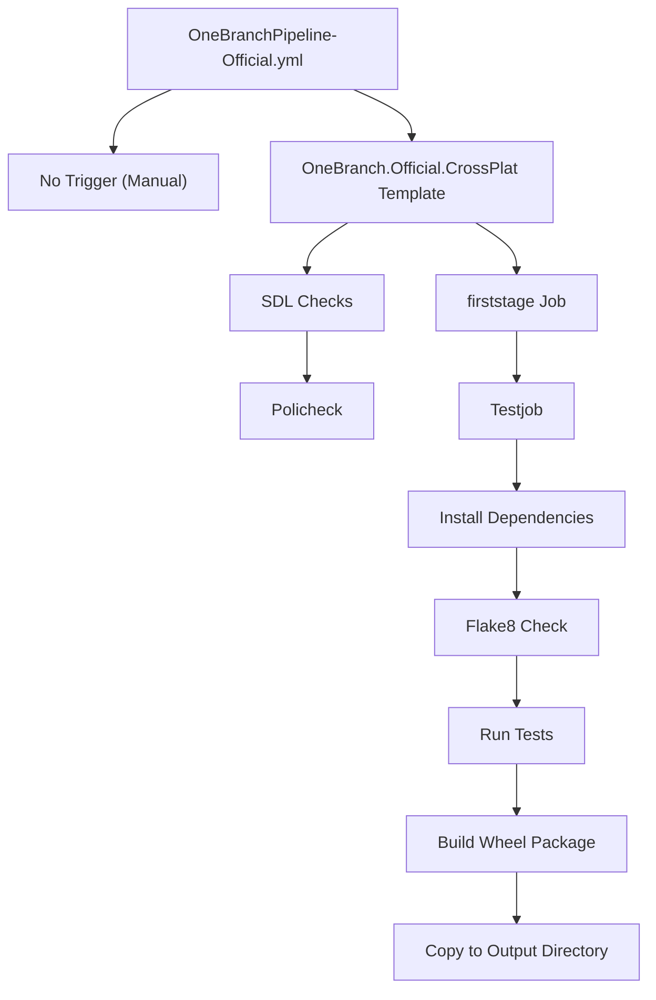
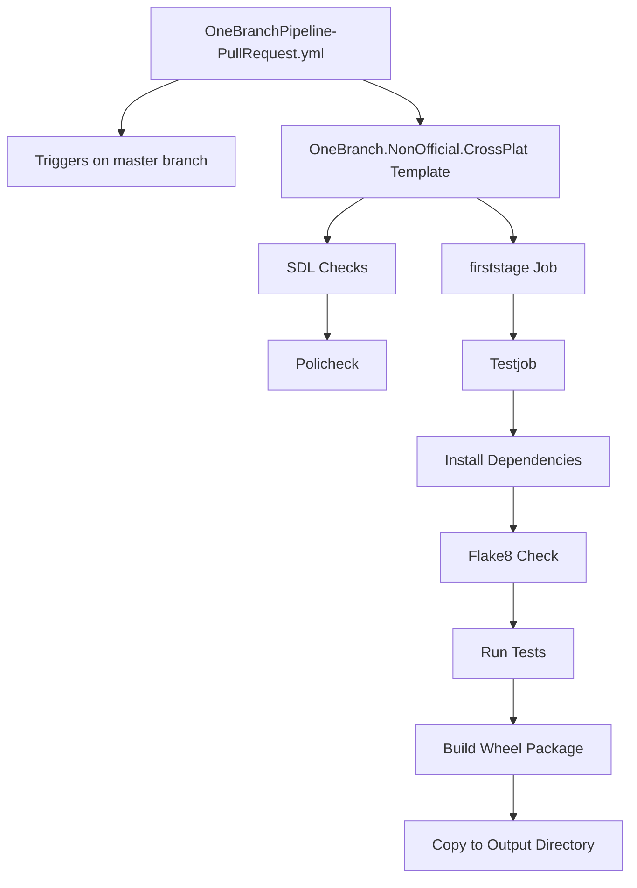
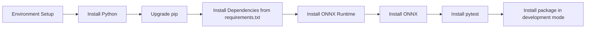
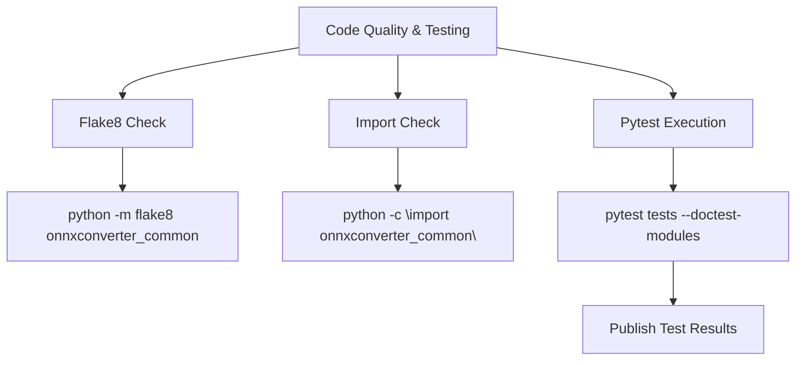
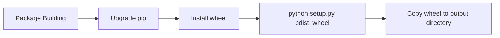
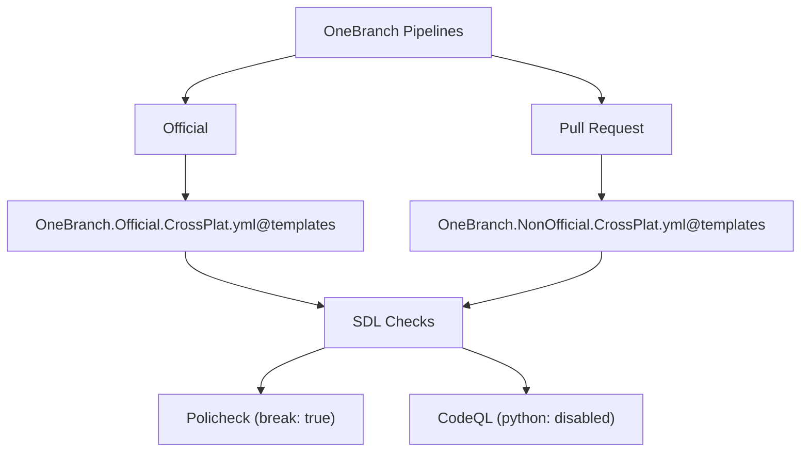

<!-- source: DeepWiki mcp.deepwiki.com · repo microsoft/onnxconverter-common · page 6.2 Azure Pipelines · fetched 2026-10-26 -->

# Azure Pipelines

Relevant source files

The following files were used as context for generating this wiki page:

- [.azure-pipelines/OneBranchPipeline-Official.yml](.azure-pipelines/OneBranchPipeline-Official.yml)
- [.azure-pipelines/OneBranchPipeline-PullRequest.yml](.azure-pipelines/OneBranchPipeline-PullRequest.yml)
- [.azure-pipelines/nightly-CI.yml](.azure-pipelines/nightly-CI.yml)

## Purpose and Scope

This document details the Azure Pipeline configurations used in the onnxconverter-common repository for continuous integration, testing, and deployment. It covers the different pipeline types, their components, and how they function within the development workflow. For information about GitHub Workflows, see [GitHub Workflows](#6.1), and for testing infrastructure details, see [Testing Infrastructure](#6.3).

## Overview of Azure Pipelines in onnxconverter-common

The repository uses three different Azure Pipeline configurations to ensure code quality and functionality across different environments and Python versions:

1. **Nightly CI Pipeline** - Runs daily against the latest nightly build of ONNX Runtime
2. **OneBranch Official Pipeline** - Used for official builds and deployments
3. **OneBranch Pull Request Pipeline** - Validates pull requests before merging

Sources: [.azure-pipelines/nightly-CI.yml:1-144](), [.azure-pipelines/OneBranchPipeline-Official.yml:1-94](), [.azure-pipelines/OneBranchPipeline-PullRequest.yml:1-93]()

## Pipeline Configurations

### Nightly CI Pipeline

The Nightly CI Pipeline runs daily to ensure compatibility with the latest development builds of ONNX Runtime.

Key characteristics:
- Runs on both Linux and Windows
- Tests against multiple Python versions (3.8, 3.9, 3.10)
- Uses specific ONNX versions (1.13.0/1.14.0)
- Uses ONNX Runtime nightly builds from test.pypi.org
- Scheduled to run daily at 10:00 UTC

Sources: [.azure-pipelines/nightly-CI.yml:6-143]()

### OneBranch Official Pipeline

The OneBranch Official Pipeline is used for creating official builds of the package. It's part of Microsoft's internal CI/CD system.

Key characteristics:
- No automatic trigger (manually triggered)
- Uses the OneBranch.Official.CrossPlat.yml template
- Includes Security Development Lifecycle (SDL) checks
- Builds a wheel package for distribution
- Copies built artifacts to the output directory

Sources: [.azure-pipelines/OneBranchPipeline-Official.yml:11-94]()

### OneBranch Pull Request Pipeline

The OneBranch Pull Request Pipeline validates changes in pull requests before they are merged.

Key characteristics:
- Triggered on changes to the master branch
- Uses the OneBranch.NonOfficial.CrossPlat.yml template
- Similar steps to the Official pipeline
- Validates code quality and functionality

Sources: [.azure-pipelines/OneBranchPipeline-PullRequest.yml:11-93]()

## Common Pipeline Components

All pipelines share several common components and steps:

### Environment Setup and Dependency Installation

Each pipeline starts by setting up the appropriate Python environment and installing dependencies.

Key dependencies:
- ONNX Runtime (regular or nightly build)
- ONNX (specific versions based on Python version)
- onnxmltools
- pytest for testing

Sources: [.azure-pipelines/nightly-CI.yml:31-57](), [.azure-pipelines/OneBranchPipeline-Official.yml:49-63](), [.azure-pipelines/OneBranchPipeline-PullRequest.yml:50-61]()

### Code Quality and Testing

All pipelines run code quality checks and tests to ensure the package functions correctly.

Testing includes:
- Flake8 for code style enforcement
- Basic import check to ensure the package can be imported
- Running pytest on all test modules
- Publishing test results for review

Sources: [.azure-pipelines/nightly-CI.yml:59-73](), [.azure-pipelines/OneBranchPipeline-Official.yml:63-79](), [.azure-pipelines/OneBranchPipeline-PullRequest.yml:63-77]()

### Package Building (OneBranch Pipelines only)

The OneBranch pipelines include steps to build and save the package wheel.

This process creates a distributable wheel package that can be used for installations.

Sources: [.azure-pipelines/OneBranchPipeline-Official.yml:81-94](), [.azure-pipelines/OneBranchPipeline-PullRequest.yml:79-92]()

## Matrix Testing Strategy

The Nightly CI pipeline employs a matrix strategy to test multiple combinations of Python versions and ONNX versions.

| Pipeline Job | Python Version | ONNX Version |
|--------------|----------------|--------------|
| Linux        | 3.8            | 1.13.0       |
| Linux        | 3.9            | 1.13.0       |
| Linux        | 3.10           | 1.14.0       |
| Win32        | 3.8            | 1.13         |
| Win32        | 3.9            | 1.13         |
| Win32        | 3.10           | 1.14         |

This ensures compatibility across different environments and dependency versions.

Sources: [.azure-pipelines/nightly-CI.yml:11-96]()

## Pipeline Triggers and Scheduling

Each pipeline has different triggering mechanisms:

| Pipeline                     | Trigger Type        | Trigger Configuration                |
|------------------------------|---------------------|-------------------------------------|
| Nightly CI                   | Schedule            | Daily at 10:00 UTC                  |
| OneBranch Official           | Manual              | No automatic trigger                |
| OneBranch Pull Request       | Branch              | Trigger on changes to master branch |

The Nightly CI pipeline's schedule is defined using a cron expression `0 10 * * *` which means it runs at 10:00 UTC every day.

Sources: [.azure-pipelines/nightly-CI.yml:137-143](), [.azure-pipelines/OneBranchPipeline-Official.yml:11](), [.azure-pipelines/OneBranchPipeline-PullRequest.yml:11-12]()

## Azure Pipeline Integration with OneBranch

The OneBranch pipelines integrate with Microsoft's internal CI/CD system called OneBranch. These pipelines use templates and configurations specific to Microsoft's internal build system.

OneBranch provides additional governance and security features:
- Security Development Lifecycle (SDL) checks
- Policheck for sensitive language detection
- Template-driven approach for consistency

Sources: [.azure-pipelines/OneBranchPipeline-Official.yml:22-37](), [.azure-pipelines/OneBranchPipeline-PullRequest.yml:22-37]()

## Summary

The Azure Pipelines in onnxconverter-common provide a comprehensive CI/CD system that:

1. Ensures compatibility with different Python and ONNX versions
2. Validates code quality through flake8 checks
3. Verifies functionality through automated tests
4. Builds package artifacts for distribution
5. Provides both scheduled and event-driven pipeline executions

Together, these pipelines maintain the quality and reliability of the onnxconverter-common package throughout its development lifecycle.

---

