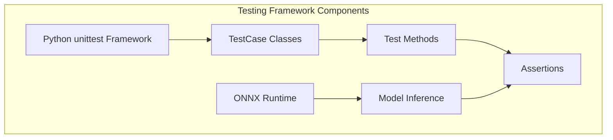
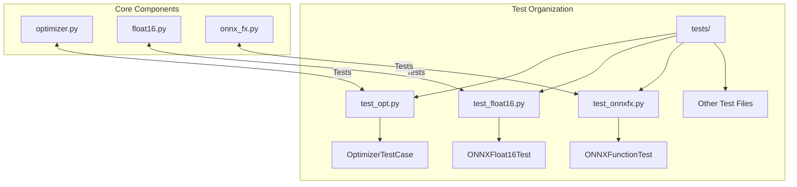
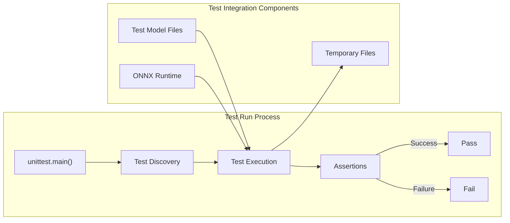
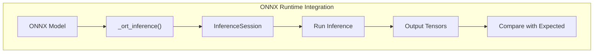
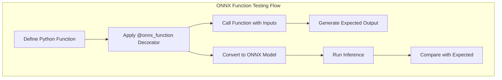
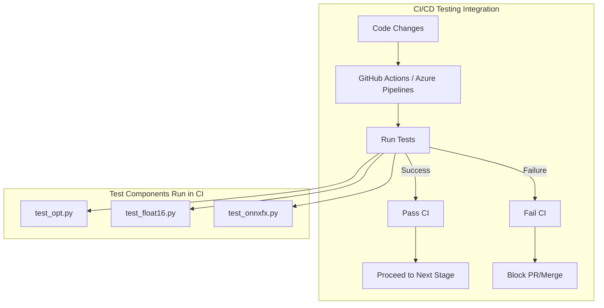

<!-- source: DeepWiki mcp.deepwiki.com · repo microsoft/onnxconverter-common · page 6.3 Testing Infrastructure · fetched 2026-10-26 -->

# Testing Infrastructure

<details>
<summary>Relevant source files</summary>

The following files were used as context for generating this wiki page:

- [tests/data/test_model_0_no_opt.onnx](tests/data/test_model_0_no_opt.onnx)
- [tests/data/test_model_1_no_opt.onnx](tests/data/test_model_1_no_opt.onnx)
- [tests/test_float16.py](tests/test_float16.py)
- [tests/test_onnxfx.py](tests/test_onnxfx.py)
- [tests/test_opt.py](tests/test_opt.py)

</details>


This document provides an overview of the testing approach and infrastructure used in the onnxconverter-common project. It details the testing framework, test organization, CI/CD integration, and common testing patterns used to ensure the reliability and correctness of the library.

## Testing Framework Overview

The onnxconverter-common library employs Python's built-in `unittest` framework for testing all components. The testing infrastructure verifies the correctness of each system component through functional tests that compare expected outputs with actual outputs.



Sources: [tests/test_opt.py:15-316](), [tests/test_float16.py:28-140](), [tests/test_onnxfx.py:22-84]()

## Test Organization

The tests are organized by functional area, with dedicated test files for each major component of the library. Each test file contains one or more test classes that inherit from `unittest.TestCase` and implement test methods for specific functionalities.



Sources: [tests/test_opt.py:15-316](), [tests/test_float16.py:28-140](), [tests/test_onnxfx.py:22-84]()

### Key Test Files

The following table outlines the main test files and the components they test:

| Test File | Component Tested | Description |
|-----------|-----------------|-------------|
| test_opt.py | Optimizer system | Tests graph optimization techniques including identity removal, transpose optimization, and model-level optimizations |
| test_float16.py | Float16 conversion | Tests conversion from float32 to float16, with options for keeping I/O types or full conversion |
| test_onnxfx.py | ONNX Function system | Tests the functionality for converting Python functions to ONNX graphs |

Sources: [tests/test_opt.py:1-316](), [tests/test_float16.py:1-146](), [tests/test_onnxfx.py:1-84]()

## Test Infrastructure Design

The testing infrastructure is designed to verify that each component of the library functions correctly both in isolation and as part of the entire system. The test runner executes test cases and reports failures.



Sources: [tests/test_opt.py:14-25](), [tests/test_float16.py:17-19](), [tests/test_onnxfx.py:11-18]()

## Test Data Management

The tests use a combination of in-memory generated test models and pre-defined model files stored in the repository. Test data files are stored in a `data` directory under the tests directory.

### Temporary Test Files

The optimizer tests create temporary ONNX model files for testing and cleanup after test execution. The `OptimizerTestCase` class manages this through its `get_temp_file` and `tearDown` methods.

```python
# From test_opt.py
def get_temp_file(name):
    if not os.path.exists(tmp_path):
        os.mkdir(tmp_path)
    return os.path.join(tmp_path, name)

def tearDown(self):
    for fl in glob.glob(os.path.join(tmp_path, '*.onnx')):
        os.remove(fl)
```

Sources: [tests/test_opt.py:16-24]()

## Integration with ONNX Runtime

A critical aspect of the testing infrastructure is the integration with ONNX Runtime for model inference. This allows the tests to verify that models converted or optimized by the library produce correct outputs when executed.



Sources: [tests/test_float16.py:17-19](), [tests/test_onnxfx.py:11-14]()

The `_ort_inference` function serves as a common utility across test files, allowing for consistent model execution:

```python
def _ort_inference(mdl, inputs):
    sess = _ort.InferenceSession(mdl.SerializeToString())
    return sess.run(None, inputs)
```

Sources: [tests/test_float16.py:17-19](), [tests/test_onnxfx.py:11-14]()

## Test Patterns

### Model Creation and Verification Pattern

Many tests follow this common pattern:
1. Create an ONNX model (either programmatically or load from file)
2. Apply a transformation (optimization, conversion, etc.)
3. Run inference on both original and transformed models
4. Compare outputs to ensure equivalence

For example, in the float16 conversion tests:

```python
# Original model inference
output_32 = _ort_inference(onnx_model32, {'modelInput': input_x})

# Convert to float16
onnx_model16 = convert_float_to_float16(onnx_model32, keep_io_types=True)

# Transformed model inference
output_16 = _ort_inference(onnx_model16, {'modelInput': input_x})

# Compare outputs
self.assertTrue(np.allclose(output_16, output_32, atol=1e-2))
```

Sources: [tests/test_float16.py:100-115]()

### Conditional Test Skipping

Tests that require specific versions of ONNX or ONNX Runtime use the `@unittest.skipIf` decorator to conditionally skip tests when requirements aren't met:

```python
@unittest.skipIf(pv.Version(onnx.__version__) <= pv.Version('1.8.0'), 
                "test for ONNX 1.8 and above")
@unittest.skipIf(get_maximum_opset_supported() < 9, 
                "tests designed for ONNX opset 9 and greater")
class ONNXFloat16Test(unittest.TestCase):
    # Test methods...
```

Sources: [tests/test_float16.py:26-28](), [tests/test_onnxfx.py:21-22]()

## Testing with ONNX Function System

The ONNX Function system (onnx_fx) is a key component that allows conversion of Python functions to ONNX graphs. Its testing has special considerations:



Sources: [tests/test_onnxfx.py:24-34](), [tests/test_float16.py:30-56]()

## CI/CD Integration

The testing infrastructure is integrated with the CI/CD pipelines to ensure all tests are run automatically on code changes. This integration helps maintain code quality and prevents regressions.



Sources: [tests/test_opt.py:1-316](), [tests/test_float16.py:1-146](), [tests/test_onnxfx.py:1-84]()

## Running Tests Locally

Tests can be run locally using the Python unittest framework. Individual test files can be executed directly as Python scripts, which will run all tests in that file, or the `unittest` module can be used to run specific tests or test classes.

Example of running a specific test file:

```bash
python -m tests.test_float16
```

Or running a specific test case:

```bash
python -m unittest tests.test_opt.OptimizerTestCase.test_optimizer
```

Sources: [tests/test_opt.py:316-317](), [tests/test_float16.py:143-146](), [tests/test_onnxfx.py:81-84]()

## Summary

The testing infrastructure of onnxconverter-common provides a robust framework for verifying the correctness of the library's components. It uses Python's unittest framework integrated with ONNX Runtime for model inference validation. Tests are organized by functional area and follow common patterns for model creation, transformation, and verification. The infrastructure integrates with CI/CD pipelines to ensure ongoing code quality.