# Page: Overview

# Overview

<details>
<summary>Relevant source files</summary>

The following files were used as context for generating this wiki page:

- [README.md](README.md)
- [onnxconverter_common/__init__.py](onnxconverter_common/__init__.py)
- [setup.py](setup.py)

</details>


## Purpose and Scope

The onnxconverter-common package is a comprehensive toolkit for converting and optimizing ONNX (Open Neural Network Exchange) models. It provides common functions and utilities used by various ONNX converters, enabling different converters to work together for handling models from mixed frameworks (such as a scikit-learn pipeline embedding a XGBoost model).

This page introduces the core components and architecture of onnxconverter-common. For detailed information about specific subsystems, refer to these dedicated pages:
- For optimization capabilities, see [ONNX Optimization System](#2)
- For precision conversion, see [Data Type Conversion](#3)
- For graph representation, see [Model Representation](#4)
- For utilities that help construct ONNX graphs, see [Graph Construction Utilities](#5)

Sources: [onnxconverter_common/__init__.py:6-10](), [README.md:5-6]()

## System Architecture Overview

The onnxconverter-common package consists of several key subsystems that collectively provide a robust framework for ONNX model conversion and optimization.

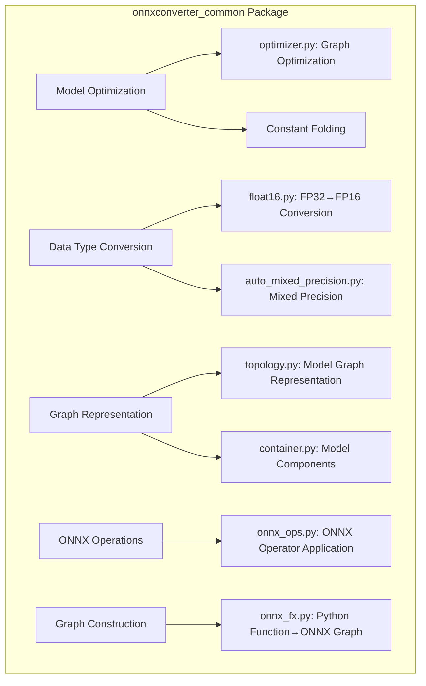

This diagram illustrates the main components of the package and how they relate to the core functionalities.

Sources: [onnxconverter_common/__init__.py:18-32]()

## Core Components and Functionality

### Model Optimization

The optimization subsystem provides techniques to improve model performance:

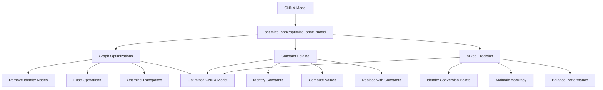

Sources: [onnxconverter_common/__init__.py:30]()

### Data Type Conversion

The package provides robust tools for converting between different precision formats:

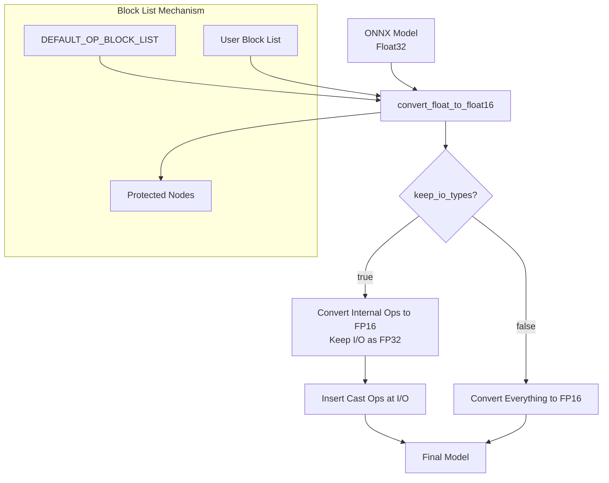

Sources: [onnxconverter_common/__init__.py:29]()

### Model Representation

The model representation components provide abstractions for working with ONNX computational graphs:

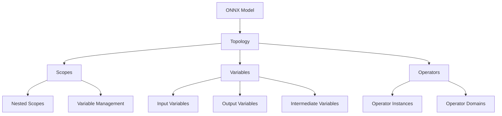

Sources: [onnxconverter_common/__init__.py:22]()

## Typical Data Flow

The following diagram illustrates the typical flow of data through the system:

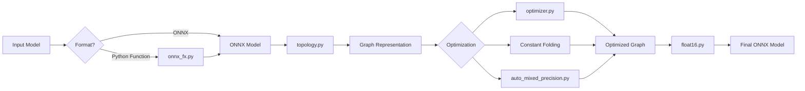

This diagram shows how models flow through the system - from input (either as ONNX models or Python functions) through graph representation, optimization, and potentially precision conversion to produce the final optimized ONNX model.

Sources: [onnxconverter_common/__init__.py:6-32]()

## Key Functions and Classes

The table below lists the key functions and classes exported by the package:

| Function/Class | Description | Module |
|----------------|-------------|--------|
| `optimize_onnx`, `optimize_onnx_graph`, `optimize_onnx_model` | Functions for optimizing ONNX models | optimizer |
| `convert_float_to_float16`, `convert_tensor_float_to_float16` | Functions for converting models to float16 precision | float16 |
| `auto_convert_mixed_precision` | Function for automatic mixed precision conversion | auto_mixed_precision |
| `Topology`, `Scope`, `Variable`, `Operator` | Classes for representing ONNX computational graphs | topology |
| Various ONNX operations | Functions for applying ONNX operators | onnx_ops |
| `Container` | Class for storing model components during conversion | container |

Sources: [onnxconverter_common/__init__.py:18-32]()

## Integration with the ONNX Ecosystem

onnxconverter-common is designed to serve as a foundation for various ONNX converters:

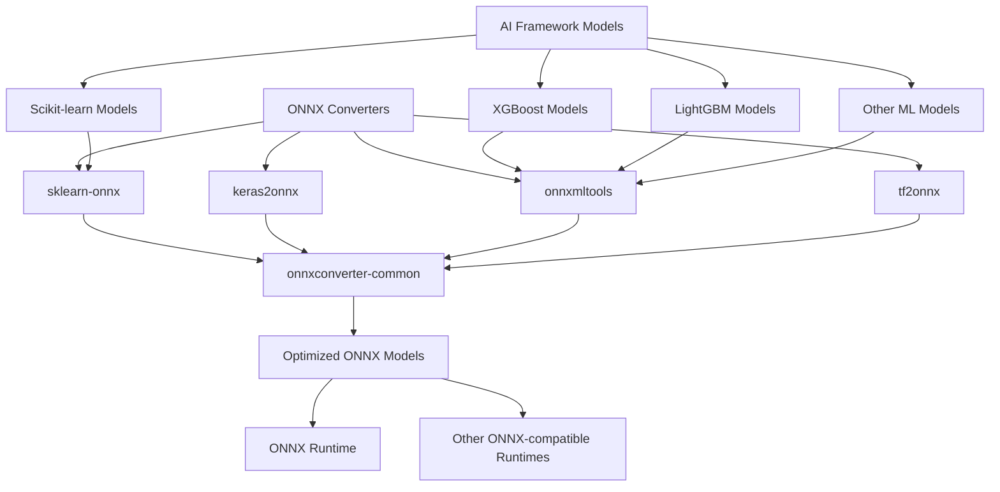

This diagram shows how onnxconverter-common fits into the broader ONNX ecosystem, providing a common foundation for various converters that transform models from different AI frameworks into optimized ONNX models ready for deployment.

Sources: [README.md:5-6]()

## Version and Compatibility Information

The current version of onnxconverter-common is 1.16.0, with the following details:

| Attribute | Value |
|-----------|-------|
| Version | 1.16.0 |
| Author | Microsoft |
| Producer | OnnxMLTools |
| Domain | onnxconverter-common |

The package is compatible with Python 3.5 and above.

Sources: [onnxconverter_common/__init__.py:11-16](), [setup.py:52-54]()

## Summary

The onnxconverter-common package provides essential tools and utilities for:

1. Optimizing ONNX models to improve performance
2. Converting between different precision formats
3. Representing and manipulating ONNX computational graphs
4. Constructing and modifying ONNX graphs

As a fundamental component in the ONNX ecosystem, it enables the efficient conversion and optimization of models from various AI frameworks to ONNX format.

Sources: [onnxconverter_common/__init__.py:6-10](), [README.md:5-6](), [setup.py:36]()

---

# Page: Installation and Requirements

# Installation and Requirements

<details>
<summary>Relevant source files</summary>

The following files were used as context for generating this wiki page:

- [README.md](README.md)
- [requirements.txt](requirements.txt)
- [setup.py](setup.py)

</details>


This document covers the installation process and system requirements for using the `onnxconverter-common` package. The `onnxconverter-common` library provides common utilities and functions for converting models from various AI frameworks to the ONNX format. For information about the overall package structure, see [Package Structure](#1.2).

## System Requirements

### Supported Operating Systems

The `onnxconverter-common` package is platform-independent and supports the following operating systems:

- Windows
- Linux
- macOS

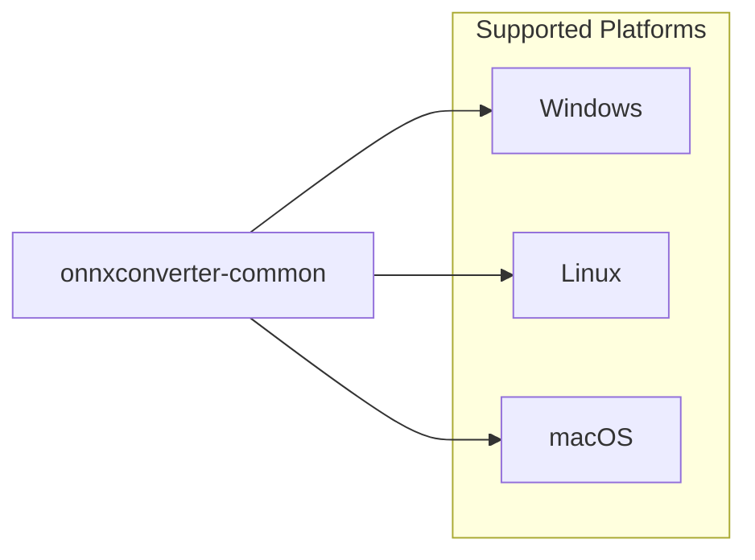

Sources: [setup.py:49-51]()

### Python Version Requirements

The package is compatible with Python versions:

- Python 3.5+
- Python 3.6+ (recommended)

Note that newer versions of ONNX may require more recent Python versions than those listed in the setup file.

Sources: [setup.py:53-54]()

### Dependencies

The `onnxconverter-common` package has minimal direct dependencies:

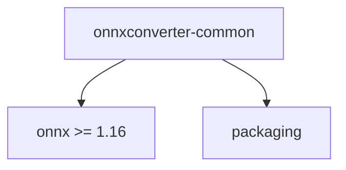

Sources: [requirements.txt:1-2]()

## Installation Methods

### Installation via pip

The recommended method for installing `onnxconverter-common` is using pip:

```bash
pip install onnxconverter-common
```

For a specific version:

```bash
pip install onnxconverter-common==1.0.0
```

### Installation from Source

For the latest development version or to contribute to the project, you can install from source:

```bash
git clone https://github.com/microsoft/onnxconverter-common.git
cd onnxconverter-common
pip install -e .
```

The `-e` flag installs the package in development mode, which allows you to modify the source code and have the changes immediately available.

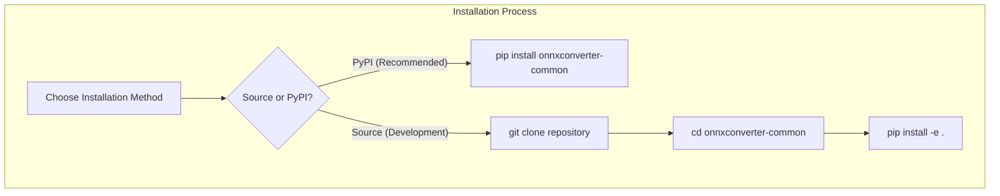

Sources: [setup.py:33-56]()

## Verifying Installation

You can verify the installation by importing the package in Python:

```python
import onnxconverter_common
print(onnxconverter_common.__version__)
```

## Integration with ONNX Ecosystem

The `onnxconverter-common` package functions as a foundational component in the ONNX model conversion ecosystem, providing shared utilities that other framework-specific converters can leverage.

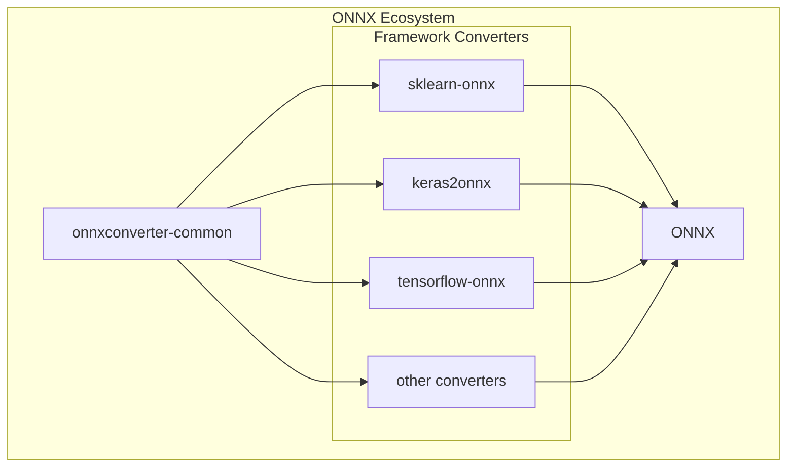

Sources: [README.md:5-6]()

## Installation Requirements Summary

The following table summarizes the key installation requirements for using `onnxconverter-common`:

| Requirement | Details |
|-------------|---------|
| Python Version | 3.5+ (3.6+ recommended) |
| Operating Systems | Windows, Linux, macOS |
| Direct Dependencies | onnx >= 1.16, packaging |
| Installation Methods | pip (recommended), source installation |

Sources: [requirements.txt:1-2](), [setup.py:49-54]()

## Troubleshooting Common Installation Issues

### ONNX Compatibility

If you encounter issues with ONNX compatibility, ensure you're using a version of ONNX that's compatible with your Python version. The requirement `onnx>=1.16` may necessitate a more recent Python version than what's listed in the setup.py file.

### Development Installation

When installing for development:

1. Ensure all dependencies are installed: `pip install -r requirements.txt`
2. Install in development mode: `pip install -e .`

This allows changes to the source code to be immediately reflected without reinstallation.

Sources: [requirements.txt:1-2](), [setup.py:14-16]()

---

# Page: Package Structure

# Package Structure

<details>
<summary>Relevant source files</summary>

The following files were used as context for generating this wiki page:

- [onnxconverter_common/__init__.py](onnxconverter_common/__init__.py)

</details>


This document describes the organization and structure of the `onnxconverter-common` package, explaining how the various modules are arranged and how they relate to each other. For information about installation, see [Installation and Requirements](#1.1).

## Package Overview

The `onnxconverter-common` package is designed to provide utilities and optimization functions for ONNX models. It serves as a common foundation for various ONNX converters, offering standardized components for model transformation, optimization, and type conversion.

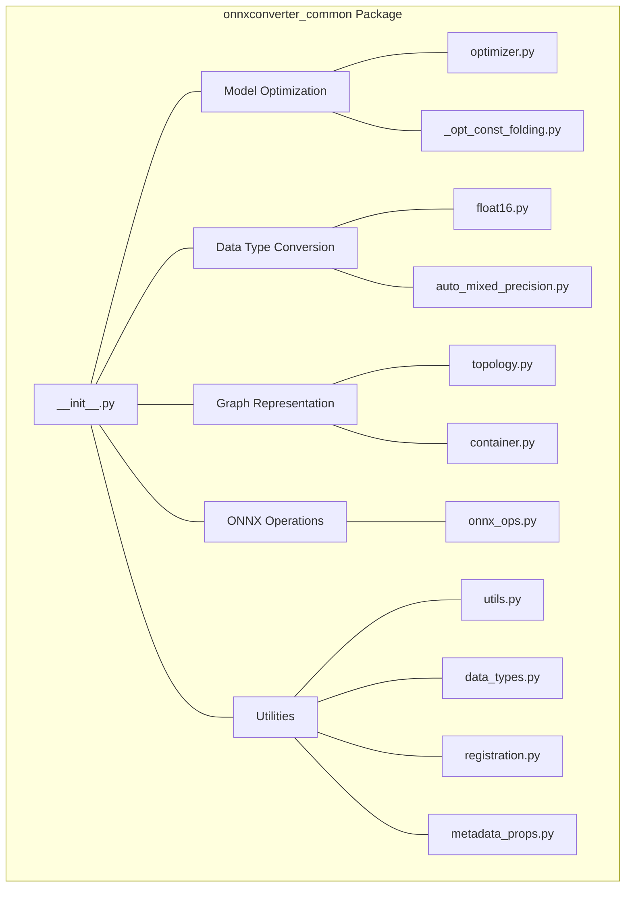

Sources: [onnxconverter_common/__init__.py:6-10](), [onnxconverter_common/__init__.py:18-32]()

## Module Organization

The package's functionality is distributed across several Python modules, each with a specific responsibility:

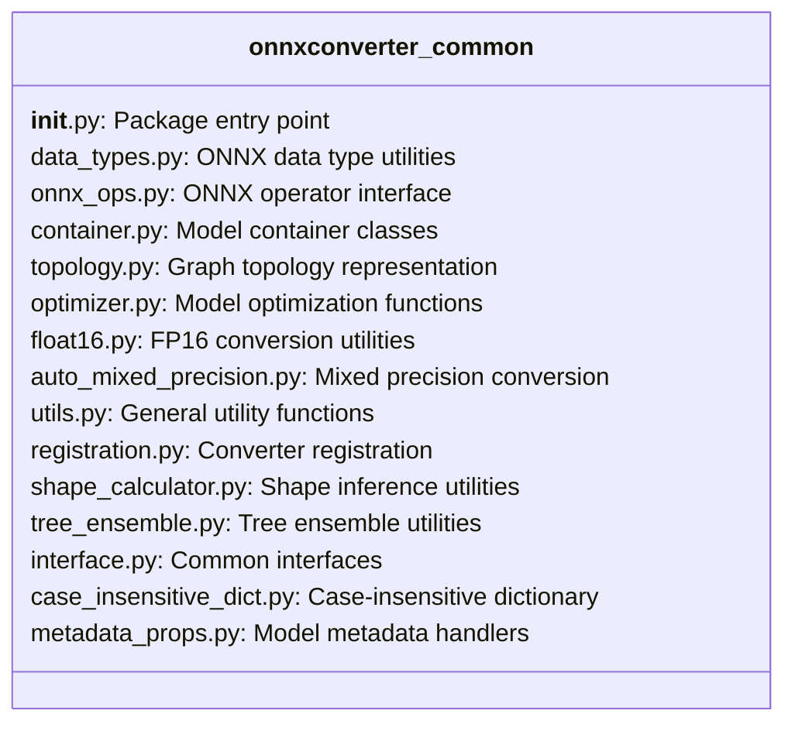

Sources: [onnxconverter_common/__init__.py:18-32]()

## Core Module Descriptions

| Module | Description |
|--------|-------------|
| `data_types.py` | Defines data type classes used for ONNX type representation and conversion |
| `onnx_ops.py` | Provides utilities for working with ONNX operators |
| `container.py` | Contains classes for model containment and management |
| `topology.py` | Provides classes for representing and manipulating computational graphs |
| `interface.py` | Defines interfaces used by the framework |
| `shape_calculator.py` | Utilities for calculating output shapes in ONNX models |
| `registration.py` | Handles registration of converter components and functions |
| `tree_ensemble.py` | Utilities for working with tree ensemble models |
| `utils.py` | General utility functions used throughout the package |
| `case_insensitive_dict.py` | Implements a case-insensitive dictionary class |

Sources: [onnxconverter_common/__init__.py:18-26]()

## Functional Module Groups

The package organizes its modules into several functional groups:

### 1. Model Optimization

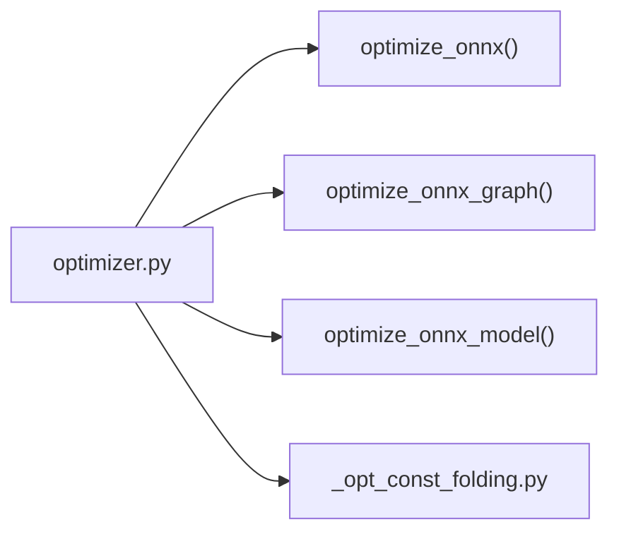

Sources: [onnxconverter_common/__init__.py:30]()

### 2. Data Type Conversion

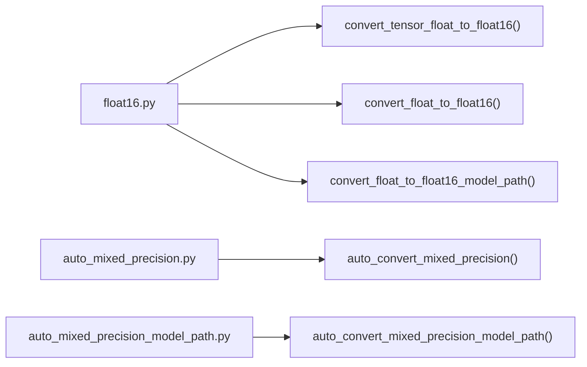

Sources: [onnxconverter_common/__init__.py:29-32]()

### 3. Graph Representation

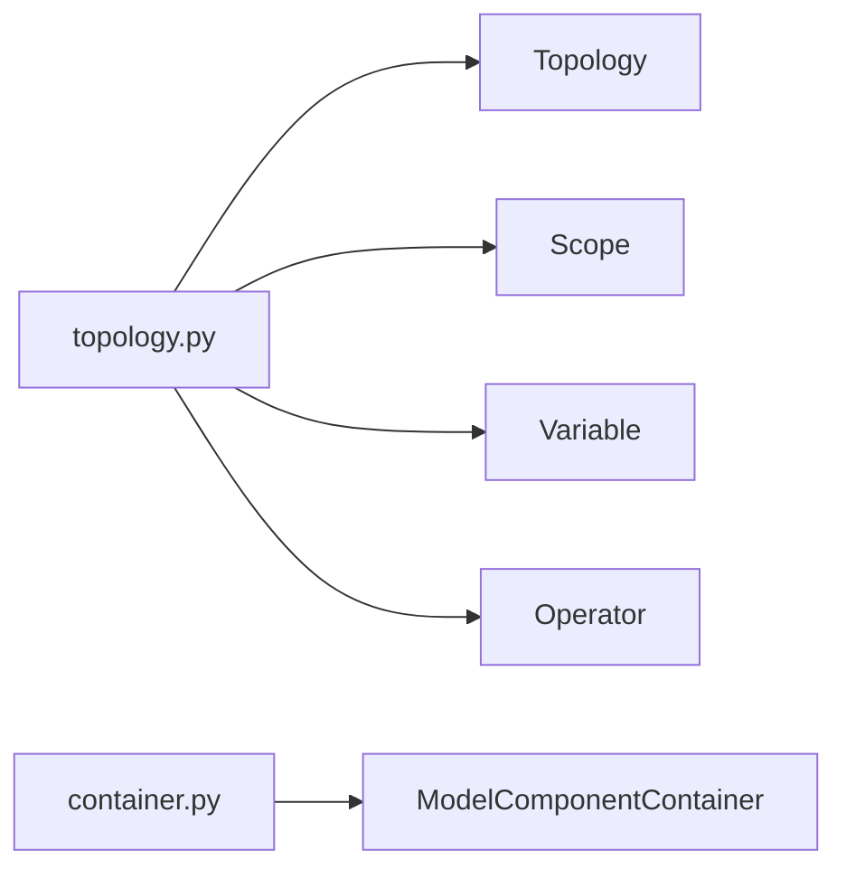

Sources: [onnxconverter_common/__init__.py:20-22]()

### 4. Metadata Handling

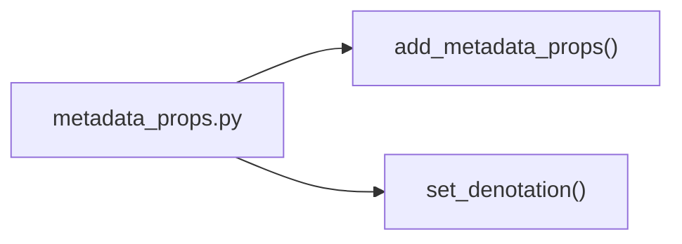

Sources: [onnxconverter_common/__init__.py:28]()

## Package Exports and Entry Point

The `__init__.py` file serves as the entry point to the package and performs two key functions:

1. Defines package metadata:
   - `__version__`: "1.16.0"
   - `__author__`: "Microsoft"
   - `__producer__`: "OnnxMLTools"
   - `__domain__`: "onnxconverter-common"

2. Imports and exposes key functionality from the various modules to make them accessible at the package level.

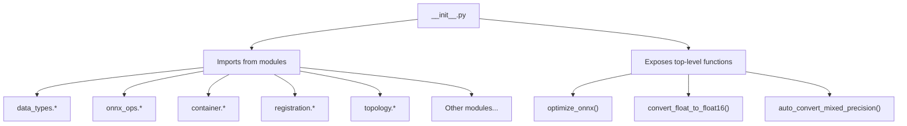

Sources: [onnxconverter_common/__init__.py:11-32]()

This import structure allows users to import directly from `onnxconverter_common` without needing to reference the specific modules, simplifying usage patterns.

## Module Dependencies

The modules within the package have inter-dependencies that form the foundation of the package's architecture:

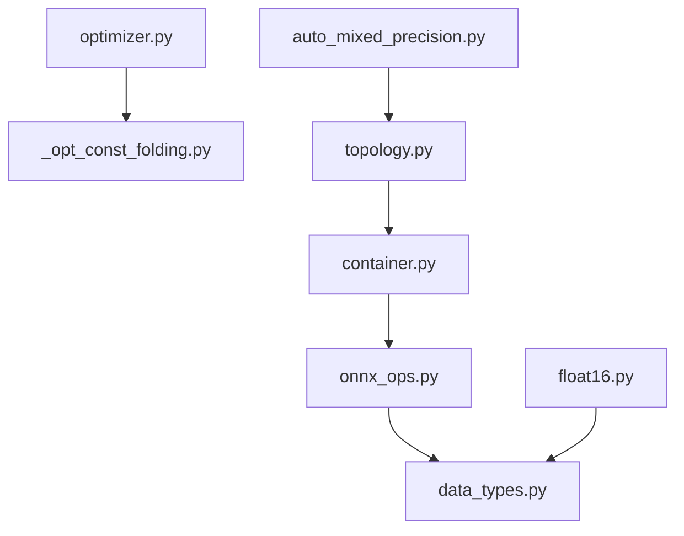

Sources: [onnxconverter_common/__init__.py:18-32]()

## Usage Patterns

The package structure facilitates two common usage patterns:

### 1. Direct Function Import

```python
from onnxconverter_common import optimize_onnx, convert_float_to_float16
```

### 2. Module Import

```python
import onnxconverter_common as occ
occ.optimize_onnx(model)
```

The module organization is designed to support both patterns while maintaining a clean separation of concerns between different components.

## Summary

The `onnxconverter-common` package structure is organized into functional modules that collectively provide:

1. ONNX model optimization capabilities
2. Data type conversion utilities (float16, mixed precision)
3. Graph representation and manipulation tools
4. ONNX operation utilities and abstractions
5. Common utilities for ONNX converters

This modular design allows for easy extension and maintenance while providing a comprehensive toolkit for working with ONNX models.

---

# Page: ONNX Optimization System

# ONNX Optimization System

<details>
<summary>Relevant source files</summary>

The following files were used as context for generating this wiki page:

- [onnxconverter_common/_opt_const_folding.py](onnxconverter_common/_opt_const_folding.py)
- [onnxconverter_common/optimizer.py](onnxconverter_common/optimizer.py)

</details>


This document provides a technical overview of the optimization system in `onnxconverter-common`, which is designed to improve the efficiency of ONNX models. The optimization system applies a series of transformations to ONNX computational graphs to reduce computational complexity, eliminate redundant operations, and improve inference performance.

For information about type conversion systems like Float16 conversion, see [Data Type Conversion](#3). For details about the graph representation used by these optimizations, see [Model Representation](#4).

## Core Architecture

The ONNX optimization system consists of multiple components that work together to transform ONNX models into more efficient forms while preserving their functionality.

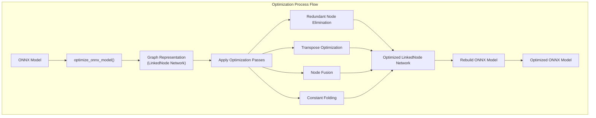

Sources: [onnxconverter_common/optimizer.py:1789-1912]()

## Graph Representation for Optimization

The optimization system uses a specialized graph representation based on `LinkedNode` objects to facilitate the analysis and transformation of the computational graph.

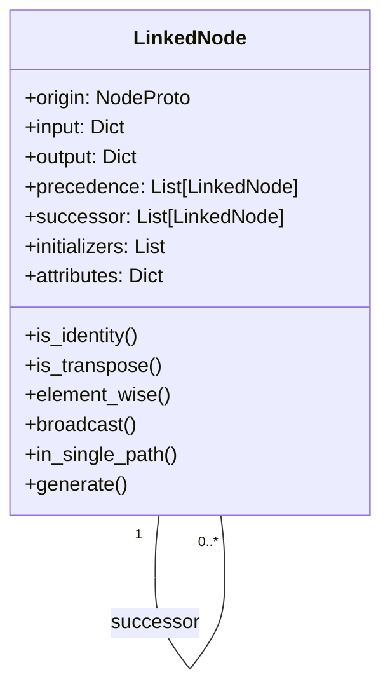

The `LinkedNode` class provides methods to:
- Navigate the graph structure (through `precedence` and `successor` relationships)
- Identify node types and patterns for optimization
- Transform the graph by modifying connections between nodes
- Generate updated ONNX nodes

Sources: [onnxconverter_common/optimizer.py:13-362]()

## Optimization Techniques

The system implements multiple optimization techniques, each focusing on specific patterns in the computational graph.

### Solution Framework

All optimization techniques extend the `Solution` base class, which provides a framework for applying transformations to the graph.

```mermaid
classDiagram
    class Solution {
        +begin: LinkedNode
        +begin_n: LinkedNode
        +end_p: LinkedNode
        +end: LinkedNode
        +apply(node_list)
        +delete_node_nto1()
        +delete_node_1ton()
        +add_siso_node()
    }
    
    Solution <|-- MergeSolution
    Solution <|-- MoveForwardSolution
    Solution <|-- FanOutSolution
    Solution <|-- TransposeFanOutSolution
    Solution <|-- FanInSolution
    Solution <|-- MergePadConvSolution
    Solution <|-- NextToOutputSolution
    Solution <|-- ConvBatchNormSolution
    Solution <|-- PushTransposeSolution
    Solution <|-- SwapOpSolution
```

Sources: [onnxconverter_common/optimizer.py:364-480]()

### Optimizer Classes

Each optimizer class is responsible for identifying specific optimization opportunities in the graph.

| Optimizer Class | Purpose |
|-----------------|---------|
| RedundantOptimizer | Eliminates identity nodes and other redundant operations |
| TransposeOptimizer | Optimizes or eliminates transpose operations |
| MergePadConvOptimizer | Fuses padding operations with convolutions |
| ConvBatchNormOptimizer | Fuses batch normalization into convolution weights and biases |
| MergeReshapeOptimizer | Optimizes chains of reshape operations |
| MergeCastOptimizer | Optimizes chains of type cast operations |
| MergeSqueezeUnsqueezeOptimizer | Eliminates unnecessary dimension changes |
| SwapOpOptimizer | Reorders operations to enable further optimizations |
| MergeCommonSequenceOptimizer | Identifies and merges duplicated computation sequences |
| MatmulOptimizer | Optimizes matrix multiplication operations |

Sources: [onnxconverter_common/optimizer.py:797-1702]()

## Transpose Optimization

The system places special emphasis on optimizing transpose operations, which are often introduced during model conversion but can be expensive at runtime.

```mermaid
flowchart TD
    subgraph "Transpose Optimization Strategies"
        A["ONNX Model with\nTranspose Operations"] 
        
        A --> B1["Eliminate\nRedundant Transposes"]
        A --> B2["Merge\nConsecutive Transposes"]
        A --> B3["Push Transposes\nThrough Element-wise Ops"]
        A --> B4["Convert Transpose+Op\npatterns to Optimized Form"]
        
        B1 --> C["Optimized Model\nWith Fewer Transposes"]
        B2 --> C
        B3 --> C
        B4 --> C
    end
```

Key transpose optimization strategies:
- Eliminating redundant transposes ([0,1,2,3] which do nothing)
- Merging consecutive transposes into a single operation
- Moving transposes forward or backward through operations that are transpose-invariant
- Recognizing common patterns involving transposes and replacing them with optimized versions

Sources: [onnxconverter_common/optimizer.py:1344-1471](), [onnxconverter_common/optimizer.py:1243-1341]()

## Constant Folding

Constant folding is a crucial optimization that pre-computes parts of the graph that depend only on constant inputs.

```mermaid
flowchart TD
    subgraph "Constant Folding Process"
        A["ONNX Graph"] --> B["Create OnnxGraphContext"]
        B --> C["Deep-First Search\nto Calculate Constants"]
        C --> D["Replace Computed Subgraphs\nwith Constant Values"]
        D --> E["Remove Unused Nodes"]
        E --> F["Optimized Graph\nwith Pre-computed Constants"]
    end
```

The system implements constant folding using the `OnnxGraphContext` class, which:
1. Identifies nodes with constant inputs
2. Executes these nodes at optimization time 
3. Replaces the subgraphs with pre-computed constant values
4. Prunes the computational graph of unused nodes

Sources: [onnxconverter_common/_opt_const_folding.py:10-297]()

## Node Fusion

The optimizer can identify and fuse common combinations of operations for better performance.

```mermaid
flowchart LR
    subgraph "Example: Conv + BatchNorm Fusion"
        A["Conv\n(with weights W)"] --> B["BatchNorm\n(with scale S, bias B)"]
        
        C["Fused Conv\n(adjusted weights W', bias B')"] 
        
        A -- "Fusion" --> C
        B -- "Fusion" --> C
        
        D["W' = W * adjusted_scale"] 
        E["B' = (original_bias - mean) * adjusted_scale + bias"]
    end
```

Common fusion patterns include:
- Conv + BatchNorm → Modified Conv
- Pad + Conv → Conv with padding parameters
- Squeeze + Unsqueeze with matching axes → No operation
- Consecutive Reshape operations → Single Reshape

Sources: [onnxconverter_common/optimizer.py:747-794](), [onnxconverter_common/optimizer.py:818-833]()

## Optimization Process

The overall optimization process follows a systematic approach to ensure that all applicable optimizations are applied efficiently.

```mermaid
flowchart TD
    subgraph "Optimization Algorithm"
        A["Input: ONNX Model"] --> B["Convert to LinkedNode Graph"]
        B --> C["Initialize Optimizers"]
        C --> D["Start Optimization Loop"]
        
        D --> E{"Find Optimization\nOpportunity?"}
        E -->|"Yes"| F["Apply Solution"]
        F --> G{"Solution Applied\nSuccessfully?"}
        G -->|"Yes"| D
        G -->|"No"| E
        
        E -->|"No"| H{"All Optimizers\nTried?"}
        H -->|"No"| I["Try Next Optimizer"]
        I --> E
        
        H -->|"Yes"| J{"Any Solutions\nApplied?"}
        J -->|"Yes"| D
        J -->|"No"| K["Finalize: Convert Back to ONNX"]
        
        K --> L["Output: Optimized ONNX Model"]
    end
```

The optimization process:
1. Converts the ONNX model to a LinkedNode graph representation
2. Iteratively applies optimizers to find and apply transformations
3. Continues until no more optimizations can be applied
4. Rebuilds the optimized ONNX model from the transformed graph

Sources: [onnxconverter_common/optimizer.py:1705-1740]()

## API Reference

The optimization system exposes three main functions for users:

| Function | Purpose | Key Parameters |
|----------|---------|----------------|
| `optimize_onnx` | Optimizes a list of ONNX nodes | `onnx_nodes`, `nchw_inputs`, `inputs`, `outputs`, `target_opset` |
| `optimize_onnx_graph` | Optimizes an ONNX graph | `onnx_nodes`, `nchw_inputs`, `inputs`, `outputs`, `initializers`, `stop_initializers`, `model_value_info`, `model_name`, `target_opset` |
| `optimize_onnx_model` | Optimizes a complete ONNX model | `origin_model`, `nchw_inputs`, `stop_initializers` |

Sources: [onnxconverter_common/optimizer.py:1794-1912]()

### Usage Example

```python
import onnx
from onnxconverter_common import optimize_onnx_model

# Load ONNX model
model = onnx.load("model.onnx")

# Optional: List input tensors that are in NCHW format
nchw_inputs = ["input_0"]

# Optimize the model
optimized_model = optimize_onnx_model(model, nchw_inputs=nchw_inputs)

# Save the optimized model
onnx.save(optimized_model, "optimized_model.onnx")
```

## Opset Compatibility

Some optimizations are only available for specific ONNX opset versions. For example, ConvBatchNormOptimizer is only applied for opset >= 9.

```python
# In _process_optimization function:
if target_opset is not None and target_opset >= 9:
    optimizers.append(ConvBatchNormOptimizer)
```

The system also handles version-specific implementations of operations, such as Squeeze and Unsqueeze which have different signatures in opset 13+.

Sources: [onnxconverter_common/optimizer.py:1706-1710]()

## Limitations and Considerations

- Some optimizations may not preserve the exact numeric precision of the original model
- Not all operations are supported for constant folding
- Optimizations are applied based on pattern matching, so novel patterns may not be optimized
- Some operations have specialized handling to maintain semantics across ONNX versions
- Reserved nodes (e.g., outputs or nodes used in sub-graphs) are protected from certain optimizations

Sources: [onnxconverter_common/optimizer.py:1878-1885](), [onnxconverter_common/_opt_const_folding.py:193-203]()

---

# Page: Graph Optimization

# Graph Optimization

<details>
<summary>Relevant source files</summary>

The following files were used as context for generating this wiki page:

- [onnxconverter_common/optimizer.py](onnxconverter_common/optimizer.py)
- [tests/data/test_model_0_no_opt.onnx](tests/data/test_model_0_no_opt.onnx)
- [tests/data/test_model_1_no_opt.onnx](tests/data/test_model_1_no_opt.onnx)
- [tests/test_opt.py](tests/test_opt.py)

</details>


## Purpose and Scope

This document details the graph optimization techniques implemented in the onnxconverter-common library. Graph optimization is a crucial step in the ONNX conversion process that improves model performance by reducing computational complexity and removing redundant operations.

The system focuses on optimizing ONNX graphs by:
- Removing redundant operations (like identity nodes)
- Merging compatible operations (such as consecutive transposes)
- Rearranging operations to reduce the computational overhead
- Performing structure-aware transformations

For constant folding optimizations, see [Constant Folding](#2.2), and for de-cast optimizations, see [De-Cast Optimization](#2.3).

## Graph Representation

Before diving into optimization techniques, it's important to understand how ONNX graphs are represented within the system.

### LinkedNode Representation

The system uses the `LinkedNode` class to represent ONNX computation nodes with their connections in a graph structure.

```mermaid
classDiagram
    class LinkedNode {
        +origin: NodeProto
        +input: dict
        +output: dict
        +tensors: list
        +initializers: list
        +precedence: list
        +successor: list
        +attributes: dict
        +unique_name: string
        +target_opset: int
        +is_identity()
        +is_transpose()
        +in_single_path()
        +element_wise()
        +broadcast()
    }
```

Sources: [onnxconverter_common/optimizer.py:13-165]()

Each `LinkedNode` maintains:
- References to predecessor and successor nodes
- Input and output tensor mappings
- Original ONNX NodeProto object
- Helper properties to determine node characteristics (e.g., is_identity, is_transpose)

### Graph Building

The system constructs a linked graph from an ONNX model using the `build_from_onnx` static method:

```mermaid
flowchart TD
    A["ONNX Nodes"] --> B["LinkedNode.build_from_onnx()"]
    B --> C["Create LinkedNode for each ONNX node"]
    C --> D["Connect predecessors/successors"]
    D --> E["Add special nodes for inputs/outputs"]
    E --> F["Complete linked graph"]
```

Sources: [onnxconverter_common/optimizer.py:284-336]()

## Optimization Solutions

The optimization system is built around the concept of "solutions" - classes that identify and transform specific patterns in the graph.

### Solution Base Class

The `Solution` class provides the foundation for all optimization techniques:

```mermaid
classDiagram
    class Solution {
        +begin: LinkedNode
        +begin_n: LinkedNode
        +end_p: LinkedNode
        +end: LinkedNode
        +apply(node_list)
        +delete_node_nto1()
        +delete_node_1ton()
        +add_siso_node()
    }
```

Sources: [onnxconverter_common/optimizer.py:364-480]()

The solution classes follow a pattern of:
1. Finding a sequence of nodes matching a specific pattern
2. Transforming this sequence to optimize the graph
3. Updating connections to maintain computational equivalence

### Key Solution Types

Several specialized solution classes handle different optimization scenarios:

```mermaid
flowchart LR
    A["Solution Base Class"] --> B["MergeSolution"]
    A --> C["MoveForwardSolution"]
    A --> D["FanOutSolution"]
    A --> E["FanInSolution"]
    A --> F["TransposeFanOutSolution"]
    A --> G["NextToOutputSolution"]
    A --> H["Specialized Solutions"]
    
    H --> H1["MergePadConvSolution"]
    H --> H2["MergePadTransposeConvSolution"]
    H --> H3["ConvBatchNormSolution"]
    H --> H4["MergeReshapeTransposeSolution"]
```

Sources: [onnxconverter_common/optimizer.py:493-793]()

## Transpose Optimization

A key focus of the optimization system is optimizing transpose operations, which can significantly impact model performance.

### Transpose Pattern Recognition

The system identifies several transpose patterns that can be optimized:

```mermaid
flowchart TD
    subgraph "Pattern: Consecutive Transposes"
        A1["Transpose [0,2,3,1]"] --> B1["Transpose [0,3,1,2]"]
        B1 --> C1["Optimized: Single Transpose or Identity"]
    end
    
    subgraph "Pattern: Transpose + Element-wise"
        A2["Transpose"] --> B2["Element-wise Op"]
        B2 --> C2["Transpose"]
        C2 --> D2["Optimized: Element-wise + Single Transpose"]
    end
    
    subgraph "Pattern: Fan-out Transpose"
        A3["Transpose"] --> B3["Op 1"]
        A3 --> C3["Op 2"] 
        A3 --> D3["Op 3"]
        B3 --> E3["Optimized: Move Transpose after branching"]
    end
```

Sources: [onnxconverter_common/optimizer.py:493-565](), [onnxconverter_common/optimizer.py:1000-1026]()

### Transpose Optimizations

The system applies several types of transpose optimizations:

1. **Merging consecutive transposes**: When two transpose operations can be combined or eliminated
2. **Moving transposes**: Repositioning transpose operations to optimize the overall graph
3. **Handling fan-in/fan-out situations**: Special handling for cases with multiple inputs or outputs

Sources: [onnxconverter_common/optimizer.py:534-631]()

## Operation Fusion

The system can fuse multiple operations into more efficient equivalents.

### Pad + Convolution Fusion

```mermaid
flowchart LR
    A["Input"] --> B["Pad"]
    B --> C["Conv"]
    C --> D["Output"]
    
    E["Input"] --> F["Conv with adjusted pads attribute"]
    F --> G["Output"]
    
    A -.-> |"Optimized to"| E
```

Sources: [onnxconverter_common/optimizer.py:658-720]()

### Convolution + BatchNorm Fusion

```mermaid
flowchart LR
    A["Input"] --> B["Conv"]
    B --> C["BatchNormalization"]
    C --> D["Output"]
    
    E["Input"] --> F["Conv with adjusted weights/bias"]
    F --> G["Output"]
    
    A -.-> |"Optimized to"| E
```

Sources: [onnxconverter_common/optimizer.py:747-793]()

## Optimizer Classes

The system includes several optimizer classes that identify optimization opportunities:

```mermaid
classDiagram
    class RedundantOptimizer {
        +find(node)
    }
    class MergePadConvOptimizer {
        +find(node)
    }
    class MergePadTransposeConvOptimizer {
        +find(node)
    }
    class ConvBatchNormOptimizer {
        +find(node)
    }
    class MergeReshapeOptimizer {
        +find(node)
    }
    class MergeCastOptimizer {
        +find(node)
    }
    class MergeSqueezeUnsqueezeOptimizer {
        +find(node)
    }
```

Each optimizer:
1. Evaluates if a node matches a specific optimization pattern
2. Returns an appropriate solution if applicable
3. Otherwise, returns None to indicate no optimization is possible

Sources: [onnxconverter_common/optimizer.py:797-996]()

## Optimization Process

The complete optimization process combines all these techniques:

```mermaid
flowchart TD
    A["ONNX Model/Nodes"] --> B["Build Linked Graph"]
    B --> C["Apply Optimizers"]
    C --> D["Find Optimization Patterns"]
    D --> E["Apply Solutions"]
    E --> F["Generate Optimized Nodes"]
    F --> G["Return Optimized Model/Nodes"]
    
    subgraph "Optimization Loop"
        C --> D
        D --> E
        E --> C
    end
```

## Public API

The package exposes two main functions for graph optimization:

1. **optimize_onnx**: Optimizes a list of ONNX nodes
   ```python
   from onnxconverter_common.optimizer import optimize_onnx
   
   # Takes nodes, inputs, and outputs and returns optimized nodes
   optimized_nodes = optimize_onnx(nodes, inputs, outputs)
   ```

2. **optimize_onnx_model**: Optimizes a complete ONNX model
   ```python
   from onnxconverter_common.optimizer import optimize_onnx_model
   
   # Takes an ONNX model and returns an optimized model
   optimized_model = optimize_onnx_model(model)
   ```

Sources: [tests/test_opt.py:9](), [tests/test_opt.py:50-55](), [tests/test_opt.py:257-258]()

## Optimization Strategies and Their Applications

The following table summarizes key optimization strategies and when they are applied:

| Strategy | Pattern | Benefit |
|----------|---------|---------|
| Remove Redundant Nodes | Identity nodes, no-op transposes | Reduces model size and execution time |
| Merge Consecutive Transposes | Transpose → Transpose | Eliminates unnecessary data movement |
| Move Transposes Past Element-wise | Transpose → Element-wise → Transpose | Reduces number of transpose operations |
| Fuse Pad + Conv | Pad → Conv | Improves memory locality and reduces operations |
| Fuse Conv + BatchNorm | Conv → BatchNorm | Eliminates a full tensor pass at runtime |
| Merge Reshape + Transpose | Reshape → Transpose | Reduces memory allocation and data movement |
| Optimize Fan-in/Fan-out | Multiple paths with transposes | Reduces total transpose operations |
| Merge Cast Operations | Cast → Cast | Eliminates unnecessary type conversions |

Sources: [onnxconverter_common/optimizer.py:797-996]()

## Conclusion

The Graph Optimization system in onnxconverter-common provides comprehensive capabilities for optimizing ONNX computational graphs. By identifying and transforming common patterns, it can significantly improve model performance without changing the mathematical behavior of the model.

The system is particularly effective at optimizing transpose operations, which are often a performance bottleneck in neural network execution. Additionally, its ability to fuse operations like convolution and batch normalization can lead to substantial improvements in both memory usage and execution time.

---

# Page: Constant Folding

# Constant Folding

<details>
<summary>Relevant source files</summary>

The following files were used as context for generating this wiki page:

- [onnxconverter_common/_opt_const_folding.py](onnxconverter_common/_opt_const_folding.py)

</details>


## Purpose and Scope

Constant folding is an optimization technique that improves the performance of ONNX models by identifying operations with constant inputs and pre-computing their results at conversion time rather than execution time. This document details the constant folding implementation in the onnxconverter-common package, explaining its architecture, workflow, and supported operations. For information about other optimization techniques like general graph optimization, see [Graph Optimization](#2.1).

## Overview

Constant folding identifies subgraphs where all inputs are constants, evaluates these subgraphs during the conversion process, and replaces them with equivalent constant nodes containing the pre-computed values. This optimization reduces model complexity, decreases inference time, and can lower memory usage.

```mermaid
flowchart TD
    A["ONNX Model with Constants"] --> B["Identify Constant Expressions"]
    B --> C["Pre-compute Values"]
    C --> D["Replace with Constant Nodes"]
    D --> E["Optimized ONNX Model"]
    
    style A stroke-width:2px
    style E stroke-width:2px
```

Sources: [onnxconverter_common/_opt_const_folding.py:266-298]()

## System Architecture

The constant folding system consists of several components working together to analyze and transform ONNX graphs.

```mermaid
classDiagram
    class OnnxGraphContext {
        +initializers: dict
        +tensor_to_node: dict
        +variables: dict
        +add_value_of_node()
        +get_attribute()
        +get_attr_graph()
        +calculate()
        +_OnAdd(), _OnCast(), etc.
    }
    
    class ConstFoldingOptimizer {
        +const_folding_optimizer()
    }
    
    class HelperFunctions {
        +_fix_unamed_node()
        +reserve_node_for_embedded_graph()
        +_dfs_calc()
        +_remove_unused_initializers()
    }
    
    ConstFoldingOptimizer --> OnnxGraphContext: uses
    ConstFoldingOptimizer --> HelperFunctions: uses
```

Sources: [onnxconverter_common/_opt_const_folding.py:10-171](), [onnxconverter_common/_opt_const_folding.py:173-190](), [onnxconverter_common/_opt_const_folding.py:193-262]()

### OnnxGraphContext

The `OnnxGraphContext` class is central to the constant folding system. It encapsulates the state of an ONNX graph and provides methods to:

1. Track initializers (constants defined in the model)
2. Map tensors to their producing nodes
3. Store computed variable values
4. Calculate outputs for supported operations

This class contains specialized methods (prefixed with `_On`) that implement the computation logic for different ONNX operations when all inputs are known at conversion time.

Sources: [onnxconverter_common/_opt_const_folding.py:10-171]()

### Supported Operations

The constant folding system can evaluate the following ONNX operations when their inputs are constants:

| Operation  | Method             | Description                                  |
|------------|-------------------|----------------------------------------------|
| Identity   | `_OnIdentity`     | Passes input unchanged to output             |
| Constant   | `_OnConstant`     | Extracts value from node attributes          |
| Add        | `_OnAdd`          | Performs element-wise addition               |
| Cast       | `_OnCast`         | Converts tensor to specified data type       |
| Gather     | `_OnGather`       | Gathers values along specified axis          |
| Greater    | `_OnGreater`      | Compares values (a > b)                      |
| Less       | `_OnLess`         | Compares values (a < b)                      |
| Mul        | `_OnMul`          | Performs element-wise multiplication         |
| Not        | `_OnNot`          | Performs logical NOT operation               |
| Transpose  | `_OnTranspose`    | Transposes input tensor                      |
| Range      | `_OnRange`        | Creates a sequence of numbers                |
| Slice      | `_OnSlice`        | Extracts a slice from input tensor           |
| Div        | `_OnDiv`          | Performs element-wise division               |
| Pow        | `_OnPow`          | Computes element-wise power                  |
| Sqrt       | `_OnSqrt`         | Computes square root                         |
| Sub        | `_OnSubtract`     | Performs element-wise subtraction            |
| Unsqueeze  | `_OnUnsqueeze`    | Inserts dimensions of size 1                 |
| Reshape    | `_OnReshape`      | Reshapes input tensor to new shape           |

Sources: [onnxconverter_common/_opt_const_folding.py:67-170]()

## Constant Folding Process

The constant folding process follows a systematic workflow to identify and process constant expressions.

```mermaid
flowchart TD
    A["Input: ONNX Graph"] --> B["Create OnnxGraphContext"]
    B --> C["Reserve nodes for embedded graphs"]
    C --> D["Perform DFS to find constant nodes"]
    D --> E["Compute values for constant nodes"]
    E --> F["Add computed values as initializers"]
    F --> G["Remove nodes replaced by constants"]
    G --> H["Sort remaining nodes"]
    H --> I["Remove unused initializers"]
    I --> J["Process embedded subgraphs"]
    J --> K["Output: Optimized ONNX Graph"]
    
    style A stroke-width:2px
    style K stroke-width:2px
```

Sources: [onnxconverter_common/_opt_const_folding.py:266-298]()

### Main Entry Point

The `const_folding_optimizer` function is the main entry point for the constant folding optimization. It takes an ONNX graph as input and returns an optimized version.

```python
def const_folding_optimizer(graph, outer_graph=None):
    # Process graph nodes
    # Optimize embedded subgraphs recursively
    # Return optimized graph
```

Sources: [onnxconverter_common/_opt_const_folding.py:266-298]()

### Node Traversal and Value Computation

The system uses a depth-first search approach to identify nodes that can be pre-computed:

1. Starting from the output nodes, traverse the graph backwards
2. For each node, determine if all its inputs are constant
3. If all inputs are constant, compute the result using the appropriate handler
4. Store the computed value in the graph context
5. Replace the node with a constant initializer

```mermaid
flowchart TD
    A["Start DFS from output node"] --> B{"All inputs\nconstant?"}
    B -->|"Yes"| C["Compute node output"]
    B -->|"No"| D["Process input nodes recursively"]
    D --> B
    C --> E["Store result as variable"]
    E --> F["Convert to initializer"]
    F --> G["Remove original node"]
    
    H["Node status\ntracking dictionary"] -.-> B
    E -.-> H
```

Sources: [onnxconverter_common/_opt_const_folding.py:206-242]()

### Calculation Process

When a node is identified as computable, the `calculate` method in `OnnxGraphContext` is called:

1. Find the appropriate calculation function based on the operation type
2. Extract input values from initializers or previously computed variables
3. Compute the result
4. Store the result in the variables dictionary

```python
def calculate(self, node):
    func_name = '_On' + node.op_type
    func = type(self).__dict__.get(func_name, None)
    if func is None:
        return None

    inputs = []
    for ts_ in node.input:
        if ts_ in self.initializers:
            inputs.append(numpy_helper.to_array(self.initializers[ts_]))
        elif ts_ in self.variables:
            inputs.append(self.variables[ts_])
        else:
            return None

    output_values = func(self, node, inputs)
    for idx_, ots_ in enumerate(node.output):
        self.add_value_of_node(ots_, output_values[idx_])

    return output_values
```

Sources: [onnxconverter_common/_opt_const_folding.py:46-65]()

### Handling Embedded Subgraphs

ONNX models can contain control flow operators like `If`, `Loop`, and `Scan` that have embedded subgraphs. The constant folding system handles these special cases by:

1. Identifying nodes with embedded subgraphs
2. Recursively optimizing each subgraph
3. Updating the parent node with the optimized subgraphs

```mermaid
flowchart TD
    A["const_folding_optimizer"] --> B["Process main graph"]
    B --> C{"Node has\nembedded subgraph?"}
    C -->|"Yes"| D["Extract subgraph"]
    D --> E["Recursively optimize subgraph"]
    E --> F["Update node attribute with optimized subgraph"]
    C -->|"No"| G["Continue to next node"]
    F --> G
    G --> H{"More nodes?"}
    H -->|"Yes"| C
    H -->|"No"| I["Return optimized graph"]
```

Sources: [onnxconverter_common/_opt_const_folding.py:293-296](), [onnxconverter_common/_opt_const_folding.py:34-44]()

## Integration with ONNX Optimization System

Constant folding is one component of the broader ONNX optimization system in onnxconverter-common. It works alongside other optimization techniques to improve model performance.

```mermaid
flowchart LR
    subgraph "ONNX Optimization System"
        A["Graph Optimization\n(optimizer.py)"] 
        B["Constant Folding\n(_opt_const_folding.py)"]
        C["De-Cast Optimization"]
    end
    
    D["Input ONNX Model"] --> A
    A --> B
    B --> C
    C --> E["Optimized ONNX Model"]
    
    style D stroke-width:2px
    style E stroke-width:2px
```

Sources: [onnxconverter_common/_opt_const_folding.py:266-298]()

## Technical Considerations

### Reserved Names

Some nodes and tensors must be preserved even if they could be constant-folded, such as inputs to embedded subgraphs or operators that have side effects. The system maintains a set of "reserved names" that won't be optimized away.

Sources: [onnxconverter_common/_opt_const_folding.py:193-203]()

### Stopping Initializers

The class-level list `stopping_initializers` allows the system to specify initializers that should not be considered for constant folding, providing a way to control the optimization process.

Sources: [onnxconverter_common/_opt_const_folding.py:11](), [onnxconverter_common/_opt_const_folding.py:202]()

### Unique Node Naming

To ensure proper tracking and identification of nodes, the system assigns unique names to any unnamed nodes in the graph.

```python
def _fix_unamed_node(nodelist):
    node_id = [1]
    name_set = set(nd_.name if nd_.name else '' for nd_ in nodelist)
    
    # Assign unique names to unnamed nodes
    named_nodes = [_ensure_node_named(nd_, node_id) for nd_ in nodelist]
    return named_nodes
```

Sources: [onnxconverter_common/_opt_const_folding.py:173-190]()

## Conclusion

Constant folding is a powerful optimization technique that can significantly improve the performance of ONNX models by pre-computing parts of the computational graph that depend only on constants. The implementation in onnxconverter-common provides a systematic approach to identifying and replacing constant subgraphs while handling complex cases like embedded subgraphs.

For related optimization techniques, see [Graph Optimization](#2.1) and [De-Cast Optimization](#2.3).

---

# Page: De-Cast Optimization

# De-Cast Optimization

<details>
<summary>Relevant source files</summary>

The following files were used as context for generating this wiki page:

- [onnxconverter_common/case_insensitive_dict.py](onnxconverter_common/case_insensitive_dict.py)
- [onnxconverter_common/decast.py](onnxconverter_common/decast.py)
- [onnxconverter_common/interface.py](onnxconverter_common/interface.py)
- [onnxconverter_common/shape_calculator.py](onnxconverter_common/shape_calculator.py)
- [tests/test_oopb.py](tests/test_oopb.py)

</details>


## Purpose and Scope

This document describes the De-Cast Optimization system in the onnxconverter-common repository. This optimization specifically targets and removes unnecessary Cast operators from ONNX models, particularly those that form patterns where operators are surrounded by redundant Cast nodes. For information about other optimization techniques like constant folding, see [Constant Folding](#2.2), or for general graph optimizations, see [Graph Optimization](#2.1).

Sources: [onnxconverter_common/decast.py:6-68]()

## Overview

The De-Cast optimization identifies and removes unnecessary Cast operators that often appear in pairs around other operators in ONNX models. This typically occurs after other optimization processes like float16 conversion, where Cast operators are inserted to maintain compatibility but might create redundant type conversions in certain parts of the graph.

```mermaid
graph LR
    subgraph "Before Optimization"
        A["Input"] --> B["Cast"]
        B --> C["Operator"]
        C --> D["Cast"]
        D --> E["Output"]
    end

    subgraph "After Optimization"
        F["Input"] --> G["Operator"]
        G --> H["Output"]
    end
```

Sources: [onnxconverter_common/decast.py:10-27]()

## Implementation Details

The De-Cast optimization is implemented in the `decast.py` module, which contains two main functions:

1. `remove_cast()`: Identifies and removes Cast operators surrounding specified operator types
2. `decast()`: Applies the cast removal to a complete ONNX model

### Internal Workflow

The optimization process follows these steps:

```mermaid
flowchart TD
    A["ONNX Model"] --> B["Extract Graph Nodes"]
    B --> C["Convert to LinkedNode Structure"]
    C --> D["identify_cast_patterns(remove_cast)"]
    D --> E["Apply Solutions"]
    E --> F["Regenerate ONNX Model"]
    
    subgraph "identify_cast_patterns"
        G["Iterate Through Nodes"] --> H{"Node in Target OpSet?"}
        H -->|"Yes"| I{"Has Cast Before & After?"}
        I -->|"Yes"| J["Create Solution to Remove Casts"]
        I -->|"No"| G
        H -->|"No"| G
        J --> K["Return Solutions"]
    end
```

Sources: [onnxconverter_common/decast.py:11-27](), [onnxconverter_common/decast.py:30-50]()

### The `remove_cast` Function

This function analyzes the model's graph represented as `LinkedNode` objects. It specifically looks for nodes that:

1. Match the operator types specified in `op_set`
2. Are in a single path (have single input and output)
3. Have a 'Cast' operator directly before and after them

When such a pattern is found, the function creates `Solution` objects that represent the removal of these Cast operations.

```mermaid
graph TD
    subgraph "Pattern Detection"
        A["LinkedNode"] --> B{"Is node op_type in op_set?"}
        B -->|"Yes"| C{"Is node in single path?"}
        C -->|"Yes"| D{"Is predecessor a Cast?"}
        D -->|"Yes"| E{"Is successor a Cast?"}
        E -->|"Yes"| F["Create Solutions to Remove Casts"]
        E -->|"No"| G["Continue to Next Node"]
        D -->|"No"| G
        C -->|"No"| G
        B -->|"No"| G
    end
```

Sources: [onnxconverter_common/decast.py:11-27]()

### The `decast` Function

This is the main entry point for applying the optimization to an ONNX model:

1. Takes an ONNX model and a list of operator types as input
2. Extracts the graph nodes from the model
3. Converts them to `LinkedNode` objects for easier manipulation
4. Calls `remove_cast` to identify and remove unnecessary Cast operators
5. Reconstructs the optimized ONNX model
6. Returns the optimized model

Sources: [onnxconverter_common/decast.py:30-50]()

## Usage

The De-Cast optimization can be used programmatically or via the command line:

### Programmatic Usage

```python
from onnxconverter_common.decast import decast
import onnx

# Load ONNX model
model = onnx.load("model.onnx")

# Apply de-cast optimization to specific operators
# For example, remove casts around "Conv" and "MatMul" operators
optimized_model = decast(model, ["Conv", "MatMul"])

# Save the optimized model
onnx.save(optimized_model, "optimized_model.onnx")
```

### Command-Line Usage

The module can also be run as a script:

```bash
python -m onnxconverter_common.decast model_in.onnx model_out.onnx Conv MatMul Relu
```

Where the arguments are:
- `model_in.onnx`: Input ONNX model file
- `model_out.onnx`: Output optimized model file
- Followed by a list of operator types to target for de-cast optimization

Sources: [onnxconverter_common/decast.py:53-68]()

## Integration with Optimization System

De-Cast optimization is part of the broader ONNX Optimization System in the onnxconverter-common framework. It can be particularly useful after Float16 conversion or Mixed Precision optimization, which often introduce Cast operators.

```mermaid
flowchart LR
    A["Original ONNX Model"] --> B["Graph Optimization"]
    B --> C["Constant Folding"]
    C --> D["Float16/Mixed Precision\nConversion"]
    D --> E["De-Cast Optimization"]
    E --> F["Final Optimized Model"]
    
    style A fill:white,stroke:black
    style B fill:white,stroke:black
    style C fill:white,stroke:black
    style D fill:white,stroke:black
    style E fill:white,stroke:black
    style F fill:white,stroke:black
```

Sources: [onnxconverter_common/decast.py:1-68]()

## Implementation Details

The De-Cast optimization relies on the `LinkedNode` and `Solution` classes from the `optimizer.py` module, which provide the infrastructure for analyzing and transforming the graph structure.

### LinkedNode and Solution

- `LinkedNode`: Represents a node in the ONNX graph with information about its connections to other nodes
- `Solution`: Represents a transformation to be applied to the graph, such as removing a node

The optimization uses the pattern-matching capabilities provided by these classes to identify specific structures in the graph that can be optimized.

Sources: [onnxconverter_common/decast.py:8]()

## Summary

The De-Cast Optimization provides a targeted approach to removing unnecessary Cast operators from ONNX models. This optimization is particularly valuable after type conversion processes like float16 conversion, where redundant Cast operators might be introduced. By eliminating these redundancies, the optimization can improve both model size and inference performance.

---

# Page: Data Type Conversion

# Data Type Conversion

<details>
<summary>Relevant source files</summary>

The following files were used as context for generating this wiki page:

- [.gitignore](.gitignore)
- [onnxconverter_common/auto_mixed_precision.py](onnxconverter_common/auto_mixed_precision.py)
- [onnxconverter_common/float16.py](onnxconverter_common/float16.py)
- [tests/test_auto_mixed_precision.py](tests/test_auto_mixed_precision.py)

</details>


## Purpose and Scope

This document details the Data Type Conversion system within the `onnxconverter-common` package. The system provides functionality to convert ONNX models between different numerical precision formats, primarily focusing on conversion from float32 to float16 and automatic mixed precision conversion. For model optimization techniques, see [ONNX Optimization System](#2).

The Data Type Conversion system enables users to reduce model size and improve inference performance while maintaining acceptable accuracy levels. This is particularly important for deployment scenarios with hardware that benefits from float16 operations, such as GPUs and specialized AI accelerators.

## Overview of Data Type Conversion System

The onnxconverter-common package provides two main approaches for data type conversion:

1. **Float16 Conversion**: A complete conversion of all eligible operations and tensors from float32 to float16
2. **Automatic Mixed Precision Conversion**: An intelligent conversion that converts only parts of the model to float16 to maintain accuracy

```mermaid
flowchart TB
    subgraph "Data Type Conversion System"
        A["ONNX Model (FP32)"] --> B{"Conversion Type"}
        B -->|"Full FP16 Conversion"| C["float16.py"]
        B -->|"Mixed Precision"| D["auto_mixed_precision.py"]
        
        C --> E["Block List Mechanism"]
        C --> F["I/O Type Handling"]
        
        D --> G["Accuracy Validation"]
        D --> H["Node Segmentation"]
        
        E --> I["Selected Operators/Nodes\nRemain FP32"]
        F --> J["Optional FP32 I/O with\nInternal FP16"]
        
        G --> K["Result Comparison"]
        H --> L["Binary Search for\nOptimal Conversion"]
        
        I --> M["Final FP16 Model"]
        J --> M
        K --> N["Final Mixed Precision Model"]
        L --> N
    end
```

Sources: [onnxconverter_common/float16.py:135-177](), [onnxconverter_common/auto_mixed_precision.py:36-102]()

## Float16 Conversion System

The Float16 Conversion system provides a direct way to convert an ONNX model from float32 to float16 precision, with options to control which operators are converted and how input/output types are handled.

### Core Components and Data Flow

```mermaid
flowchart LR
    subgraph "Float16 Conversion Implementation"
        A["ONNX Model\n(FP32)"] --> B["initial_checking()"]
        B --> C["process_graph_input()"]
        C --> D["process_tensor_in_node()"]
        D --> E["process_value_info()"]
        E --> F["process_node_in_block_list()"]
        F --> G["process_initializers()"]
        G --> H["process_graph_output()"]
        H --> I["sort_topology()"]
        I --> J["remove_unnecessary_cast_node()"]
        J --> K["ONNX Model\n(FP16)"]
        
        L["Block List\nMechanism"] --> D
        L --> F
        L --> G
        
        M["keep_io_types\nParameter"] --> C
        M --> H
    end
```

Sources: [onnxconverter_common/float16.py:135-177]()

### Key Functions and Parameters

The main entry point for float16 conversion is the `convert_float_to_float16` function, which accepts the following parameters:

| Parameter | Type | Description |
|-----------|------|-------------|
| `model` | ModelProto | The ONNX model to convert |
| `min_positive_val` | float | Minimum positive value to represent (default: 1e-7) |
| `max_finite_val` | float | Maximum finite value to represent (default: 1e4) |
| `keep_io_types` | bool | Whether to keep input/output types as float32 (default: False) |
| `disable_shape_infer` | bool | Whether to disable shape inference (default: False) |
| `op_block_list` | list | Operators to exclude from conversion (default: DEFAULT_OP_BLOCK_LIST) |
| `node_block_list` | list | Specific nodes to exclude from conversion (default: None) |
| `check_fp16_ready` | bool | Whether to check if model is already converted (default: True) |

Sources: [onnxconverter_common/float16.py:135-136]()

### Block List Mechanism

The Float16 Conversion system implements a block list mechanism to exclude certain operators or nodes from conversion. This is necessary because some operators may not support float16 inputs or may produce incorrect results when converted.

```mermaid
flowchart TD
    A["convert_float_to_float16()"] --> B{"Apply Block Lists"}
    B --> C["DEFAULT_OP_BLOCK_LIST\n(Built-in Excluded Operators)"]
    B --> D["User-provided op_block_list\n(Optional)"]
    B --> E["User-provided node_block_list\n(Optional)"]
    
    C --> F["Block List Processing\nfor Nodes"]
    D --> F
    E --> F
    
    F --> G["Insert Cast Nodes\naround Blocked Operators"]
    G --> H["Cast FP16 → FP32\nbefore Blocked Op"]
    G --> I["Cast FP32 → FP16\nafter Blocked Op"]
```

Sources: [onnxconverter_common/float16.py:108-112](), [onnxconverter_common/float16.py:233-270]()

The default block list includes operators that typically should not be converted to float16:

```
ArrayFeatureExtractor, Binarizer, CastMap, CategoryMapper, DictVectorizer,
FeatureVectorizer, Imputer, LabelEncoder, LinearClassifier, LinearRegressor,
Normalizer, OneHotEncoder, RandomUniformLike, SVMClassifier, SVMRegressor, Scaler,
TreeEnsembleClassifier, TreeEnsembleRegressor, ZipMap, NonMaxSuppression, TopK,
RoiAlign, Resize, Range, CumSum, Min, Max, Upsample
```

Sources: [onnxconverter_common/float16.py:108-112]()

### Input/Output Type Handling

The `keep_io_types` parameter controls how the converter handles the model's input and output types:

```mermaid
flowchart TD
    A["convert_float_to_float16()"] --> B{"keep_io_types?"}
    
    B -->|"True"| C["Keep Model I/O as FP32"]
    B -->|"False"| D["Convert All to FP16"]
    
    C --> E["Insert Cast FP32→FP16\nafter Inputs"]
    C --> F["Insert Cast FP16→FP32\nbefore Outputs"]
    
    E --> G["Internal Model Operations\nin FP16"]
    F --> G
    
    D --> H["All Model Operations\nincluding I/O in FP16"]
    
    G --> I["Final Model"]
    H --> I
```

Sources: [onnxconverter_common/float16.py:191-230]()

When `keep_io_types=True`, the system:
1. Maintains float32 for input and output tensors
2. Inserts Cast nodes to convert between float32 and float16 at the model boundaries
3. Performs all internal operations in float16 where possible

This allows the model to be used with float32 data while benefiting from float16 performance internally.

### Example Usage

```python
import onnx
from onnxconverter_common import float16

# Load an ONNX model
model = onnx.load("model.onnx")

# Convert to float16, keeping I/O as float32
converted_model = float16.convert_float_to_float16(
    model, 
    keep_io_types=True,
    op_block_list=["Conv", "MatMul"]  # Optional custom block list
)

# Save the converted model
onnx.save(converted_model, "model_fp16.onnx")
```

For larger models, there's also a utility function that handles file paths directly:

```python
from onnxconverter_common import float16

# Convert large model specifying file path
converted_model = float16.convert_float_to_float16_model_path(
    "large_model.onnx",
    keep_io_types=True
)

# Save the converted model
onnx.save(converted_model, "large_model_fp16.onnx")
```

Sources: [onnxconverter_common/float16.py:388-420]()

## Automatic Mixed Precision Conversion

While the Float16 Conversion system provides a comprehensive approach to convert an entire model, the Automatic Mixed Precision system offers a more selective approach that maintains model accuracy by only converting parts of the model that don't significantly impact results.

### Core Components and Data Flow

```mermaid
flowchart TD
    A["ONNX Model\n(FP32)"] --> B["auto_convert_mixed_precision()"]
    B --> C["Compare Original FP32 Results\nwith Test Data"]
    
    C --> D["SegmentList\nGenerates Conversion Candidates"]
    D --> E["Binary Search for\nOptimal Node Subset"]
    
    E --> F["Try Conversion\nwith Node Block List"]
    F --> G{"Validate Results"}
    
    G -->|"Failed"| H["Split Segment\n(Divide and Conquer)"]
    H --> F
    
    G -->|"Succeeded"| I["Mark Segment as Good"]
    I --> J{"More Segments?"}
    
    J -->|"Yes"| F
    J -->|"No"| K["Final Conversion\nwith Optimized Block List"]
    
    K --> L["ONNX Model\n(Mixed Precision)"]
```

Sources: [onnxconverter_common/auto_mixed_precision.py:36-102]()

### Validation Mechanism

The mixed precision system uses a validation function to ensure the converted model maintains acceptable accuracy. This can be provided in two ways:

1. A custom validation function that compares original and converted model outputs
2. Relative and absolute tolerance parameters (`rtol` and `atol`) for automatic comparison

The system runs the original and converted models on the provided test data and compares the results according to the validation criteria.

Sources: [onnxconverter_common/auto_mixed_precision.py:36-57]()

### Segmentation Approach

The automatic mixed precision conversion uses a binary search approach to find the optimal set of nodes to convert:

1. It starts by trying to convert all nodes except those in the specified block lists
2. If validation fails, it splits the nodes into segments and tries each segment
3. It recursively divides segments that fail validation until it identifies specific problematic nodes
4. The process results in a block list that excludes only the nodes that significantly impact accuracy

The `SegmentList` and `NodeSegment` classes manage this segmentation process:

```mermaid
classDiagram
    class SegmentList {
        -node_names: list
        -first: NodeSegment
        +get_largest()
        +get_nodes(node_segment)
    }
    
    class NodeSegment {
        -size: int
        -next: NodeSegment
        -good: bool
        -bad: bool
        +split()
    }
    
    SegmentList --> NodeSegment : contains
```

Sources: [onnxconverter_common/auto_mixed_precision.py:152-212]()

### Example Usage

```python
import onnx
import numpy as np
from onnxconverter_common import auto_mixed_precision

# Load model and prepare test data
model = onnx.load("model.onnx")
test_data = {'input_name': np.random.rand(1, 3, 224, 224).astype(np.float32)}

# Option 1: Define custom validation function
def validate_results(original_outputs, converted_outputs):
    return np.allclose(original_outputs[0], converted_outputs[0], rtol=0.01, atol=0.001)

# Convert with custom validation
model_mixed = auto_mixed_precision.auto_convert_mixed_precision(
    model, 
    test_data, 
    validate_fn=validate_results,
    keep_io_types=True
)

# Option 2: Use tolerance parameters directly
model_mixed = auto_mixed_precision.auto_convert_mixed_precision(
    model, 
    test_data, 
    rtol=0.01,
    atol=0.001,
    keep_io_types=True
)

# Save the converted model
onnx.save(model_mixed, "model_mixed_precision.onnx")
```

Sources: [onnxconverter_common/auto_mixed_precision.py:11-26](), [tests/test_auto_mixed_precision.py:46-56]()

## Comparison: Float16 vs. Automatic Mixed Precision

| Feature | Float16 Conversion | Automatic Mixed Precision |
|---------|-------------------|---------------------------|
| **Conversion Scope** | All eligible operations | Selective conversion |
| **Accuracy Control** | Manual via block lists | Automatic via validation |
| **Optimization Level** | Maximum size reduction | Balanced accuracy/performance |
| **Complexity** | Simple one-step process | Iterative with testing |
| **Use Case** | When accuracy loss is acceptable | When accuracy is critical |
| **Required Input** | Just the model | Model and test data |

## Best Practices

1. **Start with Mixed Precision**: If accuracy is critical and you have test data available, begin with automatic mixed precision conversion.

2. **Use Block Lists Effectively**: When using float16 conversion, customize the block list based on your model's specific needs.

3. **Consider I/O Requirements**: Use `keep_io_types=True` when the model needs to interface with systems expecting float32 data.

4. **Test After Conversion**: Always validate converted models with real workloads to ensure acceptable accuracy.

5. **Check for Hardware Compatibility**: Ensure your target hardware supports float16 operations efficiently.

## Implementation Details

The onnxconverter-common package implements data type conversion through a series of steps:

1. **Initial Checking**: Performs shape inference and checks if the model is already converted

2. **Graph Processing**: Systematically processes each part of the graph:
   - Input processing
   - Node tensor processing
   - Value info processing
   - Block list node processing
   - Initializer processing
   - Output processing

3. **Cast Node Management**: Inserts and optimizes Cast nodes as needed

4. **Topology Sorting**: Ensures the graph remains properly ordered after changes

5. **Cleanup**: Removes unnecessary Cast nodes to optimize the final model

Sources: [onnxconverter_common/float16.py:135-177]()

---

# Page: Float16 Conversion

# Float16 Conversion

<details>
<summary>Relevant source files</summary>

The following files were used as context for generating this wiki page:

- [onnxconverter_common/float16.py](onnxconverter_common/float16.py)
- [tests/test_float16.py](tests/test_float16.py)

</details>


## Purpose and Scope

This document describes the Float16 Conversion system in the onnxconverter-common library, which enables converting ONNX models from float32 to float16 precision. This conversion reduces model size and can improve inference performance on hardware that supports half-precision operations, while balancing accuracy requirements.

For information about mixed precision conversion that selectively converts portions of a model, see [Mixed Precision Conversion](#3.2).

## System Overview

The Float16 Conversion system converts float32 tensors, weights, initializers, and nodes in an ONNX model to float16 representation. The system provides flexibility to:

- Convert the entire model including inputs/outputs to float16
- Convert only internal operations while preserving float32 inputs/outputs
- Selectively exclude specific operators from conversion
- Handle nested subgraphs appropriately

```mermaid
flowchart TD
    A["ONNX Model\n(Float32)"] --> B["convert_float_to_float16()"]
    B --> C{"keep_io_types?"}
    
    C -->|"true"| D["Convert Internal Ops to FP16\nKeep I/O as FP32"]
    C -->|"false"| E["Convert Everything to FP16"]
    
    D --> F["Insert Cast Ops at I/O Boundaries"]
    
    F --> G["Optimized Float16 Model"]
    E --> G
    
    subgraph "Block List Mechanism"
        H["DEFAULT_OP_BLOCK_LIST"]
        I["User-Provided Block List"]
        J["Protected Nodes/Ops"]
    end
    
    H --> B
    I --> B
    B --> J
```

Sources: [onnxconverter_common/float16.py:134-176]()

## Main Conversion Functions

The module provides two primary functions for model conversion:

### convert_float_to_float16

This is the core function that performs the actual conversion process on an in-memory ONNX model.

```
convert_float_to_float16(model, min_positive_val=1e-7, max_finite_val=1e4, 
                         keep_io_types=False, disable_shape_infer=False,
                         op_block_list=None, node_block_list=None, check_fp16_ready=True)
```

**Parameters:**
- `model`: The ONNX ModelProto to convert
- `min_positive_val`: Minimum positive value to represent in float16 (smaller values clipped)
- `max_finite_val`: Maximum finite value to represent (larger values clipped)
- `keep_io_types`: Whether to keep inputs/outputs as float32
- `disable_shape_infer`: Whether to disable shape inference during conversion
- `op_block_list`: List of operator types to exclude from conversion
- `node_block_list`: List of specific node names to exclude from conversion
- `check_fp16_ready`: Whether to check if the model is already converted to float16

### convert_float_to_float16_model_path

A convenience function that loads an ONNX model from a file path and converts it:

```
convert_float_to_float16_model_path(model_path, min_positive_val=1e-7, 
                                    max_finite_val=1e4, keep_io_types=False)
```

This function attempts to use `infer_shapes_path` for large models before conversion.

Sources: [onnxconverter_common/float16.py:134-176](), [onnxconverter_common/float16.py:388-420]()

## Conversion Process

```mermaid
flowchart TD
    Start["Initial Model Checks"] --> A["Process Graph Input"]
    A --> B["Process Tensors in Nodes"]
    B --> C["Process Value Info"]
    C --> D["Process Nodes in Block List"]
    D --> E["Process Initializers"]
    E --> F["Process Graph Output"]
    F --> G["Process Subgraphs"]
    G --> H["Sort Topology"]
    H --> I["Remove Unnecessary Cast Nodes"]
    I --> End["Converted Model"]
    
    subgraph "For Each Node"
        N1["Check if in Block List"]
        N2["Convert Tensor Attributes"]
        N3["Handle Cast Operations"]
    end
    
    B --> N1
    B --> N2
    D --> N3
```

Sources: [onnxconverter_common/float16.py:134-176]()

## Block List Mechanism

The system includes a block list mechanism to prevent certain operators from being converted to float16, as they may not support half-precision or may cause accuracy issues when converted.

### Default Block List

The following operators are excluded from conversion by default:

```
ArrayFeatureExtractor, Binarizer, CastMap, CategoryMapper, DictVectorizer,
FeatureVectorizer, Imputer, LabelEncoder, LinearClassifier, LinearRegressor,
Normalizer, OneHotEncoder, RandomUniformLike, SVMClassifier, SVMRegressor, 
Scaler, TreeEnsembleClassifier, TreeEnsembleRegressor, ZipMap, 
NonMaxSuppression, TopK, RoiAlign, Resize, Range, CumSum, Min, Max, Upsample
```

You can override this list by providing your own `op_block_list` parameter.

Sources: [onnxconverter_common/float16.py:108-112]()

## Input/Output Type Handling

One of the key features is the ability to preserve float32 inputs and outputs while converting internal operations to float16. This is controlled by the `keep_io_types` parameter.

```mermaid
flowchart LR
    subgraph "keep_io_types=True"
        A1["Float32\nInput"] --> B1["Cast\n(FP32→FP16)"]
        B1 --> C1["Internal Ops\n(Float16)"]
        C1 --> D1["Cast\n(FP16→FP32)"]
        D1 --> E1["Float32\nOutput"]
    end
    
    subgraph "keep_io_types=False"
        A2["Float16\nInput"] --> C2["Internal Ops\n(Float16)"]
        C2 --> E2["Float16\nOutput"]
    end
```

When `keep_io_types` is `True`:
1. Graph inputs remain float32
2. Cast nodes are inserted after inputs to convert to float16
3. Internal operations use float16
4. Cast nodes are inserted before outputs to convert back to float32
5. Graph outputs remain float32

When `keep_io_types` is `False`:
1. All inputs, outputs, and internal operations use float16

Sources: [onnxconverter_common/float16.py:191-230]()

## Implementation Details

### Graph Traversal and Processing

The conversion process recursively traverses the main graph and all subgraphs to ensure comprehensive conversion:

1. For each graph (main and subgraphs):
   - Process inputs (add casts if needed)
   - Convert tensor data in node attributes
   - Update value info (tensor type information)
   - Process nodes in block list (add cast nodes around them)
   - Convert initializers
   - Process outputs (add casts if needed)
   - Recursively process any subgraphs

2. After conversion:
   - Sort the graph topology
   - Remove unnecessary cast nodes

Sources: [onnxconverter_common/float16.py:153-176]()

### Value Truncation

During conversion, float32 values outside the representable range of float16 are truncated:

- Values smaller than `min_positive_val` (default: 1e-7) are clipped to `min_positive_val`
- Values larger than `max_finite_val` (default: 1e4) are clipped to `max_finite_val`
- Warning messages are generated when values are truncated

This helps prevent significant accuracy loss while still gaining the benefits of float16 precision.

Sources: [onnxconverter_common/float16.py:29-63]()

## Helper Functions

### convert_tensor_float_to_float16

Converts a single TensorProto from float32 to float16.

### convert_np_to_float16

Converts a NumPy array from float32 to float16 with controlled value truncation.

### sort_topology and remove_unnecessary_cast_node

These functions clean up the graph after conversion:
- `sort_topology` ensures nodes are in the correct topological order
- `remove_unnecessary_cast_node` eliminates redundant cast operations (e.g., float32→float16→float32 sequences)

Sources: [onnxconverter_common/float16.py:66-100](), [onnxconverter_common/float16.py:459-476](), [onnxconverter_common/float16.py:473-575]()

## Usage Examples

### Basic Conversion

```python
import onnx
from onnxconverter_common.float16 import convert_float_to_float16

# Load your model
model = onnx.load("model.onnx")

# Convert to float16, keeping input/output as float32
fp16_model = convert_float_to_float16(model, keep_io_types=True)

# Save the converted model
onnx.save(fp16_model, "model_fp16.onnx")
```

### Custom Block List

```python
import onnx
from onnxconverter_common.float16 import convert_float_to_float16, DEFAULT_OP_BLOCK_LIST

# Load your model
model = onnx.load("model.onnx")

# Create a custom block list
custom_block_list = DEFAULT_OP_BLOCK_LIST + ["Conv", "MatMul"]

# Convert to float16 with custom block list
fp16_model = convert_float_to_float16(model, 
                                      op_block_list=custom_block_list,
                                      keep_io_types=True)

# Save the converted model
onnx.save(fp16_model, "model_fp16.onnx")
```

Sources: [tests/test_float16.py:1-147]()

## Performance and Accuracy Considerations

When converting models to float16:

1. **Precision loss**: Float16 has lower precision than float32, which may affect model accuracy
2. **Range limitations**: Float16 has a smaller representable range (approximately ±65504)
3. **Performance gain**: Float16 operations can be up to 2-4x faster on compatible hardware
4. **Size reduction**: Float16 models are approximately half the size of float32 models

For models with stability issues after conversion, consider:
- Using `keep_io_types=True` to maintain float32 at graph boundaries
- Adding critical operators to the block list
- Using mixed precision conversion (see [Mixed Precision Conversion](#3.2)) for more selective conversion

Sources: [onnxconverter_common/float16.py:29-63]()

---

# Page: Mixed Precision Conversion

# Mixed Precision Conversion

<details>
<summary>Relevant source files</summary>

The following files were used as context for generating this wiki page:

- [.gitignore](.gitignore)
- [onnxconverter_common/auto_mixed_precision.py](onnxconverter_common/auto_mixed_precision.py)
- [onnxconverter_common/auto_mixed_precision_model_path.py](onnxconverter_common/auto_mixed_precision_model_path.py)
- [tests/test_auto_mixed_precision.py](tests/test_auto_mixed_precision.py)
- [tests/test_auto_mixed_precision_model_path.py](tests/test_auto_mixed_precision_model_path.py)

</details>


## Purpose and Scope

This document describes the mixed precision conversion system in the onnxconverter-common package, which automatically converts ONNX models from 32-bit floating point (float32) precision to a mix of float32 and 16-bit floating point (float16) precision while maintaining model accuracy. For information about pure float16 conversion, see [Float16 Conversion](#3.1).

Sources: [onnxconverter_common/auto_mixed_precision.py:6-27]()

## Overview

Mixed precision conversion optimizes neural network performance by selectively converting appropriate operations from float32 to float16 precision. This improves execution speed and reduces memory footprint while maintaining model accuracy by preserving critical operations in higher precision.

The onnxconverter-common package provides two implementations:
1. In-memory conversion (`auto_convert_mixed_precision`)
2. File-based conversion for large models (`auto_convert_mixed_precision_model_path`)

Both implementations use an intelligent approach to determine which operations are safe to convert to lower precision.

**Mixed Precision Conversion System Architecture**

```mermaid
flowchart TD
    A["ONNX Model (Float32)"] --> B["Mixed Precision Conversion System"]
    B --> C1["In-Memory Conversion<br/>auto_convert_mixed_precision"]
    B --> C2["File-Based Conversion<br/>auto_convert_mixed_precision_model_path"]
    C1 --> D["Intelligent Node Selection"]
    C2 --> D
    D --> E["SegmentList Management"]
    D --> F["Validation Mechanism"]
    E --> G["Mixed Precision Model<br/>(Float32 + Float16)"]
    F --> G
```

Sources: [onnxconverter_common/auto_mixed_precision.py:36-102](), [onnxconverter_common/auto_mixed_precision_model_path.py:23-134]()

## Conversion Process

The mixed precision conversion system employs an adaptive algorithm that:
1. Starts with a baseline model
2. Attempts to convert all operations to float16
3. Uses an iterative divide-and-conquer approach to identify which operations must remain in float32 to maintain accuracy

**Mixed Precision Conversion Process Flow**

```mermaid
flowchart TD
    A["Original Model (FP32)"] --> B["Shape Inference"]
    B --> C["Add Missing Data Types"]
    C --> D["Baseline Run (FP32)"]
    D --> E["Attempt Full FP16 Conversion"]
    E --> F{"Model Validates?"}
    F -->|"Yes"| Z["Return Fully Converted Model"]
    F -->|"No"| G["Create SegmentList of Nodes"]
    
    subgraph "Iterative Divide-and-Conquer"
        G --> H["Get Largest Segment"]
        H --> I["Try Converting Subset<br/>(Block Other Nodes)"]
        I --> J{"Validation Success?"}
        J -->|"Yes"| K["Mark Segment as Convertible"]
        J -->|"No"| L{"Segment Size = 1?"}
        L -->|"Yes"| M["Mark Node as Unconvertible"]
        L -->|"No"| N["Split Segment in Half"]
        K --> O["Continue to Next Segment"]
        M --> O
        N --> O
        O --> P{"All Segments Processed?"}
        P -->|"No"| H
    end
    
    P -->|"Yes"| Q["Final Conversion with<br/>Optimal Node Block List"]
    Q --> R["Final Validation"]
    R --> S["Return Mixed Precision Model"]
```

Sources: [onnxconverter_common/auto_mixed_precision.py:36-102](), [onnxconverter_common/auto_mixed_precision.py:152-212]()

## In-Memory Conversion API

The `auto_convert_mixed_precision` function is the primary API for in-memory conversion:

```python
auto_convert_mixed_precision(model, feed_dict, validate_fn=None, rtol=None, atol=None, keep_io_types=False)
```

Parameters:
- `model`: The input ONNX model (ModelProto)
- `feed_dict`: Dictionary mapping input names to numpy arrays for testing
- `validate_fn`: Custom validation function comparing original outputs to converted outputs
- `rtol`/`atol`: Relative and absolute tolerance for numerical validation
- `keep_io_types`: Whether to keep input/output tensors as float32 (adds necessary Cast operations)

Sources: [onnxconverter_common/auto_mixed_precision.py:36-102]()

### Example Usage

```python
from onnxconverter_common import auto_mixed_precision
import onnx
import numpy as np

# Load model
model = onnx.load("model.onnx")

# Prepare test data
test_data = {"input_name": np.random.rand(1, 3, 224, 224).astype(np.float32)}

# Define validation function (optional)
def validate(original_outputs, converted_outputs):
    for orig, conv in zip(original_outputs, converted_outputs):
        if not np.allclose(orig, conv, rtol=0.01, atol=0.001):
            return False
    return True

# Convert model to mixed precision
model_mixed = auto_convert_mixed_precision(
    model, 
    test_data, 
    validate_fn=validate, 
    keep_io_types=True
)

# Save the converted model
onnx.save(model_mixed, "model_mixed_precision.onnx")
```

Sources: [onnxconverter_common/auto_mixed_precision.py:10-27](), [tests/test_auto_mixed_precision.py:25-70]()

## File-Based Conversion for Large Models

For models larger than 2GB, the library provides `auto_convert_mixed_precision_model_path` which operates on model files rather than in-memory objects:

```python
auto_convert_mixed_precision_model_path(
    source_model_path, input_feed, target_model_path, provider, 
    location=None, customized_validate_func=None, rtol=None, atol=None,
    keep_io_types=True, verbose=False
)
```

Additional parameters:
- `source_model_path`: Path to the original FP32 model file
- `target_model_path`: Path where the converted model will be saved
- `provider`: ONNX Runtime execution provider (e.g., `['CPUExecutionProvider']`)
- `location`: Name for external data files
- `verbose`: Whether to print detailed progress information

**File-Based Conversion Process Flow**

```mermaid
flowchart TD
    A["Source Model Path"] --> B["Copy Model to<br/>Working Folder"]
    B --> C["Shape Inference"]
    C --> D["Initial Validation"]
    D --> E["Attempt Full Conversion"]
    E --> F{"Validation Success?"}
    F -->|"No"| G["_find_nodes_blocking_fp16"]
    G -->|"Uses Same<br/>Algorithm"| H["Get Final Node Block List"]
    F -->|"Yes"| I["Use Empty Block List"]
    H --> J["Final Conversion"]
    I --> J
    J --> K["Save Model with<br/>External Data"]
    K --> L["Target Model Path"]
```

Sources: [onnxconverter_common/auto_mixed_precision_model_path.py:23-134](), [onnxconverter_common/auto_mixed_precision_model_path.py:184-212]()

### Example Usage

```python
from onnxconverter_common import auto_mixed_precision_model_path
import numpy as np

# Prepare test data
input_x = np.random.rand(1, 3, 224, 224).astype(np.float32)
input_feed = {'model_input': input_x}

# Convert model to mixed precision
auto_convert_mixed_precision_model_path(
    source_model_path="model_fp32.onnx",
    input_feed=input_feed,
    target_model_path="model_mixed.onnx",
    provider=['CPUExecutionProvider'],
    rtol=0.01,
    atol=0.001,
    keep_io_types=True,
    verbose=True
)
```

Sources: [onnxconverter_common/auto_mixed_precision_model_path.py:6-65](), [tests/test_auto_mixed_precision_model_path.py:25-67]()

## Validation Mechanisms

The system provides two approaches to validate converted models:

1. **Custom Validation Function**: A user-provided function that compares original and converted outputs and returns True if they match acceptably.

2. **Numerical Tolerance**: Using relative tolerance (`rtol`) and absolute tolerance (`atol`) parameters for automatic numerical validation with `np.allclose()`.

Both mechanisms ensure the converted model maintains sufficient accuracy compared to the original model.

Sources: [onnxconverter_common/auto_mixed_precision.py:40-57](), [onnxconverter_common/auto_mixed_precision_model_path.py:145-158]()

## Core Components

### SegmentList and NodeSegment

The conversion uses a divide-and-conquer approach implemented through the `SegmentList` and `NodeSegment` classes:

- `NodeSegment`: Represents a group of nodes that are tried together for conversion
- `SegmentList`: Manages a linked list of segments and guides the search process

**SegmentList and NodeSegment Structure**

```mermaid
classDiagram
    class SegmentList {
        +node_names: list
        +first: NodeSegment
        +get_largest()
        +get_nodes(node_segment)
    }
    
    class NodeSegment {
        +size: int
        +next: NodeSegment
        +good: bool
        +bad: bool
        +split()
    }
    
    SegmentList --> NodeSegment : manages
```

The conversion starts with one large segment containing all nodes and progressively splits segments that fail validation, marking segments as either:
- `good`: Can be converted to FP16
- `bad`: Must remain FP32

Sources: [onnxconverter_common/auto_mixed_precision.py:152-212]()

### Conversion Helper Functions

The system relies on several helper functions:

1. `add_missing_dtypes_using_ort()`: Infers and adds missing data types to intermediate tensors
2. `get_tensor_values_using_ort()`: Runs the model with ONNX Runtime to get output values
3. `_convert_and_check_inference_result()`: Performs test conversion and validation 
4. `_find_nodes_blocking_fp16()`: Implements the iterative algorithm in the file-based version

Sources: [onnxconverter_common/auto_mixed_precision.py:105-149](), [onnxconverter_common/auto_mixed_precision_model_path.py:184-244]()

## Integration with Float16 Conversion

The mixed precision system uses the Float16 conversion module to perform the actual conversions, but with a carefully selected block list to preserve critical operations in FP32:

```python
model = float16.convert_float_to_float16(
    copy.deepcopy(model0), 
    node_block_list=node_block_list,
    keep_io_types=keep_io_types, 
    disable_shape_infer=False
)
```

Sources: [onnxconverter_common/auto_mixed_precision.py:69-71](), [onnxconverter_common/auto_mixed_precision_model_path.py:229-231]()

## Performance and Accuracy Considerations

When using the mixed precision conversion system, consider:

1. **Validation Strategy**: Choose between custom validation and numerical tolerances based on model requirements
2. **Keep I/O Types**: Set to True if downstream applications expect FP32 inputs/outputs
3. **Test Data**: Use representative test data that exercises critical paths in the model
4. **Providers**: Select the appropriate execution provider matching your target deployment environment

The system balances performance improvements with accuracy preservation by selectively applying lower precision where it doesn't impact results.

Sources: [onnxconverter_common/auto_mixed_precision.py:36-102](), [onnxconverter_common/auto_mixed_precision_model_path.py:23-134]()

---

# Page: Model Representation

# Model Representation

<details>
<summary>Relevant source files</summary>

The following files were used as context for generating this wiki page:

- [onnxconverter_common/container.py](onnxconverter_common/container.py)
- [onnxconverter_common/metadata_props.py](onnxconverter_common/metadata_props.py)
- [onnxconverter_common/topology.py](onnxconverter_common/topology.py)
- [onnxconverter_common/tree_ensemble.py](onnxconverter_common/tree_ensemble.py)

</details>


This page provides an overview of the core systems used to represent and manipulate ONNX model graphs in the onnxconverter-common library. The model representation components facilitate the conversion of models between different formats, providing intermediate abstractions that make it easier to transform computational graphs.

For detailed information about specific parts of the model representation system, see the following pages:
- [Topology System](#4.1)
- [ONNX Operations](#4.2)
- [Container System](#4.3)
- [Data Types](#4.4)

## Core Components

The model representation system in onnxconverter-common consists of several key components that work together to represent computational graphs. These include:

```mermaid
classDiagram
    class Topology {
        +List scopes
        +Set scope_names
        +Set variable_name_set
        +Set operator_name_set
        +List initial_types
        +Dict metadata_props
        +int target_opset
        +compile()
        +topological_operator_iterator()
        +unordered_variable_iterator()
        +find_root_and_sink_variables()
    }
    
    class Scope {
        +String name
        +List parent_scopes
        +Set onnx_variable_names
        +Set onnx_operator_names
        +Dict variables
        +Dict operators
        +Dict variable_name_mapping
        +declare_local_variable()
        +declare_local_operator()
        +find_sink_variables()
    }
    
    class Variable {
        +String raw_name
        +String onnx_name
        +String scope
        +Type type
        +Boolean is_fed
        +Boolean is_root
        +Boolean is_leaf
        +Boolean is_abandoned
    }
    
    class Operator {
        +String onnx_name
        +String scope
        +String type
        +Object raw_operator
        +List inputs
        +List outputs
        +Boolean is_evaluated
        +Boolean is_abandoned
        +int target_opset
        +infer_types()
    }
    
    Topology "1" -- "many" Scope : contains
    Scope "1" -- "many" Variable : contains
    Scope "1" -- "many" Operator : contains
    Operator "1" -- "many" Variable : inputs/outputs
```

**Model Representation Class Hierarchy**

Sources: [onnxconverter_common/topology.py:20-53](), [onnxconverter_common/topology.py:55-109](), [onnxconverter_common/topology.py:110-238](), [onnxconverter_common/topology.py:241-679]()

### Variable

The `Variable` class represents a variable (tensor or scalar) in the computational graph. Variables serve as inputs and outputs for operators.

Key attributes:
- `raw_name`: The original name of the variable in the source model
- `onnx_name`: The name assigned to the variable in the ONNX model
- `scope`: The scope where the variable is declared
- `type`: The data type of the variable (defined in `data_types.py`)
- Various flags (`is_fed`, `is_root`, `is_leaf`, `is_abandoned`) used during graph processing

Sources: [onnxconverter_common/topology.py:20-53]()

### Operator

The `Operator` class represents an operation in the computational graph, such as convolution, pooling, or normalization.

Key attributes:
- `onnx_name`: Unique identifier for the operator
- `scope`: The scope where the operator is declared
- `type`: The type of the operator (e.g., "Conv", "Pooling")
- `raw_operator`: Reference to the original operator from the source model
- `inputs`: List of input variables
- `outputs`: List of output variables
- `target_opset`: The target ONNX opset number for the converted model

Sources: [onnxconverter_common/topology.py:55-109]()

### Scope

The `Scope` class manages variables and operators within a specific namespace. It helps avoid naming conflicts and organizes components of the graph.

Key attributes:
- `name`: Unique identifier for the scope
- `parent_scopes`: List of parent scopes
- `variables`: Dictionary of variables defined in this scope
- `operators`: Dictionary of operators defined in this scope
- `variable_name_mapping`: Maps raw variable names to ONNX variable names

Key methods:
- `declare_local_variable()`: Creates a new variable in this scope
- `declare_local_operator()`: Creates a new operator in this scope
- `find_sink_variables()`: Finds output variables with no consumers

Sources: [onnxconverter_common/topology.py:110-238]()

### Topology

The `Topology` class represents the entire computational graph. It contains all the scopes, manages the compilation process, and provides methods for traversing the graph.

Key attributes:
- `scopes`: List of all scopes in the topology
- `raw_model`: The original model being converted
- `target_opset`: The target ONNX opset number

Key methods:
- `compile()`: Prepares the topology for conversion by applying various transformations
- `topological_operator_iterator()`: Iterates through operators in topological order
- `unordered_variable_iterator()`: Iterates through all variables
- `find_root_and_sink_variables()`: Identifies input and output variables of the graph

Sources: [onnxconverter_common/topology.py:241-679]()

## Model Containers

The model representation system includes containers that manage components during the conversion process:

```mermaid
classDiagram
    class RawModelContainer {
        +Object raw_model
        +List input_names
        +List output_names
    }
    
    class CommonSklearnModelContainer {
        +List _inputs
        +List _outputs
        +add_input()
        +add_output()
    }
    
    class ModelComponentContainer {
        +List inputs
        +List outputs
        +List initializers
        +List value_info
        +List nodes
        +Set node_domain_version_pair_sets
        +int target_opset
        +Boolean enable_optimizer
        +add_input()
        +add_output()
        +add_initializer()
        +add_node()
    }
    
    RawModelContainer <|-- CommonSklearnModelContainer
    CommonSklearnModelContainer <|-- LightGbmModelContainer
    CommonSklearnModelContainer <|-- XGBoostModelContainer
    
    class ModelContainer {
        <<interface>>
    }
    
    ModelContainer <|.. ModelComponentContainer
```

**Container Class Hierarchy**

Sources: [onnxconverter_common/container.py:10-74](), [onnxconverter_common/container.py:76-176]()

### RawModelContainer

The `RawModelContainer` is an abstract class that provides a unified interface to work with models from different frameworks. It encapsulates the original model and provides access to input and output names.

Sources: [onnxconverter_common/container.py:10-39]()

### ModelComponentContainer

The `ModelComponentContainer` collects all the components needed to build an ONNX model:

- `inputs`: ONNX graph inputs (ValueInfoProto objects)
- `outputs`: ONNX graph outputs (ValueInfoProto objects)
- `initializers`: ONNX tensor initializers (TensorProto objects)
- `value_info`: Intermediate variables (ValueInfoProto objects)
- `nodes`: ONNX computation nodes (NodeProto objects)

Key methods:
- `add_input()`: Adds a variable to the input list
- `add_output()`: Adds a variable to the output list
- `add_initializer()`: Adds a tensor initializer
- `add_node()`: Adds a computation node

Sources: [onnxconverter_common/container.py:76-176]()

## Conversion Flow

The conversion process from the internal representation to an ONNX model follows these steps:

```mermaid
flowchart TD
    subgraph "Model Parsing/Construction"
        A["Source Model"] --> B["Create RawModelContainer"]
        B --> C["Create Topology"]
        C --> D["Define Variables and Operators"]
        D --> E["Compile Topology"]
    end
    
    subgraph "ONNX Conversion"
        E --> F["convert_topology()"]
        F --> G["Create ModelComponentContainer"]
        G --> H["Add Inputs and Outputs"]
        H --> I["Add Operators"]
        I --> J["Create ONNX Graph"]
        J --> K["Create ONNX Model"]
    end
    
    K --> L["Final ONNX Model"]
```

**Conversion Process Flow**

Sources: [onnxconverter_common/topology.py:670-679](), [onnxconverter_common/topology.py:682-815]()

The key steps in the conversion process are:

1. **Topology Compilation**: The `compile()` method in the `Topology` class performs several important transformations:
   - Prunes unused operators and variables
   - Resolves duplicate variables connected by identity operators
   - Fixes shapes for specific operators
   - Infers types for all variables in the graph
   - Checks the structure of the graph for isolated variables or operators

2. **Topology to ONNX Conversion**: The `convert_topology()` function performs the actual conversion:
   - Creates a `ModelComponentContainer` to collect ONNX components
   - Adds inputs and outputs from the topology to the container
   - Iterates through the operators in topological order, converting each one to ONNX format
   - Creates an ONNX graph from the collected components
   - Creates an ONNX model from the graph and additional metadata

Sources: [onnxconverter_common/topology.py:670-679](), [onnxconverter_common/topology.py:682-815]()

## Graph Traversal and Processing

The model representation system provides mechanisms for traversing and processing the graph:

```mermaid
flowchart TD
    A["Initialize Graph Status"] --> B["Mark Root Variables"]
    B --> C["Mark Leaf Variables"]
    C --> D["Topological Traversal"]
    
    subgraph "Topological Traversal"
        E["Find Operator with\nAll Inputs Fed"] --> F["Mark Operator as Evaluated"]
        F --> G["Mark Outputs as Fed"]
        G --> H["Yield Operator"]
        H --> E
    end
```

**Graph Traversal Process**

Sources: [onnxconverter_common/topology.py:341-417](), [onnxconverter_common/topology.py:494-525]()

The `topological_operator_iterator()` method in the `Topology` class enables traversal of the operators in topological order (i.e., an operator is only visited after all its input variables are available). This is essential for operations like type inference and conversion to ONNX.

The graph traversal process:
1. Initializes the status of all variables and operators
2. Identifies root variables (inputs with no producers) and marks them as "fed"
3. Iteratively processes operators whose inputs are all "fed"
4. Marks the outputs of processed operators as "fed"
5. Continues until all operators are processed or no further progress can be made

Sources: [onnxconverter_common/topology.py:341-417](), [onnxconverter_common/topology.py:494-525]()

## Type Inference

The model representation system includes a type inference mechanism to determine the shapes and data types of all variables in the graph:

```mermaid
flowchart TD
    A["Initialize Graph Status"] --> B["Assign Types to Root Variables"]
    B --> C["Traverse Graph in Topological Order"]
    C --> D["For Each Operator"]
    D --> E{"Has Custom\nShape Calculator?"}
    E -->|"Yes"| F["Apply Custom Shape Calculator"]
    E -->|"No"| G["Apply Default Shape Calculator"]
    F --> H["Next Operator"]
    G --> H
    H --> D
```

**Type Inference Process**

Sources: [onnxconverter_common/topology.py:526-554]()

The `_infer_all_types()` method in the `Topology` class performs type inference:
1. Initializes the status of all variables and operators
2. Assigns types to root variables based on user-specified initial types
3. Traverses the graph in topological order
4. For each operator, applies either:
   - A custom shape calculator for the operator type
   - The default shape calculator for the operator type

Type inference is a critical step in the conversion process, ensuring that all variables have properly defined shapes and data types before generating the ONNX model.

Sources: [onnxconverter_common/topology.py:526-554]()

## Metadata Handling

The model representation system supports adding metadata to the ONNX model:

1. **Metadata Properties**: Key-value pairs that provide additional information about the model.
2. **Denotations**: Type and dimension information that specifies the semantic meaning of tensors (e.g., IMAGE, AUDIO).

The `metadata_props` attribute in the `Topology` class stores metadata properties, which are added to the ONNX model during conversion.

Sources: [onnxconverter_common/metadata_props.py:1-94](), [onnxconverter_common/topology.py:246-268]()

## Summary

The model representation system in onnxconverter-common provides a rich set of abstractions for working with computational graphs:

- `Variable`, `Operator`, `Scope`, and `Topology` classes form the core of the representation.
- Containers like `RawModelContainer` and `ModelComponentContainer` manage model components during conversion.
- The system supports various graph operations including compilation, traversal, type inference, and metadata handling.

This system enables the conversion of models from different frameworks to ONNX, providing a flexible and extensible framework for model transformation.

Sources: [onnxconverter_common/topology.py:1-815](), [onnxconverter_common/container.py:1-176]()

---

# Page: Topology System

# Topology System

<details>
<summary>Relevant source files</summary>

The following files were used as context for generating this wiki page:

- [onnxconverter_common/topology.py](onnxconverter_common/topology.py)

</details>


## Purpose and Scope

The Topology System provides the core representation of computational graphs in the onnxconverter-common library. It serves as a bridge between various model formats and ONNX by defining a flexible intermediate representation that can capture the structure and properties of a neural network model. This system enables the conversion, manipulation, and optimization of computational graphs before final ONNX serialization.

This document covers the internal structure of the Topology system, its core classes, and how they interact to represent and transform computational graphs. For information about the Container System which works alongside Topology, see [Container System](#4.3). For details about applying ONNX operations within this system, see [ONNX Operations](#4.2).

Sources: [onnxconverter_common/topology.py:241-680]()

## Core Classes

The Topology system consists of four primary classes that work together to represent computational graphs:

```mermaid
classDiagram
    class Topology {
        +scopes
        +raw_model
        +scope_names
        +variable_name_set
        +operator_name_set
        +initial_types
        +root_names
        +get_unique_scope_name()
        +declare_scope()
        +unordered_operator_iterator()
        +unordered_variable_iterator()
        +topological_operator_iterator()
        +compile()
    }
    
    class Scope {
        +name
        +parent_scopes
        +variables
        +operators
        +variable_name_mapping
        +get_onnx_variable_name()
        +get_unique_variable_name()
        +get_unique_operator_name()
        +declare_local_variable()
        +declare_local_operator()
    }
    
    class Variable {
        +raw_name
        +onnx_name
        +scope
        +type
        +is_fed
        +is_root
        +is_leaf
        +is_abandoned
        +full_name()
    }
    
    class Operator {
        +onnx_name
        +scope
        +type
        +raw_operator
        +inputs
        +outputs
        +is_evaluated
        +is_abandoned
        +target_opset
        +infer_types()
    }
    
    Topology --* "many" Scope : contains
    Scope --* "many" Variable : contains
    Scope --* "many" Operator : contains
    Operator --> "many" Variable : inputs
    Operator --> "many" Variable : outputs
```

Sources: [onnxconverter_common/topology.py:20-109](), [onnxconverter_common/topology.py:110-239](), [onnxconverter_common/topology.py:241-303]()

### Topology Class

The `Topology` class represents the complete computational graph and provides methods to construct, traverse, and manipulate the graph. It serves as the main container for all `Scope`, `Variable`, and `Operator` instances.

Key attributes:
- `scopes`: List of `Scope` objects in the graph
- `raw_model`: The original model being converted
- `initial_types`: Types of root variables (inputs)
- `target_opset`: The target ONNX opset version

Key methods:
- `declare_scope()`: Create a new scope
- `compile()`: Prepare the topology for conversion to ONNX
- `topological_operator_iterator()`: Traverse operators in topological order

Sources: [onnxconverter_common/topology.py:241-303](), [onnxconverter_common/topology.py:670-680]()

### Scope Class

A `Scope` represents a namespace for variables and operators. It manages the naming and organization of variables and operators within a specific context.

Key attributes:
- `name`: Unique identifier for the scope
- `variables`: Dictionary of variables in this scope
- `operators`: Dictionary of operators in this scope
- `variable_name_mapping`: Maps raw names to ONNX names

Key methods:
- `declare_local_variable()`: Create a new variable in this scope
- `declare_local_operator()`: Create a new operator in this scope
- `get_unique_variable_name()`: Generate a unique ONNX variable name
- `get_unique_operator_name()`: Generate a unique ONNX operator name

Sources: [onnxconverter_common/topology.py:110-239]()

### Variable Class

The `Variable` class represents a data entity in the computational graph. It can be an input, output, or intermediate value.

Key attributes:
- `raw_name`: Original name from the source model
- `onnx_name`: Unique name in the ONNX model
- `scope`: The scope where this variable is declared
- `type`: Data type information (shape, element type)
- `is_root`: Flag indicating if it's an input variable
- `is_leaf`: Flag indicating if it's an output variable

Sources: [onnxconverter_common/topology.py:20-53]()

### Operator Class

The `Operator` class represents a computation node in the graph. It takes input variables and produces output variables.

Key attributes:
- `type`: Type of operation (e.g., "convolution", "pooling")
- `inputs`: List of input variables
- `outputs`: List of output variables
- `raw_operator`: The original operator from the source model
- `target_opset`: Target ONNX opset version

Key methods:
- `infer_types()`: Infer output types based on input types

Sources: [onnxconverter_common/topology.py:55-108]()

## Graph Construction and Traversal

### Graph Construction

The Topology system constructs a computational graph through a series of steps:

```mermaid
flowchart TD
    A["Initialize Topology"] --> B["Declare Scopes"]
    B --> C["Declare Variables"]
    C --> D["Declare Operators"]
    D --> E["Connect Variables to Operators"]
    E --> F["Compile Topology"]
    
    subgraph "Variable Creation"
        C1["declare_local_variable()"] --> C2["get_unique_variable_name()"]
        C2 --> C3["Create Variable Object"]
    end
    
    subgraph "Operator Creation"
        D1["declare_local_operator()"] --> D2["get_unique_operator_name()"]
        D2 --> D3["Create Operator Object"]
    end
    
    C --> C1
    D --> D1
    F --> F1["_prune()"]
    F1 --> F2["_resolve_duplicates()"]
    F2 --> F3["_fix_shapes()"]
    F3 --> F4["_infer_all_types()"]
    F4 --> F5["_check_structure()"]
```

Sources: [onnxconverter_common/topology.py:670-680](), [onnxconverter_common/topology.py:138-151](), [onnxconverter_common/topology.py:171-218]()

### Graph Traversal

The Topology system provides two main ways to traverse the graph:

1. **Unordered Traversal**: Simple iteration over all operators or variables.
   - `unordered_operator_iterator()`
   - `unordered_variable_iterator()`

2. **Topological Traversal**: Traversing operators ensuring all inputs are processed before the operator itself.
   - `topological_operator_iterator()`

The topological traversal is crucial for operations like type inference and conversion to ONNX, where operators need to be processed in dependency order.

Sources: [onnxconverter_common/topology.py:314-324](), [onnxconverter_common/topology.py:341-417]()

## Graph Optimization and Validation

### Topology Compilation Process

The `compile()` method prepares the topology for conversion to ONNX by performing several optimization and validation steps:

```mermaid
flowchart LR
    A["Topology.compile()"] --> B["_prune()"]
    B["Remove Unused Nodes"] --> C["_resolve_duplicates()"]
    C["Merge Identity Ops"] --> D["_fix_shapes()"]
    D["Fix Input Shapes"] --> E["_infer_all_types()"]
    E["Infer Data Types"] --> F["_check_structure()"]
    F["Validate Graph Structure"]
```

Sources: [onnxconverter_common/topology.py:670-680]()

### Pruning

The `_prune()` method removes unused operators and variables from the graph by performing a dummy evaluation and marking reachable nodes.

Sources: [onnxconverter_common/topology.py:647-668]()

### Resolving Duplicates

The `_resolve_duplicates()` method identifies and merges variables connected by identity operators to reduce redundancy.

Sources: [onnxconverter_common/topology.py:555-623]()

### Shape Fixing

The `_fix_shapes()` method applies rules to adjust input shapes, particularly for certain operators that require specific dimensionality.

Sources: [onnxconverter_common/topology.py:625-645]()

### Type Inference

The `_infer_all_types()` method propagates type information through the graph by traversing operators in topological order and applying type inference rules.

Sources: [onnxconverter_common/topology.py:526-554]()

### Structure Validation

The `_check_structure()` method validates the graph structure by ensuring there are no isolated variables or operators.

Sources: [onnxconverter_common/topology.py:463-492]()

## Conversion to ONNX

The `convert_topology()` function transforms a `Topology` instance into an ONNX ModelProto object ready for serialization:

```mermaid
flowchart TD
    A["convert_topology()"] --> B["Initialize ModelComponentContainer"]
    B --> C["Add Inputs to Container"]
    C --> D["Add Outputs to Container"]
    D --> E["Process Operators"]
    E --> F["Create Graph"]
    F --> G["Create ONNX Model"]
    
    subgraph "Process Operators"
        E1["Topological Traversal"] --> E2["Get Converter Function"]
        E2 --> E3["Apply Converter to Operator"]
        E3 --> E4["Add Nodes to Container"]
    end
    
    subgraph "Create Graph"
        F1["Collect Nodes"] --> F2["Collect Inputs"]
        F2 --> F3["Collect Outputs"]
        F3 --> F4["Collect Initializers"]
        F4 --> F5["Create Graph Proto"]
    end
```

Sources: [onnxconverter_common/topology.py:682-815]()

## Variable Name Management

The Topology system maintains a careful tracking of variable names through the conversion process:

| Name Type | Purpose | Management |
|-----------|---------|------------|
| `raw_name` | Original name from source model | Used as reference and for lookups |
| `onnx_name` | Unique name in ONNX model | Generated to ensure uniqueness across model |
| `full_name` | Globally unique variable ID | Used for tracking variables across scopes |

The `variable_name_mapping` in `Scope` maintains a mapping from `raw_name` to multiple `onnx_name` values, allowing tracking of name evolution through the conversion process.

Sources: [onnxconverter_common/topology.py:20-53](), [onnxconverter_common/topology.py:138-151](), [onnxconverter_common/topology.py:277-303]()

## Integration with Other Systems

The Topology system integrates with other components of the onnxconverter-common library:

```mermaid
flowchart LR
    A["Topology System"] --> B["Shape Calculator System"]
    A --> C["Converter System"]
    A --> D["Container System"]
    A --> E["Optimizer System"]
    
    subgraph "Topology Components"
        A1["Topology"]
        A2["Scope"]
        A3["Variable"]
        A4["Operator"]
    end
    
    subgraph "Integration Points"
        B1["get_shape_calculator()"]
        C1["get_converter()"]
        D1["ModelComponentContainer"]
        E1["optimize_onnx()"]
    end
    
    A1 --- A2
    A2 --- A3
    A2 --- A4
    
    A4 --> B1
    A --> C1
    A --> D1
    D1 --> E1
```

Sources: [onnxconverter_common/topology.py:12-17](), [onnxconverter_common/topology.py:107-107](), [onnxconverter_common/topology.py:709-776](), [onnxconverter_common/topology.py:795-798]()

## Summary

The Topology System provides a flexible intermediate representation for computational graphs that facilitates the conversion of various model formats to ONNX. Through its core classes (`Topology`, `Scope`, `Variable`, and `Operator`), it captures the structure and properties of neural networks and provides mechanisms for graph traversal, optimization, and validation before final conversion to ONNX format.

---

# Page: ONNX Operations

# ONNX Operations

<details>
<summary>Relevant source files</summary>

The following files were used as context for generating this wiki page:

- [onnxconverter_common/onnx_ops.py](onnxconverter_common/onnx_ops.py)

</details>


The ONNX Operations system provides a comprehensive collection of high-level APIs for applying ONNX operators in model conversion processes. These functions produce ONNX operators according to the ONNX version specified in the `container` argument, handling compatibility across different opset versions and standardizing the operator application interface.

For information about the container system that manages these operations, see [Container System](#4.3). For details on the topology structure that organizes the operations, see [Topology System](#4.1).

## Purpose and Scope

The ONNX Operations module (`onnx_ops.py`) serves the following purposes:

1. Provides a consistent API for applying ONNX operations during model conversion
2. Abstracts away version differences between ONNX opsets
3. Simplifies the process of adding operators with proper attributes and configurations
4. Manages operator names and versioning automatically

These operations are designed to be used within a conversion process where a model's computational graph is being constructed or transformed.

Sources: [onnxconverter_common/onnx_ops.py:5-8]()

## Architecture Overview

The ONNX Operations system follows a functional approach where each operation is implemented as a Python function. These functions handle the details of creating a properly configured node in the ONNX graph.

### ONNX Operations Architecture

```mermaid
graph TD
    subgraph "ONNX Operations System"
        A["Operation Functions"] --> B["Utility Helpers"]
        A --> C["Version Handling"]
        A --> D["Node Creation"]
        
        B --> B1["_create_name_or_use_existing_one()"]
        B --> B2["_apply_unary_operation()"]
        B --> B3["_apply_basic_numerical_operation()"]
        B --> B4["_apply_pointwise_operation()"]
        
        C --> C1["Target Opset Checks"]
        C --> C2["Version-Specific Attributes"]
        C --> C3["Operation Substitution"]
        
        D --> D1["container.add_node()"]
        D --> D2["container.add_initializer()"]
    end
    
    subgraph "API Surface"
        E["apply_relu()"]
        F["apply_add()"]
        G["apply_matmul()"]
        H["apply_reshape()"]
        I["...other operations"]
    end
    
    E --> A
    F --> A
    G --> A
    H --> A
    I --> A
```

Sources: [onnxconverter_common/onnx_ops.py:15-56]()

## Operation Function Structure

All operation functions follow a common pattern:

1. Create or use a provided name for the operator
2. Determine the correct opset version and attributes based on the container's target opset
3. Add the node to the container with appropriate inputs, outputs, and attributes

```mermaid
flowchart TD
    Start["Function Call\n(e.g., apply_relu)"] --> A["Create Node Name"]
    A --> B{"Check Target\nOpset Version"}
    B -->|"Opset < N"| C1["Set Attributes\nfor Older Version"]
    B -->|"Opset >= N"| C2["Set Attributes\nfor Newer Version"]
    C1 --> D["Add Node to Container"]
    C2 --> D
    D --> End["Return"]
```

Sources: [onnxconverter_common/onnx_ops.py:22-32](), [onnxconverter_common/onnx_ops.py:35-56]()

## Operation Categories

The ONNX Operations module provides functions for the following categories of operations:

### Common Function Parameters

All operation functions share these common parameters:

| Parameter | Description |
|-----------|-------------|
| `scope` | The name scope for creating unique variable names |
| `container` | The container to which the ONNX node will be added |
| `operator_name` | Optional name for the operator (generated if not provided) |
| `input_name(s)` | Name(s) of input variable(s) |
| `output_name(s)` | Name(s) of output variable(s) |

Additional parameters are specific to each operation.

Sources: [onnxconverter_common/onnx_ops.py:77-82](), [onnxconverter_common/onnx_ops.py:81-83]()

### Unary Operations

These operations take a single input tensor and produce a single output tensor.

| Operation | Function | Description |
|-----------|----------|-------------|
| Abs | `apply_abs()` | Absolute value |
| Exp | `apply_exp()` | Exponential function |
| Floor | `apply_floor()` | Floor function |
| Identity | `apply_identity()` | Identity function |
| Log | `apply_log()` | Natural logarithm |
| Neg | `apply_neg()` | Negation |
| Relu | `apply_relu()` | Rectified Linear Unit |
| Sigmoid | `apply_sigmoid()` | Sigmoid function |
| Sqrt | `apply_sqrt()` | Square root |
| Tanh | `apply_tanh()` | Hyperbolic tangent |

Sources: [onnxconverter_common/onnx_ops.py:77-78](), [onnxconverter_common/onnx_ops.py:802-804](), [onnxconverter_common/onnx_ops.py:885-886]()

### Binary and Numerical Operations

These operations typically take two input tensors and perform element-wise operations.

| Operation | Function | Description |
|-----------|----------|-------------|
| Add | `apply_add()` | Addition |
| Sub | `apply_sub()` | Subtraction |
| Mul | `apply_mul()` | Multiplication |
| Div | `apply_div()` | Division |
| Pow | `apply_pow()` | Power function |
| Greater | `apply_greater()` | Element-wise greater comparison |
| Less | `apply_less()` | Element-wise less comparison |
| Equal | `apply_equal()` | Element-wise equality comparison |

Sources: [onnxconverter_common/onnx_ops.py:81-83](), [onnxconverter_common/onnx_ops.py:394-396](), [onnxconverter_common/onnx_ops.py:622-624]()

### Shape Manipulation Operations

These operations modify the shape or organization of a tensor.

| Operation | Function | Description |
|-----------|----------|-------------|
| Reshape | `apply_reshape()` | Changes the shape of a tensor |
| Transpose | `apply_transpose()` | Permutes the dimensions of a tensor |
| Flatten | `apply_flatten()` | Flattens a tensor to a 2D matrix |
| Squeeze | `apply_squeeze()` | Removes dimensions of size 1 |
| Unsqueeze | `apply_unsqueeze()` | Adds dimensions of size 1 |
| Slice | `apply_slice()` | Extracts a slice from a tensor |
| Concat | `apply_concat()` | Concatenates tensors along a dimension |
| Split | `apply_split()` | Splits a tensor into multiple tensors |

Sources: [onnxconverter_common/onnx_ops.py:813-835](), [onnxconverter_common/onnx_ops.py:1173-1175]()

### Neural Network Operations

These operations are commonly used in neural networks.

| Operation | Function | Description |
|-----------|----------|-------------|
| Conv | `apply_conv()` | Convolution |
| Gemm | `apply_gemm()` | General Matrix Multiplication |
| MatMul | `apply_matmul()` | Matrix Multiplication |
| BatchNormalization | `apply_batch_norm()` | Batch Normalization |
| InstanceNormalization | `apply_instance_norm()` | Instance Normalization |
| LSTM | `apply_lstm()` | Long Short-Term Memory |
| GRU | `apply_gru()` | Gated Recurrent Unit |
| RNN | `apply_rnn()` | Recurrent Neural Network |

Sources: [onnxconverter_common/onnx_ops.py:339-347](), [onnxconverter_common/onnx_ops.py:443-461](), [onnxconverter_common/onnx_ops.py:588-597]()

## Version Compatibility Handling

A key feature of the ONNX Operations system is its handling of version compatibility across different ONNX opsets. This is accomplished through conditional logic that adapts the operation's attributes and behavior based on the target opset version.

### Version Compatibility Approach

```mermaid
flowchart TD
    Start["Operation Call"] --> A["Check Target Opset"]
    
    A --> B{"Opset < Version\nThreshold?"}
    
    B -->|"Yes"| C1["Use Old Attributes\nand Behavior"]
    B -->|"No"| C2["Use New Attributes\nand Behavior"]
    
    C1 --> D1["Set op_version\nto older version"]
    C2 --> D2["Set op_version\nto newer version"]
    
    D1 --> E["Add Node with\nVersion-Specific Configuration"]
    D2 --> E
    
    E --> End["Return"]
```

The system handles several types of version differences:

1. **Attribute Changes**: When attributes are renamed or removed in newer versions
2. **Behavior Changes**: When operator behavior changes across versions
3. **Input/Output Changes**: When the number or meaning of inputs/outputs changes
4. **Operator Replacements**: When operators are deprecated and replaced

Sources: [onnxconverter_common/onnx_ops.py:25-32](), [onnxconverter_common/onnx_ops.py:38-55]()

### Example: Clip Operation Version Handling

The `apply_clip` function demonstrates comprehensive version handling:

```mermaid
flowchart TD
    Start["apply_clip()"] --> A{"target_opset < 11?"}
    
    A -->|"Yes"| B["Set min/max as\nattributes"]
    A -->|"No"| C["Add min/max as\ninput tensors"]
    
    B --> D{"target_opset < 6?"}
    D -->|"Yes"| E1["Add consumed_inputs\nattribute"]
    D -->|"No"| E2["Modern Clip\nop_version=6"]
    
    C --> F{"target_opset < 12?"}
    F -->|"Yes"| G1["op_version=11"]
    F -->|"No"| G2["op_version=12"]
    
    E1 --> H["Add Node with\nVersion-Specific Configuration"]
    E2 --> H
    G1 --> H
    G2 --> H
    
    H --> End["Return"]
```

Sources: [onnxconverter_common/onnx_ops.py:198-283]()

## Operation Application Process

When applying an ONNX operation, the following process occurs:

1. A unique name is created for the operator (or the provided name is used)
2. The correct opset version is determined based on the container's target opset
3. Operation-specific attributes are configured according to the opset version
4. Any required initializers (constants) are added to the container
5. The node is added to the container with the appropriate configuration

```mermaid
sequenceDiagram
    participant User as "User Code"
    participant Op as "Operation Function"
    participant Helpers as "Helper Functions"
    participant Container as "ONNX Container"
    
    User->>Op: Call operation function (e.g., apply_relu)
    Op->>Helpers: Create operator name
    Helpers-->>Op: Return name
    
    Op->>Op: Check target opset version
    Op->>Op: Configure operator attributes
    
    alt Additional Inputs Required
        Op->>Container: Add initializer(s)
        Container-->>Op: Confirm initializer added
    end
    
    Op->>Container: Add node to graph
    Container-->>Op: Confirm node added
    Op-->>User: Return
```

Sources: [onnxconverter_common/onnx_ops.py:15-19](), [onnxconverter_common/onnx_ops.py:22-32]()

## Usage Examples

The ONNX Operations functions are used in model conversion processes to build or transform ONNX computational graphs. Here are some example usage patterns:

### Basic Operation Application

To apply a simple operation like ReLU:

```python
apply_relu(scope, input_var_name, output_var_name, container)
```

### Operations with Additional Parameters

For operations with specific parameters:

```python
apply_clip(scope, input_var_name, output_var_name, container, 
           operator_name='my_clip', min=0.0, max=6.0)
```

### Complex Graph Construction

For more complex operations requiring multiple inputs:

```python
apply_gemm(scope, [input_name, weight_name, bias_name], output_name, 
           container, alpha=1.0, beta=1.0, transA=0, transB=1)
```

Sources: [onnxconverter_common/onnx_ops.py:443-461](), [onnxconverter_common/onnx_ops.py:198-283]()

## Conclusion

The ONNX Operations system provides a comprehensive and consistent API for applying ONNX operators during model conversion. By abstracting away the details of version compatibility and properly configuring operators, it simplifies the process of building and transforming ONNX computational graphs.

The system's design ensures that models can be created with appropriate operator versions based on the target ONNX opset, making it easier to produce compatible models across different ONNX runtimes and versions.

---

# Page: Container System

# Container System

<details>
<summary>Relevant source files</summary>

The following files were used as context for generating this wiki page:

- [onnxconverter_common/container.py](onnxconverter_common/container.py)
- [onnxconverter_common/metadata_props.py](onnxconverter_common/metadata_props.py)
- [onnxconverter_common/tree_ensemble.py](onnxconverter_common/tree_ensemble.py)

</details>


## Purpose and Scope

The Container System in onnxconverter-common provides a structured framework for encapsulating models and their components during the ONNX conversion process. This system abstracts away the specifics of different model frameworks and provides a unified interface for managing model components throughout the conversion pipeline.

The Container System serves as a bridge between input models from various frameworks (such as scikit-learn, LightGBM, XGBoost) and the ONNX format, facilitating consistent representation and manipulation of model data.

For information about representing computational graphs, see [Topology System](#4.1), and for applying ONNX operations, see [ONNX Operations](#4.2).

## Container Class Hierarchy

```mermaid
classDiagram
  class RawModelContainer {
    +raw_model
    +input_names()
    +output_names()
  }
  
  class CommonSklearnModelContainer {
    +_inputs[]
    +_outputs[]
    +add_input(variable)
    +add_output(variable)
  }
  
  class LightGbmModelContainer
  class XGBoostModelContainer
  
  class ModelContainer {
    <<interface>>
  }
  
  class ModelComponentContainer {
    +inputs[]
    +outputs[]
    +initializers[]
    +value_info[]
    +nodes[]
    +node_domain_version_pair_sets
    +target_opset
    +enable_optimizer
    +add_input(variable)
    +add_output(variable)
    +add_initializer(name, onnx_type, shape, content)
    +add_value_info(variable)
    +add_node(op_type, inputs, outputs, domain, version, **attrs)
  }
  
  RawModelContainer <|-- CommonSklearnModelContainer
  CommonSklearnModelContainer <|-- LightGbmModelContainer
  CommonSklearnModelContainer <|-- XGBoostModelContainer
  ModelContainer <|.. ModelComponentContainer
```

This diagram illustrates the inheritance relationships between the container classes in the system. The hierarchy provides increasing levels of specialization from the abstract `RawModelContainer` to framework-specific containers, while `ModelComponentContainer` implements the `ModelContainer` interface to support ONNX model construction.

Sources: [onnxconverter_common/container.py:10-76](onnxconverter_common/container.py:10-76)

## Container Classes

### RawModelContainer

`RawModelContainer` is an abstract base class that wraps a model from any supported framework. It defines the interface for accessing basic model information, particularly input and output variable names.

Key attributes and methods:
- `raw_model`: The original framework-specific model being converted
- `input_names()`: Abstract method that returns a list of input variable names
- `output_names()`: Abstract method that returns a list of output variable names

Sources: [onnxconverter_common/container.py:10-37](onnxconverter_common/container.py:10-37)

### CommonSklearnModelContainer

`CommonSklearnModelContainer` extends `RawModelContainer` specifically for scikit-learn models. Since scikit-learn models don't explicitly define their inputs and outputs, this container provides functionality to manually define them.

Key attributes and methods:
- `_inputs`: List to store input variables
- `_outputs`: List to store output variables
- `input_names()`: Returns the raw names of input variables
- `output_names()`: Returns the raw names of output variables
- `add_input(variable)`: Adds an input variable to the model
- `add_output(variable)`: Adds an output variable to the model

Sources: [onnxconverter_common/container.py:40-64](onnxconverter_common/container.py:40-64)

### LightGbmModelContainer and XGBoostModelContainer

These containers extend `CommonSklearnModelContainer` for specific model types:
- `LightGbmModelContainer`: For LightGBM models
- `XGBoostModelContainer`: For XGBoost models

These specialized containers currently inherit all functionality from `CommonSklearnModelContainer` without adding additional features, but their separate class definitions allow for future framework-specific extensions.

Sources: [onnxconverter_common/container.py:67-73](onnxconverter_common/container.py:67-73)

## ModelComponentContainer

```mermaid
graph TD
    subgraph "ModelComponentContainer Components"
        A["ModelComponentContainer"]
        
        B["inputs: ValueInfoProto[]"]
        C["outputs: ValueInfoProto[]"]
        D["initializers: TensorProto[]"]
        E["value_info: ValueInfoProto[]"]
        F["nodes: NodeProto[]"]
        G["node_domain_version_pair_sets: set"]
        H["target_opset: int"]
        I["enable_optimizer: bool"]
        
        A --- B
        A --- C
        A --- D
        A --- E
        A --- F
        A --- G
        A --- H
        A --- I
    end
```

`ModelComponentContainer` is the core class in the Container System, implementing the `ModelContainer` interface. It collects and organizes all components needed to build an ONNX graph during the conversion process.

### Key Components

| Component | Type | Description |
|-----------|------|-------------|
| `inputs` | List | Input variable definitions (ValueInfoProto) |
| `outputs` | List | Output variable definitions (ValueInfoProto) |
| `initializers` | List | Tensor initializers (TensorProto) for constants like weights |
| `value_info` | List | Intermediate variable definitions (ValueInfoProto) |
| `nodes` | List | ONNX operators (NodeProto) that define the computation |
| `node_domain_version_pair_sets` | Set | Domain-version pairs for all operators used |
| `target_opset` | Integer | Target ONNX operator set version |
| `enable_optimizer` | Boolean | Flag to enable/disable optimization |

### Key Methods

| Method | Description |
|--------|-------------|
| `add_input(variable)` | Add a variable to model inputs |
| `add_output(variable)` | Add a variable to model outputs |
| `add_initializer(name, onnx_type, shape, content)` | Add a tensor initializer |
| `add_value_info(variable)` | Add intermediate variable info |
| `add_node(op_type, inputs, outputs, op_domain, op_version, **attrs)` | Add an ONNX operation node |

Sources: [onnxconverter_common/container.py:76-176](onnxconverter_common/container.py:76-176)

## Container System in the Conversion Pipeline

```mermaid
flowchart TD
    A["Framework-specific Model"]
    B["RawModelContainer/\nSpecialized Container"]
    C["Model Parser/Converter"]
    D["ModelComponentContainer"]
    E["ONNX Model Assembly"]
    F["Final ONNX Model"]
    
    subgraph "Container System"
        B
        D
    end
    
    subgraph "ModelComponentContainer Contents"
        D1["Inputs"]
        D2["Outputs"]
        D3["Initializers"]
        D4["Nodes"]
        D5["Value Info"]
        
        D --> D1
        D --> D2
        D --> D3
        D --> D4
        D --> D5
    end
    
    A --> B
    B --> C
    C --> D
    D --> E
    E --> F
    
    T["Topology System"] -.-> D
    O["ONNX Operations"] -.-> D
    M["Metadata Properties"] -.-> F
```

This diagram illustrates how the Container System integrates into the overall ONNX conversion pipeline:

1. The original framework-specific model is wrapped in an appropriate container (`RawModelContainer` or specialized container)
2. The model parser/converter extracts information from the container
3. The extracted information is organized in a `ModelComponentContainer`
4. The `ModelComponentContainer` contents are used to assemble the final ONNX model

The Topology System and ONNX Operations components interact with the `ModelComponentContainer` to build the computation graph, while Metadata Properties can be added to the final ONNX model.

Sources: [onnxconverter_common/container.py:76-176](onnxconverter_common/container.py:76-176), [onnxconverter_common/metadata_props.py:33-56](onnxconverter_common/metadata_props.py:33-56)

## Implementation Details

### ValueInfo Creation

The `ModelComponentContainer` uses a helper method `_make_value_info` to create ONNX ValueInfoProto objects from internal Variable objects:

```python
def _make_value_info(self, variable):
    value_info = helper.ValueInfoProto()
    value_info.name = variable.full_name
    value_info.type.CopyFrom(variable.type.to_onnx_type())
    if variable.type.doc_string:
        value_info.doc_string = variable.type.doc_string
    return value_info
```

This method converts the internal type representation to ONNX type format and preserves documentation strings.

Sources: [onnxconverter_common/container.py:103-109](onnxconverter_common/container.py:103-109)

### Node Creation and Validation

The `add_node` method in `ModelComponentContainer` performs extensive validation of inputs and outputs before creating an ONNX NodeProto:

1. Ensures inputs and outputs are properly formatted as strings or lists of strings
2. Validates that attribute values are not None
3. Creates the node using ONNX helper functions
4. Sets the operator domain
5. Records the domain-version pair for later inclusion in the model's opset imports
6. Adds the node to the container's node list

Sources: [onnxconverter_common/container.py:144-175](onnxconverter_common/container.py:144-175)

## Integration with Metadata Properties

The Container System can be extended with metadata properties using functions from the `metadata_props` module:

```python
def add_metadata_props(onnx_model, metadata_props, target_opset):
    '''
    Add metadata properties to the model.
    '''
    if target_opset < 7:
        warnings.warn('Metadata properties are not supported in targeted opset - %d' % target_opset)
        return
    _validate_metadata(metadata_props)
    # Update model metadata
    onnx_model.metadata_props.extend(
        onnx_proto.StringStringEntryProto(key=key, value=value)
        for key, value in metadata_props.items()
    )
```

This function adds metadata properties to an ONNX model after it has been created using the components collected in the `ModelComponentContainer`.

Sources: [onnxconverter_common/metadata_props.py:33-56](onnxconverter_common/metadata_props.py:33-56)

## Usage in Tree Ensemble Conversion

The Container System, particularly `ModelComponentContainer`, is used in specific conversion scenarios like tree ensemble models. The `tree_ensemble.py` module defines functions that populate a container with the appropriate nodes and attributes for tree-based models:

```python
def add_tree_to_attribute_pairs(attr_pairs, is_classifier, tree, tree_id, tree_weight,
                                weight_id_bias, leaf_weights_are_counts):
    for i in range(tree.node_count):
        # Convert tree node to ONNX representation
        # Add node to container attributes
        add_node(attr_pairs, is_classifier, tree_id, tree_weight, node_id, feat_id, mode, threshold,
                 left_child_id, right_child_id, weight, weight_id_bias, leaf_weights_are_counts)
```

These attributes are later used to create TreeEnsembleClassifier or TreeEnsembleRegressor operators in the ONNX model.

Sources: [onnxconverter_common/tree_ensemble.py:52-112](onnxconverter_common/tree_ensemble.py:52-112)

## Summary

The Container System serves as a critical infrastructure component in the onnxconverter-common framework, enabling:

1. **Abstraction** - Hiding framework-specific details behind a common interface
2. **Organization** - Structuring model components in a coherent way
3. **Construction** - Building ONNX models piece by piece during conversion
4. **Validation** - Ensuring inputs, outputs, and attributes meet ONNX requirements

This system works in conjunction with the Topology System and ONNX Operations to facilitate the conversion of models from various frameworks to the standardized ONNX format.

---

# Page: Data Types

# Data Types

<details>
<summary>Relevant source files</summary>

The following files were used as context for generating this wiki page:

- [onnxconverter_common/data_types.py](onnxconverter_common/data_types.py)

</details>


This document explains the data type system used in the `onnxconverter-common` package for representing and converting between ONNX data types. The data type system provides Python classes that map to the corresponding ONNX data types, allowing easy conversion between Python representations and ONNX type representations.

For information about the model representation system that uses these data types, see [Topology System](#4.1) and [Container System](#4.3).

## Data Type Class Hierarchy

The `onnxconverter-common` package implements a comprehensive type system that mirrors the data types available in the ONNX specification. These types are organized in a class hierarchy that enables easy conversion to ONNX type representations.

```mermaid
classDiagram
    class "DataType" {
        +shape
        +doc_string
        +to_onnx_type()
    }
    
    class "Int64Type" {
        +to_onnx_type()
    }
    
    class "FloatType" {
        +to_onnx_type()
    }
    
    class "StringType" {
        +to_onnx_type()
    }
    
    class "TensorType" {
        +denotation
        +channel_denotations
        +_get_element_onnx_type()
        +to_onnx_type()
    }
    
    class "Int32TensorType" {
        +_get_element_onnx_type()
    }
    
    class "Int8TensorType" {
        +_get_element_onnx_type()
    }
    
    class "UInt8TensorType" {
        +_get_element_onnx_type()
    }
    
    class "Int64TensorType" {
        +_get_element_onnx_type()
    }
    
    class "BooleanTensorType" {
        +_get_element_onnx_type()
    }
    
    class "FloatTensorType" {
        +color_space
        +_get_element_onnx_type()
    }
    
    class "DoubleTensorType" {
        +color_space
        +_get_element_onnx_type()
    }
    
    class "Complex64TensorType" {
        +color_space
        +_get_element_onnx_type()
    }
    
    class "Complex128TensorType" {
        +color_space
        +_get_element_onnx_type()
    }
    
    class "StringTensorType" {
        +_get_element_onnx_type()
    }
    
    class "DictionaryType" {
        +key_type
        +value_type
        +to_onnx_type()
    }
    
    class "SequenceType" {
        +element_type
        +to_onnx_type()
    }
    
    DataType <|-- Int64Type
    DataType <|-- FloatType
    DataType <|-- StringType
    DataType <|-- TensorType
    DataType <|-- DictionaryType
    DataType <|-- SequenceType
    
    TensorType <|-- Int32TensorType
    TensorType <|-- Int8TensorType
    TensorType <|-- UInt8TensorType
    TensorType <|-- Int64TensorType
    TensorType <|-- BooleanTensorType
    TensorType <|-- FloatTensorType
    TensorType <|-- DoubleTensorType
    TensorType <|-- Complex64TensorType
    TensorType <|-- Complex128TensorType
    TensorType <|-- StringTensorType
```

Sources: [onnxconverter_common/data_types.py:11-244]()

## Core Data Type Categories

The data type system consists of three main categories:

1. **Scalar Types**: Simple single-value types like `Int64Type`, `FloatType`, and `StringType`
2. **Tensor Types**: Multi-dimensional array types with specific element types
3. **Collection Types**: Container types like `DictionaryType` and `SequenceType` that can hold other types

```mermaid
graph TD
    A["DataType"] --> B["Scalar Types"]
    A --> C["Tensor Types"]
    A --> D["Collection Types"]
    
    B --> B1["Int64Type"]
    B --> B2["FloatType"]
    B --> B3["StringType"]
    
    C --> C1["TensorType"]
    C1 --> C2["Int32TensorType"]
    C1 --> C3["Int8TensorType"]
    C1 --> C4["UInt8TensorType"]
    C1 --> C5["Int64TensorType"]
    C1 --> C6["BooleanTensorType"]
    C1 --> C7["FloatTensorType"]
    C1 --> C8["DoubleTensorType"]
    C1 --> C9["Complex64TensorType"]
    C1 --> C10["Complex128TensorType"]
    C1 --> C11["StringTensorType"]
    
    D --> D1["DictionaryType"]
    D --> D2["SequenceType"]
```

Sources: [onnxconverter_common/data_types.py:11-244]()

## Base Data Type Class

The `DataType` class serves as the abstract base class for all data types in the system. It provides common attributes and methods that all data types should implement.

```python
class DataType(object):
    def __init__(self, shape=None, doc_string=''):
        self.shape = shape
        self.doc_string = doc_string

    def to_onnx_type(self):
        raise NotImplementedError()
```

Key properties of the `DataType` class:
- **shape**: The shape of the data type (if applicable)
- **doc_string**: Documentation string for the data type
- **to_onnx_type()**: Abstract method that must be implemented by subclasses to convert to ONNX type representation

Sources: [onnxconverter_common/data_types.py:11-21]()

## Scalar Types

Scalar types represent single values of a specific data type. The library provides three scalar types:

| Class | ONNX Type | Description |
|-------|-----------|-------------|
| `Int64Type` | INT64 | 64-bit integer scalar |
| `FloatType` | FLOAT | 32-bit floating point scalar |
| `StringType` | STRING | String scalar |

Each scalar type implements the `to_onnx_type()` method to convert to the corresponding ONNX type representation:

```python
def to_onnx_type(self):
    onnx_type = onnx_proto.TypeProto()
    onnx_type.tensor_type.elem_type = onnx_proto.TensorProto.INT64  # Example for Int64Type
    s = onnx_type.tensor_type.shape.dim.add()
    s.dim_value = 1
    return onnx_type
```

Sources: [onnxconverter_common/data_types.py:24-66]()

## Tensor Types

Tensor types represent multi-dimensional arrays with elements of a specific type. The base class for all tensor types is `TensorType`, which provides common functionality for all tensor types.

### TensorType Base Class

The `TensorType` class has the following key features:
- **shape**: The shape of the tensor (dimensions)
- **denotation**: Semantic information about the tensor (optional)
- **channel_denotations**: Semantic information about each dimension (optional)
- **_get_element_onnx_type()**: Abstract method to get the ONNX element type
- **to_onnx_type()**: Method to convert to ONNX type representation

Sources: [onnxconverter_common/data_types.py:69-103]()

### Tensor Type Implementations

The system provides a wide range of tensor types for different element types:

| Class | ONNX Element Type | Description |
|-------|-------------------|-------------|
| `Int32TensorType` | INT32 | Tensor with 32-bit integer elements |
| `Int8TensorType` | INT8 | Tensor with 8-bit integer elements |
| `UInt8TensorType` | UINT8 | Tensor with 8-bit unsigned integer elements |
| `Int64TensorType` | INT64 | Tensor with 64-bit integer elements |
| `BooleanTensorType` | BOOL | Tensor with boolean elements |
| `FloatTensorType` | FLOAT | Tensor with 32-bit floating point elements |
| `DoubleTensorType` | DOUBLE | Tensor with 64-bit floating point elements |
| `Complex64TensorType` | COMPLEX64 | Tensor with 64-bit complex elements |
| `Complex128TensorType` | COMPLEX128 | Tensor with 128-bit complex elements |
| `StringTensorType` | STRING | Tensor with string elements |

Each tensor type implements the `_get_element_onnx_type()` method to specify the element type:

```python
def _get_element_onnx_type(self):
    return onnx_proto.TensorProto.FLOAT  # Example for FloatTensorType
```

Sources: [onnxconverter_common/data_types.py:106-190]()

## Collection Types

Collection types are container types that can hold other data types. The system provides two collection types:

### Dictionary Type

The `DictionaryType` class represents a key-value mapping (dictionary/map):

- **key_type**: The type of the keys (limited to `Int64Type` or `StringType`)
- **value_type**: The type of the values (can be any DataType)

```python
class DictionaryType(DataType):
    def __init__(self, key_type, value_type, shape=None, doc_string=''):
        super(DictionaryType, self).__init__(shape, doc_string)
        self.key_type = key_type
        self.value_type = value_type
```

Sources: [onnxconverter_common/data_types.py:192-217]()

### Sequence Type

The `SequenceType` class represents a sequence (list) of elements:

- **element_type**: The type of the elements in the sequence

```python
class SequenceType(DataType):
    def __init__(self, element_type, shape=None, doc_string=''):
        super(SequenceType, self).__init__(shape, doc_string)
        self.element_type = element_type
        self.doc_string = doc_string
```

Sources: [onnxconverter_common/data_types.py:220-244]()

## Conversion to ONNX Types

A core feature of this type system is the ability to convert the Python representation to the corresponding ONNX type representation through the `to_onnx_type()` method:

```mermaid
sequenceDiagram
    participant User
    participant DataTypeObj as "DataType Object"
    participant ONNXTypeProto as "ONNX TypeProto"
    
    User->>DataTypeObj: Create data type instance
    User->>DataTypeObj: to_onnx_type()
    DataTypeObj->>ONNXTypeProto: Create TypeProto
    
    alt Scalar Type
        DataTypeObj->>ONNXTypeProto: Set element_type
        DataTypeObj->>ONNXTypeProto: Add dimension with value 1
    else Tensor Type
        DataTypeObj->>ONNXTypeProto: Set element_type from _get_element_onnx_type()
        DataTypeObj->>ONNXTypeProto: Add dimensions from shape
        DataTypeObj->>ONNXTypeProto: Set denotations (if any)
    else Dictionary Type
        DataTypeObj->>ONNXTypeProto: Set key_type
        DataTypeObj->>ONNXTypeProto: Set value_type from value_type.to_onnx_type()
    else Sequence Type
        DataTypeObj->>ONNXTypeProto: Set element_type from element_type.to_onnx_type()
    end
    
    DataTypeObj-->>User: Return ONNX TypeProto
```

Sources: [onnxconverter_common/data_types.py:16-244]()

## Type Conversion Utilities

The module provides utility functions for type conversion:

### find_type_conversion

The `find_type_conversion` function finds the appropriate operator to convert between different data types:

```python
def find_type_conversion(source_type, target_type):
    """
    Find the operator name for converting source_type into target_type
    """
    if isinstance(source_type, target_type):
        return 'identity'
    if isinstance(target_type, FloatTensorType):
        return 'imageToFloatTensor'
    raise ValueError('Unsupported type conversion from %s to %s' % (
                     source_type, target_type))
```

Sources: [onnxconverter_common/data_types.py:247-256]()

### onnx_built_with_ml

The `onnx_built_with_ml` function checks if ONNX was built with ML support, which is required for sequence and map types:

```python
def onnx_built_with_ml():
    """
    Tells if ONNX was built with flag ``ONNX-ML``.
    """
    seq = SequenceType(FloatTensorType())
    try:
        seq.to_onnx_type()
        return True
    except RuntimeError:
        return False
```

Sources: [onnxconverter_common/data_types.py:259-268]()

## Integration with ONNX Converter Common

The data type system serves as a foundation for other components in the `onnxconverter-common` package:

1. It provides input/output type information for the topology system ([Topology System](#4.1))
2. It supports data type conversions used in mixed precision and float16 conversion ([Mixed Precision Conversion](#3.2), [Float16 Conversion](#3.1))
3. It enables ONNX operations to define their expected input and output types ([ONNX Operations](#4.2))

```mermaid
graph LR
    subgraph "ONNX Converter Common"
        A["Data Types System"]
        B["Topology System"]
        C["Container System"]
        D["Mixed Precision"]
        E["Float16 Conversion"]
        F["ONNX Operations"]
        
        A -->|"provides type info"| B
        A -->|"supports conversion"| D
        A -->|"supports conversion"| E
        A -->|"defines I/O types"| F
        A -->|"type information"| C
    end
```

Sources: [onnxconverter_common/data_types.py:11-268]()

## Summary

The data type system in `onnxconverter-common` provides a comprehensive representation of ONNX data types in Python. Key features include:

1. A class hierarchy that mirrors ONNX type system
2. Support for scalar, tensor, and collection types
3. Conversion to ONNX type representations
4. Utility functions for type conversion and compatibility checking

This system is essential for accurately representing the types of variables, parameters, and operations in ONNX models during conversion and optimization processes.

Sources: [onnxconverter_common/data_types.py:11-268]()

---

# Page: Graph Construction Utilities

# Graph Construction Utilities

<details>
<summary>Relevant source files</summary>

The following files were used as context for generating this wiki page:

- [onnxconverter_common/onnx2py.py](onnxconverter_common/onnx2py.py)
- [onnxconverter_common/onnx_fx.py](onnxconverter_common/onnx_fx.py)
- [tests/test_data_types.py](tests/test_data_types.py)

</details>


## Purpose and Scope

The Graph Construction Utilities provide tools for building, manipulating, and converting ONNX computational graphs. This module enables developers to convert between Python functions and ONNX models, programmatically construct ONNX graphs, and serialize/deserialize models in various formats. For details on specific graph representation used internally, see [Model Representation](#4) and for optimization of these graphs, see [ONNX Optimization System](#2).

## System Overview

The Graph Construction Utilities consist of several key components that work together to facilitate the creation and manipulation of ONNX graphs:

```mermaid
flowchart TD
    A["Graph Construction Utilities"] --> B["ONNX Function System<br>(onnx_fx.py)"]
    A --> C["ONNX to Python Conversion<br>(onnx2py.py)"]
    A --> D["Data Types System"]
    A --> E["ONNX Operator Builder"]
    
    B --> B1["Graph Class<br>(tracing & execution)"]
    B --> B2["Tensor Class<br>(operator overloading)"]
    B --> B3["OnnxOperatorBuilderX"]
    
    C --> C1["convert_tensor()"]
    C --> C2["convert_node()"]
    C --> C3["convert_graph()"]
    C --> C4["convert_model()"]
    
    D --> D1["TensorTypes"]
    D --> D2["SequenceTypes"]
    D --> D3["DictionaryTypes"]
    
    E --> E1["Operator Application"]
    E --> E2["Graph Construction"]
```

Sources: [onnxconverter_common/onnx_fx.py:1-523](), [onnxconverter_common/onnx2py.py:1-324]()

## Python to ONNX Conversion

### ONNX Function System

The ONNX Function System is the core component for converting Python functions to ONNX models. The process works by tracing the execution of a Python function and capturing the operations to build an equivalent ONNX graph.

```mermaid
flowchart TD
    A["Python Function"] --> B["@Graph.trace()"]
    B --> C["_build_graph()"]
    C --> D["Topology Creation"]
    D --> E["convert_topology()"]
    E --> F["ONNX Model"]
    
    G["Graph.__call__()"] --> H{"Is Symbolic?"}
    H -->|"Yes (Tensor inputs)"| I["Symbolic Execution<br>(builds graph)"]
    H -->|"No (Numpy inputs)"| J["Inference Runtime<br>(executes graph)"]
    I --> K["Return Tensor Objects"]
    J --> L["Return Evaluation Results"]

    style A fill:white,stroke:black
    style F fill:white,stroke:black
    style K fill:white,stroke:black
    style L fill:white,stroke:black
```

Sources: [onnxconverter_common/onnx_fx.py:69-294]()

### Graph Class

The `Graph` class is the central component that manages the tracing and conversion process. It provides the following key functionalities:

1. **Tracing Python Functions**: Using the `@Graph.trace()` decorator to capture operations
2. **Building ONNX Graphs**: Converting traced operations to ONNX format
3. **Model Execution**: Running models symbolically or with actual values
4. **Model Serialization**: Saving and loading ONNX models

Example usage:
```python
from onnxconverter_common.onnx_fx import Graph, GraphFunctionType as GFT

@Graph.trace(outputs="logits", 
             input_types=[GFT.F(shape=['N', 3, 224, 224])],
             output_types=[GFT.F(shape=['N', 1000])])
def my_model(x):
    # Model operations here
    return x

# Get the ONNX model
model = my_model.to_model()

# Save the model
my_model.save("model.onnx")
```

Sources: [onnxconverter_common/onnx_fx.py:69-294]()

### Tensor Class

The `Tensor` class represents a tensor in the ONNX graph and provides operator overloading to enable natural Python syntax for building computational graphs:

| Operator Category | Supported Operators |
|-------------------|---------------------|
| Arithmetic        | `+`, `-`, `*`, `/`, `**`, `@` (matrix multiplication) |
| Comparison        | `<`, `<=`, `==`, `!=`, `>`, `>=` |
| Unary             | `-`, `not` |
| Indexing          | `[]` (supports slicing) |
| Method Chaining   | `.shape()`, `.transpose()`, etc. |

This enables intuitive graph construction, for example:

```python
@Graph.trace()
def computation(x, y):
    z = x * 2 + y
    return z[0:10]  # Slice operation
```

Sources: [onnxconverter_common/onnx_fx.py:297-400]()

### OnnxOperatorBuilderX

The `OnnxOperatorBuilderX` class extends the base operator builder to provide additional functionality for the ONNX Function System:

1. Converting between tensor objects and tensor names
2. Applying ONNX operators to tensors
3. Supporting graph inlining (embedding subgraphs)
4. Creating tensor arguments for functions

Sources: [onnxconverter_common/onnx_fx.py:403-522]()

## ONNX to Python Conversion

The ONNX to Python conversion system provides the reverse functionality - converting ONNX models to Python code that can recreate the original model.

```mermaid
flowchart TD
    A["ONNX Model"] --> B["convert() function"]
    B --> C["convert_model()"]
    C --> D["convert_graph()"]
    D --> E["convert_node()"]
    E --> F["convert_tensor()"]
    
    F --> G{"Is large tensor?"}
    G -->|"Yes (>10 elements)"| H["Save as .npy file"]
    G -->|"No"| I["Inline in Python code"]
    
    H --> J["Python Code + .npy files"]
    I --> J
    
    J --> K["Executable Python<br>that recreates ONNX model"]

    style A fill:white,stroke:black
    style K fill:white,stroke:black
```

Sources: [onnxconverter_common/onnx2py.py:1-324]()

### Conversion Process

The core of the ONNX to Python conversion is the `convert()` function, which:

1. Takes an ONNX model and converts it to Python code
2. Saves large constant tensors as separate `.npy` files
3. Generates Python code that uses `onnx.helper` to recreate the model
4. Handles complex model structures including graphs, nodes, tensors, and attributes

Example usage:
```python
from onnxconverter_common.onnx2py import convert

# Convert ONNX model to Python code
convert("model.onnx", "model.py")

# Later, recreate the model by running the Python file:
# python model.py output.onnx
```

Sources: [onnxconverter_common/onnx2py.py:242-299]()

### Conversion Components

The conversion system consists of several specialized functions for handling different ONNX components:

| Function | Purpose |
|----------|---------|
| `convert_tensor()` | Converts ONNX tensors to NumPy arrays |
| `convert_node()` | Converts ONNX nodes to Python function calls |
| `convert_graph()` | Converts ONNX graphs to Python objects |
| `convert_model()` | Converts the complete ONNX model |
| `make_external_tensor()` | Handles external data references |
| `make_node()` | Creates node representations |
| `make_graph()` | Creates graph representations |

Sources: [onnxconverter_common/onnx2py.py:37-75](), [onnxconverter_common/onnx2py.py:165-228]()

## Data Types

The Graph Construction Utilities include a comprehensive data type system for representing various tensor and scalar types in ONNX graphs.

```mermaid
classDiagram
    class GraphFunctionType {
        +D: DoubleTensorType
        +F: FloatTensorType
        +I: Int64TensorType
        +B: BooleanTensorType
        +I32: Int32TensorType
        +C64: Complex64TensorType
        +C128: Complex128TensorType
        +S: StringTensorType
        +d: DoubleTensorType(shape=[])
        +f: FloatTensorType(shape=[])
        +i: Int64TensorType(shape=[])
        +i32: Int32TensorType(shape=[])
        +b: BooleanTensorType(shape=[])
    }

    class TensorTypes {
        +shape: list
        +to_onnx_type()
        +_get_element_onnx_type()
    }

    class ScalarTypes {
        +to_onnx_type()
    }

    class ContainerTypes {
        +to_onnx_type()
    }

    TensorTypes <|-- DoubleTensorType
    TensorTypes <|-- FloatTensorType
    TensorTypes <|-- Int64TensorType
    TensorTypes <|-- BooleanTensorType
    TensorTypes <|-- StringTensorType
    
    ScalarTypes <|-- Int64Type
    ScalarTypes <|-- FloatType
    ScalarTypes <|-- StringType
    
    ContainerTypes <|-- SequenceType
    ContainerTypes <|-- DictionaryType
```

Sources: [onnxconverter_common/onnx_fx.py:25-42](), [tests/test_data_types.py:1-78]()

The `GraphFunctionType` class provides convenient access to these types and is commonly used when specifying input and output types in the `Graph.trace()` decorator.

## Integration with Other Components

The Graph Construction Utilities integrate with other components in the `onnxconverter-common` repository:

1. **Model Representation**: Uses the Topology system to represent computational graphs internally
2. **ONNX Operations**: Utilizes the ONNX operator builder to apply operations to tensors
3. **Optimization System**: Generated models can be optimized using the optimization components
4. **Data Type Conversion**: Models can be converted between different precisions

This integration enables a comprehensive workflow from Python functions to optimized ONNX models.

## Example Use Cases

### Creating a Simple Neural Network

```python
from onnxconverter_common.onnx_fx import Graph, GraphFunctionType as GFT

@Graph.trace(outputs="output", 
             input_types=[GFT.F(shape=['N', 784])],
             output_types=[GFT.F(shape=['N', 10])])
def simple_nn(x):
    # Hidden layer with ReLU activation
    w1 = ox.constant(value=np.random.randn(784, 128).astype(np.float32))
    b1 = ox.constant(value=np.zeros(128).astype(np.float32))
    hidden = (x @ w1) + b1
    hidden = hidden.relu()
    
    # Output layer
    w2 = ox.constant(value=np.random.randn(128, 10).astype(np.float32))
    b2 = ox.constant(value=np.zeros(10).astype(np.float32))
    output = (hidden @ w2) + b2
    return output

# Save the model
simple_nn.save("model.onnx")
```

### Converting a Model to Python and Back

```python
# Step 1: Convert ONNX model to Python code
from onnxconverter_common.onnx2py import convert
convert("model.onnx", "model.py")

# Step 2: Import the generated model
from model import model

# Step 3: Save the recreated model
import onnx
onnx.save(model, "recreated_model.onnx")
```

## Summary

The Graph Construction Utilities provide a comprehensive set of tools for working with ONNX computational graphs:

1. **Python to ONNX Conversion**: Convert Python functions to ONNX models using the tracing mechanism
2. **ONNX to Python Conversion**: Convert ONNX models to Python code for modification or analysis
3. **Rich Data Type System**: Support for various tensor, scalar, and container types
4. **Natural Python Syntax**: Operator overloading for intuitive graph construction
5. **Integration with Other Components**: Seamless workflow with other parts of the onnxconverter-common package

These utilities enable developers to work with ONNX models at a higher level of abstraction, making it easier to create, modify, and optimize deep learning models for deployment.

---

# Page: ONNX Function System

# ONNX Function System

<details>
<summary>Relevant source files</summary>

The following files were used as context for generating this wiki page:

- [onnxconverter_common/onnx_fx.py](onnxconverter_common/onnx_fx.py)
- [tests/test_data_types.py](tests/test_data_types.py)
- [tests/test_onnxfx.py](tests/test_onnxfx.py)

</details>


The ONNX Function System provides a way to convert Python functions to ONNX graphs with a simple, decorator-based API. It allows developers to define neural network computations in natural Python syntax while automatically tracing operations and generating ONNX models.

## Purpose and Scope

This system enables:
- Converting Python functions to ONNX graphs using a decorator pattern
- Executing operator overloading to allow intuitive Python syntax for tensor operations
- Loading, saving, and executing ONNX models
- Building complex control flow structures like loops in ONNX

For information about converting existing ONNX models to Python, see [ONNX to Python Conversion](#5.2). For details about the ONNX operator system, see [ONNX Operations](#4.2).

## System Architecture

The ONNX Function System consists of four primary components:

1. **Graph** - Main class that represents an ONNX computational graph
2. **Tensor** - Represents tensors with overloaded operators for natural syntax
3. **OnnxOperatorBuilderX** - Extended operator builder that works with Tensor objects
4. **GraphFunctionType** - Type system for ONNX functions

### ONNX Function System Architecture

```mermaid
graph TD
    subgraph "Python Domain"
        PythonFunction["Python Function"]
        PyInputs["Python Inputs"]
    end
    
    subgraph "onnx_fx.py Core Components"
        GraphTrace["Graph.trace"]
        GraphObject["Graph Object"]
        TensorObj["Tensor Objects"]
        OpBuilderX["OnnxOperatorBuilderX"]
        TypeSystem["GraphFunctionType"]
    end
    
    subgraph "Conversion System"
        TopologySystem["Topology System"]
        Conversion["convert_topology()"]
    end
    
    subgraph "Output"
        OnnxModel["ONNX Model"]
    end
    
    PythonFunction -->|"@decorator"| GraphTrace
    GraphTrace -->|"_create()"| GraphObject
    GraphObject -->|"_build_graph()"| TopologySystem
    PyInputs -->|"__call__()"| GraphObject
    TopologySystem -->|"convert"| Conversion
    Conversion --> OnnxModel
    GraphObject -->|"creates"| TensorObj
    GraphObject -->|"uses"| OpBuilderX
    GraphObject -->|"uses"| TypeSystem
    TensorObj -->|"references"| OpBuilderX
```

Sources: [onnxconverter_common/onnx_fx.py:69-129](), [onnxconverter_common/onnx_fx.py:297-352](), [onnxconverter_common/onnx_fx.py:403-522]()

### Function Tracing Workflow

```mermaid
sequenceDiagram
    participant User
    participant Graph
    participant Topology
    participant OnnxOperatorBuilderX
    
    User->>Graph: @Graph.trace decorator
    Graph->>Graph: _create(func, *args, **kwargs)
    Note over Graph: Store function for later
    
    User->>Graph: Call function with arguments
    Graph->>Graph: _defer_building()
    Graph->>Graph: _build_graph(func, input_types, output_types)
    Graph->>Topology: Create Topology
    Graph->>Topology: Declare scope, operators and variables
    Graph->>Graph: Register function converter
    Graph->>Topology: convert_topology()
    Graph->>Graph: _bind(oxml, inputs, outputs)
    Graph-->>User: Return result
```

Sources: [onnxconverter_common/onnx_fx.py:120-141](), [onnxconverter_common/onnx_fx.py:184-214]()

## Core Components

### Graph Class

The `Graph` class is the central component that manages the conversion of Python functions to ONNX models.

Key Methods:
- `trace()` - Class method/decorator for converting Python functions to ONNX
- `to_model()` - Converts the Graph to an ONNX model
- `load()` - Loads an ONNX model into a Graph object
- `save()` - Saves the Graph as an ONNX model file
- `__call__()` - Executes the graph with given inputs

When a function is decorated with `@Graph.trace`, it creates a Graph instance that stores the function reference. The actual graph building is deferred until the function is first called.

```python
# Example usage
@Graph.trace
def my_function(x, y):
    return x + y

# The graph is built when the function is called
result = my_function(input_x, input_y)
```

Sources: [onnxconverter_common/onnx_fx.py:69-129](), [onnxconverter_common/onnx_fx.py:184-214]()

### Tensor Class

The `Tensor` class represents a tensor in the ONNX graph and provides overloaded operators for natural Python syntax.

```mermaid
classDiagram
    class Tensor {
        +name: str
        +ox: OnnxOperatorBuilderX
        +__add__(other)
        +__sub__(other)
        +__mul__(other)
        +__div__(other)
        +__pow__(other)
        +__matmul__(other)
        +__lt__(other)
        +__le__(other)
        +__eq__(other)
        +__ne__(other)
        +__gt__(other)
        +__ge__(other)
        +__neg__()
        +__not__()
        +__getitem__(indices)
        +__getattribute__(attr)
    }
```

The `Tensor` class overloads many Python operators to enable intuitive syntax:

| Python Operator | ONNX Operator | Method |
|-----------------|---------------|--------|
| `+` | Add | `__add__` |
| `-` | Sub | `__sub__` |
| `*` | Mul | `__mul__` |
| `/` | Div | `__div__` |
| `**` | Pow | `__pow__` |
| `@` | MatMul | `__matmul__` |
| `<` | Less | `__lt__` |
| `<=` | LessOrEqual | `__le__` |
| `==` | Equal | `__eq__` |
| `!=` | Not(Equal) | `__ne__` |
| `>` | Greater | `__gt__` |
| `>=` | GreaterOrEqual | `__ge__` |
| `-x` | Neg | `__neg__` |
| `not x` | Not | `__not__` |
| `x[...]` | Slice | `__getitem__` |

The class also implements a special `__getattribute__` method that allows calling ONNX operators as methods on tensors:

```python
# Instead of writing:
result = ox.relu([tensor])

# You can write:
result = tensor.relu()
```

Sources: [onnxconverter_common/onnx_fx.py:297-400]()

### OnnxOperatorBuilderX

`OnnxOperatorBuilderX` extends the base `OnnxOperatorBuilder` class to work with `Tensor` objects.

Key methods:
- `_output_names_to_tensors()` - Converts output names to Tensor objects
- `_tensors_to_input_names()` - Extracts input names from Tensor objects
- `apply_op()` - Applies an ONNX operator to inputs
- `apply_invoke_inline()` - Inlines another ONNX graph within the current graph
- `arg()` - Creates a Tensor representing a function argument

Sources: [onnxconverter_common/onnx_fx.py:403-522]()

### GraphFunctionType

`GraphFunctionType` provides type annotations for ONNX functions:

```mermaid
graph TD
    subgraph "GraphFunctionType"
        TensorTypes["Tensor Types"]
        ScalarTypes["Scalar Types"]
    end
    
    TensorTypes --> DoubleTensorType["D = DoubleTensorType"]
    TensorTypes --> FloatTensorType["F = FloatTensorType"]
    TensorTypes --> Int64TensorType["I = Int64TensorType"]
    TensorTypes --> BooleanTensorType["B = BooleanTensorType"]
    TensorTypes --> Int32TensorType["I32 = Int32TensorType"]
    TensorTypes --> Complex64TensorType["C64 = Complex64TensorType"]
    TensorTypes --> Complex128TensorType["C128 = Complex128TensorType"]
    TensorTypes --> StringTensorType["S = StringTensorType"]
    
    ScalarTypes --> DoubleScalar["d = DoubleTensorType([])"]
    ScalarTypes --> FloatScalar["f = FloatTensorType([])"]
    ScalarTypes --> Int64Scalar["i = Int64TensorType([])"]
    ScalarTypes --> BooleanScalar["b = BooleanTensorType([])"]
    ScalarTypes --> Int32Scalar["i32 = Int32TensorType([])"]
    ScalarTypes --> Complex64Scalar["c64 = Complex64TensorType([])"]
    ScalarTypes --> Complex128Scalar["c128 = Complex128TensorType([])"]
    ScalarTypes --> StringScalar["s = StringTensorType([])"]
```

Usage example:

```python
from onnxconverter_common.onnx_fx import Graph, GraphFunctionType as _Ty

@Graph.trace(
    input_types=[_Ty.F([None, 3])],  # Float tensor with shape [batch_size, 3]
    output_types=[_Ty.F([None, 1])]  # Float tensor with shape [batch_size, 1]
)
def my_model(x):
    # Function body
    return result
```

Sources: [onnxconverter_common/onnx_fx.py:25-42](), [tests/test_data_types.py:1-78]()

## Usage Examples

### Basic Usage

```python
from onnxconverter_common.onnx_fx import Graph

# Define a function to convert to ONNX
@Graph.trace
def add_function(x, y):
    return x + y

# Use the function with real values
result = add_function(np.array([1.0, 2.0]), np.array([3.0, 4.0]))
# result = [4.0, 6.0]

# Save the ONNX model
add_function.save("add_model.onnx")

# Load an ONNX model
loaded_model = Graph.load("add_model.onnx")
```

### Function Composition

```python
@Graph.trace
def f(x, y):
    return x + y

@Graph.trace
def g(x, y):
    return x.ox.abs(f(x, y) + 1.0)  # Use f inside g

result = g([2.0], [-5.0])  # result = [2.0]
```

Sources: [tests/test_onnxfx.py:24-34]()

### Loop Example

The ONNX Function System supports complex control flow like loops:

```python
@Graph.trace(
    outputs=['y1', 'y2', 'y3', 'y4'],
    input_types=[_Ty.I([1])],
    output_types=[_Ty.F([None]), _Ty.F([None]), _Ty.F([None, 1]), _Ty.F([None, 1])]
)
def loop_test(length):
    ox = length.ox
    squeezed_len = ox.squeeze(length, axes=[0])
    condition = ox.constant(value=True)
    
    # Define the loop body as a nested function
    @Graph.trace(
        outputs=['cond_out', 'i_out', 'j_out', 'all_i', 'all_j'],
        output_types=[_Ty.b, _Ty.f, _Ty.f, _Ty.f, _Ty.f],
        input_types=[_Ty.I([1]), _Ty.b, _Ty.F([1]), _Ty.F([1])]
    )
    def loop_body(iteration, cond, i, j):
        return (condition,
                i + i.ox.constant(value=1.0), 
                j + 2.0, 
                i, j)
    
    initial_value = ox.constant(value=-1.0)
    return ox.loop(
        squeezed_len,            # Max iterations
        condition,               # Loop condition
        loop_body,               # Loop body function
        inputs=[initial_value, initial_value],  # Initial values
        outputs=['y1_o', 'y2_o', 'y3_o', 'y4_o']  # Output names
    )
```

Sources: [tests/test_onnxfx.py:36-58]()

## Integration with Runtime

The `Graph` class can be configured to use different runtime engines for model execution by setting the `inference_runtime` static property:

```python
# Example with ONNX Runtime
import onnxruntime as _ort

def _ort_inference(model, inputs):
    sess = _ort.InferenceSession(model.SerializeToString())
    return sess.run(None, inputs)

Graph.inference_runtime = _ort_inference
```

Sources: [tests/test_onnxfx.py:11-16]()

## Advanced Features

### Operator Chaining

The `Tensor` class implements a special `__getattribute__` method that allows chaining operations:

```python
# Traditional way:
result = ox.relu([ox.add([x, y])])

# Using operator overloading and chaining:
result = (x + y).relu()
```

Sources: [onnxconverter_common/onnx_fx.py:385-400]()

### Deferred Building

Graphs are built lazily when first used, allowing for efficient creation and manipulation:

```python
@Graph.trace
def my_function(x, y):
    return x + y

# The graph isn't built yet
print(my_function.oxml)  # This triggers _defer_building()
```

Sources: [onnxconverter_common/onnx_fx.py:92-95](), [onnxconverter_common/onnx_fx.py:239-241]()

## Summary

The ONNX Function System provides a powerful and intuitive way to create ONNX models using Python code. By leveraging function decorators and operator overloading, it bridges the gap between imperative Python code and ONNX's declarative graph representation. The system integrates with the broader Topology system in the `onnxconverter-common` package to enable seamless conversion between Python functions and ONNX models.

Sources: [onnxconverter_common/onnx_fx.py:1-523]()

---

# Page: ONNX to Python Conversion

# ONNX to Python Conversion

<details>
<summary>Relevant source files</summary>

The following files were used as context for generating this wiki page:

- [onnxconverter_common/onnx2py.py](onnxconverter_common/onnx2py.py)
- [tests/data/image_classifier32.onnx](tests/data/image_classifier32.onnx)
- [tests/test_onnx2py.py](tests/test_onnx2py.py)
- [tests/test_pytracing.py](tests/test_pytracing.py)

</details>


This document describes the system for converting ONNX models to equivalent Python code in the `onnxconverter-common` package. For information about the reverse process (converting Python functions to ONNX), see [ONNX Function System](#5.1).

## Purpose and Overview

The ONNX to Python conversion system enables users to transform ONNX models into human-readable Python scripts that can recreate the original model. This provides several benefits:

- Easier inspection and debugging of ONNX model structures
- Simplified model modification and customization
- Better understanding of how ONNX models are structured
- Ability to share models in a more readable format than binary ONNX files

The conversion produces a Python script that uses the `onnx.helper` library to recreate the ONNX model, with large constant tensors saved as separate `.npy` files for efficiency.

## Conversion Workflow

```mermaid
flowchart LR
    A["ONNX Model"] --> B["convert()"]
    B --> C["Python Script (.py)"]
    B --> D["Constant Tensors"] 
    D --> E["Directory of .npy Files"]
```

The conversion process involves:

1. Converting ONNX model components (tensors, nodes, graphs) to Python code
2. Saving large constant tensors (>10 elements) as separate `.npy` files
3. Generating a Python script that can recreate the original model

Sources: [onnxconverter_common/onnx2py.py:253-299]()

## System Architecture

The ONNX to Python conversion system is built around recursive conversion of ONNX model components.

```mermaid
flowchart TD
    A["convert(model, out_path)"] --> B["convert_field(field)"]
    B -->|"ModelProto"| C["convert_model(model)"]
    B -->|"GraphProto"| D["convert_graph(graph)"]
    B -->|"NodeProto"| E["convert_node(node)"]
    B -->|"TensorProto"| F["convert_tensor(tensor)"]
    B -->|"ValueInfoProto"| G["convert_value_info(val_info)"]
    B -->|"OperatorSetIdProto"| H["convert_operatorsetid(opsetid)"]
    
    F --> I{"Size > 10 elements?"}
    I -->|"Yes"| J["Save as .npy file"]
    I -->|"No"| K["Include in script"]
```

### Key Components

1. **Main Conversion Function**: `convert(model, out_path)` serves as the entry point
2. **Field Converter**: `convert_field(field)` recursively handles different types of ONNX objects
3. **Type-Specific Converters**:
   - `convert_model(model)`: Handles ONNX ModelProto objects
   - `convert_graph(graph)`: Handles ONNX GraphProto objects
   - `convert_node(node)`: Handles ONNX NodeProto objects
   - `convert_tensor(tensor)`: Handles ONNX TensorProto objects
4. **Code Generation**: Uses the `TracingObject` class to generate executable Python code

Sources: [onnxconverter_common/onnx2py.py:79-228]()

## TracingObject System

The `TracingObject` class is central to the conversion process, as it enables the system to generate Python code that reconstructs the original ONNX model.

```mermaid
flowchart LR
    A["ONNX Component"] --> B["Type-specific Converter"]
    B --> C["TracingObject"]
    C --> D["Python Code String"]
```

TracingObject wraps Python objects and produces string representations of operations performed on them. For example:

- `helper_traced.make_tensor_value_info(name, elem_type, shape)` generates a string like `"helper.make_tensor_value_info('input', TensorProto.FLOAT, [1, 3, 224, 224])"`

These string representations are combined to generate the final Python script.

Sources: [onnxconverter_common/onnx2py.py:30-34](), [onnxconverter_common/pytracing.py]()

## Output Structure

The conversion produces two types of output:

1. **Python Script**: A `.py` file containing code to recreate the ONNX model
2. **Constant Tensors**: A directory containing `.npy` files for large tensors

```mermaid
flowchart TD
    A["Output"] --> B["model.py"]
    A --> C["model/"]
    C --> D["const0_weight.npy"]
    C --> E["const1_bias.npy"]
    C --> F["..."]
```

The Python script includes:
- Import statements for required libraries
- Helper functions for ONNX operations
- Code to reconstruct the model
- Main block to save the model if executed directly

Sources: [onnxconverter_common/onnx2py.py:246-295]()

## Usage

### Command Line Usage

You can use the converter from the command line:

```
python -m onnxconverter_common.onnx2py input_model.onnx output_model.py
```

This generates `output_model.py` and a directory `output_model/` containing any large constant tensors.

Sources: [onnxconverter_common/onnx2py.py:302-321]()

### Programmatic Usage

You can also use the converter in your Python code:

```python
import onnx
from onnxconverter_common.onnx2py import convert

# Load ONNX model
model = onnx.load("model.onnx")

# Convert to Python
convert(model, "model.py")
```

Sources: [tests/test_onnx2py.py:22-34]()

### Using the Generated Script

The generated Python script can be used in two ways:

1. **Run directly** to create an ONNX file:
   ```
   python model.py output.onnx
   ```

2. **Import in Python code**:
   ```python
   from model import model
   
   # Use model as a regular ONNX model
   ```

Sources: [onnxconverter_common/onnx2py.py:246-250]()

## Implementation Details

### Constant Tensor Handling

Large constant tensors (more than 10 elements) are saved as separate `.npy` files:

```python
# For large tensors
np.save(const_path, np_data)
data_path = os_traced.path.join(DATA_DIR_TRACED, name + '.npy')
np_array = np_traced.load(data_path).astype(np_dtype).reshape(np_shape)
```

For small tensors, they're included directly in the script:

```python
# For small tensors
numpy_helper_traced.from_array(np_data, name=tensor.name)
```

Sources: [onnxconverter_common/onnx2py.py:175-199]()

### Verification

The converter verifies that the converted model is identical to the original by comparing their serialized binary representations:

```python
if TracingObject.get_py_obj(model_trace).SerializeToString() == model.SerializeToString():
    print("\nConversion successful. Converted model is identical.\n")
else:
    print("\nWARNING: Conversion succeeded but converted model is not identical. "
          "Difference might be trivial.\n")
```

Sources: [onnxconverter_common/onnx2py.py:310-314]()

## Summary

The ONNX to Python conversion system provides a powerful way to transform binary ONNX models into human-readable Python code. It handles all aspects of the ONNX model, including operators, graphs, tensors, and attributes, producing a Python script that can faithfully recreate the original model. Large constant tensors are efficiently stored as separate `.npy` files to keep the Python script concise and readable.

Sources: [onnxconverter_common/onnx2py.py:6-13]()

---

# Page: ONNX Operator Builder

# ONNX Operator Builder

<details>
<summary>Relevant source files</summary>

The following files were used as context for generating this wiki page:

- [onnxconverter_common/oopb.py](onnxconverter_common/oopb.py)

</details>


The ONNX Operator Builder provides a systematic way to programmatically construct ONNX operators and build computational graphs. It simplifies the process of creating ONNX nodes by offering a higher-level API over the raw ONNX protobuf operations, while managing operator naming, inputs/outputs processing, and initializer creation.

For information about converting Python functions to ONNX graphs, see [ONNX Function System](#5.1). For details on applying ONNX operators, see [ONNX Operations](#4.2).

## Architecture Overview

The ONNX Operator Builder system consists of two primary classes:

1. `OnnxOperatorBuilder`: The main class for creating ONNX operators
2. `_OperatorNameContext`: A helper class for managing operator naming contexts

### Class Structure Diagram

```mermaid
classDiagram
    class OnnxOperatorBuilder {
        -_container
        -_scope
        -basename
        -upper_ctx
        +as_default(basename)
        +add_node(op_type, inputs, name, outputs, ...)
        +apply_op(apply_func, inputs, name, outputs, ...)
        +constant(name, value, outputs)
        +[operator methods]
    }
    
    class _OperatorNameContext {
        -_history[]
        -basename
        -oopb
        +__enter__()
        +__exit__(type, value, traceback)
    }
    
    OnnxOperatorBuilder --> _OperatorNameContext : "creates"
    _OperatorNameContext --> OnnxOperatorBuilder : "references"
```

Sources: [onnxconverter_common/oopb.py:12-31](), [onnxconverter_common/oopb.py:32-47]()

### System Integration

```mermaid
graph TD
    A["OnnxOperatorBuilder"] --> B["Container"]
    A --> C["Scope"]
    A --> D["onnx_ops.py functions"]
    A --> E["ONNX Protobuf"]
    
    F["User Code"] --> A
    
    B --> G["ONNX Model"]
    C --> G
    
    subgraph "Input Processing"
        H["numpy arrays"]
        I["scalar values"]
        J["string identifiers"]
    end
    
    H --> A
    I --> A
    J --> A
```

Sources: [onnxconverter_common/oopb.py:32-47](), [onnxconverter_common/oopb.py:54-83]()

## Core Functionality

### Node Creation

The OnnxOperatorBuilder provides three main methods for creating ONNX nodes:

1. `add_node()`: Generic method for adding any ONNX operator
2. `add_node_with_output()`: Adds a node with pre-specified output names
3. `apply_op()`: Applies operators using functions from the `onnx_ops` module

Additionally, the class provides specialized methods for common ONNX operators (add, mul, conv, etc.), which are implemented as wrappers around `apply_op()`.

Sources: [onnxconverter_common/oopb.py:134-151](), [onnxconverter_common/oopb.py:152-158](), [onnxconverter_common/oopb.py:190-407]()

### Input/Output Processing

The OnnxOperatorBuilder handles various input types and automatically creates outputs:

```mermaid
flowchart TD
    A["Input Arguments"] --> B{"Input Type?"}
    
    B -->|"numpy.ndarray"| C["Create initializer\nfrom array data"]
    B -->|"(name, type, ndarray) tuple"| D["Create named initializer\nwith specified type"]
    B -->|"string"| E["Use as-is\n(variable reference)"]
    
    C --> F["Generated ONNX Input"]
    D --> F
    E --> F
    
    G["Output Arguments"] --> H{"Output Type?"}
    
    H -->|"None"| I["Generate single\nunique output name"]
    H -->|"integer"| J["Generate N\nunique output names"]
    H -->|"list/tuple"| K["Use provided\noutput names"]
    
    I --> L["ONNX Node Outputs"]
    J --> L
    K --> L
```

Sources: [onnxconverter_common/oopb.py:54-83](), [onnxconverter_common/oopb.py:85-98]()

### Naming Contexts

The OnnxOperatorBuilder implements a context management system for operator naming using the `as_default()` method:

```mermaid
sequenceDiagram
    participant "User Code" as U
    participant "OnnxOperatorBuilder" as B
    participant "_OperatorNameContext" as C
    
    U->>B: "as_default('layer1')"
    B->>C: "new _OperatorNameContext(oopb, 'layer1')"
    C->>C: "Add to _history"
    C->>B: "Set basename to 'layer1'"
    C->>U: "Return builder instance"
    
    U->>B: "add(inputs, name='node1')"
    Note over B: "Generated name: 'layer1_node1'"
    B->>B: "Process inputs/outputs"
    B->>B: "Add node to container"
    
    U->>C: "Exit context"
    C->>C: "Remove from _history"
    C->>B: "Reset basename"
```

Sources: [onnxconverter_common/oopb.py:12-31](), [onnxconverter_common/oopb.py:47-48](), [onnxconverter_common/oopb.py:100-110]()

### Constants and Value Handling

The OnnxOperatorBuilder provides methods for creating constant nodes and handling different value types:

1. `constant()`: Creates a constant node with a given value
2. `constant_of_shape()`: Creates a tensor with a specified shape and constant value
3. `value_to_ndarray()`: Converts Python scalars to numpy arrays
4. `_value_to_tensor()`: Converts values to ONNX tensors

Sources: [onnxconverter_common/oopb.py:160-170](), [onnxconverter_common/oopb.py:112-132]()

## API Reference

### Core Methods

| Method | Description |
|--------|-------------|
| `as_default(basename)` | Creates a naming context with the specified basename |
| `add_node(op_type, inputs, name, outputs, op_domain, op_version, **attrs)` | Adds a node of the specified type with given attributes |
| `add_node_with_output(op_type, inputs, outputs, name, op_domain, op_version, **attrs)` | Adds a node with pre-specified outputs |
| `apply_op(apply_func, inputs, name, outputs, **attrs)` | Applies an operator using a function from onnx_ops |
| `constant(name, value, outputs)` | Creates a constant node with the given value |
| `constant_of_shape(inputs, name, outputs, value)` | Creates a tensor with specified shape and value |
| `loop(trip_count, cond, body, inputs, outputs, name)` | Creates a Loop operator with a subgraph body |

Sources: [onnxconverter_common/oopb.py:47-48](), [onnxconverter_common/oopb.py:134-142](), [onnxconverter_common/oopb.py:144-150](), [onnxconverter_common/oopb.py:152-158](), [onnxconverter_common/oopb.py:160-163](), [onnxconverter_common/oopb.py:165-170](), [onnxconverter_common/oopb.py:176-185]()

### Operator Methods

The OnnxOperatorBuilder provides numerous methods for specific ONNX operators. These are generated automatically (note the "CODE-AUTOGEN" comment in the source) and follow a consistent pattern. Here's a sampling of common operators:

| Category | Operators |
|----------|-----------|
| Mathematical | `add`, `sub`, `mul`, `div`, `pow`, `exp`, `log`, `sqrt` |
| Neural Network | `conv`, `gemm`, `relu`, `sigmoid`, `tanh`, `softmax`, `lstm`, `gru` |
| Shape Operations | `reshape`, `transpose`, `flatten`, `squeeze`, `unsqueeze` |
| Data Movement | `concat`, `split`, `slice`, `gather`, `tile` |
| Logical | `greater`, `less`, `equal`, `not_op` |
| Reduction | `reducesum`, `min`, `max`, `mean` |

Sources: [onnxconverter_common/oopb.py:187-407]()

## Usage Workflow

The typical workflow for using the OnnxOperatorBuilder follows these steps:

```mermaid
flowchart TD
    A["Initialize OnnxOperatorBuilder\nwith container and scope"] --> B["Optional: Create naming context\nwith as_default()"]
    
    B --> C["Create nodes using operator methods\nor add_node()"]
    
    C --> D["Process results as inputs\nto other operators"]
    
    D --> E["Final outputs become\nmodel outputs"]
    
    subgraph "Inside container"
        F["Nodes added to\ngraph structure"]
        G["Initializers created\nfor constant data"]
        H["Variable names tracked\nand managed"]
    end
    
    C --> F
    C --> G
    C --> H
```

Sources: [onnxconverter_common/oopb.py:32-47](), [onnxconverter_common/oopb.py:134-158]()

## Implementation Details

### Name Generation

The OnnxOperatorBuilder generates names for operators using the following logic:

1. If a basename is set (via `as_default()`), it's used as a prefix
2. If a name is provided by the user, it's appended to the prefix
3. If no name is provided, the operator type is used
4. The scope ensures name uniqueness through `get_unique_operator_name()`

Sources: [onnxconverter_common/oopb.py:100-110](), [onnxconverter_common/oopb.py:134-142]()

### Data Type Constants

The OnnxOperatorBuilder provides convenient access to ONNX data type constants:

| Attribute | ONNX Data Type |
|-----------|---------------|
| `int32` | `TensorProto.INT32` |
| `int64` | `TensorProto.INT64` |
| `float` | `TensorProto.FLOAT` |
| `float16` | `TensorProto.FLOAT16` |
| `double` | `TensorProto.DOUBLE` |
| `bool` | `TensorProto.BOOL` |

Sources: [onnxconverter_common/oopb.py:40-45]()

## Relationship with Other Components

The OnnxOperatorBuilder is part of a larger ecosystem for ONNX model creation and manipulation:

- It works with the **Container** system to store nodes, initializers, and other model components
- It uses the **Scope** system to manage variable naming and uniqueness
- It leverages the **ONNX Operations** module for applying specific operators
- It provides building blocks used by the **ONNX Function System** for converting Python functions to ONNX graphs

Sources: [onnxconverter_common/oopb.py:32-36](), [onnxconverter_common/oopb.py:152-158]()

---

# Page: ONNX Extensions

# ONNX Extensions

<details>
<summary>Relevant source files</summary>

The following files were used as context for generating this wiki page:

- [onnxconverter_common/onnx_ex.py](onnxconverter_common/onnx_ex.py)

</details>


## Purpose and Scope

This document describes the ONNX Extensions module within the `onnxconverter-common` framework. These extensions provide enhanced capabilities for creating and managing ONNX models with specific focus on opset versioning, IR version compatibility, and metadata management. 

This module specifically handles the complexity of working with different ONNX operator set (opset) versions, ensuring compatibility between various versions, and providing a way to create ONNX models with proper version configurations. For information about building ONNX operators, see [ONNX Operator Builder](#5.3) and for information about general ONNX operations, see [ONNX Operations](#4.2).

## Overview of ONNX Extensions Components

```mermaid
graph TD
    subgraph "ONNX Extensions Module"
        A["onnx_ex.py"]
        A --> B["Opset Management"]
        A --> C["Enhanced Model Creation"]
        A --> D["Version Compatibility"]
        A --> E["Metadata Handling"]
    end

    B --> B1["get_maximum_opset_supported()"]
    B --> B2["onnx_builtin_opset_version()"]
    B --> B3["_get_main_opset_version()"]

    C --> C1["make_model_ex()"]

    D --> D1["OPSET_TO_IR_VERSION Mapping"]

    E --> E2["add_metadata_props()"]
```

Sources: [onnxconverter_common/onnx_ex.py]()

## ONNX Opset Management

ONNX models are defined using operator sets (opsets), which specify the available operators and their behavior. The ONNX Extensions module provides several utilities for managing opsets, ensuring compatibility, and handling version differences.

### Key Constants and Mappings

```python
DEFAULT_OPSET_NUMBER = 15  # Maximum opset supported by the converter
OPSET_TO_IR_VERSION = {
    1: 3, 2: 3, 3: 3, 4: 3, 5: 3, 6: 3,
    7: 3, 8: 3, 9: 4, 10: 5, 11: 6, 12: 7,
    13: 7, 14: 7, 15: 8
}
```

This mapping is crucial as it defines the relationship between ONNX opset versions and the required IR (Intermediate Representation) versions.

Sources: [onnxconverter_common/onnx_ex.py:11-17]()

### Opset Version Detection and Management

The module provides several functions for working with opset versions:

| Function | Purpose |
|----------|---------|
| `_get_main_opset_version(model)` | Extracts the main opset version from an ONNX model |
| `onnx_builtin_opset_version()` | Returns the current ONNX built-in opset version |
| `get_maximum_opset_supported()` | Returns the maximum opset version supported by the converter |

These functions are used to determine compatibility and select appropriate versions when creating or modifying ONNX models.

Sources: [onnxconverter_common/onnx_ex.py:20-35]()

## Enhanced Model Creation with ONNX Extensions

The primary functionality provided by the ONNX Extensions module is `make_model_ex()`, an enhanced version of ONNX's `helper.make_model()` function that adds capabilities for opset management, metadata addition, and version compatibility checks.

```mermaid
flowchart TD
    A["Input: graph, imported_opset_pairs,\ntarget_default_opset, metadata_props"]
    B["make_model_ex()"]
    C["ONNX Model"]
    
    A --> B
    B --> C
    
    subgraph "make_model_ex() Operations"
        D["Base model creation\nhelper.make_model()"]
        E["Opset purification\nand merging"]
        F["Opset compatibility\nchecking"]
        G["Metadata addition"]
        H["Version setting\nIR version, producer info"]
    end
    
    B --> D
    D --> E
    E --> F
    F --> G
    G --> H
    H --> C
```

Sources: [onnxconverter_common/onnx_ex.py:38-85]()

### Opset Purification and Merging

A key feature of `make_model_ex()` is its ability to merge operator sets for the same domain while keeping the largest version number:

```python
# Merge operator sets for the same domain, the largest version number would be kept
purified_operator_set = dict()
for op_domain, op_version in imported_opset_pairs:
    if op_domain not in purified_operator_set:
        # Special handling for empty domain and IR version compatibility
        purified_operator_set[op_domain] = op_version
    else:
        purified_operator_set[op_domain] = max(purified_operator_set[op_domain], op_version)
```

This ensures that the ONNX model uses the most appropriate opset version for each domain while eliminating duplicates.

Sources: [onnxconverter_common/onnx_ex.py:42-52]()

### Version Compatibility Management

The function also performs compatibility checks to ensure that the target opset version is sufficient for the model:

```python
if op_domain == '' or op_domain == 'ai.onnx':
    if target_default_opset < op_version:
        raise RuntimeError(('The specified opset %d is too low to convert this model, ' +
                            'which requires at least opset %d.') % (target_default_opset, op_version))
    elif target_default_opset > op_version:
        getLogger('onnxmltools').warning('The maximum opset needed by this model is only %d.' % op_version)
```

This helps prevent compatibility issues by ensuring that the target opset version is appropriate for the model's requirements.

Sources: [onnxconverter_common/onnx_ex.py:66-73]()

## ONNX Model Properties and Metadata

The function also sets important model properties:

| Property | Description |
|----------|-------------|
| `ir_version` | IR version based on opset version |
| `producer_name` | Name of the producer (tool that created the model) |
| `producer_version` | Version of the producer |
| `domain` | Model domain |
| `model_version` | Model version |
| `metadata_props` | Custom metadata properties |

These properties provide important context for the model, making it easier to understand its origin, compatibility, and purpose.

Sources: [onnxconverter_common/onnx_ex.py:76-84]()

## Integration with Other Components

```mermaid
graph TD
    subgraph "ONNX Converter Common Framework"
        A["ONNX Extensions\n(onnx_ex.py)"]
        B["ONNX Fx\n(onnx_fx.py)"]
        C["ONNX Ops\n(onnx_ops.py)"]
        D["Container\n(container.py)"]
        E["Topology\n(topology.py)"]
        F["Metadata Props\n(metadata_props.py)"]
    end
    
    A <--> B
    A <--> C
    A <--> D
    A <--> E
    A --> F
    
    subgraph "External Components"
        G["ONNX Helper Module"]
        H["ONNX Definitions"]
    end
    
    A --> G
    A --> H
```

The ONNX Extensions module interacts with several other components of the system:

1. It uses the ONNX helper module for basic model creation
2. It references ONNX definitions for opset versioning
3. It utilizes the metadata_props module for adding metadata to models
4. It provides services to other components like ONNX Fx and Topology

Sources: [onnxconverter_common/onnx_ex.py:6-8](), [onnxconverter_common/onnx_ex.py:77]()

## Usage Example

Here's how the ONNX Extensions can be used to create a model with specific opset configurations:

```python
# Create an ONNX graph using other components
graph = create_onnx_graph()  # Placeholder for actual graph creation

# Define the opset requirements for different domains
imported_opset_pairs = [
    ('', 11),                # Main ONNX domain with opset 11
    ('ai.onnx.ml', 2),       # ML domain with opset 2
    ('com.microsoft', 1)     # Microsoft domain with opset 1
]

# Define target default opset
target_default_opset = 11

# Define metadata properties
metadata_props = {
    'model_type': 'classification',
    'framework': 'scikit-learn'
}

# Create the model with extended capabilities
onnx_model = make_model_ex(
    graph=graph,
    imported_opset_pairs=imported_opset_pairs,
    target_default_opset=target_default_opset,
    metadata_props=metadata_props,
    producer_name='onnxconverter-common',
    doc_string='Model created with ONNX Extensions'
)
```

This example shows how the `make_model_ex()` function provides enhanced capabilities for creating ONNX models with proper version configuration and metadata.

Sources: [onnxconverter_common/onnx_ex.py:38-85]()

## Conclusion

The ONNX Extensions module provides essential functionality for creating and managing ONNX models with proper version configurations, ensuring compatibility between different ONNX versions, and adding important metadata. It serves as a bridge between basic ONNX functionality and the more advanced capabilities needed for model conversion and optimization in the `onnxconverter-common` framework.

---

# Page: Utility Functions

# Utility Functions

<details>
<summary>Relevant source files</summary>

The following files were used as context for generating this wiki page:

- [onnxconverter_common/pytracing.py](onnxconverter_common/pytracing.py)
- [onnxconverter_common/utils.py](onnxconverter_common/utils.py)

</details>


This page provides an overview of the utility functions in the `onnxconverter_common` package that support various operations including dependency checking, type conversion, model validation, and Python object tracing. These utilities serve as helper functions for the core components of the package, enabling seamless integration with different ML frameworks and proper handling of data types.

For information about ONNX Function conversion systems, see [ONNX Function System](#5.1).

## Overview of Utility Categories

The utility functions in `onnxconverter_common` can be grouped into several categories based on their purpose:

```mermaid
flowchart TD
    subgraph "onnxconverter_common Utilities"
        A["Dependency Checking<br/>utils.py"] 
        B["Type Conversion<br/>utils.py"]
        C["Model Validation<br/>utils.py"]
        D["Metadata Functions<br/>utils.py"]
        E["Python Tracing<br/>pytracing.py"]
    end
    
    A --> A1["Framework<br/>Availability"]
    B --> B1["Data Type<br/>Conversion"]
    C --> C1["Input/Output<br/>Validation"]
    D --> D1["Package<br/>Metadata"]
    E --> E1["Code<br/>Generation"]
    
    classDef default fill:#fff,stroke:#333,stroke-width:1px;
```

Sources: [onnxconverter_common/utils.py:1-332](), [onnxconverter_common/pytracing.py:1-93]()

## Dependency Checking Functions

The package provides a set of utility functions to check whether specific ML frameworks, tools, or converters are available in the current environment. These functions help in making conditional decisions based on available dependencies.

```mermaid
classDiagram
    class "Dependency Checking" {
        +sparkml_installed() bool
        +sklearn_installed() bool
        +skl2onnx_installed() bool
        +coreml_installed() bool
        +keras2onnx_installed() bool
        +torch_installed() bool
        +caffe2_installed() bool
        +libsvm_installed() bool
        +lightgbm_installed() bool
        +xgboost_installed() bool
        +h2o_installed() bool
        +hummingbird_installed() bool
    }
```

Each function follows a similar pattern - attempting to import the required module and returning a boolean indicating success or failure. Most functions simply check if the import succeeds, but some like `xgboost_installed()` perform additional version compatibility checks.

### Example Usage

```python
from onnxconverter_common import utils

if utils.sklearn_installed():
    # Use scikit-learn specific conversion logic
else:
    # Use an alternative approach or raise an error
```

Sources: [onnxconverter_common/utils.py:12-155]()

## Type Checking and Conversion Functions

These functions help with type verification and conversion between different data formats, particularly when working with various input/output types in ONNX models.

| Function | Description | Input Types | Output Types |
|----------|-------------|-------------|--------------|
| `is_numeric_type(item)` | Checks if an item is numeric | Any | Boolean |
| `is_string_type(item)` | Checks if an item is a string type | Any | Boolean |
| `cast_list(type, items)` | Casts all items in a list to a specified type | List, Type | List |
| `convert_to_python_value(var)` | Converts a value to Python primitive | Numbers, Strings | int, float, str |
| `convert_to_python_default_value(var)` | Gets default value for a Python type | Numbers, Strings | int(), float(), str() |
| `convert_to_list(var)` | Converts a variable to a list format | Various | List |

### Key Implementation Details

- Type checking functions handle not only primitive types but also collections (lists and numpy arrays)
- `convert_to_list()` implements complex flattening logic for nested structures
- These functions ensure consistent type handling across the framework

Sources: [onnxconverter_common/utils.py:190-258]()

## Model Validation Functions

The validation utilities help ensure that ONNX operators have the correct structure, number of inputs/outputs, and appropriate types.

```mermaid
flowchart TD
    A["check_input_and_output_numbers()"] --> B["Validate input count"]
    A --> C["Validate output count"]
    
    D["check_input_and_output_types()"] --> E["Validate input types"]
    D --> F["Validate output types"]
    
    B -->|"If invalid"| G["Raise RuntimeError"]
    C -->|"If invalid"| G
    E -->|"If invalid"| G
    F -->|"If invalid"| G
    
    classDef default fill:#fff,stroke:#333,stroke-width:1px;
```

### Function Details

- `check_input_and_output_numbers(operator, input_count_range, output_count_range)`: Validates that an operator has the correct number of inputs and outputs. The count ranges can be specified as integers or as [min, max] lists.
- `check_input_and_output_types(operator, good_input_types, good_output_types)`: Validates that the types of an operator's inputs and outputs match the expected types.

Sources: [onnxconverter_common/utils.py:261-331]()

## Metadata Functions

These functions provide access to package metadata:

- `get_producer()`: Returns the producer name
- `get_producer_version()`: Returns the producer version
- `get_domain()`: Returns the model domain
- `get_model_version()`: Returns the model version

Sources: [onnxconverter_common/utils.py:158-187]()

## Python Tracing Utilities

The `pytracing.py` module provides tools for recording Python function calls, which is particularly useful for converting between ONNX models and equivalent Python code.

```mermaid
classDiagram
    class NoPyObjException {
        +__init__()
    }
    
    class TracingObject {
        -_trace: str
        -_py_obj: object
        -_cnt: int
        +__init__(trace, py_obj)
        +reset_cnt(o)
        +get_cnt(o)
        +from_repr(o)
        +get_repr(x)
        +get_py_obj(o)
        +__getattr__(attr)
        +__call__(*args, **kwargs)
        +__repr__()
    }
    
    TracingObject --o NoPyObjException : "raises"
```

### TracingObject Usage

The `TracingObject` class enables mocking of modules like numpy or onnx.helper and recording calls on those modules. For example:

```python
np = TracingObject("np")
x = np.array(np.prod([1, 2, 3]), np.int32)
assert repr(x) == "np.array(np.prod([1, 2, 3]), np.int32)"
```

This mechanism is used by the [ONNX to Python Conversion](#5.2) system to generate equivalent Python code from ONNX models.

Sources: [onnxconverter_common/pytracing.py:1-93]()

## Integration with Other Components

The utility functions are integrated with other components of the framework as illustrated below:

```mermaid
flowchart TD
    subgraph "Core Components"
        A["ONNX Model Optimization"]
        B["Data Type Conversion"]
        C["Graph Representation"]
        D["ONNX Operations"]
    end
    
    subgraph "Utility Functions"
        E["Dependency<br/>Checking"]
        F["Type<br/>Conversion"]
        G["Model<br/>Validation"]
        H["Python<br/>Tracing"]
    end
    
    A --> G
    B --> F
    C --> H
    D --> G
    
    classDef default fill:#fff,stroke:#333,stroke-width:1px;
```

### Key Integration Points

1. **Model Validation** utilities are used by optimization components to ensure valid transformations
2. **Type Conversion** utilities support the data type conversion systems
3. **Python Tracing** utilities enable graph construction and representation
4. **Dependency Checking** utilities allow conditional imports across the framework

Sources: [onnxconverter_common/utils.py:1-332](), [onnxconverter_common/pytracing.py:1-93]()

## Summary

The utility functions in `onnxconverter_common` provide essential support for the core functionality of the package. They facilitate:

- Framework availability checking for conditional functionality
- Type checking and conversion for consistent data handling
- Model validation to ensure correct structure and types
- Python tracing for code generation and model conversion

These utilities are designed to be simple, reusable components that follow consistent patterns, making them easy to incorporate into different parts of the ONNX conversion workflow.

---

# Page: Performance Statistics

# Performance Statistics

<details>
<summary>Relevant source files</summary>

The following files were used as context for generating this wiki page:

- [onnxconverter_common/perfstats.py](onnxconverter_common/perfstats.py)

</details>


The Performance Statistics system in `onnxconverter-common` provides tools for analyzing and interpreting profiling data generated by ONNX Runtime. This module enables developers to identify performance bottlenecks, optimize model execution, and understand resource utilization patterns by parsing and presenting execution metrics in various useful formats.

## Overview

The `perfstats.py` module is a standalone utility that parses profiling trace files from ONNX Runtime and presents the performance data in a structured, readable format. It can analyze execution times by operation type, node, or execution step, helping users identify which parts of their model consume the most computational resources.

```mermaid
flowchart LR
    A["ONNX Model"] --> B["ONNX Runtime\n(with profiling enabled)"]
    B --> C["JSON Trace File"]
    C --> D["perfstats.py"]
    D --> E["Performance Report"]
    
    subgraph "Analysis Options"
        F["By Op Type"]
        G["By Node"]
        H["By Step"]
        I["Raw Data"]
    end
    
    D --- F
    D --- G
    D --- H
    D --- I
```

Sources: [onnxconverter_common/perfstats.py:6-40]()

## Generating Profiling Data

Before using the Performance Statistics tool, you need to generate profiling data from ONNX Runtime. This involves enabling profiling in the session options when creating an ONNX Runtime inference session.

```python
import onnxruntime as ort

# Enable profiling in session options
sess_options = ort.SessionOptions()
sess_options.enable_profiling = True

# Create session with profiling enabled
session = ort.InferenceSession(onnx_model_path, sess_options)

# Run inference
session.run(None, feed_dict)

# End profiling and get the profile file path
profile_file = session.end_profiling()
print(profile_file)  # This outputs the path to the JSON trace file
```

Sources: [onnxconverter_common/perfstats.py:24-33]()

## Internal Data Structures

The Performance Statistics system uses several internal data structures to represent and process profiling data. These are organized as named tuples for efficient data handling and presentation.

```mermaid
classDiagram
    class RawEntry {
        +str name
        +int duration
        +str op_type
        +str provider
        +int graph_index
        +int parameter_size
        +int activation_size
        +int output_size
    }
    
    class NodeEntry {
        +str name
        +int duration
        +str op_type
        +str provider
        +float percent
        +int count
    }
    
    class StepEntry {
        +str name
        +int duration
        +str op_type
        +str provider
        +float percent
    }
    
    class OpTypeEntry {
        +str op_type
        +int duration
        +float percent
        +int count
    }
    
    RawEntry --> NodeEntry : aggregated by name
    RawEntry --> StepEntry : transformed
    RawEntry --> OpTypeEntry : aggregated by op_type
```

Sources: [onnxconverter_common/perfstats.py:59-71]()

## Data Processing Flow

The Performance Statistics system processes the raw profiling data through several transformation steps to produce meaningful analysis. The flow depends on the analysis type selected by the user.

```mermaid
flowchart TD
    A["read_raw_entries()"] --> B["Raw Entries"]
    B --> C{Analysis Type}
    C -->|"--type"| D["compute_op_type_entries()"]
    C -->|"--node"| E["compute_node_entries()"]
    C -->|"--step"| F["compute_step_entries()"]
    C -->|"--raw"| G["No Transformation"]
    
    D --> H["Filter by Query"]
    E --> H
    F --> H
    G --> H
    
    H --> I["Apply Limit"]
    I --> J{Output Type}
    J -->|Console| K["TablePrinter"]
    J -->|CSV| L["CSV Writer"]
```

Sources: [onnxconverter_common/perfstats.py:74-142](), [onnxconverter_common/perfstats.py:250-295]()

## Command-Line Interface

The Performance Statistics tool provides a comprehensive command-line interface with several options for customizing the analysis and output.

| Option | Flag | Description |
|--------|------|-------------|
| Type Analysis | `-t`, `--type` | Group execution time by operation type |
| Node Analysis | `-n`, `--node` | Group execution time by node |
| Step Analysis | `-s`, `--step` | Show times for each execution step |
| Raw Data | `-r`, `--raw` | Show unsorted raw data |
| Data Only | `-d`, `--data-only` | Exclude headers from output |
| Query | `-q`, `--query` | Filter entries with a query expression |
| Limit | `-l`, `--limit` | Limit the number of results shown |
| Output | `-o`, `--output` | Write results to a CSV file |

Sources: [onnxconverter_common/perfstats.py:145-168]()

## Analysis Types

The Performance Statistics tool offers several ways to analyze and view the profiling data:

### Type Analysis

Groups execution time by operation type (e.g., Conv, Add, MatMul), showing the total duration, percentage of total execution time, and count for each operation type. This is useful for identifying which operation types are the most computationally intensive.

```
op_type               duration    percent     count
--------------------  ----------  ----------  ----------
MemcpyFromHost        3388472     66.0656981  193
Conv                  1205958     23.5127978  5
Loop                  451989      8.81251751  5
Add                   23115       0.45067765  3482
Concat                14228       0.27740608  323
```

Sources: [onnxconverter_common/perfstats.py:100-111]()

### Node Analysis

Groups execution time by node, showing the total duration, operation type, provider, percentage of total execution time, and execution count for each node. This helps identify specific bottleneck nodes in the model.

Sources: [onnxconverter_common/perfstats.py:84-97]()

### Step Analysis

Shows the execution time for each individual step in the execution sequence, sorted by duration. This provides a chronological view of the model execution.

Sources: [onnxconverter_common/perfstats.py:74-81]()

### Raw Data Analysis

Displays the raw profiling data without any transformation, showing all the details recorded by the ONNX Runtime profiler.

Sources: [onnxconverter_common/perfstats.py:114-142]()

## Query System

The Performance Statistics tool includes a powerful query system to filter results based on node names, operation types, or a combination of criteria.

```mermaid
classDiagram
    class Query {
        +list clauses
        +bool no_inc
        +match(entry) bool
    }
    
    class QueryClause {
        +str rule_type
        +bool match_name
        +bool match_type
        +set patterns
        +match(entry) str
    }
    
    Query "1" *-- "many" QueryClause : contains
```

The query syntax supports:
- Including entries with specific node names: `n=NodeName`
- Including entries with specific operation types: `t=OpType`
- Excluding entries with specific node names: `n!=NodeName`
- Excluding entries with specific operation types: `t!=OpType`
- Combining multiple conditions with semicolons: `t=Conv;n!=NodeName`

Sources: [onnxconverter_common/perfstats.py:171-199]()

## Usage Examples

Here are some common use cases for the Performance Statistics tool:

1. List operations by type, showing the 5 most time-consuming operation types:
   ```
   python -m onnxconverter_common.perfstats -t -l 5 trace.json
   ```

2. List all nodes, sorted by execution time:
   ```
   python -m onnxconverter_common.perfstats -n trace.json
   ```

3. List only convolution nodes:
   ```
   python -m onnxconverter_common.perfstats -n trace.json -q t=Conv
   ```

4. List all non-convolution nodes:
   ```
   python -m onnxconverter_common.perfstats -n trace.json -q t!=Conv
   ```

5. List convolution nodes except those with a specific name:
   ```
   python -m onnxconverter_common.perfstats -n trace.json -q t=Conv;n!=NodeName
   ```

6. Export results to a CSV file:
   ```
   python -m onnxconverter_common.perfstats -t trace.json -o results.csv
   ```

Sources: [onnxconverter_common/perfstats.py:48-55]()

## Output Formatting

The Performance Statistics tool formats output for console display using the `TablePrinter` class, which automatically adjusts column widths based on terminal size and content. For CSV output, it uses Python's built-in `csv` module.

Sources: [onnxconverter_common/perfstats.py:202-247](), [onnxconverter_common/perfstats.py:281-294]()

## Integration with ONNX Optimization Workflow

The Performance Statistics tool plays a crucial role in the ONNX model optimization workflow, providing insights that guide optimization efforts.

```mermaid
flowchart LR
    A["Initial ONNX Model"] --> B["Run with ONNX Runtime\n(Profiling Enabled)"]
    B --> C["Analyze with perfstats.py"]
    C --> D["Identify Bottlenecks"]
    D --> E["Apply Optimizations"]
    E --> F["Optimized ONNX Model"]
    F --> G["Validate Performance\nImprovement"]
    G -->|"If not sufficient"| E
    G -->|"If sufficient"| H["Final Model"]
    
    subgraph "Performance Statistics System"
        B
        C
        D
        G
    end
```

Sources: [onnxconverter_common/perfstats.py:6-40]()

## Common Performance Bottlenecks

When analyzing ONNX model performance, several common bottlenecks can be identified:

1. **Memory Transfers**: Operations like `MemcpyFromHost` often consume significant time, indicating data transfer overhead between CPU and execution devices.

2. **Compute-Intensive Operations**: Operations like `Conv` (convolution) and `MatMul` (matrix multiplication) are typically computationally expensive.

3. **Suboptimal Graph Structure**: Excessive number of small operations or unnecessary data format conversions can impact performance.

4. **Provider Selection**: The execution provider (e.g., CPU, CUDA, DirectML) can significantly impact operation performance.

Sources: [onnxconverter_common/perfstats.py:15-22](), [onnxconverter_common/perfstats.py:35-39]()

## Summary

The Performance Statistics system in `onnxconverter-common` provides a powerful tool for analyzing and understanding the performance characteristics of ONNX models. By parsing and presenting profiling data in various formats, it helps developers identify bottlenecks, optimize model execution, and improve overall performance.

Sources: [onnxconverter_common/perfstats.py:6-40]()

---

# Page: Development and CI/CD

# Development and CI/CD

<details>
<summary>Relevant source files</summary>

The following files were used as context for generating this wiki page:

- [.azure-pipelines/nightly-CI.yml](.azure-pipelines/nightly-CI.yml)
- [.github/workflows/linux-CI.yml](.github/workflows/linux-CI.yml)
- [.github/workflows/windows-CI.yml](.github/workflows/windows-CI.yml)
- [.vscode/launch.json](.vscode/launch.json)

</details>


This page documents the development environment, continuous integration (CI) pipelines, and continuous deployment (CD) processes used in the onnxconverter-common repository. It covers the setup of CI/CD systems, testing infrastructure, and development workflow to ensure code quality and reliability.

For information about the overall package structure, see [Package Structure](#1.2). For details on testing specific components, see the relevant component documentation.

## Development Environment Setup

The onnxconverter-common repository is a Python package that can be developed in various environments. The recommended way to set up a development environment is to clone the repository and install it in development mode.

```bash
git clone https://github.com/microsoft/onnxconverter-common.git
cd onnxconverter-common
pip install -e .
```

### VS Code Configuration

The repository includes VS Code configuration for debugging:

```json
{
    "version": "0.2.0",
    "configurations": [
        {
            "name": "Python Debugger: Current File",
            "type": "debugpy",
            "request": "launch",
            "program": "${file}",
            "console": "integratedTerminal",
            "justMyCode": false
        }
    ]
}
```

This configuration allows for debugging Python files with access to third-party library source code (`justMyCode: false`).

Sources: [.vscode/launch.json:1-16]()

## CI/CD Infrastructure

The onnxconverter-common repository uses both GitHub Actions and Azure Pipelines for continuous integration and continuous deployment.

```mermaid
flowchart TD
    subgraph "CI/CD Infrastructure"
        direction TB
        
        PR["Pull Request"] --> GH_Actions["GitHub Actions"]
        Push["Push to Master"] --> GH_Actions
        
        GH_Actions --> WindowsCI["Windows CI"]
        GH_Actions --> LinuxCI["Linux CI"]
        
        subgraph "GitHub Actions"
            WindowsCI
            LinuxCI
        end
        
        subgraph "Azure Pipelines"
            NightlyCI["Nightly CI"]
        end
        
        Schedule["Daily Schedule\n(10:00 UTC)"] --> NightlyCI
        
        WindowsCI --> TestResults["Test Results"]
        LinuxCI --> TestResults
        NightlyCI --> TestResults
    end
```

### GitHub Actions Workflows

The repository uses GitHub Actions for CI on both Windows and Linux platforms. These workflows are triggered on:
- Push to the master branch
- Pull requests to the master branch

#### Windows CI Workflow

The Windows CI workflow runs tests on Windows using multiple Python versions:

```mermaid
flowchart LR
    subgraph "Windows CI"
        direction TB
        
        Setup["Set up Python\n(3.8, 3.9, 3.10)"]
        InstallDeps["Install Dependencies\n- flake8\n- pytest\n- onnxruntime\n- onnxmltools\n- onnx"]
        Lint["Lint with flake8"]
        Test["Run pytest"]
        
        Setup --> InstallDeps
        InstallDeps --> Lint
        Lint --> Test
    end
```

The Windows CI workflow:
1. Sets up multiple Python environments (3.8, 3.9, 3.10)
2. Installs dependencies including onnxruntime, onnxmltools, and specific ONNX versions
3. Runs linting checks using flake8
4. Executes tests using pytest

Sources: [.github/workflows/windows-CI.yml:1-53]()

#### Linux CI Workflow

The Linux CI workflow follows a similar pattern to the Windows workflow:

```mermaid
flowchart LR
    subgraph "Linux CI"
        direction TB
        
        Setup["Set up Python\n(3.8, 3.9, 3.10)"]
        InstallDeps["Install Dependencies\n- flake8\n- pytest\n- requirements.txt\n- onnxruntime\n- onnxmltools\n- onnx"]
        Lint["Lint with flake8"]
        Test["Run pytest"]
        
        Setup --> InstallDeps
        InstallDeps --> Lint
        Lint --> Test
    end
```

The Linux CI workflow matches the Windows workflow but runs in a Linux environment.

Sources: [.github/workflows/linux-CI.yml:1-55]()

### Azure Pipelines

The repository uses Azure Pipelines for nightly CI builds to test against the latest versions of dependencies, particularly onnxruntime nightly builds.

```mermaid
flowchart TD
    subgraph "Azure Pipelines - Nightly CI"
        direction TB
        
        Schedule["Daily Schedule\n(10:00 UTC)"] --> Pipeline["Nightly CI Pipeline"]
        
        Pipeline --> Linux["Linux Job"]
        Pipeline --> Windows["Win32 Job"]
        
        subgraph "Linux Job"
            LinuxSetup["Set up Python\n(3.8, 3.9, 3.10)"]
            LinuxDeps["Install Dependencies\n- ORT nightly\n- ONNX versions"]
            LinuxLint["Run flake8"]
            LinuxTest["Run pytest"]
            
            LinuxSetup --> LinuxDeps
            LinuxDeps --> LinuxLint
            LinuxLint --> LinuxTest
        end
        
        subgraph "Windows Job"
            WinSetup["Set up Python\n(3.8, 3.9, 3.10)"]
            WinDeps["Install Dependencies\n- ORT nightly\n- ONNX versions"]
            WinLint["Run flake8"]
            WinTest["Run pytest"]
            
            WinSetup --> WinDeps
            WinDeps --> WinLint
            WinLint --> WinTest
        end
        
        LinuxTest --> Results["Publish Test Results"]
        WinTest --> Results
    end
```

Key aspects of the Nightly CI pipeline:
1. Runs daily at 10:00 UTC
2. Tests on both Linux and Windows platforms
3. Tests with multiple Python versions (3.8, 3.9, 3.10)
4. Uses onnxruntime nightly builds from TestPyPI
5. Tests with specific ONNX versions appropriate for each Python version
6. Runs flake8 linting checks
7. Runs pytest tests
8. Publishes test results

Sources: [.azure-pipelines/nightly-CI.yml:1-144]()

## Testing Infrastructure

The onnxconverter-common repository uses pytest for testing. The tests are organized to validate the functionality of different components of the package.

```mermaid
flowchart TD
    subgraph "Testing Infrastructure"
        direction TB
        
        TestRunner["pytest Test Runner"] --> TestModules["Test Modules"]
        
        subgraph "Test Modules"
            OptTest["test_opt.py\n(Optimization Tests)"]
            Float16Test["test_float16.py\n(Float16 Conversion Tests)"]
            AMPTest["test_auto_mixed_precision.py\n(Mixed Precision Tests)"]
            OnnxFxTest["test_onnxfx.py\n(ONNX Function Tests)"]
        end
        
        TestModules --> Reports["JUnit XML Reports"]
        Reports --> CI["CI Systems"]
    end
```

### Test Execution in CI

All CI pipelines execute tests using pytest with the following pattern:

```bash
pytest tests --doctest-modules --junitxml=junit/test-results.xml
```

This command:
1. Runs all tests in the `tests` directory
2. Runs doctests in all modules
3. Generates JUnit XML reports for test results processing by CI systems

Test results are published to the CI system for visibility and tracking.

Sources: [.github/workflows/windows-CI.yml:50-52](), [.github/workflows/linux-CI.yml:52-54](), [.azure-pipelines/nightly-CI.yml:65-67]()

## Code Quality Tools

The repository uses several tools to maintain code quality:

1. **flake8**: Linting tool used to enforce Python coding standards
2. **pytest**: Testing framework for unit and integration tests

### Linting with flake8

The GitHub Actions workflows run flake8 in two passes:
1. Strict pass for critical errors: `flake8 . --count --select=E9,F63,F7,F82 --show-source --statistics`
2. Warning pass for style issues: `flake8 . --count --exit-zero --max-complexity=10 --max-line-length=127 --statistics`

Azure Pipelines uses a simpler flake8 check: `python -m flake8 onnxconverter_common`

Sources: [.github/workflows/windows-CI.yml:44-49](), [.github/workflows/linux-CI.yml:46-51](), [.azure-pipelines/nightly-CI.yml:59-62]()

## Development Workflow

The typical development workflow for contributing to onnxconverter-common is as follows:

```mermaid
flowchart LR
    subgraph "Development Workflow"
        direction LR
        
        Fork["Fork Repository"] --> Clone["Clone Repository"]
        Clone --> Branch["Create Branch"]
        Branch --> Changes["Make Changes"]
        Changes --> TestLocal["Run Tests Locally"]
        TestLocal --> PR["Create Pull Request"]
        PR --> CI["CI Checks Run"]
        CI --> Review["Code Review"]
        Review --> Merge["Merge to Master"]
    end
```

### Local Testing

Before submitting a pull request, developers should run tests locally to ensure their changes don't break existing functionality:

```bash
# Install dependencies
pip install -e .
pip install pytest flake8

# Run linting
flake8 onnxconverter_common

# Run tests
pytest tests
```

### Pull Request Process

1. Fork the repository on GitHub
2. Create a feature branch for your changes
3. Make and commit your changes
4. Ensure all tests pass locally
5. Create a pull request to the master branch
6. Wait for CI checks to complete
7. Address any review comments
8. Once approved, the changes will be merged

## Release Process

The release process for onnxconverter-common is not explicitly defined in the provided files. However, based on typical Python package practices, it likely involves:

1. Version bumping in the package metadata
2. Creating a release tag in GitHub
3. Building the package
4. Publishing to PyPI

The package follows semantic versioning, and releases are managed through the GitHub repository.

---

# Page: GitHub Workflows

# GitHub Workflows

<details>
<summary>Relevant source files</summary>

The following files were used as context for generating this wiki page:

- [.github/workflows/linux-CI.yml](.github/workflows/linux-CI.yml)
- [.github/workflows/windows-CI.yml](.github/workflows/windows-CI.yml)
- [.vscode/launch.json](.vscode/launch.json)

</details>


## Purpose and Scope

This document details the GitHub Actions workflows used in the onnxconverter-common repository for continuous integration (CI). These workflows automatically test the codebase across multiple platforms and Python environments whenever code changes are pushed or pull requests are made, ensuring code quality and compatibility. For information about Azure Pipelines used in the project, see [Azure Pipelines](#6.2).

Sources: [.github/workflows/windows-CI.yml:1-12](), [.github/workflows/linux-CI.yml:1-12]()

## Workflow Overview

The repository utilizes two primary GitHub Actions workflows:

1. **Windows CI Workflow** - Tests the codebase on Windows environments
2. **Linux CI Workflow** - Tests the codebase on Linux environments

Both workflows follow a similar structure but target different operating systems, ensuring cross-platform compatibility of the onnxconverter-common package.

### Workflow Trigger Events

```mermaid
flowchart LR
    subgraph "Trigger Events"
        A["Push to master branch"] --> C["CI Workflows"]
        B["Pull request to master branch"] --> C
    end
    
    subgraph "CI Workflows"
        C --> D["windows-CI.yml"]
        C --> E["linux-CI.yml"]
    end
    
    D --> F["Test results"]
    E --> F
```

**Diagram: GitHub Workflow Trigger Events**

Sources: [.github/workflows/windows-CI.yml:7-11](), [.github/workflows/linux-CI.yml:7-11]()

## Test Matrix Strategy

Both workflows implement a matrix strategy that tests the codebase across multiple Python versions while controlling the ONNX version used. This ensures compatibility with various Python environments that users might have.

```mermaid
flowchart TD
    subgraph "Test Matrix"
        P1["Python 3.8 + ONNX 1.17"]
        P2["Python 3.9 + ONNX 1.17"]
        P3["Python 3.10 + ONNX 1.17"]
    end
    
    P1 --> W["Windows CI"]
    P2 --> W
    P3 --> W
    
    P1 --> L["Linux CI"]
    P2 --> L
    P3 --> L
    
    W --> R["Test Results"]
    L --> R
```

**Diagram: Test Matrix Configuration**

Sources: [.github/workflows/windows-CI.yml:17-28](), [.github/workflows/linux-CI.yml:17-28]()

The following table details the test matrix configuration:

| Python Version | ONNX Version | Windows | Linux |
|----------------|--------------|---------|-------|
| 3.8            | 1.17         | ✓       | ✓     |
| 3.9            | 1.17         | ✓       | ✓     |
| 3.10           | 1.17         | ✓       | ✓     |

Sources: [.github/workflows/windows-CI.yml:20-28](), [.github/workflows/linux-CI.yml:20-28]()

## Windows CI Workflow

The Windows CI workflow runs on the latest Windows environment and executes a series of steps to validate the codebase.

```mermaid
flowchart TD
    A["Start Windows CI"] --> B["actions/checkout@v4"]
    B --> C["actions/setup-python@v5"]
    C --> D["Install dependencies"]
    D --> E["Lint with flake8"]
    E --> F["Test with pytest"]
    F --> G["Generate test results XML"]
    
    subgraph "Install Dependencies"
        D1["pip install flake8 pytest"]
        D2["pip install onnxruntime"]
        D3["pip install onnxmltools"]
        D4["pip install onnx==1.17"]
        D5["pip install -e ."]
    end
    
    D --> D1
    D1 --> D2
    D2 --> D3
    D3 --> D4
    D4 --> D5
```

**Diagram: Windows CI Workflow Process**

Sources: [.github/workflows/windows-CI.yml:16-52]()

### Key Steps in Windows CI

1. **Checkout Code**: Uses `actions/checkout@v4` to fetch the repository code
2. **Setup Python**: Configures the specified Python version using `actions/setup-python@v5`
3. **Install Dependencies**: Installs required packages and development dependencies
4. **Lint Code**: Performs syntax checking with flake8
5. **Run Tests**: Executes tests using pytest and generates XML reports

Sources: [.github/workflows/windows-CI.yml:30-52]()

## Linux CI Workflow

The Linux CI workflow runs on the latest Ubuntu environment and follows steps similar to the Windows workflow with minor platform-specific differences.

```mermaid
flowchart TD
    A["Start Linux CI"] --> B["actions/checkout@v4"]
    B --> C["actions/setup-python@v5"]
    C --> D["Install dependencies"]
    D --> E["Lint with flake8"]
    E --> F["Test with pytest"]
    F --> G["Generate test results XML"]
    
    subgraph "Install Dependencies"
        D1["pip install flake8 pytest"]
        D2["Check requirements.txt"]
        D3["pip install onnxruntime"]
        D4["pip install onnxmltools"]
        D5["pip install onnx==1.17"]
        D6["pip install -e ."]
    end
    
    D --> D1
    D1 --> D2
    D2 --> D3
    D3 --> D4
    D4 --> D5
    D5 --> D6
```

**Diagram: Linux CI Workflow Process**

Sources: [.github/workflows/linux-CI.yml:16-54]()

### Key Steps in Linux CI

1. **Checkout Code**: Uses `actions/checkout@v4` to fetch the repository code
2. **Setup Python**: Configures the specified Python version using `actions/setup-python@v5`
3. **Install Dependencies**: Installs required packages and checks for requirements.txt
4. **Lint Code**: Performs syntax checking with flake8
5. **Run Tests**: Executes tests using pytest and generates XML reports

Sources: [.github/workflows/linux-CI.yml:31-54]()

## Common Components Between Workflows

Despite targeting different operating systems, both workflows share several common configuration elements and steps.

### Shared Configuration

- **Trigger Events**: Both workflows trigger on push to master and pull requests to master
- **Permissions**: Both use read-only permission for repository contents
- **Matrix Strategy**: Both test against Python 3.8, 3.9, and 3.10 with ONNX 1.17

### Shared Steps

```mermaid
flowchart LR
    subgraph "Common Steps"
        A["Checkout code"] --> B["Setup Python"]
        B --> C["Install dependencies"]
        C --> D["Lint with flake8"]
        D --> E["Run pytest"]
    end
    
    subgraph "Flake8 Configuration"
        F["Syntax errors check"] --> G["Style check (non-blocking)"]
    end
    
    D --> F
```

**Diagram: Common Workflow Components**

Sources: [.github/workflows/windows-CI.yml:30-52](), [.github/workflows/linux-CI.yml:31-54]()

### Linting Process

Both workflows use flake8 for code quality checks with identical configuration:

1. **Syntax Error Check**: Stops the build if Python syntax errors or undefined names are found
   ```
   flake8 . --count --select=E9,F63,F7,F82 --show-source --statistics
   ```

2. **Style Check**: Treats style issues as warnings (non-blocking)
   ```
   flake8 . --count --exit-zero --max-complexity=10 --max-line-length=127 --statistics
   ```

Sources: [.github/workflows/windows-CI.yml:44-49](), [.github/workflows/linux-CI.yml:46-51]()

### Testing Process

Both workflows use pytest to run the test suite:

```
pytest tests --doctest-modules --junitxml=junit/test-results-onnxutils.xml
```

Key aspects of the test command:
- Includes doctests in modules
- Generates JUnit XML report for test results

Sources: [.github/workflows/windows-CI.yml:50-52](), [.github/workflows/linux-CI.yml:52-54]()

## Integration with the Broader CI/CD System

The GitHub workflows represent one component of the broader CI/CD system, which also includes Azure Pipelines as detailed in [Azure Pipelines](#6.2).

```mermaid
flowchart TD
    A["Code Changes"] --> B["GitHub Workflows"]
    A --> C["Azure Pipelines"]
    
    subgraph "GitHub Workflows"
        B1["windows-CI.yml"]
        B2["linux-CI.yml"]
    end
    
    subgraph "Azure Pipelines"
        C1["linux-conda-CI.yml"]
        C2["nightly-CI.yml"]
        C3["OneBranchPipeline-Official.yml"]
    end
    
    B --> B1
    B --> B2
    
    C --> C1
    C --> C2
    C --> C3
    
    B1 --> D["Test Results"]
    B2 --> D
    C1 --> D
    C2 --> D
    C3 --> D
    
    D --> E["Package Release (if applicable)"]
```

**Diagram: CI/CD System Integration**

Sources: [.github/workflows/windows-CI.yml:1-52](), [.github/workflows/linux-CI.yml:1-54]()

## Dependencies

Both workflows install the following key dependencies:

| Dependency | Purpose |
|------------|---------|
| flake8 | Code quality checking |
| pytest | Test execution |
| onnxruntime | ONNX model execution and validation |
| onnxmltools | ONNX conversion tools |
| onnx | Core ONNX functionality |

Sources: [.github/workflows/windows-CI.yml:36-43](), [.github/workflows/linux-CI.yml:38-45]()

## Conclusion

The GitHub Workflows in the onnxconverter-common repository provide continuous integration capabilities across multiple platforms and Python versions. They ensure that code changes maintain compatibility and quality through automated testing and linting. These workflows work alongside the Azure Pipelines system to form a comprehensive CI/CD infrastructure for the project. For more details on the testing approach used in these workflows, see [Testing Infrastructure](#6.3).

---

# Page: Azure Pipelines

# Azure Pipelines

<details>
<summary>Relevant source files</summary>

The following files were used as context for generating this wiki page:

- [.azure-pipelines/OneBranchPipeline-Official.yml](.azure-pipelines/OneBranchPipeline-Official.yml)
- [.azure-pipelines/OneBranchPipeline-PullRequest.yml](.azure-pipelines/OneBranchPipeline-PullRequest.yml)
- [.azure-pipelines/nightly-CI.yml](.azure-pipelines/nightly-CI.yml)

</details>


## Purpose and Scope

This document details the Azure Pipeline configurations used in the onnxconverter-common repository for continuous integration, testing, and deployment. It covers the different pipeline types, their components, and how they function within the development workflow. For information about GitHub Workflows, see [GitHub Workflows](#6.1), and for testing infrastructure details, see [Testing Infrastructure](#6.3).

## Overview of Azure Pipelines in onnxconverter-common

The repository uses three different Azure Pipeline configurations to ensure code quality and functionality across different environments and Python versions:

1. **Nightly CI Pipeline** - Runs daily against the latest nightly build of ONNX Runtime
2. **OneBranch Official Pipeline** - Used for official builds and deployments
3. **OneBranch Pull Request Pipeline** - Validates pull requests before merging

```mermaid
flowchart TD
    subgraph "Azure Pipelines"
        A["nightly-CI.yml"] --> |"Runs daily"| A1["Test against ONNX Runtime nightly"]
        B["OneBranchPipeline-Official.yml"] --> |"Manual trigger"| B1["Official builds & releases"]
        C["OneBranchPipeline-PullRequest.yml"] --> |"Triggers on PRs to master"| C1["PR validation"]
    end

    A1 --> D["Multiple Python versions on Linux & Windows"]
    B1 --> E["Build wheel package"]
    C1 --> F["Validate code & functionality"]
```

Sources: [.azure-pipelines/nightly-CI.yml:1-144](), [.azure-pipelines/OneBranchPipeline-Official.yml:1-94](), [.azure-pipelines/OneBranchPipeline-PullRequest.yml:1-93]()

## Pipeline Configurations

### Nightly CI Pipeline

The Nightly CI Pipeline runs daily to ensure compatibility with the latest development builds of ONNX Runtime.

```mermaid
flowchart TD
    A["nightly-CI.yml"] --> B{Jobs}
    B --> C["Linux"]
    B --> D["Win32"]
    
    C --> E["Matrix Strategy"]
    D --> F["Matrix Strategy"]
    
    E --> |"Python 3.8"| G1["ONNX 1.13.0"]
    E --> |"Python 3.9"| G2["ONNX 1.13.0"]
    E --> |"Python 3.10"| G3["ONNX 1.14.0"]
    
    F --> |"Python 3.8"| H1["ONNX 1.13"]
    F --> |"Python 3.9"| H2["ONNX 1.13"]
    F --> |"Python 3.10"| H3["ONNX 1.14"]
    
    G1 --> I["Test Steps"]
    G2 --> I
    G3 --> I
    H1 --> J["Test Steps"]
    H2 --> J
    H3 --> J
    
    I --> K["Install Dependencies"]
    I --> L["Flake8 Check"]
    I --> M["Run Tests"]
    
    J --> N["Install Dependencies"]
    J --> O["Flake8 Check"]
    J --> P["Run Tests"]
```

Key characteristics:
- Runs on both Linux and Windows
- Tests against multiple Python versions (3.8, 3.9, 3.10)
- Uses specific ONNX versions (1.13.0/1.14.0)
- Uses ONNX Runtime nightly builds from test.pypi.org
- Scheduled to run daily at 10:00 UTC

Sources: [.azure-pipelines/nightly-CI.yml:6-143]()

### OneBranch Official Pipeline

The OneBranch Official Pipeline is used for creating official builds of the package. It's part of Microsoft's internal CI/CD system.

```mermaid
flowchart TD
    A["OneBranchPipeline-Official.yml"] --> B["No Trigger (Manual)"]
    A --> C["OneBranch.Official.CrossPlat Template"]
    
    C --> D["SDL Checks"]
    D --> E["Policheck"]
    
    C --> F["firststage Job"]
    F --> G["Testjob"]
    
    G --> H["Install Dependencies"]
    H --> I["Flake8 Check"]
    I --> J["Run Tests"]
    J --> K["Build Wheel Package"]
    K --> L["Copy to Output Directory"]
```

Key characteristics:
- No automatic trigger (manually triggered)
- Uses the OneBranch.Official.CrossPlat.yml template
- Includes Security Development Lifecycle (SDL) checks
- Builds a wheel package for distribution
- Copies built artifacts to the output directory

Sources: [.azure-pipelines/OneBranchPipeline-Official.yml:11-94]()

### OneBranch Pull Request Pipeline

The OneBranch Pull Request Pipeline validates changes in pull requests before they are merged.

```mermaid
flowchart TD
    A["OneBranchPipeline-PullRequest.yml"] --> B["Triggers on master branch"]
    A --> C["OneBranch.NonOfficial.CrossPlat Template"]
    
    C --> D["SDL Checks"]
    D --> E["Policheck"]
    
    C --> F["firststage Job"]
    F --> G["Testjob"]
    
    G --> H["Install Dependencies"]
    H --> I["Flake8 Check"]
    I --> J["Run Tests"]
    J --> K["Build Wheel Package"]
    K --> L["Copy to Output Directory"]
```

Key characteristics:
- Triggered on changes to the master branch
- Uses the OneBranch.NonOfficial.CrossPlat.yml template
- Similar steps to the Official pipeline
- Validates code quality and functionality

Sources: [.azure-pipelines/OneBranchPipeline-PullRequest.yml:11-93]()

## Common Pipeline Components

All pipelines share several common components and steps:

### Environment Setup and Dependency Installation

Each pipeline starts by setting up the appropriate Python environment and installing dependencies.

```mermaid
flowchart LR
    A["Environment Setup"] --> B["Install Python"]
    B --> C["Upgrade pip"]
    C --> D["Install Dependencies from requirements.txt"]
    D --> E["Install ONNX Runtime"]
    E --> F["Install ONNX"]
    F --> G["Install pytest"]
    G --> H["Install package in development mode"]
```

Key dependencies:
- ONNX Runtime (regular or nightly build)
- ONNX (specific versions based on Python version)
- onnxmltools
- pytest for testing

Sources: [.azure-pipelines/nightly-CI.yml:31-57](), [.azure-pipelines/OneBranchPipeline-Official.yml:49-63](), [.azure-pipelines/OneBranchPipeline-PullRequest.yml:50-61]()

### Code Quality and Testing

All pipelines run code quality checks and tests to ensure the package functions correctly.

```mermaid
flowchart TD
    A["Code Quality & Testing"] --> B["Flake8 Check"]
    A --> C["Import Check"]
    A --> D["Pytest Execution"]
    
    B --> B1["python -m flake8 onnxconverter_common"]
    C --> C1["python -c \"import onnxconverter_common\""]
    D --> D1["pytest tests --doctest-modules"]
    
    D1 --> E["Publish Test Results"]
```

Testing includes:
- Flake8 for code style enforcement
- Basic import check to ensure the package can be imported
- Running pytest on all test modules
- Publishing test results for review

Sources: [.azure-pipelines/nightly-CI.yml:59-73](), [.azure-pipelines/OneBranchPipeline-Official.yml:63-79](), [.azure-pipelines/OneBranchPipeline-PullRequest.yml:63-77]()

### Package Building (OneBranch Pipelines only)

The OneBranch pipelines include steps to build and save the package wheel.

```mermaid
flowchart LR
    A["Package Building"] --> B["Upgrade pip"]
    B --> C["Install wheel"]
    C --> D["python setup.py bdist_wheel"]
    D --> E["Copy wheel to output directory"]
```

This process creates a distributable wheel package that can be used for installations.

Sources: [.azure-pipelines/OneBranchPipeline-Official.yml:81-94](), [.azure-pipelines/OneBranchPipeline-PullRequest.yml:79-92]()

## Matrix Testing Strategy

The Nightly CI pipeline employs a matrix strategy to test multiple combinations of Python versions and ONNX versions.

| Pipeline Job | Python Version | ONNX Version |
|--------------|----------------|--------------|
| Linux        | 3.8            | 1.13.0       |
| Linux        | 3.9            | 1.13.0       |
| Linux        | 3.10           | 1.14.0       |
| Win32        | 3.8            | 1.13         |
| Win32        | 3.9            | 1.13         |
| Win32        | 3.10           | 1.14         |

This ensures compatibility across different environments and dependency versions.

Sources: [.azure-pipelines/nightly-CI.yml:11-96]()

## Pipeline Triggers and Scheduling

Each pipeline has different triggering mechanisms:

| Pipeline                     | Trigger Type        | Trigger Configuration                |
|------------------------------|---------------------|-------------------------------------|
| Nightly CI                   | Schedule            | Daily at 10:00 UTC                  |
| OneBranch Official           | Manual              | No automatic trigger                |
| OneBranch Pull Request       | Branch              | Trigger on changes to master branch |

The Nightly CI pipeline's schedule is defined using a cron expression `0 10 * * *` which means it runs at 10:00 UTC every day.

Sources: [.azure-pipelines/nightly-CI.yml:137-143](), [.azure-pipelines/OneBranchPipeline-Official.yml:11](), [.azure-pipelines/OneBranchPipeline-PullRequest.yml:11-12]()

## Azure Pipeline Integration with OneBranch

The OneBranch pipelines integrate with Microsoft's internal CI/CD system called OneBranch. These pipelines use templates and configurations specific to Microsoft's internal build system.

```mermaid
flowchart TD
    A["OneBranch Pipelines"] --> B["Official"]
    A --> C["Pull Request"]
    
    B --> D["OneBranch.Official.CrossPlat.yml@templates"]
    C --> E["OneBranch.NonOfficial.CrossPlat.yml@templates"]
    
    D --> F["SDL Checks"]
    E --> F
    
    F --> G["Policheck (break: true)"]
    F --> H["CodeQL (python: disabled)"]
```

OneBranch provides additional governance and security features:
- Security Development Lifecycle (SDL) checks
- Policheck for sensitive language detection
- Template-driven approach for consistency

Sources: [.azure-pipelines/OneBranchPipeline-Official.yml:22-37](), [.azure-pipelines/OneBranchPipeline-PullRequest.yml:22-37]()

## Summary

The Azure Pipelines in onnxconverter-common provide a comprehensive CI/CD system that:

1. Ensures compatibility with different Python and ONNX versions
2. Validates code quality through flake8 checks
3. Verifies functionality through automated tests
4. Builds package artifacts for distribution
5. Provides both scheduled and event-driven pipeline executions

Together, these pipelines maintain the quality and reliability of the onnxconverter-common package throughout its development lifecycle.

---

# Page: Testing Infrastructure

# Testing Infrastructure

<details>
<summary>Relevant source files</summary>

The following files were used as context for generating this wiki page:

- [tests/data/test_model_0_no_opt.onnx](tests/data/test_model_0_no_opt.onnx)
- [tests/data/test_model_1_no_opt.onnx](tests/data/test_model_1_no_opt.onnx)
- [tests/test_float16.py](tests/test_float16.py)
- [tests/test_onnxfx.py](tests/test_onnxfx.py)
- [tests/test_opt.py](tests/test_opt.py)

</details>


This document provides an overview of the testing approach and infrastructure used in the onnxconverter-common project. It details the testing framework, test organization, CI/CD integration, and common testing patterns used to ensure the reliability and correctness of the library.

## Testing Framework Overview

The onnxconverter-common library employs Python's built-in `unittest` framework for testing all components. The testing infrastructure verifies the correctness of each system component through functional tests that compare expected outputs with actual outputs.

```mermaid
flowchart TD
    subgraph "Testing Framework Components"
        A["Python unittest Framework"] --> B["TestCase Classes"]
        B --> C["Test Methods"]
        C --> D["Assertions"]
        E["ONNX Runtime"] --> F["Model Inference"]
        F --> D
    end
```

Sources: [tests/test_opt.py:15-316](), [tests/test_float16.py:28-140](), [tests/test_onnxfx.py:22-84]()

## Test Organization

The tests are organized by functional area, with dedicated test files for each major component of the library. Each test file contains one or more test classes that inherit from `unittest.TestCase` and implement test methods for specific functionalities.

```mermaid
flowchart TD
    subgraph "Test Organization"
        A["tests/"] --> B["test_opt.py"]
        A --> C["test_float16.py"]
        A --> D["test_onnxfx.py"]
        A --> E["Other Test Files"]
        
        B --> B1["OptimizerTestCase"]
        C --> C1["ONNXFloat16Test"]
        D --> D1["ONNXFunctionTest"]
    end
    
    subgraph "Core Components"
        F["optimizer.py"] <-- Tests --> B
        G["float16.py"] <-- Tests --> C
        H["onnx_fx.py"] <-- Tests --> D
    end
```

Sources: [tests/test_opt.py:15-316](), [tests/test_float16.py:28-140](), [tests/test_onnxfx.py:22-84]()

### Key Test Files

The following table outlines the main test files and the components they test:

| Test File | Component Tested | Description |
|-----------|-----------------|-------------|
| test_opt.py | Optimizer system | Tests graph optimization techniques including identity removal, transpose optimization, and model-level optimizations |
| test_float16.py | Float16 conversion | Tests conversion from float32 to float16, with options for keeping I/O types or full conversion |
| test_onnxfx.py | ONNX Function system | Tests the functionality for converting Python functions to ONNX graphs |

Sources: [tests/test_opt.py:1-316](), [tests/test_float16.py:1-146](), [tests/test_onnxfx.py:1-84]()

## Test Infrastructure Design

The testing infrastructure is designed to verify that each component of the library functions correctly both in isolation and as part of the entire system. The test runner executes test cases and reports failures.

```mermaid
flowchart LR
    subgraph "Test Run Process"
        A["unittest.main()"] --> B["Test Discovery"]
        B --> C["Test Execution"]
        C --> D["Assertions"]
        D -->|"Success"| E["Pass"]
        D -->|"Failure"| F["Fail"]
    end
    
    subgraph "Test Integration Components"
        G["Test Model Files"]
        H["ONNX Runtime"]
        I["Temporary Files"]
    end
    
    G --> C
    H --> C
    C --> I
```

Sources: [tests/test_opt.py:14-25](), [tests/test_float16.py:17-19](), [tests/test_onnxfx.py:11-18]()

## Test Data Management

The tests use a combination of in-memory generated test models and pre-defined model files stored in the repository. Test data files are stored in a `data` directory under the tests directory.

### Temporary Test Files

The optimizer tests create temporary ONNX model files for testing and cleanup after test execution. The `OptimizerTestCase` class manages this through its `get_temp_file` and `tearDown` methods.

```python
# From test_opt.py
def get_temp_file(name):
    if not os.path.exists(tmp_path):
        os.mkdir(tmp_path)
    return os.path.join(tmp_path, name)

def tearDown(self):
    for fl in glob.glob(os.path.join(tmp_path, '*.onnx')):
        os.remove(fl)
```

Sources: [tests/test_opt.py:16-24]()

## Integration with ONNX Runtime

A critical aspect of the testing infrastructure is the integration with ONNX Runtime for model inference. This allows the tests to verify that models converted or optimized by the library produce correct outputs when executed.

```mermaid
flowchart TD
    subgraph "ONNX Runtime Integration"
        A["ONNX Model"] --> B["_ort_inference()"]
        B --> C["InferenceSession"]
        C --> D["Run Inference"]
        D --> E["Output Tensors"]
        E --> F["Compare with Expected"]
    end
```

Sources: [tests/test_float16.py:17-19](), [tests/test_onnxfx.py:11-14]()

The `_ort_inference` function serves as a common utility across test files, allowing for consistent model execution:

```python
def _ort_inference(mdl, inputs):
    sess = _ort.InferenceSession(mdl.SerializeToString())
    return sess.run(None, inputs)
```

Sources: [tests/test_float16.py:17-19](), [tests/test_onnxfx.py:11-14]()

## Test Patterns

### Model Creation and Verification Pattern

Many tests follow this common pattern:
1. Create an ONNX model (either programmatically or load from file)
2. Apply a transformation (optimization, conversion, etc.)
3. Run inference on both original and transformed models
4. Compare outputs to ensure equivalence

For example, in the float16 conversion tests:

```python
# Original model inference
output_32 = _ort_inference(onnx_model32, {'modelInput': input_x})

# Convert to float16
onnx_model16 = convert_float_to_float16(onnx_model32, keep_io_types=True)

# Transformed model inference
output_16 = _ort_inference(onnx_model16, {'modelInput': input_x})

# Compare outputs
self.assertTrue(np.allclose(output_16, output_32, atol=1e-2))
```

Sources: [tests/test_float16.py:100-115]()

### Conditional Test Skipping

Tests that require specific versions of ONNX or ONNX Runtime use the `@unittest.skipIf` decorator to conditionally skip tests when requirements aren't met:

```python
@unittest.skipIf(pv.Version(onnx.__version__) <= pv.Version('1.8.0'), 
                "test for ONNX 1.8 and above")
@unittest.skipIf(get_maximum_opset_supported() < 9, 
                "tests designed for ONNX opset 9 and greater")
class ONNXFloat16Test(unittest.TestCase):
    # Test methods...
```

Sources: [tests/test_float16.py:26-28](), [tests/test_onnxfx.py:21-22]()

## Testing with ONNX Function System

The ONNX Function system (onnx_fx) is a key component that allows conversion of Python functions to ONNX graphs. Its testing has special considerations:

```mermaid
flowchart TD
    subgraph "ONNX Function Testing Flow"
        A["Define Python Function"] --> B["Apply @onnx_function Decorator"]
        B --> C["Call Function with Inputs"]
        C --> D["Generate Expected Output"]
        B --> E["Convert to ONNX Model"]
        E --> F["Run Inference"]
        F --> G["Compare with Expected"]
    end
```

Sources: [tests/test_onnxfx.py:24-34](), [tests/test_float16.py:30-56]()

## CI/CD Integration

The testing infrastructure is integrated with the CI/CD pipelines to ensure all tests are run automatically on code changes. This integration helps maintain code quality and prevents regressions.

```mermaid
flowchart TD
    subgraph "CI/CD Testing Integration"
        A["Code Changes"] --> B["GitHub Actions / Azure Pipelines"]
        B --> C["Run Tests"]
        C -->|"Success"| D["Pass CI"]
        C -->|"Failure"| E["Fail CI"]
        D --> F["Proceed to Next Stage"]
        E --> G["Block PR/Merge"]
    end
    
    subgraph "Test Components Run in CI"
        H["test_opt.py"]
        I["test_float16.py"]
        J["test_onnxfx.py"]
    end
    
    C --> H
    C --> I
    C --> J
```

Sources: [tests/test_opt.py:1-316](), [tests/test_float16.py:1-146](), [tests/test_onnxfx.py:1-84]()

## Running Tests Locally

Tests can be run locally using the Python unittest framework. Individual test files can be executed directly as Python scripts, which will run all tests in that file, or the `unittest` module can be used to run specific tests or test classes.

Example of running a specific test file:

```bash
python -m tests.test_float16
```

Or running a specific test case:

```bash
python -m unittest tests.test_opt.OptimizerTestCase.test_optimizer
```

Sources: [tests/test_opt.py:316-317](), [tests/test_float16.py:143-146](), [tests/test_onnxfx.py:81-84]()

## Summary

The testing infrastructure of onnxconverter-common provides a robust framework for verifying the correctness of the library's components. It uses Python's unittest framework integrated with ONNX Runtime for model inference validation. Tests are organized by functional area and follow common patterns for model creation, transformation, and verification. The infrastructure integrates with CI/CD pipelines to ensure ongoing code quality.