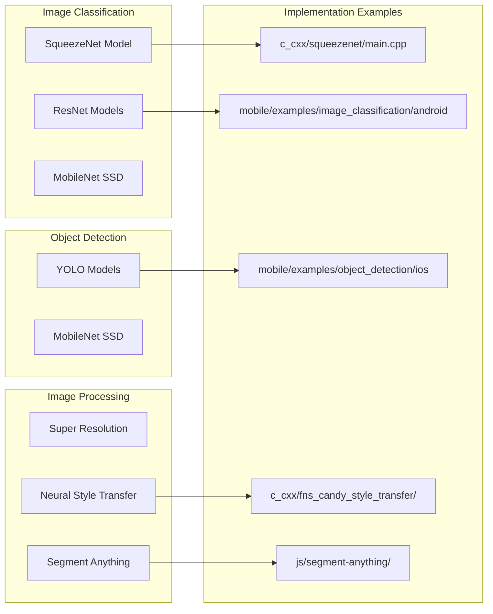
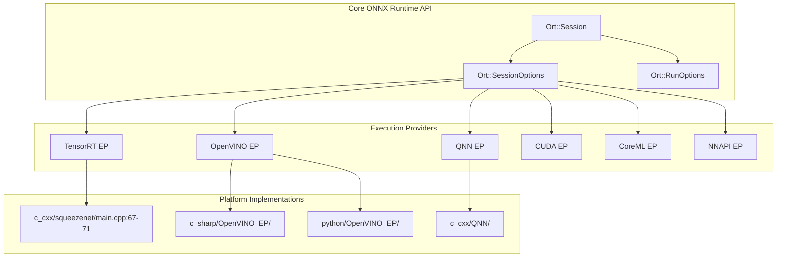
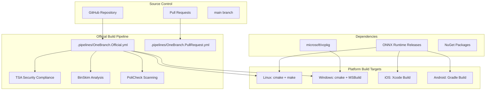

<!-- source: DeepWiki mcp.deepwiki.com · repo microsoft/onnxruntime-inference-examples · page 1 ONNX Runtime Inference Examples · fetched 2026-10-26 -->

# ONNX Runtime Inference Examples

<details>
<summary>Relevant source files</summary>

The following files were used as context for generating this wiki page:

- [.config/tsaoptions.json](.config/tsaoptions.json)
- [.pipelines/OneBranch.Official.yml](.pipelines/OneBranch.Official.yml)
- [.pipelines/OneBranch.PullRequest.yml](.pipelines/OneBranch.PullRequest.yml)
- [c_cxx/CMakeLists.txt](c_cxx/CMakeLists.txt)
- [c_cxx/squeezenet/main.cpp](c_cxx/squeezenet/main.cpp)
- [c_sharp/image_classification/image_classification.csproj](c_sharp/image_classification/image_classification.csproj)
- [mobile/README.md](mobile/README.md)

</details>


This document provides an overview of the ONNX Runtime inference examples repository, which demonstrates how to integrate and use ONNX Runtime across multiple platforms, programming languages, and machine learning scenarios. The repository serves as a comprehensive collection of practical examples for developers implementing ONNX Runtime in production applications.

For platform-specific implementation details, see [Mobile Examples](#2), [C/C++ Examples](#3), [C# Examples](#4), [Python Examples](#5), and [JavaScript Examples](#6). For execution provider specifics, see [Execution Providers](#7). For build system documentation, see [CI/CD & Build Systems](#8).

## Repository Architecture

The repository is organized into platform-specific directories, each containing examples that demonstrate ONNX Runtime integration patterns for that platform. The structure supports both mobile and desktop/server deployment scenarios with comprehensive CI/CD automation.

```mermaid
graph TB
    subgraph "Repository Structure"
        mobile["mobile/"]
        c_cxx["c_cxx/"]
        c_sharp["c_sharp/"]
        python["python/"]
        js["js/"]
        pipelines[".pipelines/"]
        ci_build["ci_build/"]
    end
    
    subgraph "Mobile Platform Examples"
        ios_basic["mobile/examples/basic_usage/ios"]
        ios_speech["mobile/examples/speech_recognition/ios"]
        android_imgclass["mobile/examples/image_classification/android"]
        android_objdet["mobile/examples/object_detection/android"]
        react_native["mobile/examples/React_Native/"]
        xamarin["mobile/examples/Xamarin/"]
        phi3_mobile["mobile/examples/phi-3/android"]
    end
    
    subgraph "Desktop Platform Examples"
        squeezenet_cpp["c_cxx/squeezenet/main.cpp"]
        style_transfer["c_cxx/fns_candy_style_transfer/"]
        csharp_imgclass["c_sharp/image_classification/"]
        openvino_python["python/OpenVINO_EP/"]
        js_web["js/"]
    end
    
    subgraph "Build System"
        cmake["c_cxx/CMakeLists.txt"]
        onebranch_official[".pipelines/OneBranch.Official.yml"]
        onebranch_pr[".pipelines/OneBranch.PullRequest.yml"]
        mobile_pipeline[".pipelines/mobile-examples-pipeline.yml"]
    end
    
    mobile --> ios_basic
    mobile --> ios_speech
    mobile --> android_imgclass
    mobile --> android_objdet
    mobile --> react_native
    mobile --> xamarin
    mobile --> phi3_mobile
    
    c_cxx --> squeezenet_cpp
    c_cxx --> style_transfer
    c_sharp --> csharp_imgclass
    python --> openvino_python
    
    pipelines --> onebranch_official
    pipelines --> onebranch_pr
    pipelines --> mobile_pipeline
    c_cxx --> cmake
```



Sources: [mobile/README.md:25-90](), [c_cxx/CMakeLists.txt:1-101](), [.pipelines/OneBranch.Official.yml:1-161]()

## Platform and Language Support

The repository demonstrates ONNX Runtime integration across major platforms and programming languages, with each combination targeting specific deployment scenarios.

| Platform | Language | Key Examples | Primary Use Cases |
|----------|----------|--------------|-------------------|
| iOS | Swift/Objective-C++ | `basic_usage`, `speech_recognition`, `object_detection` | Mobile inference, camera-based AI |
| Android | Java/Kotlin | `image_classification`, `object_detection`, `phi-3` | Mobile AI applications |
| Windows/Linux | C/C++ | `squeezenet`, `fns_candy_style_transfer` | High-performance native inference |
| Cross-platform | C#/.NET | `image_classification`, OpenVINO examples | Enterprise applications |
| Cross-platform | Python | OpenVINO integration, LLaMA-2 models | Research, prototyping, server deployment |
| Web/Node.js | JavaScript | Browser examples, WebGPU acceleration | Web applications, edge deployment |
| Cross-platform Mobile | React Native | `ort-rn-basic-usage` | Cross-platform mobile development |
| Cross-platform Mobile | Xamarin | VisionSample | Enterprise mobile applications |

Sources: [mobile/README.md:25-90]()

## ML Tasks and Model Support

The examples demonstrate a wide range of machine learning tasks using various pre-trained models from the ONNX model ecosystem.

### Computer Vision Tasks



### Generative AI and NLP Tasks

| Task | Model | Platform Examples | Key Features |
|------|-------|------------------|--------------|
| Speech Recognition | Whisper | `mobile/examples/whisper/` | Cloud and local inference |
| Question Answering | BERT, Phi-3 | `mobile/examples/question_answering/`, `mobile/examples/phi-3/` | Mobile-optimized NLP |
| Text Generation | Phi-3, LLaMA-2 | `mobile/examples/phi-3/`, `python/LLaMA-2/` | Generative AI on mobile and server |

Sources: [mobile/README.md:33-89](), [c_cxx/squeezenet/main.cpp:1-160]()

## Execution Provider Integration

The repository demonstrates integration with multiple hardware-accelerated execution providers, showing how to leverage specialized hardware for optimal inference performance.



Sources: [c_cxx/squeezenet/main.cpp:40-75](), [c_cxx/CMakeLists.txt:68-77]()

## Build System and CI/CD Architecture

The repository uses a multi-tier build system supporting both official Microsoft OneBranch builds and community-oriented GitHub Actions for comprehensive platform coverage.



### Build Configuration Details

| Build Target | Configuration File | Key Dependencies | Output |
|--------------|-------------------|------------------|---------|
| C/C++ Examples | `c_cxx/CMakeLists.txt` | vcpkg, ONNX Runtime binaries | Native executables |
| C# Examples | `*.csproj` files | Microsoft.ML.OnnxRuntime NuGet | .NET assemblies |
| iOS Examples | Xcode projects | ONNX Runtime CocoaPods | iOS applications |
| Android Examples | Gradle projects | ONNX Runtime AAR | Android APKs |

Sources: [.pipelines/OneBranch.Official.yml:1-161](), [.pipelines/OneBranch.PullRequest.yml:1-161](), [c_cxx/CMakeLists.txt:1-101](), [c_sharp/image_classification/image_classification.csproj:1-15]()

## Getting Started

### Prerequisites

To work with the examples in this repository, you need platform-specific development tools:

- **iOS Development**: Xcode 12.5+, CocoaPods, valid Apple Developer ID
- **Android Development**: Android Studio, Gradle, Android SDK
- **C/C++ Development**: CMake 3.13+, Visual Studio (Windows) or GCC/Clang (Linux)
- **C# Development**: .NET 6.0+ SDK
- **Python Development**: Python 3.7+, pip
- **JavaScript Development**: Node.js, npm/yarn

### Repository Setup

```bash
git clone https://github.com/microsoft/onnxruntime-inference-examples.git
cd onnxruntime-inference-examples
```

### Example Usage Pattern

Most examples follow a consistent pattern demonstrated in the SqueezeNet C++ example:

1. **Environment Setup**: Initialize `Ort::Env` with logging configuration
2. **Session Configuration**: Create `Ort::SessionOptions` and configure execution providers
3. **Model Loading**: Load ONNX model using `Ort::Session`
4. **Input Preparation**: Create input tensors with `Ort::Value::CreateTensor`
5. **Inference Execution**: Run inference with `session.Run()`
6. **Output Processing**: Extract and process output tensors

Sources: [mobile/README.md:11-24](), [c_cxx/squeezenet/main.cpp:40-160]()

## Cross-Platform Considerations

The repository demonstrates several approaches to cross-platform deployment:

- **Native Integration**: Platform-specific implementations using native APIs (Swift, Java, C++)
- **Cross-Platform Frameworks**: React Native and Xamarin for mobile development
- **Execution Provider Abstraction**: Hardware-specific optimizations through standardized EP interfaces
- **Build System Portability**: CMake for C/C++, cross-platform CI/CD pipelines

Each approach provides different trade-offs between performance, development efficiency, and platform integration depth, allowing developers to choose the most appropriate strategy for their specific requirements.

Sources: [mobile/README.md:1-90](), [c_cxx/CMakeLists.txt:24-40]()

---

