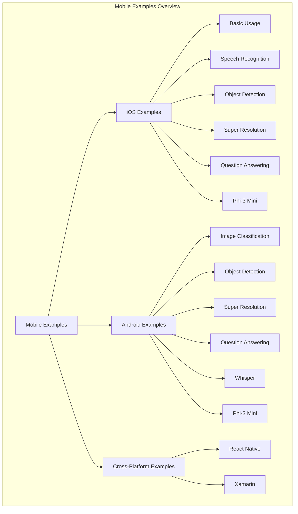
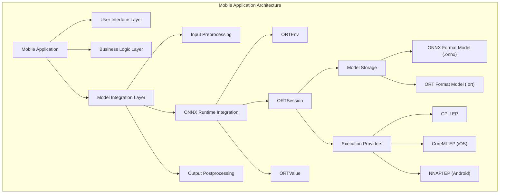
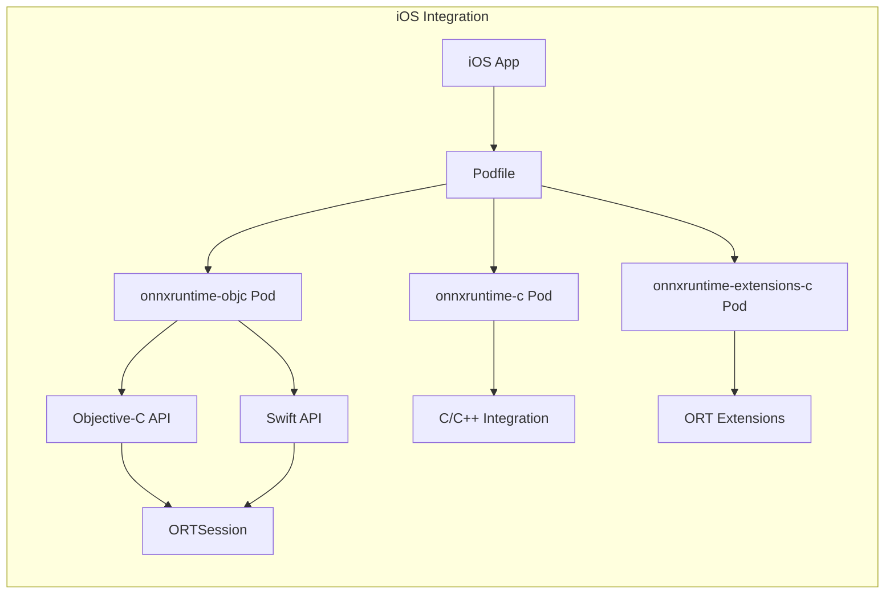
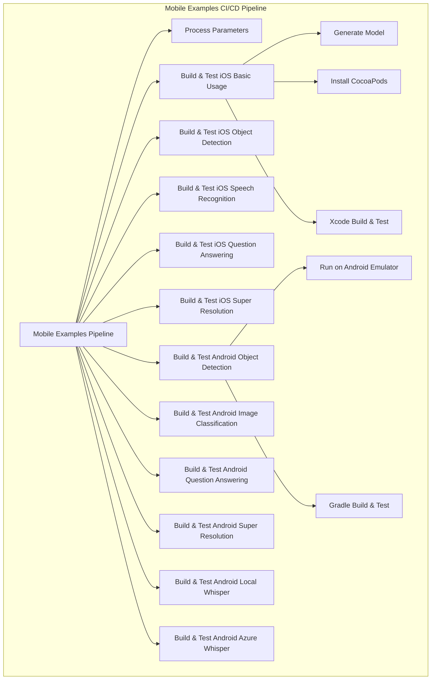

<!-- source: DeepWiki mcp.deepwiki.com · repo microsoft/onnxruntime-inference-examples · page 2 Mobile Examples · fetched 2026-10-26 -->

# Mobile Examples

Relevant source files

The following files were used as context for generating this wiki page:

- [ci_build/azure_pipelines/mobile-examples-pipeline.yml](ci_build/azure_pipelines/mobile-examples-pipeline.yml)
- [ci_build/azure_pipelines/templates/use-python-step.yml](ci_build/azure_pipelines/templates/use-python-step.yml)
- [ci_build/azure_pipelines/templates/xcode-build-and-test-step.yml](ci_build/azure_pipelines/templates/xcode-build-and-test-step.yml)
- [mobile/README.md](mobile/README.md)
- [mobile/examples/basic_usage/ios/Podfile](mobile/examples/basic_usage/ios/Podfile)
- [mobile/examples/object_detection/ios/ORTObjectDetection/prepare_model.sh](mobile/examples/object_detection/ios/ORTObjectDetection/prepare_model.sh)
- [mobile/examples/object_detection/ios/Podfile](mobile/examples/object_detection/ios/Podfile)
- [mobile/examples/question_answering/ios/ORTQuestionAnswering/Podfile](mobile/examples/question_answering/ios/ORTQuestionAnswering/Podfile)
- [mobile/examples/speech_recognition/ios/Podfile](mobile/examples/speech_recognition/ios/Podfile)
- [mobile/examples/super_resolution/ios/ORTSuperResolution/Podfile](mobile/examples/super_resolution/ios/ORTSuperResolution/Podfile)

This page provides an overview of ONNX Runtime mobile examples across iOS, Android, Xamarin, and React Native platforms. These examples demonstrate how to integrate and use ONNX Runtime inference capabilities on mobile devices with various machine learning models and scenarios.

For C/C++ examples, see [C/C++ Examples](#3). For JavaScript examples, see [JavaScript Examples](#6).

## Overview

The ONNX Runtime mobile examples showcase practical implementations for running machine learning models on mobile devices. These examples span various application domains including image classification, object detection, speech recognition, and natural language processing.

Sources: [mobile/README.md:1-90](), [ci_build/azure_pipelines/mobile-examples-pipeline.yml:1-351]()

## Prerequisites

### General Requirements

- Git for cloning the repository
- Python for model generation and preparation

### iOS Requirements

- Xcode 12.5 or higher
- CocoaPods package manager 
- Valid Apple Developer ID (for device testing)

### Android Requirements

- Android Studio
- JDK 11 or higher
- Android SDK

Sources: [mobile/README.md:5-23]()

## Mobile Architecture

The mobile examples follow a common architecture pattern across platforms while adapting to platform-specific idioms. The following diagram illustrates the general architecture of the mobile examples:

Sources: [mobile/examples/basic_usage/ios/OrtBasicUsage/ObjcOrtBasicUsage.mm:1-126](), [mobile/examples/basic_usage/ios/OrtBasicUsage/SwiftOrtBasicUsage.swift:1-111](), [mobile/examples/basic_usage/ios/Podfile:1-12]()

### Key Components

The ONNX Runtime mobile examples utilize several key components:

1. **ORTEnv**: The environment object that manages the ONNX Runtime global state.
2. **ORTSession**: Represents a loaded model ready for inference.
3. **ORTValue**: Contains tensor data for model inputs and outputs.
4. **Model Files**: ONNX (.onnx) or ORT (.ort) format models.
5. **Execution Providers**: Hardware acceleration backends like CPU, CoreML, or NNAPI.

## Platform-Specific Integration

### iOS Integration

iOS examples integrate ONNX Runtime through CocoaPods, primarily using the `onnxruntime-objc` package. Some advanced examples use `onnxruntime-c` with `onnxruntime-extensions-c`.

Sources: [mobile/examples/basic_usage/ios/Podfile:1-12](), [mobile/examples/object_detection/ios/Podfile:1-13](), [mobile/examples/speech_recognition/ios/Podfile:1-12](), [mobile/examples/super_resolution/ios/ORTSuperResolution/Podfile:1-22](), [mobile/examples/question_answering/ios/ORTQuestionAnswering/Podfile:1-21]()

### Android Integration

Android examples integrate ONNX Runtime through Gradle dependencies, using the `onnxruntime-android` package.

## Available Examples

### Basic Usage Examples

The basic usage examples demonstrate fundamental ONNX Runtime operations:
- Creating an environment and session
- Loading a model
- Preparing input data
- Running inference
- Processing output results

The iOS basic usage example ([mobile/examples/basic_usage/ios]()) shows both Objective-C and Swift implementations.

Key implementation features include:
- Model loading from both ONNX and ORT formats
- Simple addition operation with two input tensors
- Explicit memory management for tensor data

Sources: [mobile/examples/basic_usage/ios/OrtBasicUsage/ObjcOrtBasicUsage.mm:1-126](), [mobile/examples/basic_usage/ios/OrtBasicUsage/SwiftOrtBasicUsage.swift:1-111]()

### Computer Vision Examples

#### Image Classification (Android)

The Android image classification example demonstrates real-time classification of objects from the device camera feed.

#### Object Detection (iOS and Android)

The object detection examples show how to detect objects in images with bounding boxes:
- iOS implementation: [mobile/examples/object_detection/ios]()
- Android implementation: [mobile/examples/object_detection/android]()

The object detection examples use MobileNet SSD models converted from TensorFlow Lite format to ONNX/ORT format.

Sources: [mobile/examples/object_detection/ios/ORTObjectDetection/prepare_model.sh:1-32]()

#### Super Resolution (iOS and Android)

The super resolution examples demonstrate how to enhance low-resolution images:
- iOS implementation: [mobile/examples/super_resolution/ios]()
- Android implementation: [mobile/examples/super_resolution/android]()

These examples utilize ONNX Runtime Extensions for pre/post-processing operations.

Sources: [mobile/examples/super_resolution/ios/ORTSuperResolution/Podfile:1-22]()

### Speech Recognition Examples

#### Speech Recognition (iOS)

The iOS speech recognition example uses the Wav2Vec2 model to transcribe speech from audio recordings.

The model is converted from PyTorch using the following process:
1. Import the pre-trained Wav2Vec2 model from HuggingFace
2. Convert it to a torchaudio compatible format
3. Export to ONNX format

Sources: [mobile/examples/speech_recognition/model/wav2vec2_gen.py:1-23](), [mobile/examples/speech_recognition/model/requirements.txt:1-6]()

#### Whisper Examples (Android)

Two Android examples demonstrate speech recognition using OpenAI's Whisper model:
- Azure Whisper: Uses Azure cloud services with a custom op
- Local Whisper: Runs the model locally on-device

Sources: [mobile/README.md:72-78]()

### Natural Language Processing Examples

#### Question Answering (iOS and Android)

The question answering examples demonstrate NLP models for answering questions about provided text:
- iOS implementation: [mobile/examples/question_answering/ios]()
- Android implementation: [mobile/examples/question_answering/android]()

Sources: [mobile/examples/question_answering/ios/ORTQuestionAnswering/Podfile:1-21]()

### Large Language Model Examples

#### Phi-3 Mini (Android and iOS)

The Phi-3 Mini examples demonstrate how to use Microsoft's Phi-3 Mini LLM on mobile devices for simple question answering in a chatbot mode.

Sources: [mobile/README.md:85-90]()

### Cross-Platform Examples

#### React Native Example

The React Native example demonstrates basic ONNX Runtime usage in a React Native Expo project.

Sources: [mobile/README.md:79-84]()

#### Xamarin Example

The Xamarin example demonstrates vision-related models from the ONNX Model Zoo using Xamarin.Forms for cross-platform mobile development.

Sources: [mobile/README.md:52-57]()

## CI/CD Pipeline

The mobile examples are built and tested using a dedicated Azure DevOps pipeline defined in [ci_build/azure_pipelines/mobile-examples-pipeline.yml]().

Sources: [ci_build/azure_pipelines/mobile-examples-pipeline.yml:1-351](), [ci_build/azure_pipelines/templates/xcode-build-and-test-step.yml:1-33](), [ci_build/azure_pipelines/templates/use-python-step.yml:1-13]()

The pipeline performs the following key operations:
1. Processes parameters for ORT version specification
2. Builds and tests each example on the appropriate platform
3. For iOS examples:
   - Generates models as needed
   - Installs CocoaPods dependencies
   - Builds and runs tests using Xcode
4. For Android examples:
   - Generates models as needed
   - Builds and runs tests using Gradle
   - Executes tests on Android emulators

## Conclusion

The ONNX Runtime mobile examples provide comprehensive reference implementations for integrating machine learning capabilities into mobile applications across different platforms. They cover a wide range of use cases from basic ONNX Runtime usage to complex AI scenarios like speech recognition, object detection, and language models.

These examples serve as practical starting points for developers looking to leverage ONNX Runtime in their own mobile applications, demonstrating best practices for model integration, preprocessing, inference, and result handling.

---

