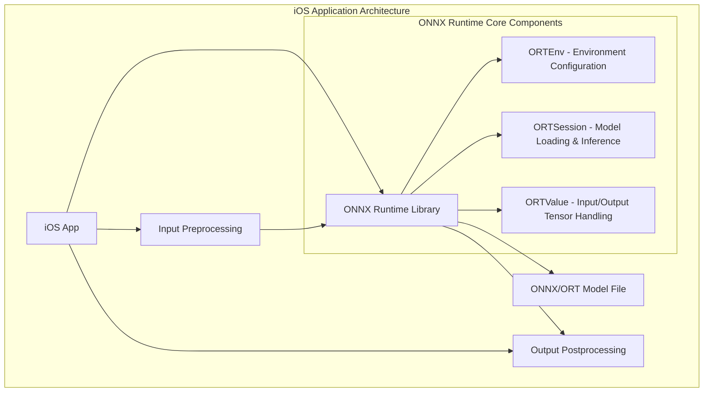
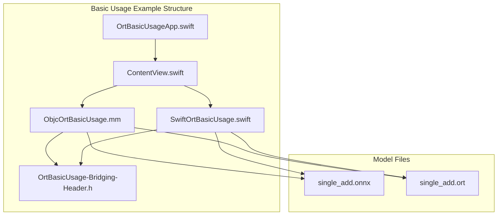
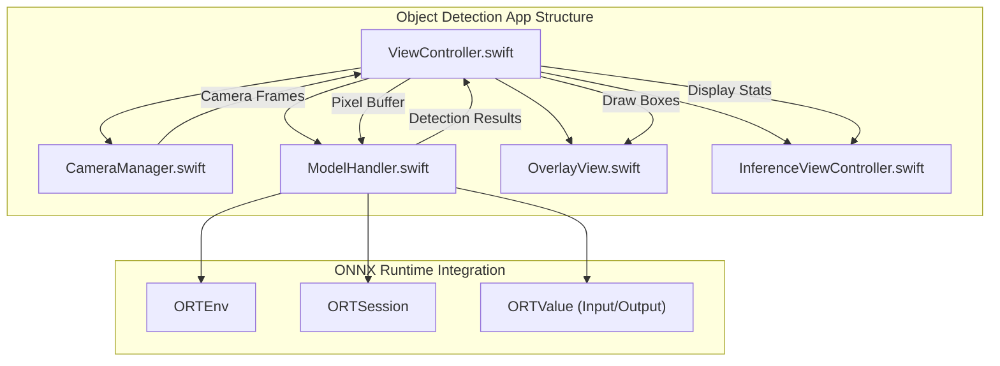
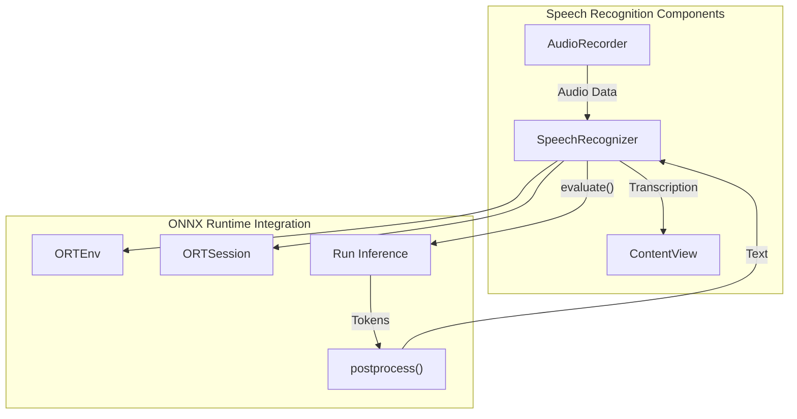
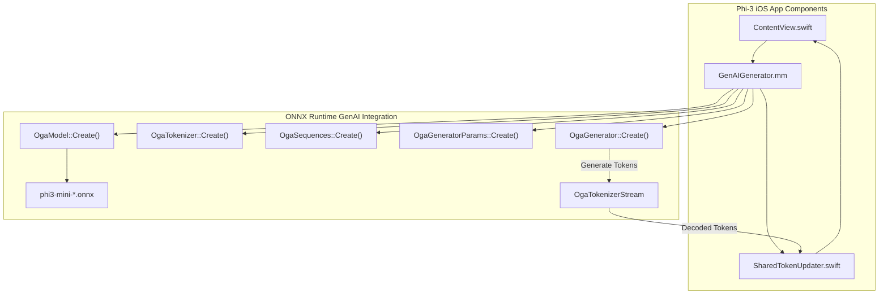
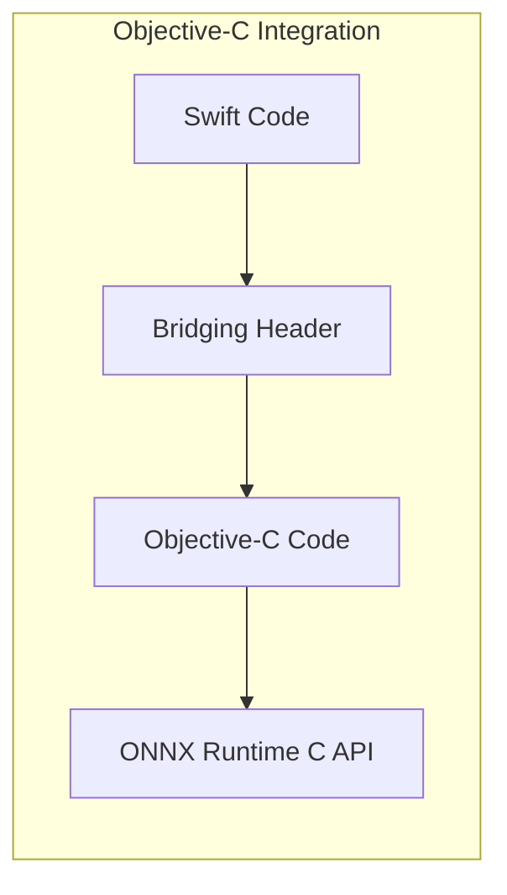
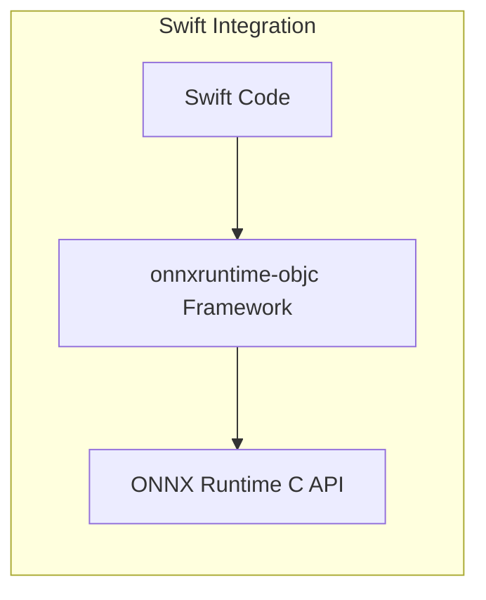

<!-- source: DeepWiki mcp.deepwiki.com · repo microsoft/onnxruntime-inference-examples · page 2.1 iOS Examples · fetched 2026-10-26 -->

# iOS Examples

<details>
<summary>Relevant source files</summary>

The following files were used as context for generating this wiki page:

- [README.md](README.md)
- [mobile/examples/basic_usage/ios/OrtBasicUsage.xcodeproj/project.pbxproj](mobile/examples/basic_usage/ios/OrtBasicUsage.xcodeproj/project.pbxproj)
- [mobile/examples/basic_usage/ios/OrtBasicUsage/ObjcOrtBasicUsage.h](mobile/examples/basic_usage/ios/OrtBasicUsage/ObjcOrtBasicUsage.h)
- [mobile/examples/basic_usage/ios/OrtBasicUsage/ObjcOrtBasicUsage.mm](mobile/examples/basic_usage/ios/OrtBasicUsage/ObjcOrtBasicUsage.mm)
- [mobile/examples/basic_usage/ios/OrtBasicUsage/SwiftOrtBasicUsage.swift](mobile/examples/basic_usage/ios/OrtBasicUsage/SwiftOrtBasicUsage.swift)
- [mobile/examples/basic_usage/model/requirements.txt](mobile/examples/basic_usage/model/requirements.txt)
- [mobile/examples/image_classification/android/prepare_models.requirements.txt](mobile/examples/image_classification/android/prepare_models.requirements.txt)
- [mobile/examples/object_detection/ios/ORTObjectDetection.xcodeproj/project.pbxproj](mobile/examples/object_detection/ios/ORTObjectDetection.xcodeproj/project.pbxproj)
- [mobile/examples/object_detection/ios/ORTObjectDetection/ModelHandler.swift](mobile/examples/object_detection/ios/ORTObjectDetection/ModelHandler.swift)
- [mobile/examples/object_detection/ios/ORTObjectDetection/Storyboards/Main.storyboard](mobile/examples/object_detection/ios/ORTObjectDetection/Storyboards/Main.storyboard)
- [mobile/examples/object_detection/ios/ORTObjectDetection/ViewController.swift](mobile/examples/object_detection/ios/ORTObjectDetection/ViewController.swift)
- [mobile/examples/object_detection/ios/ORTObjectDetection/prepare_model.requirements.txt](mobile/examples/object_detection/ios/ORTObjectDetection/prepare_model.requirements.txt)
- [mobile/examples/object_detection/ios/ORTObjectDetectionTests/ORTObjectDetectionTests.swift](mobile/examples/object_detection/ios/ORTObjectDetectionTests/ORTObjectDetectionTests.swift)
- [mobile/examples/object_detection/ios/README.md](mobile/examples/object_detection/ios/README.md)
- [mobile/examples/phi-3/ios/LocalLLM/LocalLLM.xcodeproj/project.pbxproj](mobile/examples/phi-3/ios/LocalLLM/LocalLLM.xcodeproj/project.pbxproj)
- [mobile/examples/phi-3/ios/LocalLLM/LocalLLM/Assets.xcassets/AccentColor.colorset/Contents.json](mobile/examples/phi-3/ios/LocalLLM/LocalLLM/Assets.xcassets/AccentColor.colorset/Contents.json)
- [mobile/examples/phi-3/ios/LocalLLM/LocalLLM/Assets.xcassets/AppIcon.appiconset/Contents.json](mobile/examples/phi-3/ios/LocalLLM/LocalLLM/Assets.xcassets/AppIcon.appiconset/Contents.json)
- [mobile/examples/phi-3/ios/LocalLLM/LocalLLM/Assets.xcassets/Contents.json](mobile/examples/phi-3/ios/LocalLLM/LocalLLM/Assets.xcassets/Contents.json)
- [mobile/examples/phi-3/ios/LocalLLM/LocalLLM/ContentView.swift](mobile/examples/phi-3/ios/LocalLLM/LocalLLM/ContentView.swift)
- [mobile/examples/phi-3/ios/LocalLLM/LocalLLM/GenAIGenerator.h](mobile/examples/phi-3/ios/LocalLLM/LocalLLM/GenAIGenerator.h)
- [mobile/examples/phi-3/ios/LocalLLM/LocalLLM/GenAIGenerator.mm](mobile/examples/phi-3/ios/LocalLLM/LocalLLM/GenAIGenerator.mm)
- [mobile/examples/phi-3/ios/LocalLLM/LocalLLM/LocalLLM-Bridging-Header.h](mobile/examples/phi-3/ios/LocalLLM/LocalLLM/LocalLLM-Bridging-Header.h)
- [mobile/examples/phi-3/ios/LocalLLM/LocalLLM/LocalLLMApp.swift](mobile/examples/phi-3/ios/LocalLLM/LocalLLM/LocalLLMApp.swift)
- [mobile/examples/phi-3/ios/LocalLLM/LocalLLM/Preview Content/Preview Assets.xcassets/Contents.json](mobile/examples/phi-3/ios/LocalLLM/LocalLLM/Preview Content/Preview Assets.xcassets/Contents.json)
- [mobile/examples/phi-3/ios/LocalLLM/LocalLLM/README.md](mobile/examples/phi-3/ios/LocalLLM/LocalLLM/README.md)
- [mobile/examples/phi-3/ios/LocalLLM/LocalLLM/SharedTokenUpdater.swift](mobile/examples/phi-3/ios/LocalLLM/LocalLLM/SharedTokenUpdater.swift)
- [mobile/examples/phi-3/ios/LocalLLM/LocalLLM/Simulator Screenshot - iPhone 16.png](mobile/examples/phi-3/ios/LocalLLM/LocalLLM/Simulator Screenshot - iPhone 16.png)
- [mobile/examples/speech_recognition/ios/SpeechRecognition.xcodeproj/project.pbxproj](mobile/examples/speech_recognition/ios/SpeechRecognition.xcodeproj/project.pbxproj)
- [mobile/examples/speech_recognition/ios/SpeechRecognition/SpeechRecognizer.swift](mobile/examples/speech_recognition/ios/SpeechRecognition/SpeechRecognizer.swift)
- [mobile/examples/speech_recognition/model/requirements.txt](mobile/examples/speech_recognition/model/requirements.txt)
- [mobile/examples/speech_recognition/model/wav2vec2_gen.py](mobile/examples/speech_recognition/model/wav2vec2_gen.py)

</details>


This document provides a detailed overview of the iOS examples in the ONNX Runtime Inference Examples repository. These examples demonstrate how to integrate and use ONNX Runtime for model inference on iOS devices using Swift and Objective-C. For information about other mobile platforms, see the [Mobile Examples](#2) page.

## Architecture Overview

The iOS examples follow a common architecture for integrating ONNX Runtime:



Sources: [mobile/examples/basic_usage/ios/OrtBasicUsage/ObjcOrtBasicUsage.mm:69-103](), [mobile/examples/object_detection/ios/ORTObjectDetection/ModelHandler.swift:92-106]()

## Available Examples

The repository contains several iOS examples demonstrating different capabilities:

| Example | Description | Key Features |
|---------|-------------|--------------|
| Basic Usage | Simple addition model | Demonstrates core ORT API usage in both Swift and Objective-C |
| Object Detection | Camera-based object detection | Real-time MobileNet SSD model with camera integration |
| Speech Recognition | Audio transcription | Wav2Vec2 model for speech-to-text conversion |
| Phi-3 Mini | Local language model | Running a quantized LLM directly on device |

Sources: [README.md:15-18]()

## Basic Usage Example

The basic usage example demonstrates the minimum code required to run inference with ONNX Runtime on iOS.

### Implementation

The example includes both Objective-C and Swift implementations of the same functionality:



The example uses a simple model that adds two floating-point numbers:
- Inputs: Two float tensors named "A" and "B" with shape [1]
- Output: One float tensor named "C" with shape [1]

Sources: [mobile/examples/basic_usage/ios/OrtBasicUsage/ObjcOrtBasicUsage.mm:56-121](), [mobile/examples/basic_usage/ios/OrtBasicUsage/SwiftOrtBasicUsage.swift:26-110]()

### Key Code Components

The core steps for using ONNX Runtime are:

1. Create an environment:
   ```swift
   let ortEnv = try ORTEnv(loggingLevel: ORTLoggingLevel.warning)
   ```

2. Create input tensors:
   ```swift
   let aInputValue = try ORTValue(
     tensorData: NSMutableData(data: aData),
     elementType: ORTTensorElementDataType.float,
     shape: [1])
   ```

3. Create a session with the model:
   ```swift
   let session = try ORTSession(env: ortEnv, modelPath: modelPath, sessionOptions: nil)
   ```

4. Run inference:
   ```swift
   let outputs = try session.run(
     withInputs: ["A": aInputValue, "B": bInputValue],
     outputNames: ["C"],
     runOptions: nil)
   ```

5. Process outputs:
   ```swift
   let cData = try outputs["C"]?.tensorData()
   ```

Sources: [mobile/examples/basic_usage/ios/OrtBasicUsage/ObjcOrtBasicUsage.mm:69-119](), [mobile/examples/basic_usage/ios/OrtBasicUsage/SwiftOrtBasicUsage.swift:35-109]()

## Object Detection Example

The object detection example demonstrates how to use ONNX Runtime for real-time object detection with device camera.

### Architecture



Sources: [mobile/examples/object_detection/ios/ORTObjectDetection/ViewController.swift:20-167](), [mobile/examples/object_detection/ios/ORTObjectDetection/ModelHandler.swift:46-207]()

### Implementation Details

The ModelHandler class contains the core ONNX Runtime integration:

1. **Initialization**:
   - Creates an ORTEnv with verbose logging
   - Configures threading options
   - Loads the SSD MobileNet model and labels

2. **Inference Pipeline**:
   - Preprocesses camera frames to the model's required input format (300x300 RGB)
   - Creates ORTValue tensors from the processed image data
   - Runs inference with the model
   - Processes outputs to extract bounding boxes, classes, and scores
   - Formats results for display

3. **UI Integration**:
   - The ViewController coordinates between camera, model, and UI
   - Detected objects are drawn on the OverlayView
   - Performance statistics are shown in InferenceViewController

Sources: [mobile/examples/object_detection/ios/ORTObjectDetection/ModelHandler.swift:80-207](), [mobile/examples/object_detection/ios/ORTObjectDetection/ViewController.swift:135-195]()

## Speech Recognition Example

The speech recognition example demonstrates how to use ONNX Runtime to transcribe speech from audio input.

### Architecture

The speech recognition example uses a Wav2Vec2 model to convert audio to text:



Sources: [mobile/examples/speech_recognition/ios/SpeechRecognition/SpeechRecognizer.swift:14-97]()

### Implementation Details

The SpeechRecognizer class handles the core functionality:

1. **Initialization**:
   - Creates an ORTEnv with warning-level logging
   - Loads the Wav2Vec2 model from the app bundle
   - Initializes the ORTSession

2. **Inference Process**:
   - Takes audio data as input
   - Creates an ORTValue tensor from the float audio data
   - Runs the model with appropriate input and output names
   - Processes the output using a token-to-character mapping
   - Returns the transcribed text

3. **Postprocessing**:
   - Finds the highest probability token for each position
   - Maps token indices to characters using a predefined label set
   - Removes duplicate consecutive tokens
   - Converts special tokens (like '|' for space)

Sources: [mobile/examples/speech_recognition/ios/SpeechRecognition/SpeechRecognizer.swift:22-96]()

## Phi-3 Mini Example

The Phi-3 Mini example demonstrates running a quantized large language model (LLM) directly on iOS devices.

### Architecture

This example uses ONNX Runtime and ONNX Runtime GenAI extensions:



Sources: [mobile/examples/phi-3/ios/LocalLLM/LocalLLM/GenAIGenerator.mm:33-139](), [mobile/examples/phi-3/ios/LocalLLM/LocalLLM/ContentView.swift:13-157]()

### Implementation Details

The example uses a mix of Swift for UI and Objective-C++/C++ for ONNX Runtime GenAI integration:

1. **Model Loading**:
   - Loads the quantized Phi-3 Mini model (INT4 quantization)
   - Creates tokenizer and generator components

2. **Text Generation Process**:
   - Takes a user prompt as input
   - Formats it with appropriate chat markers: `<|user|>\n{input}<|end|>\n<|assistant|>`
   - Tokenizes the input using the model's tokenizer
   - Generates tokens one-by-one in a streaming fashion
   - Decodes each token and sends it to the UI via SharedTokenUpdater

3. **User Interface**:
   - Displays a chat interface with user and assistant messages
   - Shows generation statistics (tokens/second)
   - Streams tokens as they're generated for a responsive experience

Sources: [mobile/examples/phi-3/ios/LocalLLM/LocalLLM/GenAIGenerator.mm:33-140](), [mobile/examples/phi-3/ios/LocalLLM/LocalLLM/ContentView.swift:13-157](), [mobile/examples/phi-3/ios/LocalLLM/LocalLLM/SharedTokenUpdater.swift:7-23]()

## Integration Methods

There are two primary approaches for integrating ONNX Runtime in iOS applications:

### Objective-C API



Sources: [mobile/examples/basic_usage/ios/OrtBasicUsage/ObjcOrtBasicUsage.mm:56-121]()

### Swift with Direct API Access



Sources: [mobile/examples/basic_usage/ios/OrtBasicUsage/SwiftOrtBasicUsage.swift:26-110]()

## Best Practices

Based on the examples, here are some best practices for using ONNX Runtime on iOS:

1. **Model Format**:
   - Use the ORT format for better performance on mobile devices
   - Both formats are supported: `.onnx` (standard) and `.ort` (optimized)

2. **Memory Management**:
   - Use appropriate data containers (NSData/Data) for tensor data
   - Be careful with memory lifetimes, especially for output tensors

3. **Error Handling**:
   - Use Swift's try/catch or Objective-C's NSError pattern consistently
   - Check return values from all ONNX Runtime API calls

4. **Performance Optimization**:
   - Control thread count based on device capabilities
   - Measure and optimize preprocessing/postprocessing steps
   - Consider quantized models for large networks (like Phi-3 Mini)

5. **UI Integration**:
   - Process inference results on background threads
   - Update UI on the main thread
   - Consider streaming outputs for responsive user experience (as in Phi-3 example)

Sources: [mobile/examples/basic_usage/ios/OrtBasicUsage/ObjcOrtBasicUsage.mm:29-54](), [mobile/examples/object_detection/ios/ORTObjectDetection/ModelHandler.swift:80-106](), [mobile/examples/phi-3/ios/LocalLLM/LocalLLM/GenAIGenerator.mm:33-140]()

## Setting Up an iOS Example

To run any of the iOS examples:

1. Clone the repository
2. Navigate to the example directory
3. Run `pod install` to install the ONNX Runtime dependency
4. Open the `.xcworkspace` file in Xcode
5. Some examples require model preparation scripts:
   ```bash
   # For object detection example
   cd mobile/examples/object_detection/ios/ORTObjectDetection
   ./prepare_model.sh
   ```
6. Build and run on a device or simulator

Sources: [mobile/examples/object_detection/ios/README.md:19-39]()

---

