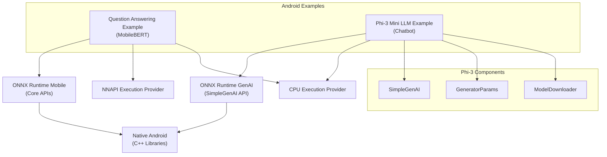
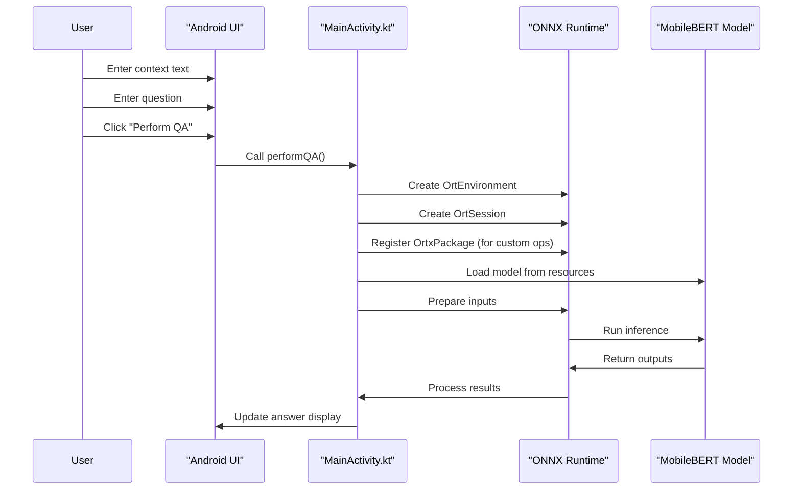
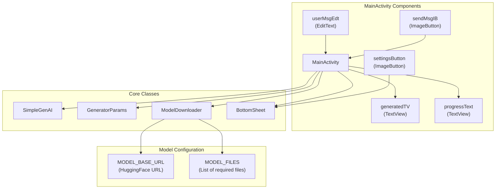
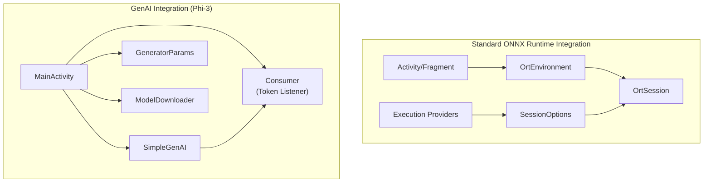

<!-- source: DeepWiki mcp.deepwiki.com · repo microsoft/onnxruntime-inference-examples · page 2.2 Android Examples · fetched 2026-10-26 -->

# Android Examples

<details>
<summary>Relevant source files</summary>

The following files were used as context for generating this wiki page:

- [mobile/examples/phi-3/android/README.md](mobile/examples/phi-3/android/README.md)
- [mobile/examples/phi-3/android/app/build.gradle.kts](mobile/examples/phi-3/android/app/build.gradle.kts)
- [mobile/examples/phi-3/android/app/libs/onnxruntime-genai-android-0.8.1.aar](mobile/examples/phi-3/android/app/libs/onnxruntime-genai-android-0.8.1.aar)
- [mobile/examples/phi-3/android/app/src/main/java/ai/onnxruntime/genai/demo/MainActivity.java](mobile/examples/phi-3/android/app/src/main/java/ai/onnxruntime/genai/demo/MainActivity.java)
- [mobile/examples/phi-3/android/gradle/wrapper/gradle-wrapper.jar](mobile/examples/phi-3/android/gradle/wrapper/gradle-wrapper.jar)
- [mobile/examples/phi-3/android/gradle/wrapper/gradle-wrapper.properties](mobile/examples/phi-3/android/gradle/wrapper/gradle-wrapper.properties)
- [mobile/examples/phi-3/android/gradlew](mobile/examples/phi-3/android/gradlew)
- [mobile/examples/phi-3/android/gradlew.bat](mobile/examples/phi-3/android/gradlew.bat)
- [mobile/examples/question_answering/android/prepare_model.requirements.txt](mobile/examples/question_answering/android/prepare_model.requirements.txt)
- [mobile/examples/question_answering/android/prepare_model.sh](mobile/examples/question_answering/android/prepare_model.sh)

</details>


This page documents the Android examples in the ONNX Runtime Inference Examples repository, demonstrating how to integrate and use ONNX Runtime on Android devices. These examples showcase different inference scenarios including question answering, large language models, and basic model inference in React Native applications.

For iOS examples, see [iOS Examples](#2.1). For information about cross-platform mobile frameworks, see [React Native Examples](#2.3) and [Xamarin Examples](#2.4).

## Overview of Android Examples

The repository contains several Android examples that demonstrate different aspects of ONNX Runtime integration:

1. **Question Answering Example** - A Kotlin-based application that uses MobileBERT for answering questions based on provided context.
2. **Phi-3 Mini Example** - A Java-based chatbot application demonstrating integration of the Phi-3 Mini large language model using ONNX Runtime GenAI API.

The examples showcase different ONNX Runtime APIs and integration patterns for Android development.

### Android Examples Architecture



Sources:
- [mobile/examples/phi-3/android/app/src/main/java/ai/onnxruntime/genai/demo/MainActivity.java:27-29]()
- [mobile/examples/phi-3/android/app/build.gradle.kts:54-55]()

## Setting Up Android Examples

### Requirements

| Example | Requirements |
|---------|--------------|
| Question Answering | Android Studio, Android SDK 29+, NDK r22+ |
| Phi-3 Mini | Android Studio Giraffe (2022.3.1+), Android SDK 29+, NDK r22+, 8GB+ device storage |

Sources:
- [mobile/examples/phi-3/android/README.md:37-41]()
- [mobile/examples/phi-3/android/app/build.gradle.kts:12-14]()

### Common Dependencies

For native Android examples, add ONNX Runtime dependencies to your `build.gradle.kts`:

```kotlin
// Core ONNX Runtime for Android
implementation("com.microsoft.onnxruntime:onnxruntime-android:latest.release")

// For Phi-3 and other GenAI models
implementation(files("libs/onnxruntime-genai-android-0.8.1.aar"))
```

The Phi-3 example also requires specific ABI filters:

```kotlin
ndk {
    abiFilters += listOf("arm64-v8a", "x86_64")
}
```

Sources:
- [mobile/examples/phi-3/android/app/build.gradle.kts:54-55]()
- [mobile/examples/phi-3/android/app/build.gradle.kts:18-21]()
- [mobile/examples/question_answering/android/prepare_model.requirements.txt:1-5]()

## Question Answering Example

The Question Answering example demonstrates how to use ONNX Runtime with a MobileBERT model to answer questions based on a provided text context.

### Architecture



Sources:
- [mobile/examples/question_answering/android/app/src/main/java/ai/onnxruntime/example/question_answering/MainActivity.kt]()
- [mobile/examples/question_answering/android/app/src/main/res/layout/activity_main.xml]()

### Implementation Details

The main components of the Question Answering example include:

1. **MainActivity** - Handles UI interactions and ONNX Runtime initialization
2. **OrtEnvironment and OrtSession** - Core ONNX Runtime components for inference
3. **Execution Provider Selection** - Support for CPU, NNAPI, and XNNPACK

Key code sections:

- **Creating ORT session with execution provider selection:**

```kotlin
private fun createOrtSession(ep: String) {
    // Initialize session options
    val sessionOptions: OrtSession.SessionOptions = OrtSession.SessionOptions()
    
    // Configure execution provider
    if (ep.contains("NNAPI")) {
        sessionOptions.addNnapi()
    } else if (ep.contains("XNNAPCK")) {
        val po = mapOf<String, String>()
        sessionOptions.addXnnpack(po)
    }
    
    // Register custom operators and create session
    sessionOptions.registerCustomOpLibrary(OrtxPackage.getLibraryPath())
    ortSession = ortEnv.createSession(readModel(), sessionOptions)
}
```

- **Performing inference:**

```kotlin
private fun performQA(ortSession: OrtSession) {
    var qaPerformer = QAPerformer()
    var result = qaPerformer.answer(ArticleText.text, readQuestion(), ortEnv, ortSession)
    updateUI(result)
}
```

Sources:
- [mobile/examples/question_answering/android/app/src/main/java/ai/onnxruntime/example/question_answering/MainActivity.kt:78-98]()
- [mobile/examples/question_answering/android/app/src/main/java/ai/onnxruntime/example/question_answering/MainActivity.kt:123-127]()

## Phi-3 Mini Example

The Phi-3 Mini example showcases how to integrate a large language model (LLM) into an Android application using ONNX Runtime's GenAI API.

### Architecture



Sources:
- [mobile/examples/phi-3/android/app/src/main/java/ai/onnxruntime/genai/demo/MainActivity.java:31-60]()
- [mobile/examples/phi-3/android/app/src/main/java/ai/onnxruntime/genai/demo/MainActivity.java:35-50]()

### Implementation Details

The Phi-3 Mini example demonstrates several important concepts:

1. **Model Loading and Management** - Downloads or loads the Phi-3 model files
2. **GenAI API Usage** - Uses `SimpleGenAI` class for streamlined inference
3. **Token Generation** - Implements streaming token-by-token text generation
4. **Performance Tracking** - Measures and displays inference performance metrics

Key code components:

- **SimpleGenAI Initialization:**

```java
genAI = new SimpleGenAI(getFilesDir().getPath());
```

- **Setting up Generator Parameters:**

```java
GeneratorParams generatorParams = genAI.createGeneratorParams();
generatorParams.setSearchOption("length_penalty", (double)lengthPenalty);
generatorParams.setSearchOption("max_length", (double)maxLength);
```

- **Streaming Token Generation:**

```java
Consumer<String> tokenListener = token -> {
    if (numTokens[0] == 0) {
        firstTokenTime[0] = System.currentTimeMillis();
    }
    MainActivity.this.accept(token);
    Log.i(TAG, "Generated token: " + token);
    numTokens[0] += 1;
};

String fullResponse = genAI.generate(generatorParams, promptQuestion_formatted, tokenListener);
```

The example provides detailed performance metrics, including prompt processing time and tokens generated per second.

Sources:
- [mobile/examples/phi-3/android/app/src/main/java/ai/onnxruntime/genai/demo/MainActivity.java:254]()
- [mobile/examples/phi-3/android/app/src/main/java/ai/onnxruntime/genai/demo/MainActivity.java:144-149]()
- [mobile/examples/phi-3/android/app/src/main/java/ai/onnxruntime/genai/demo/MainActivity.java:155-168]()

### Model Management

The Phi-3 example demonstrates comprehensive model management:

1. **Model Configuration** - Centralized configuration for easy model switching:

```java
private static final String MODEL_BASE_URL = "https://huggingface.co/microsoft/Phi-3-mini-4k-instruct-onnx/resolve/main/cpu_and_mobile/cpu-int4-rtn-block-32-acc-level-4/";

private static final List<String> MODEL_FILES = Arrays.asList(
    "added_tokens.json",
    "config.json", 
    "configuration_phi3.py",
    "genai_config.json",
    "phi3-mini-4k-instruct-cpu-int4-rtn-block-32-acc-level-4.onnx",
    "phi3-mini-4k-instruct-cpu-int4-rtn-block-32-acc-level-4.onnx.data",
    "special_tokens_map.json",
    "tokenizer.json",
    "tokenizer.model",
    "tokenizer_config.json"
);
```

2. **File Existence Checking** - Verifies if model files exist locally using `fileExists()` method
3. **Download Management** - Uses `ModelDownloader` with progress callbacks
4. **Model Initialization** - Creates `SimpleGenAI` instance after files are available

The example supports switching to different models by simply updating the `MODEL_BASE_URL` and `MODEL_FILES` configuration.

Sources:
- [mobile/examples/phi-3/android/app/src/main/java/ai/onnxruntime/genai/demo/MainActivity.java:35-49]()
- [mobile/examples/phi-3/android/app/src/main/java/ai/onnxruntime/genai/demo/MainActivity.java:63-66]()
- [mobile/examples/phi-3/android/app/src/main/java/ai/onnxruntime/genai/demo/MainActivity.java:209-272]()
- [mobile/examples/phi-3/android/README.md:10-33]()

## Android Development Best Practices

Based on the examples, several best practices emerge for Android ONNX Runtime integration:

### Error Handling and User Experience

The Phi-3 example demonstrates robust error handling:

```java
try {
    genAI = new SimpleGenAI(getFilesDir().getPath());
    // ... inference code
} catch (GenAIException e) {
    Log.e(TAG, "Exception occurred during model query: " + e.getMessage());
    runOnUiThread(() -> {
        Toast.makeText(MainActivity.this, "Error generating response: " + e.getMessage(), Toast.LENGTH_SHORT).show();
    });
}
```

### Threading and UI Updates

Proper threading is essential for responsive UI:

```java
new Thread(new Runnable() {
    @Override
    public void run() {
        // Background inference work
        String fullResponse = genAI.generate(generatorParams, promptQuestion_formatted, tokenListener);
        
        runOnUiThread(() -> {
            // UI updates on main thread
            sendMsgIB.setEnabled(true);
            sendMsgIB.setAlpha(1.0f);
        });
    }
}).start();
```

Sources:
- [mobile/examples/phi-3/android/app/src/main/java/ai/onnxruntime/genai/demo/MainActivity.java:182-193]()
- [mobile/examples/phi-3/android/app/src/main/java/ai/onnxruntime/genai/demo/MainActivity.java:139-196]()

## Common Android Integration Patterns

Looking across the examples, several common patterns emerge for integrating ONNX Runtime with Android applications:



### Key Integration Components

| Component | Purpose | Usage in Examples |
|-----------|---------|------------------|
| `SimpleGenAI` | Simplified GenAI interface | Phi-3 example for LLM inference |
| `GeneratorParams` | Configure generation behavior | Set max length, length penalty in Phi-3 |
| `ModelDownloader` | Handle model file downloads | Download Phi-3 files from HuggingFace |
| `Consumer<String>` | Stream token generation | Real-time token display in Phi-3 |
| Error handling with `GenAIException` | Robust error management | Try-catch blocks around inference |

Sources:
- [mobile/examples/phi-3/android/app/src/main/java/ai/onnxruntime/genai/demo/MainActivity.java:27-29]()
- [mobile/examples/phi-3/android/app/src/main/java/ai/onnxruntime/genai/demo/MainActivity.java:144-149]()
- [mobile/examples/phi-3/android/app/src/main/java/ai/onnxruntime/genai/demo/MainActivity.java:155-166]()

## Performance Considerations

The examples demonstrate several methods for optimizing performance:

1. **Model Quantization** - Using quantized models (INT4 for Phi-3)
2. **Performance Tracking** - Measuring and optimizing critical metrics
3. **User-Configurable Parameters** - Settings for controlling generation behavior

The Phi-3 example includes comprehensive performance tracking:

```java
long startTime = System.currentTimeMillis();
final long[] firstTokenTime = {startTime};
final long[] numTokens = {0};

// Token listener tracks performance
Consumer<String> tokenListener = token -> {
    if (numTokens[0] == 0) {
        firstTokenTime[0] = System.currentTimeMillis();
    }
    MainActivity.this.accept(token);
    numTokens[0] += 1;
};

// Calculate metrics after generation
long totalTime = System.currentTimeMillis() - firstTokenTime[0];
float promptProcessingTime = (firstTokenTime[0] - startTime) / 1000.0f;
float tokensPerSecond = numTokens[0] > 1 ? (1000.0f * (numTokens[0] - 1)) / totalTime : 0;
```

### Performance Metrics Display

The Phi-3 example shows performance metrics in a popup dialog:

```java
private void showTokenPopup(float promptProcessingTime, float tokenRate) {
    final Dialog dialog = new Dialog(MainActivity.this);
    dialog.setContentView(R.layout.info_popup);
    
    TextView promptProcessingTimeTv = dialog.findViewById(R.id.prompt_processing_time_tv);
    TextView tokensPerSecondTv = dialog.findViewById(R.id.tokens_per_second_tv);
    
    promptProcessingTimeTv.setText(String.format("Prompt processing time: %.2f seconds", promptProcessingTime));
    tokensPerSecondTv.setText(String.format("Tokens per second: %.2f", tokenRate));
}
```

Sources:
- [mobile/examples/phi-3/android/app/src/main/java/ai/onnxruntime/genai/demo/MainActivity.java:150-172]()
- [mobile/examples/phi-3/android/app/src/main/java/ai/onnxruntime/genai/demo/MainActivity.java:293-307]()
- [mobile/examples/phi-3/android/README.md:8]()

## Getting Started with Examples

To run the Android examples:

1. Clone the repository:
   ```
   git clone https://github.com/microsoft/onnxruntime-inference-examples.git
   ```

2. Open the specific example in Android Studio:
   - For Question Answering: `mobile/examples/question_answering/android/`
   - For Phi-3 Mini: `mobile/examples/phi-3/android/`

3. Build and run on a physical device or emulator

### Phi-3 Specific Setup

For the Phi-3 example, additional considerations:

- **Storage Requirements**: Model is over 2.5GB and downloads automatically on first launch
- **Device Requirements**: Ensure device has at least 8GB internal storage
- **Manual Model Setup** (Optional): You can manually copy model files to `/data/data/ai.onnxruntime.genai.demo/files`

The model files are downloaded from the configured `MODEL_BASE_URL` and stored in the app's private files directory.

Sources:
- [mobile/examples/phi-3/android/README.md:45-76]()
- [mobile/examples/phi-3/android/README.md:53-69]()
- [mobile/examples/phi-3/android/app/src/main/java/ai/onnxruntime/genai/demo/MainActivity.java:35]()

## Summary

The Android examples in the ONNX Runtime Inference Examples repository demonstrate various ways to integrate machine learning models into Android applications using ONNX Runtime. From basic question answering to large language models and cross-platform development, these examples provide a foundation for developers looking to add ML capabilities to their Android apps.

The examples highlight:
- Core ONNX Runtime usage patterns for Android
- Integration with different execution providers
- Specialized APIs for different model types (GenAI)
- Cross-platform options with React Native
- Performance optimization techniques

These patterns can be applied to build sophisticated, performant ML-enabled Android applications using ONNX Runtime.

---

