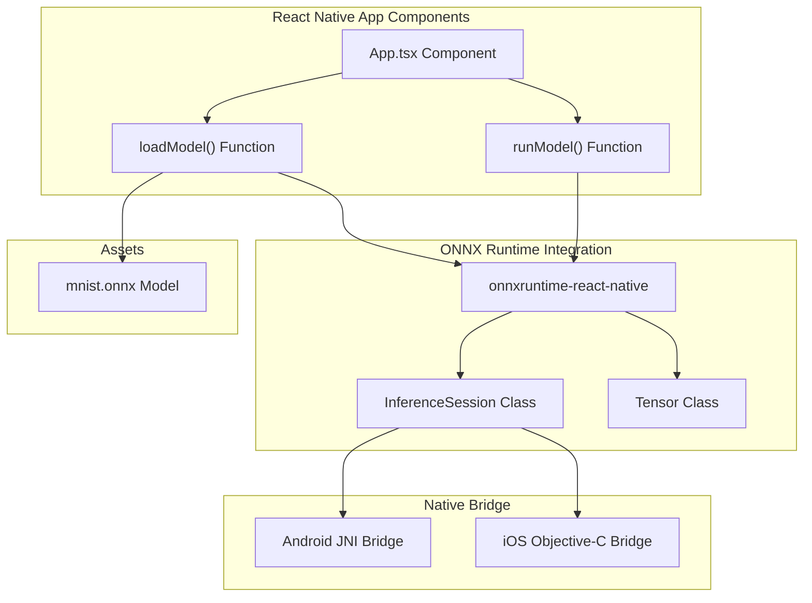
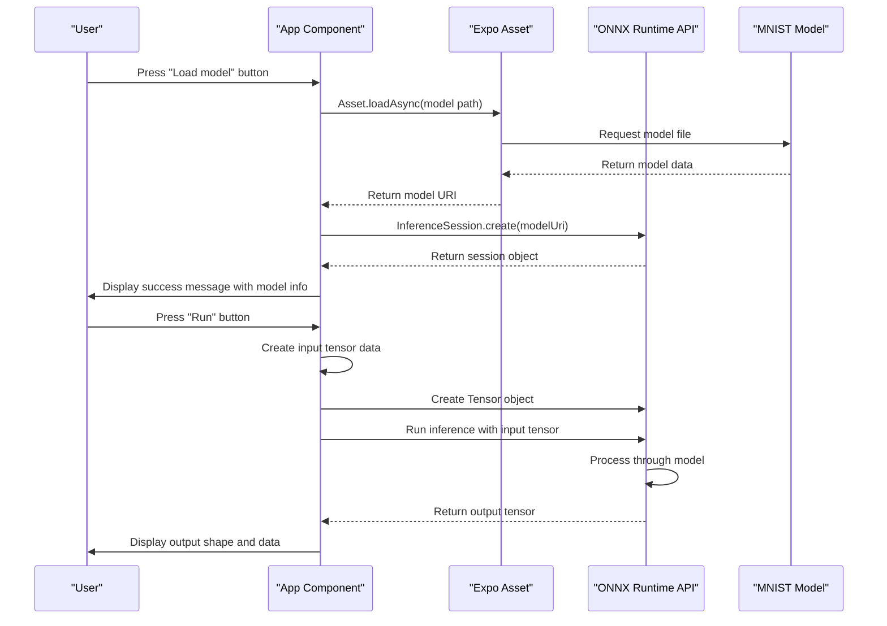

<!-- source: DeepWiki mcp.deepwiki.com · repo microsoft/onnxruntime-inference-examples · page 2.3 React Native Examples · fetched 2026-10-26 -->

# React Native Examples

<details>
<summary>Relevant source files</summary>

The following files were used as context for generating this wiki page:

- [mobile/examples/React_Native/ort-rn-basic-usage/yarn.lock](mobile/examples/React_Native/ort-rn-basic-usage/yarn.lock)

</details>


This document covers the React Native examples in the ONNX Runtime inference examples repository, demonstrating how to integrate and use ONNX Runtime in React Native applications for machine learning inference on mobile devices.

For information about other mobile example implementations, see the following related wiki pages:
- [iOS Examples](#2.1)
- [Android Examples](#2.2)
- [Xamarin Examples](#2.4)

## Overview

The repository contains a React Native example that demonstrates basic ONNX Runtime functionality, including:

- Loading an ONNX model
- Creating an inference session
- Preparing input data
- Running inference
- Processing output results

The example leverages Expo, a framework for React Native development, making it easier to set up and run on both Android and iOS platforms.

Sources:
- [mobile/examples/React_Native/ort-rn-basic-usage/README.md]()
- [README.md]()

## Architecture

The following diagram illustrates the architecture of the React Native with ONNX Runtime integration:



This architecture shows how the React Native app interfaces with ONNX Runtime through the JavaScript API layer (`onnxruntime-react-native`), which then communicates with native code via platform-specific bridges.

Sources:
- [mobile/examples/React_Native/ort-rn-basic-usage/App.tsx]()
- [mobile/examples/React_Native/ort-rn-basic-usage/README.md]()

## Project Setup

### Prerequisites

To work with the React Native examples, you need:

1. Node.js
2. Expo CLI installed globally: `npm install -g expo-cli`
3. Yarn (recommended): `npm install -g yarn`
4. For iOS: Xcode
5. For Android: Android Studio and Android SDK

### Project Configuration

The React Native example includes several key configuration files:

1. **metro.config.js**: Configures the Metro bundler to include `.onnx` files in the bundled assets:

```
const { getDefaultConfig } = require('@expo/metro-config');
const defaultConfig = getDefaultConfig(__dirname);
defaultConfig.resolver.assetExts.push('onnx');
module.exports = defaultConfig;
```

2. **app.json**: Includes the ONNX Runtime React Native plugin in the Expo configuration:

```json
{
  "expo": {
    "plugins": ["onnxruntime-react-native"],
    ...
  }
}
```

This plugin automatically sets up the native code for iOS and Android when the project is built.

Sources:
- [mobile/examples/React_Native/ort-rn-basic-usage/metro.config.js]()
- [mobile/examples/React_Native/ort-rn-basic-usage/app.json]()
- [mobile/examples/React_Native/ort-rn-basic-usage/README.md]()

## Basic Usage Example Workflow

The following sequence diagram illustrates the workflow of the basic usage example:



This sequence demonstrates the complete flow from loading a model to running inference and displaying results.

Sources:
- [mobile/examples/React_Native/ort-rn-basic-usage/App.tsx]()

## Key Implementation Details

### Model Loading

The example demonstrates loading an ONNX model (MNIST) from the application's assets using the following steps:

1. Load the ONNX file using Expo's Asset system
2. Retrieve the local URI for the model file
3. Create an ONNX Runtime inference session with the model URI

```typescript
const assets = await Asset.loadAsync(require('./assets/mnist.onnx'));
const modelUri = assets[0].localUri;
if (!modelUri) {
  Alert.alert('failed to get model URI', `${assets[0]}`);
} else {
  myModel = await ort.InferenceSession.create(modelUri);
  Alert.alert(
    'model loaded successfully',
    `input names: ${myModel.inputNames}, output names: ${myModel.outputNames}`);
}
```

Sources:
- [mobile/examples/React_Native/ort-rn-basic-usage/App.tsx:14-32]()

### Running Inference

Once the model is loaded, inference can be run using these steps:

1. Create input data (a Float32Array for the MNIST model)
2. Create an input feeds object mapping input names to tensor values
3. Run the model with the feeds and get the outputs
4. Process the outputs as needed

```typescript
const inputData = new Float32Array(28 * 28);
const feeds = {};
feeds[myModel.inputNames[0]] = new ort.Tensor(inputData, [1, 1, 28, 28]);
const fetches = await myModel.run(feeds);
const output = fetches[myModel.outputNames[0]];
```

Sources:
- [mobile/examples/React_Native/ort-rn-basic-usage/App.tsx:39-56]()

## Key ONNX Runtime APIs

The React Native example demonstrates usage of the following key ONNX Runtime APIs:

| API | Description |
|-----|-------------|
| `ort.InferenceSession.create()` | Creates a session from a model file path |
| `ort.Tensor` | Creates a tensor object from data with specified shape |
| `session.inputNames` | Gets the names of inputs required by the model |
| `session.outputNames` | Gets the names of outputs produced by the model |
| `session.run()` | Runs inference with the provided input feeds |

Sources:
- [mobile/examples/React_Native/ort-rn-basic-usage/App.tsx:4-61]()

## Running the Example

To run the example:

1. Clone the repository
2. Navigate to the example directory: `cd mobile/examples/React_Native/ort-rn-basic-usage`
3. Install dependencies: `yarn install`
4. Install ONNX Runtime: `expo install onnxruntime-react-native@latest`
5. Generate native code: `expo prebuild`
6. Run on Android or iOS:
   - For Android: `expo run:android`
   - For iOS: `expo run:ios`

Sources:
- [mobile/examples/React_Native/ort-rn-basic-usage/README.md:23-53]()

## Enabling ONNX Runtime Extensions

If you need to use custom operators from ONNX Runtime Extensions, you can enable this by modifying your application's configuration. See the example README for details on how to enable extensions.

Sources:
- [mobile/examples/React_Native/ort-rn-basic-usage/README.md:128-132]()

## Troubleshooting

Common issues and solutions:

- **Model loading fails**: Ensure metro.config.js correctly includes .onnx files in assetExts
- **Build errors**: Verify the onnxruntime-react-native plugin is properly configured in app.json
- **Runtime errors**: Check that error handling is implemented for model loading and inference operations

The example demonstrates proper error handling patterns:

```typescript
try {
  // Model loading or inference code
} catch (e) {
  Alert.alert('error title', `${e}`);
}
```

Sources:
- [mobile/examples/React_Native/ort-rn-basic-usage/App.tsx:15-35]()
- [mobile/examples/React_Native/ort-rn-basic-usage/App.tsx:40-59]()

## Conclusion

The React Native example in the ONNX Runtime inference examples repository provides a foundation for integrating machine learning models into cross-platform mobile applications. It demonstrates the key concepts of loading models, running inference, and processing results using the ONNX Runtime JavaScript API within a React Native application.

By following this example, developers can build their own React Native applications that leverage machine learning models with ONNX Runtime for both Android and iOS platforms.

Sources:
- [mobile/examples/React_Native/ort-rn-basic-usage/README.md]()
- [mobile/examples/React_Native/ort-rn-basic-usage/App.tsx]()

---

