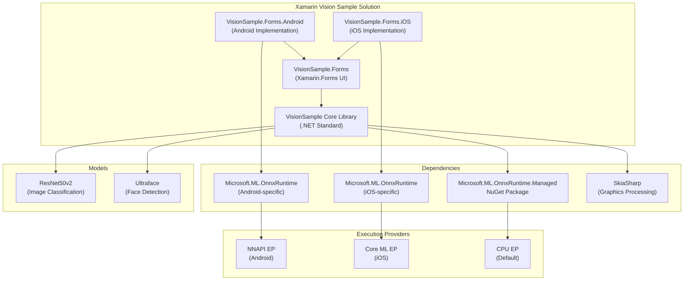
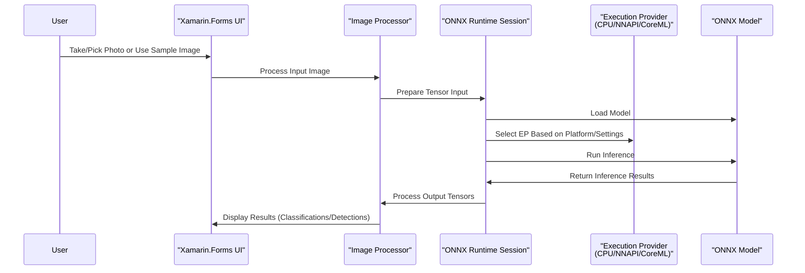
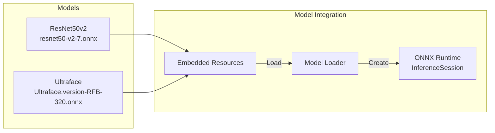
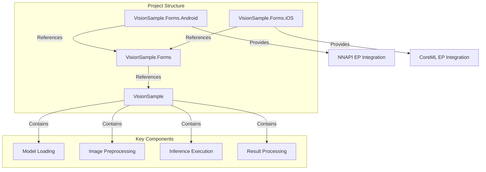

<!-- source: DeepWiki mcp.deepwiki.com · repo microsoft/onnxruntime-inference-examples · page 2.4 Xamarin Examples · fetched 2026-10-26 -->

# Xamarin Examples

<details>
<summary>Relevant source files</summary>

The following files were used as context for generating this wiki page:

- [.gdn/.gdntsa](.gdn/.gdntsa)
- [ci_build/azure_pipelines/compliance.yml](ci_build/azure_pipelines/compliance.yml)
- [ci_build/policheck_exclusions.xml](ci_build/policheck_exclusions.xml)
- [mobile/examples/Xamarin/VisionSample/VisionSample.Forms.Android/VisionSample.Forms.Android.csproj](mobile/examples/Xamarin/VisionSample/VisionSample.Forms.Android/VisionSample.Forms.Android.csproj)
- [mobile/examples/Xamarin/VisionSample/VisionSample.Forms.iOS/VisionSample.Forms.iOS.csproj](mobile/examples/Xamarin/VisionSample/VisionSample.Forms.iOS/VisionSample.Forms.iOS.csproj)
- [mobile/examples/Xamarin/VisionSample/VisionSample/VisionSample.csproj](mobile/examples/Xamarin/VisionSample/VisionSample/VisionSample.csproj)
- [mobile/examples/Xamarin/nuget.config](mobile/examples/Xamarin/nuget.config)
- [mobile/examples/Xamarin/readme.md](mobile/examples/Xamarin/readme.md)

</details>


## Purpose and Scope

This document provides detailed information about the Xamarin examples contained in the ONNX Runtime Inference Examples repository. These examples demonstrate how to integrate and use ONNX Runtime within Xamarin applications for cross-platform mobile development on both Android and iOS platforms. 

For other mobile platform implementations, see [iOS Examples](#2.1), [Android Examples](#2.2), and [React Native Examples](#2.3).

## Overview

The Xamarin examples showcase how to perform machine learning inference using ONNX Runtime in cross-platform mobile applications built with Xamarin.Forms. The primary example is a vision application demonstrating image classification and face detection using pre-trained models from the ONNX Model Zoo.

Sources: [mobile/examples/Xamarin/readme.md:1-17]()

## Architecture

The Xamarin sample follows a cross-platform architecture that enables code sharing while providing platform-specific implementations where needed.

### High-Level Architecture



Sources: 
- [mobile/examples/Xamarin/readme.md:1-19]()
- [mobile/examples/Xamarin/VisionSample/VisionSample.csproj:1-28]()
- [mobile/examples/Xamarin/VisionSample/VisionSample.Forms.Android/VisionSample.Forms.Android.csproj:1-118]()
- [mobile/examples/Xamarin/VisionSample/VisionSample.Forms.iOS/VisionSample.Forms.iOS.csproj:1-152]()

### Component Interactions



Sources: [mobile/examples/Xamarin/readme.md:6-18]()

## Models

The Xamarin sample includes two primary models:

1. **ResNet50v2** - A deep residual neural network for image classification, capable of classifying images into 1,000 pre-defined categories.

2. **Ultraface** - A lightweight face detection model designed for edge computing devices, providing bounding boxes and confidence scores for detected faces.

These models are embedded as resources in the application and loaded at runtime.



Sources: 
- [mobile/examples/Xamarin/readme.md:8-15]()
- [mobile/examples/Xamarin/VisionSample/VisionSample.csproj:16-22]()

## Integration with ONNX Runtime

The Xamarin example integrates ONNX Runtime through NuGet packages:

| Project | Package | Version |
|---------|---------|---------|
| VisionSample (Core) | Microsoft.ML.OnnxRuntime.Managed | 1.10.0 |
| Android Implementation | Microsoft.ML.OnnxRuntime | 1.10.0 |
| iOS Implementation | Microsoft.ML.OnnxRuntime | 1.10.0 |

Sources:
- [mobile/examples/Xamarin/VisionSample/VisionSample.csproj:23-27]()
- [mobile/examples/Xamarin/VisionSample/VisionSample.Forms.Android/VisionSample.Forms.Android.csproj:65-70]()
- [mobile/examples/Xamarin/VisionSample/VisionSample.Forms.iOS/VisionSample.Forms.iOS.csproj:132-139]()

### Execution Providers

The sample demonstrates how to utilize different execution providers based on the platform:

1. **CPU EP** - Default execution provider that works on all platforms
2. **NNAPI EP** - Android Neural Networks API for hardware acceleration on Android devices
3. **Core ML EP** - Apple's machine learning framework for hardware acceleration on iOS devices

The application allows the user to switch between the default CPU EP and the platform-specific options.

Sources: [mobile/examples/Xamarin/readme.md:16-18]()

## Setup and Configuration

### Required Models

The Xamarin example requires model files to be placed in a "Models" directory. The repository includes the Ultraface model, while the ResNet50v2 model can be downloaded separately.

| Model | Description | Size |
|-------|-------------|------|
| Ultraface | Lightweight face detection model (included in repository) | Small |
| ResNet50v2 | Image classification model (needs download) | 97.7 MB |

Sources: [mobile/examples/Xamarin/readme.md:25-41]()

### Using Prerelease Packages

The examples can also be configured to use prerelease versions of ONNX Runtime packages by updating the NuGet configuration:

1. Add the integration repository to the NuGet sources
2. Update the package references to use prerelease versions

Sources: 
- [mobile/examples/Xamarin/readme.md:43-52]()
- [mobile/examples/Xamarin/nuget.config:1-8]()

## Known Issues

The Xamarin examples have some documented known issues:

1. **Media Component Issues** - There are limitations with the Xamarin.Essentials MediaPicker APIs and Xam.Plugin.Media that may affect photo capturing and selection on certain devices.

2. **MissingMethodException** - When using Visual Studio 2022 with Hot Reload enabled, conflicts may occur between system packages (System.Memory, System.Buffers) and ONNX Runtime packages, potentially causing MissingMethodException related to ReadOnlySpan<T>.

Sources: [mobile/examples/Xamarin/readme.md:54-66]()

## Comparison with Other Mobile Implementations

The following table compares key aspects of Xamarin with other mobile implementations in the repository:

| Feature | Xamarin | iOS Native | Android Native | React Native |
|---------|---------|------------|----------------|--------------|
| Programming Language | C# | Swift/Objective-C | Java/Kotlin | JavaScript |
| UI Framework | Xamarin.Forms | UIKit | Android SDK | React Native |
| Code Sharing | High | None | None | High |
| ONNX Runtime Package | Microsoft.ML.OnnxRuntime.Managed | onnxruntime-objc | onnxruntime-android | onnxruntime-react-native |
| Platform-Specific EPs | NNAPI (Android), CoreML (iOS) | CoreML | NNAPI | Via native bridges |

Sources: 
- [mobile/examples/Xamarin/readme.md:1-18]()
- [README.md:15-16]()

## Implementation Details

The Xamarin sample is structured as a Xamarin.Forms solution with multiple projects:

1. **VisionSample** - Core .NET Standard library containing the ML processing logic
2. **VisionSample.Forms** - Xamarin.Forms UI project with the cross-platform user interface
3. **VisionSample.Forms.Android** - Android-specific implementation
4. **VisionSample.Forms.iOS** - iOS-specific implementation



Sources:
- [mobile/examples/Xamarin/VisionSample/VisionSample.csproj:1-28]()
- [mobile/examples/Xamarin/VisionSample/VisionSample.Forms.Android/VisionSample.Forms.Android.csproj:1-118]()
- [mobile/examples/Xamarin/VisionSample/VisionSample.Forms.iOS/VisionSample.Forms.iOS.csproj:1-152]()

### Model Embedding

Models are embedded as resources in the application:

```
<EmbeddedResource Include="..\..\Models\resnet50-v2-7.onnx" Condition="Exists('..\..\Models\resnet50-v2-7.onnx')">
  <Link>ResNet50v2\resnet50.onnx</Link>
</EmbeddedResource>
<EmbeddedResource Include="..\..\Models\Ultraface.version-RFB-320.onnx" Condition="Exists('..\..\Models\Ultraface.version-RFB-320.onnx')">
  <Link>Ultraface\ultraface.onnx</Link>
</EmbeddedResource>
```

Sources: [mobile/examples/Xamarin/VisionSample/VisionSample.csproj:16-22]()

## Conclusion

The Xamarin examples demonstrate how to use ONNX Runtime in cross-platform mobile applications using C# and .NET. They showcase image classification and face detection capabilities, as well as the ability to use platform-specific execution providers for optimized performance on different devices.

These examples provide a valuable reference for developers looking to integrate machine learning capabilities into their Xamarin applications using ONNX Runtime.

---

