<!-- source: DeepWiki mcp.deepwiki.com · repo microsoft/onnxruntime-inference-examples · page 2.5 Phi-3 Mini for Mobile · fetched 2026-10-26 -->

# Phi-3 Mini for Mobile

<details>
<summary>Relevant source files</summary>

The following files were used as context for generating this wiki page:

- [mobile/examples/phi-3/android/README.md](mobile/examples/phi-3/android/README.md)
- [mobile/examples/phi-3/android/app/build.gradle.kts](mobile/examples/phi-3/android/app/build.gradle.kts)
- [mobile/examples/phi-3/android/app/libs/onnxruntime-genai-android-0.8.1.aar](mobile/examples/phi-3/android/app/libs/onnxruntime-genai-android-0.8.1.aar)
- [mobile/examples/phi-3/android/app/src/main/java/ai/onnxruntime/genai/demo/MainActivity.java](mobile/examples/phi-3/android/app/src/main/java/ai/onnxruntime/genai/demo/MainActivity.java)
- [mobile/examples/phi-3/android/gradle/wrapper/gradle-wrapper.jar](mobile/examples/phi-3/android/gradle/wrapper/gradle-wrapper.jar)
- [mobile/examples/phi-3/android/gradle/wrapper/gradle-wrapper.properties](mobile/examples/phi-3/android/gradle/wrapper/gradle-wrapper.properties)
- [mobile/examples/phi-3/android/gradlew](mobile/examples/phi-3/android/gradlew)
- [mobile/examples/phi-3/android/gradlew.bat](mobile/examples/phi-3/android/gradlew.bat)
- [mobile/examples/phi-3/ios/LocalLLM/LocalLLM.xcodeproj/project.pbxproj](mobile/examples/phi-3/ios/LocalLLM/LocalLLM.xcodeproj/project.pbxproj)
- [mobile/examples/phi-3/ios/LocalLLM/LocalLLM/Assets.xcassets/AccentColor.colorset/Contents.json](mobile/examples/phi-3/ios/LocalLLM/LocalLLM/Assets.xcassets/AccentColor.colorset/Contents.json)
- [mobile/examples/phi-3/ios/LocalLLM/LocalLLM/Assets.xcassets/AppIcon.appiconset/Contents.json](mobile/examples/phi-3/ios/LocalLLM/LocalLLM/Assets.xcassets/AppIcon.appiconset/Contents.json)
- [mobile/examples/phi-3/ios/LocalLLM/LocalLLM/Assets.xcassets/Contents.json](mobile/examples/phi-3/ios/LocalLLM/LocalLLM/Assets.xcassets/Contents.json)
- [mobile/examples/phi-3/ios/LocalLLM/LocalLLM/ContentView.swift](mobile/examples/phi-3/ios/LocalLLM/LocalLLM/ContentView.swift)
- [mobile/examples/phi-3/ios/LocalLLM/LocalLLM/GenAIGenerator.h](mobile/examples/phi-3/ios/LocalLLM/LocalLLM/GenAIGenerator.h)
- [mobile/examples/phi-3/ios/LocalLLM/LocalLLM/GenAIGenerator.mm](mobile/examples/phi-3/ios/LocalLLM/LocalLLM/GenAIGenerator.mm)
- [mobile/examples/phi-3/ios/LocalLLM/LocalLLM/LocalLLM-Bridging-Header.h](mobile/examples/phi-3/ios/LocalLLM/LocalLLM/LocalLLM-Bridging-Header.h)
- [mobile/examples/phi-3/ios/LocalLLM/LocalLLM/LocalLLMApp.swift](mobile/examples/phi-3/ios/LocalLLM/LocalLLM/LocalLLMApp.swift)
- [mobile/examples/phi-3/ios/LocalLLM/LocalLLM/Preview Content/Preview Assets.xcassets/Contents.json](mobile/examples/phi-3/ios/LocalLLM/LocalLLM/Preview Content/Preview Assets.xcassets/Contents.json)
- [mobile/examples/phi-3/ios/LocalLLM/LocalLLM/README.md](mobile/examples/phi-3/ios/LocalLLM/LocalLLM/README.md)
- [mobile/examples/phi-3/ios/LocalLLM/LocalLLM/SharedTokenUpdater.swift](mobile/examples/phi-3/ios/LocalLLM/LocalLLM/SharedTokenUpdater.swift)
- [mobile/examples/phi-3/ios/LocalLLM/LocalLLM/Simulator Screenshot - iPhone 16.png](mobile/examples/phi-3/ios/LocalLLM/LocalLLM/Simulator Screenshot - iPhone 16.png)

</details>


This section documents the implementation of Microsoft's Phi-3 Mini language model for mobile platforms using ONNX Runtime and the GenAI API. The examples demonstrate on-device chatbot applications for both Android and iOS, featuring quantized model deployment, streaming token generation, and platform-specific UI implementations.

## Overview

The Phi-3 Mini mobile examples showcase complete chatbot implementations using a quantized INT4 Phi-3 model for on-device inference. Key features include:

- Automatic model download from HuggingFace repositories
- Streaming token generation with real-time UI updates
- Performance monitoring (tokens/second, prompt processing time)
- Configurable generation parameters (max length, length penalty)
- Platform-specific UI implementations (Android XML layouts, iOS SwiftUI)

Sources:
- [mobile/examples/phi-3/android/README.md:1-88]()
- [mobile/examples/phi-3/ios/LocalLLM/LocalLLM/README.md:1-111]()

## Architecture Overview

**Android Architecture Diagram**

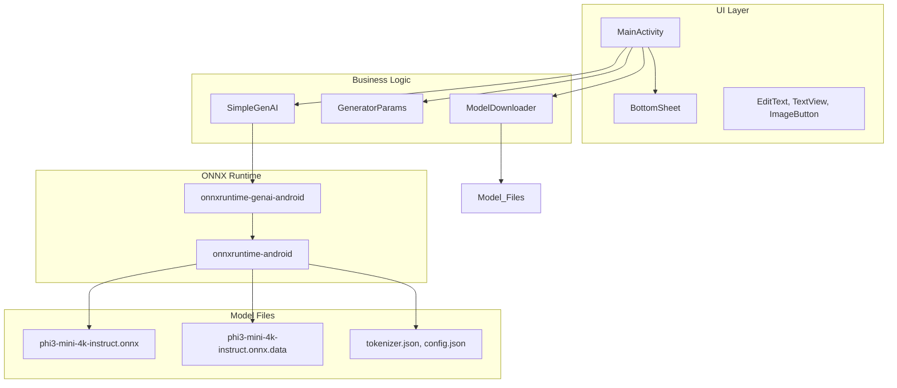

**iOS Architecture Diagram**

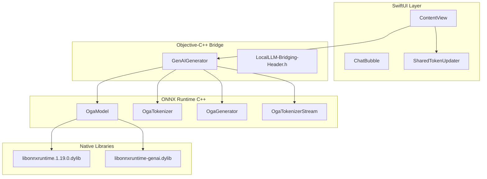

Sources:
- [mobile/examples/phi-3/android/app/src/main/java/ai/onnxruntime/genai/demo/MainActivity.java:27-30]()
- [mobile/examples/phi-3/ios/LocalLLM/LocalLLM/GenAIGenerator.mm:14-16]()
- [mobile/examples/phi-3/ios/LocalLLM/LocalLLM/ContentView.swift:7-11]()

## Token Generation Flow

**Android Token Generation Sequence**

```mermaid
sequenceDiagram
    participant User
    participant MainActivity
    participant SimpleGenAI
    participant GeneratorParams
    participant TokenListener["Consumer<String>"]
    
    User->>MainActivity: "onClick sendMsgIB"
    MainActivity->>SimpleGenAI: "createGeneratorParams()"
    SimpleGenAI->>GeneratorParams: "new GeneratorParams"
    MainActivity->>GeneratorParams: "setSearchOption(length_penalty, maxLength)"
    MainActivity->>TokenListener: "Create lambda tokenListener"
    MainActivity->>SimpleGenAI: "generate(params, prompt, tokenListener)"
    
    loop "Token Generation Loop"
        SimpleGenAI->>SimpleGenAI: "computeLogits(), generateNextToken()"
        SimpleGenAI->>TokenListener: "accept(decodedToken)"
        TokenListener->>MainActivity: "runOnUiThread()"
        MainActivity->>MainActivity: "generatedTV.setText(generated + token)"
    end
    
    SimpleGenAI->>MainActivity: "Return fullResponse"
    MainActivity->>MainActivity: "showTokenPopup(promptTime, tokensPerSec)"
```

**iOS Token Generation Sequence**

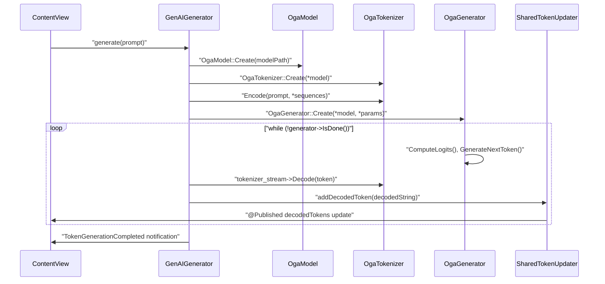

Sources:
- [mobile/examples/phi-3/android/app/src/main/java/ai/onnxruntime/genai/demo/MainActivity.java:139-196]()
- [mobile/examples/phi-3/ios/LocalLLM/LocalLLM/GenAIGenerator.mm:72-103]()
- [mobile/examples/phi-3/ios/LocalLLM/LocalLLM/SharedTokenUpdater.swift:12-16]()

## 3. Model Specifications

The examples use the INT4-quantized version of Phi-3 Mini optimized for mobile devices. 

### 3.1 Model Details

| Property | Value |
|----------|-------|
| Model Name | Phi-3 Mini |
| Variant | INT4-quantized, RTN, block-32 |
| Size | >2GB |
| Location | HuggingFace (microsoft/Phi-3-mini-4k-instruct-onnx) |
| Path | cpu_and_mobile/cpu-int4-rtn-block-32-acc-level-4/ |
| Format | ONNX |

Sources:
- [mobile/examples/phi-3/android/README.md:7-10]()
- [mobile/examples/phi-3/ios/LocalLLM/LocalLLM/README.md:99-101]()

### Model File Dependencies

The Android implementation defines required model files in `MODEL_FILES`:

| File | Purpose |
|------|---------|
| `phi3-mini-4k-instruct-cpu-int4-rtn-block-32-acc-level-4.onnx` | Main ONNX model |
| `phi3-mini-4k-instruct-cpu-int4-rtn-block-32-acc-level-4.onnx.data` | Model weights data |
| `tokenizer.json` | Tokenizer vocabulary and configuration |
| `tokenizer.model` | SentencePiece tokenizer model |
| `tokenizer_config.json` | Tokenizer configuration |
| `added_tokens.json` | Additional tokens for the vocabulary |
| `special_tokens_map.json` | Special token mappings |
| `config.json` | Model configuration |
| `genai_config.json` | GenAI-specific configuration |
| `configuration_phi3.py` | Python configuration file |

The `ModelDownloader` class handles automatic download of missing files from the configured `MODEL_BASE_URL`.

Sources:
- [mobile/examples/phi-3/android/app/src/main/java/ai/onnxruntime/genai/demo/MainActivity.java:37-49]()
- [mobile/examples/phi-3/android/app/src/main/java/ai/onnxruntime/genai/demo/MainActivity.java:209-272]()

## Android Implementation

### Requirements

- Android Studio Giraffe | 2022.3.1 or later
- Android SDK 29+, target SDK 33
- Android NDK r22+
- Device with 8GB+ internal storage
- ARM64-v8a or x86_64 architecture support

Sources:
- [mobile/examples/phi-3/android/README.md:37-41]()
- [mobile/examples/phi-3/android/app/build.gradle.kts:18-21]()

### Class Structure

**MainActivity Core Components**

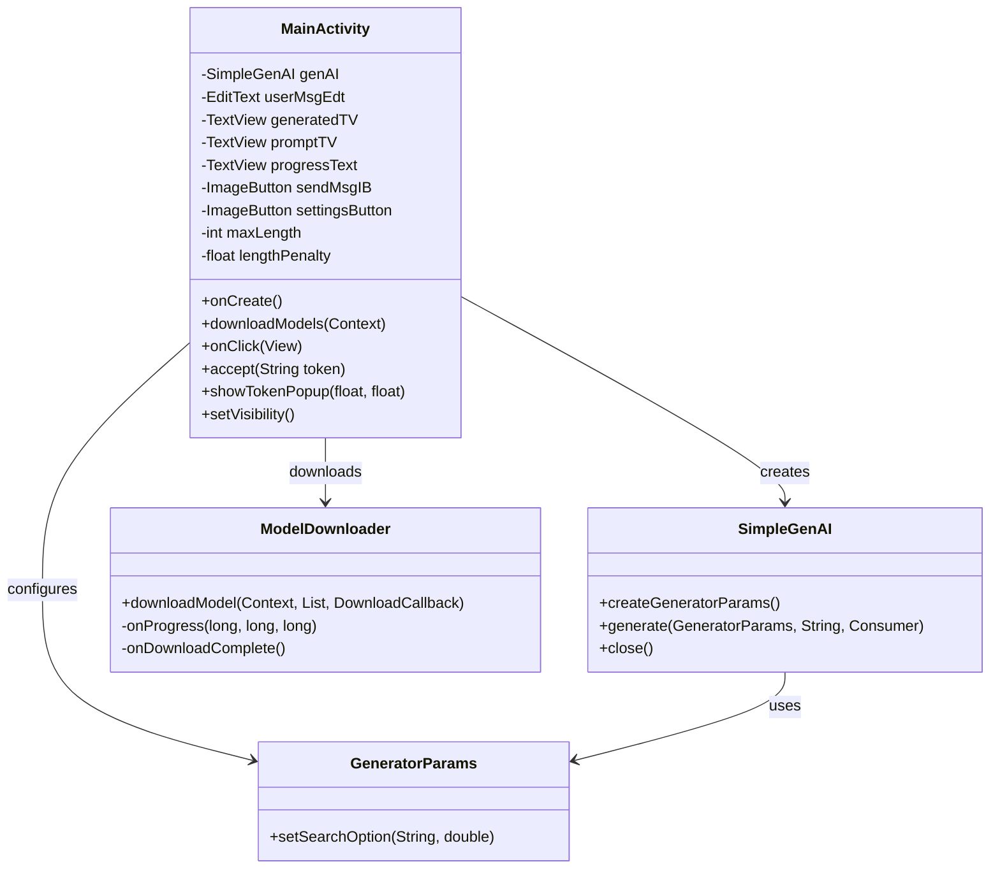

**Settings Configuration**

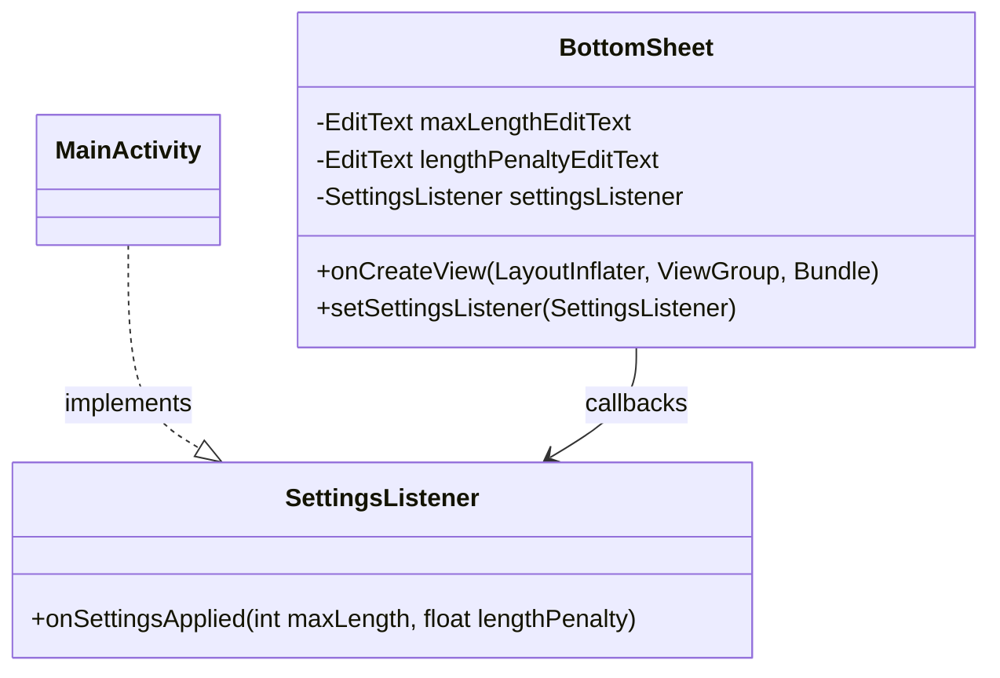

Sources:
- [mobile/examples/phi-3/android/app/src/main/java/ai/onnxruntime/genai/demo/MainActivity.java:31-62]()
- [mobile/examples/phi-3/android/app/src/main/java/ai/onnxruntime/genai/demo/MainActivity.java:88-99]()

### Implementation Details

**Model Download Process**

The `downloadModels()` method in `MainActivity` implements the following logic:

1. Check for existing files using `fileExists(context, fileName)`
2. Create URL-file pairs for missing files from `MODEL_BASE_URL`
3. Use `ExecutorService` for background download
4. Initialize `SimpleGenAI` on completion

**Token Generation Implementation**

```java
// Create generator parameters
GeneratorParams generatorParams = genAI.createGeneratorParams();
generatorParams.setSearchOption("length_penalty", (double)lengthPenalty);
generatorParams.setSearchOption("max_length", (double)maxLength);

// Token listener for streaming
Consumer<String> tokenListener = token -> {
    MainActivity.this.accept(token);  // Update UI
    Log.i(TAG, "Generated token: " + token);
    numTokens[0] += 1;
};

// Generate with streaming callback
String fullResponse = genAI.generate(generatorParams, promptQuestion_formatted, tokenListener);
```

**UI Thread Safety**

The `accept(String token)` method ensures thread-safe UI updates:

```java
@Override
public void accept(String token) {
    runOnUiThread(() -> {
        CharSequence generated = generatedTV.getText();
        generatedTV.setText(generated + token);
        generatedTV.invalidate();
        // Auto-scroll to bottom
        final int scrollAmount = generatedTV.getLayout().getLineTop(generatedTV.getLineCount()) - generatedTV.getHeight();
        generatedTV.scrollTo(0, Math.max(scrollAmount, 0));
    });
}
```

Sources:
- [mobile/examples/phi-3/android/app/src/main/java/ai/onnxruntime/genai/demo/MainActivity.java:209-272]()
- [mobile/examples/phi-3/android/app/src/main/java/ai/onnxruntime/genai/demo/MainActivity.java:143-168]()
- [mobile/examples/phi-3/android/app/src/main/java/ai/onnxruntime/genai/demo/MainActivity.java:274-284]()

### Prompt Formatting and Configuration

**Prompt Template**

The Android implementation formats user input into a structured prompt:

```java
String promptQuestion_formatted = "<system>You are a helpful AI assistant. Answer in two paragraphs or less<|end|><|user|>"+promptQuestion+"<|end|>\n<assistant|>";
```

**Generation Parameters Configuration**

| Parameter | Type | Default | Description |
|-----------|------|---------|-------------|
| `maxLength` | `int` | 100 | Maximum tokens to generate |
| `lengthPenalty` | `float` | 1.0f | Length penalty factor |

Parameters are applied via `GeneratorParams.setSearchOption()`:

```java
generatorParams.setSearchOption("length_penalty", (double)lengthPenalty);
generatorParams.setSearchOption("max_length", (double)maxLength);
```

The `BottomSheet` class provides a settings dialog for runtime parameter adjustment, implementing the `SettingsListener` interface for callback communication with `MainActivity`.

Sources:
- [mobile/examples/phi-3/android/app/src/main/java/ai/onnxruntime/genai/demo/MainActivity.java:126]()
- [mobile/examples/phi-3/android/app/src/main/java/ai/onnxruntime/genai/demo/MainActivity.java:60-61]()
- [mobile/examples/phi-3/android/app/src/main/java/ai/onnxruntime/genai/demo/MainActivity.java:148-149]()

## iOS Implementation

### Requirements

- macOS 14+
- Xcode 15+ (latest recommended)
- iOS SDK 16.x+
- iPhone 14+ with A16/A17 chip (preferred)
- Device storage for >2GB model files

Sources:
- [mobile/examples/phi-3/ios/LocalLLM/LocalLLM/README.md:11-15]()

### SwiftUI Architecture

**Main View Components**

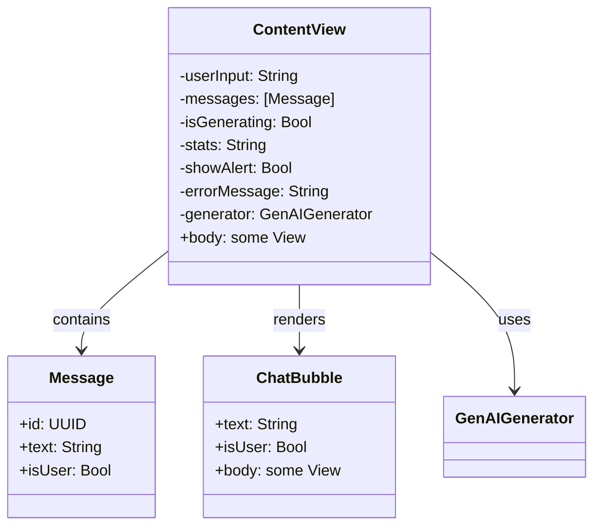

**Objective-C++ Bridge Layer**

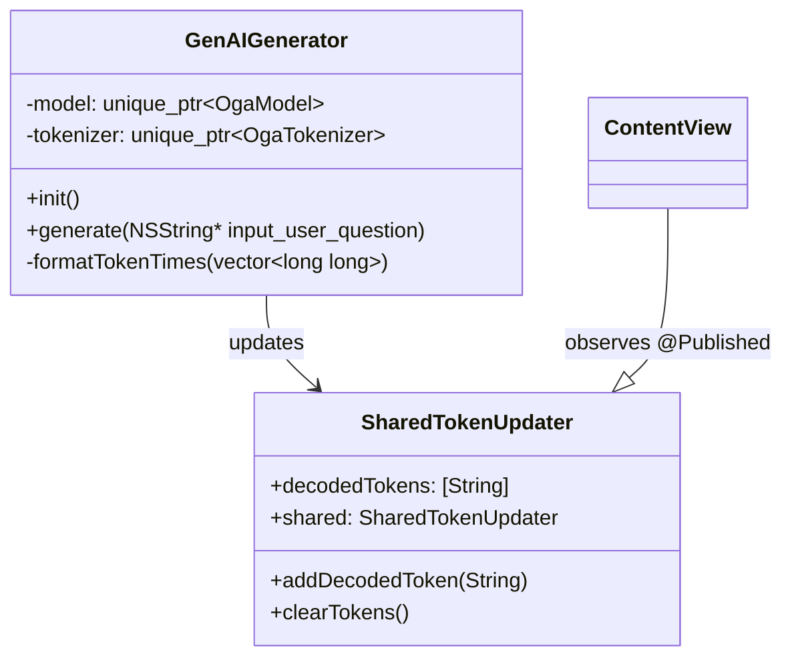

**ONNX Runtime C++ Integration**

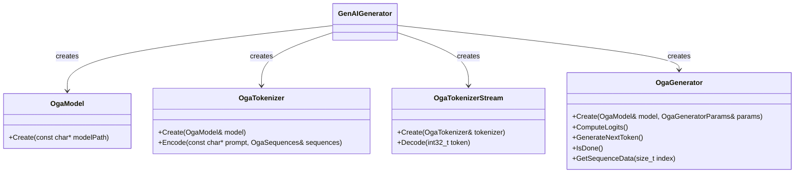

Sources:
- [mobile/examples/phi-3/ios/LocalLLM/LocalLLM/ContentView.swift:13-21]()
- [mobile/examples/phi-3/ios/LocalLLM/LocalLLM/GenAIGenerator.mm:13-17]()
- [mobile/examples/phi-3/ios/LocalLLM/LocalLLM/SharedTokenUpdater.swift:7-10]()

### Implementation Flow

**Model Initialization and Resource Loading**

The `GenAIGenerator` implements lazy initialization:

```objective-c
if (!self->model) {
    NSLog(@"Creating model...");
    NSString* llmPath = [[NSBundle mainBundle] resourcePath];
    const char* modelPath = llmPath.cString;
    self->model = OgaModel::Create(modelPath);
}

if (!self->tokenizer) {
    NSLog(@"Creating tokenizer...");
    self->tokenizer = OgaTokenizer::Create(*self->model);
}
```

**Token Generation Loop**

```objective-c
while (!generator->IsDone()) {
    tokenStartTime = Clock::now();
    
    generator->ComputeLogits();
    generator->GenerateNextToken();
    
    // Get and decode the latest token
    const int32_t* seq = generator->GetSequenceData(0);
    size_t seq_len = generator->GetSequenceCount(0);
    const char* decode_tokens = tokenizer_stream->Decode(seq[seq_len - 1]);
    
    // Update UI through SharedTokenUpdater
    NSString* decodedTokenString = [NSString stringWithUTF8String:decode_tokens];
    [SharedTokenUpdater.shared addDecodedToken:decodedTokenString];
    
    // Track timing
    TimePoint tokenEndTime = Clock::now();
    auto tokenDuration = std::chrono::duration_cast<std::chrono::milliseconds>(tokenEndTime - tokenStartTime).count();
    tokenTimes.push_back(tokenDuration);
}
```

**SwiftUI Reactive Updates**

The `ContentView` observes token updates through Combine:

```swift
.onReceive(SharedTokenUpdater.shared.$decodedTokens) { tokens in
    if let lastIndex = messages.lastIndex(where: { !$0.isUser }) {
        let combinedText = tokens.joined(separator: "")
        messages[lastIndex].text = combinedText
    }
}
```

Sources:
- [mobile/examples/phi-3/ios/LocalLLM/LocalLLM/GenAIGenerator.mm:42-52]()
- [mobile/examples/phi-3/ios/LocalLLM/LocalLLM/GenAIGenerator.mm:77-102]()
- [mobile/examples/phi-3/ios/LocalLLM/LocalLLM/ContentView.swift:89-95]()

### Prompt Configuration and Performance

**Prompt Template**

The iOS implementation uses a simplified prompt format:

```objective-c
NSString* promptString = [NSString stringWithFormat:@"<|user|>\n%@<|end|>\n<|assistant|>", input_user_question];
```

**Performance Metrics Collection**

The `GenAIGenerator` tracks detailed timing information:

```objective-c
// Initialize timing vectors
std::vector<long long> tokenTimes;
TimePoint startTime, firstTokenTime, tokenStartTime;

// Track first token latency
startTime = Clock::now();
while (!generator->IsDone()) {
    tokenStartTime = Clock::now();
    
    // Generation logic...
    
    if (isFirstToken) {
        firstTokenTime = Clock::now();
        isFirstToken = false;
    }
    
    TimePoint tokenEndTime = Clock::now();
    auto tokenDuration = std::chrono::duration_cast<std::chrono::milliseconds>(tokenEndTime - tokenStartTime).count();
    tokenTimes.push_back(tokenDuration);
}

// Calculate final metrics
auto totalDuration = std::chrono::duration_cast<std::chrono::milliseconds>(endTime - startTime).count();
auto firstTokenDuration = std::chrono::duration_cast<std::chrono::milliseconds>(firstTokenTime - startTime).count();

double promptProcRate = (double)promptTokensCount * 1000.0 / firstTokenDuration;
double tokenGenRate = (double)(tokenTimes.size() - 1) * 1000.0 / (totalDuration - firstTokenDuration);
```

**UI Performance Display**

Performance statistics are displayed via notification to the main thread:

```objective-c
NSDictionary* stats = @{@"tokenGenRate" : @(tokenGenRate), @"promptProcRate" : @(promptProcRate)};
dispatch_async(dispatch_get_main_queue(), ^{
    [[NSNotificationCenter defaultCenter] postNotificationName:@"TokenGenerationStats" object:nil userInfo:stats];
});
```

Sources:
- [mobile/examples/phi-3/ios/LocalLLM/LocalLLM/GenAIGenerator.mm:57]()
- [mobile/examples/phi-3/ios/LocalLLM/LocalLLM/GenAIGenerator.mm:34-36]()
- [mobile/examples/phi-3/ios/LocalLLM/LocalLLM/GenAIGenerator.mm:110-121]()
- [mobile/examples/phi-3/ios/LocalLLM/LocalLLM/ContentView.swift:96-102]()

## Core API Integration

### Platform-Specific API Patterns

**Android GenAI API Usage**

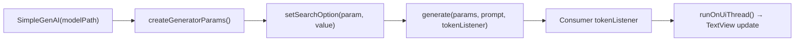

**iOS ONNX Runtime C++ API Usage**

```mermaid
flowchart LR
    OgaModel["OgaModel::Create(modelPath)"] --> OgaTokenizer["OgaTokenizer::Create(*model)"]
    OgaTokenizer --> OgaSequences["tokenizer->Encode(prompt, *sequences)"]
    OgaSequences --> OgaGeneratorParams["OgaGeneratorParams::Create(*model)"]
    OgaGeneratorParams --> OgaGenerator["OgaGenerator::Create(*model, *params)"]
    OgaGenerator --> GenerationLoop["while (!generator->IsDone())"]
    GenerationLoop --> ComputeLogits["generator->ComputeLogits()"]
    ComputeLogits --> GenerateToken["generator->GenerateNextToken()"]
    GenerateToken --> DecodeToken["tokenizer_stream->Decode(token)"]
    DecodeToken --> UpdateUI["SharedTokenUpdater.shared addDecodedToken"]
```

### Key API Method Mappings

| Android (Java) | iOS (C++) | Purpose |
|----------------|-----------|---------|
| `SimpleGenAI(String path)` | `OgaModel::Create(const char* path)` | Initialize model |
| `genAI.createGeneratorParams()` | `OgaGeneratorParams::Create(*model)` | Create generation config |
| `params.setSearchOption(key, value)` | `params->SetSearchOption(key, value)` | Configure generation |
| `genAI.generate(params, prompt, listener)` | Manual generation loop | Execute generation |
| `Consumer<String> tokenListener` | `SharedTokenUpdater.shared` | Handle token callbacks |

### Generation Configuration Options

Both platforms support these `setSearchOption` parameters:

| Parameter | Type | Purpose |
|-----------|------|---------|
| `"max_length"` | `double` | Maximum tokens to generate |
| `"length_penalty"` | `double` | Length penalty factor |

Sources:
- [mobile/examples/phi-3/android/app/src/main/java/ai/onnxruntime/genai/demo/MainActivity.java:143-168]()
- [mobile/examples/phi-3/ios/LocalLLM/LocalLLM/GenAIGenerator.mm:66-71]()
- [mobile/examples/phi-3/ios/LocalLLM/LocalLLM/GenAIGenerator.mm:77-91]()

## Performance Analysis

### Metrics Collection Implementation

**Android Performance Tracking**

```java
// Timing measurement in MainActivity
long startTime = System.currentTimeMillis();
final long[] firstTokenTime = {startTime};
final long[] numTokens = {0};

Consumer<String> tokenListener = token -> {
    if (numTokens[0] == 0) {
        firstTokenTime[0] = System.currentTimeMillis();
    }
    numTokens[0] += 1;
};

// After generation completes
long totalTime = System.currentTimeMillis() - firstTokenTime[0];
float promptProcessingTime = (firstTokenTime[0] - startTime) / 1000.0f;
float tokensPerSecond = numTokens[0] > 1 ? (1000.0f * (numTokens[0] - 1)) / totalTime : 0;
```

**iOS Performance Tracking**

```objective-c
std::vector<long long> tokenTimes;
TimePoint startTime = Clock::now();
TimePoint firstTokenTime, tokenStartTime;

while (!generator->IsDone()) {
    tokenStartTime = Clock::now();
    
    // Generation logic...
    
    if (isFirstToken) {
        firstTokenTime = Clock::now();
        isFirstToken = false;
    }
    
    TimePoint tokenEndTime = Clock::now();
    auto tokenDuration = std::chrono::duration_cast<std::chrono::milliseconds>(tokenEndTime - tokenStartTime).count();
    tokenTimes.push_back(tokenDuration);
}
```

### Performance Characteristics

| Metric | Android Implementation | iOS Implementation |
|--------|----------------------|-------------------|
| **Prompt Processing** | `(firstTokenTime - startTime) / 1000.0f` seconds | `firstTokenDuration` milliseconds |
| **Token Generation Rate** | `(numTokens - 1) * 1000.0f / totalTime` tokens/sec | `(tokenTimes.size() - 1) * 1000.0 / duration` tokens/sec |
| **Per-Token Timing** | Not tracked individually | `std::vector<long long> tokenTimes` |
| **Memory Efficiency** | Java garbage collection | C++ RAII with smart pointers |

### Model Optimization Characteristics

- **Quantization**: INT4 reduces model size from ~7GB to ~2GB
- **Architecture Support**: ARM64-v8a (Android), arm64 (iOS)
- **Memory Requirements**: Minimum 8GB device storage recommended
- **First Token Latency**: Significantly higher than subsequent tokens due to prompt processing

Sources:
- [mobile/examples/phi-3/android/app/src/main/java/ai/onnxruntime/genai/demo/MainActivity.java:150-172]()
- [mobile/examples/phi-3/ios/LocalLLM/LocalLLM/GenAIGenerator.mm:34-36]()
- [mobile/examples/phi-3/ios/LocalLLM/LocalLLM/GenAIGenerator.mm:98-114]()
- [mobile/examples/phi-3/android/README.md:53]()

## User Interface Architecture

### Android UI Components

**Layout Structure**

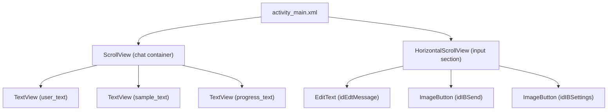

**Dialog Components**

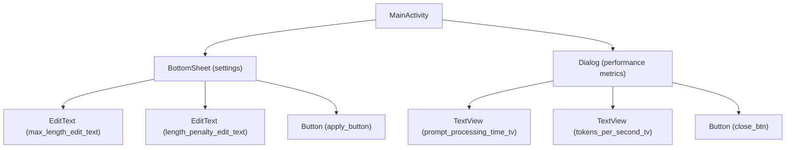

### iOS SwiftUI Architecture

**View Hierarchy**

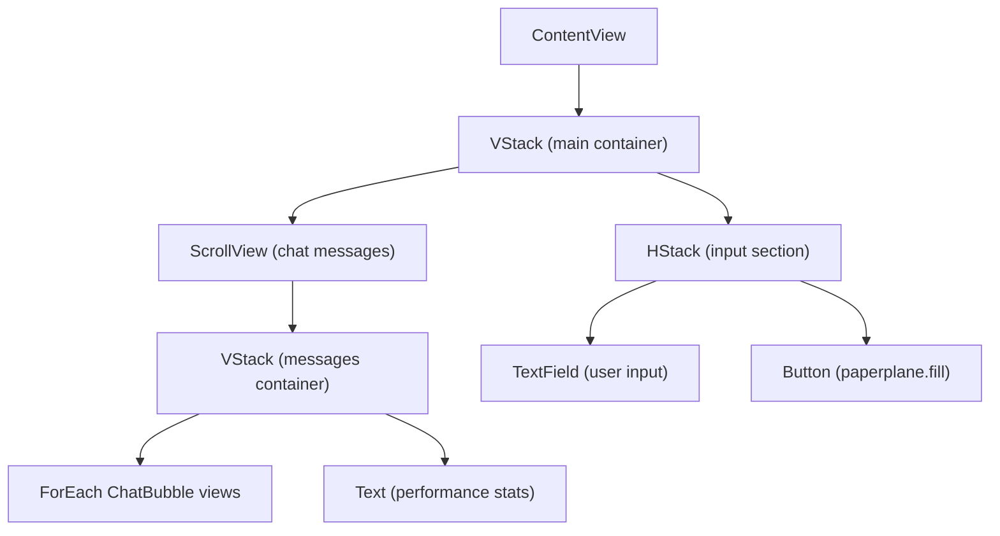

**State Management**

```swift
@State private var userInput: String = ""
@State private var messages: [Message] = []
@State private var isGenerating: Bool = false
@State private var stats: String = ""
@State private var showAlert: Bool = false
@State private var errorMessage: String = ""
```

**Reactive Data Flow**

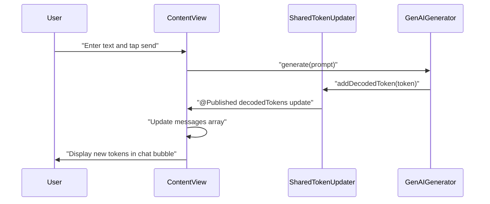

### Platform-Specific UI Features

| Feature | Android Implementation | iOS Implementation |
|---------|----------------------|-------------------|
| **Chat Display** | Separate `TextView` for user/bot | `ChatBubble` views with `isUser` styling |
| **Input Method** | `EditText` with `ImageButton` | `TextField` with `Button(systemName: "paperplane.fill")` |
| **Settings** | `BottomSheet` modal dialog | Currently not implemented |
| **Progress Indication** | `TextView` with download percentage | Built-in loading state |
| **Performance Display** | Popup `Dialog` | Inline `Text` below chat |
| **Error Handling** | `Toast` messages | SwiftUI `.alert()` modifier |

Sources:
- [mobile/examples/phi-3/android/app/src/main/java/ai/onnxruntime/genai/demo/MainActivity.java:73-78]()
- [mobile/examples/phi-3/ios/LocalLLM/LocalLLM/ContentView.swift:14-19]()
- [mobile/examples/phi-3/ios/LocalLLM/LocalLLM/ContentView.swift:46-82]()
- [mobile/examples/phi-3/ios/LocalLLM/LocalLLM/ContentView.swift:121-146]()

## 9. Extending The Examples

The example implementations can be extended in several ways:

1. **Custom Model Integration**: Replace the Phi-3 model with other ONNX models
2. **Advanced Prompting**: Modify the prompt format for different tasks
3. **Parameter Tuning**: Experiment with generation parameters
4. **UI Enhancements**: Add conversation history, sharing options, etc.
5. **Performance Improvements**: Implement caching for better response times

Sources:
- [mobile/examples/phi-3/android/README.md:10]()
- [mobile/examples/phi-3/ios/LocalLLM/LocalLLM/README.md:107-109]()

## 10. Conclusion

The Phi-3 Mini mobile implementation demonstrates how to build on-device LLM applications using ONNX Runtime and the GenAI API. The examples showcase efficient model loading, token generation, and UI integration for both Android and iOS platforms. While the model is significantly compressed through INT4 quantization, it still maintains impressive capabilities for on-device text generation without requiring cloud connectivity.

---

