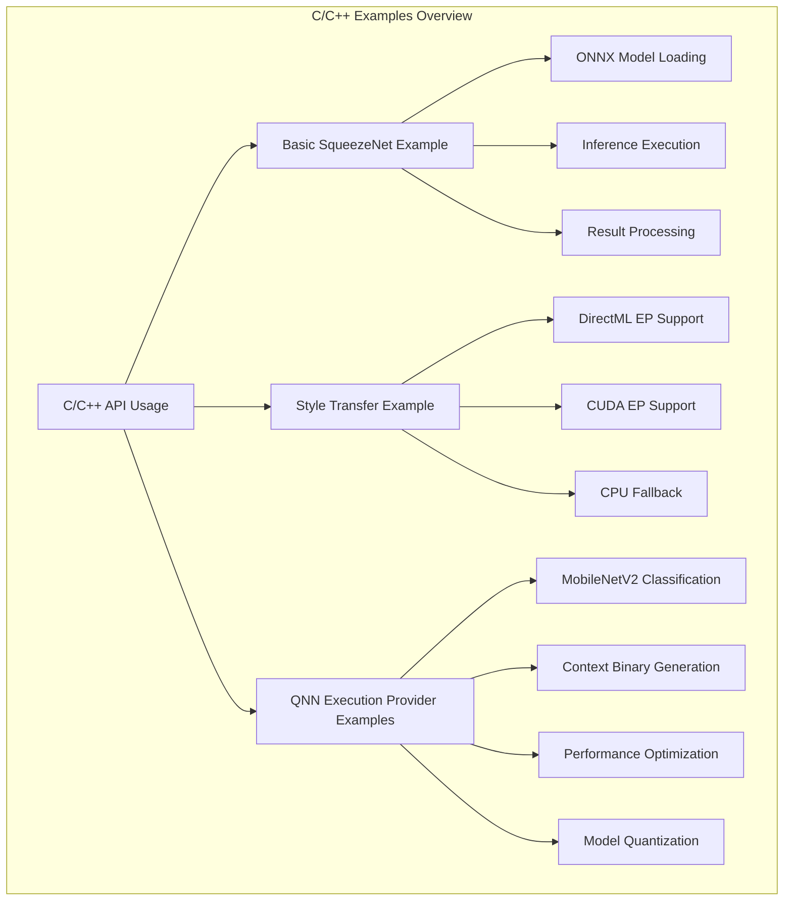
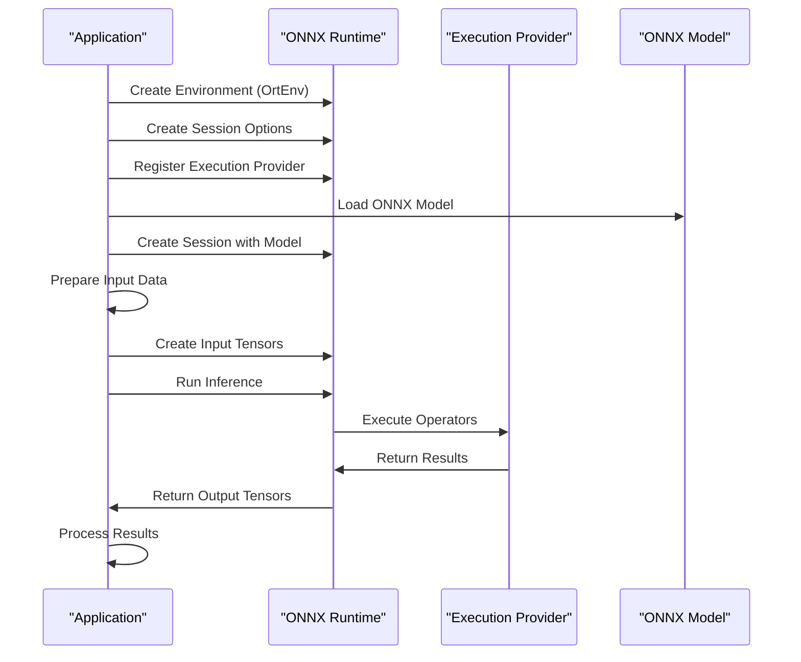
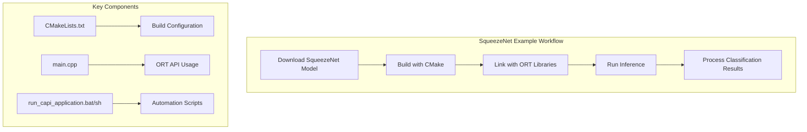
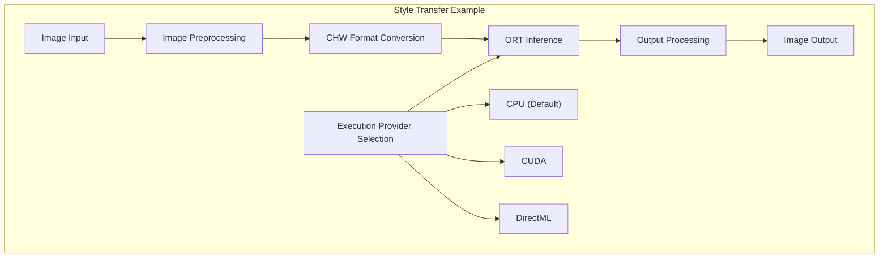
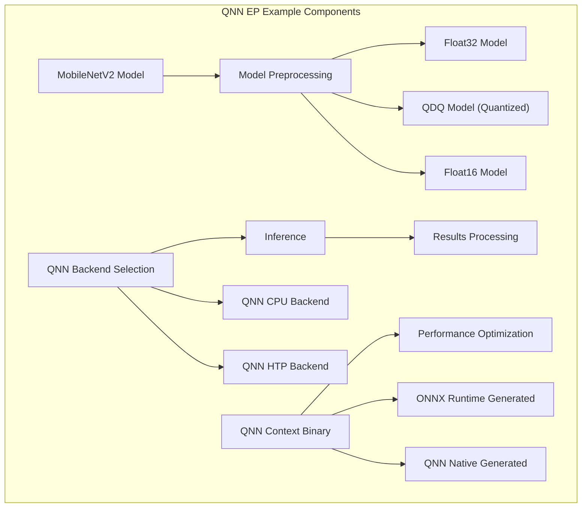
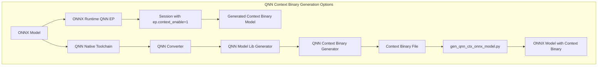
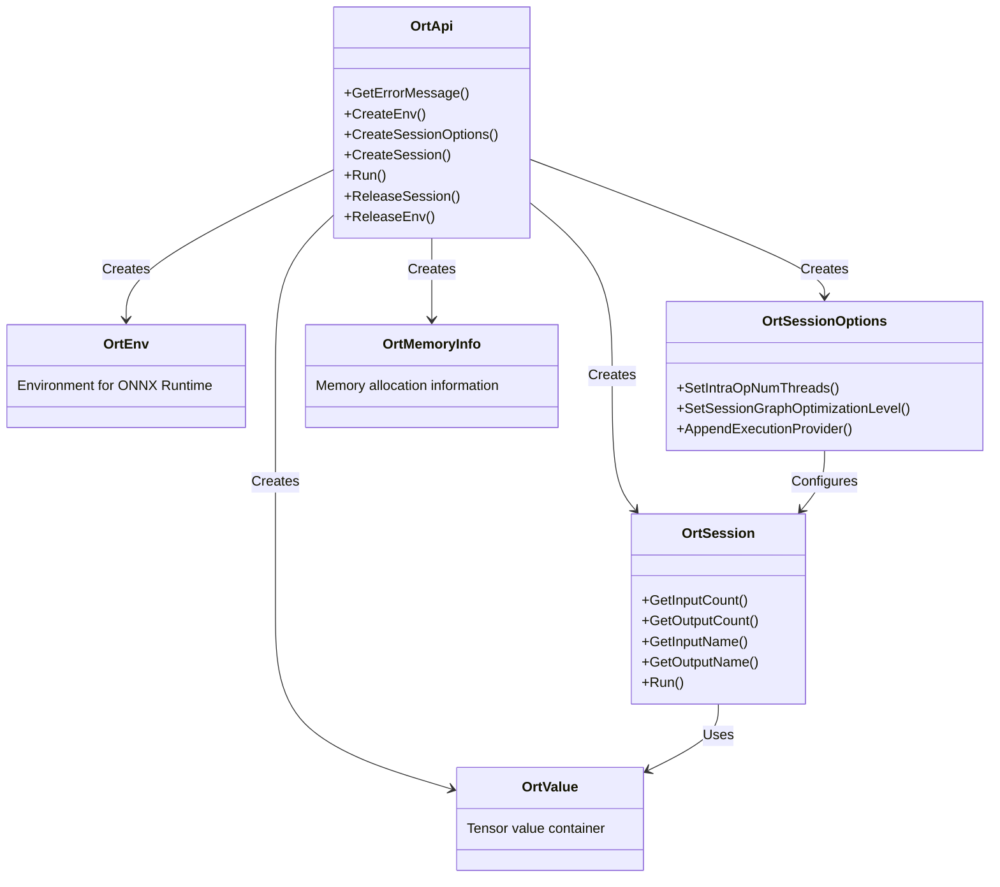

<!-- source: DeepWiki mcp.deepwiki.com · repo microsoft/onnxruntime-inference-examples · page 3 C/C++ Examples · fetched 2026-10-26 -->

# C/C++ Examples

<details>
<summary>Relevant source files</summary>

The following files were used as context for generating this wiki page:

- [c_cxx/QNN_EP/mobilenetv2_classification/CMakeLists.txt](c_cxx/QNN_EP/mobilenetv2_classification/CMakeLists.txt)
- [c_cxx/QNN_EP/mobilenetv2_classification/README.md](c_cxx/QNN_EP/mobilenetv2_classification/README.md)
- [c_cxx/QNN_EP/mobilenetv2_classification/libmobilenetv2-12.serialized.bin](c_cxx/QNN_EP/mobilenetv2_classification/libmobilenetv2-12.serialized.bin)
- [c_cxx/QNN_EP/mobilenetv2_classification/main.cpp](c_cxx/QNN_EP/mobilenetv2_classification/main.cpp)
- [c_cxx/QNN_EP/mobilenetv2_classification/mobilenetv2-12_net.json](c_cxx/QNN_EP/mobilenetv2_classification/mobilenetv2-12_net.json)
- [c_cxx/QNN_EP/mobilenetv2_classification/mobilenetv2_helper.py](c_cxx/QNN_EP/mobilenetv2_classification/mobilenetv2_helper.py)
- [c_cxx/QNN_EP/mobilenetv2_classification/run_qnn_ep_sample.bat](c_cxx/QNN_EP/mobilenetv2_classification/run_qnn_ep_sample.bat)
- [c_cxx/QNN_EP/mobilenetv2_classification/to_fp16.py](c_cxx/QNN_EP/mobilenetv2_classification/to_fp16.py)
- [c_cxx/squeezenet/CMakeLists.txt](c_cxx/squeezenet/CMakeLists.txt)
- [c_cxx/squeezenet/README.md](c_cxx/squeezenet/README.md)
- [c_cxx/squeezenet/run_capi_application.bat](c_cxx/squeezenet/run_capi_application.bat)
- [c_cxx/squeezenet/run_capi_application.sh](c_cxx/squeezenet/run_capi_application.sh)

</details>


This page provides a comprehensive overview of the C/C++ examples included in the ONNX Runtime inference examples repository. These examples demonstrate how to use the ONNX Runtime C and C++ APIs for various inference scenarios, execution providers, and optimization techniques.

## Overview

The C/C++ examples showcase different ways to integrate ONNX Runtime into C and C++ applications. These examples range from basic inference using the C API to more advanced scenarios utilizing specific execution providers and optimization techniques.



Sources: [c_cxx/QNN_EP/mobilenetv2_classification/main.cpp](), [c_cxx/squeezenet/CMakeLists.txt](), [c_cxx/squeezenet/run_capi_application.bat]()

## Common Inference Pattern

The C/C++ examples follow a common pattern for inference with ONNX Runtime, which can be summarized as follows:



Sources: [c_cxx/QNN_EP/mobilenetv2_classification/main.cpp:25-190](), [c_cxx/QNN_EP/mobilenetv2_classification/run_qnn_ep_sample.bat](), [c_cxx/squeezenet/run_capi_application.bat]()

## Basic C API Usage (SqueezeNet)

The SqueezeNet example demonstrates the fundamental usage of the ONNX Runtime C API to perform image classification with a pre-trained SqueezeNet model.

### Setup and Build

The example can be built using CMake and run with a pre-downloaded SqueezeNet ONNX model. The build process is automated through platform-specific scripts:

- Windows: `run_capi_application.bat ONNXRUNTIME_ROOTDIR ORT_PACKAGE`
- Linux: `run_capi_application.sh -o ONNXRUNTIME_ROOTDIR -p ORT_PACKAGE -w WORKSPACE`

The CMake configuration in `CMakeLists.txt` sets up the build with:
- C++14 standard requirement
- TensorRT provider factory header detection
- ONNX Runtime library linking via `target_link_libraries(capi_test onnxruntime)`
</old_str>

<old_str>
### Model Types and Optimization

The example supports different types of models and optimization techniques with specific command-line arguments:

| Model Type | Command Flag | Description | Backend Support |
|------------|--------------|-------------|-----------------|
| Float32 | `--fp32` | Original 32-bit floating point model | CPU, HTP (with FP16 precision) |
| QDQ (Quantized) | `--htp` | Quantized model using QDQ nodes | HTP |
| Float16 | `--fp16` | 16-bit floating point model | HTP |
| Context Binary | `--qnn` | Pre-compiled model with QNN context binary | HTP |
| CPU Backend | `--cpu` | Standard CPU inference | CPU only |

The `main.cpp` implementation uses constants like `CPUBACKEDN`, `HTPBACKEDN`, `QNNCTXBINARY`, `FLOAT32`, and `FLOAT16` to handle these different execution modes.
</old_str>
<new_str>
Sources: [c_cxx/squeezenet/run_capi_application.bat:3-34](), [c_cxx/squeezenet/run_capi_application.sh:13-38](), [c_cxx/squeezenet/CMakeLists.txt:1-25](), [c_cxx/squeezenet/README.md]()



Sources: [c_cxx/squeezenet/run_capi_application.bat](), [c_cxx/squeezenet/run_capi_application.sh](), [c_cxx/squeezenet/CMakeLists.txt]()

## Style Transfer Example

The Fast Neural Style Transfer example demonstrates how to use ONNX Runtime to apply artistic styles to images using a pre-trained neural network.

### Architecture and Components



The example supports multiple execution providers:
- CPU (default)
- CUDA (for NVIDIA GPUs)
- DirectML (for Windows GPUs)

The example takes an input image (720x720), processes it through the neural style transfer model, and outputs the styled image.

Sources: [c_cxx/fns_candy_style_transfer/fns_candy_style_transfer.c](), [c_cxx/fns_candy_style_transfer/image_file.h](), [c_cxx/fns_candy_style_transfer/image_file_libpng.c]()

### Key Functions

- `hwc_to_chw`: Converts image data from HWC format to CHW format
- `chw_to_hwc`: Converts image data from CHW format to HWC format
- `run_inference`: Core function that performs the style transfer
- `enable_cuda`/`enable_dml`: Functions to enable specific execution providers

Sources: [c_cxx/fns_candy_style_transfer/fns_candy_style_transfer.c:34-75](), [c_cxx/fns_candy_style_transfer/fns_candy_style_transfer.c:138-161]()

## QNN EP (Qualcomm Neural Network Execution Provider) Example

The QNN EP example demonstrates how to use the Qualcomm Neural Network Execution Provider with ONNX Runtime for efficient inference on Qualcomm devices, specifically focusing on image classification with MobileNetV2.

### Architecture and Components



Sources: [c_cxx/QNN_EP/mobilenetv2_classification/main.cpp](), [c_cxx/QNN_EP/mobilenetv2_classification/README.md]()

### Usage Examples

The QNN EP example provides several usage scenarios executed through the `run_qnn_ep_sample.bat` script:

1. **CPU Backend**: `qnn_ep_sample.exe --cpu mobilenetv2-12_shape.onnx kitten_input.raw`
2. **HTP Backend with QDQ**: `qnn_ep_sample.exe --htp mobilenetv2-12_quant_shape.onnx kitten_input.raw`
3. **Context Generation**: `qnn_ep_sample.exe --htp mobilenetv2-12_quant_shape.onnx kitten_input.raw --gen_ctx`
4. **Context Binary Usage**: `qnn_ep_sample.exe --htp mobilenetv2-12_quant_shape.onnx_ctx.onnx kitten_input.raw`
5. **Native QNN Context**: `qnn_ep_sample.exe --qnn mobilenetv2-12_net_qnn_ctx.onnx kitten_input_nhwc.raw`
6. **FP32 with FP16 Precision**: `qnn_ep_sample.exe --fp32 mobilenetv2-12_shape.onnx kitten_input.raw`
7. **FP16 Model**: `qnn_ep_sample.exe --fp16 mobilenetv2-12_shape_fp16.onnx kitten_input.raw`

The `run_ort_qnn_ep` function in `main.cpp` handles the core inference logic, while command-line parsing occurs in the `main` function starting at line 208.

Sources: [c_cxx/QNN_EP/mobilenetv2_classification/run_qnn_ep_sample.bat:136-165](), [c_cxx/QNN_EP/mobilenetv2_classification/main.cpp:208-257](), [c_cxx/QNN_EP/mobilenetv2_classification/main.cpp:25-26]()

### Context Binary Optimization

One of the key features demonstrated is the generation and use of QNN context binary for improved model initialization time and reduced memory overhead:



Sources: [c_cxx/QNN_EP/mobilenetv2_classification/README.md:19-45](), [c_cxx/QNN_EP/mobilenetv2_classification/run_qnn_ep_sample.bat:82-89]()

### Usage Examples

The QNN EP example provides several usage scenarios:

1. Running float32 model with QNN CPU backend
2. Running QDQ model with QNN HTP backend
3. Generating and using context binary model with QNN HTP backend
4. Using native QNN context binary with QNN HTP backend
5. Running float32 model with QNN HTP backend using FP16 precision
6. Running float16 model with QNN HTP backend

Sources: [c_cxx/QNN_EP/mobilenetv2_classification/run_qnn_ep_sample.bat:136-165](), [c_cxx/QNN_EP/mobilenetv2_classification/main.cpp:208-257]()

## Core C/C++ API Components

The examples demonstrate several core components of the ONNX Runtime C/C++ API:



Sources: [c_cxx/QNN_EP/mobilenetv2_classification/main.cpp:12-24](), [c_cxx/QNN_EP/mobilenetv2_classification/main.cpp:15-23]()

### Common API Pattern

All examples follow a similar pattern for using the C/C++ API:

1. Obtain the OrtApi pointer (`OrtGetApiBase()->GetApi(ORT_API_VERSION)`)
2. Create an environment (`g_ort->CreateEnv`)
3. Create session options (`g_ort->CreateSessionOptions`)
4. Configure execution providers (`g_ort->SessionOptionsAppendExecutionProvider`)
5. Create a session with the ONNX model (`g_ort->CreateSession`)
6. Prepare input data and create input tensors (`g_ort->CreateTensorWithDataAsOrtValue`)
7. Run inference (`g_ort->Run`)
8. Process output tensors (`g_ort->GetTensorMutableData`)
9. Release resources

The QNN EP example implements this pattern in the `run_ort_qnn_ep` function, with specific session configuration for QNN execution providers and context binary generation.

Sources: [c_cxx/QNN_EP/mobilenetv2_classification/main.cpp:25-189](), [c_cxx/QNN_EP/mobilenetv2_classification/main.cpp:29-70]()

## Memory Management and Error Handling

Proper memory management and error handling are crucial in C/C++ applications. The examples demonstrate best practices:

### Memory Management

- Creating and releasing resources in the correct order
- Using appropriate memory allocators
- Properly releasing tensors, sessions, and environments

### Error Handling

The examples use a pattern of checking return status after API calls:

```
ORT_ABORT_ON_ERROR(g_ort->SomeFunction(...));
```

or

```
CheckStatus(g_ort, g_ort->SomeFunction(...));
```

These macros/functions check if the OrtStatus returned is non-null (indicating an error), print the error message, and handle the error appropriately.

Sources: [c_cxx/QNN_EP/mobilenetv2_classification/main.cpp:15-23]()

## Building and Running the Examples

Each example includes build instructions and scripts:

### SqueezeNet Example

- Windows: `run_capi_application.bat` 
- Linux: `run_capi_application.sh`

### Style Transfer Example

- Build with CMake
- Run with arguments: `<model_path> <input_file> <output_file> [cpu|cuda|dml]`

### QNN EP Example

- Windows: `run_qnn_ep_sample.bat`
- Requires Qualcomm AI Engine Direct SDK and ONNX Runtime with QNN support

Sources: [c_cxx/squeezenet/README.md](), [c_cxx/QNN_EP/mobilenetv2_classification/README.md:49-71](), [c_cxx/QNN_EP/mobilenetv2_classification/run_qnn_ep_sample.bat:97-102]()

## Related Advanced Examples

For more advanced examples using specific execution providers:

- QNN EP (Qualcomm Neural Network): See [QNN EP Examples](#3.1)
- OpenVINO EP (Intel): See [OpenVINO EP for C/C++](#3.2)
- Style Transfer with various EPs: See [Style Transfer Example](#3.3)
- Accuracy Testing Tool: See [Accuracy Testing Tool](#3.4)

---

