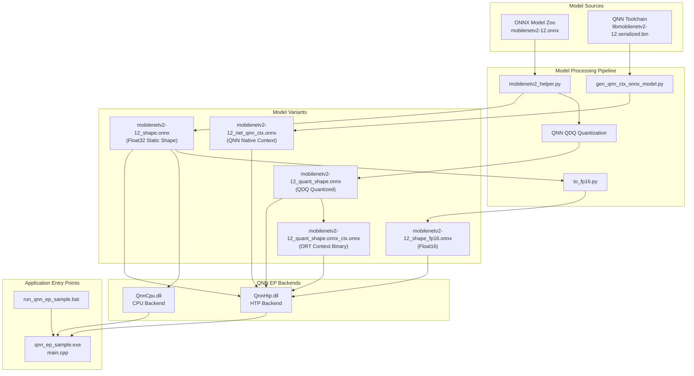
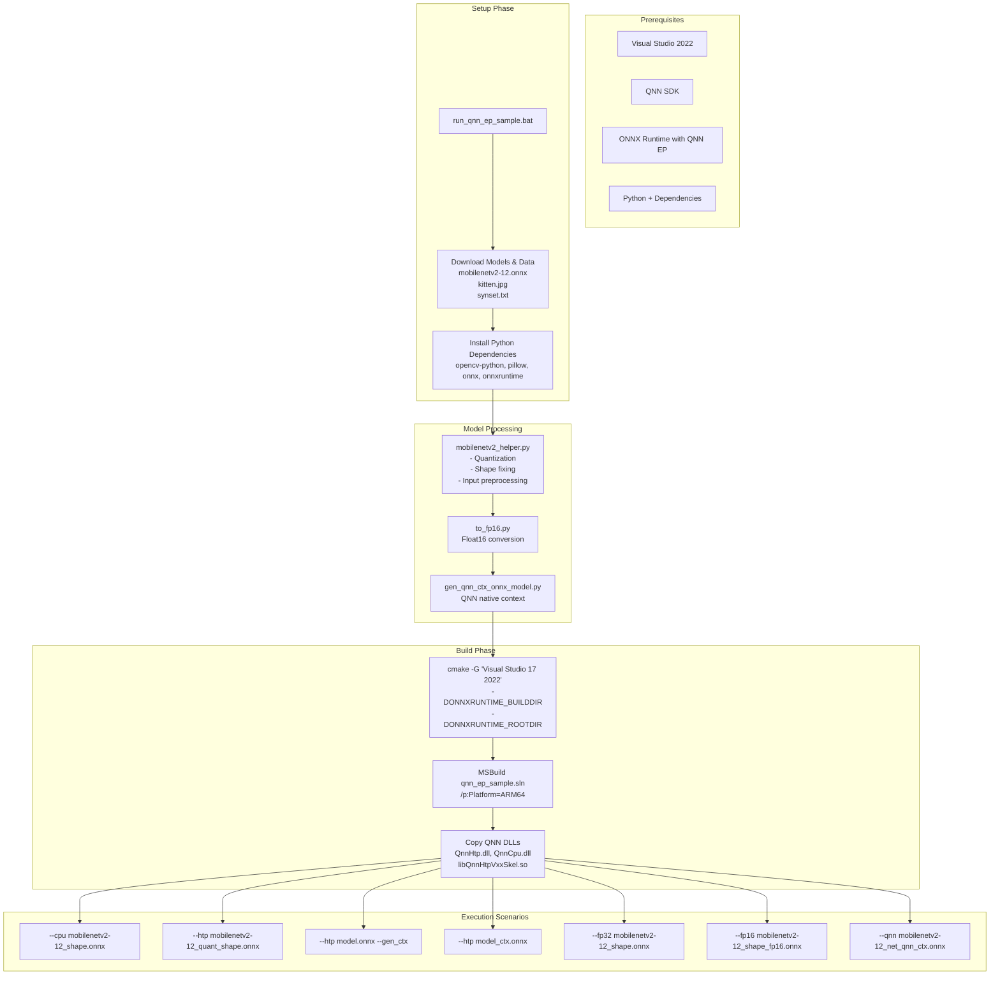
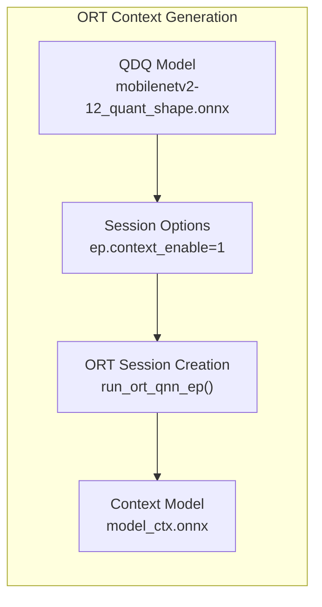
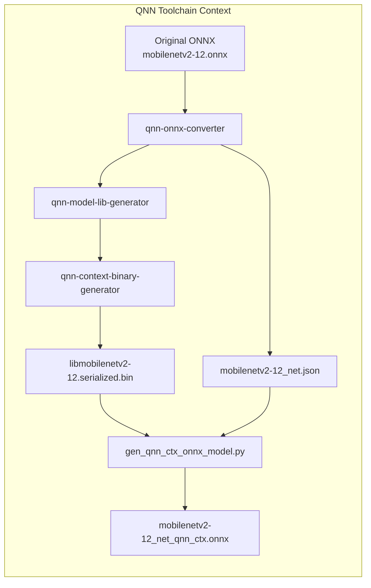
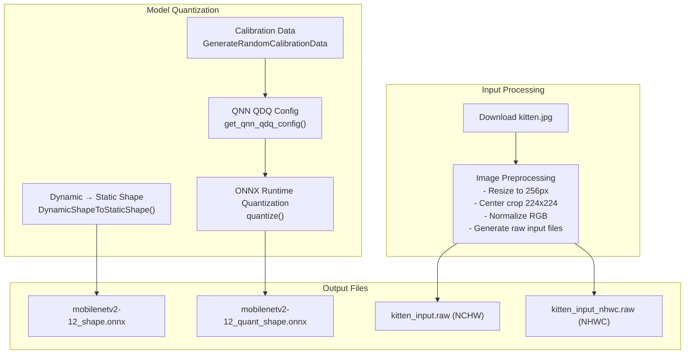

<!-- source: DeepWiki mcp.deepwiki.com · repo microsoft/onnxruntime-inference-examples · page 3.1 QNN EP Examples · fetched 2026-10-26 -->

# QNN EP Examples

<details>
<summary>Relevant source files</summary>

The following files were used as context for generating this wiki page:

- [c_cxx/QNN_EP/mobilenetv2_classification/CMakeLists.txt](c_cxx/QNN_EP/mobilenetv2_classification/CMakeLists.txt)
- [c_cxx/QNN_EP/mobilenetv2_classification/README.md](c_cxx/QNN_EP/mobilenetv2_classification/README.md)
- [c_cxx/QNN_EP/mobilenetv2_classification/libmobilenetv2-12.serialized.bin](c_cxx/QNN_EP/mobilenetv2_classification/libmobilenetv2-12.serialized.bin)
- [c_cxx/QNN_EP/mobilenetv2_classification/main.cpp](c_cxx/QNN_EP/mobilenetv2_classification/main.cpp)
- [c_cxx/QNN_EP/mobilenetv2_classification/mobilenetv2-12_net.json](c_cxx/QNN_EP/mobilenetv2_classification/mobilenetv2-12_net.json)
- [c_cxx/QNN_EP/mobilenetv2_classification/mobilenetv2_helper.py](c_cxx/QNN_EP/mobilenetv2_classification/mobilenetv2_helper.py)
- [c_cxx/QNN_EP/mobilenetv2_classification/run_qnn_ep_sample.bat](c_cxx/QNN_EP/mobilenetv2_classification/run_qnn_ep_sample.bat)
- [c_cxx/QNN_EP/mobilenetv2_classification/to_fp16.py](c_cxx/QNN_EP/mobilenetv2_classification/to_fp16.py)

</details>


This page covers the Qualcomm Neural Network (QNN) Execution Provider examples for ONNX Runtime, specifically focusing on the C/C++ MobileNetV2 classification example. This demonstrates how to use QNN EP for both CPU and HTP (Hexagon Tensor Processor) backends with various model formats including float32, quantized (QDQ), and float16 models.

For general C/C++ examples using other execution providers, see [C/C++ Examples](#3). For mobile deployment of QNN models, see [iOS Examples](#2.1) and [Android Examples](#2.2).

## Architecture Overview

The QNN EP example demonstrates multiple execution paths and model formats within the ONNX Runtime ecosystem:



**Sources:** [c_cxx/QNN_EP/mobilenetv2_classification/README.md:1-48](), [c_cxx/QNN_EP/mobilenetv2_classification/run_qnn_ep_sample.bat:1-175]()

## Key Components

### QNN Execution Provider Backends

The example supports two QNN backends through dynamic library loading:

| Backend | Library | Use Case | Command Flag |
|---------|---------|----------|--------------|
| **QNN CPU** | `QnnCpu.dll` | CPU fallback, development | `--cpu` |
| **QNN HTP** | `QnnHtp.dll` | Hexagon DSP acceleration | `--htp`, `--qnn` |

**Sources:** [c_cxx/QNN_EP/mobilenetv2_classification/main.cpp:228-251]()

### Model Format Support

| Format | Description | Backend Compatibility | Context Generation |
|--------|-------------|----------------------|-------------------|
| **Float32** | Original model with static shapes | CPU, HTP (with FP16 precision) | No |
| **QDQ Quantized** | INT8 quantized with Q/DQ ops | HTP only | Yes (ORT-generated) |
| **Float16** | FP16 model with float32 I/O | HTP only | No |
| **Context Binary** | Pre-compiled QNN context | HTP only | N/A (pre-generated) |

**Sources:** [c_cxx/QNN_EP/mobilenetv2_classification/README.md:3-15]()

## Build and Execution Workflow

The complete workflow from model acquisition to inference execution:



**Sources:** [c_cxx/QNN_EP/mobilenetv2_classification/run_qnn_ep_sample.bat:28-166](), [c_cxx/QNN_EP/mobilenetv2_classification/CMakeLists.txt:1-31]()

## Context Binary Generation Methods

The QNN EP supports two distinct approaches for context binary generation to optimize session initialization:

### Method 1: ONNX Runtime Generated Context



**Configuration:**
- Set `kOrtSessionOptionEpContextEnable` to `"1"`
- Optional: `kOrtSessionOptionEpContextFilePath` for custom output path
- Optional: `kOrtSessionOptionEpContextEmbedMode` to control binary embedding

**Sources:** [c_cxx/QNN_EP/mobilenetv2_classification/main.cpp:56-65](), [c_cxx/QNN_EP/mobilenetv2_classification/README.md:19-33]()

### Method 2: QNN Native Toolchain Context



**QNN Toolchain Commands:**
```bash
qnn-onnx-converter --input_list ./input.txt --input_network ./mobilenetv2-12.onnx --output_path ./mobilenetv2-12.cpp -b 1 --bias_bw 32
qnn-model-lib-generator -c ./mobilenetv2-12.cpp -b ./mobilenetv2-12.bin -o ./qnn_lib
qnn-context-binary-generator --backend libQnnHtp.so --model libmobilenetv2-12.so --binary_file libmobilenetv2-12.serialized
```

**Sources:** [c_cxx/QNN_EP/mobilenetv2_classification/README.md:34-45](), [c_cxx/QNN_EP/mobilenetv2_classification/run_qnn_ep_sample.bat:82-89]()

## Model Preprocessing Pipeline

The preprocessing pipeline transforms models and input data for QNN EP compatibility:

### Quantization Process

The `mobilenetv2_helper.py` script implements the quantization workflow:



**Quantization Configuration:**
- **Activation Type:** `QuantType.QUInt8`
- **Weight Type:** `QuantType.QUInt8`
- **Format:** QDQ (Quantize-Dequantize) operations

**Sources:** [c_cxx/QNN_EP/mobilenetv2_classification/mobilenetv2_helper.py:88-131](), [c_cxx/QNN_EP/mobilenetv2_classification/mobilenetv2_helper.py:16-76]()

### Float16 Conversion

The `to_fp16.py` script converts float32 models to float16:

```python
model_fp16 = float16.convert_float_to_float16(model, keep_io_types=True)
```

**Key Parameters:**
- `keep_io_types=True`: Maintains float32 input/output interfaces
- Internal computation uses float16 precision

**Sources:** [c_cxx/QNN_EP/mobilenetv2_classification/to_fp16.py:12-14]()

## C++ Application Structure

The main application in `main.cpp` provides a command-line interface for different execution scenarios:

### Command Line Interface

| Flag | Model Type | Backend | Description |
|------|------------|---------|-------------|
| `--cpu` | Float32 | QNN CPU | CPU backend execution |
| `--htp` | QDQ/Context | QNN HTP | HTP backend execution |
| `--qnn` | QNN Native Context | QNN HTP | QNN toolchain context |
| `--fp32` | Float32 | QNN HTP | Float32 with FP16 precision |
| `--fp16` | Float16 | QNN HTP | Float16 model |
| `--gen_ctx` | Any | QNN HTP | Context generation mode |

**Sources:** [c_cxx/QNN_EP/mobilenetv2_classification/main.cpp:192-199](), [c_cxx/QNN_EP/mobilenetv2_classification/main.cpp:201-207]()

### Session Configuration

The `run_ort_qnn_ep()` function configures ONNX Runtime sessions:

```cpp
// QNN EP configuration
std::vector<const char*> options_keys = {"backend_path"};
std::vector<const char*> options_values = {backend.c_str()};

// FP16 precision for float32 models
if (float32_model) {
    options_keys.push_back("enable_htp_fp16_precision");
    options_values.push_back("1");
}

// Context generation
if (generate_ctx) {
    CheckStatus(g_ort, g_ort->AddSessionConfigEntry(session_options, 
        kOrtSessionOptionEpContextEnable, "1"));
}
```

**Sources:** [c_cxx/QNN_EP/mobilenetv2_classification/main.cpp:39-65]()

### Inference Execution

The application supports both float32 and quantized data paths:

```cpp
// Float32 input path (standard models)
CheckStatus(g_ort, g_ort->CreateTensorWithDataAsOrtValue(
    memory_info, reinterpret_cast<void*>(input_data.data()), 
    input_data_length, input_node_dims[0].data(), 
    input_node_dims[0].size(), input_types[0], &input_tensors[0]));

// Session execution
CheckStatus(g_ort, g_ort->Run(session, nullptr, 
    input_node_names.data(), input_tensors.data(),
    input_tensors.size(), output_node_names.data(), 
    output_node_names.size(), output_tensors.data()));
```

**Sources:** [c_cxx/QNN_EP/mobilenetv2_classification/main.cpp:155-167]()

## Usage Examples

### Basic CPU Execution
```bash
qnn_ep_sample.exe --cpu mobilenetv2-12_shape.onnx kitten_input.raw
```

### HTP Quantized Inference
```bash
qnn_ep_sample.exe --htp mobilenetv2-12_quant_shape.onnx kitten_input.raw
```

### Context Binary Generation
```bash
qnn_ep_sample.exe --htp mobilenetv2-12_quant_shape.onnx kitten_input.raw --gen_ctx
```

### Context Binary Execution
```bash
qnn_ep_sample.exe --htp mobilenetv2-12_quant_shape.onnx_ctx.onnx kitten_input.raw
```

**Expected Output:**
```
Result:
position=281, classification=n02123045 tabby, tabby cat, probability=13.663178
```

**Sources:** [c_cxx/QNN_EP/mobilenetv2_classification/README.md:74-116](), [c_cxx/QNN_EP/mobilenetv2_classification/run_qnn_ep_sample.bat:136-166]()

---

