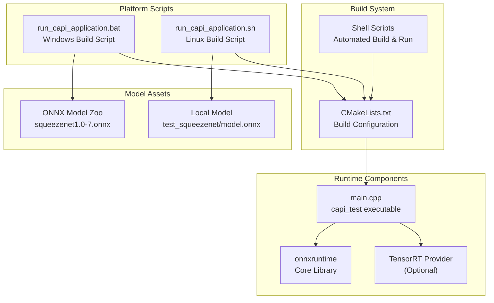
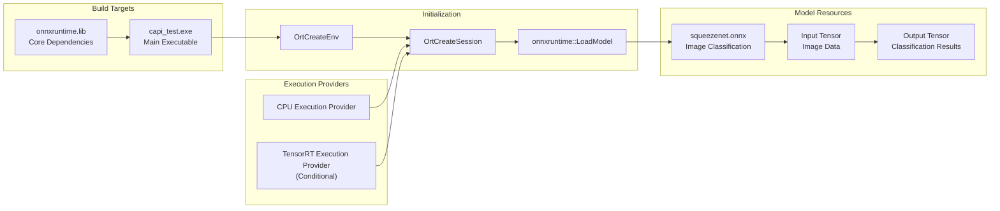
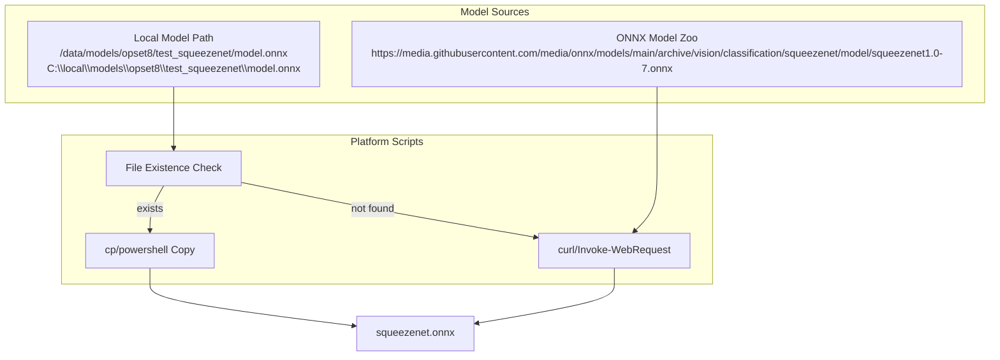

<!-- source: DeepWiki mcp.deepwiki.com · repo microsoft/onnxruntime-inference-examples · page 3.2 SqueezeNet Example · fetched 2026-10-26 -->

# SqueezeNet Example

<details>
<summary>Relevant source files</summary>

The following files were used as context for generating this wiki page:

- [c_cxx/squeezenet/CMakeLists.txt](c_cxx/squeezenet/CMakeLists.txt)
- [c_cxx/squeezenet/README.md](c_cxx/squeezenet/README.md)
- [c_cxx/squeezenet/run_capi_application.bat](c_cxx/squeezenet/run_capi_application.bat)
- [c_cxx/squeezenet/run_capi_application.sh](c_cxx/squeezenet/run_capi_application.sh)

</details>


## Purpose and Scope

The SqueezeNet Example demonstrates basic usage of ONNX Runtime's C API for image classification inference. This example serves as a foundational reference for C/C++ developers integrating ONNX Runtime into native applications, showcasing model loading, session creation, and inference execution using the SqueezeNet 1.0 computer vision model.

For advanced C++ examples with execution providers, see [QNN EP Examples](#3.1). For C# image classification examples, see [Image Classification in C#](#4.3).

## System Architecture

The SqueezeNet example follows a straightforward C API integration pattern, demonstrating the core ONNX Runtime inference workflow in a minimal implementation.

### Component Overview



**Sources:** [c_cxx/squeezenet/CMakeLists.txt:1-26](), [c_cxx/squeezenet/run_capi_application.bat:1-35](), [c_cxx/squeezenet/run_capi_application.sh:1-48]()

### C API Integration Flow



**Sources:** [c_cxx/squeezenet/CMakeLists.txt:21-25](), [c_cxx/squeezenet/CMakeLists.txt:9-24]()

## Build Configuration

The example uses CMake for cross-platform build management with conditional TensorRT provider support.

### CMake Configuration

The `CMakeLists.txt` establishes the build environment with specific ONNX Runtime integration requirements:

| Configuration | Value | Purpose |
|---------------|--------|---------|
| Project Name | `capi_test` | Main executable identifier |
| CMake Version | `3.13` minimum | Modern CMake feature support |
| C++ Standard | `14` | ONNX Runtime C++ API compatibility |
| Build Type | `Debug` | Development and debugging |

**Sources:** [c_cxx/squeezenet/CMakeLists.txt:1-14]()

### Execution Provider Detection

The build system includes conditional compilation for TensorRT support through header detection:

```
CHECK_INCLUDE_FILE_CXX(tensorrt_provider_factory.h HAVE_TENSORRT_PROVIDER_FACTORY_H)
```

When the TensorRT headers are available, the `HAVE_TENSORRT_PROVIDER_FACTORY_H` preprocessor definition enables TensorRT execution provider functionality.

**Sources:** [c_cxx/squeezenet/CMakeLists.txt:9-24]()

## Model Management

### Model Download Strategy

The example implements a dual-source model acquisition strategy:



**Sources:** [c_cxx/squeezenet/run_capi_application.bat:28-33](), [c_cxx/squeezenet/run_capi_application.sh:33-37]()

### Model Specifications

| Attribute | Value |
|-----------|--------|
| Model Name | SqueezeNet 1.0-7 |
| Task | Image Classification |
| ONNX Opset | 7 |
| Source | ONNX Model Zoo |
| Local Filename | `squeezenet.onnx` |

**Sources:** [c_cxx/squeezenet/run_capi_application.bat:1-2](), [c_cxx/squeezenet/run_capi_application.sh:13-14]()

## Platform Support

### Windows Build Process

The Windows batch script `run_capi_application.bat` orchestrates the complete build and execution workflow:

1. **Archive Extraction**: Uses `7z.exe` to extract ONNX Runtime packages
2. **CMake Generation**: Configures Visual Studio 2022 solution
3. **Library Management**: Copies ONNX Runtime libraries for linking and runtime
4. **MSBuild Execution**: Compiles using Visual Studio toolchain
5. **Model Preparation**: Downloads or copies SqueezeNet model
6. **Execution**: Runs the `capi_test.exe` executable

**Sources:** [c_cxx/squeezenet/run_capi_application.bat:9-34]()

### Linux Build Process

The Linux shell script `run_capi_application.sh` provides equivalent functionality with Unix-specific tooling:

1. **Parameter Processing**: Handles command-line arguments with `getopts`
2. **Archive Extraction**: Uses `tar` for ONNX Runtime package extraction
3. **Environment Setup**: Configures `LD_LIBRARY_PATH` and `LIBRARY_PATH`
4. **Make Build**: Compiles using standard Make with parallel jobs (`-j4`)
5. **Model Acquisition**: Uses `curl` for remote model download
6. **Execution**: Runs the compiled `capi_test` binary

**Sources:** [c_cxx/squeezenet/run_capi_application.sh:4-48]()

## Usage Instructions

### Command Line Interface

#### Linux Usage
```bash
./run_capi_application.sh -p /path/to/onnxruntime-linux-x64-gpu-1.13.1.tgz -w /path/to/onnxruntime-inference-examples/c_cxx/squeezenet
```

#### Windows Usage
```cmd
.\run_capi_application.bat D:\onnxruntime-win-x64-gpu-1.13.1.zip D:\repos\onnxruntime-inference-examples\c_cxx\squeezenet
```

### Parameter Requirements

| Parameter | Description | Example |
|-----------|-------------|---------|
| `-p` (Linux) / Arg 2 (Windows) | ONNX Runtime package path | `onnxruntime-linux-x64-gpu-1.13.1.tgz` |
| `-w` (Linux) / Arg 3 (Windows) | Workspace directory | `onnxruntime-inference-examples/c_cxx/squeezenet` |
| `-o` (Linux) / Arg 1 (Windows) | ONNX Runtime root directory | For header file location |

**Sources:** [c_cxx/squeezenet/README.md:2-11](), [c_cxx/squeezenet/run_capi_application.sh:4-11]()

## Dependencies and Linking

### Core Dependencies

The example requires the following ONNX Runtime components:

- **Headers**: Located in `${ONNXRUNTIME_ROOTDIR}/include/onnxruntime/core/session/`
- **TensorRT Headers**: Located in `${ONNXRUNTIME_ROOTDIR}/include/onnxruntime/core/providers/tensorrt/`
- **Runtime Library**: `onnxruntime` shared library

### Library Path Configuration

The build scripts handle runtime library path configuration differently per platform:

- **Linux**: Sets `LD_LIBRARY_PATH` and `LIBRARY_PATH` environment variables
- **Windows**: Copies ONNX Runtime DLLs to executable directory

**Sources:** [c_cxx/squeezenet/CMakeLists.txt:16-25](), [c_cxx/squeezenet/run_capi_application.sh:23-24](), [c_cxx/squeezenet/run_capi_application.bat:16-27]()

---

