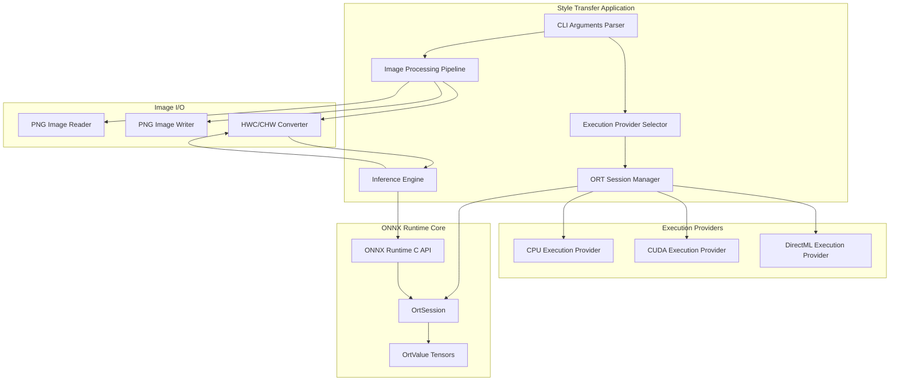
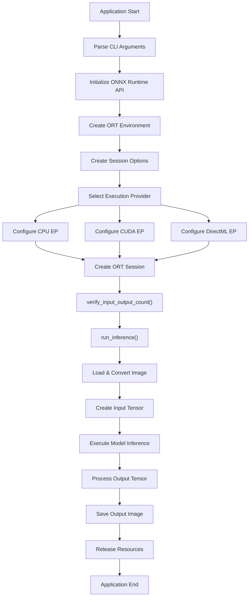

<!-- source: DeepWiki mcp.deepwiki.com · repo microsoft/onnxruntime-inference-examples · page 3.3 Style Transfer Example · fetched 2026-10-26 -->

# Style Transfer Example

<details>
<summary>Relevant source files</summary>

The following files were used as context for generating this wiki page:

- [c_cxx/fns_candy_style_transfer/fns_candy_style_transfer.c](c_cxx/fns_candy_style_transfer/fns_candy_style_transfer.c)
- [c_cxx/fns_candy_style_transfer/image_file.h](c_cxx/fns_candy_style_transfer/image_file.h)
- [c_cxx/fns_candy_style_transfer/image_file_libpng.c](c_cxx/fns_candy_style_transfer/image_file_libpng.c)
- [c_cxx/imagenet/image_loader_libjpeg.cc](c_cxx/imagenet/image_loader_libjpeg.cc)
- [c_cxx/imagenet/runnable_task.h](c_cxx/imagenet/runnable_task.h)
- [ci_build/download_ort_release.ps1](ci_build/download_ort_release.ps1)

</details>


## Purpose and Scope

This document covers the Fast Neural Style (FNS) Candy style transfer example implementation in C using ONNX Runtime. The example demonstrates how to perform neural style transfer on images using a pre-trained ONNX model with support for multiple execution providers including CPU, CUDA, and DirectML.

For general C/C++ examples overview, see [C/C++ Examples](#3). For other computer vision examples in different languages, see [Mobile Examples](#2) and [JavaScript Examples](#6).

## Architecture Overview

The style transfer example implements a complete inference pipeline that processes 720x720 images through a neural style transfer model. The system supports multiple execution providers and handles image format conversions required for neural network processing.



**Sources:** [c_cxx/fns_candy_style_transfer/fns_candy_style_transfer.c:1-233]()

## Core Components

### Main Application Structure

The application entry point handles command-line arguments and orchestrates the inference pipeline through several key functions:

| Function | Purpose | Input Parameters | Return Value |
|----------|---------|-----------------|--------------|
| `main`/`wmain` | Application entry point | model_path, input_file, output_file, execution_provider | Exit code |
| `run_inference` | Execute model inference | OrtSession*, input_file, output_file | Status code |
| `verify_input_output_count` | Validate model I/O | OrtSession* | void |

**Sources:** [c_cxx/fns_candy_style_transfer/fns_candy_style_transfer.c:163-232]()

### Image Processing Pipeline

The image processing system handles format conversions between the RGB image format used by PNG files and the tensor format expected by neural networks:


**Sources:** [c_cxx/fns_candy_style_transfer/fns_candy_style_transfer.c:42-75](), [c_cxx/fns_candy_style_transfer/image_file_libpng.c:1-47]()

### Format Conversion Functions

The system implements two critical format conversion functions:

- `hwc_to_chw()`: Converts from Height-Width-Channels format (standard image layout) to Channels-Height-Width format (neural network tensor layout)
- `chw_to_hwc()`: Converts from CHW back to HWC format for image output

**Sources:** [c_cxx/fns_candy_style_transfer/fns_candy_style_transfer.c:42-75]()

## Inference Execution Flow

The inference process follows a structured pipeline that manages ONNX Runtime sessions and tensor operations:



**Sources:** [c_cxx/fns_candy_style_transfer/fns_candy_style_transfer.c:79-128](), [c_cxx/fns_candy_style_transfer/fns_candy_style_transfer.c:163-232]()

## Execution Provider Support

The example supports three execution providers with different configuration requirements:

### CPU Execution Provider
Default provider requiring no additional configuration. Used when no provider is specified or when `"cpu"` is explicitly requested.

**Sources:** [c_cxx/fns_candy_style_transfer/fns_candy_style_transfer.c:197-198]()

### CUDA Execution Provider
Configured through the `enable_cuda()` function with specific CUDA provider options:

```c
OrtCUDAProviderOptions o;
memset(&o, 0, sizeof(o));
o.cudnn_conv_algo_search = OrtCudnnConvAlgoSearchExhaustive;
o.gpu_mem_limit = SIZE_MAX;
```

**Sources:** [c_cxx/fns_candy_style_transfer/fns_candy_style_transfer.c:138-155]()

### DirectML Execution Provider
Available on Windows builds when `USE_DML` is defined. Enables GPU acceleration through DirectML.

**Sources:** [c_cxx/fns_candy_style_transfer/fns_candy_style_transfer.c:157-161]()

## Model Interface Specification

The FNS Candy style transfer model expects specific input/output tensor specifications:

| Tensor | Name | Shape | Data Type | Format |
|--------|------|-------|-----------|--------|
| Input | `"inputImage"` | [1, 3, 720, 720] | FLOAT32 | CHW |
| Output | `"outputImage"` | [1, 3, 720, 720] | FLOAT32 | CHW |

The model validation ensures exactly one input and one output tensor through `verify_input_output_count()`.

**Sources:** [c_cxx/fns_candy_style_transfer/fns_candy_style_transfer.c:95-96](), [c_cxx/fns_candy_style_transfer/fns_candy_style_transfer.c:108-109](), [c_cxx/fns_candy_style_transfer/fns_candy_style_transfer.c:130-136]()

## Error Handling and Resource Management

The implementation uses a macro-based error handling pattern with automatic resource cleanup:

```c
#define ORT_ABORT_ON_ERROR(expr)                             \
  do {                                                       \
    OrtStatus* onnx_status = (expr);                         \
    if (onnx_status != NULL) {                               \
      const char* msg = g_ort->GetErrorMessage(onnx_status); \
      fprintf(stderr, "%s\n", msg);                          \
      g_ort->ReleaseStatus(onnx_status);                     \
      abort();                                               \
    }                                                        \
  } while (0);
```

**Sources:** [c_cxx/fns_candy_style_transfer/fns_candy_style_transfer.c:23-32]()

## Usage and Command Line Interface

The application accepts command-line arguments in the following format:

```
<model_path> <input_file> <output_file> [cpu|cuda|dml]
```

Where:
- `model_path`: Path to the ONNX model file
- `input_file`: Input PNG image file (must be 720x720)
- `output_file`: Output PNG image file path
- Execution provider: Optional, defaults to attempting CUDA first, then CPU

**Sources:** [c_cxx/fns_candy_style_transfer/fns_candy_style_transfer.c:77](), [c_cxx/fns_candy_style_transfer/fns_candy_style_transfer.c:168-171]()

---

