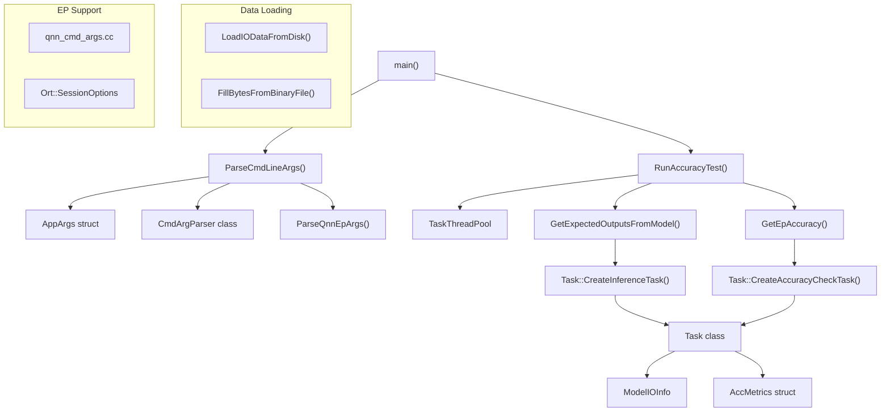
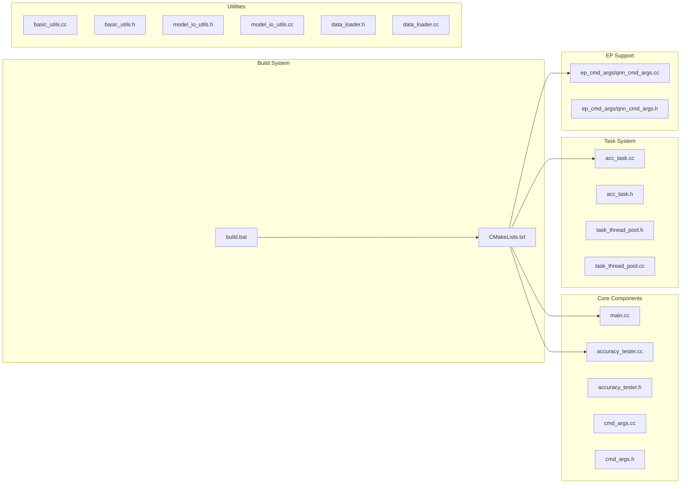
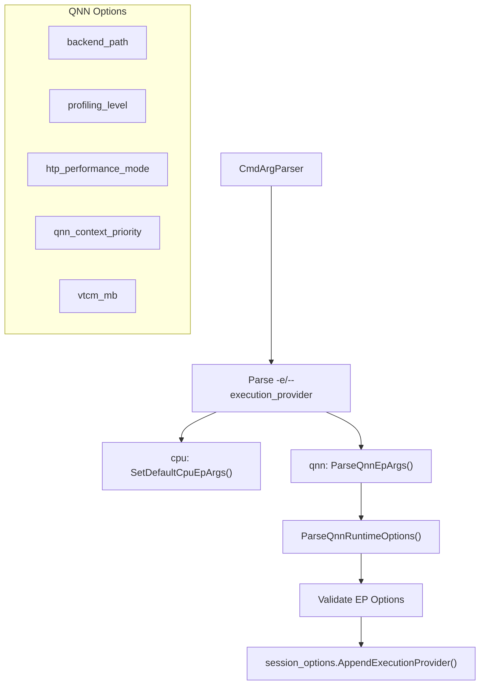
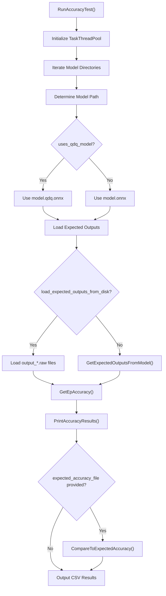
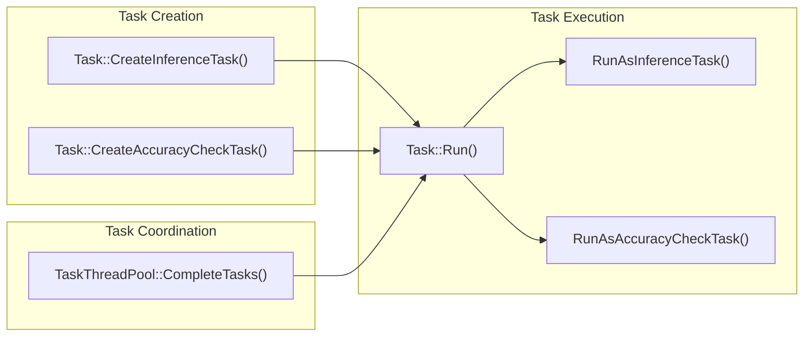

<!-- source: DeepWiki mcp.deepwiki.com · repo microsoft/onnxruntime-inference-examples · page 3.4 Accuracy Testing Tool · fetched 2026-10-26 -->

# Accuracy Testing Tool

<details>
<summary>Relevant source files</summary>

The following files were used as context for generating this wiki page:

- [c_cxx/accuracy_tool/CMakeLists.txt](c_cxx/accuracy_tool/CMakeLists.txt)
- [c_cxx/accuracy_tool/README.md](c_cxx/accuracy_tool/README.md)
- [c_cxx/accuracy_tool/build.bat](c_cxx/accuracy_tool/build.bat)
- [c_cxx/accuracy_tool/src/acc_task.cc](c_cxx/accuracy_tool/src/acc_task.cc)
- [c_cxx/accuracy_tool/src/acc_task.h](c_cxx/accuracy_tool/src/acc_task.h)
- [c_cxx/accuracy_tool/src/accuracy_tester.cc](c_cxx/accuracy_tool/src/accuracy_tester.cc)
- [c_cxx/accuracy_tool/src/accuracy_tester.h](c_cxx/accuracy_tool/src/accuracy_tester.h)
- [c_cxx/accuracy_tool/src/basic_utils.cc](c_cxx/accuracy_tool/src/basic_utils.cc)
- [c_cxx/accuracy_tool/src/basic_utils.h](c_cxx/accuracy_tool/src/basic_utils.h)
- [c_cxx/accuracy_tool/src/cmd_args.cc](c_cxx/accuracy_tool/src/cmd_args.cc)
- [c_cxx/accuracy_tool/src/cmd_args.h](c_cxx/accuracy_tool/src/cmd_args.h)
- [c_cxx/accuracy_tool/src/ep_cmd_args/qnn_cmd_args.cc](c_cxx/accuracy_tool/src/ep_cmd_args/qnn_cmd_args.cc)
- [c_cxx/accuracy_tool/src/main.cc](c_cxx/accuracy_tool/src/main.cc)

</details>


## Purpose and Scope

The Accuracy Testing Tool is a C++ command-line application that measures the accuracy of ONNX Runtime models across different execution providers. It compares inference outputs from a test execution provider against expected baseline results, computing Signal-to-Noise Ratio (SNR) and other accuracy metrics. The tool supports various execution providers including CPU, QNN (Qualcomm Neural Network), and others through an extensible architecture.

This tool is specifically designed for execution provider validation and regression testing. For general C++ inference examples, see [C/C++ Examples](#3). For QNN-specific usage patterns, see [QNN EP Examples](#3.1).

## System Architecture

The accuracy testing tool follows a modular design with clear separation between command-line parsing, model I/O handling, task execution, and accuracy computation.

### Component Overview



Sources: [c_cxx/accuracy_tool/src/main.cc:10-29](), [c_cxx/accuracy_tool/src/accuracy_tester.cc:51-172](), [c_cxx/accuracy_tool/src/cmd_args.h:54-66](), [c_cxx/accuracy_tool/src/acc_task.h:17-75]()

### File Structure and Build System



Sources: [c_cxx/accuracy_tool/CMakeLists.txt:62-78](), [c_cxx/accuracy_tool/build.bat:1-94]()

## Build System

The tool supports multiple build configurations and ONNX Runtime deployment methods.

### Build Options

| Build Method | Command | Purpose |
|-------------|---------|---------|
| NuGet Package | `build.bat .\microsoft.ml.onnxruntime.qnn.1.16.0.nupkg` | Use pre-built NuGet package |
| Source Build | `build.bat <ORT_INSTALL_DIR>` | Use ONNX Runtime built from source |
| GitHub Release | `build.bat <EXTRACTED_RELEASE_DIR>` | Use official GitHub release package |

### CMake Configuration

The build system automatically handles execution provider dependencies:

- **QNN EP**: Requires `QNN_SDK_ROOTDIR` and `QNN_HEXAGON_ARCH_VERSION`
- **Artifact Copying**: Automatically copies required DLLs and libraries to output directory
- **Cross-Platform**: Supports Windows (ARM64/x64) and Linux builds

Sources: [c_cxx/accuracy_tool/CMakeLists.txt:10-43](), [c_cxx/accuracy_tool/build.bat:68-93]()

## Command-Line Interface

### Core Arguments

The `AppArgs` struct defines the application's runtime configuration:

```cpp
struct AppArgs {
  std::filesystem::path test_dir;
  std::string output_file;
  std::filesystem::path expected_accuracy_file;
  std::unordered_set<std::string> only_models;
  std::string execution_provider;
  bool uses_qdq_model = false;
  bool supports_multithread_inference = true;
  bool save_expected_outputs_to_disk = false;
  bool load_expected_outputs_from_disk = false;
  size_t num_threads = 1;
  Ort::SessionOptions session_options;
};
```

### Execution Provider Arguments

The tool uses a modular approach for EP-specific argument parsing:



Sources: [c_cxx/accuracy_tool/src/cmd_args.cc:188-206](), [c_cxx/accuracy_tool/src/ep_cmd_args/qnn_cmd_args.cc:99-123]()

## Model and Data Organization

### Required Directory Structure

The tool expects models and test data to follow a specific directory layout:

```
models/
├── model_name/
│   ├── model.onnx          # Float32 baseline model
│   ├── model.qdq.onnx      # Quantized model (for QNN EP)
│   ├── test_data_set_0/
│   │   ├── input_0.raw
│   │   ├── input_1.raw
│   │   ├── output_0.raw    # Optional expected outputs
│   │   └── output_1.raw
│   ├── test_data_set_1/
│   └── test_data_set_N/
```

### Data Loading Process

The `GetSortedDatasetPaths()` function discovers and orders test datasets:


Sources: [c_cxx/accuracy_tool/src/basic_utils.cc:58-80](), [c_cxx/accuracy_tool/README.md:107-146]()

## Execution Flow

### Main Accuracy Testing Loop

The `RunAccuracyTest()` function orchestrates the entire testing process:



### Task-Based Parallel Execution

The tool uses a `TaskThreadPool` to parallelize inference across multiple datasets:



Sources: [c_cxx/accuracy_tool/src/accuracy_tester.cc:174-287](), [c_cxx/accuracy_tool/src/acc_task.cc:71-119]()

## Accuracy Measurement

### Metrics Computation

The `AccMetrics` struct captures comprehensive accuracy information:

```cpp
struct AccMetrics {
  double rmse = 0.0;                // Root Mean Square Error
  double snr = 0.0;                 // Signal-to-Noise Ratio (dB)
  double min_val = 0.0;             // Minimum actual output value
  double max_val = 0.0;             // Maximum actual output value  
  double min_expected_val = 0.0;    // Minimum expected output value
  double max_expected_val = 0.0;    // Maximum expected output value
};
```

### SNR Calculation

The primary accuracy metric is Signal-to-Noise Ratio computed as:

```
SNR(dB) = 20 * log10(||expected|| / ||difference||)
```

Where:
- `||expected||` is the L2 norm of expected outputs
- `||difference||` is the L2 norm of (actual - expected)

Sources: [c_cxx/accuracy_tool/src/basic_utils.h:65-115]()

## Execution Provider Support

### QNN Execution Provider

The QNN EP requires specific configuration through `ParseQnnEpArgs()`:

| Parameter | Values | Purpose |
|-----------|---------|---------|
| `backend_path` | Path to `QnnHtp.dll` | Required QNN backend library |
| `htp_performance_mode` | `burst`, `balanced`, `default`, etc. | Performance optimization mode |
| `qnn_context_priority` | `low`, `normal`, `normal_high`, `high` | Execution priority |
| `profiling_level` | `off`, `basic`, `detailed` | Profiling verbosity |
| `vtcm_mb` | Integer value | VTCM memory size in MB |

### Extensible EP Architecture

New execution providers can be added by:

1. Creating EP-specific argument parser (similar to `qnn_cmd_args.cc`)
2. Adding EP case to `ParseCmdLineArgs()` switch statement  
3. Setting appropriate `AppArgs` fields (`uses_qdq_model`, `supports_multithread_inference`)

Sources: [c_cxx/accuracy_tool/src/ep_cmd_args/qnn_cmd_args.cc:12-123](), [c_cxx/accuracy_tool/src/cmd_args.cc:196-206]()

---

