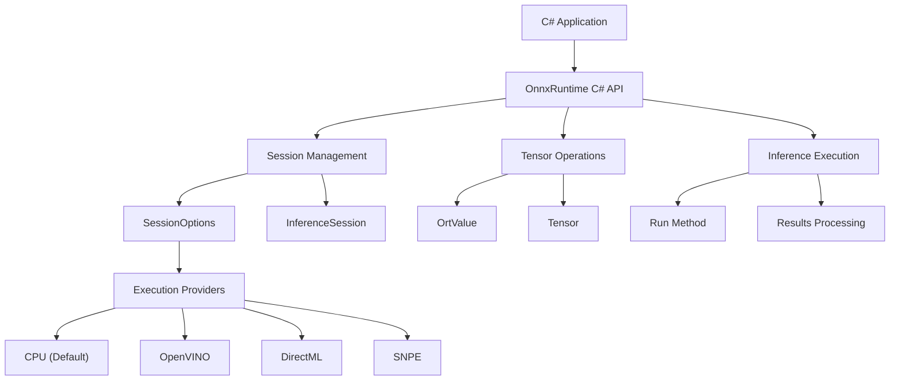
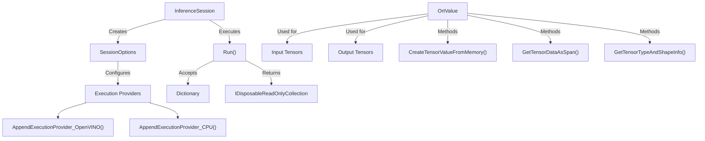
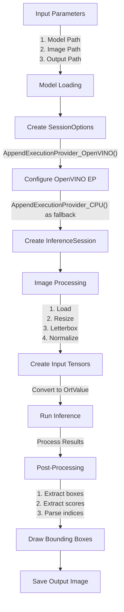
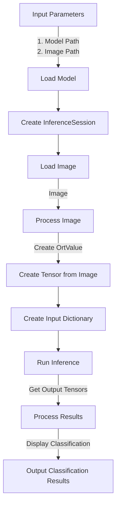

<!-- source: DeepWiki mcp.deepwiki.com · repo microsoft/onnxruntime-inference-examples · page 4 C# Examples · fetched 2026-10-26 -->

# C# Examples

<details>
<summary>Relevant source files</summary>

The following files were used as context for generating this wiki page:

- [c_cxx/OpenVINO_EP/Windows/CMakeLists.txt](c_cxx/OpenVINO_EP/Windows/CMakeLists.txt)
- [c_cxx/OpenVINO_EP/Windows/README.md](c_cxx/OpenVINO_EP/Windows/README.md)
- [c_cxx/OpenVINO_EP/Windows/model-explorer/model-explorer.cpp](c_cxx/OpenVINO_EP/Windows/model-explorer/model-explorer.cpp)
- [c_cxx/OpenVINO_EP/Windows/squeezenet_classification/squeezenet_cpp_app.cpp](c_cxx/OpenVINO_EP/Windows/squeezenet_classification/squeezenet_cpp_app.cpp)
- [c_cxx/OpenVINO_EP/Windows/squeezenet_classification_io_buffer/CMakeLists.txt](c_cxx/OpenVINO_EP/Windows/squeezenet_classification_io_buffer/CMakeLists.txt)
- [c_cxx/OpenVINO_EP/Windows/squeezenet_classification_io_buffer/squeezenet_cpp_app_io_buffer.cpp](c_cxx/OpenVINO_EP/Windows/squeezenet_classification_io_buffer/squeezenet_cpp_app_io_buffer.cpp)
- [c_cxx/OpenVINO_EP/Windows/squeezenet_classification_io_buffer/synset.txt](c_cxx/OpenVINO_EP/Windows/squeezenet_classification_io_buffer/synset.txt)
- [c_sharp/OpenVINO_EP/yolov3_object_detection/Prediction.cs](c_sharp/OpenVINO_EP/yolov3_object_detection/Prediction.cs)
- [c_sharp/OpenVINO_EP/yolov3_object_detection/Program.cs](c_sharp/OpenVINO_EP/yolov3_object_detection/Program.cs)
- [c_sharp/OpenVINO_EP/yolov3_object_detection/yolov3_object_detection.csproj](c_sharp/OpenVINO_EP/yolov3_object_detection/yolov3_object_detection.csproj)
- [c_sharp/image_classification/Program.cs](c_sharp/image_classification/Program.cs)

</details>


This document provides a comprehensive overview of the C# examples available in the ONNX Runtime Inference Examples repository. These examples demonstrate how to use ONNX Runtime's C# API to perform machine learning inference tasks such as object detection and image classification. For Python examples, see [Python Examples](#5), and for C/C++ examples, see [C/C++ Examples](#3).

## Overview of C# ONNX Runtime Integration

ONNX Runtime provides a robust C# API for integrating machine learning models into .NET applications. The examples in this repository showcase different approaches to using this API with various execution providers and model types.

### Key Components of ONNX Runtime C# API



Sources: [c_sharp/OpenVINO_EP/yolov3_object_detection/Program.cs:46-53](), [c_sharp/image_classification/Program.cs:18-19]()

### C# API Core Classes and Methods



Sources: [c_sharp/OpenVINO_EP/yolov3_object_detection/Program.cs:46-53](), [c_sharp/OpenVINO_EP/yolov3_object_detection/Program.cs:107-134]()

## YOLOv3 Object Detection with OpenVINO EP

The YOLOv3 object detection example demonstrates how to use the OpenVINO Execution Provider with ONNX Runtime to perform efficient object detection on images.

### Implementation Overview

This example:
1. Takes a YOLOv3 ONNX model, input image, and output path as command-line arguments
2. Configures ONNX Runtime with the OpenVINO Execution Provider
3. Performs image preprocessing and creates input tensors
4. Runs inference and post-processes the results to draw bounding boxes around detected objects

### Key Components



Sources: [c_sharp/OpenVINO_EP/yolov3_object_detection/Program.cs:20-218]()

### Dependencies

The YOLOv3 example uses the following NuGet packages:

| Package | Purpose |
|---------|---------|
| Microsoft.ML.OnnxRuntime.Managed | Core ONNX Runtime API |
| Microsoft.ML.OnnxRuntime.OpenVino | OpenVINO EP support |
| SixLabors.ImageSharp | Image loading and processing |
| SixLabors.ImageSharp.Drawing | Drawing bounding boxes on images |
| SixLabors.Fonts | Font rendering for labels |

Sources: [c_sharp/OpenVINO_EP/yolov3_object_detection/yolov3_object_detection.csproj:10-17]()

### Workflow Details

1. **Session Configuration**:
   - Creates `SessionOptions` with logging level set to INFO
   - Configures OpenVINO EP for CPU target
   - Adds CPU EP as fallback

```
options.LogSeverityLevel = OrtLoggingLevel.ORT_LOGGING_LEVEL_INFO;
options.AppendExecutionProvider_OpenVINO(@"CPU");
options.AppendExecutionProvider_CPU(1);
```

2. **Image Preprocessing**:
   - Loads the image using SixLabors.ImageSharp
   - Applies letterboxing to maintain the aspect ratio
   - Resizes to the input dimensions required by YOLOv3 (416x416)
   - Converts pixel values to normalized float format (0-1)

3. **Input Preparation**:
   - Creates input tensors using `OrtValue.CreateTensorValueFromMemory`
   - Manages memory efficiently by directly using native memory

4. **Inference**:
   - Runs inference using the `session.Run()` method with a dictionary of input names and values
   - Processes the output tensors, which contain bounding boxes, scores, and class indices

5. **Post-Processing**:
   - Extracts boxes, scores, and indices from the output tensors
   - Calculates actual coordinates and creates `Prediction` objects
   - Draws bounding boxes, class labels, and confidence scores on the image
   - Saves the result to the output path

Sources: [c_sharp/OpenVINO_EP/yolov3_object_detection/Program.cs:46-218](), [c_sharp/OpenVINO_EP/yolov3_object_detection/Prediction.cs:8-31]()

## Image Classification Example

The Image Classification example demonstrates a simpler approach to using ONNX Runtime for classifying images.

### Implementation Overview

This example:
1. Takes a model path and image path as command-line arguments
2. Creates an InferenceSession with the model
3. Loads and processes the image into a tensor format
4. Runs inference and displays the classification results

### Key Components



Sources: [c_sharp/image_classification/Program.cs:14-93]()

### Efficient Memory Management

The Image Classification example showcases efficient memory management techniques:

1. **Direct Memory Access**:
   - Creates allocated tensor value with `OrtValue.CreateAllocatedTensorValue`
   - Accesses tensor data directly with `GetTensorMutableDataAsSpan<byte>()`
   - Avoids unnecessary memory copies

2. **Memory Optimization**:
   - Uses `MemoryMarshal.Cast<Rgb24, byte>` to efficiently convert between pixel formats
   - Properly disposes of `OrtValue` objects using `using` statements

3. **Output Processing**:
   - Accesses output tensor data directly without copying using `GetTensorDataAsSpan<T>()`
   - Handles different output types (float and Int64) appropriately

Sources: [c_sharp/image_classification/Program.cs:38-67](), [c_sharp/image_classification/Program.cs:82-93]()

## Common Patterns and Best Practices

The C# examples demonstrate several patterns and best practices for ONNX Runtime integration.

### Memory Management

1. **Proper Resource Disposal**:
   - Use `using` statements for all disposable objects (SessionOptions, InferenceSession, RunOptions, OrtValue)
   - Ensure proper cleanup of native resources

2. **Memory Efficiency**:
   - Use `OrtValue.CreateTensorValueFromMemory` for zero-copy scenarios
   - Access tensor data directly with `GetTensorDataAsSpan<T>()` to avoid copies
   - Use `OrtValue.CreateAllocatedTensorValue` when new memory allocation is needed

### Performance Considerations

1. **Execution Provider Selection**:
   - Choose appropriate EPs based on hardware availability (e.g., OpenVINO for Intel hardware)
   - Configure fallback providers (e.g., CPU) when hardware-specific EPs might not be available

2. **Session Configuration**:
   - Set appropriate thread counts with `SetIntraOpNumThreads`
   - Configure logging levels for production vs. development

3. **Input/Output Optimization**:
   - Reuse tensors for repeated inference when possible
   - Process images in batches when applicable
   - Use direct memory access methods to avoid copies

### Error Handling

The examples demonstrate proper error handling techniques:

1. **Input Validation**:
   - Check command-line arguments
   - Validate file existence
   - Verify image dimensions

2. **Runtime Checks**:
   - Verify tensor shapes and types
   - Use Debug.Assert for runtime validations
   - Handle potential failures in model execution

Sources: [c_sharp/OpenVINO_EP/yolov3_object_detection/Program.cs:22-39](), [c_sharp/OpenVINO_EP/yolov3_object_detection/Program.cs:130-134]()

## Execution Provider Integration

### OpenVINO Execution Provider

The YOLOv3 example demonstrates how to integrate the OpenVINO Execution Provider for Intel hardware acceleration:

1. **Configuration**:
   ```csharp
   using SessionOptions options = new SessionOptions();
   options.AppendExecutionProvider_OpenVINO(@"CPU");
   options.AppendExecutionProvider_CPU(1);
   ```

2. **Benefits**:
   - Accelerated performance on Intel CPUs, GPUs, and VPUs
   - Optimized for computer vision workloads
   - Fallback to CPU EP when necessary

Sources: [c_sharp/OpenVINO_EP/yolov3_object_detection/Program.cs:46-50](), [c_cxx/OpenVINO_EP/Windows/README.md:1-107]()

## Conclusion

The C# examples in this repository demonstrate how to effectively integrate ONNX Runtime into .NET applications for machine learning inference. They showcase key patterns for memory management, performance optimization, and integration with hardware-specific execution providers like OpenVINO.

These examples serve as a starting point for developers looking to implement efficient inference pipelines in C# applications, from basic image classification to more complex object detection tasks.

---

