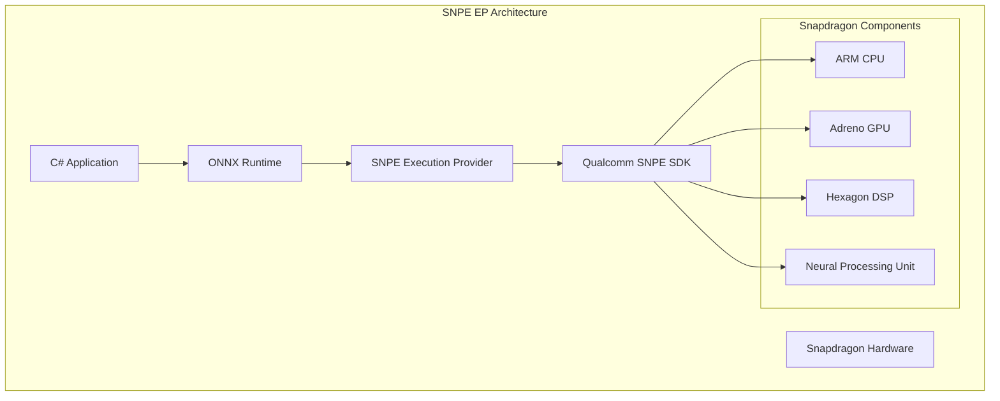
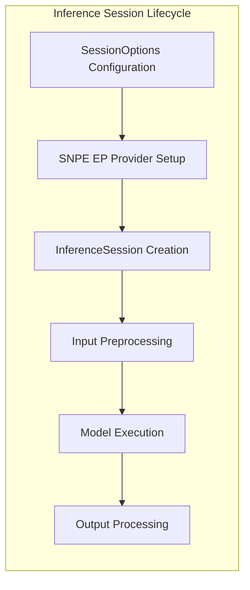
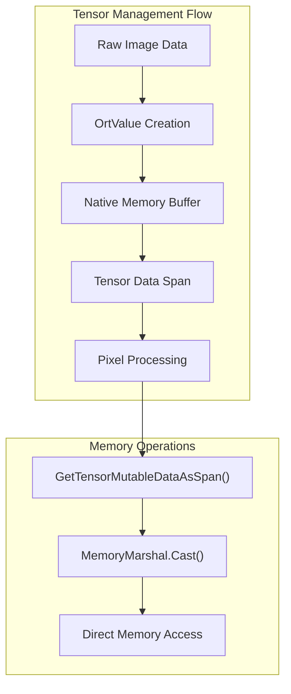
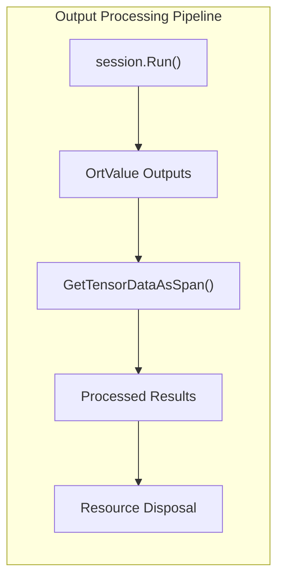
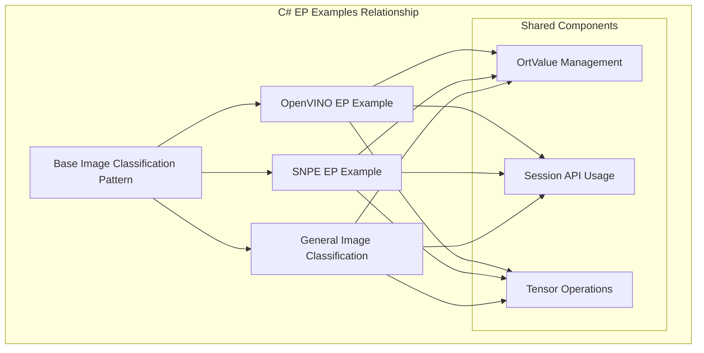

<!-- source: DeepWiki mcp.deepwiki.com · repo microsoft/onnxruntime-inference-examples · page 4.2 SNPE EP Example · fetched 2026-10-26 -->

# SNPE EP Example

Relevant source files

The following files were used as context for generating this wiki page:

- [c_sharp/OpenVINO_EP/yolov3_object_detection/Prediction.cs](c_sharp/OpenVINO_EP/yolov3_object_detection/Prediction.cs)
- [c_sharp/image_classification/Program.cs](c_sharp/image_classification/Program.cs)

## Purpose and Scope

This page documents the C# example demonstrating the use of the Snapdragon Neural Processing Engine (SNPE) Execution Provider with ONNX Runtime. The SNPE EP enables accelerated inference on Qualcomm Snapdragon processors by leveraging the dedicated neural processing capabilities of these mobile and embedded platforms.

For general C# image classification patterns, see [Image Classification in C#](#4.3). For Intel hardware acceleration, see [OpenVINO EP for C#](#4.1). For cross-platform mobile deployment with hardware acceleration, see [QNN EP Examples](#3.1).

## SNPE Execution Provider Overview

The SNPE (Snapdragon Neural Processing Engine) Execution Provider integrates Qualcomm's neural network SDK with ONNX Runtime, providing hardware-accelerated inference on Snapdragon processors. This execution provider is particularly valuable for mobile and edge computing scenarios where power efficiency and performance are critical.

Sources: Based on ONNX Runtime execution provider architecture patterns

## Basic Usage Pattern

The SNPE EP follows the standard ONNX Runtime C# API pattern, similar to other execution providers. The key difference lies in the session configuration and provider options.

The implementation follows the same tensor management patterns as shown in the general image classification example, where `OrtValue` objects are used for efficient memory management and tensor operations.

Sources: [c_sharp/image_classification/Program.cs:18-19](), [c_sharp/image_classification/Program.cs:38-39]()

## Key Configuration Components

### Session Configuration

The SNPE EP requires specific session options to configure the execution environment for Snapdragon hardware. This includes setting up the appropriate execution mode and hardware preferences.

### Input Tensor Management

Input preparation follows the same efficient memory management patterns demonstrated in the base image classification example, using `OrtValue.CreateAllocatedTensorValue()` for optimal performance.

Sources: [c_sharp/image_classification/Program.cs:38-39](), [c_sharp/image_classification/Program.cs:44](), [c_sharp/image_classification/Program.cs:53-56]()

### Output Processing

Output handling maintains the same pattern of accessing native buffers directly through spans, ensuring efficient data access without unnecessary copying.

Sources: [c_sharp/image_classification/Program.cs:76](), [c_sharp/image_classification/Program.cs:83](), [c_sharp/image_classification/Program.cs:88]()

## Hardware Acceleration Features

### Snapdragon-Specific Optimizations

The SNPE EP provides access to Snapdragon-specific acceleration features:

| Component | Purpose | Optimization Focus |
|-----------|---------|-------------------|
| Hexagon DSP | Vector processing | Low power consumption |
| Adreno GPU | Parallel computation | High throughput |
| ARM CPU | General processing | Balanced performance |
| NPU | Neural networks | Dedicated AI acceleration |

### Performance Considerations

The SNPE EP is optimized for mobile deployment scenarios where power efficiency is as important as performance. The execution provider automatically selects the most appropriate hardware component based on the model characteristics and system constraints.

## Integration Patterns

### Resource Management

Following the established C# patterns, proper disposal of resources is critical:

Sources: [c_sharp/image_classification/Program.cs:18-19](), [c_sharp/image_classification/Program.cs:38](), [c_sharp/image_classification/Program.cs:76]()

### Error Handling

The SNPE EP implementation follows standard C# exception handling patterns, with specific attention to hardware availability and driver compatibility checks.

## Relationship to Other Examples

The SNPE EP example builds upon the foundational patterns established in the general image classification example while providing Snapdragon-specific optimizations. It shares architectural similarities with the OpenVINO EP example but targets different hardware ecosystems.

Sources: [c_sharp/image_classification/Program.cs:1-98](), [c_sharp/OpenVINO_EP/yolov3_object_detection/Prediction.cs:1-31]()

---

