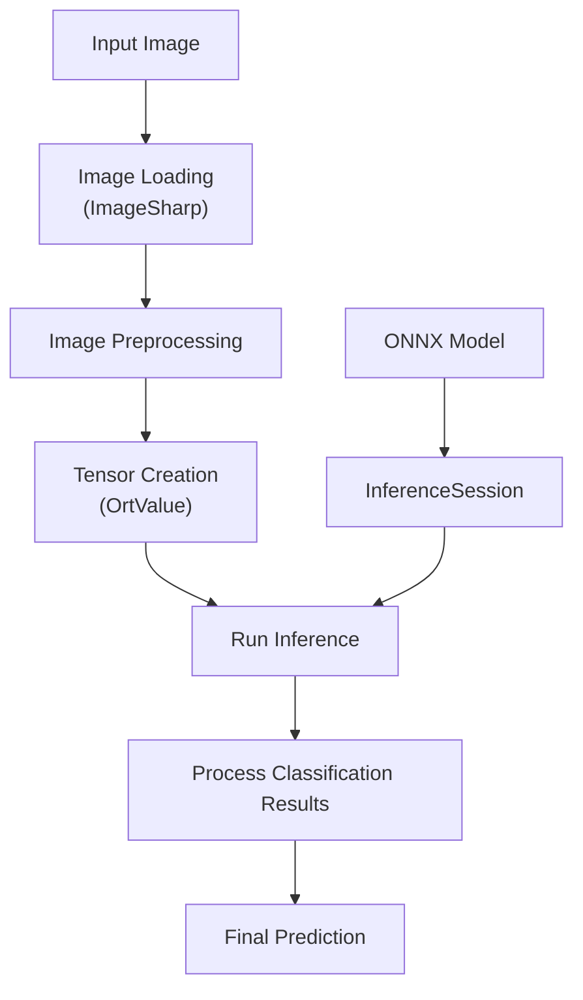
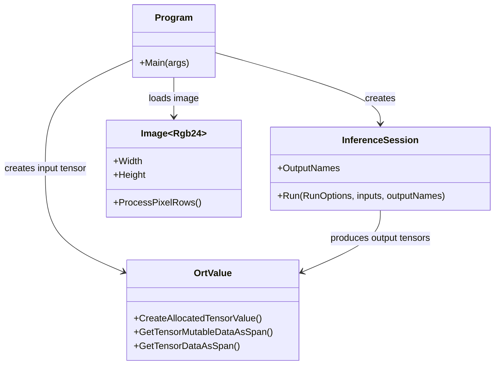
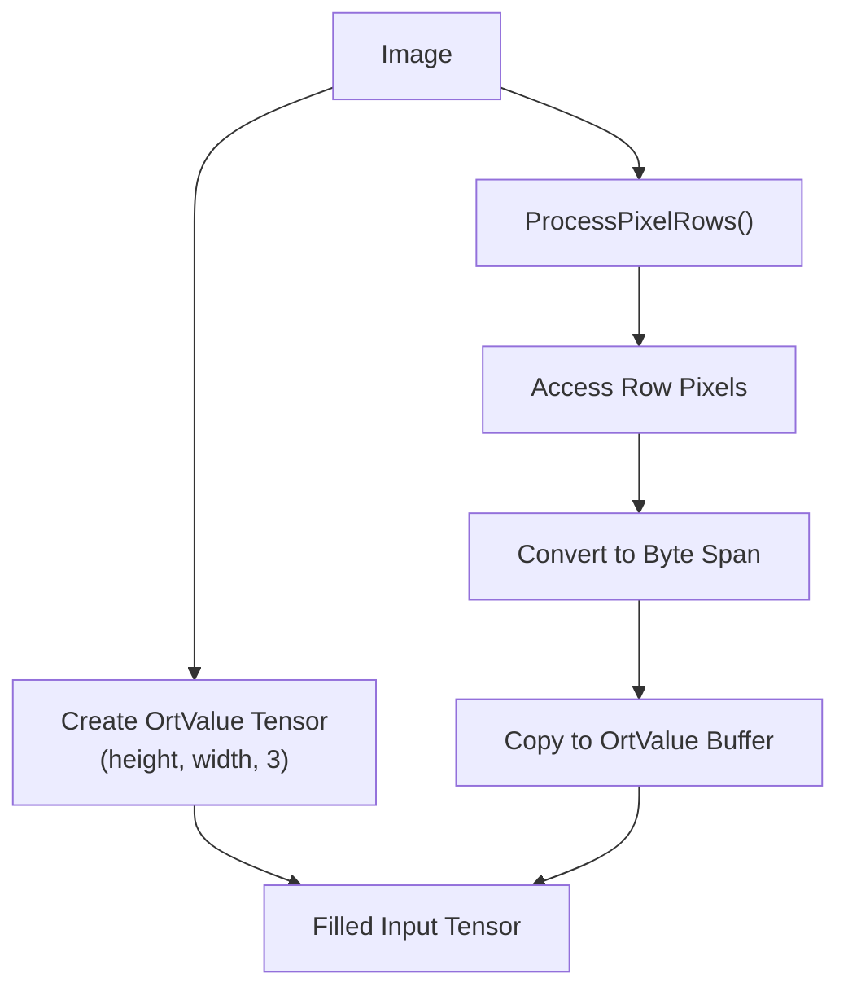
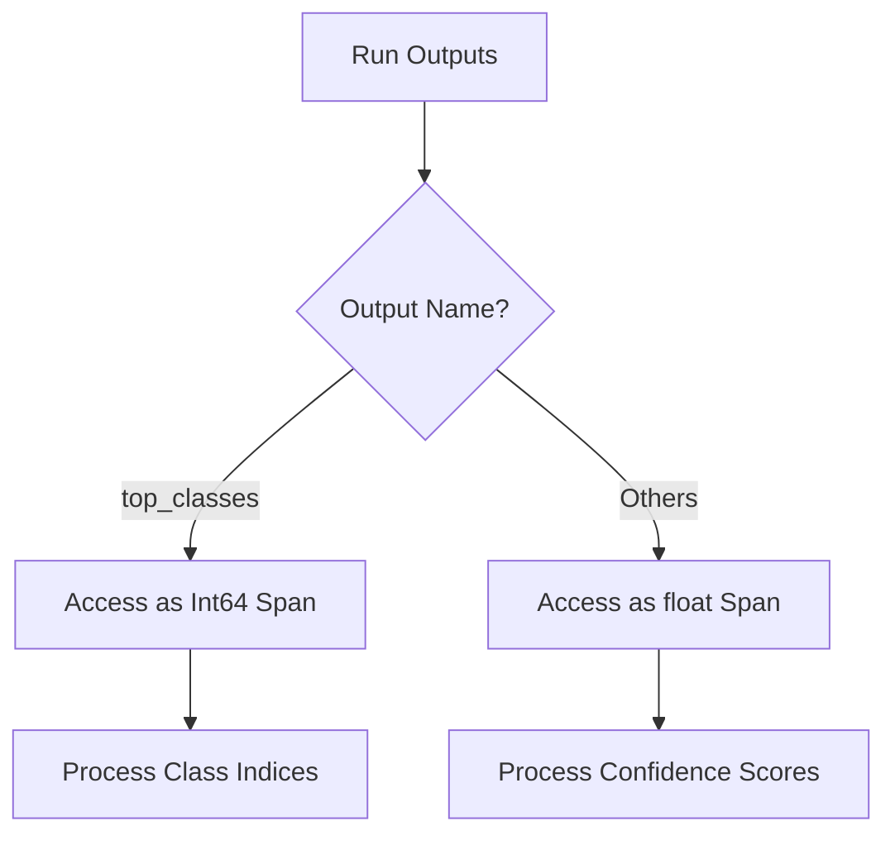
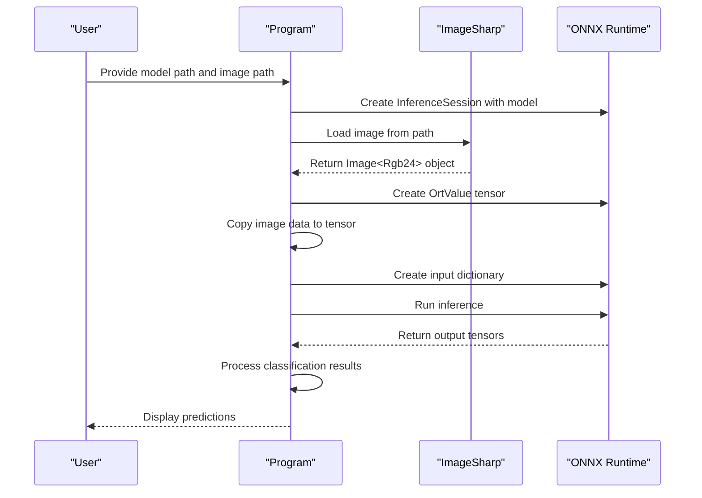

<!-- source: DeepWiki mcp.deepwiki.com · repo microsoft/onnxruntime-inference-examples · page 4.3 Image Classification in C# · fetched 2026-10-26 -->

# Image Classification in C#

Relevant source files

The following files were used as context for generating this wiki page:

- [c_sharp/OpenVINO_EP/yolov3_object_detection/Prediction.cs](c_sharp/OpenVINO_EP/yolov3_object_detection/Prediction.cs)
- [c_sharp/image_classification/Program.cs](c_sharp/image_classification/Program.cs)

This document provides a comprehensive guide to implementing image classification using ONNX Runtime in C#. It covers the process of loading models, preparing image data, running inference, and processing classification results. For object detection examples in C#, see [OpenVINO EP for C#](#4.1).

## System Overview

Image classification using ONNX Runtime in C# involves several key components and a defined workflow from image loading to classification results.

Sources: [c_sharp/image_classification/Program.cs:13-95]()

## Key Components

The image classification implementation relies on these key components:

| Component | Purpose | Implementation |
|-----------|---------|----------------|
| `InferenceSession` | Manages the ONNX model and performs inference | Microsoft.ML.OnnxRuntime |
| `OrtValue` | Represents tensor data for input/output | Microsoft.ML.OnnxRuntime |
| `Image<Rgb24>` | Handles image loading and pixel access | SixLabors.ImageSharp |
| `RunOptions` | Configures inference execution | Microsoft.ML.OnnxRuntime |

Sources: [c_sharp/image_classification/Program.cs:1-5](), [c_sharp/image_classification/Program.cs:18-19]()

## Detailed Implementation Flow

Sources: [c_sharp/image_classification/Program.cs:18-76]()

## Image Loading and Preprocessing

The first step in the image classification process is loading the input image and preparing it for the model:

1. The application uses SixLabors.ImageSharp to load images
2. The image is loaded as an `Image<Rgb24>` object, which provides pixel-level access
3. Original image dimensions are preserved during loading

Sources: [c_sharp/image_classification/Program.cs:21-27]()

## Tensor Creation from Image Data

Converting image data to tensor format requires careful memory handling:

1. An `OrtValue` object is created with the appropriate dimensions (height, width, channels)
2. Image pixel data is copied to the tensor's native memory buffer
3. The example demonstrates efficient row-by-row copying to optimize performance

Sources: [c_sharp/image_classification/Program.cs:38-67]()

## Running Inference

The inference process involves:

1. Creating a dictionary of named inputs with the image tensor
2. Running inference with the specified model outputs
3. Properly handling the output OrtValue objects

Sources: [c_sharp/image_classification/Program.cs:70-76]()

## Processing Classification Results

The model outputs are processed according to their data type:

1. For class indices (typically Int64 values), direct access through `GetTensorDataAsSpan<Int64>()`
2. For confidence scores (typically float values), access through `GetTensorDataAsSpan<float>()`

Sources: [c_sharp/image_classification/Program.cs:78-93]()

## Memory Management Considerations

The example demonstrates proper memory management with disposable ONNX Runtime objects:

1. `InferenceSession`, `RunOptions`, and image objects are all wrapped in `using` statements
2. `OrtValue` objects for both inputs and outputs must be properly disposed
3. Tensor data is accessed via spans to avoid unnecessary copying

Sources: [c_sharp/image_classification/Program.cs:18-19](), [c_sharp/image_classification/Program.cs:38-40](), [c_sharp/image_classification/Program.cs:76]()

## Complete Workflow Implementation

The complete workflow integrates all components into a coherent process:

Sources: [c_sharp/image_classification/Program.cs:14-95]()

## Usage Requirements

To implement image classification with this approach, you'll need:

1. Microsoft.ML.OnnxRuntime NuGet package
2. SixLabors.ImageSharp NuGet package
3. A pre-trained ONNX classification model
4. Input images to classify

The example assumes the model accepts a 3-channel RGB image as input (shape: [height, width, 3]) and outputs class indices and possibly confidence scores.

## Best Practices

- Always dispose ONNX Runtime resources using `using` statements
- Consider the memory layout of your tensor data (channel-first vs. channel-last)
- For repeated inference with different images, reuse the same InferenceSession
- Access tensor data directly with spans to avoid unnecessary copying
- Consider model-specific preprocessing steps (normalization, resizing, etc.)

Sources: [c_sharp/image_classification/Program.cs:18-19](), [c_sharp/image_classification/Program.cs:38-67](), [c_sharp/image_classification/Program.cs:76]()

---

