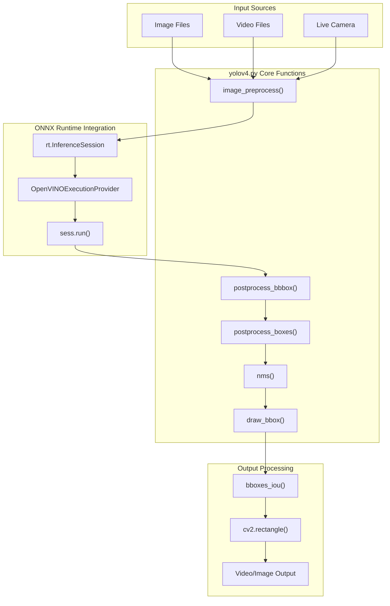
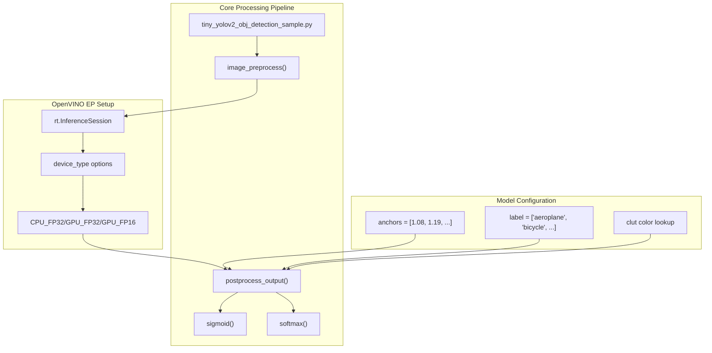
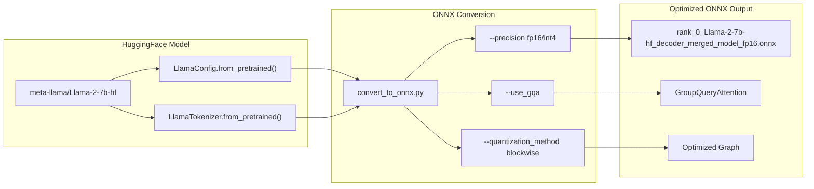
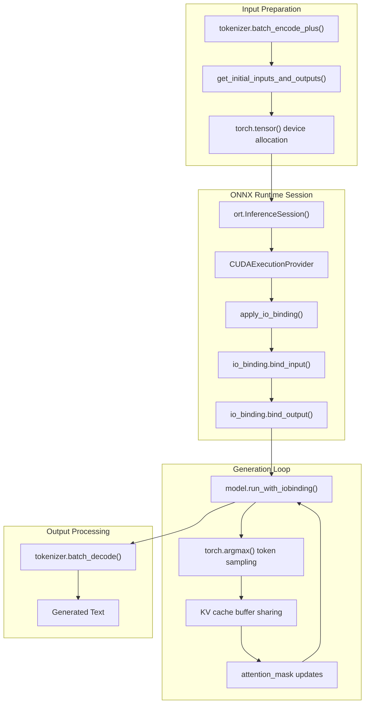

<!-- source: DeepWiki mcp.deepwiki.com · repo microsoft/onnxruntime-inference-examples · page 5 Python Examples · fetched 2026-10-26 -->

# Python Examples

<details>
<summary>Relevant source files</summary>

The following files were used as context for generating this wiki page:

- [c_sharp/OpenVINO_EP/yolov3_object_detection/README.md](c_sharp/OpenVINO_EP/yolov3_object_detection/README.md)
- [python/OpenVINO_EP/tiny_yolo_v2_object_detection/README.md](python/OpenVINO_EP/tiny_yolo_v2_object_detection/README.md)
- [python/OpenVINO_EP/tiny_yolo_v2_object_detection/requirements.txt](python/OpenVINO_EP/tiny_yolo_v2_object_detection/requirements.txt)
- [python/OpenVINO_EP/tiny_yolo_v2_object_detection/tiny_yolov2_obj_detection_sample.py](python/OpenVINO_EP/tiny_yolo_v2_object_detection/tiny_yolov2_obj_detection_sample.py)
- [python/OpenVINO_EP/yolov4_object_detection/README.md](python/OpenVINO_EP/yolov4_object_detection/README.md)
- [python/OpenVINO_EP/yolov4_object_detection/requirements.txt](python/OpenVINO_EP/yolov4_object_detection/requirements.txt)
- [python/OpenVINO_EP/yolov4_object_detection/yolov4.py](python/OpenVINO_EP/yolov4_object_detection/yolov4.py)
- [python/models/llama/LLaMA-2 E2E Notebook.ipynb](python/models/llama/LLaMA-2 E2E Notebook.ipynb)
- [python/models/llama/README.md](python/models/llama/README.md)

</details>


## Purpose and Scope

This section covers Python examples in the ONNX Runtime inference examples repository, demonstrating inference workflows across computer vision and natural language processing tasks. The examples showcase two primary categories: OpenVINO Execution Provider integration for Intel hardware acceleration, and large language model inference with LLaMA-2.

For C# examples using similar execution providers, see [C# Examples](#4). For JavaScript browser implementations, see [JavaScript Examples](#6).

## OpenVINO Execution Provider Examples

The Python OpenVINO examples demonstrate computer vision inference using Intel's OpenVINO execution provider for hardware acceleration. These examples support CPU, GPU, and specialized Intel hardware targets.

### Object Detection Examples

#### YOLOv4 Object Detection

The YOLOv4 implementation supports real-time object detection with 80 COCO dataset classes across multiple input modalities.



Sources: [python/OpenVINO_EP/yolov4_object_detection/yolov4.py:1-343](), [python/OpenVINO_EP/yolov4_object_detection/README.md:1-99]()

#### TinyYOLOv2 Object Detection

The TinyYOLOv2 implementation provides a lightweight alternative for resource-constrained environments, detecting 20 object classes.



Sources: [python/OpenVINO_EP/tiny_yolo_v2_object_detection/tiny_yolov2_obj_detection_sample.py:1-222](), [python/OpenVINO_EP/tiny_yolo_v2_object_detection/README.md:1-68]()

### Device Support and Configuration

| Device Type | Precision | Use Case |
|-------------|-----------|----------|
| `CPU_FP32` | Float32 | General CPU inference |
| `GPU_FP32` | Float32 | Intel GPU acceleration |
| `GPU_FP16` | Float16 | Optimized GPU inference |
| `MYRIAD_FP16` | Float16 | Intel Neural Compute Stick |

Sources: [python/OpenVINO_EP/yolov4_object_detection/README.md:60-61](), [python/OpenVINO_EP/tiny_yolo_v2_object_detection/README.md:32]()

## LLaMA-2 Large Language Model Examples

The LLaMA-2 examples demonstrate end-to-end large language model workflows including export, optimization, quantization, and inference using ONNX Runtime.

### Model Export and Optimization Pipeline



Sources: [python/models/llama/LLaMA-2 E2E Notebook.ipynb:547-628](), [python/models/llama/README.md:1-4]()

### Inference Architecture

The LLaMA-2 inference implementation demonstrates advanced ONNX Runtime features including IO binding and KV cache management.



Sources: [python/models/llama/LLaMA-2 E2E Notebook.ipynb:1305-1351](), [python/models/llama/LLaMA-2 E2E Notebook.ipynb:1403-1463](), [python/models/llama/LLaMA-2 E2E Notebook.ipynb:1501-1557]()

### Performance Benchmarks

The LLaMA-2 examples include comprehensive performance benchmarks across different model sizes and hardware configurations.

| Model | Batch Size | Prompt Length | Throughput (tps) | Latency (ms) |
|-------|------------|---------------|------------------|--------------|
| LLaMA-2 7B FP16 | 1 | 16 | 95.01 | 10.52 |
| LLaMA-2 7B FP16 | 4 | 16 | 366.29 | 10.92 |
| LLaMA-2 7B FP16 | 16 | 16 | 1385.42 | 11.55 |

Sources: [python/models/llama/README.md:7-26]()

### Advanced Features

#### IO Binding and Memory Management

The LLaMA-2 implementation demonstrates advanced ONNX Runtime features for optimal GPU memory utilization.

```python
# Key functions from the implementation
def get_initial_inputs_and_outputs(config, tokenizer, prompt, device, use_fp16, use_buffer_share)
def apply_io_binding(model, inputs, outputs, use_fp16, use_buffer_share)
```

#### GroupQueryAttention Buffer Sharing

When `use_buffer_share=True`, the implementation enables memory sharing between present and past KV cache tensors, reducing memory overhead.

Sources: [python/models/llama/LLaMA-2 E2E Notebook.ipynb:1608-1649](), [python/models/llama/LLaMA-2 E2E Notebook.ipynb:1651-1706]()

## Common Dependencies and Requirements

### OpenVINO Examples Dependencies

The OpenVINO examples share common Python dependencies managed through `requirements.txt` files:

- `onnx` - ONNX model format support
- `opencv-python` - Computer vision operations
- `scipy` - Scientific computing functions
- `Pillow` - Image processing
- `protobuf==3.20.2` - Protocol buffer serialization

Sources: [python/OpenVINO_EP/yolov4_object_detection/requirements.txt:1-9](), [python/OpenVINO_EP/tiny_yolo_v2_object_detection/requirements.txt:1-9]()

### LLaMA-2 Dependencies

The LLaMA-2 examples require additional packages for transformer model handling:

- `transformers>=4.33.2` - Hugging Face transformers
- `torch>=2.2.0.dev` - PyTorch framework
- `onnxruntime-gpu>=1.16.2` - ONNX Runtime with CUDA support
- `datasets>=2.8.0` - Dataset handling utilities

Sources: [python/models/llama/LLaMA-2 E2E Notebook.ipynb:118-326]()

## Integration Patterns

### Execution Provider Selection

Both example categories demonstrate consistent patterns for execution provider configuration:

```python
# CPU execution
sess = rt.InferenceSession(model_path, providers=['CPUExecutionProvider'])

# OpenVINO execution  
sess = rt.InferenceSession(model_path, providers=['OpenVINOExecutionProvider'], 
                          provider_options=[{'device_type': device}])

# CUDA execution
sess = rt.InferenceSession(model_path, providers=['CUDAExecutionProvider'])
```

Sources: [python/OpenVINO_EP/yolov4_object_detection/yolov4.py:280-287](), [python/models/llama/LLaMA-2 E2E Notebook.ipynb:1385-1387]()

---

