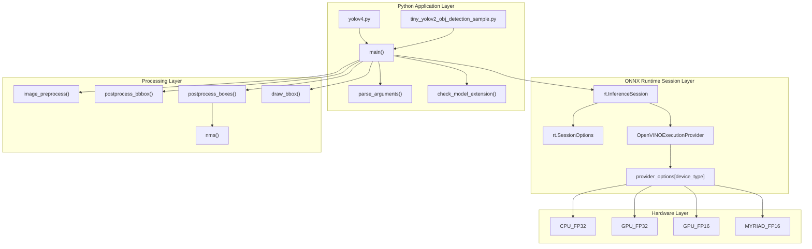
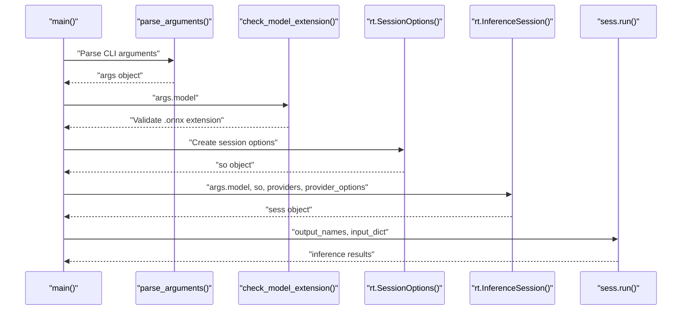
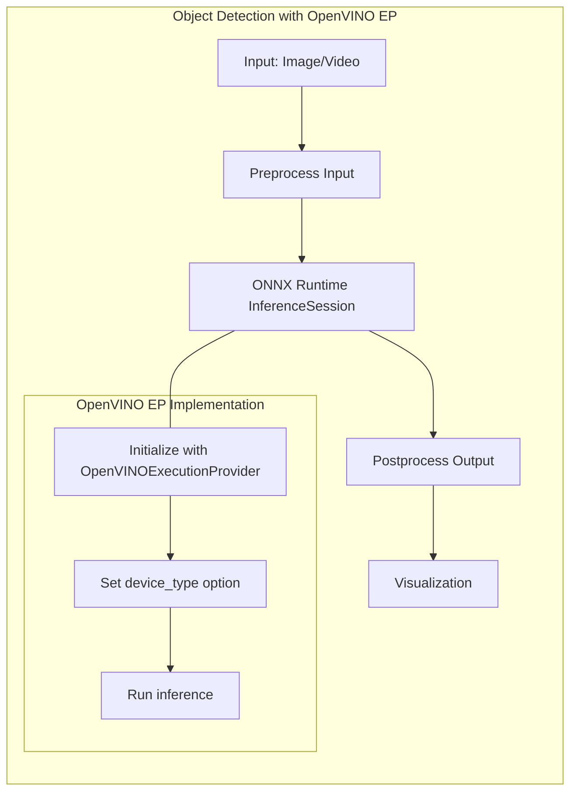

<!-- source: DeepWiki mcp.deepwiki.com · repo microsoft/onnxruntime-inference-examples · page 5.1 OpenVINO EP for Python · fetched 2026-10-26 -->

# OpenVINO EP for Python

<details>
<summary>Relevant source files</summary>

The following files were used as context for generating this wiki page:

- [c_sharp/OpenVINO_EP/yolov3_object_detection/README.md](c_sharp/OpenVINO_EP/yolov3_object_detection/README.md)
- [python/OpenVINO_EP/tiny_yolo_v2_object_detection/README.md](python/OpenVINO_EP/tiny_yolo_v2_object_detection/README.md)
- [python/OpenVINO_EP/tiny_yolo_v2_object_detection/requirements.txt](python/OpenVINO_EP/tiny_yolo_v2_object_detection/requirements.txt)
- [python/OpenVINO_EP/tiny_yolo_v2_object_detection/tiny_yolov2_obj_detection_sample.py](python/OpenVINO_EP/tiny_yolo_v2_object_detection/tiny_yolov2_obj_detection_sample.py)
- [python/OpenVINO_EP/yolov4_object_detection/README.md](python/OpenVINO_EP/yolov4_object_detection/README.md)
- [python/OpenVINO_EP/yolov4_object_detection/requirements.txt](python/OpenVINO_EP/yolov4_object_detection/requirements.txt)
- [python/OpenVINO_EP/yolov4_object_detection/yolov4.py](python/OpenVINO_EP/yolov4_object_detection/yolov4.py)

</details>


This document covers Python examples using OpenVINO Execution Provider for object detection and computer vision tasks. The examples demonstrate how to use ONNX Runtime with Intel's OpenVINO EP to accelerate inference on Intel hardware platforms.

## 1. Overview

The repository contains two main Python examples implementing object detection using OpenVINO EP:
- `yolov4.py` - YOLOv4 object detection supporting image, video, and live camera input
- `tiny_yolov2_obj_detection_sample.py` - Tiny YOLOv2 object detection for video input

Both examples follow the same architectural pattern: model loading, preprocessing, OpenVINO EP inference session creation, and postprocessing with visualization.

### Python OpenVINO EP Architecture



Sources: [python/OpenVINO_EP/yolov4_object_detection/yolov4.py:241-342](), [python/OpenVINO_EP/tiny_yolo_v2_object_detection/tiny_yolov2_obj_detection_sample.py:140-222]()

### 1.1 Supported Device Types

The examples support multiple Intel hardware targets specified via the `--device` argument:

| Device Type | Implementation | YOLOv4 Support | Tiny YOLOv2 Support |
|-------------|----------------|----------------|----------------------|
| `cpu` | Default CPU EP (MLAS) | ✓ | ✓ |
| `CPU_FP32` | OpenVINO EP with FP32 | ✓ | ✓ |
| `CPU_FP16` | OpenVINO EP with FP16 | ✓ | ✓ |
| `GPU_FP32` | Intel GPU with FP32 | ✓ | ✓ |
| `GPU_FP16` | Intel GPU with FP16 | ✓ | ✓ |
| `MYRIAD_FP16` | Intel NCS2 | ✓ | - |
| `VAD-M_FP16` | Visual Accelerator | ✓ | - |

The device selection logic is implemented in both `main()` functions with conditional session creation:

```python
if(args.device == 'cpu'):
    sess = rt.InferenceSession(args.model, so, providers=['CPUExecutionProvider'])
else:
    sess = rt.InferenceSession(args.model, so, providers=['OpenVINOExecutionProvider'], 
                               provider_options=[{'device_type' : device}])
```

Sources: [python/OpenVINO_EP/yolov4_object_detection/yolov4.py:280-291](), [python/OpenVINO_EP/tiny_yolo_v2_object_detection/tiny_yolov2_obj_detection_sample.py:149-162]()

## 2. Installation

### 2.1 Prerequisites

To use OpenVINO EP for Python, you need:

- Python 3+
- ONNX Runtime 1.6+
- OpenVINO Runtime 
- numpy, opencv, and other dependencies

Sources: [python/OpenVINO_EP/yolov4_object_detection/README.md:35-46](), [python/OpenVINO_EP/yolov4_object_detection/requirements.txt:1-8]()

### 2.2 Installation Steps

The recommended installation method is using pip:

```
pip install onnxruntime-openvino openvino
```

Alternatively, you can install dependencies from the requirements file:

```
pip install -r requirements.txt
```

Sources: [python/OpenVINO_EP/yolov4_object_detection/README.md:23-25](), [python/OpenVINO_EP/yolov4_object_detection/requirements.txt:1-8]()

### 2.3 Manual Build (Optional)

If you need to build from source:

1. Follow the build instructions from the ONNX Runtime documentation
2. Install OpenVINO Runtime using an installer
3. Build the Python wheels from source

Sources: [python/OpenVINO_EP/yolov4_object_detection/README.md:27-30]()

## 3. Usage

### 3.1 Core Implementation Pattern

Both examples follow the same implementation pattern with these key functions:

### Inference Session Initialization Pattern



### Key Code Components

| Function | File | Purpose | Line Range |
|----------|------|---------|------------|
| `parse_arguments()` | yolov4.py | CLI argument parsing | [221-228]() |
| `check_model_extension()` | yolov4.py | Model file validation | [230-239]() |
| `image_preprocess()` | yolov4.py | Input preprocessing | [27-47]() |
| `postprocess_bbbox()` | yolov4.py | Bounding box postprocessing | [49-68]() |
| `draw_bbox()` | yolov4.py | Visualization | [173-205]() |
| `main()` | yolov4.py | Main execution flow | [241-342]() |

Sources: [python/OpenVINO_EP/yolov4_object_detection/yolov4.py:221-342](), [python/OpenVINO_EP/tiny_yolo_v2_object_detection/tiny_yolov2_obj_detection_sample.py:30-222]()

### 3.2 Session Creation Implementation

Both examples implement the same session creation pattern with device-specific logic:

#### YOLOv4 Implementation
```python
# From yolov4.py lines 277-291
device = args.device
so = rt.SessionOptions()
so.log_severity_level = 3
if(args.device == 'cpu'):
    print("Device type selected is 'cpu' which is the default CPU Execution Provider (MLAS)")
    sess = rt.InferenceSession(args.model, so, providers=['CPUExecutionProvider'])
else:
    sess = rt.InferenceSession(args.model, so, providers=['OpenVINOExecutionProvider'], 
                               provider_options=[{'device_type' : device}])
    print("Device type selected is: " + device + " using the OpenVINO Execution Provider")

input_name = sess.get_inputs()[0].name
```

#### Tiny YOLOv2 Implementation  
```python
# From tiny_yolov2_obj_detection_sample.py lines 147-165
so = rt.SessionOptions()
so.log_severity_level = 3
if (args.device == 'cpu'):
    sess = rt.InferenceSession(args.model, so, providers=['CPUExecutionProvider'])
elif (args.device == 'CPU_FP32', args.device == 'CPU_FP16' or args.device == 'GPU_FP32' or args.device == 'GPU_FP16'):
    sess = rt.InferenceSession(args.model, so, providers=['OpenVINOExecutionProvider'], 
                               provider_options=[{'device_type' : args.device}])

input_name = sess.get_inputs()[0].name
```

Sources: [python/OpenVINO_EP/yolov4_object_detection/yolov4.py:277-291](), [python/OpenVINO_EP/tiny_yolo_v2_object_detection/tiny_yolov2_obj_detection_sample.py:147-165]()

### 3.3 Windows-Specific Considerations

On Windows platforms, you may need to add OpenVINO libraries to the path:

```python
import platform
if platform.system() == "Windows":
    import onnxruntime.tools.add_openvino_win_libs as utils
    utils.add_openvino_libs_to_path()
```

Sources: [python/OpenVINO_EP/yolov4_object_detection/yolov4.py:22-25](), [python/OpenVINO_EP/tiny_yolo_v2_object_detection/tiny_yolov2_obj_detection_sample.py:14-16]()

## 4. Examples

The repository contains two main examples demonstrating OpenVINO EP for Python:

1. YOLOv4 object detection
2. Tiny YOLOv2 object detection

Both examples follow a similar pattern but use different models and have slightly different pre/post-processing steps.



Sources: [python/OpenVINO_EP/yolov4_object_detection/README.md:1-15](), [python/OpenVINO_EP/tiny_yolo_v2_object_detection/README.md:1-7]()

### 4.2 YOLOv4 Implementation Details

**File**: `python/OpenVINO_EP/yolov4_object_detection/yolov4.py`

#### Key Constants and Configuration
```python
# Lines 215-219
ANCHORS = "./yolov4_anchors.txt"    
STRIDES = [8, 16, 32]
XYSCALE = [1.2, 1.1, 1.05]
ANCHORS = get_anchors(ANCHORS)
STRIDES = np.array(STRIDES)
```

#### Core Processing Functions

| Function | Lines | Purpose |
|----------|-------|---------|
| `image_preprocess()` | [27-47]() | Resize and normalize input |
| `postprocess_bbbox()` | [49-68]() | Convert raw predictions to bboxes |
| `postprocess_boxes()` | [70-109]() | Filter and scale bounding boxes |
| `nms()` | [129-163]() | Non-maximum suppression |
| `draw_bbox()` | [173-205]() | Visualization with class labels |

#### Input Support Matrix
- **Image**: Single image processing with `.jpg` output
- **Video**: Frame-by-frame processing with `.avi` output  
- **Camera**: Live webcam feed (no input file)

#### Performance Monitoring
```python
# Lines 319-322, 329-330
start = time.time()
detections = sess.run(output_names, {input_name: image_data})
end = time.time()
inference_time = end - start
cv2.putText(image,'FPS: {}'.format(1.0/inference_time),(10,40),cv2.FONT_HERSHEY_COMPLEX,0.5,(255,255,255),1)
```

### 4.3 Tiny YOLOv2 Implementation Details

**File**: `python/OpenVINO_EP/tiny_yolo_v2_object_detection/tiny_yolov2_obj_detection_sample.py`

#### Supported Classes
```python
# Lines 25-28
label = ["aeroplane","bicycle","bird","boat","bottle",
         "bus","car","cat","chair","cow","diningtable",
         "dog","horse","motorbike","person","pottedplant",
          "sheep","sofa","train","tvmonitor"]
```

#### Core Processing Functions

| Function | Lines | Purpose |
|----------|-------|---------|
| `image_preprocess()` | [69-76]() | Resize to 416x416, transpose to CHW format |
| `postprocess_output()` | [78-132]() | Extract detections with confidence filtering |
| `sigmoid()` | [38-39]() | Activation function for bbox confidence |
| `softmax()` | [41-43]() | Class probability calculation |

#### Detection Logic
```python
# Lines 85-99: Grid cell processing
for cy in range(0,13):
    for cx in range(0,13):
        for b in range(0,5):
            # Extract tx, ty, tw, th, tc from output tensor
            # Apply sigmoid and exponential transforms
            # Calculate final bbox coordinates
```

#### Confidence Threshold
- Default threshold: `0.60` for combined class confidence × detection confidence
- Duplicate detection suppression using spatial thresholding

Sources: [python/OpenVINO_EP/yolov4_object_detection/yolov4.py:27-342](), [python/OpenVINO_EP/tiny_yolo_v2_object_detection/tiny_yolov2_obj_detection_sample.py:25-132]()

## 5. Command Line Interface

### 5.1 YOLOv4 CLI Arguments

The `parse_arguments()` function in `yolov4.py` defines these arguments:

```python
# Lines 221-228
parser.add_argument('--device', default='CPU_FP32', help="Device to perform inference on 'cpu (MLAS)' or on devices supported by OpenVINO-EP [CPU_FP32, GPU_FP32, GPU_FP16, MYRIAD_FP16, VAD-M_FP16].")
parser.add_argument('--image', help='Path to image file.')
parser.add_argument('--video', help='Path to video file.')
parser.add_argument('--model', help='Path to model.')
```

#### Usage Examples
```bash
# Video processing with CPU
python yolov4.py --device CPU_FP32 --video classroom.mp4 --model yolov4.onnx

# Image processing with GPU  
python yolov4.py --device GPU_FP16 --image cat.jpg --model yolov4.onnx

# Live camera with NCS2
python yolov4.py --device MYRIAD_FP16 --model yolov4.onnx

# Default CPU EP
python yolov4.py --device cpu --video classroom.mp4 --model yolov4.onnx
```

### 5.2 Tiny YOLOv2 CLI Arguments

The `parse_arguments()` function in `tiny_yolov2_obj_detection_sample.py` defines:

```python
# Lines 30-36
parser.add_argument('--device', default='CPU_FP32', help="Device to perform inference on 'cpu (MLAS)' or on devices supported by OpenVINO-EP [CPU_FP32, CPU_FP32, GPU_FP32, GPU_FP16].")
parser.add_argument('--video', help='Path to video file.')
parser.add_argument('--model', help='Path to model.')
```

#### Usage Example
```bash
python tiny_yolov2_obj_detection_sample.py --video face-demographics-walking-and-pause.mp4 --model tinyyolov2.onnx --device CPU_FP32
```

### 5.3 File Validation

Both examples implement validation functions:

| Function | File | Validation |
|----------|------|------------|
| `check_model_extension()` | yolov4.py:[230-239]() | Validates `.onnx` extension and file existence |
| `check_model_extension()` | tiny_yolov2_obj_detection_sample.py:[45-54]() | Same validation logic |
| `check_video_file_extension()` | tiny_yolov2_obj_detection_sample.py:[56-67]() | Validates `.mp4`, `.avi`, `.mov` extensions |

Sources: [python/OpenVINO_EP/yolov4_object_detection/yolov4.py:221-239](), [python/OpenVINO_EP/tiny_yolo_v2_object_detection/tiny_yolov2_obj_detection_sample.py:30-67]()

## 6. Dependencies and Requirements

### 6.1 Core Dependencies

Both examples share similar dependency requirements:

#### YOLOv4 Requirements (`requirements.txt`)
```
certifi==2024.7.4
flatbuffers==2.0
onnx
opencv-python==4.8.1.78
Pillow==10.2.0
protobuf==3.20.2
scipy==1.11.4
typing-extensions==4.2.0
```

#### Tiny YOLOv2 Requirements (`requirements.txt`)
```
certifi==2023.7.22
flatbuffers==2.0
onnx
opencv-python==4.5.5.64
Pillow==10.3.0
protobuf==3.20.2
scipy==1.10.0
typing-extensions==4.2.0
```

### 6.2 Platform-Specific Considerations

#### Windows OpenVINO Library Path
Both examples include Windows-specific path handling:

```python
# Lines 23-25 in yolov4.py, Lines 14-16 in tiny_yolov2_obj_detection_sample.py
if platform.system() == "Windows":
    import onnxruntime.tools.add_openvino_win_libs as utils
    utils.add_openvino_libs_to_path()
```

#### ONNX Runtime Requirements
- **Minimum Version**: ONNX Runtime 1.6+
- **Python Version**: Python 3+
- **numpy**: Version 1.21.6+
- **OpenCV**: Version 4.5.5+

### 6.3 Model Requirements

| Example | Model Source | Input Shape | Output Classes |
|---------|--------------|-------------|----------------|
| YOLOv4 | [ONNX Model Zoo YOLOv4](https://github.com/onnx/models/tree/master/vision/object_detection_segmentation/yolov4) | 416×416×3 | 80 (COCO dataset) |
| Tiny YOLOv2 | [ONNX Model Zoo Tiny YOLOv2](https://github.com/onnx/models/tree/master/vision/object_detection_segmentation/tiny-yolov2) | 416×416×3 | 20 classes |

Sources: [python/OpenVINO_EP/yolov4_object_detection/requirements.txt:1-8](), [python/OpenVINO_EP/tiny_yolo_v2_object_detection/requirements.txt:1-8](), [python/OpenVINO_EP/yolov4_object_detection/yolov4.py:23-25](), [python/OpenVINO_EP/tiny_yolo_v2_object_detection/tiny_yolov2_obj_detection_sample.py:14-16]()

## 7. Troubleshooting

### 7.1 Common Issues

1. **Missing OpenVINO libraries**: Ensure OpenVINO is correctly installed and libraries are in path
2. **Model compatibility**: Not all ONNX models are fully compatible with OpenVINO EP
3. **Device unavailability**: Make sure the specified device is available on your system
4. **Dependencies**: Ensure all required packages are installed

### 7.2 Windows-Specific Issues

On Windows, path issues are common. Use the provided utility to add OpenVINO libraries to path:

```python
import onnxruntime.tools.add_openvino_win_libs as utils
utils.add_openvino_libs_to_path()
```

Sources: [python/OpenVINO_EP/yolov4_object_detection/yolov4.py:22-25](), [python/OpenVINO_EP/tiny_yolo_v2_object_detection/tiny_yolov2_obj_detection_sample.py:14-16]()

## 8. References

- [OpenVINO Execution Provider Documentation](https://onnxruntime.ai/docs/execution-providers/OpenVINO-ExecutionProvider.html)
- [OpenVINO Execution Provider pip wheels](https://pypi.org/project/onnxruntime-openvino/)
- [Get started with ORT for Python](https://onnxruntime.ai/docs/get-started/with-python.html)
- [Build instructions](https://onnxruntime.ai/docs/build/eps.html#openvino)

Sources: [python/OpenVINO_EP/yolov4_object_detection/README.md:87-97](), [python/OpenVINO_EP/tiny_yolo_v2_object_detection/README.md:56-66]()

---

