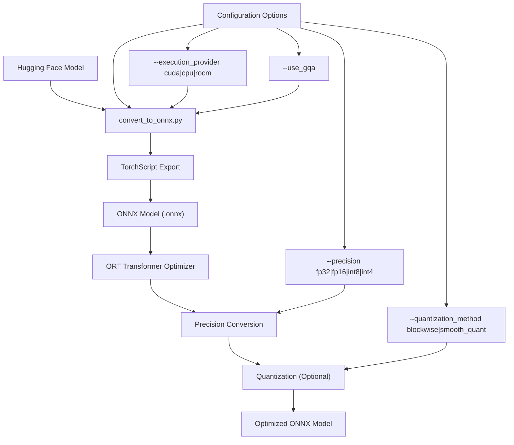
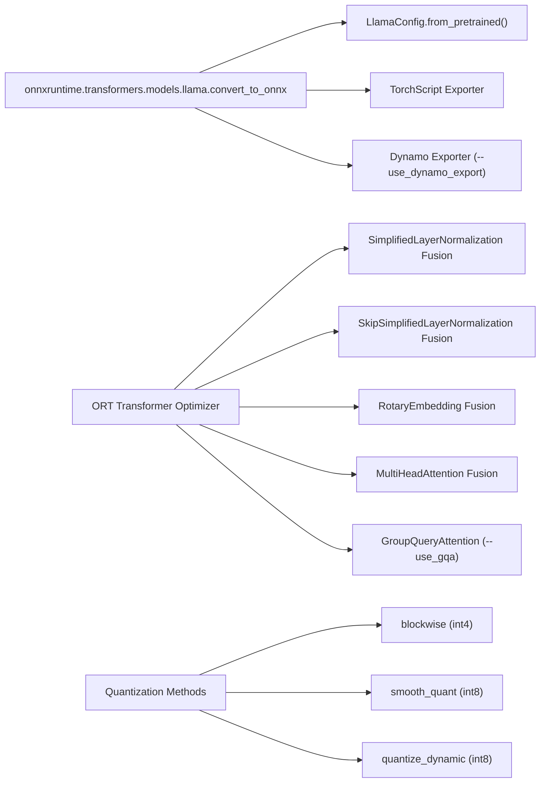
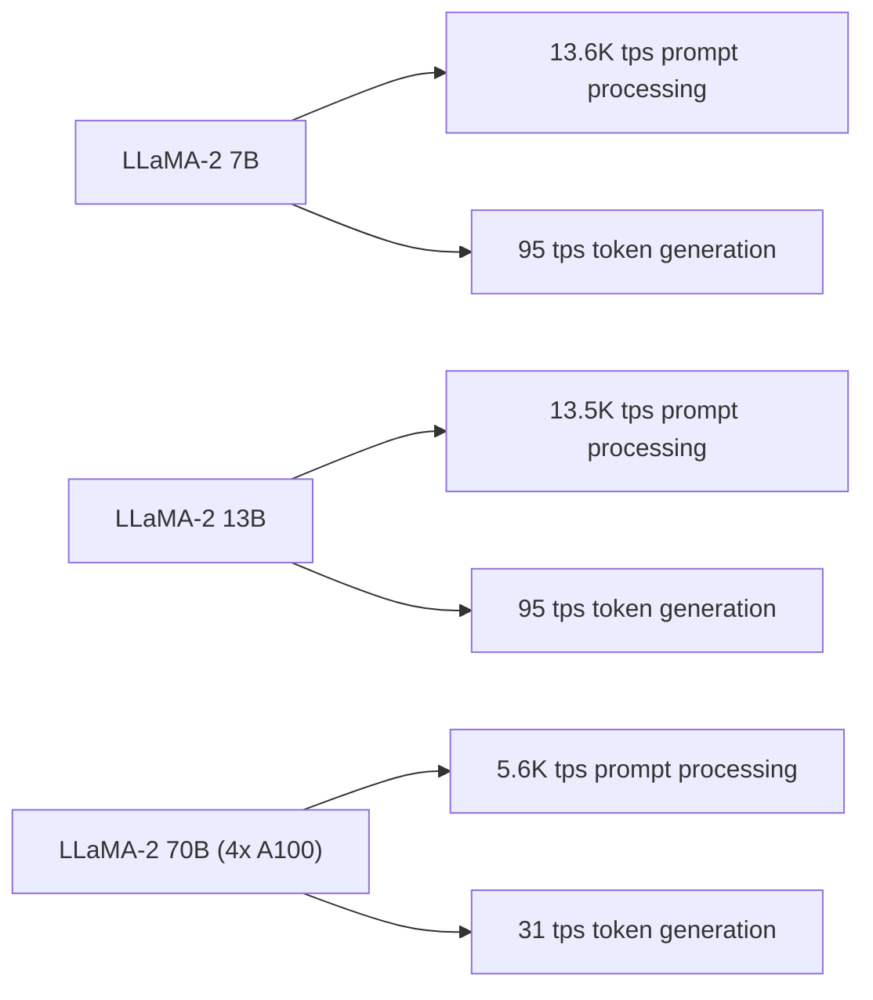
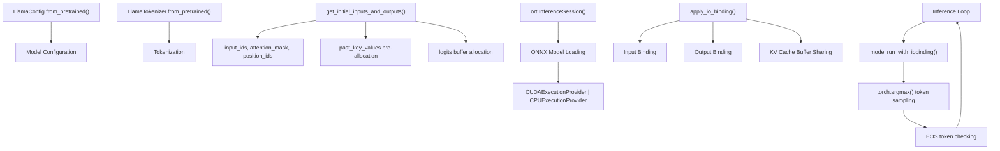
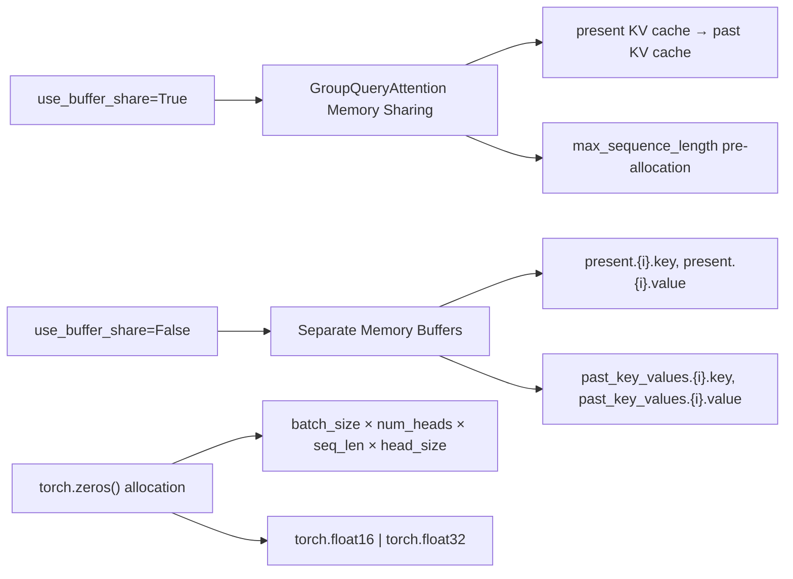

<!-- source: DeepWiki mcp.deepwiki.com · repo microsoft/onnxruntime-inference-examples · page 5.2 LLaMA-2 with ONNX Runtime · fetched 2026-10-26 -->

# LLaMA-2 with ONNX Runtime

<details>
<summary>Relevant source files</summary>

The following files were used as context for generating this wiki page:

- [python/models/llama/LLaMA-2 E2E Notebook.ipynb](python/models/llama/LLaMA-2 E2E Notebook.ipynb)
- [python/models/llama/README.md](python/models/llama/README.md)

</details>


This page covers the export, optimization, and inference of LLaMA-2 models using ONNX Runtime in Python. It demonstrates how to convert PyTorch LLaMA-2 models to optimized ONNX format and implement efficient inference with various precision levels and execution providers.

For OpenVINO-specific LLaMA implementations, see [OpenVINO EP for Python](#5.1). For general quantization workflows, see [Quantization](#9).

## Export and Optimization Pipeline

The LLaMA-2 export process involves converting PyTorch models to ONNX format with comprehensive optimizations for different target platforms and precision requirements.

### Export Process Flow



**Export and Optimization Components**



Sources: [python/models/llama/LLaMA-2 E2E Notebook.ipynb:624-628](), [python/models/llama/LLaMA-2 E2E Notebook.ipynb:1098-1124]()

### Export Configuration Options

| Parameter | Options | Description |
|-----------|---------|-------------|
| `--precision` | `fp32`, `fp16`, `int8`, `int4` | Target precision for model weights |
| `--execution_provider` | `cuda`, `cpu`, `rocm` | Target execution provider |
| `--quantization_method` | `blockwise`, `smooth_quant`, `quantize_dynamic` | Quantization algorithm |
| `--use_gqa` | flag | Enable GroupQueryAttention optimization |
| `--use_dynamo_export` | flag | Use Dynamo exporter instead of TorchScript |

Sources: [python/models/llama/LLaMA-2 E2E Notebook.ipynb:547-620]()

## Performance Characteristics

Performance benchmarks demonstrate significant throughput improvements with ONNX Runtime compared to PyTorch implementations across different model sizes and configurations.

### LLaMA-2 7B Performance Summary

| Engine | Batch Size | Prompt Length | Prompt Processing (tps) | Token Generation (tps) | Wall-Clock (tps) |
|--------|------------|---------------|------------------------|----------------------|------------------|
| onnxruntime | 1 | 16 | 1336.94 | 95.01 | 88.25 |
| onnxruntime | 4 | 16 | 5016.64 | 366.29 | 341.21 |
| onnxruntime | 16 | 16 | 12002.35 | 1385.42 | 1250.62 |
| pytorch-eager | 1 | 16 | 485.22 | 31.30 | 32.83 |
| pytorch-compile | 1 | 16 | 1233.32 | 66.37 | 68.86 |

Sources: [python/models/llama/README.md:7-26]()

### Model Size Scaling



Sources: [python/models/llama/README.md:64-144]()

## Inference Implementation Architecture

The inference system implements efficient token generation with optimized memory management and IO binding for maximum performance.

### Core Inference Components



Sources: [python/models/llama/LLaMA-2 E2E Notebook.ipynb:1167-1175](), [python/models/llama/LLaMA-2 E2E Notebook.ipynb:1305-1351]()

### Memory Management and Buffer Sharing



Sources: [python/models/llama/LLaMA-2 E2E Notebook.ipynb:1322-1349](), [python/models/llama/LLaMA-2 E2E Notebook.ipynb:1441-1461]()

## Key Implementation Functions

### Input/Output Preparation

The `get_initial_inputs_and_outputs()` function handles tokenization, tensor allocation, and KV cache memory setup:

```python
def get_initial_inputs_and_outputs(config, tokenizer, prompt, device, use_fp16, use_buffer_share):
    # Tokenization and padding
    tokenizer.pad_token = "[PAD]"
    encodings_dict = tokenizer.batch_encode_plus(prompt, padding=True)
    
    # Tensor creation and device placement
    input_ids = torch.tensor(encodings_dict["input_ids"], device=device, dtype=torch.int64)
    attention_mask = torch.tensor(encodings_dict["attention_mask"], device=device, dtype=torch.int64)
    position_ids = attention_mask.long().cumsum(-1) - 1
    
    # KV cache pre-allocation with buffer sharing support
    for i in range(config.num_hidden_layers):
        past_key = torch.zeros(batch_size, num_heads, max_sequence_length if use_buffer_share else 0, head_size, device=device, dtype=torch_dtype)
        past_value = torch.zeros(batch_size, num_heads, max_sequence_length if use_buffer_share else 0, head_size, device=device, dtype=torch_dtype)
```

Sources: [python/models/llama/LLaMA-2 E2E Notebook.ipynb:1305-1351]()

### IO Binding Management

The `apply_io_binding()` function optimizes memory access by binding tensors directly to ONNX Runtime:

```python
def apply_io_binding(model, inputs, outputs, use_fp16, use_buffer_share):
    io_binding = model.io_binding()
    
    # Input binding with direct memory pointers
    for k, v in inputs.items():
        io_binding.bind_input(
            name=k,
            device_type=v.device.type,
            device_id=0 if v.device.type == "cpu" else v.device.index,
            element_type=pt_to_np[repr(v.dtype)],
            shape=tuple(v.shape),
            buffer_ptr=v.data_ptr()
        )
    
    # Output binding with KV cache sharing
    if use_buffer_share and "present" in name:
        v = inputs[name.replace("present", "past_key_values")]
        io_binding.bind_output(name=name, buffer_ptr=v.data_ptr())
```

Sources: [python/models/llama/LLaMA-2 E2E Notebook.ipynb:1403-1463]()

### Inference Loop Implementation

The main inference loop handles token generation, EOS detection, and tensor updates:

- **Token Sampling**: Uses `torch.argmax()` for greedy decoding from logits output
- **EOS Handling**: Tracks completion status with `has_eos` tensor per batch entry  
- **Memory Reuse**: Zeros logits buffer and updates input tensors for next iteration
- **KV Cache Management**: Handles buffer sharing or explicit tensor copying based on `use_buffer_share`

Sources: [python/models/llama/LLaMA-2 E2E Notebook.ipynb:1501-1557]()

## Integration Options

### Direct ONNX Runtime Usage

The notebook demonstrates low-level ONNX Runtime integration with manual memory management and IO binding for maximum performance control.

### Hugging Face Optimum Integration

For simplified usage, the system supports Hugging Face Optimum's `ORTModelForCausalLM`:

```python
from optimum.onnxruntime import ORTModelForCausalLM

model = ORTModelForCausalLM.from_pretrained(
    onnx_model_dir,
    use_io_binding=True,
    provider="CUDAExecutionProvider",
    provider_options={"device_id": device_id}
)
```

Sources: [python/models/llama/LLaMA-2 E2E Notebook.ipynb:1847-1853]()

---

