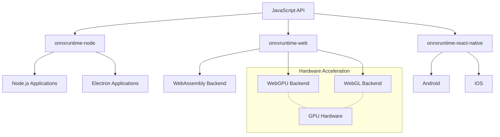
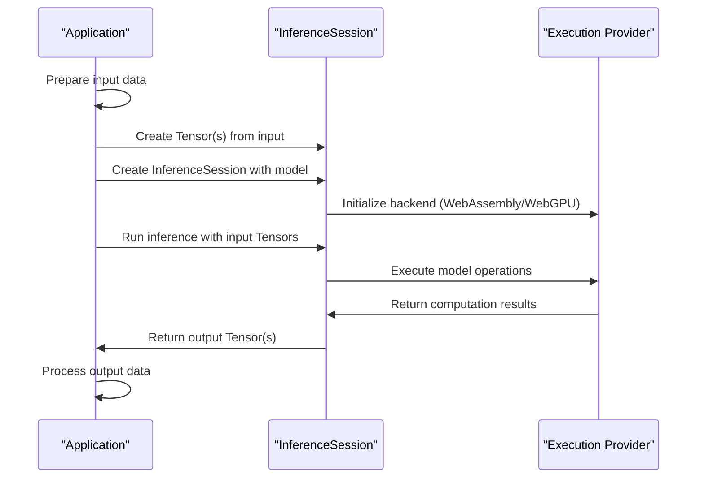
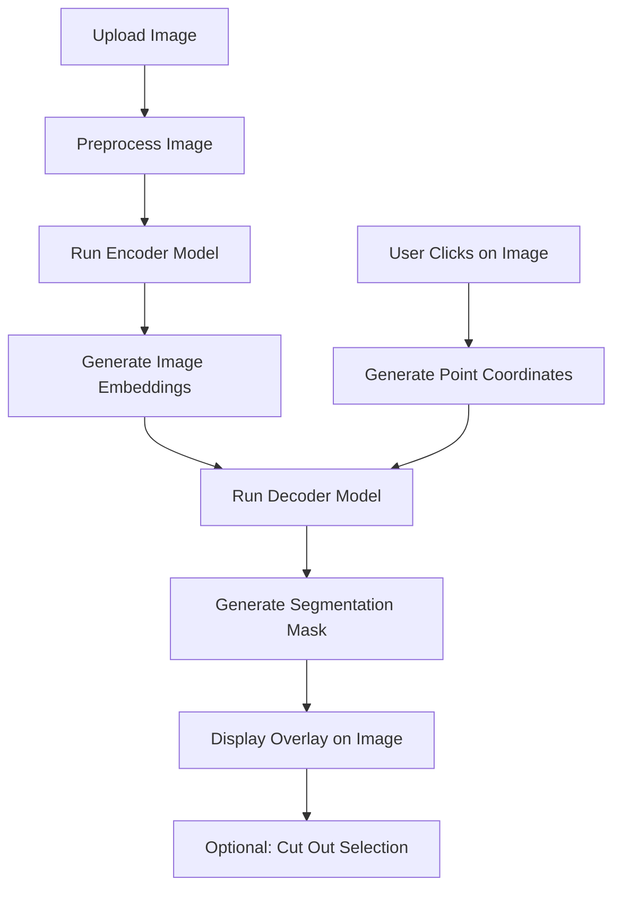

<!-- source: DeepWiki mcp.deepwiki.com · repo microsoft/onnxruntime-inference-examples · page 6 JavaScript Examples · fetched 2026-10-26 -->

# JavaScript Examples

<details>
<summary>Relevant source files</summary>

The following files were used as context for generating this wiki page:

- [js/README.md](js/README.md)
- [js/segment-anything/.eslintrc.js](js/segment-anything/.eslintrc.js)
- [js/segment-anything/EgyptianCat.png](js/segment-anything/EgyptianCat.png)
- [js/segment-anything/README.md](js/segment-anything/README.md)
- [js/segment-anything/index.html](js/segment-anything/index.html)
- [js/segment-anything/index.js](js/segment-anything/index.js)
- [js/segment-anything/package.json](js/segment-anything/package.json)
- [js/segment-anything/webpack.config.js](js/segment-anything/webpack.config.js)

</details>


This page provides documentation for the JavaScript examples in the ONNX Runtime inference examples repository. It covers how to use ONNX Runtime JavaScript APIs in various environments including Node.js, web browsers, and React Native applications.

For mobile-specific React Native examples, see [React Native Examples](#2.3).

## Overview

ONNX Runtime provides JavaScript support through three main packages:

- **onnxruntime-node**: For Node.js applications and Electron
- **onnxruntime-web**: For web browsers using WebAssembly and WebGPU
- **onnxruntime-react-native**: For React Native mobile applications

The examples demonstrate basic usage patterns, API functionality, and more complex applications like speech recognition and image segmentation.

### JavaScript Package Ecosystem



Sources: [js/README.md:5-9]()

## Example Categories

The JavaScript examples are organized into the following categories:

```mermaid
graph TD
    Examples["JavaScript Examples"] --> QuickStart["Quick Start Examples"]
    Examples --> ImportingExamples["Importing Examples"]
    Examples --> APIUsage["API Usage Examples"]
    Examples --> Applications["Sample Applications"]
    
    QuickStart --> QSNode["Node.js Quick Start"]
    QuickStart --> QSNodeBundle["Node.js with Bundler"]
    QuickStart --> QSWebScript["Web using Script Tag"]
    QuickStart --> QSWebBundle["Web using Bundler"]
    
    ImportingExamples --> IMPNode["Node.js Importing"]
    ImportingExamples --> IMPWeb["Web Importing"]
    ImportingExamples --> IMPReactNative["React Native Importing"]
    
    APIUsage --> APItensor["Tensor API"]
    APIUsage --> APIimg["Tensor-Image Conversion"]
    APIUsage --> APIsession["InferenceSession API"]
    APIUsage --> APIoptions["SessionOptions API"]
    APIUsage --> APIenv["Environment Flags"]
    
    Applications --> Whisper["OpenAI Whisper"]
    Applications --> SegmentAnything["FB Segment-Anything"]
    Applications --> StableDiffusion["Stable Diffusion Turbo"]
    Applications --> Phi3["Phi-3-mini-4k-instruct"]
```



Sources: [js/README.md:15-53]()

## Quick Start Examples

The quick start examples provide minimal demonstrations to get started with ONNX Runtime in different JavaScript environments.

### Node.js Quick Start

A basic example showing how to use ONNX Runtime in a Node.js application. Key components include:

- Importing the `onnxruntime-node` package
- Creating an inference session
- Running inference with a model

**Dependencies:**
```
onnxruntime-node: ^1.15.1
```

Sources: [js/quick-start_onnxruntime-node/package.json:1-10]()

### Node.js with Bundler

Shows how to integrate ONNX Runtime Node.js binding with a bundler like webpack.

**Dependencies:**
```
onnxruntime-node: ^1.15.1
webpack: ^5.75.0
copy-webpack-plugin: ^8.1.1
webpack-node-externals: ^3.0.0
```

Sources: [js/quick-start_onnxruntime-node-bundler/package.json:1-19]()

### Web Quick Start

Two approaches are demonstrated for web applications:

1. **Using Script Tag**: Loading ONNX Runtime directly via a script tag
2. **Using Bundler**: Integrating ONNX Runtime using a bundler like webpack

**Dependencies (bundler approach):**
```
onnxruntime-web: ^1.15.1
webpack: ^5.36.2
copy-webpack-plugin: ^8.1.1
```

Sources: [js/quick-start_onnxruntime-web-bundler/package.json:1-14]()

## API Usage Examples

These examples focus on specific ONNX Runtime APIs and their usage patterns.

### Tensor API

Demonstrates how to create and manipulate tensors, which are the fundamental data structures for model inputs and outputs.

Example operations include:
- Creating tensors from JavaScript arrays
- Accessing tensor properties (dimensions, data type, data)
- Manipulating tensor data

```javascript
// Example of tensor property access
const dims = tensor.dims;    // Get dimensions array [1, 3, 224, 224]
const type = tensor.type;    // Get data type (e.g., 'float32')
const data = tensor.data;    // Get the underlying typed array
const size = tensor.size;    // Get total number of elements
```

Sources: [js/api-usage_tensor/package.json:1-10](), [js/api-usage_tensor/tensor-properties.js:1-37]()

### InferenceSession API

Shows how to use the InferenceSession API to load models and perform inference.

Key operations:
- Creating an InferenceSession with a model
- Preparing input tensors
- Running inference
- Processing output tensors

Sources: [js/api-usage_inference-session/package.json:1-11]()

## Sample Applications

The repository includes several more complex applications demonstrating real-world use cases.

### Inference Workflow



### Segment-Anything Example

This application demonstrates how to run Facebook's Segment-Anything model for image segmentation in a web browser using WebGPU acceleration. The example uses a two-stage approach with encoder and decoder models.



Key files:
- `index.js`: Main application logic and model running
- `index.html`: User interface
- `webpack.config.js`: Bundling configuration

**Technical highlights:**
- Uses WebGPU for faster encoder performance
- Loads models from Hugging Face
- Supports on-demand segmentation based on user clicks
- Includes image upload and result download functionality

**Dependencies:**
```
onnxruntime-web: ^1.17.1
onnxruntime-common: ^1.17.1
webpack: ^5.90.3
```

Sources: [js/segment-anything/package.json:1-33](), [js/segment-anything/README.md:1-47](), [js/segment-anything/index.js:1-416](), [js/segment-anything/index.html:1-90](), [js/segment-anything/webpack.config.js:1-52]()

### Other Sample Applications

The repository includes several other sample applications:

1. **OpenAI Whisper**: Speech recognition in the browser
2. **Stable Diffusion Turbo**: Image generation in the browser
3. **Phi-3-mini-4k-instruct**: Text generation using Microsoft's Phi-3 language model

All these examples demonstrate running complex AI models directly in web browsers using ONNX Runtime Web.

Sources: [js/README.md:45-53]()

## Implementation Considerations

### WebAssembly vs WebGPU

ONNX Runtime Web supports both WebAssembly and WebGPU backends:

- **WebAssembly**: Works in all modern browsers, CPU-only execution
- **WebGPU**: Provides GPU acceleration, but requires browser support and compatible hardware

For computationally intensive models (like the encoder in Segment-Anything), WebGPU provides significant performance improvements:
- WebAssembly: ~45 seconds for Segment-Anything encoder
- WebGPU: Much faster execution, making browser-based inference practical

### Model Loading and Caching

The examples demonstrate different approaches to model loading:

1. **Bundling small models**: Including models in the application bundle
2. **Remote loading**: Fetching models from CDNs or Hugging Face
3. **Browser caching**: Using the Cache API to store models locally after the first load

Example from Segment-Anything:
```javascript
// Simplified model loading with caching
async function fetchAndCache(url, name) {
    try {
        const cache = await caches.open("onnx");
        let cachedResponse = await cache.match(url);
        if (cachedResponse == undefined) {
            await cache.add(url);
            cachedResponse = await cache.match(url);
            log(`${name} (network)`);
        } else {
            log(`${name} (cached)`);
        }
        return await cachedResponse.arrayBuffer();
    } catch (error) {
        // Fallback to network fetch
        return await fetch(url).then(response => response.arrayBuffer());
    }
}
```

Sources: [js/segment-anything/index.js:291-311]()

## Conclusion

The JavaScript examples in this repository demonstrate how to use ONNX Runtime in various JavaScript environments, from basic tensor operations to complex applications running state-of-the-art AI models. These examples showcase the flexibility of ONNX Runtime JavaScript APIs and the potential for running machine learning models directly in browsers and Node.js applications.

---

