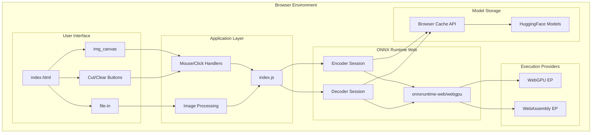
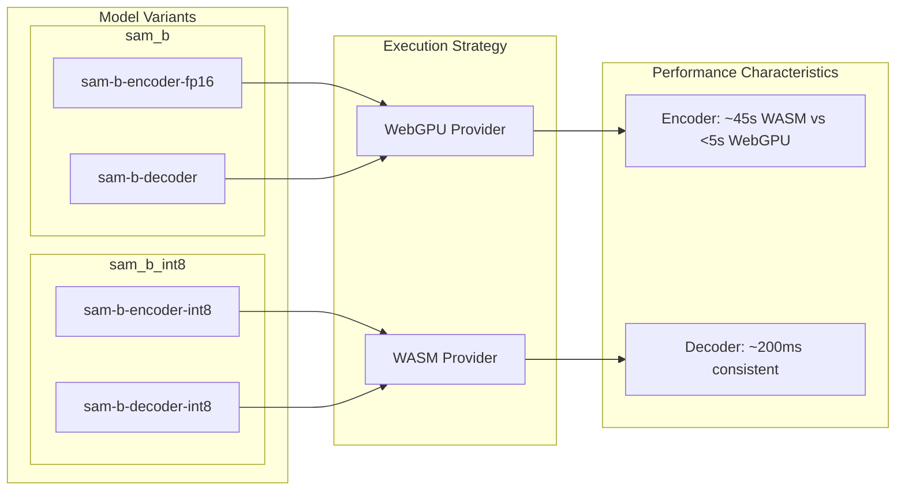
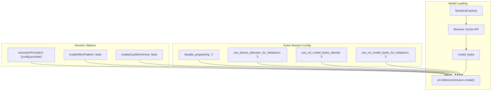
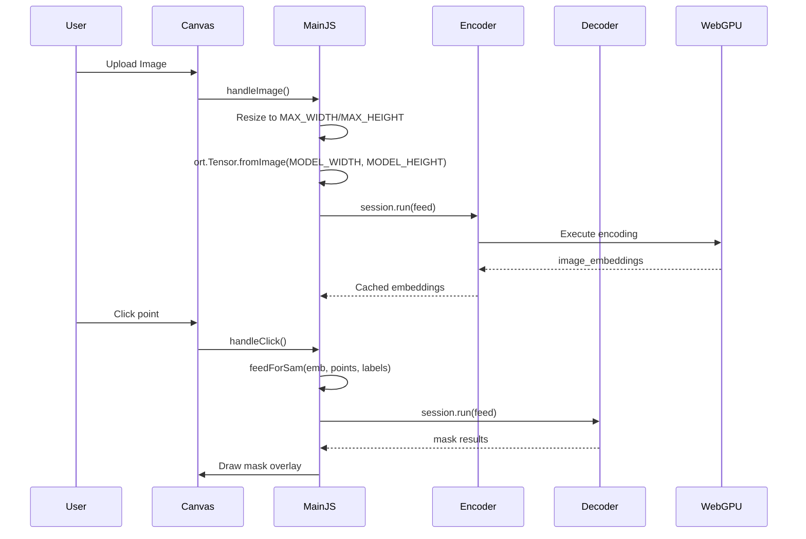
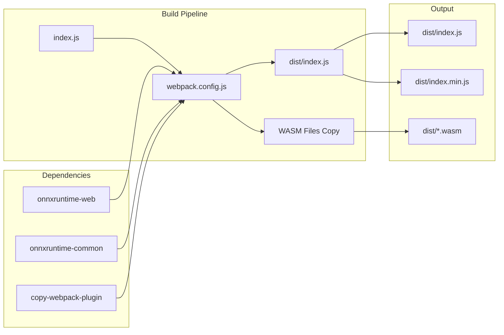
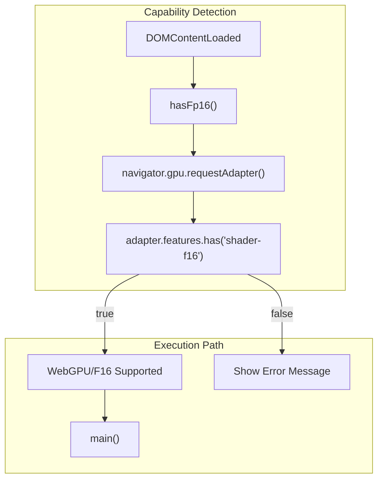

<!-- source: DeepWiki mcp.deepwiki.com · repo microsoft/onnxruntime-inference-examples · page 6.1 Web Browser Examples · fetched 2026-10-26 -->

# Web Browser Examples

Relevant source files

The following files were used as context for generating this wiki page:

- [js/README.md](js/README.md)
- [js/segment-anything/.eslintrc.js](js/segment-anything/.eslintrc.js)
- [js/segment-anything/EgyptianCat.png](js/segment-anything/EgyptianCat.png)
- [js/segment-anything/README.md](js/segment-anything/README.md)
- [js/segment-anything/index.html](js/segment-anything/index.html)
- [js/segment-anything/index.js](js/segment-anything/index.js)
- [js/segment-anything/package.json](js/segment-anything/package.json)
- [js/segment-anything/webpack.config.js](js/segment-anything/webpack.config.js)

This document covers browser-based examples that demonstrate ONNX Runtime Web usage for client-side machine learning inference. These examples showcase real-time ML capabilities in web browsers using WebGPU and WebAssembly execution providers.

For server-side JavaScript examples using Node.js, see [Node.js Examples](#6.2). For mobile web frameworks, see [React Native Examples](#2.3).

## Overview

The web browser examples demonstrate client-side machine learning inference capabilities using `onnxruntime-web` with multiple execution providers. The primary example is a comprehensive Segment-Anything implementation that showcases WebGPU acceleration for compute-intensive models.

### Available Examples

| Example | Description | Execution Providers | Key Features |
|---------|-------------|-------------------|--------------|
| Segment-Anything | Interactive image segmentation | WebGPU, WebAssembly | Real-time inference, model caching, interactive UI |
| Whisper | Speech recognition | WebAssembly | Browser audio interface integration |
| Stable Diffusion Turbo | Image generation | WebGPU | Generative AI in browser |
| Phi-3 Chat | Language model chat | WebGPU | Conversational AI interface |

Sources: [js/README.md:47-54]()

## Segment-Anything Example Architecture

The Segment-Anything example demonstrates a complete browser-based ML application with encoder-decoder architecture optimized for different execution providers.

### System Architecture

Sources: [js/segment-anything/index.html:1-89](), [js/segment-anything/index.js:1-416]()

### Model Configuration and Loading

The application supports multiple model variants with different optimization strategies:

The `MODELS` configuration object defines model variants:

- **sam_b**: Full precision models (180MB encoder, 17MB decoder)
- **sam_b_int8**: Quantized models (108MB encoder, 5MB decoder)

Sources: [js/segment-anything/index.js:17-42]()

## Technical Implementation Details

### Session Configuration

The application configures ONNX Runtime sessions with optimizations for browser environments:

Sources: [js/segment-anything/index.js:333-349]()

### Inference Pipeline

The inference pipeline demonstrates the encoder-decoder pattern with interactive feedback:

Key functions in the inference pipeline:

- `handleImage()`: Processes uploaded images and runs encoder
- `handleClick()`/`handleMouseMove()`: Captures user interaction points
- `feedForSam()`: Prepares decoder inputs with embeddings and points
- `decoder()`: Runs decoder inference and renders results

Sources: [js/segment-anything/index.js:244-289](), [js/segment-anything/index.js:221-240](), [js/segment-anything/index.js:100-115]()

## Build System and Dependencies

### Webpack Configuration

The build system uses Webpack with ES modules and WebAssembly support:

The Webpack configuration enables:
- ES module output format
- Source map generation for debugging
- WASM file copying from `onnxruntime-web/dist/`
- Development server on port 8080

Sources: [js/segment-anything/webpack.config.js:1-52](), [js/segment-anything/package.json:1-33]()

### Runtime Environment Detection

The application includes WebGPU capability detection:

The `hasFp16()` function checks for WebGPU shader-f16 support before initializing the application, ensuring compatibility with the fp16 models.

Sources: [js/segment-anything/index.js:398-415]()

## Performance Characteristics

### Latency Measurements

The application provides real-time performance monitoring with latency displays:

| Component | WebGPU Performance | WebAssembly Performance |
|-----------|-------------------|------------------------|
| Encoder | ~5s (practical) | ~45s (impractical) |
| Decoder | ~200ms | ~200ms |
| Model Size | 180MB + 17MB | 108MB + 5MB (quantized) |

The encoder latency difference makes WebGPU essential for practical browser deployment, while the decoder performs adequately on both execution providers.

Sources: [js/segment-anything/README.md:9-11]()

---

