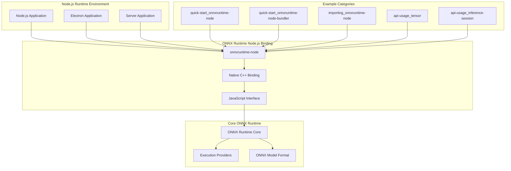
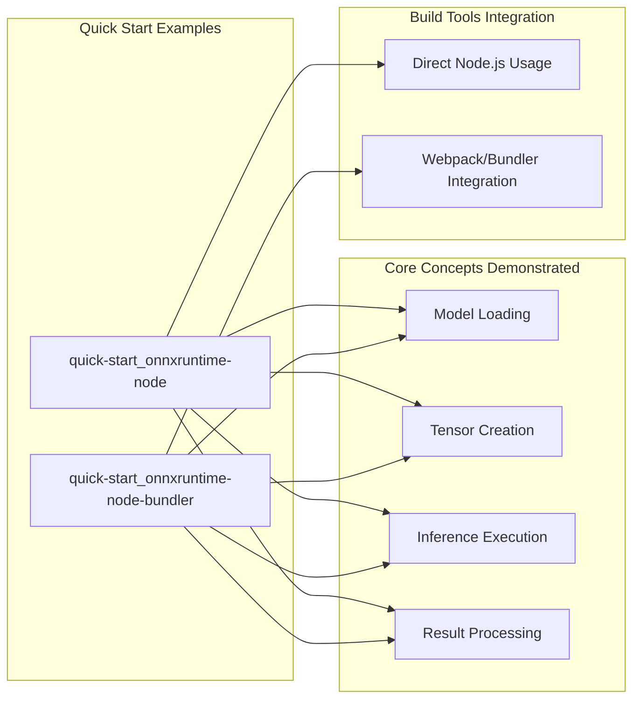
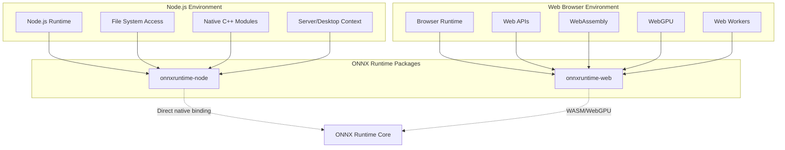

<!-- source: DeepWiki mcp.deepwiki.com · repo microsoft/onnxruntime-inference-examples · page 6.2 Node.js Examples · fetched 2026-10-26 -->

# Node.js Examples

Relevant source files

The following files were used as context for generating this wiki page:

- [js/README.md](js/README.md)
- [js/segment-anything/.eslintrc.js](js/segment-anything/.eslintrc.js)
- [js/segment-anything/EgyptianCat.png](js/segment-anything/EgyptianCat.png)
- [js/segment-anything/README.md](js/segment-anything/README.md)
- [js/segment-anything/index.html](js/segment-anything/index.html)
- [js/segment-anything/index.js](js/segment-anything/index.js)
- [js/segment-anything/package.json](js/segment-anything/package.json)
- [js/segment-anything/webpack.config.js](js/segment-anything/webpack.config.js)

## Purpose and Scope

This section covers Node.js-specific examples for ONNX Runtime inference using the `onnxruntime-node` package. These examples demonstrate server-side and desktop JavaScript applications that can leverage ONNX Runtime for machine learning inference in Node.js environments, including Electron applications.

For browser-based JavaScript examples using `onnxruntime-web`, see [Web Browser Examples](#6.1). For mobile JavaScript examples using React Native, see [React Native Examples](#2.3).

## Node.js Binding Overview

The Node.js examples utilize the `onnxruntime-node` package, which provides native Node.js bindings for ONNX Runtime. This allows JavaScript applications running on Node.js to perform ML inference with access to the full range of ONNX Runtime execution providers and optimizations available on the host system.

### Available Example Categories

Based on the JavaScript examples structure, Node.js examples are organized into several categories:

| Category | Purpose | Description |
|----------|---------|-------------|
| Quick Start | Basic usage demonstrations | Shows fundamental patterns for using ONNX Runtime in Node.js |
| Quick Start Bundle | Bundler integration | Demonstrates usage with bundling tools for Node.js applications |
| Importing | Package integration | Shows different ways to import and configure onnxruntime-node |
| API Usage | Core API patterns | Demonstrates key APIs like Tensor manipulation and InferenceSession |

Sources: [js/README.md:5-44]()

## Node.js Examples Architecture

Sources: [js/README.md:7-8](), [js/README.md:17-19](), [js/README.md:27-27]()

## Example Structure and Organization

The Node.js examples follow a consistent pattern that demonstrates different aspects of ONNX Runtime usage:

### Quick Start Examples

The quick start examples provide the most basic introduction to using ONNX Runtime in Node.js:

Sources: [js/README.md:17-19]()

### API Usage Examples

The API usage examples demonstrate specific aspects of the ONNX Runtime JavaScript API:

| Example | API Focus | Description |
|---------|-----------|-------------|
| `api-usage_tensor` | Tensor Operations | Basic usage of `Tensor` class for data manipulation |
| `api-usage_inference-session` | Session Management | Basic usage of `InferenceSession` for model execution |
| `api-usage_session-options` | Configuration | How to configure creation of `InferenceSession` instances |
| `api-usage_ort-env-flags` | Global Settings | How to configure global flags via `ort.env` |

Sources: [js/README.md:35-43]()

## Node.js vs Web Browser Differences

Node.js examples differ from web browser examples in several key ways:

Sources: [js/README.md:7-9]()

## Integration with Execution Providers

Node.js examples can leverage the full range of ONNX Runtime execution providers available on the host system, unlike web browser examples which are limited to WebAssembly and WebGPU:

| Execution Provider | Node.js Support | Web Browser Support |
|-------------------|-----------------|-------------------|
| CPU | ✓ | ✓ (via WASM) |
| CUDA | ✓ | ✗ |
| OpenVINO | ✓ | ✗ |
| DirectML | ✓ | ✗ |
| CoreML | ✓ | ✗ |
| QNN | ✓ | ✗ |
| WebGPU | ✗ | ✓ |

This makes Node.js examples particularly valuable for demonstrating high-performance inference scenarios and execution provider integration patterns that are not possible in browser environments.

Sources: [js/README.md:7-8]()

## Development and Build Patterns

Node.js examples demonstrate different development and deployment patterns suitable for server-side and desktop applications. The bundler examples show how to integrate ONNX Runtime into applications that use build tools like webpack, which is common in modern Node.js development workflows.

The examples serve as templates for integrating ONNX Runtime into various Node.js application architectures, from simple scripts to complex server applications and Electron desktop applications.

Sources: [js/README.md:17-19](), [js/README.md:27-27]()

---

