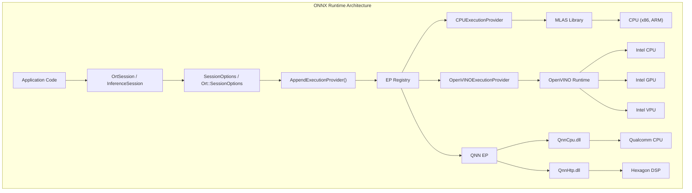
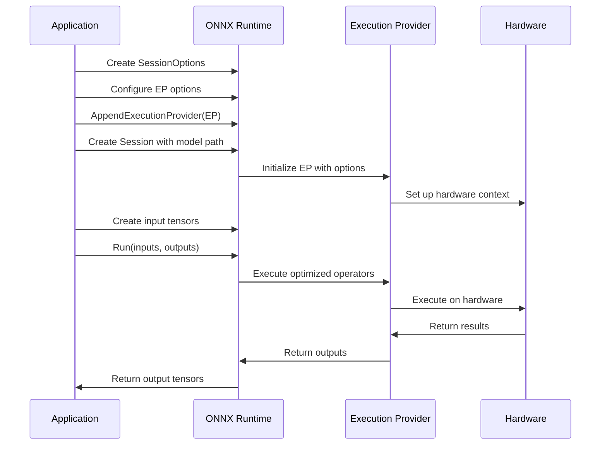
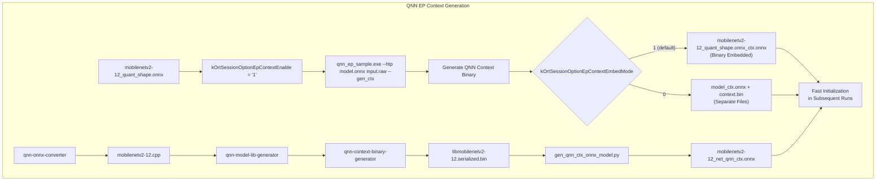

<!-- source: DeepWiki mcp.deepwiki.com · repo microsoft/onnxruntime-inference-examples · page 7 Execution Providers · fetched 2026-10-26 -->

# Execution Providers

<details>
<summary>Relevant source files</summary>

The following files were used as context for generating this wiki page:

- [c_cxx/QNN_EP/mobilenetv2_classification/CMakeLists.txt](c_cxx/QNN_EP/mobilenetv2_classification/CMakeLists.txt)
- [c_cxx/QNN_EP/mobilenetv2_classification/README.md](c_cxx/QNN_EP/mobilenetv2_classification/README.md)
- [c_cxx/QNN_EP/mobilenetv2_classification/libmobilenetv2-12.serialized.bin](c_cxx/QNN_EP/mobilenetv2_classification/libmobilenetv2-12.serialized.bin)
- [c_cxx/QNN_EP/mobilenetv2_classification/main.cpp](c_cxx/QNN_EP/mobilenetv2_classification/main.cpp)
- [c_cxx/QNN_EP/mobilenetv2_classification/mobilenetv2-12_net.json](c_cxx/QNN_EP/mobilenetv2_classification/mobilenetv2-12_net.json)
- [c_cxx/QNN_EP/mobilenetv2_classification/mobilenetv2_helper.py](c_cxx/QNN_EP/mobilenetv2_classification/mobilenetv2_helper.py)
- [c_cxx/QNN_EP/mobilenetv2_classification/run_qnn_ep_sample.bat](c_cxx/QNN_EP/mobilenetv2_classification/run_qnn_ep_sample.bat)
- [c_cxx/QNN_EP/mobilenetv2_classification/to_fp16.py](c_cxx/QNN_EP/mobilenetv2_classification/to_fp16.py)
- [c_sharp/OpenVINO_EP/yolov3_object_detection/README.md](c_sharp/OpenVINO_EP/yolov3_object_detection/README.md)
- [python/OpenVINO_EP/tiny_yolo_v2_object_detection/README.md](python/OpenVINO_EP/tiny_yolo_v2_object_detection/README.md)
- [python/OpenVINO_EP/tiny_yolo_v2_object_detection/requirements.txt](python/OpenVINO_EP/tiny_yolo_v2_object_detection/requirements.txt)
- [python/OpenVINO_EP/tiny_yolo_v2_object_detection/tiny_yolov2_obj_detection_sample.py](python/OpenVINO_EP/tiny_yolo_v2_object_detection/tiny_yolov2_obj_detection_sample.py)
- [python/OpenVINO_EP/yolov4_object_detection/README.md](python/OpenVINO_EP/yolov4_object_detection/README.md)
- [python/OpenVINO_EP/yolov4_object_detection/requirements.txt](python/OpenVINO_EP/yolov4_object_detection/requirements.txt)
- [python/OpenVINO_EP/yolov4_object_detection/yolov4.py](python/OpenVINO_EP/yolov4_object_detection/yolov4.py)

</details>


Execution Providers (EPs) in ONNX Runtime are hardware-specific backends that enable efficient model inference on different hardware platforms. They bridge the gap between the ONNX Runtime core and the underlying hardware acceleration libraries, allowing developers to seamlessly leverage hardware-specific optimizations without changing their application code.

This page explains the execution providers available in the ONNX Runtime inference examples repository, how to use them, and their specific features and configurations. For information about creating custom execution providers, see [ONNX Runtime Core](#1).

## Execution Provider Architecture



Sources: [c_cxx/QNN_EP/mobilenetv2_classification/main.cpp:39-68](), [python/OpenVINO_EP/yolov4_object_detection/yolov4.py:283-287](), [c_sharp/OpenVINO_EP/yolov3_object_detection/Program.cs:46-50]()

## Available Execution Providers

ONNX Runtime supports various execution providers, each targeting different hardware platforms:

| Execution Provider | Hardware Target | Supported Platforms | Available in Examples |
|--------------------|-----------------|---------------------|------------------------|
| CPU (MLAS) | CPU (x86, ARM) | All | ✅ |
| OpenVINO | Intel CPU, GPU, VPU | Windows, Linux | ✅ |
| QNN | Qualcomm Snapdragon, Hexagon DSP | Windows, Android | ✅ |
| CUDA | NVIDIA GPUs | Windows, Linux | ❌ |
| DirectML | DirectX-compatible GPUs | Windows | ❌ |
| NNAPI | Android Neural Processing Units | Android | ❌ |
| CoreML | Apple Neural Engine | iOS, macOS | ❌ |

The examples in this repository primarily demonstrate the usage of CPU, OpenVINO, and QNN execution providers.

Sources: [python/OpenVINO_EP/yolov4_object_detection/README.md:59-61](python/OpenVINO_EP/yolov4_object_detection/README.md)
[c_cxx/QNN_EP/mobilenetv2_classification/README.md:47](c_cxx/QNN_EP/mobilenetv2_classification/README.md)
[c_cxx/OpenVINO_EP/Windows/README.md:104-106](c_cxx/OpenVINO_EP/Windows/README.md)

## Using Execution Providers

### C/C++



Example with OpenVINO EP (C++):

```cpp
Ort::SessionOptions sessionOptions;
// Configure OpenVINO EP
OrtOpenVINOProviderOptions options;
options.device_type = "CPU";
sessionOptions.AppendExecutionProvider_OpenVINO(options);
// Create session with configured options
Ort::Session session(env, modelPath, sessionOptions);
```

Example with QNN EP (C++):

```cpp
// QNN EP configuration
std::vector<const char*> options_keys = {"backend_path"};
std::vector<const char*> options_values = {backend.c_str()};

// Enable HTP FP16 precision for float32 models
const std::string ENABLE_HTP_FP16_PRECISION = "enable_htp_fp16_precision";
const std::string ENABLE_HTP_FP16_PRECISION_VALUE = "1";
if (float32_model) {
    options_keys.push_back(ENABLE_HTP_FP16_PRECISION.c_str());
    options_values.push_back(ENABLE_HTP_FP16_PRECISION_VALUE.c_str());
}

// Enable context generation for caching
if (generate_ctx) {
    CheckStatus(g_ort, g_ort->AddSessionConfigEntry(
        session_options, kOrtSessionOptionEpContextEnable, "1"));
}

// Register QNN EP with ONNX Runtime
CheckStatus(g_ort, g_ort->SessionOptionsAppendExecutionProvider(
    session_options, "QNN", options_keys.data(),
    options_values.data(), options_keys.size()));
```

Sources: [c_cxx/QNN_EP/mobilenetv2_classification/main.cpp:39-68](), [c_cxx/QNN_EP/mobilenetv2_classification/main.cpp:45-50](), [c_cxx/QNN_EP/mobilenetv2_classification/main.cpp:55-58]()

### C#

```csharp
// Create session options
using SessionOptions options = new SessionOptions();
// Set log level (optional)
options.LogSeverityLevel = OrtLoggingLevel.ORT_LOGGING_LEVEL_INFO;
// Add OpenVINO EP with device type "CPU"
options.AppendExecutionProvider_OpenVINO(@"CPU");
// Add CPU EP as fallback with thread count = 1
options.AppendExecutionProvider_CPU(1);
// Create inference session with configured options
using var session = new InferenceSession(modelFilePath, options);
```

Sources: [c_sharp/OpenVINO_EP/yolov3_object_detection/Program.cs:46-53](c_sharp/OpenVINO_EP/yolov3_object_detection/Program.cs)
[c_sharp/OpenVINO_EP/yolov3_object_detection/yolov3_object_detection.csproj:10-16](c_sharp/OpenVINO_EP/yolov3_object_detection/yolov3_object_detection.csproj)

### Python

```python
import onnxruntime as rt

# Create session options
so = rt.SessionOptions()
so.log_severity_level = 3

# Using CPU EP (default MLAS provider)
sess = rt.InferenceSession(model_path, so, providers=['CPUExecutionProvider'])

# Using OpenVINO EP with CPU_FP32 device type
sess = rt.InferenceSession(
    model_path, 
    so, 
    providers=['OpenVINOExecutionProvider'], 
    provider_options=[{'device_type': 'CPU_FP32'}]
)

# Available OpenVINO device types:
# 'CPU_FP32', 'GPU_FP32', 'GPU_FP16', 'MYRIAD_FP16', 'VAD-M_FP16'
```

Sources: [python/OpenVINO_EP/yolov4_object_detection/yolov4.py:280-291](python/OpenVINO_EP/yolov4_object_detection/yolov4.py)
[python/OpenVINO_EP/tiny_yolo_v2_object_detection/tiny_yolov2_obj_detection_sample.py:147-161](python/OpenVINO_EP/tiny_yolo_v2_object_detection/tiny_yolov2_obj_detection_sample.py)

## Provider Configurations and Features

### OpenVINO Execution Provider

The OpenVINO Execution Provider enables ONNX Runtime to leverage Intel hardware acceleration.

Key features:
- Supports Intel CPUs, integrated GPUs, and Movidius VPUs
- Both FP16 and FP32 precision modes for different hardware targets
- Compatible with Windows, Linux, and macOS platforms

| Device Type | Description | Precision | Hardware Target |
|-------------|-------------|-----------|-----------------|
| CPU_FP32 | Intel CPU with FP32 precision | FP32 | Intel CPUs |
| GPU_FP32 | Intel integrated GPU with FP32 precision | FP32 | Intel integrated GPUs |
| GPU_FP16 | Intel integrated GPU with FP16 precision | FP16 | Intel integrated GPUs |
| MYRIAD_FP16 | Intel Movidius VPU with FP16 precision | FP16 | Intel Movidius VPUs |
| VAD-M_FP16 | Vision Accelerator Design with FP16 precision | FP16 | Intel Vision Accelerators |

Installation:
```bash
pip install onnxruntime-openvino openvino
```

Requirements (from examples):
```
certifi==2024.7.4
flatbuffers==2.0
onnx
opencv-python==4.8.1.78
Pillow==10.2.0
protobuf==3.20.2
scipy==1.11.4
typing-extensions==4.2.0
```

Sources: [python/OpenVINO_EP/yolov4_object_detection/README.md:24](), [python/OpenVINO_EP/tiny_yolo_v2_object_detection/requirements.txt:1-9](), [python/OpenVINO_EP/yolov4_object_detection/requirements.txt:1-8]()

#### OpenVINO IO Buffer Feature

OpenVINO EP supports zero-copy buffer sharing with OpenCL, allowing direct integration with GPU pipelines:

```cpp
// Create OpenCL context
auto ocl_instance = std::make_shared<OpenCL>();

// Configure OpenVINO EP with OpenCL context
OrtOpenVINOProviderOptions options;
options.device_type = "GPU";
options.context = (void *) ocl_instance->_context.get();
sessionOptions.AppendExecutionProvider_OpenVINO(options);
```

This feature avoids memory copies between the application and OpenVINO backend when using GPU acceleration.

Sources: [c_cxx/OpenVINO_EP/Windows/squeezenet_classification_io_buffer/squeezenet_cpp_app_io_buffer.cpp:246-254](c_cxx/OpenVINO_EP/Windows/squeezenet_classification_io_buffer/squeezenet_cpp_app_io_buffer.cpp)
[c_cxx/OpenVINO_EP/Windows/README.md:11-13](c_cxx/OpenVINO_EP/Windows/README.md)

### QNN Execution Provider

The QNN Execution Provider enables ONNX Runtime to leverage Qualcomm hardware acceleration through the Qualcomm AI Engine Direct SDK.

Key features:
- Targets Qualcomm Snapdragon platforms and Hexagon DSP
- Supports both CPU and HTP (Hexagon Tensor Processor) backends
- Optimized for mobile and embedded devices
- Context caching for improved initialization time

| Backend | Description | Best Used For |
|---------|-------------|---------------|
| QnnCpu.dll | QNN CPU backend | Testing and debugging |
| QnnHtp.dll | QNN Hexagon Tensor Processor backend | Production deployment |

Example configuration:
```cpp
// QNN backend selection
std::vector<const char*> options_keys = {"backend_path"};
std::vector<const char*> options_values = {"QnnHtp.dll"};

// Enable FP16 precision for better performance on HTP
options_keys.push_back("enable_htp_fp16_precision");
options_values.push_back("1");

// Register QNN EP with options
sessionOptions.AppendExecutionProvider(
    "QNN", options_keys.data(), options_values.data(), options_keys.size());
```

Sources: [c_cxx/QNN_EP/mobilenetv2_classification/main.cpp:39-68](c_cxx/QNN_EP/mobilenetv2_classification/main.cpp)
[c_cxx/QNN_EP/mobilenetv2_classification/README.md:1-16](c_cxx/QNN_EP/mobilenetv2_classification/README.md)

#### QNN Context Generation and Caching

The QNN EP supports generating and caching context binaries to improve model initialization time:

QNN EP Context Generation Flow


There are two approaches to context generation:

1. **ORT-Generated Context**: Generated by ONNX Runtime QNN EP during the first inference run
   ```cpp
   // Enable context generation
   CheckStatus(g_ort, g_ort->AddSessionConfigEntry(
       session_options, kOrtSessionOptionEpContextEnable, "1"));
   
   // Optional: Set output context file path
   // CheckStatus(g_ort, g_ort->AddSessionConfigEntry(
   //     session_options, kOrtSessionOptionEpContextFilePath, "./qnn_ctx.onnx"));
   
   // Optional: Store context in separate file instead of embedding
   // CheckStatus(g_ort, g_ort->AddSessionConfigEntry(
   //     session_options, kOrtSessionOptionEpContextEmbedMode, "0"));
   ```

2. **QNN Native Context**: Generated using QNN native tools and `gen_qnn_ctx_onnx_model.py`
   ```bash
   # Generate QNN model from ONNX (from mobilenetv2-12.onnx)
   qnn-onnx-converter --input_list ./input.txt --input_network ./mobilenetv2-12.onnx \
       --output_path ./mobilenetv2-12.cpp -b 1 --bias_bw 32
   
   # Generate QNN library
   qnn-model-lib-generator -c ./mobilenetv2-12.cpp -b ./mobilenetv2-12.bin \
       -o ./mobilenetv2_classification/qnn_lib
   
   # Generate context binary
   qnn-context-binary-generator --backend ${QNN_SDK_ROOT}/target/x86_64-linux-clang/lib/libQnnHtp.so \
       --model ./mobilenetv2_classification/qnn_lib/x86_64-linux-clang/libmobilenetv2-12.so \
       --binary_file libmobilenetv2-12.serialized
   
   # Create ONNX model with embedded QNN context using helper script
   python gen_qnn_ctx_onnx_model.py -b libmobilenetv2-12.serialized.bin -q mobilenetv2-12_net.json
   ```

Sources: [c_cxx/QNN_EP/mobilenetv2_classification/main.cpp:55-64](), [c_cxx/QNN_EP/mobilenetv2_classification/README.md:19-45](), [c_cxx/QNN_EP/mobilenetv2_classification/run_qnn_ep_sample.bat:83-89](), [c_cxx/QNN_EP/mobilenetv2_classification/README.md:37-42]()

### CPU Execution Provider (Default)

The CPU Execution Provider is the default provider in ONNX Runtime, using the MLAS (Machine Learning Acceleration Subroutines) library for optimized CPU execution.

Key features:
- Available on all platforms without additional dependencies
- Works as a fallback when hardware-specific EPs are not available
- Can be configured with thread count for multi-threading control

Example configuration:
```cpp
// C++
sessionOptions.SetIntraOpNumThreads(1); // Set thread count

// C#
options.AppendExecutionProvider_CPU(1); // Set thread count

// Python
sess = rt.InferenceSession(model_path, providers=['CPUExecutionProvider'])
```

Sources: [c_cxx/OpenVINO_EP/Windows/squeezenet_classification/squeezenet_cpp_app.cpp:215-216](c_cxx/OpenVINO_EP/Windows/squeezenet_classification/squeezenet_cpp_app.cpp)
[c_sharp/OpenVINO_EP/yolov3_object_detection/Program.cs:50](c_sharp/OpenVINO_EP/yolov3_object_detection/Program.cs)
[python/OpenVINO_EP/yolov4_object_detection/yolov4.py:280-283](python/OpenVINO_EP/yolov4_object_detection/yolov4.py)

## Execution Provider Selection and Fallback

ONNX Runtime allows registering multiple execution providers in priority order. When multiple EPs are registered, the runtime:

1. Attempts to assign each node in the model graph to the highest priority EP that supports it
2. Falls back to the next EP in the list for unsupported operations
3. Ensures optimal execution by partitioning the graph across providers


Example of registering multiple EPs with fallback:

```csharp
// C# example - OpenVINO first, CPU as fallback
options.AppendExecutionProvider_OpenVINO(@"CPU");
options.AppendExecutionProvider_CPU(1);
```

```python
# Python example - Prioritized list of providers
providers = ['OpenVINOExecutionProvider', 'CPUExecutionProvider']
provider_options = [{'device_type': 'CPU_FP32'}, {}]
session = rt.InferenceSession(model_path, providers=providers, provider_options=provider_options)
```

Sources: [c_sharp/OpenVINO_EP/yolov3_object_detection/Program.cs:49-50](c_sharp/OpenVINO_EP/yolov3_object_detection/Program.cs)
[c_cxx/OpenVINO_EP/Windows/model-explorer/model-explorer.cpp:65-70](c_cxx/OpenVINO_EP/Windows/model-explorer/model-explorer.cpp)

## Performance Considerations

When using execution providers, consider these performance optimization strategies:

1. **Device Selection**: Choose the appropriate device type for your target hardware
   ```python
   # For Intel integrated GPU (better for inference)
   provider_options = [{'device_type': 'GPU_FP16'}]
   
   # For power-constrained devices
   provider_options = [{'device_type': 'CPU_FP32'}]
   ```

2. **Precision Mode**: Use lower precision (FP16) when possible for better performance
   ```cpp
   // QNN EP with FP16 precision
   options_keys.push_back("enable_htp_fp16_precision");
   options_values.push_back("1");
   ```

3. **Context Caching**: Enable context caching for QNN EP to reduce initialization time
   ```cpp
   // Enable context generation/caching
   g_ort->AddSessionConfigEntry(session_options, kOrtSessionOptionEpContextEnable, "1");
   ```

4. **Thread Control**: Optimize thread usage based on your workload
   ```cpp
   // Limit threads for small models or multi-model scenarios
   sessionOptions.SetIntraOpNumThreads(1);
   ```

5. **Model Optimization**: Use quantized models where supported
   ```python
   # QNN EP supports quantized models for better performance
   # Convert float32 model to QDQ model using quantize_static
   from onnxruntime.quantization import quantize, quantize_static, CalibrationDataReader, QuantFormat, QuantType
   from onnxruntime.quantization.execution_providers.qnn import get_qnn_qdq_config
   
   # Create calibration data reader
   class GenerateRandomCalibrationData(CalibrationDataReader):
       def __init__(self, data_dir):
           self.preprocess_flag = True
           self.enum_data_dicts = []
           self.data_dir = data_dir
   
       def get_next(self):
           if self.preprocess_flag:
               self.preprocess_flag = False
               data_list = GetImages(self.data_dir)
               self.enum_data_dicts = iter([{"input": data} for data in data_list])
           return next(self.enum_data_dicts, None)
   
   # Configure QNN quantization
   dr = GenerateRandomCalibrationData('./images')
   qnn_config = get_qnn_qdq_config(input_model_file,
                                   dr,
                                   activation_type=QuantType.QUInt8,
                                   weight_type=QuantType.QUInt8)
   quantize(input_model_file, qdq_model_file, qnn_config)
   
   # Convert float32 model to float16 for better HTP performance
   from onnxconverter_common import float16
   model = onnx.load(input_model_path)
   model_fp16 = float16.convert_float_to_float16(model, keep_io_types=True)
   onnx.save(model_fp16, output_model_path)
   ```

Sources: [c_cxx/QNN_EP/mobilenetv2_classification/mobilenetv2_helper.py:115-119](), [c_cxx/QNN_EP/mobilenetv2_classification/mobilenetv2_helper.py:96-107](), [c_cxx/QNN_EP/mobilenetv2_classification/to_fp16.py:12-14]()

## Example Run Commands

Running models with different execution providers:

### QNN EP

```bash
# Run with QNN CPU backend
qnn_ep_sample.exe --cpu mobilenetv2-12_shape.onnx kitten_input.raw

# Run with QNN HTP backend (Hexagon Tensor Processor)
qnn_ep_sample.exe --htp mobilenetv2-12_quant_shape.onnx kitten_input.raw

# Generate QNN context and save to model
qnn_ep_sample.exe --htp mobilenetv2-12_quant_shape.onnx kitten_input.raw --gen_ctx

# Run with float32 model on HTP with FP16 precision
qnn_ep_sample.exe --fp32 mobilenetv2-12_shape.onnx kitten_input.raw

# Run with float16 model on HTP
qnn_ep_sample.exe --fp16 mobilenetv2-12_shape_fp16.onnx kitten_input.raw
```

Sources: [c_cxx/QNN_EP/mobilenetv2_classification/run_qnn_ep_sample.bat:136-165](c_cxx/QNN_EP/mobilenetv2_classification/run_qnn_ep_sample.bat)

### OpenVINO EP

```bash
# Python with OpenVINO EP on different devices
python3 yolov4.py --device CPU_FP32 --video classroom.mp4 --model yolov4.onnx
python3 yolov4.py --device GPU_FP32 --video classroom.mp4 --model yolov4.onnx  
python3 yolov4.py --device GPU_FP16 --video classroom.mp4 --model yolov4.onnx
python3 yolov4.py --device MYRIAD_FP16 --video classroom.mp4 --model yolov4.onnx

# Python with image input
python3 yolov4.py --device CPU_FP32 --image cat.jpg --model yolov4.onnx

# Python with webcam input
python3 yolov4.py --device CPU_FP32 --model yolov4.onnx

# Python with default CPU EP (MLAS)
python3 yolov4.py --device cpu --video classroom.mp4 --model yolov4.onnx

# TinyYOLOv2 example with OpenVINO EP
python3 tiny_yolov2_obj_detection_sample.py --video face-demographics-walking-and-pause.mp4 \
    --model tinyyolov2.onnx --device CPU_FP32

# C# application with OpenVINO EP  
dotnet run yolov3.onnx input.jpg output.jpg
```

Sources: [python/OpenVINO_EP/yolov4_object_detection/README.md:55-80](), [python/OpenVINO_EP/tiny_yolo_v2_object_detection/README.md:48-49](), [c_sharp/OpenVINO_EP/yolov3_object_detection/README.md:64]()

## Conclusion

Execution Providers in ONNX Runtime provide a unified way to leverage hardware acceleration across different platforms. By selecting the appropriate execution provider and configuring it correctly, you can achieve optimal performance for your machine learning models without changing your application code.

For specific details about each execution provider, refer to their respective documentation and sample code in the repository:

- [OpenVINO EP Examples](#3.2)
- [QNN EP Examples](#3.1)
- [C# EP Usage](#4.1)
- [Python EP Usage](#5.1)

---

