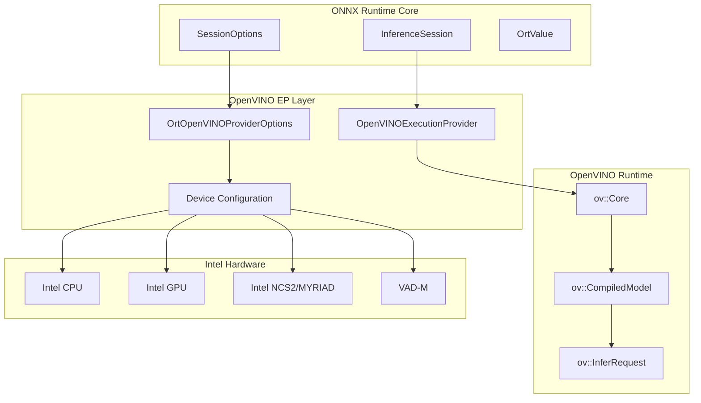
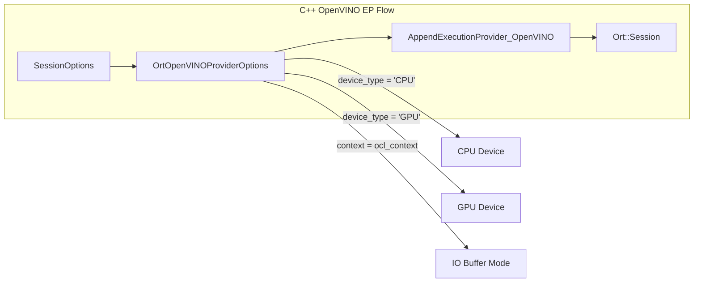
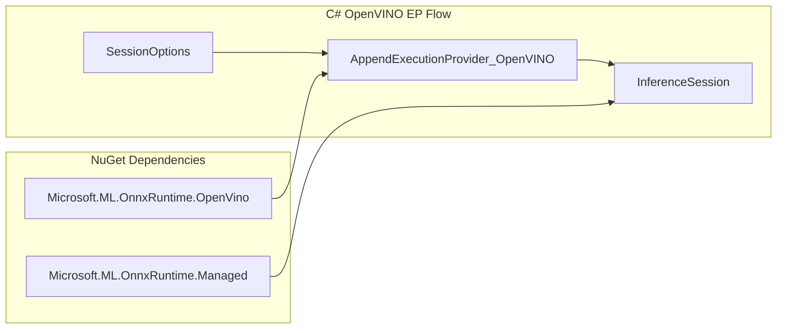
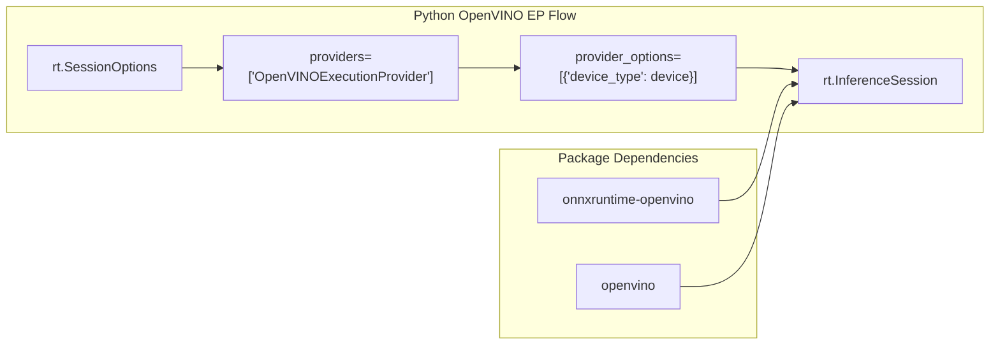
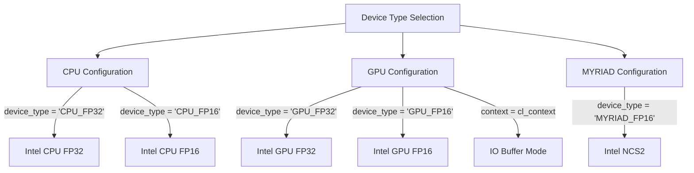

<!-- source: DeepWiki mcp.deepwiki.com · repo microsoft/onnxruntime-inference-examples · page 7.1 OpenVINO Execution Provider · fetched 2026-10-26 -->

# OpenVINO Execution Provider

Relevant source files

The following files were used as context for generating this wiki page:

- [c_cxx/OpenVINO_EP/Windows/CMakeLists.txt](c_cxx/OpenVINO_EP/Windows/CMakeLists.txt)
- [c_cxx/OpenVINO_EP/Windows/README.md](c_cxx/OpenVINO_EP/Windows/README.md)
- [c_cxx/OpenVINO_EP/Windows/model-explorer/model-explorer.cpp](c_cxx/OpenVINO_EP/Windows/model-explorer/model-explorer.cpp)
- [c_cxx/OpenVINO_EP/Windows/squeezenet_classification/squeezenet_cpp_app.cpp](c_cxx/OpenVINO_EP/Windows/squeezenet_classification/squeezenet_cpp_app.cpp)
- [c_cxx/OpenVINO_EP/Windows/squeezenet_classification_io_buffer/CMakeLists.txt](c_cxx/OpenVINO_EP/Windows/squeezenet_classification_io_buffer/CMakeLists.txt)
- [c_cxx/OpenVINO_EP/Windows/squeezenet_classification_io_buffer/squeezenet_cpp_app_io_buffer.cpp](c_cxx/OpenVINO_EP/Windows/squeezenet_classification_io_buffer/squeezenet_cpp_app_io_buffer.cpp)
- [c_cxx/OpenVINO_EP/Windows/squeezenet_classification_io_buffer/synset.txt](c_cxx/OpenVINO_EP/Windows/squeezenet_classification_io_buffer/synset.txt)
- [c_sharp/OpenVINO_EP/yolov3_object_detection/Program.cs](c_sharp/OpenVINO_EP/yolov3_object_detection/Program.cs)
- [c_sharp/OpenVINO_EP/yolov3_object_detection/README.md](c_sharp/OpenVINO_EP/yolov3_object_detection/README.md)
- [c_sharp/OpenVINO_EP/yolov3_object_detection/yolov3_object_detection.csproj](c_sharp/OpenVINO_EP/yolov3_object_detection/yolov3_object_detection.csproj)
- [python/OpenVINO_EP/tiny_yolo_v2_object_detection/README.md](python/OpenVINO_EP/tiny_yolo_v2_object_detection/README.md)
- [python/OpenVINO_EP/tiny_yolo_v2_object_detection/requirements.txt](python/OpenVINO_EP/tiny_yolo_v2_object_detection/requirements.txt)
- [python/OpenVINO_EP/tiny_yolo_v2_object_detection/tiny_yolov2_obj_detection_sample.py](python/OpenVINO_EP/tiny_yolo_v2_object_detection/tiny_yolov2_obj_detection_sample.py)
- [python/OpenVINO_EP/yolov4_object_detection/README.md](python/OpenVINO_EP/yolov4_object_detection/README.md)
- [python/OpenVINO_EP/yolov4_object_detection/requirements.txt](python/OpenVINO_EP/yolov4_object_detection/requirements.txt)
- [python/OpenVINO_EP/yolov4_object_detection/yolov4.py](python/OpenVINO_EP/yolov4_object_detection/yolov4.py)

## Purpose and Scope

The OpenVINO Execution Provider (EP) enables ONNX Runtime to leverage Intel's OpenVINO toolkit for accelerated inference on Intel hardware including CPUs, GPUs, and specialized devices like Intel Neural Compute Stick 2 (MYRIAD). This page covers the implementation and usage patterns across C++, C#, and Python platforms.

For general execution provider concepts, see [Execution Providers](#7). For Qualcomm-specific acceleration, see [Qualcomm QNN Execution Provider](#7.2).

## Architecture Overview

The OpenVINO EP integrates with ONNX Runtime through a consistent API pattern across all supported languages, providing hardware-specific optimizations while maintaining the standard ONNX Runtime interface.

### OpenVINO EP Integration Architecture

Sources: [c_cxx/OpenVINO_EP/Windows/squeezenet_classification/squeezenet_cpp_app.cpp:218-225](), [c_sharp/OpenVINO_EP/yolov3_object_detection/Program.cs:47-50](), [python/OpenVINO_EP/yolov4_object_detection/yolov4.py:280-291]()

## Platform Implementation Patterns

### C++ Implementation

The C++ API uses `OrtOpenVINOProviderOptions` structure for configuration and `AppendExecutionProvider_OpenVINO` for registration.

**Key C++ Classes and Methods:**
- `OrtOpenVINOProviderOptions` - Configuration structure
- `sessionOptions.AppendExecutionProvider_OpenVINO(options)` - EP registration
- `options.device_type` - Device selection (`"CPU"`, `"GPU"`)
- `options.context` - OpenCL context for IO buffer optimization

Sources: [c_cxx/OpenVINO_EP/Windows/squeezenet_classification/squeezenet_cpp_app.cpp:221-224](), [c_cxx/OpenVINO_EP/Windows/squeezenet_classification_io_buffer/squeezenet_cpp_app_io_buffer.cpp:250-254]()

### C# Implementation

The C# API uses the `Microsoft.ML.OnnxRuntime.OpenVino` NuGet package with `AppendExecutionProvider_OpenVINO` method.

**Key C# Components:**
- `Microsoft.ML.OnnxRuntime.OpenVino` - NuGet package dependency
- `options.AppendExecutionProvider_OpenVINO(@"CPU")` - Device-specific registration
- `options.AppendExecutionProvider_CPU(1)` - Fallback EP configuration

Sources: [c_sharp/OpenVINO_EP/yolov3_object_detection/Program.cs:49-50](), [c_sharp/OpenVINO_EP/yolov3_object_detection/yolov3_object_detection.csproj:11-12]()

### Python Implementation

The Python API uses provider lists with device-specific configuration through `provider_options`.

**Key Python Components:**
- `providers=['OpenVINOExecutionProvider']` - EP registration
- `provider_options=[{'device_type': device_type}]` - Device configuration
- Device types: `'CPU_FP32'`, `'GPU_FP32'`, `'GPU_FP16'`, `'MYRIAD_FP16'`

Sources: [python/OpenVINO_EP/yolov4_object_detection/yolov4.py:286-291](), [python/OpenVINO_EP/tiny_yolo_v2_object_detection/tiny_yolov2_obj_detection_sample.py:155-156]()

## Device Types and Configuration

### Supported Device Types

| Device Type | Description | Precision | Platform Support |
|-------------|-------------|-----------|-------------------|
| `CPU_FP32` | Intel CPU with FP32 | 32-bit float | All platforms |
| `CPU_FP16` | Intel CPU with FP16 | 16-bit float | All platforms |
| `GPU_FP32` | Intel GPU with FP32 | 32-bit float | Windows, Linux |
| `GPU_FP16` | Intel GPU with FP16 | 16-bit float | Windows, Linux |
| `MYRIAD_FP16` | Intel NCS2 stick | 16-bit float | All platforms |
| `VAD-M_FP16` | Intel Vision Accelerator | 16-bit float | Linux |

### Device Configuration Pattern

Sources: [python/OpenVINO_EP/yolov4_object_detection/yolov4.py:289-291](), [c_cxx/OpenVINO_EP/Windows/squeezenet_classification/squeezenet_cpp_app.cpp:222]()

## Example Applications

### Object Detection Examples

The repository includes multiple object detection implementations using YOLO models:

**YOLOv4 Object Detection (Python)**
- File: `python/OpenVINO_EP/yolov4_object_detection/yolov4.py`
- Model: YOLOv4 ONNX from ONNX Model Zoo
- Input types: Image, video, webcam
- Key functions: `image_preprocess()`, `postprocess_bbbox()`, `nms()`

**YOLOv3 Object Detection (C#)**
- File: `c_sharp/OpenVINO_EP/yolov3_object_detection/Program.cs`
- Model: YOLOv3 ONNX from ONNX Model Zoo
- Processing: Letterbox resizing, tensor creation with `DenseTensor<float>`
- Output: Bounding boxes with confidence scores

**TinyYOLOv2 Object Detection (Python)**
- File: `python/OpenVINO_EP/tiny_yolo_v2_object_detection/tiny_yolov2_obj_detection_sample.py`
- Model: TinyYOLOv2 for 20 object classes
- Processing: 416x416 input resolution, sigmoid activation, softmax classification

Sources: [python/OpenVINO_EP/yolov4_object_detection/yolov4.py:1-25](), [c_sharp/OpenVINO_EP/yolov3_object_detection/Program.cs:1-25](), [python/OpenVINO_EP/tiny_yolo_v2_object_detection/tiny_yolov2_obj_detection_sample.py:1-30]()

### Image Classification Examples

**SqueezeNet Classification (C++)**
- File: `c_cxx/OpenVINO_EP/Windows/squeezenet_classification/squeezenet_cpp_app.cpp`
- Model: SqueezeNet 1.1 from ONNX Model Zoo
- Preprocessing: OpenCV-based image processing, normalization
- Output: Class prediction with confidence scores

**SqueezeNet with IO Buffer (C++)**
- File: `c_cxx/OpenVINO_EP/Windows/squeezenet_classification_io_buffer/squeezenet_cpp_app_io_buffer.cpp`
- Optimization: OpenCL buffer sharing for GPU inference
- Memory management: Direct GPU memory access with `cl::Buffer`

Sources: [c_cxx/OpenVINO_EP/Windows/squeezenet_classification/squeezenet_cpp_app.cpp:275-337](), [c_cxx/OpenVINO_EP/Windows/squeezenet_classification_io_buffer/squeezenet_cpp_app_io_buffer.cpp:350-378]()

## Performance Optimizations

### IO Buffer Feature (GPU Only)

The IO Buffer optimization enables zero-copy memory sharing between OpenCL kernels and OpenVINO GPU inference:

**IO Buffer Implementation Pattern:**
- Create OpenCL context: `OpenCL ocl_instance`
- Shared buffer creation: `cl::Buffer shared_buffer(context, CL_MEM_READ_WRITE, size)`
- ORT tensor creation: `Ort::Value::CreateTensor(info_gpu, buffer_ptr, size, dims)`
- Direct GPU memory access without CPU roundtrips

Sources: [c_cxx/OpenVINO_EP/Windows/squeezenet_classification_io_buffer/squeezenet_cpp_app_io_buffer.cpp:350-380](), [c_cxx/OpenVINO_EP/Windows/README.md:11-13]()

### Model Explorer Utility

The model explorer provides runtime model introspection capabilities:

**Key Features:**
- Input/output shape analysis: `session.GetInputShapes()`, `session.GetOutputShapes()`
- Tensor type inspection: `GetTensorTypeAndShapeInfo()`
- Runtime validation: Model compatibility testing with random data

Sources: [c_cxx/OpenVINO_EP/Windows/model-explorer/model-explorer.cpp:74-88]()

---

