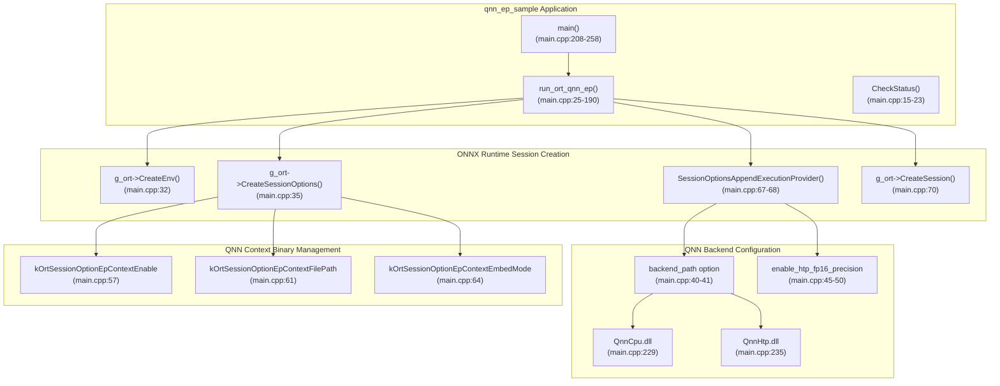
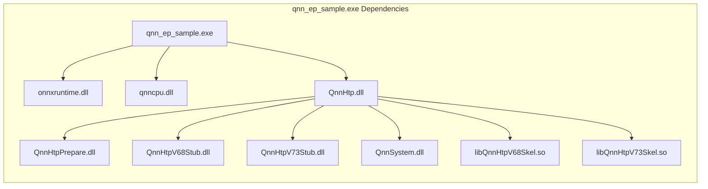
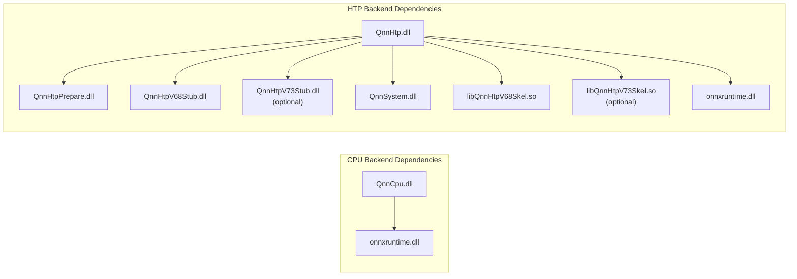
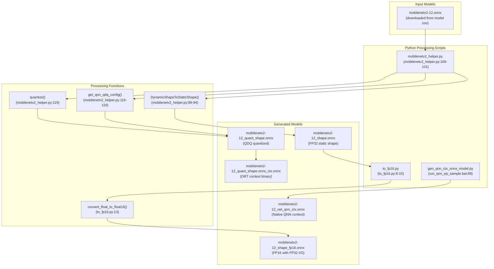
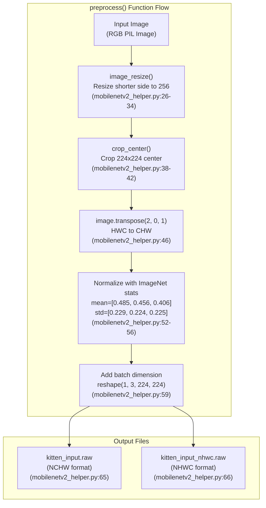
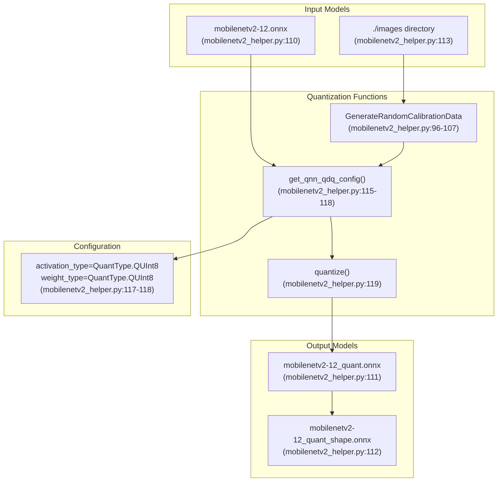

<!-- source: DeepWiki mcp.deepwiki.com · repo microsoft/onnxruntime-inference-examples · page 7.2 Qualcomm QNN Execution Provider · fetched 2026-10-26 -->

# Qualcomm QNN Execution Provider

<details>
<summary>Relevant source files</summary>

The following files were used as context for generating this wiki page:

- [c_cxx/QNN_EP/mobilenetv2_classification/CMakeLists.txt](c_cxx/QNN_EP/mobilenetv2_classification/CMakeLists.txt)
- [c_cxx/QNN_EP/mobilenetv2_classification/README.md](c_cxx/QNN_EP/mobilenetv2_classification/README.md)
- [c_cxx/QNN_EP/mobilenetv2_classification/libmobilenetv2-12.serialized.bin](c_cxx/QNN_EP/mobilenetv2_classification/libmobilenetv2-12.serialized.bin)
- [c_cxx/QNN_EP/mobilenetv2_classification/main.cpp](c_cxx/QNN_EP/mobilenetv2_classification/main.cpp)
- [c_cxx/QNN_EP/mobilenetv2_classification/mobilenetv2-12_net.json](c_cxx/QNN_EP/mobilenetv2_classification/mobilenetv2-12_net.json)
- [c_cxx/QNN_EP/mobilenetv2_classification/mobilenetv2_helper.py](c_cxx/QNN_EP/mobilenetv2_classification/mobilenetv2_helper.py)
- [c_cxx/QNN_EP/mobilenetv2_classification/run_qnn_ep_sample.bat](c_cxx/QNN_EP/mobilenetv2_classification/run_qnn_ep_sample.bat)
- [c_cxx/QNN_EP/mobilenetv2_classification/to_fp16.py](c_cxx/QNN_EP/mobilenetv2_classification/to_fp16.py)

</details>


This document provides a technical overview of the Qualcomm QNN (Qualcomm Neural Network) Execution Provider for ONNX Runtime. The QNN Execution Provider enables ONNX models to run efficiently on Qualcomm hardware by leveraging the Qualcomm AI Engine Direct SDK. This page covers the architecture, setup, configuration, and optimization techniques specifically for the QNN Execution Provider.

For general information about ONNX Runtime Execution Providers, see [Execution Providers](#7).

## 1. Overview

The QNN Execution Provider (QNN EP) is implemented in the `qnn_ep_sample` application and enables ONNX Runtime to execute neural network models on Qualcomm Snapdragon platforms. The implementation in [c_cxx/QNN_EP/mobilenetv2_classification/main.cpp]() demonstrates how to use specialized hardware accelerators on Qualcomm SoCs, particularly the Hexagon DSP through the Hexagon Tensor Processor (HTP).

### Key Features

- Support for float32, float16, and quantized model execution through the `run_ort_qnn_ep()` function
- Multiple backends: `QnnCpu.dll` and `QnnHtp.dll` specified via `backend_path` option
- Context binary caching via `kOrtSessionOptionEpContextEnable` to improve model initialization time
- Compatibility with native QNN models and context binaries generated by `gen_qnn_ctx_onnx_model.py`

### Core Implementation Components

| Component | File | Purpose |
|-----------|------|---------|
| `qnn_ep_sample.exe` | [c_cxx/QNN_EP/mobilenetv2_classification/main.cpp]() | Main application demonstrating QNN EP usage |
| `run_qnn_ep_sample.bat` | [c_cxx/QNN_EP/mobilenetv2_classification/run_qnn_ep_sample.bat]() | Build and execution script |
| `mobilenetv2_helper.py` | [c_cxx/QNN_EP/mobilenetv2_classification/mobilenetv2_helper.py]() | Model quantization and preprocessing |
| `to_fp16.py` | [c_cxx/QNN_EP/mobilenetv2_classification/to_fp16.py]() | FP16 model conversion |

Sources:
[c_cxx/QNN_EP/mobilenetv2_classification/README.md:1-47]()
[c_cxx/QNN_EP/mobilenetv2_classification/main.cpp:25-26]()
[c_cxx/QNN_EP/mobilenetv2_classification/run_qnn_ep_sample.bat:1-175]()

## 2. Architecture

The QNN Execution Provider sits between the ONNX Runtime framework and Qualcomm's hardware. The `run_ort_qnn_ep()` function in [c_cxx/QNN_EP/mobilenetv2_classification/main.cpp:25-190]() demonstrates how ONNX operators are translated into QNN operations that can be executed on Qualcomm's AI accelerators.

### QNN EP Code Architecture



### Runtime Dependencies



Sources:
[c_cxx/QNN_EP/mobilenetv2_classification/main.cpp:25-190]()
[c_cxx/QNN_EP/mobilenetv2_classification/run_qnn_ep_sample.bat:105-126]()
[c_cxx/QNN_EP/mobilenetv2_classification/CMakeLists.txt:18-24]()

## 3. Backend Types

The QNN Execution Provider supports two main backend types, configured through command-line arguments in [c_cxx/QNN_EP/mobilenetv2_classification/main.cpp:228-247]():

1. **CPU Backend** (`--cpu`): Executes neural network operations on the CPU using `QnnCpu.dll`
2. **HTP Backend** (`--htp`): Executes operations on the Hexagon Tensor Processor using `QnnHtp.dll`

### Backend Selection Implementation

```mermaid
graph TD
    subgraph "Command Line Arguments"
        CPUBACKEDN["CPUBACKEDN = \"--cpu\"\n(main.cpp:201)"]
        HTPBACKEDN["HTPBACKEDN = \"--htp\"\n(main.cpp:202)"]
        QNNCTXBINARY["QNNCTXBINARY = \"--qnn\"\n(main.cpp:203)"]
        FLOAT32["FLOAT32 = \"--fp32\"\n(main.cpp:205)"]
        FLOAT16["FLOAT16 = \"--fp16\"\n(main.cpp:206)"]
    end
    
    subgraph "Backend DLL Assignment"
        QnnCpu_dll["backend = \"QnnCpu.dll\"\n(main.cpp:229)"]
        QnnHtp_dll["backend = \"QnnHtp.dll\"\n(main.cpp:235)"]
        float32_model_flag["float32_model = true\n(main.cpp:244)"]
    end
    
    subgraph "EP Configuration"
        backend_path_option["options_keys[0] = \"backend_path\"\n(main.cpp:40)"]
        backend_value["options_values[0] = backend.c_str()\n(main.cpp:41)"]
        enable_htp_fp16["enable_htp_fp16_precision option\n(main.cpp:45-50)"]
    end
    
    CPUBACKEDN --> QnnCpu_dll
    HTPBACKEDN --> QnnHtp_dll
    QNNCTXBINARY --> QnnHtp_dll
    FLOAT32 --> QnnHtp_dll
    FLOAT32 --> float32_model_flag
    FLOAT16 --> QnnHtp_dll
    
    QnnCpu_dll --> backend_path_option
    QnnHtp_dll --> backend_path_option
    backend_path_option --> backend_value
    float32_model_flag --> enable_htp_fp16
```

### Required DLL Dependencies per Backend



Sources:
[c_cxx/QNN_EP/mobilenetv2_classification/main.cpp:201-247]()
[c_cxx/QNN_EP/mobilenetv2_classification/run_qnn_ep_sample.bat:111-123]()
[c_cxx/QNN_EP/mobilenetv2_classification/main.cpp:40-50]()

## 4. Setup and Dependencies

### Build System Configuration

The QNN EP sample uses CMake for build configuration as defined in [c_cxx/QNN_EP/mobilenetv2_classification/CMakeLists.txt]():

```cmake
project(qnn_ep_sample C CXX)
option(ONNXRUNTIME_ROOTDIR "onnxruntime root dir")
option(ONNXRUNTIME_BUILDDIR "onnxruntime build dir")
ADD_EXECUTABLE(qnn_ep_sample main.cpp)
target_link_libraries(qnn_ep_sample ${ORT_LIBS})
```

### Required Components

| Component | File Reference | Description |
|-----------|----------------|-------------|
| Microsoft.ML.OnnxRuntime.QNN | [run_qnn_ep_sample.bat:56-174]() | ONNX Runtime NuGet package with QNN support (version 1.17+) |
| Qualcomm AI Engine Direct SDK | [README.md:53-63]() | SDK from Qualcomm providing QNN implementation |
| `onnxruntime.dll` | [run_qnn_ep_sample.bat:111]() | Core ONNX Runtime library |
| `qnncpu.dll` | [run_qnn_ep_sample.bat:112]() | QNN CPU backend |
| `QnnHtp.dll` | [run_qnn_ep_sample.bat:113]() | QNN HTP backend |
| `QnnHtpPrepare.dll` | [run_qnn_ep_sample.bat:114]() | HTP backend preparation component |
| `QnnHtpV68Stub.dll` | [run_qnn_ep_sample.bat:115]() | HTP V68 architecture stub |
| `QnnHtpV73Stub.dll` | [run_qnn_ep_sample.bat:117]() | HTP V73 architecture stub (optional) |
| `QnnSystem.dll` | [run_qnn_ep_sample.bat:119]() | QNN system library |
| `libQnnHtpV68Skel.so` | [run_qnn_ep_sample.bat:120]() | HTP V68 skeleton library |
| `libQnnHtpV73Skel.so` | [run_qnn_ep_sample.bat:122]() | HTP V73 skeleton library (optional) |

### Platform Requirements

The sample is built for ARM64 Windows as specified in [c_cxx/QNN_EP/mobilenetv2_classification/run_qnn_ep_sample.bat:102]():

```batch
MSBuild.exe .\qnn_ep_sample.sln /property:Configuration=Release /p:Platform="ARM64"
```

### Python Dependencies

The model preparation scripts require specific Python packages installed via [c_cxx/QNN_EP/mobilenetv2_classification/run_qnn_ep_sample.bat:55-59]():

```batch
python -m pip install opencv-python
python -m pip install pillow
python -m pip install onnx
python -m pip install onnxruntime
python -m pip install onnxconverter-common
```

Sources:
[c_cxx/QNN_EP/mobilenetv2_classification/CMakeLists.txt:1-31]()
[c_cxx/QNN_EP/mobilenetv2_classification/run_qnn_ep_sample.bat:102-126]()
[c_cxx/QNN_EP/mobilenetv2_classification/README.md:49-63]()
[c_cxx/QNN_EP/mobilenetv2_classification/run_qnn_ep_sample.bat:55-74]()

## 5. Model Types and Support

### Supported Model Types

The QNN Execution Provider supports different model types through specific command-line arguments and Python preprocessing scripts:

1. **Float32 Models**: Generated by `DynamicShapeToStaticShape()` in [mobilenetv2_helper.py:89-94]()
2. **Float16 Models**: Created by `to_fp16.py` using `float16.convert_float_to_float16()` 
3. **Quantized (QDQ) Models**: Generated by `mobilenetv2_helper.py` using `get_qnn_qdq_config()`
4. **QNN Context Binary Models**: Created via `gen_qnn_ctx_onnx_model.py` script

### Model Processing Pipeline



### Model File Outputs from Scripts

| Model Type | File Name | Generated By | Purpose |
|------------|-----------|--------------|---------|
| FP32 Static | `mobilenetv2-12_shape.onnx` | [mobilenetv2_helper.py:126]() | Float32 model with fixed input shape |
| QDQ Quantized | `mobilenetv2-12_quant_shape.onnx` | [mobilenetv2_helper.py:128]() | INT8 quantized model for HTP backend |
| FP16 | `mobilenetv2-12_shape_fp16.onnx` | [to_fp16.py:10-14]() | FP16 weights with FP32 I/O |
| ORT Context | `model_name.onnx_ctx.onnx` | QNN EP runtime | Context binary generated by ONNX Runtime |
| Native Context | `mobilenetv2-12_net_qnn_ctx.onnx` | [run_qnn_ep_sample.bat:89]() | Context binary from native QNN tools |

### Input Data Preprocessing

The `mobilenetv2_helper.py` script generates preprocessed input files:

- `kitten_input.raw`: NCHW format float32 data via [mobilenetv2_helper.py:65]()
- `kitten_input_nhwc.raw`: NHWC format for native QNN models via [mobilenetv2_helper.py:66]()

Sources:
[c_cxx/QNN_EP/mobilenetv2_classification/mobilenetv2_helper.py:89-131]()
[c_cxx/QNN_EP/mobilenetv2_classification/to_fp16.py:8-15]()
[c_cxx/QNN_EP/mobilenetv2_classification/run_qnn_ep_sample.bat:89]()
[c_cxx/QNN_EP/mobilenetv2_classification/run_qnn_ep_sample.bat:126-165]()

## 6. QNN Context Binary

QNN Context binary is implemented through session configuration options in [c_cxx/QNN_EP/mobilenetv2_classification/main.cpp:56-65]() and significantly improves model initialization time.

### 6.1 ORT-Generated Context Binary Implementation

The context binary generation is controlled by session options in the `run_ort_qnn_ep()` function:

```cpp
// Enable context generation via main.cpp:57
CheckStatus(g_ort, g_ort->AddSessionConfigEntry(session_options, kOrtSessionOptionEpContextEnable, "1"));

// Optional: Custom context file path via main.cpp:61
CheckStatus(g_ort, g_ort->AddSessionConfigEntry(session_options, kOrtSessionOptionEpContextFilePath, "./qnn_ctx.onnx"));

// Optional: Control embedding mode via main.cpp:64
CheckStatus(g_ort, g_ort->AddSessionConfigEntry(session_options, kOrtSessionOptionEpContextEmbedMode, "0"));
```

### 6.2 Native QNN Context Binary Process

The native QNN context binary workflow is demonstrated in [c_cxx/QNN_EP/mobilenetv2_classification/README.md:36-42]():

1. Convert ONNX to QNN using `qnn-onnx-converter --input_list ./input.txt --input_network ./mobilenetv2-12.onnx --output_path ./mobilenetv2-12.cpp`
2. Generate model library using `qnn-model-lib-generator -c ./mobilenetv2-12.cpp -b ./mobilenetv2-12.bin`
3. Create context binary using `qnn-context-binary-generator --backend libQnnHtp.so --model libmobilenetv2-12.so --binary_file libmobilenetv2-12.serialized`
4. Generate ONNX model using `gen_qnn_ctx_onnx_model.py -b libmobilenetv2-12.serialized.bin -q mobilenetv2-12_net.json`

### Context Binary Generation Flow

```mermaid
graph TD
    subgraph "ORT Context Generation"
        generate_ctx_flag["generate_ctx = true\n(main.cpp:215-224)"]
        kOrtSessionOptionEpContextEnable_set["kOrtSessionOptionEpContextEnable = \"1\"\n(main.cpp:57)"]
        CreateSession_ctx["g_ort->CreateSession()\n(main.cpp:70)"]
        context_generated["mobilenetv2-12_quant_shape.onnx_ctx.onnx\n(generated automatically)"]
        early_return["return (no inference)\n(main.cpp:71-74)"]
    end
    
    subgraph "Native QNN Context Generation"
        qnn_onnx_converter["qnn-onnx-converter\n(README.md:38)"]
        mobilenetv2_12_cpp["mobilenetv2-12.cpp"]
        qnn_model_lib_generator["qnn-model-lib-generator\n(README.md:39)"]
        libmobilenetv2_so["libmobilenetv2-12.so"]
        qnn_context_binary_generator["qnn-context-binary-generator\n(README.md:40)"]
        libmobilenetv2_serialized["libmobilenetv2-12.serialized.bin"]
        gen_qnn_ctx_script["gen_qnn_ctx_onnx_model.py\n(run_qnn_ep_sample.bat:89)"]
        mobilenetv2_net_json["mobilenetv2-12_net.json\n(mobilenetv2-12_net.json:1-4)"]
        mobilenetv2_qnn_ctx["mobilenetv2-12_net_qnn_ctx.onnx"]
    end
    
    generate_ctx_flag --> kOrtSessionOptionEpContextEnable_set
    kOrtSessionOptionEpContextEnable_set --> CreateSession_ctx
    CreateSession_ctx --> context_generated
    CreateSession_ctx --> early_return
    
    qnn_onnx_converter --> mobilenetv2_12_cpp
    mobilenetv2_12_cpp --> qnn_model_lib_generator
    qnn_model_lib_generator --> libmobilenetv2_so
    libmobilenetv2_so --> qnn_context_binary_generator
    qnn_context_binary_generator --> libmobilenetv2_serialized
    libmobilenetv2_serialized --> gen_qnn_ctx_script
    mobilenetv2_net_json --> gen_qnn_ctx_script
    gen_qnn_ctx_script --> mobilenetv2_qnn_ctx
```

### Context Binary Configuration Options

| Session Option | Variable Name | Purpose |
|----------------|---------------|---------|
| `kOrtSessionOptionEpContextEnable` | [main.cpp:57]() | Enable context binary generation |
| `kOrtSessionOptionEpContextFilePath` | [main.cpp:61]() | Specify custom output path for context |
| `kOrtSessionOptionEpContextEmbedMode` | [main.cpp:64]() | Control if context is embedded (1) or separate file (0) |

Sources:
[c_cxx/QNN_EP/mobilenetv2_classification/main.cpp:56-74]()
[c_cxx/QNN_EP/mobilenetv2_classification/README.md:36-42]()
[c_cxx/QNN_EP/mobilenetv2_classification/run_qnn_ep_sample.bat:89]()
[c_cxx/QNN_EP/mobilenetv2_classification/mobilenetv2-12_net.json:1-4]()

## 7. Configuration Options

The QNN Execution Provider supports various configuration options to control its behavior and performance:

### 7.1 EP Provider Options

These options are specified when adding the QNN EP to the session.

| Option | Description | Values |
|--------|-------------|--------|
| `backend_path` | Path to QNN backend DLL | `QnnCpu.dll`, `QnnHtp.dll` |
| `enable_htp_fp16_precision` | Enable FP16 precision for HTP backend with float32 models | `0` (default), `1` |

### 7.2 Session Configuration Options

These options are specified as session configuration entries.

| Option | Description | Values |
|--------|-------------|--------|
| `kOrtSessionOptionEpContextEnable` | Enable QNN context generation | `0` (default), `1` |
| `kOrtSessionOptionEpContextFilePath` | Custom path for generated QNN context | Path string |
| `kOrtSessionOptionEpContextEmbedMode` | Control embedding mode for context binary | `0` (separate file), `1` (embedded, default) |

Sources:
[c_cxx/QNN_EP/mobilenetv2_classification/main.cpp:39-65]()
[c_cxx/accuracy_tool/src/ep_cmd_args/qnn_cmd_args.cc:13-96]()

## 7. Running Models with QNN EP

The QNN EP execution modes are implemented through the `run_ort_qnn_ep()` function in [c_cxx/QNN_EP/mobilenetv2_classification/main.cpp:25-190]().

### 7.1 Command-Line Interface

The application supports multiple execution modes via command-line arguments:

```batch
# CPU Backend
qnn_ep_sample.exe --cpu mobilenetv2-12_shape.onnx kitten_input.raw

# HTP Backend with QDQ model
qnn_ep_sample.exe --htp mobilenetv2-12_quant_shape.onnx kitten_input.raw

# Generate context binary
qnn_ep_sample.exe --htp mobilenetv2-12_quant_shape.onnx kitten_input.raw --gen_ctx

# Native QNN context binary
qnn_ep_sample.exe --qnn mobilenetv2-12_net_qnn_ctx.onnx kitten_input_nhwc.raw

# Float32 with FP16 precision
qnn_ep_sample.exe --fp32 mobilenetv2-12_shape.onnx kitten_input.raw

# Float16 model
qnn_ep_sample.exe --fp16 mobilenetv2-12_shape_fp16.onnx kitten_input.raw
```

### 7.2 Backend Configuration Implementation

The backend selection logic is implemented in [c_cxx/QNN_EP/mobilenetv2_classification/main.cpp:226-251]():

```mermaid
graph TD
    subgraph "Command Line Processing"
        argv1["argv[1]\n(main.cpp:228-246)"]
        backend_assignment["backend string assignment\n(main.cpp:229-246)"]
        float32_model_flag["float32_model boolean\n(main.cpp:244)"]
    end
    
    subgraph "EP Options Configuration"
        options_keys["options_keys vector\n(main.cpp:40)"]
        options_values["options_values vector\n(main.cpp:41)"]
        enable_htp_fp16_check["if (float32_model)\n(main.cpp:47-50)"]
        SessionOptionsAppendExecutionProvider_call["SessionOptionsAppendExecutionProvider()\n(main.cpp:67-68)"]
    end
    
    subgraph "Backend Values"
        QnnCpu_dll["\"QnnCpu.dll\"\n(main.cpp:229)"]
        QnnHtp_dll["\"QnnHtp.dll\"\n(main.cpp:235,237,243,246)"]
        enable_htp_fp16_precision["\"enable_htp_fp16_precision\"\n(main.cpp:48)"]
        enable_htp_fp16_value["\"1\"\n(main.cpp:49)"]
    end
    
    argv1 --> backend_assignment
    backend_assignment --> QnnCpu_dll
    backend_assignment --> QnnHtp_dll
    backend_assignment --> float32_model_flag
    
    QnnCpu_dll --> options_values
    QnnHtp_dll --> options_values
    options_keys --> SessionOptionsAppendExecutionProvider_call
    options_values --> SessionOptionsAppendExecutionProvider_call
    
    float32_model_flag --> enable_htp_fp16_check
    enable_htp_fp16_check --> enable_htp_fp16_precision
    enable_htp_fp16_check --> enable_htp_fp16_value
```

### 7.3 Session Creation and Input Processing

The session creation and input processing flow:

```mermaid
graph TD
    subgraph "Session Setup"
        CreateEnv["g_ort->CreateEnv()\n(main.cpp:32)"]
        CreateSessionOptions["g_ort->CreateSessionOptions()\n(main.cpp:35)"]
        SetIntraOpNumThreads["SetIntraOpNumThreads(1)\n(main.cpp:36)"]
        SetGraphOptimizationLevel["SetGraphOptimizationLevel(ORT_ENABLE_BASIC)\n(main.cpp:37)"]
        AppendExecutionProvider["SessionOptionsAppendExecutionProvider(\"QNN\")\n(main.cpp:67-68)"]
        CreateSession["g_ort->CreateSession()\n(main.cpp:70)"]
    end
    
    subgraph "Input Processing"
        SessionGetInputCount["SessionGetInputCount()\n(main.cpp:79)"]
        SessionGetInputName["SessionGetInputName()\n(main.cpp:94)"]
        SessionGetInputTypeInfo["SessionGetInputTypeInfo()\n(main.cpp:99)"]
        CreateTensorWithDataAsOrtValue["CreateTensorWithDataAsOrtValue()\n(main.cpp:160-162)"]
    end
    
    subgraph "Inference and Output"
        Run["g_ort->Run()\n(main.cpp:165-167)"]
        GetTensorMutableData["GetTensorMutableData()\n(main.cpp:172)"]
        max_element["std::max_element()\n(main.cpp:176)"]
        classification_output["printf classification result\n(main.cpp:189)"]
    end
    
    CreateEnv --> CreateSessionOptions
    CreateSessionOptions --> SetIntraOpNumThreads
    SetIntraOpNumThreads --> SetGraphOptimizationLevel
    SetGraphOptimizationLevel --> AppendExecutionProvider
    AppendExecutionProvider --> CreateSession
    
    CreateSession --> SessionGetInputCount
    SessionGetInputCount --> SessionGetInputName
    SessionGetInputName --> SessionGetInputTypeInfo
    SessionGetInputTypeInfo --> CreateTensorWithDataAsOrtValue
    
    CreateTensorWithDataAsOrtValue --> Run
    Run --> GetTensorMutableData
    GetTensorMutableData --> max_element
    max_element --> classification_output
```

Sources:
[c_cxx/QNN_EP/mobilenetv2_classification/main.cpp:25-190]()
[c_cxx/QNN_EP/mobilenetv2_classification/main.cpp:226-251]()
[c_cxx/QNN_EP/mobilenetv2_classification/run_qnn_ep_sample.bat:136-165]()

## 8. Python Helper Scripts

The QNN EP sample includes Python scripts for model preprocessing and format conversion.

### 8.1 mobilenetv2_helper.py

The main preprocessing script [c_cxx/QNN_EP/mobilenetv2_classification/mobilenetv2_helper.py]() provides several key functions:

| Function | Purpose | Lines |
|----------|---------|-------|
| `get_image()` | Load and convert image to RGB | [16-22]() |
| `preprocess()` | Resize, crop, normalize, and format image data | [24-60]() |
| `predict()` | Run inference and save input files | [62-76]() |
| `DynamicShapeToStaticShape()` | Convert dynamic ONNX model to static shape | [89-94]() |
| `GenerateRandomCalibrationData` | Calibration data reader for quantization | [96-107]() |

### 8.2 Image Preprocessing Pipeline

The `preprocess()` function implements the standard MobileNetV2 preprocessing:



### 8.3 Model Quantization Process

The quantization workflow uses ONNX Runtime's QNN-specific quantization:



### 8.4 to_fp16.py Conversion

The FP16 conversion script [c_cxx/QNN_EP/mobilenetv2_classification/to_fp16.py]() converts FP32 models to FP16:

| Function | Purpose | Lines |
|----------|---------|-------|
| `main()` | Load model, convert to FP16, save result | [8-15]() |
| `float16.convert_float_to_float16()` | Convert weights to FP16 while keeping I/O as FP32 | [13]() |

The conversion maintains FP32 I/O types via `keep_io_types=True` parameter.

Sources:
[c_cxx/QNN_EP/mobilenetv2_classification/mobilenetv2_helper.py:16-131]()
[c_cxx/QNN_EP/mobilenetv2_classification/to_fp16.py:8-15]()
[c_cxx/QNN_EP/mobilenetv2_classification/run_qnn_ep_sample.bat:59]()

## 9. Complete Execution Workflow

The `run_qnn_ep_sample.bat` script demonstrates the complete workflow from model download to inference execution.

### 9.1 Automated Build and Execution Pipeline

```mermaid
graph TD
    subgraph "Setup Phase"
        check_args["Check ORT_ROOT and ORT_BIN\n(run_qnn_ep_sample.bat:12-26)"]
        download_model["Download mobilenetv2-12.onnx\n(run_qnn_ep_sample.bat:31-32)"]
        download_image["Download kitten.jpg\n(run_qnn_ep_sample.bat:34-36)"]
        download_labels["Download synset.txt\n(run_qnn_ep_sample.bat:38-39)"]
    end
    
    subgraph "Python Processing"
        install_python_deps["pip install packages\n(run_qnn_ep_sample.bat:55-58)"]
        run_mobilenetv2_helper["python mobilenetv2_helper.py\n(run_qnn_ep_sample.bat:59)"]
        install_converter["pip install onnxconverter-common\n(run_qnn_ep_sample.bat:74)"]
        run_to_fp16["python to_fp16.py\n(run_qnn_ep_sample.bat:75)"]
        download_gen_script["Download gen_qnn_ctx_onnx_model.py\n(run_qnn_ep_sample.bat:84-85)"]
        run_gen_script["python gen_qnn_ctx_onnx_model.py\n(run_qnn_ep_sample.bat:89)"]
    end
    
    subgraph "Build Phase"
        cmake_configure["cmake -G \"Visual Studio 17 2022\"\n(run_qnn_ep_sample.bat:98)"]
        msbuild_arm64["MSBuild ARM64 platform\n(run_qnn_ep_sample.bat:102)"]
        copy_dependencies["Copy QNN DLLs and models\n(run_qnn_ep_sample.bat:111-133)"]
    end
    
    subgraph "Inference Execution"
        cpu_inference["qnn_ep_sample.exe --cpu\n(run_qnn_ep_sample.bat:137)"]
        htp_inference["qnn_ep_sample.exe --htp\n(run_qnn_ep_sample.bat:140)"]
        generate_context["qnn_ep_sample.exe --htp --gen_ctx\n(run_qnn_ep_sample.bat:144)"]
        context_inference["qnn_ep_sample.exe --htp context model\n(run_qnn_ep_sample.bat:150)"]
        native_context["qnn_ep_sample.exe --qnn\n(run_qnn_ep_sample.bat:157)"]
        fp32_htp["qnn_ep_sample.exe --fp32\n(run_qnn_ep_sample.bat:161)"]
        fp16_htp["qnn_ep_sample.exe --fp16\n(run_qnn_ep_sample.bat:165)"]
    end
    
    check_args --> download_model
    download_model --> download_image
    download_image --> download_labels
    download_labels --> install_python_deps
    install_python_deps --> run_mobilenetv2_helper
    run_mobilenetv2_helper --> install_converter
    install_converter --> run_to_fp16
    run_to_fp16 --> download_gen_script
    download_gen_script --> run_gen_script
    run_gen_script --> cmake_configure
    cmake_configure --> msbuild_arm64
    msbuild_arm64 --> copy_dependencies
    copy_dependencies --> cpu_inference
    cpu_inference --> htp_inference
    htp_inference --> generate_context
    generate_context --> context_inference
    context_inference --> native_context
    native_context --> fp32_htp
    fp32_htp --> fp16_htp
```

### 9.2 Expected Output Results

The script execution produces classification results for each model type as shown in [c_cxx/QNN_EP/mobilenetv2_classification/README.md:74-114]():

| Model Type | Command | Expected Result |
|------------|---------|-----------------|
| FP32 CPU | `--cpu mobilenetv2-12_shape.onnx` | `position=281, classification=n02123045 tabby, tabby cat, probability=13.663178` |
| QDQ HTP | `--htp mobilenetv2-12_quant_shape.onnx` | `position=281, classification=n02123045 tabby, tabby cat, probability=13.637316` |
| Context Binary | `--htp mobilenetv2-12_quant_shape.onnx_ctx.onnx` | `position=281, classification=n02123045 tabby, tabby cat, probability=13.637316` |
| Native QNN | `--qnn mobilenetv2-12_net_qnn_ctx.onnx` | `position=281, classification=n02123045 tabby, tabby cat, probability=13.637315` |
| FP32 HTP FP16 | `--fp32 mobilenetv2-12_shape.onnx` | `position=281, classification=n02123045 tabby, tabby cat, probability=13.656251` |
| FP16 HTP | `--fp16 mobilenetv2-12_shape_fp16.onnx` | `position=281, classification=n02123045 tabby, tabby cat, probability=13.656251` |

### 9.3 Generated Files Overview

The workflow produces the following files:

| File | Purpose | Generated By |
|------|---------|--------------|
| `mobilenetv2-12_shape.onnx` | FP32 static shape model | [mobilenetv2_helper.py:126]() |
| `mobilenetv2-12_quant_shape.onnx` | QDQ quantized model | [mobilenetv2_helper.py:128]() |
| `mobilenetv2-12_shape_fp16.onnx` | FP16 model | [to_fp16.py]() |
| `mobilenetv2-12_quant_shape.onnx_ctx.onnx` | ORT context binary | QNN EP runtime |
| `mobilenetv2-12_net_qnn_ctx.onnx` | Native QNN context | [gen_qnn_ctx_onnx_model.py]() |
| `kitten_input.raw` | NCHW preprocessed input | [mobilenetv2_helper.py:65]() |
| `kitten_input_nhwc.raw` | NHWC preprocessed input | [mobilenetv2_helper.py:66]() |
| `qnn_ep_sample.exe` | Compiled application | MSBuild |

Sources:
[c_cxx/QNN_EP/mobilenetv2_classification/run_qnn_ep_sample.bat:12-165]()
[c_cxx/QNN_EP/mobilenetv2_classification/README.md:74-114]()
[c_cxx/QNN_EP/mobilenetv2_classification/mobilenetv2_helper.py:65-66]()

## 11. Performance Considerations

When using the QNN Execution Provider, consider the following performance tips:

1. **Use QNN context binary** for improved model initialization time
2. **Enable FP16 precision** for float32 models running on HTP backend for better performance
3. **Use quantized models** on HTP for optimal performance
4. **Set appropriate performance mode** based on your application's power/performance requirements
5. **Configure VTCM size** for memory-intensive models

Sources:
[c_cxx/QNN_EP/mobilenetv2_classification/README.md:19-45]()
[c_cxx/QNN_EP/mobilenetv2_classification/main.cpp:44-49]()
[c_cxx/accuracy_tool/src/ep_cmd_args/qnn_cmd_args.cc:53-65]()

---

