<!-- source: DeepWiki mcp.deepwiki.com · repo microsoft/onnxruntime-inference-examples · page 8 CI/CD & Build Systems · fetched 2026-10-26 -->

# CI/CD & Build Systems

Relevant source files

The following files were used as context for generating this wiki page:

- [.config/tsaoptions.json](.config/tsaoptions.json)
- [.pipelines/OneBranch.Official.yml](.pipelines/OneBranch.Official.yml)
- [.pipelines/OneBranch.PullRequest.yml](.pipelines/OneBranch.PullRequest.yml)
- [c_cxx/CMakeLists.txt](c_cxx/CMakeLists.txt)
- [c_cxx/fns_candy_style_transfer/fns_candy_style_transfer.c](c_cxx/fns_candy_style_transfer/fns_candy_style_transfer.c)
- [c_cxx/fns_candy_style_transfer/image_file.h](c_cxx/fns_candy_style_transfer/image_file.h)
- [c_cxx/fns_candy_style_transfer/image_file_libpng.c](c_cxx/fns_candy_style_transfer/image_file_libpng.c)
- [c_cxx/imagenet/image_loader_libjpeg.cc](c_cxx/imagenet/image_loader_libjpeg.cc)
- [c_cxx/imagenet/runnable_task.h](c_cxx/imagenet/runnable_task.h)
- [c_cxx/squeezenet/main.cpp](c_cxx/squeezenet/main.cpp)
- [c_sharp/image_classification/image_classification.csproj](c_sharp/image_classification/image_classification.csproj)
- [ci_build/azure_pipelines/mobile-examples-pipeline.yml](ci_build/azure_pipelines/mobile-examples-pipeline.yml)
- [ci_build/azure_pipelines/templates/use-python-step.yml](ci_build/azure_pipelines/templates/use-python-step.yml)
- [ci_build/azure_pipelines/templates/xcode-build-and-test-step.yml](ci_build/azure_pipelines/templates/xcode-build-and-test-step.yml)
- [ci_build/download_ort_release.ps1](ci_build/download_ort_release.ps1)
- [mobile/examples/basic_usage/ios/Podfile](mobile/examples/basic_usage/ios/Podfile)
- [mobile/examples/object_detection/ios/ORTObjectDetection/prepare_model.sh](mobile/examples/object_detection/ios/ORTObjectDetection/prepare_model.sh)
- [mobile/examples/object_detection/ios/Podfile](mobile/examples/object_detection/ios/Podfile)
- [mobile/examples/question_answering/ios/ORTQuestionAnswering/Podfile](mobile/examples/question_answering/ios/ORTQuestionAnswering/Podfile)
- [mobile/examples/speech_recognition/ios/Podfile](mobile/examples/speech_recognition/ios/Podfile)
- [mobile/examples/super_resolution/ios/ORTSuperResolution/Podfile](mobile/examples/super_resolution/ios/ORTSuperResolution/Podfile)

This document details the Continuous Integration and Continuous Deployment (CI/CD) pipelines and build systems used in the ONNX Runtime Inference Examples repository. It covers the configuration, workflow, and functionality of the build infrastructure that ensures examples are properly tested across different platforms.

For information about specific example implementations, refer to the respective pages for [Mobile Examples](#2), [C/C++ Examples](#3), [C# Examples](#4), [Python Examples](#5), and [JavaScript Examples](#6).

## Overview of CI/CD Architecture

The repository uses two primary CI/CD pipelines:

1. **Mobile Examples Pipeline** - Azure Pipelines-based system for building and testing mobile examples
2. **OneBranch Pipeline** - Microsoft's internal CI/CD system for building and testing C/C++ examples with compliance checks

These pipelines work with various build systems depending on the target platform:
- **CMake** for C/C++ examples
- **CocoaPods** for iOS examples
- **Gradle** for Android examples
- **.NET SDK** for C# examples

## Mobile Examples Pipeline

The Mobile Examples Pipeline handles the building and testing of all mobile platform examples, using a stage-based approach to validate different platforms and example types.

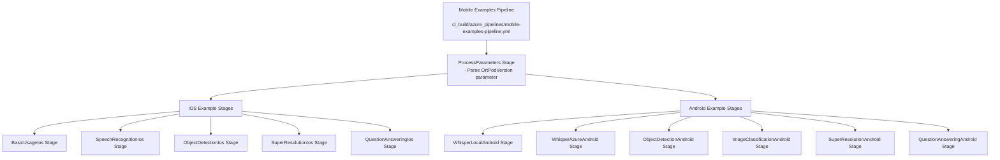

Sources: [ci_build/azure_pipelines/mobile-examples-pipeline.yml:1-351]()

### Pipeline Parameters and Variables

The Mobile Examples Pipeline accepts the following parameters:

| Parameter | Description | Default |
|-----------|-------------|---------|
| `OrtPodVersion` | ONNX Runtime Pod version to use | "default" |

Key variables include:

| Variable | Value | Purpose |
|----------|-------|---------|
| `AndroidTestAgentPool` | "onnxruntime-Ubuntu2204-AMD-CPU" | Pool for Android tests |
| `IosTestAgentVmImage` | "macOS-14" | VM image for iOS tests |

Sources: [ci_build/azure_pipelines/mobile-examples-pipeline.yml:1-11]()

### Example Job: iOS Build Process

A typical iOS example build follows these steps:

1. **Process Parameters Stage** - Parse the `OrtPodVersion` parameter
2. **Generate/Download Model** - Prepare the model using Python scripts
3. **Update Podfile** - Modify the Podfile to use the specified ORT version
4. **Install CocoaPods** - Install dependencies using `pod install`
5. **Build and Test** - Use Xcode to build and test the example

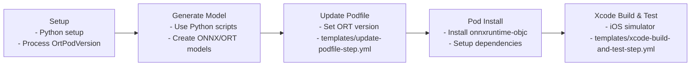

Sources: [ci_build/azure_pipelines/mobile-examples-pipeline.yml:46-88](), [ci_build/azure_pipelines/templates/xcode-build-and-test-step.yml:1-32]()

### Example Job: Android Build Process

A typical Android example build follows these steps:

1. **Process Parameters Stage** - Parse parameters
2. **Setup Python and JDK** - Configure build environment
3. **Generate/Download Model** (if needed) - Prepare model files
4. **Setup Android Emulator** - Configure emulator for testing
5. **Build and Test** - Use Gradle to build and run tests

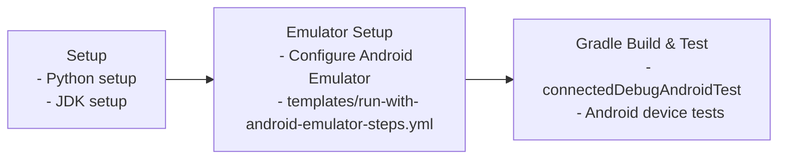

Sources: [ci_build/azure_pipelines/mobile-examples-pipeline.yml:90-129]()

## OneBranch Pipeline

The OneBranch Pipeline is used for building and testing C/C++ examples with additional compliance and security checks. There are two variants:

1. **OneBranch.Official.yml** - For production builds with TSA security analysis
2. **OneBranch.PullRequest.yml** - For pull request validation without TSA

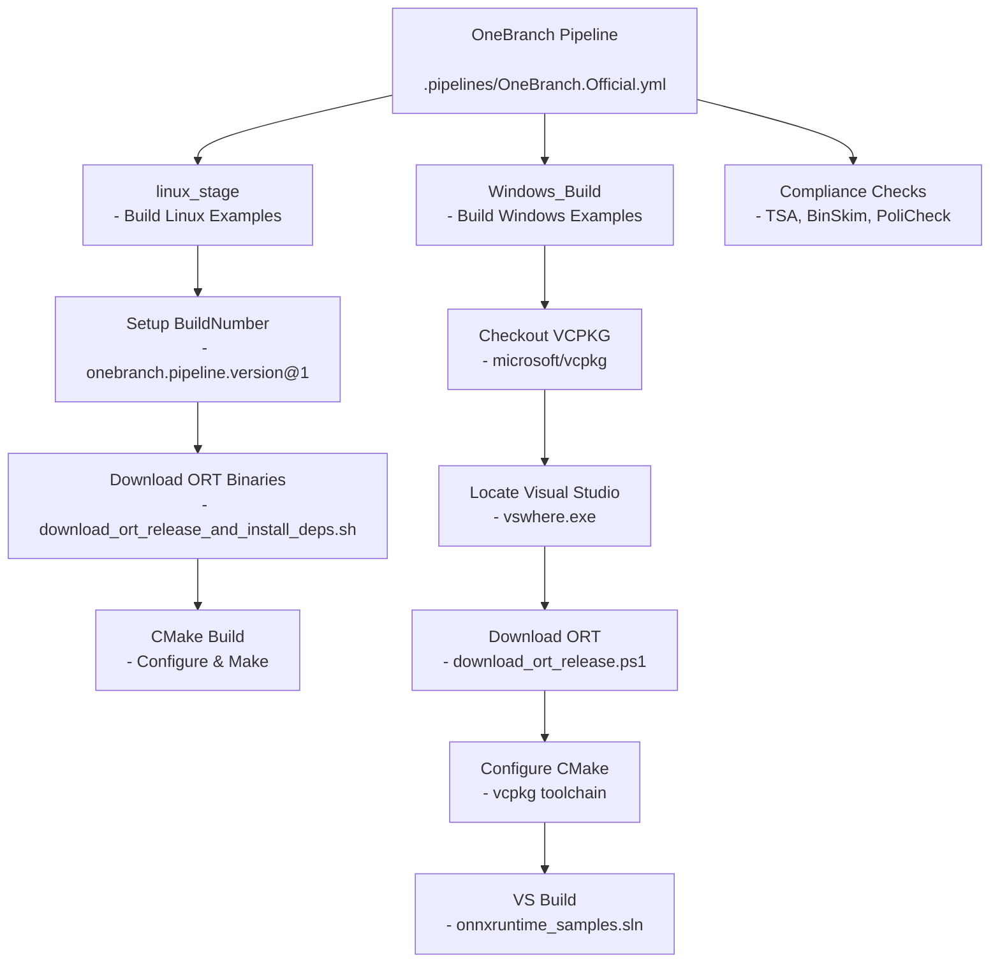

Sources: [.pipelines/OneBranch.Official.yml:1-161](), [.pipelines/OneBranch.PullRequest.yml:1-161]()

### Pipeline Parameters and Variables

The OneBranch Pipeline accepts the following parameters:

| Parameter | Description | Default |
|-----------|-------------|---------|
| `debug` | Enable debug output | false |
| `ortversion` | ONNX Runtime Version | "1.15.1" |

Key variables include:

| Variable | Value | Purpose |
|----------|-------|---------|
| `ROOT` / `REPOROOT` | `$(Build.SourcesDirectory)` | Source code root |
| `OUTPUTROOT` | `$(REPOROOT)\out` | Output directory |
| `WindowsContainerImage` | `onebranch.azurecr.io/windows/ltsc2019/vse2022:latest` | Windows container |
| `LinuxContainerImage` | `onebranch.azurecr.io/linux/ubuntu-2004:latest` | Linux container |

Sources: [.pipelines/OneBranch.Official.yml:13-34]()

## Build Systems

### C/C++ Build System (CMake)

The C/C++ examples use CMake for building, with support for various execution providers and platform-specific configurations.

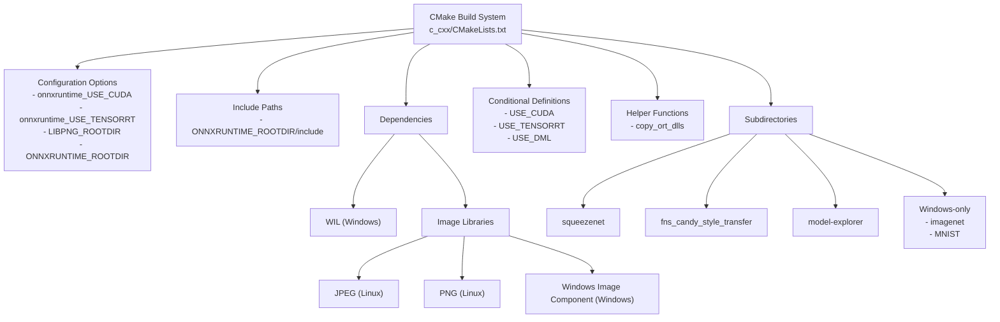

Sources: [c_cxx/CMakeLists.txt:1-100]()

#### Example C/C++ Build Process

The style transfer example demonstrates a typical C/C++ build and execution process:

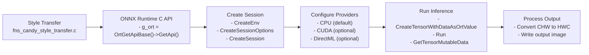

Sources: [c_cxx/fns_candy_style_transfer/fns_candy_style_transfer.c:1-233]()

### iOS Build System (CocoaPods)

iOS examples use CocoaPods for dependency management, with Xcode as the build system.

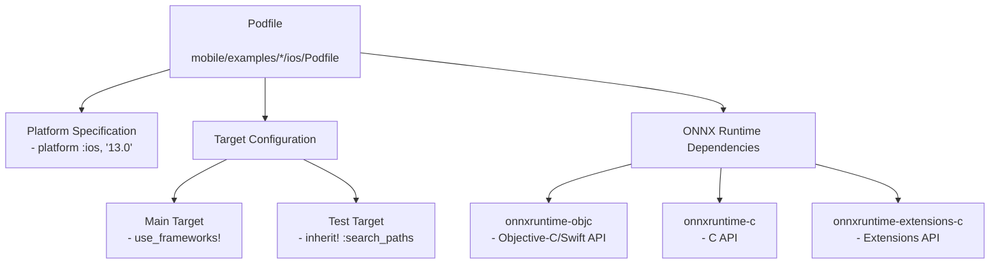

Sources: [mobile/examples/basic_usage/ios/Podfile:1-12](), [mobile/examples/object_detection/ios/Podfile:1-13](), [mobile/examples/speech_recognition/ios/Podfile:1-12](), [mobile/examples/super_resolution/ios/ORTSuperResolution/Podfile:1-22](), [mobile/examples/question_answering/ios/ORTQuestionAnswering/Podfile:1-21]()

### Android Build System (Gradle)

Android examples use Gradle for building, with tasks for building and running tests on emulators.

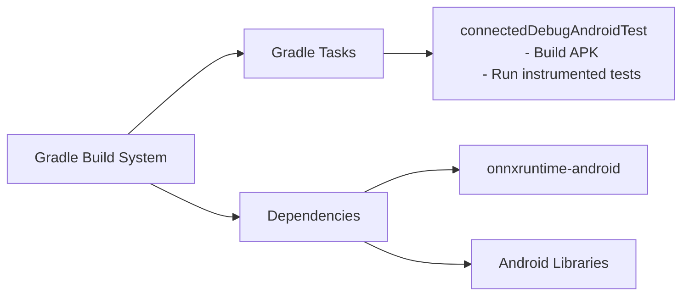

Sources: [ci_build/azure_pipelines/mobile-examples-pipeline.yml:101-108](), [ci_build/azure_pipelines/mobile-examples-pipeline.yml:122-129]()

### C# Build System (.NET SDK)

C# examples use the .NET SDK build system with NuGet package references.

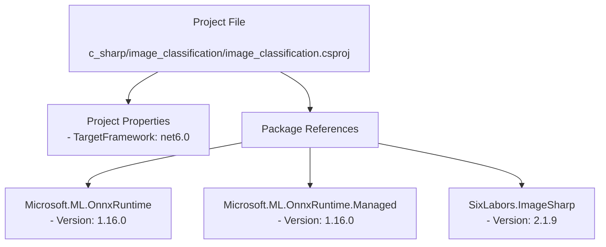

Sources: [c_sharp/image_classification/image_classification.csproj:1-15]()

## CI Pipeline Templates

The CI system uses several reusable templates to standardize operations across different examples:

### Xcode Build and Test Template

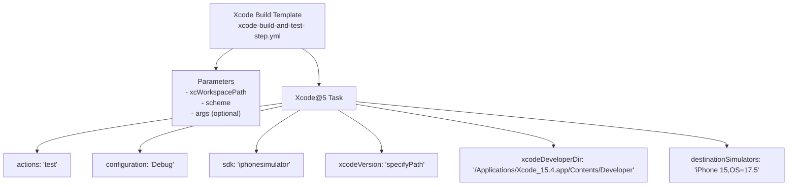

Sources: [ci_build/azure_pipelines/templates/xcode-build-and-test-step.yml:1-32]()

### Python and JDK Setup Templates

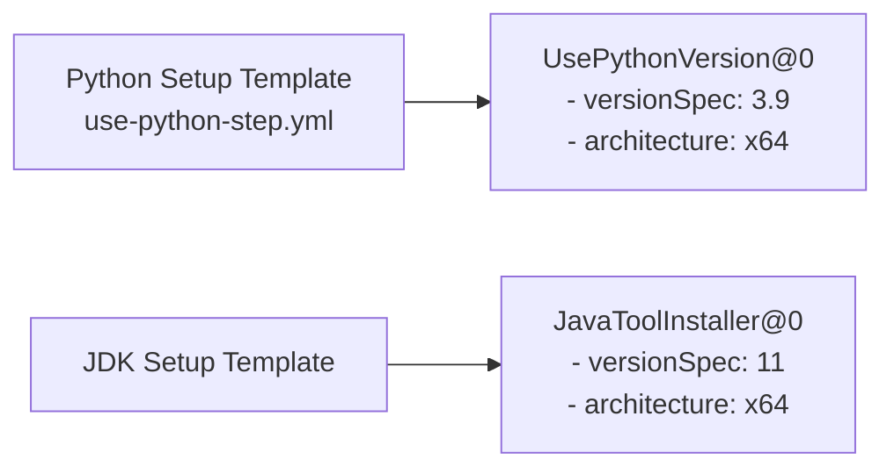

Sources: [ci_build/azure_pipelines/templates/use-python-step.yml:1-13]()

## Model Preparation Process

Many examples require model preparation as part of the build process. This typically involves:

1. **Installing Python dependencies** - Using `pip install` with requirements files
2. **Downloading pre-trained models** - From model repositories 
3. **Model conversion** - Converting to ONNX or ORT format
4. **Placing models in correct location** - For access during tests

Example: Object Detection iOS model preparation:

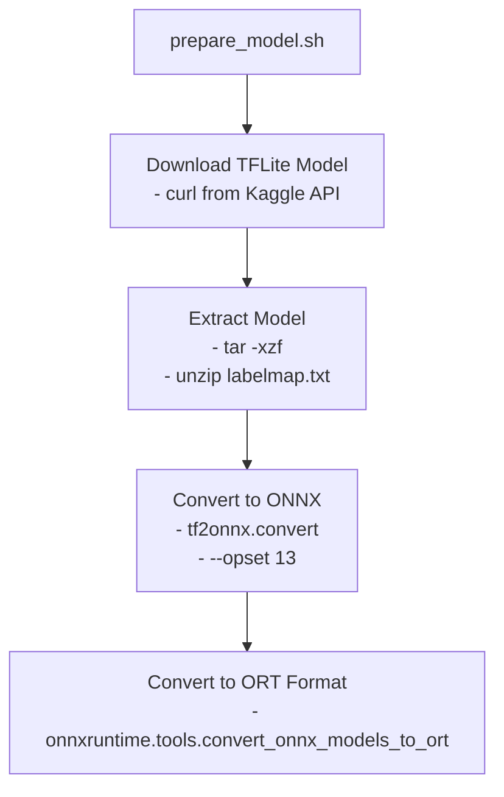

Sources: [mobile/examples/object_detection/ios/ORTObjectDetection/prepare_model.sh:1-32]()

## Security and Compliance

The OneBranch pipelines include security and compliance checks configured through:

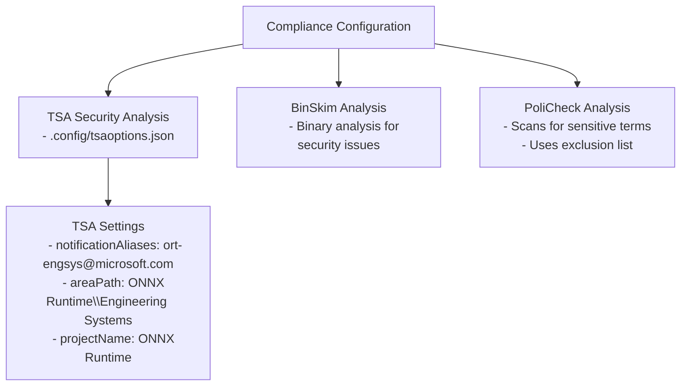

Sources: [.pipelines/OneBranch.Official.yml:51-60](), [.config/tsaoptions.json:1-10]()

## Conclusion

The CI/CD and build systems in the ONNX Runtime Inference Examples repository enable reliable testing across multiple platforms and example types. They ensure examples remain functional across different versions of ONNX Runtime and provide a standardized process for building examples on various platforms.

For more detailed information about specific pipeline configurations, refer to [Mobile Examples Pipeline](#8.1) and [OneBranch Pipeline](#8.2).

Sources: [ci_build/azure_pipelines/mobile-examples-pipeline.yml](), [.pipelines/OneBranch.Official.yml](), [.pipelines/OneBranch.PullRequest.yml](), [c_cxx/CMakeLists.txt]()

---

