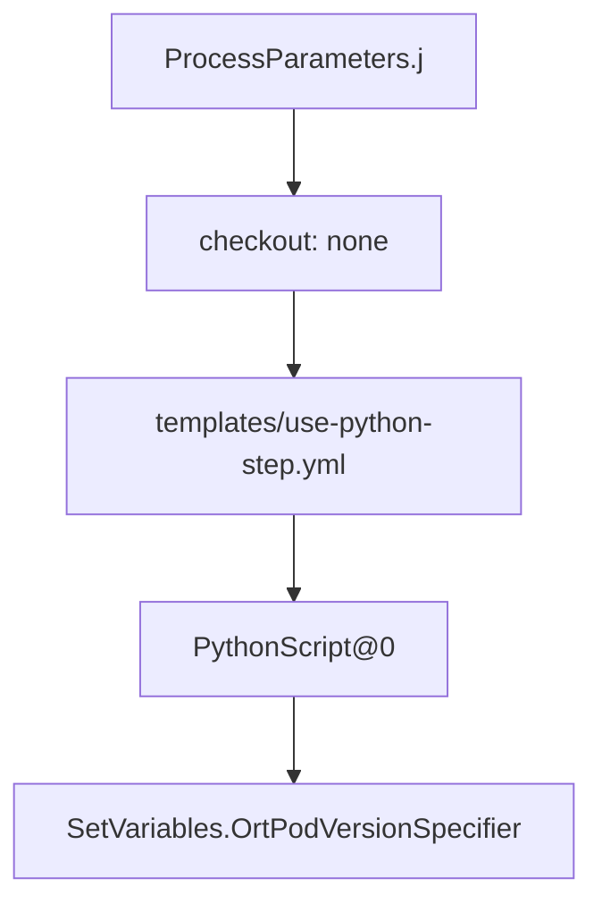
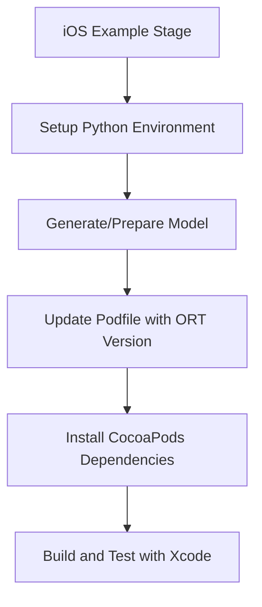
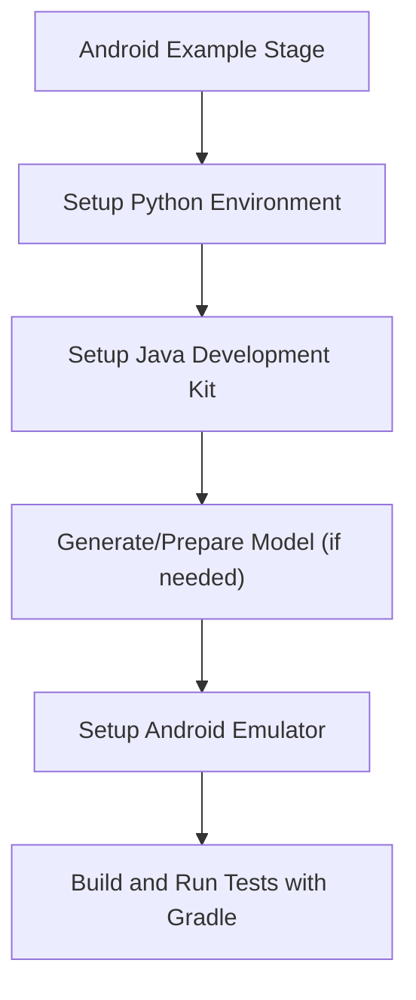
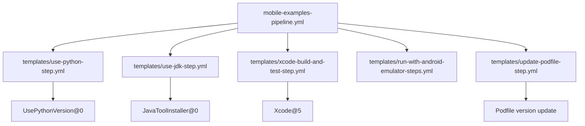
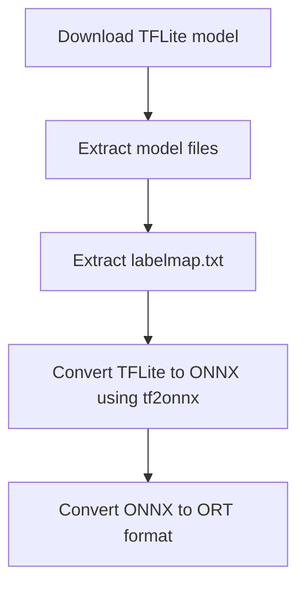
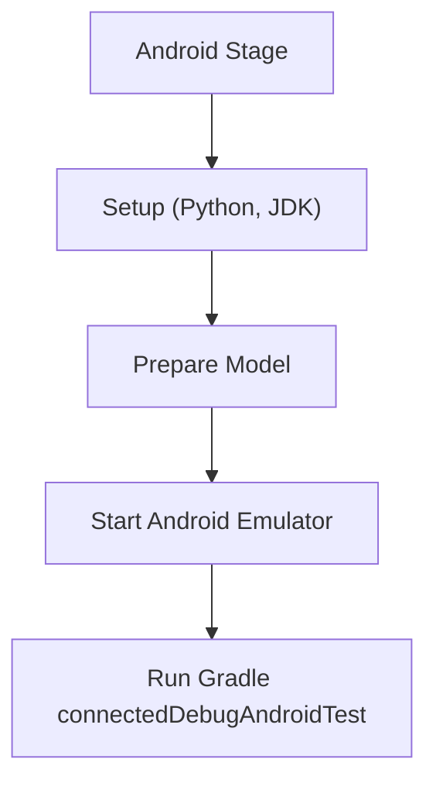

<!-- source: DeepWiki mcp.deepwiki.com · repo microsoft/onnxruntime-inference-examples · page 8.1 Mobile Examples Pipeline · fetched 2026-10-26 -->

# Mobile Examples Pipeline

<details>
<summary>Relevant source files</summary>

The following files were used as context for generating this wiki page:

- [ci_build/azure_pipelines/mobile-examples-pipeline.yml](ci_build/azure_pipelines/mobile-examples-pipeline.yml)
- [ci_build/azure_pipelines/templates/use-python-step.yml](ci_build/azure_pipelines/templates/use-python-step.yml)
- [ci_build/azure_pipelines/templates/xcode-build-and-test-step.yml](ci_build/azure_pipelines/templates/xcode-build-and-test-step.yml)
- [mobile/examples/basic_usage/ios/Podfile](mobile/examples/basic_usage/ios/Podfile)
- [mobile/examples/object_detection/ios/ORTObjectDetection/prepare_model.sh](mobile/examples/object_detection/ios/ORTObjectDetection/prepare_model.sh)
- [mobile/examples/object_detection/ios/Podfile](mobile/examples/object_detection/ios/Podfile)
- [mobile/examples/question_answering/ios/ORTQuestionAnswering/Podfile](mobile/examples/question_answering/ios/ORTQuestionAnswering/Podfile)
- [mobile/examples/speech_recognition/ios/Podfile](mobile/examples/speech_recognition/ios/Podfile)
- [mobile/examples/super_resolution/ios/ORTSuperResolution/Podfile](mobile/examples/super_resolution/ios/ORTSuperResolution/Podfile)

</details>


## Purpose and Scope

The Mobile Examples Pipeline is an Azure DevOps CI/CD system defined in [ci_build/azure_pipelines/mobile-examples-pipeline.yml]() that automatically builds and tests mobile examples across iOS and Android platforms. The pipeline validates that mobile examples remain functional by executing tests on iOS simulators and Android emulators, ensuring compatibility across ONNX Runtime versions.

For information about the OneBranch Pipeline, see [OneBranch Pipeline](#8.2).

Sources: [ci_build/azure_pipelines/mobile-examples-pipeline.yml:1-351]()

## Pipeline Architecture Overview

The Mobile Examples Pipeline is implemented as an Azure DevOps pipeline defined in YAML, consisting of multiple stages that test specific mobile examples across iOS and Android platforms.

### Pipeline Stage Dependency Graph

```mermaid
graph TD
    ProcessParameters["ProcessParameters"] --> BasicUsageIos["BasicUsageIos"]
    ProcessParameters --> WhisperLocalAndroid["WhisperLocalAndroid"]
    ProcessParameters --> WhisperAzureAndroid["WhisperAzureAndroid"]
    ProcessParameters --> SpeechRecognitionIos["SpeechRecognitionIos"]
    ProcessParameters --> ObjectDetectionIos["ObjectDetectionIos"]
    ProcessParameters --> ObjectDetectionAndroid["ObjectDetectionAndroid"]
    ProcessParameters --> ImageClassificationAndroid["ImageClassificationAndroid"]
    ProcessParameters --> SuperResolutionAndroid["SuperResolutionAndroid"]
    ProcessParameters --> SuperResolutionIos["SuperResolutionIos"]
    ProcessParameters --> QuestionAnsweringAndroid["QuestionAnsweringAndroid"]
    ProcessParameters --> QuestionAnsweringIos["QuestionAnsweringIos"]
```



Sources: [ci_build/azure_pipelines/mobile-examples-pipeline.yml:14-351]()

## Pipeline Parameters and Configuration

The pipeline accepts parameters that control its behavior:

- **`OrtPodVersion`**: Specifies which version of the ONNX Runtime Pod to use. Setting to "default" means no specific version is specified.

Key configuration variables:
- **`AndroidTestAgentPool`**: `"onnxruntime-Ubuntu2204-AMD-CPU"` - Agent pool for Android testing
- **`IosTestAgentVmImage`**: `"macOS-14"` - VM image for iOS testing

The `ProcessParameters` stage validates the `OrtPodVersion` parameter using a Python script that checks the version string format with regex pattern `r"[\w\.\-\+]+"` and sets the `OrtPodVersionSpecifier` variable for downstream stages.

Sources: [ci_build/azure_pipelines/mobile-examples-pipeline.yml:1-11](), [ci_build/azure_pipelines/mobile-examples-pipeline.yml:25-44]()

## Pipeline Workflow

### ProcessParameters Stage

The `ProcessParameters` stage processes input parameters and sets up variables for subsequent stages:

#### ProcessParameters Stage Workflow



The stage executes these steps:
1. Uses `checkout: none` to skip source code checkout
2. Applies the `templates/use-python-step.yml` template 
3. Runs a `PythonScript@0` task that validates the `OrtPodVersion` parameter with regex `r"[\w\.\-\+]+"`
4. Sets the `OrtPodVersionSpecifier` output variable using `##vso[task.setvariable]` syntax

If `OrtPodVersion` is "default", `OrtPodVersionSpecifier` is set to empty string. Otherwise, it's formatted as `, '{version}'` for use in Podfile updates.

Sources: [ci_build/azure_pipelines/mobile-examples-pipeline.yml:14-44]()

### iOS Example Testing Workflow



For iOS examples, the pipeline typically follows these steps:
1. Sets up Python environment
2. Generates or prepares ML models if needed
3. Updates the Podfile with the specified ONNX Runtime version
4. Installs CocoaPods dependencies
5. Builds and tests using Xcode on an iOS simulator

Sources: [ci_build/azure_pipelines/mobile-examples-pipeline.yml:47-88](), [ci_build/azure_pipelines/mobile-examples-pipeline.yml:132-165](), [ci_build/azure_pipelines/mobile-examples-pipeline.yml:167-199]()

### Android Example Testing Workflow



For Android examples, the pipeline typically follows these steps:
1. Sets up Python environment
2. Sets up Java Development Kit (JDK)
3. Generates or prepares ML models if needed
4. Sets up an Android emulator
5. Builds and runs tests using Gradle with the `connectedDebugAndroidTest` task

Sources: [ci_build/azure_pipelines/mobile-examples-pipeline.yml:90-129](), [ci_build/azure_pipelines/mobile-examples-pipeline.yml:202-225](), [ci_build/azure_pipelines/mobile-examples-pipeline.yml:228-260]()

## Common Templates

The pipeline uses reusable Azure DevOps templates to standardize operations across stages:

#### Template Usage Map



### Template Parameters and Usage

| Template | Key Parameters | Default Values | Usage Context |
|----------|---------------|----------------|---------------|
| `templates/use-python-step.yml` | `pythonVersion` | `"3.9"` | Model generation, validation scripts |
| `templates/use-jdk-step.yml` | `versionSpec` | `"11"` | Android Gradle builds |
| `templates/xcode-build-and-test-step.yml` | `xcWorkspacePath`, `scheme`, `args` | N/A | iOS simulator testing |
| `templates/run-with-android-emulator-steps.yml` | `steps` | N/A | Android emulator testing |
| `templates/update-podfile-step.yml` | `podfilePath`, `ortPodVersionSpecifier` | N/A | CocoaPods version management |

Sources: [ci_build/azure_pipelines/mobile-examples-pipeline.yml:23-323](), [ci_build/azure_pipelines/templates/use-python-step.yml:1-13](), [ci_build/azure_pipelines/templates/xcode-build-and-test-step.yml:1-32]()

## Xcode Build Configuration

The `templates/xcode-build-and-test-step.yml` template configures the `Xcode@5` task with these parameters:

| Parameter | Value | Purpose |
|-----------|-------|---------|
| `actions` | `'test'` | Runs unit tests instead of just building |
| `configuration` | `'Debug'` | Uses debug build configuration |
| `sdk` | `'iphonesimulator'` | Targets iOS simulator |
| `xcodeVersion` | `'specifyPath'` | Uses specific Xcode installation |
| `xcodeDeveloperDir` | `'/Applications/Xcode_15.4.app/Contents/Developer'` | Xcode 15.4 path |
| `destinationPlatformOption` | `'iOS'` | iOS platform target |
| `destinationTypeOption` | `'simulators'` | Simulator target |
| `destinationSimulators` | `'iPhone 15,OS=17.5'` | Specific simulator device and OS |

The template accepts optional `args` parameter for additional Xcode arguments, used by `BasicUsageIos` stage for preprocessor definitions.

Sources: [ci_build/azure_pipelines/templates/xcode-build-and-test-step.yml:10-32]()

## Mobile Examples Tested

The pipeline tests these mobile examples with their corresponding directory paths:

| Stage Name | Platform | Example Path | Build Tool | Test Command |
|------------|----------|--------------|------------|--------------|
| `BasicUsageIos` | iOS | `mobile/examples/basic_usage/ios` | Xcode | `OrtBasicUsage.xcworkspace` |
| `WhisperLocalAndroid` | Android | `mobile/examples/whisper/local/android` | Gradle | `connectedDebugAndroidTest` |
| `WhisperAzureAndroid` | Android | `mobile/examples/whisper/azure/android` | Gradle | `connectedDebugAndroidTest` |
| `SpeechRecognitionIos` | iOS | `mobile/examples/speech_recognition/ios` | Xcode | `SpeechRecognition.xcworkspace` |
| `ObjectDetectionIos` | iOS | `mobile/examples/object_detection/ios` | Xcode | `ORTObjectDetection.xcworkspace` |
| `ObjectDetectionAndroid` | Android | `mobile/examples/object_detection/android` | Gradle | `connectedDebugAndroidTest` |
| `ImageClassificationAndroid` | Android | `mobile/examples/image_classification/android` | Gradle | `connectedDebugAndroidTest` |
| `SuperResolutionAndroid` | Android | `mobile/examples/super_resolution/android` | Gradle | `connectedDebugAndroidTest` |
| `SuperResolutionIos` | iOS | `mobile/examples/super_resolution/ios/ORTSuperResolution` | Xcode | `ORTSuperResolution.xcworkspace` |
| `QuestionAnsweringAndroid` | Android | `mobile/examples/question_answering/android` | Gradle | `connectedDebugAndroidTest` |
| `QuestionAnsweringIos` | iOS | `mobile/examples/question_answering/ios/ORTQuestionAnswering` | Xcode | `ORTQuestionAnswering.xcworkspace` |

### Strategy Matrix Examples

The `BasicUsageIos` stage uses a strategy matrix to test both ONNX and ORT format models:

```yaml
strategy:
  matrix:
    onnx_model:
      XcodeArgs: 'GCC_PREPROCESSOR_DEFINITIONS="$GCC_PREPROCESSOR_DEFINITIONS ORT_BASIC_USAGE_USE_ONNX_FORMAT_MODEL"'
    ort_format_model:
      XcodeArgs: ''
```

The `ImageClassificationAndroid` stage tests both model formats:

```yaml
strategy:
  matrix:
    onnx_model:
      ModelFormat: onnx
    ort_format_model:
      ModelFormat: ort
```

Sources: [ci_build/azure_pipelines/mobile-examples-pipeline.yml:47-351]()

## Model Preparation Examples

Many examples require model preparation. For instance, the Object Detection iOS example:



This process is automated in `prepare_model.sh` and similar scripts, which:
1. Download pre-trained models from public sources
2. Convert models to ONNX format if needed
3. Optionally convert ONNX models to ORT format for optimized inference
4. Place models in the appropriate location within the app

Sources: [mobile/examples/object_detection/ios/ORTObjectDetection/prepare_model.sh:1-32]()

## iOS Dependency Management

iOS examples use CocoaPods for ONNX Runtime dependency management with different pod configurations:

### CocoaPods Configuration by Example

| Example | Podfile Path | Primary Pod | Additional Pods |
|---------|--------------|-------------|-----------------|
| Basic Usage | `mobile/examples/basic_usage/ios/Podfile` | `onnxruntime-objc` | None |
| Speech Recognition | `mobile/examples/speech_recognition/ios/Podfile` | `onnxruntime-objc` | None |
| Object Detection | `mobile/examples/object_detection/ios/Podfile` | `onnxruntime-objc` | None |
| Super Resolution | `mobile/examples/super_resolution/ios/ORTSuperResolution/Podfile` | `onnxruntime-c` | `onnxruntime-extensions-c` |
| Question Answering | `mobile/examples/question_answering/ios/ORTQuestionAnswering/Podfile` | `onnxruntime-c` | `onnxruntime-extensions-c` |

All iOS examples target `platform :ios, '13.0'` and use `use_frameworks!`.

### Dynamic Version Management

The `templates/update-podfile-step.yml` template dynamically updates Podfiles with the `OrtPodVersionSpecifier` variable. When `OrtPodVersion` parameter is not "default", it appends a version specifier to the pod declaration.

Super Resolution and Question Answering examples include a `post_install` hook that disables code signing:

```ruby
post_install do |installer|
  installer.pods_project.targets.each do |target|
    target.build_configurations.each do |config|
      config.build_settings['CODE_SIGNING_ALLOWED'] = 'NO'
    end
  end
end
```

Sources: [mobile/examples/basic_usage/ios/Podfile:1-11](), [mobile/examples/object_detection/ios/Podfile:1-12](), [mobile/examples/speech_recognition/ios/Podfile:1-12](), [mobile/examples/super_resolution/ios/ORTSuperResolution/Podfile:1-22](), [mobile/examples/question_answering/ios/ORTQuestionAnswering/Podfile:1-20]()

## Android Dependency and Testing

Android examples:
1. Use Gradle for building and dependency management
2. Run tests on an emulator via the `connectedDebugAndroidTest` Gradle task
3. Often include model generation/preparation steps



Sources: [ci_build/azure_pipelines/mobile-examples-pipeline.yml:90-129](), [ci_build/azure_pipelines/mobile-examples-pipeline.yml:202-225]()

---

