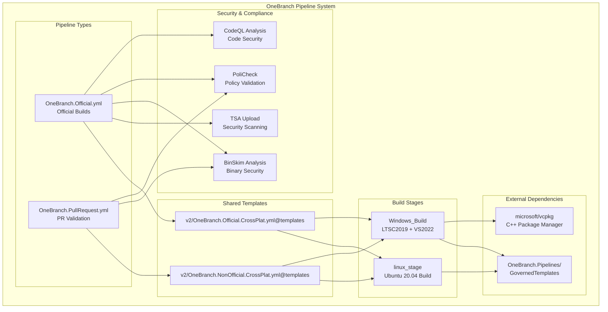
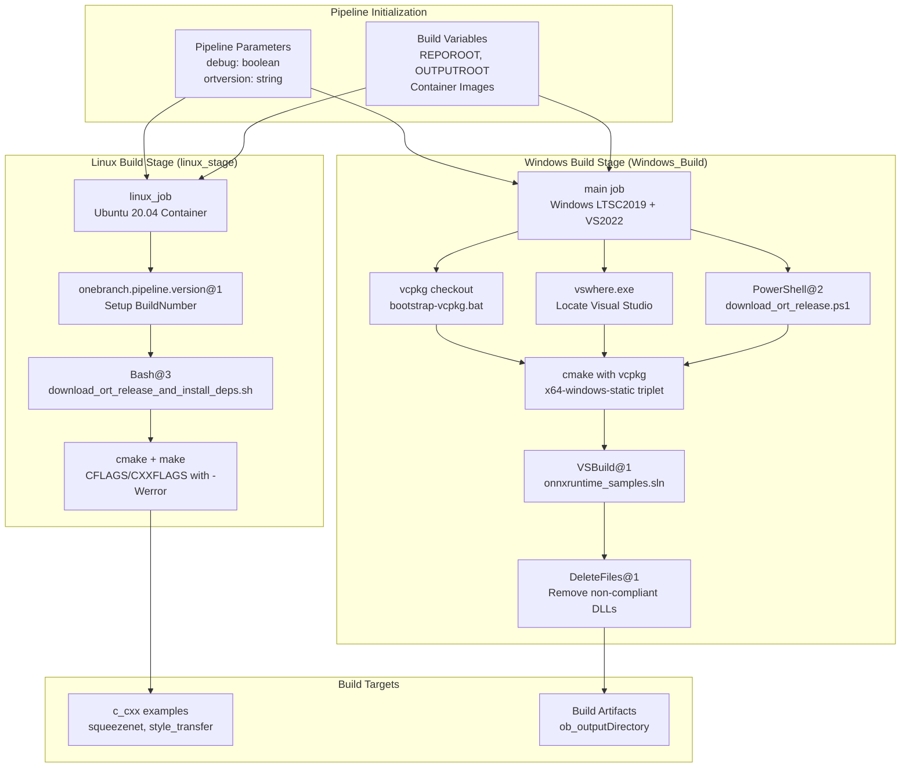

<!-- source: DeepWiki mcp.deepwiki.com · repo microsoft/onnxruntime-inference-examples · page 8.2 OneBranch Pipeline · fetched 2026-10-26 -->

# OneBranch Pipeline

<details>
<summary>Relevant source files</summary>

The following files were used as context for generating this wiki page:

- [.config/tsaoptions.json](.config/tsaoptions.json)
- [.pipelines/OneBranch.Official.yml](.pipelines/OneBranch.Official.yml)
- [.pipelines/OneBranch.PullRequest.yml](.pipelines/OneBranch.PullRequest.yml)
- [c_cxx/CMakeLists.txt](c_cxx/CMakeLists.txt)
- [c_cxx/squeezenet/main.cpp](c_cxx/squeezenet/main.cpp)
- [c_sharp/image_classification/image_classification.csproj](c_sharp/image_classification/image_classification.csproj)

</details>


The OneBranch Pipeline is Microsoft's official build system used for compliance-focused builds of the ONNX Runtime inference examples repository. It provides secure, governed builds with integrated security scanning and compliance validation for both official releases and pull request validation.

This page covers the OneBranch build pipeline configuration and processes. For mobile-specific CI/CD, see [Mobile Examples Pipeline](#8.1). For GitHub Actions workflows, see [GitHub Actions](#8.3).

## Pipeline Architecture Overview

The OneBranch system consists of two main pipeline configurations that share common build logic but differ in their compliance and security requirements.

**OneBranch Pipeline Architecture**



Sources: [.pipelines/OneBranch.Official.yml:1-161](), [.pipelines/OneBranch.PullRequest.yml:1-161]()

## Security and Compliance Features

OneBranch integrates multiple security and compliance tools as part of the build process:

| Tool | Official Builds | PR Builds | Purpose |
|------|----------------|-----------|---------|
| TSA (Trusted Security Advisor) | ✅ Enabled | ❌ Disabled | Security scanning and vulnerability upload |
| BinSkim | ✅ Break on issues | ✅ Break on issues | Binary security analysis |
| PoliCheck | ✅ Break on issues | ✅ Break on issues | Policy compliance validation |
| CodeQL | ✅ Enabled | ❌ Disabled | Static code analysis for security |

The compliance configuration is defined in the `globalSdl` section with specific exclusions managed through `policheck_exclusions.xml`.

Sources: [.pipelines/OneBranch.Official.yml:53-60](), [.pipelines/OneBranch.PullRequest.yml:53-60](), [.config/tsaoptions.json:1-9]()

## Build Process and Stages

The OneBranch pipeline executes builds across two primary stages with platform-specific configurations and dependencies.

**Build Process Flow**



Sources: [.pipelines/OneBranch.Official.yml:62-161](), [.pipelines/OneBranch.PullRequest.yml:62-161]()

## Dependencies and Configuration

### ONNX Runtime Integration

The pipeline downloads and integrates with ONNX Runtime binaries using platform-specific scripts:

- **Linux**: `ci_build/download_ort_release_and_install_deps.sh` with `-i` flag for version parameter
- **Windows**: `ci_build/download_ort_release.ps1` with version parameter

The ONNX Runtime version is configurable via the `ortversion` parameter (default: `1.15.1`).

### C++ Build Configuration

The Windows build uses vcpkg for dependency management with the following configuration:

```yaml
CMAKE_TOOLCHAIN_FILE: $(Build.SourcesDirectory)/vcpkg/scripts/buildsystems/vcpkg.cmake
VCPKG_TARGET_TRIPLET: x64-windows-static
ONNXRUNTIME_ROOTDIR: $(Build.BinariesDirectory)/onnxruntimebin
```

The Linux build uses system dependencies and compiler flags:

```yaml
CFLAGS: "-O2 -Wall -Wextra -Werror"
CXXFLAGS: "-O2 -Wall -Wextra -Werror"
CMAKE_BUILD_TYPE: Release
```

Sources: [.pipelines/OneBranch.Official.yml:81-93](), [.pipelines/OneBranch.Official.yml:135-141](), [c_cxx/CMakeLists.txt:1-101]()

## Build Targets and Examples

The OneBranch pipeline primarily builds the C/C++ examples defined in the CMake configuration:

| Example | Platforms | Dependencies |
|---------|-----------|--------------|
| `squeezenet` | Linux, Windows | ONNX Runtime C API |
| `imagenet` | Windows only | Windows-specific APIs |
| `MNIST` | Windows only | Windows-specific APIs |
| `fns_candy_style_transfer` | Windows, Linux (with PNG) | libpng for image processing |
| `model-explorer` | Linux, Windows | Basic ONNX Runtime integration |

The build process generates the `onnxruntime_samples.sln` solution file and compiles all compatible examples for the target platform.

Sources: [c_cxx/CMakeLists.txt:92-101](), [.pipelines/OneBranch.Official.yml:143-153]()

## Container Images and Environment

OneBranch uses specific container images for reproducible builds:

- **Windows**: `onebranch.azurecr.io/windows/ltsc2019/vse2022:latest`
- **Linux**: `onebranch.azurecr.io/linux/ubuntu-2004:latest`

These images provide standardized build environments with pre-installed toolchains and security scanning capabilities required for compliance.

Sources: [.pipelines/OneBranch.Official.yml:32-34](), [.pipelines/OneBranch.PullRequest.yml:32-34]()

---

