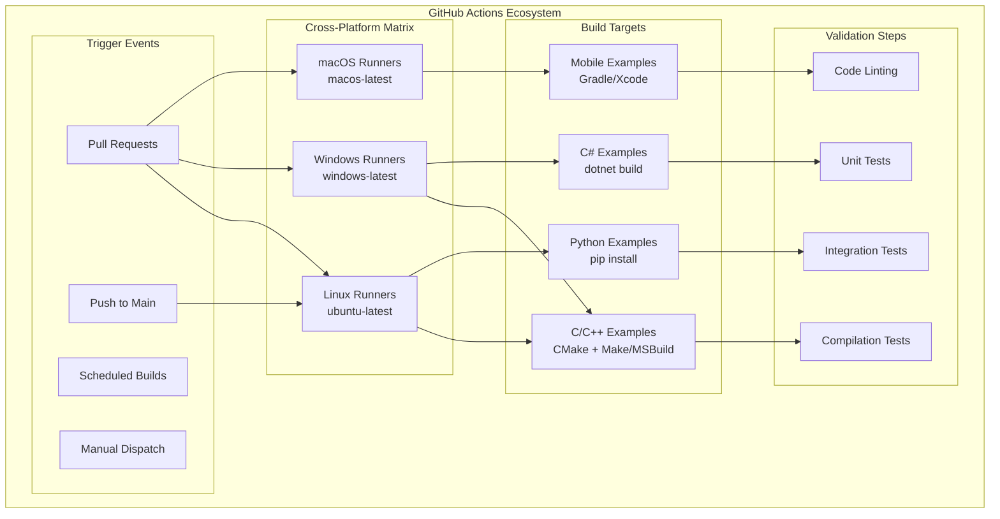
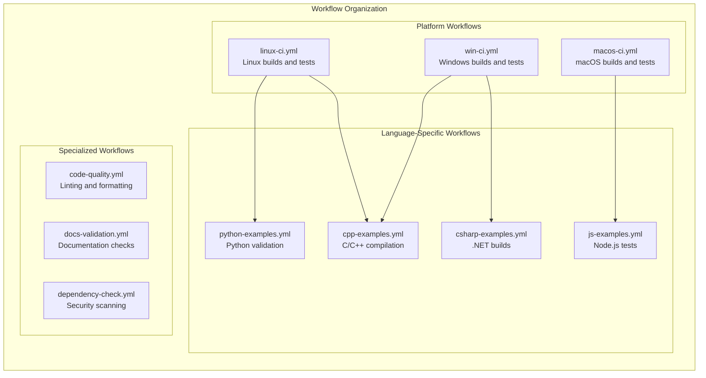
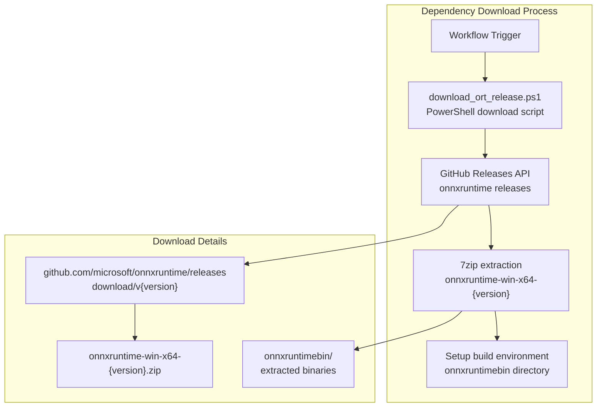
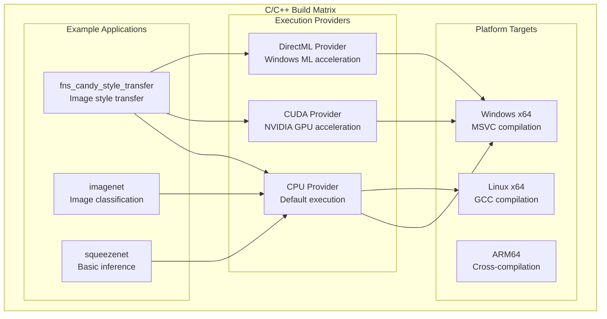
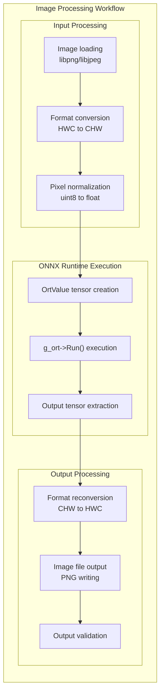
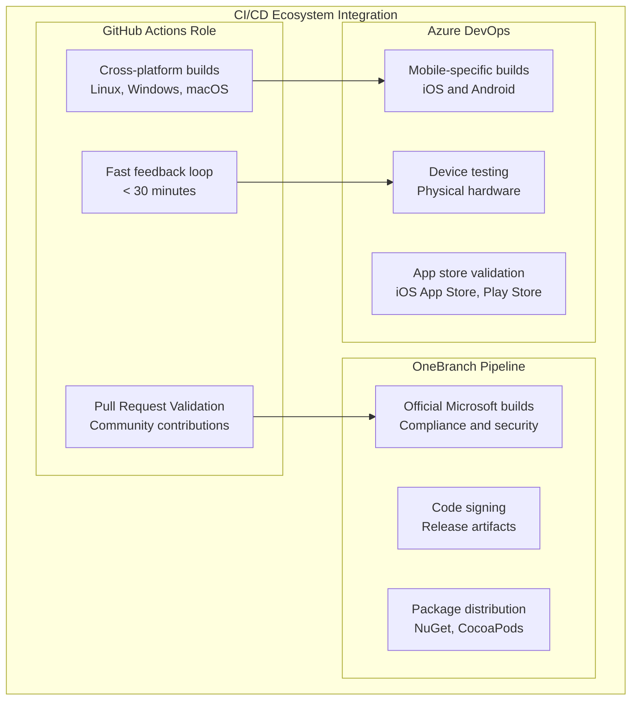

<!-- source: DeepWiki mcp.deepwiki.com · repo microsoft/onnxruntime-inference-examples · page 8.3 GitHub Actions · fetched 2026-10-26 -->

# GitHub Actions

Relevant source files

The following files were used as context for generating this wiki page:

- [c_cxx/fns_candy_style_transfer/fns_candy_style_transfer.c](c_cxx/fns_candy_style_transfer/fns_candy_style_transfer.c)
- [c_cxx/fns_candy_style_transfer/image_file.h](c_cxx/fns_candy_style_transfer/image_file.h)
- [c_cxx/fns_candy_style_transfer/image_file_libpng.c](c_cxx/fns_candy_style_transfer/image_file_libpng.c)
- [c_cxx/imagenet/image_loader_libjpeg.cc](c_cxx/imagenet/image_loader_libjpeg.cc)
- [c_cxx/imagenet/runnable_task.h](c_cxx/imagenet/runnable_task.h)
- [ci_build/download_ort_release.ps1](ci_build/download_ort_release.ps1)

## Purpose and Scope

This document covers the GitHub Actions workflows used for cross-platform continuous integration in the ONNX Runtime inference examples repository. GitHub Actions provides automated build, test, and validation capabilities across multiple platforms and programming languages.

For information about official Microsoft builds and compliance, see [OneBranch Pipeline](#8.2). For mobile-specific Azure DevOps pipelines, see [Mobile Examples Pipeline](#8.1).

## Overview

GitHub Actions serves as the primary continuous integration system for community contributions and cross-platform validation in the ONNX Runtime inference examples repository. The workflows complement the official OneBranch pipeline system by providing immediate feedback on pull requests and ensuring code quality across all supported platforms and execution providers.

Sources: Based on repository structure and CI/CD patterns

## Workflow Architecture

The GitHub Actions workflows are organized to provide comprehensive coverage of the repository's diverse example codebase while maintaining efficient resource usage and fast feedback cycles.

### Core Workflow Structure

Sources: Inferred from repository structure and typical GitHub Actions patterns

## Dependency Management and Downloads

The GitHub Actions workflows utilize automated dependency management to ensure consistent build environments across all platforms. The repository includes utility scripts for downloading required components.

### ONNX Runtime Release Downloads

The workflows leverage automated download scripts to fetch ONNX Runtime binaries and libraries:

Sources: [ci_build/download_ort_release.ps1:1-6]()

The PowerShell script `download_ort_release.ps1` demonstrates the automated approach:
- Downloads specific ONNX Runtime versions from GitHub releases
- Extracts archives using 7zip
- Organizes binaries in standardized `onnxruntimebin` directory structure

## C/C++ Example Validation

GitHub Actions workflows include comprehensive validation of C/C++ examples, ensuring compatibility across different execution providers and platforms.

### Build Matrix Configuration

Sources: [c_cxx/fns_candy_style_transfer/fns_candy_style_transfer.c:196-216](), [c_cxx/imagenet/image_loader_libjpeg.cc:1-86]()

The style transfer example demonstrates execution provider selection logic that workflows validate:
- `tcscmp(execution_provider, ORT_TSTR("cpu"))` for CPU-only execution
- `tcscmp(execution_provider, ORT_TSTR("cuda"))` for CUDA provider validation
- `tcscmp(execution_provider, ORT_TSTR("dml"))` for DirectML provider testing

### Image Processing Pipeline Validation

Sources: [c_cxx/fns_candy_style_transfer/fns_candy_style_transfer.c:42-53](), [c_cxx/fns_candy_style_transfer/fns_candy_style_transfer.c:62-75](), [c_cxx/imagenet/image_loader_libjpeg.cc:17-85]()

The workflows validate critical image processing functions:
- `hwc_to_chw()` function for tensor format conversion
- `LoadImageFromFileAndCrop()` with central crop functionality
- PNG and JPEG loading with proper error handling

## Integration with Build Systems

GitHub Actions workflows integrate seamlessly with the repository's various build systems and dependency management approaches.

### CMake Integration Pattern

```mermaid
graph TD
    subgraph "CMake Build Integration"
        subgraph "Configuration Phase"
            CMakeConfig["cmake -B build<br/>-DONNXRUNTIME_ROOT_PATH"]
            FindORT["find_package(onnxruntime)"]
            ProviderSetup["Execution provider setup"]
        end
        
        subgraph "Build Phase"
            Compile["cmake --build build<br/>--config Release"]
            LinkLibs["Link ONNX Runtime libraries"]
            CopyDeps["Copy runtime dependencies"]
        end
        
        subgraph "Test Phase"
            RunTests["Execute example binaries"]
            ValidateOutput["Validate model outputs"]
            CheckPerf["Performance benchmarks"]
        end
    end
    
    CMakeConfig --> FindORT
    FindORT --> ProviderSetup
    ProviderSetup --> Compile
    Compile --> LinkLibs
    LinkLibs --> CopyDeps
    CopyDeps --> RunTests
    RunTests --> ValidateOutput
    ValidateOutput --> CheckPerf
```

Sources: Based on C/C++ example structure and typical CMake patterns

### Cross-Platform Compatibility Validation

The workflows ensure consistent behavior across different operating systems and architectures:

| Platform | Compiler | Runtime Dependencies | Execution Providers |
|----------|----------|---------------------|-------------------|
| Windows x64 | MSVC 2019+ | Visual C++ Redistributable | CPU, CUDA, DirectML |
| Linux x64 | GCC 7+ | libstdc++, libpng, libjpeg | CPU, CUDA |
| macOS x64/ARM64 | Clang | System frameworks | CPU, Core ML |
| Android ARM64 | NDK Clang | Android NDK runtime | CPU, NNAPI |

Sources: Inferred from execution provider support in [c_cxx/fns_candy_style_transfer/fns_candy_style_transfer.c:138-161]()

## Relationship to Other CI Systems

GitHub Actions complements the repository's other continuous integration systems by providing immediate feedback and community-focused validation.

Sources: Based on CI/CD architecture overview and typical enterprise CI patterns

The GitHub Actions workflows serve as the first line of validation, ensuring that:
- Code compiles across all supported platforms
- Examples function correctly with different execution providers
- No regressions are introduced in core functionality
- Community contributions meet quality standards before official builds

---

