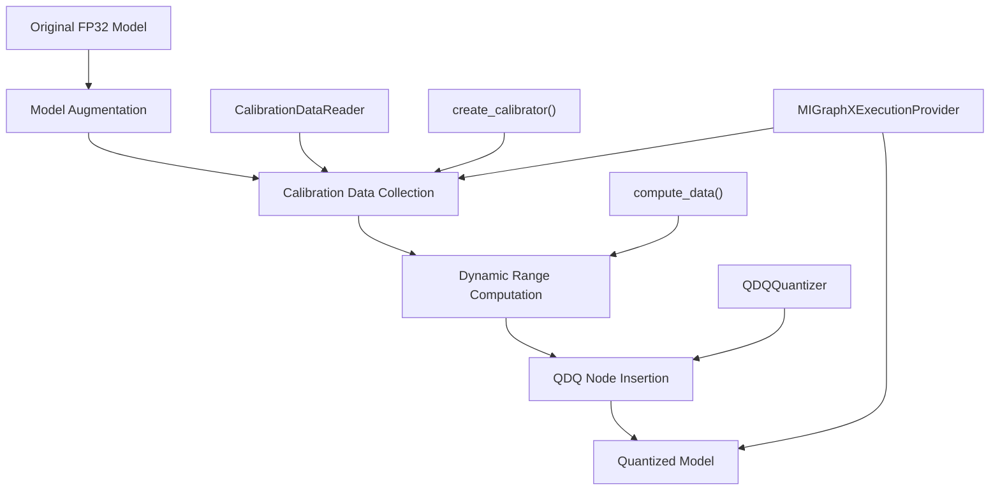
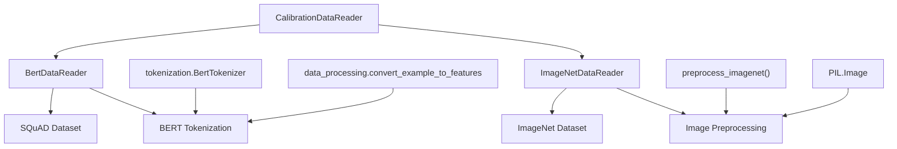
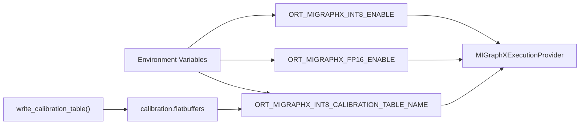

<!-- source: DeepWiki mcp.deepwiki.com · repo microsoft/onnxruntime-inference-examples · page 9 Quantization · fetched 2026-10-26 -->

# Quantization

<details>
<summary>Relevant source files</summary>

The following files were used as context for generating this wiki page:

- [quantization/image_classification/migraphx/resnet50/e2e_migraphx_resnet_example.py](quantization/image_classification/migraphx/resnet50/e2e_migraphx_resnet_example.py)
- [quantization/nlp/bert/migraphx/README.md](quantization/nlp/bert/migraphx/README.md)
- [quantization/nlp/bert/migraphx/data_processing.py](quantization/nlp/bert/migraphx/data_processing.py)
- [quantization/nlp/bert/migraphx/e2e_migraphx_bert_example.py](quantization/nlp/bert/migraphx/e2e_migraphx_bert_example.py)
- [quantization/nlp/bert/migraphx/squad/dev-v1.1.json](quantization/nlp/bert/migraphx/squad/dev-v1.1.json)
- [quantization/nlp/bert/migraphx/squad/dev-v2.0.json](quantization/nlp/bert/migraphx/squad/dev-v2.0.json)
- [quantization/nlp/bert/migraphx/squad/evaluate-v1.1.py](quantization/nlp/bert/migraphx/squad/evaluate-v1.1.py)
- [quantization/nlp/bert/migraphx/squad/evaluate-v2.0.py](quantization/nlp/bert/migraphx/squad/evaluate-v2.0.py)
- [quantization/nlp/bert/migraphx/squad/vocab.txt](quantization/nlp/bert/migraphx/squad/vocab.txt)
- [quantization/nlp/bert/migraphx/tokenization.py](quantization/nlp/bert/migraphx/tokenization.py)

</details>


This document covers model quantization examples within the ONNX Runtime inference repository. Quantization reduces model precision from FP32 to lower precision formats (INT8, FP16) to improve inference performance and reduce memory usage. The examples demonstrate quantization workflows for computer vision and natural language processing models using the MIGraphX execution provider.

For BERT-specific quantization details, see [BERT QDQ Quantization](#9.1). For ResNet50 quantization implementation, see [ResNet50 Quantization](#9.2).

## Quantization Approaches

The repository implements two primary quantization strategies:

| Quantization Type | Precision | Method | Use Case |
|------------------|-----------|---------|----------|
| **INT8 Quantization** | 8-bit integers | QDQ (Quantize-Dequantize) nodes | Maximum performance gains |
| **FP16 Quantization** | 16-bit floats | Native precision reduction | Balanced performance/accuracy |

### QDQ Quantization Workflow

The quantization process follows a two-stage approach implemented across both BERT and ResNet50 examples:



**QDQ Quantization Pipeline**

Sources: [quantization/nlp/bert/migraphx/e2e_migraphx_bert_example.py:533-558](), [quantization/image_classification/migraphx/resnet50/e2e_migraphx_resnet_example.py:392-411]()

## Data Readers and Calibration

### Calibration Data Reader Interface

Both examples implement custom data readers extending the `CalibrationDataReader` base class:



**Data Reader Implementation Hierarchy**

Sources: [quantization/nlp/bert/migraphx/e2e_migraphx_bert_example.py:14-146](), [quantization/image_classification/migraphx/resnet50/e2e_migraphx_resnet_example.py:53-216]()

### Calibration Methods

The quantization system supports multiple calibration algorithms:

| Method | Implementation | Description |
|--------|----------------|-------------|
| `CalibrationMethod.Percentile` | Default for BERT | Uses percentile-based range computation |
| `CalibrationMethod.MinMax` | Default for ResNet50 | Uses minimum/maximum range computation |
| `CalibrationMethod.Entropy` | Optional | Entropy-based histogram analysis |

Sources: [quantization/nlp/bert/migraphx/e2e_migraphx_bert_example.py:533](), [quantization/nlp/bert/migraphx/README.md:66-67]()

## Execution Provider Integration

### MIGraphX Configuration

The quantization examples primarily target the MIGraphX execution provider with specific environment variable configurations:



**MIGraphX Execution Provider Configuration**

The system also supports alternative execution providers for calibration:

- `ROCMExecutionProvider` - For AMD GPU acceleration during calibration
- `CPUExecutionProvider` - For CPU-based calibration when GPU unavailable

Sources: [quantization/image_classification/migraphx/resnet50/e2e_migraphx_resnet_example.py:377-380](), [quantization/nlp/bert/migraphx/e2e_migraphx_bert_example.py:474-484]()

## Model-Specific Implementations

### BERT Quantization Features

The BERT quantization implementation includes:

- **Batch Processing**: Dynamic batching with `BertDataReader` for efficient calibration
- **SQuAD Integration**: Native support for SQuAD v1.1 and v2.0 datasets
- **Token Management**: Integration with `tokenization.BertTokenizer` for preprocessing
- **Evaluation Pipeline**: F1 score and exact match evaluation using `evaluate-v1.1.py` and `evaluate-v2.0.py`

### ResNet50 Quantization Features

The ResNet50 quantization implementation provides:

- **ImageNet Support**: Full ImageNet dataset processing with `ImageNetDataReader`
- **Dynamic Model Conversion**: Automatic conversion from static to dynamic batch sizes
- **Accuracy Evaluation**: Top-1 and Top-5 accuracy measurement with `ImageClassificationEvaluator`
- **Preprocessing Pipeline**: Complete image normalization and resizing workflow

Sources: [quantization/nlp/bert/migraphx/e2e_migraphx_bert_example.py:14-146](), [quantization/image_classification/migraphx/resnet50/e2e_migraphx_resnet_example.py:254-309]()

## Quantization Configuration

### Operator Selection

The quantization process allows selective quantization of specific operator types:

```python
op_types_to_quantize = ['MatMul', 'Conv']  # BERT example
op_types_to_quantize = ['MatMul', 'Add']   # Alternative configuration
```

### Per-Channel Quantization

Advanced quantization configurations support per-channel quantization for improved accuracy:

```python
extra_options = {
    'QDQOpTypePerChannelSupportToAxis': {'MatMul': 1}
}
```

This enables channel-wise quantization for `MatMul` operations, particularly beneficial for transformer models like BERT.

Sources: [quantization/nlp/bert/migraphx/e2e_migraphx_bert_example.py:507](), [quantization/nlp/bert/migraphx/README.md:72]()

---

