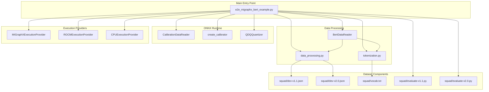
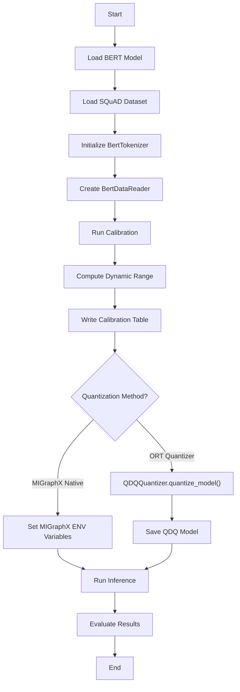
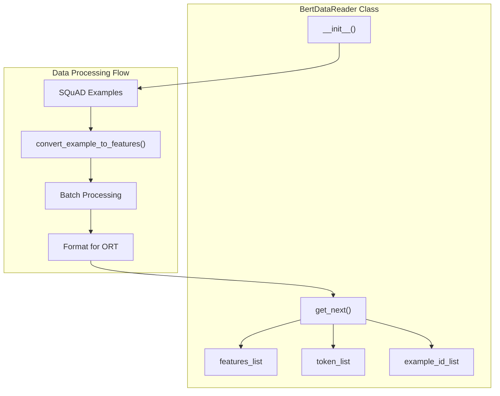
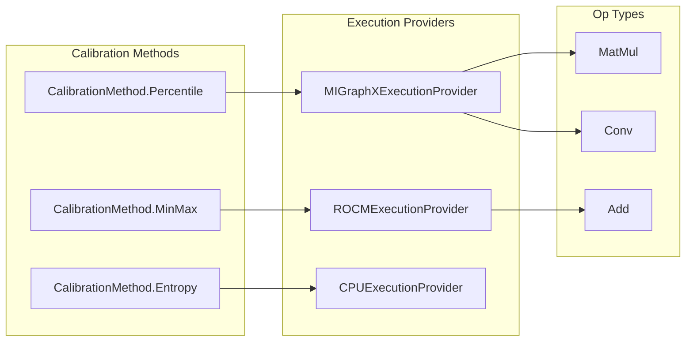
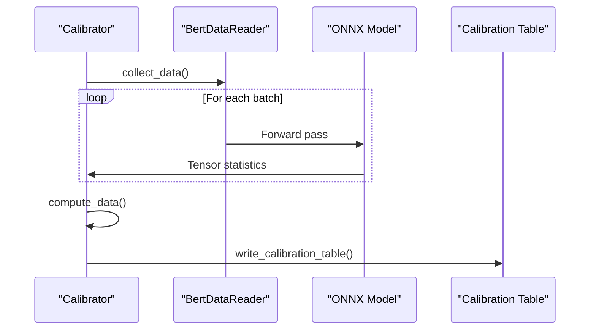
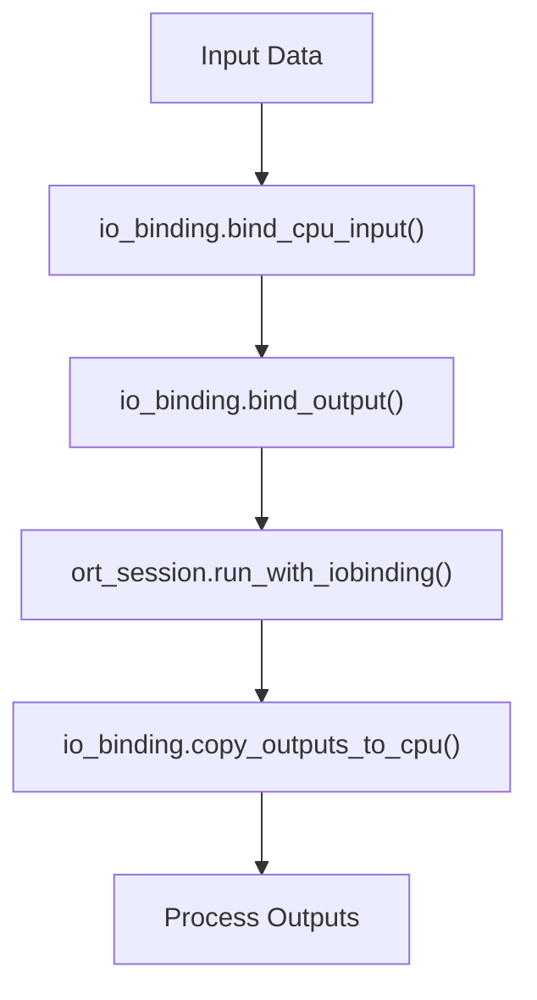
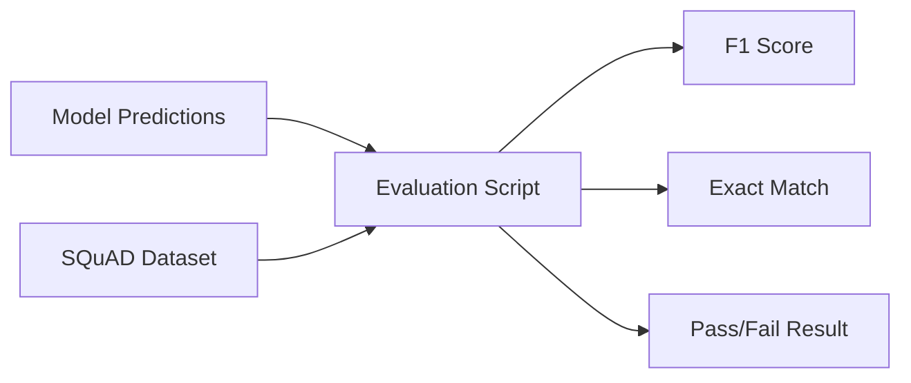

<!-- source: DeepWiki mcp.deepwiki.com · repo microsoft/onnxruntime-inference-examples · page 9.1 BERT QDQ Quantization · fetched 2026-10-26 -->

# BERT QDQ Quantization

<details>
<summary>Relevant source files</summary>

The following files were used as context for generating this wiki page:

- [quantization/nlp/bert/migraphx/README.md](quantization/nlp/bert/migraphx/README.md)
- [quantization/nlp/bert/migraphx/data_processing.py](quantization/nlp/bert/migraphx/data_processing.py)
- [quantization/nlp/bert/migraphx/e2e_migraphx_bert_example.py](quantization/nlp/bert/migraphx/e2e_migraphx_bert_example.py)
- [quantization/nlp/bert/migraphx/squad/dev-v1.1.json](quantization/nlp/bert/migraphx/squad/dev-v1.1.json)
- [quantization/nlp/bert/migraphx/squad/dev-v2.0.json](quantization/nlp/bert/migraphx/squad/dev-v2.0.json)
- [quantization/nlp/bert/migraphx/squad/evaluate-v1.1.py](quantization/nlp/bert/migraphx/squad/evaluate-v1.1.py)
- [quantization/nlp/bert/migraphx/squad/evaluate-v2.0.py](quantization/nlp/bert/migraphx/squad/evaluate-v2.0.py)
- [quantization/nlp/bert/migraphx/squad/vocab.txt](quantization/nlp/bert/migraphx/squad/vocab.txt)
- [quantization/nlp/bert/migraphx/tokenization.py](quantization/nlp/bert/migraphx/tokenization.py)

</details>


This document covers the BERT QDQ (Quantize-Dequantize) quantization system for MIGraphX execution provider in ONNX Runtime. The system implements INT8 and FP16 quantization for BERT models using calibration data from the SQuAD dataset to optimize inference performance while maintaining accuracy.

For general ONNX Runtime quantization techniques beyond BERT, see [Quantization](#9). For ResNet50 quantization specifically, see [ResNet50 Quantization](#9.2).

## Overview

The BERT QDQ quantization system performs model quantization through a two-step process: calibration and quantization node insertion. It uses the Stanford Question Answering Dataset (SQuAD) for calibration data generation and supports both ONNX Runtime's built-in quantizer and MIGraphX's native quantization approach.

## System Architecture

### Core Components



Sources: [quantization/nlp/bert/migraphx/e2e_migraphx_bert_example.py:1-632](), [quantization/nlp/bert/migraphx/data_processing.py:1-497](), [quantization/nlp/bert/migraphx/tokenization.py:1-430]()

### Quantization Workflow



Sources: [quantization/nlp/bert/migraphx/e2e_migraphx_bert_example.py:445-632](), [quantization/nlp/bert/migraphx/README.md:1-82]()

## Key Classes and Functions

### BertDataReader

The `BertDataReader` class extends ONNX Runtime's `CalibrationDataReader` to provide BERT-specific data preprocessing for calibration.



Sources: [quantization/nlp/bert/migraphx/e2e_migraphx_bert_example.py:14-146]()

Key methods:
- `__init__()`: Initializes reader with model path, dataset, tokenizer, and sequence parameters [quantization/nlp/bert/migraphx/e2e_migraphx_bert_example.py:15-42]()
- `get_next()`: Returns next batch of calibration data, handling feature conversion and batching [quantization/nlp/bert/migraphx/e2e_migraphx_bert_example.py:43-146]()

### Data Processing Functions

The `data_processing.py` module provides utilities for converting SQuAD examples to BERT features:

| Function | Purpose | Input | Output |
|----------|---------|-------|--------|
| `read_squad_json()` | Parse SQuAD JSON files | JSON file path | List of examples |
| `convert_example_to_features()` | Convert examples to BERT features | Doc tokens, question, tokenizer | List of features |
| `get_predictions()` | Extract predictions from model output | Features, logits | Prediction text |

Sources: [quantization/nlp/bert/migraphx/data_processing.py:186-209](), [quantization/nlp/bert/migraphx/data_processing.py:86-184](), [quantization/nlp/bert/migraphx/data_processing.py:333-497]()

## Calibration Process

### Calibrator Configuration

The system supports multiple calibration methods through ONNX Runtime's calibration framework:



Sources: [quantization/nlp/bert/migraphx/e2e_migraphx_bert_example.py:533-534](), [quantization/nlp/bert/migraphx/README.md:66-67]()

### Dynamic Range Computation

The calibration process computes dynamic ranges for floating-point tensors:



Sources: [quantization/nlp/bert/migraphx/e2e_migraphx_bert_example.py:545-558]()

## Quantization Methods

### ONNX Runtime QDQ Quantizer

When using `--ort_quant` flag, the system employs ONNX Runtime's built-in QDQ quantizer:

Key configuration parameters:
- `per_channel=True`: Enables per-channel quantization for MatMul weights
- `QuantType.QInt8`: Uses 8-bit integer quantization
- `ActivationSymmetric=True`: Symmetric activation quantization
- `QDQOpTypePerChannelSupportToAxis={'MatMul': 1}`: Per-channel support for MatMul on axis 1

Sources: [quantization/nlp/bert/migraphx/e2e_migraphx_bert_example.py:568-582]()

### MIGraphX Native Quantization

When using MIGraphX's native quantization, the system sets environment variables:

| Environment Variable | Purpose | Value |
|---------------------|---------|-------|
| `ORT_MIGRAPHX_INT8_ENABLE` | Enable INT8 quantization | "1" |
| `ORT_MIGRAPHX_FP16_ENABLE` | Enable FP16 quantization | "1" |
| `ORT_MIGRAPHX_INT8_CALIBRATION_TABLE_NAME` | Calibration table file | "calibration.flatbuffers" |

Sources: [quantization/nlp/bert/migraphx/e2e_migraphx_bert_example.py:588-601]()

## Inference and Evaluation

### Model Inference

The inference process uses IO binding for optimal performance:



Sources: [quantization/nlp/bert/migraphx/e2e_migraphx_bert_example.py:218-256]()

### Input Format Compatibility

The system supports multiple BERT model versions:

| Version | Input Names | 
|---------|-------------|
| 1.1 | `input_ids`, `input_mask`, `segment_ids` |
| 2.0 | `input_ids`, `attention_mask`, `token_type_ids` |
| 2.1 | `input_ids`, `attention_mask`, `token_type_ids` |

Sources: [quantization/nlp/bert/migraphx/e2e_migraphx_bert_example.py:220-232]()

### Evaluation Metrics

The system uses SQuAD evaluation scripts to compute accuracy metrics:



Sources: [quantization/nlp/bert/migraphx/squad/evaluate-v1.1.py:79-103](), [quantization/nlp/bert/migraphx/squad/evaluate-v2.0.py:257-295]()

## Configuration Parameters

### Command Line Arguments

| Parameter | Default | Description |
|-----------|---------|-------------|
| `--fp16` | False | Enable FP16 quantization |
| `--int8` | False | Enable INT8 quantization |
| `--ep` | "MIGraphX" | Execution provider |
| `--model` | "./model.onnx" | ONNX model path |
| `--seq_len` | 384 | Sequence length |
| `--batch` | 1 | Batch size |
| `--cal_num` | 100 | Calibration samples |

Sources: [quantization/nlp/bert/migraphx/e2e_migraphx_bert_example.py:281-431]()

### Sequence Length and Doc Stride Recommendations

The system provides guidance for optimal performance:

- Sequence length 384 → Doc stride 128
- Sequence length 128 → Doc stride 32

Sources: [quantization/nlp/bert/migraphx/README.md:61-62]()

## Optimization Features

### Add Node Filtering

The system implements TensorRT-style optimizations by excluding Add nodes not followed by ReduceMean:

```python
nodes_to_exclude = get_op_nodes_not_followed_by_specific_op(model, "Add", "ReduceMean")
```

Sources: [quantization/nlp/bert/migraphx/e2e_migraphx_bert_example.py:567](), [quantization/nlp/bert/migraphx/e2e_migraphx_bert_example.py:259-279]()

### Model Save/Load Optimization

The system supports compiled model caching through environment variables:

- `ORT_MIGRAPHX_SAVE_COMPILED_MODEL`
- `ORT_MIGRAPHX_LOAD_COMPILED_MODEL`
- `ORT_MIGRAPHX_SAVE_COMPILE_PATH`
- `ORT_MIGRAPHX_LOAD_COMPILE_PATH`

Sources: [quantization/nlp/bert/migraphx/e2e_migraphx_bert_example.py:602-608]()

---

