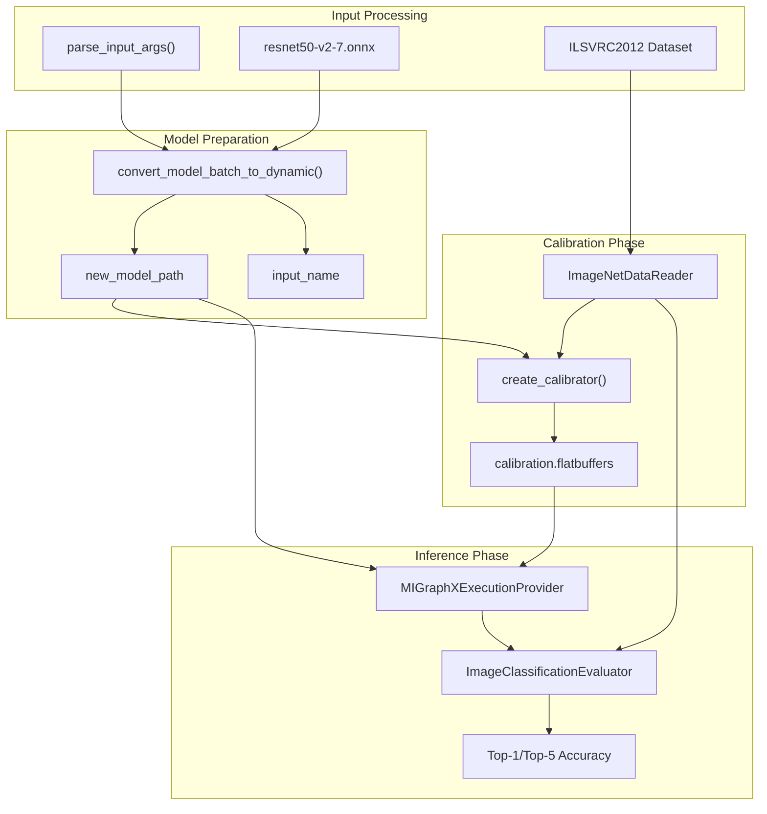
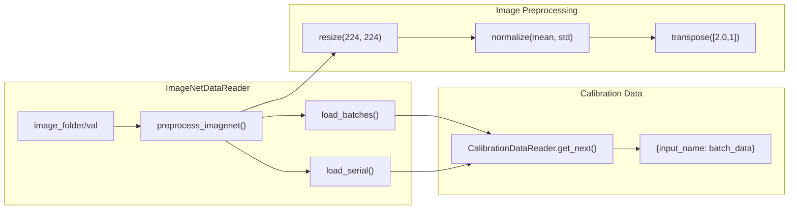
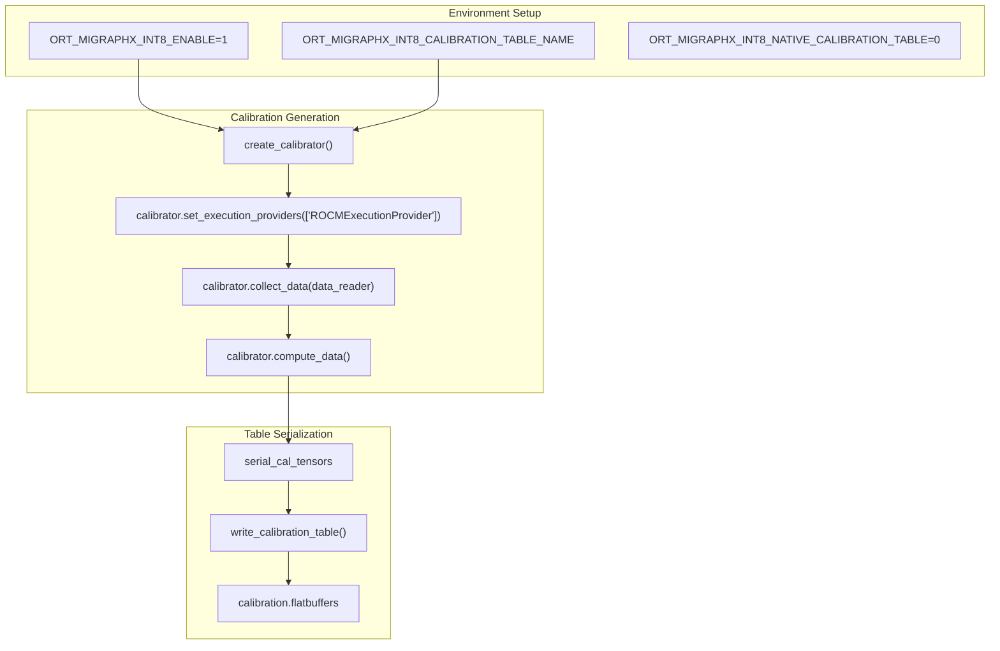

<!-- source: DeepWiki mcp.deepwiki.com · repo microsoft/onnxruntime-inference-examples · page 9.2 ResNet50 Quantization · fetched 2026-10-26 -->

# ResNet50 Quantization

<details>
<summary>Relevant source files</summary>

The following files were used as context for generating this wiki page:

- [quantization/image_classification/migraphx/resnet50/e2e_migraphx_resnet_example.py](quantization/image_classification/migraphx/resnet50/e2e_migraphx_resnet_example.py)

</details>


This document covers the ResNet50 image classification quantization example using the MIGraphX Execution Provider. The example demonstrates INT8 and FP16 quantization workflows for improving inference performance while maintaining model accuracy on the ILSVRC2012 ImageNet dataset.

For BERT model quantization examples, see [BERT QDQ Quantization](#9.1). For general quantization concepts across other frameworks, see [Quantization](#9).

## Purpose and Scope

The ResNet50 quantization example provides a complete end-to-end workflow for:
- INT8 quantization with calibration table generation
- FP16 quantization for mixed precision inference  
- Model accuracy evaluation using ImageNet validation dataset
- Integration with AMD's MIGraphX Execution Provider for optimized inference

## System Architecture



Sources: [quantization/image_classification/migraphx/resnet50/e2e_migraphx_resnet_example.py:346-441]()

## Core Components

### Command Line Interface

The system supports multiple quantization modes through command line arguments:

| Argument | Type | Default | Purpose |
|----------|------|---------|---------|
| `--fp16` | flag | False | Enable FP16 quantization |
| `--fp32` | flag | False | Disable quantization (baseline) |
| `--image_dir` | string | "./ILSVRC2012" | ImageNet dataset path |
| `--batch` | int | 20 | Inference batch size |
| `--cal_size` | int | 1000 | Calibration dataset size |

Sources: [quantization/image_classification/migraphx/resnet50/e2e_migraphx_resnet_example.py:13-51]()

### Data Processing Pipeline



The `ImageNetDataReader` class extends ONNX Runtime's `CalibrationDataReader` interface and implements ImageNet-specific preprocessing:

- Image resizing to 224x224 pixels using Lanczos resampling
- RGB conversion for CMYK/RGBA images  
- Channel-wise normalization with ImageNet statistics
- Dynamic batching support for calibration and inference

Sources: [quantization/image_classification/migraphx/resnet50/e2e_migraphx_resnet_example.py:53-216]()

## Quantization Workflow

### INT8 Calibration Process



The calibration process involves:

1. **Calibrator Creation**: Uses `create_calibrator()` with the dynamic model and augmented model path
2. **Data Collection**: Processes calibration dataset through `ImageNetDataReader` 
3. **Range Computation**: Calculates activation ranges for INT8 quantization
4. **Table Generation**: Serializes calibration data to FlatBuffers format

Sources: [quantization/image_classification/migraphx/resnet50/e2e_migraphx_resnet_example.py:391-411]()

### Model Evaluation System

The `ImageClassificationEvaluator` class handles inference and accuracy measurement:

```python
class ImageClassificationEvaluator:
    def __init__(self, model_path, synset_id, data_reader, providers)
    def predict(self)  # Runs inference with ONNX Runtime session
    def evaluate(self, prediction_results)  # Computes top-k accuracy
    def top_k_accuracy(self, truth, prediction, k=1)  # Accuracy calculation
```

Key evaluation features:
- **Session Configuration**: Disables graph optimization for consistent results
- **Batch Inference**: Processes validation dataset in configurable batch sizes  
- **Top-K Accuracy**: Computes both top-1 and top-5 classification accuracy
- **Ground Truth Mapping**: Uses ILSVRC2012 synset mappings for label validation

Sources: [quantization/image_classification/migraphx/resnet50/e2e_migraphx_resnet_example.py:254-309]()

## MIGraphX Integration

### Execution Provider Configuration

The example demonstrates MIGraphX EP configuration for different precision modes:

| Mode | Environment Variables | Purpose |
|------|----------------------|---------|
| INT8 | `ORT_MIGRAPHX_INT8_ENABLE=1` | Enable INT8 quantization |
| FP16 | `ORT_MIGRAPHX_FP16_ENABLE=1` | Enable mixed precision |
| FP32 | Both flags disabled | Baseline floating point |

### Dynamic Batch Conversion

The `convert_model_batch_to_dynamic()` function modifies the ONNX model to support variable batch sizes:

- Identifies model inputs excluding initializers
- Sets first dimension parameter to 'N' for dynamic batching
- Runs shape inference to update the model graph
- Saves modified model with "_dynamic.onnx" suffix

Sources: [quantization/image_classification/migraphx/resnet50/e2e_migraphx_resnet_example.py:311-327]()

## Dataset Requirements

The example requires specific ILSVRC2012 ImageNet dataset structure:

```
ILSVRC2012/
├── val/                    # Validation images (JPEG format)
├── devkit/
│   └── data/
│       ├── meta.mat        # ImageNet metadata
│       └── ILSVRC2012_validation_ground_truth.txt
└── synset_words.txt        # Class labels mapping
```

The dataset preparation involves:
- Validation image extraction to `val/` directory
- Development kit extraction for ground truth labels
- Synset words file for class name mapping

Sources: [quantization/image_classification/migraphx/resnet50/e2e_migraphx_resnet_example.py:347-361]()