# Page: ONNX Runtime Inference Examples

# ONNX Runtime Inference Examples

<details>
<summary>Relevant source files</summary>

The following files were used as context for generating this wiki page:

- [.config/tsaoptions.json](.config/tsaoptions.json)
- [.pipelines/OneBranch.Official.yml](.pipelines/OneBranch.Official.yml)
- [.pipelines/OneBranch.PullRequest.yml](.pipelines/OneBranch.PullRequest.yml)
- [c_cxx/CMakeLists.txt](c_cxx/CMakeLists.txt)
- [c_cxx/squeezenet/main.cpp](c_cxx/squeezenet/main.cpp)
- [c_sharp/image_classification/image_classification.csproj](c_sharp/image_classification/image_classification.csproj)
- [mobile/README.md](mobile/README.md)

</details>


This document provides an overview of the ONNX Runtime inference examples repository, which demonstrates how to integrate and use ONNX Runtime across multiple platforms, programming languages, and machine learning scenarios. The repository serves as a comprehensive collection of practical examples for developers implementing ONNX Runtime in production applications.

For platform-specific implementation details, see [Mobile Examples](#2), [C/C++ Examples](#3), [C# Examples](#4), [Python Examples](#5), and [JavaScript Examples](#6). For execution provider specifics, see [Execution Providers](#7). For build system documentation, see [CI/CD & Build Systems](#8).

## Repository Architecture

The repository is organized into platform-specific directories, each containing examples that demonstrate ONNX Runtime integration patterns for that platform. The structure supports both mobile and desktop/server deployment scenarios with comprehensive CI/CD automation.

```mermaid
graph TB
    subgraph "Repository Structure"
        mobile["mobile/"]
        c_cxx["c_cxx/"]
        c_sharp["c_sharp/"]
        python["python/"]
        js["js/"]
        pipelines[".pipelines/"]
        ci_build["ci_build/"]
    end
    
    subgraph "Mobile Platform Examples"
        ios_basic["mobile/examples/basic_usage/ios"]
        ios_speech["mobile/examples/speech_recognition/ios"]
        android_imgclass["mobile/examples/image_classification/android"]
        android_objdet["mobile/examples/object_detection/android"]
        react_native["mobile/examples/React_Native/"]
        xamarin["mobile/examples/Xamarin/"]
        phi3_mobile["mobile/examples/phi-3/android"]
    end
    
    subgraph "Desktop Platform Examples"
        squeezenet_cpp["c_cxx/squeezenet/main.cpp"]
        style_transfer["c_cxx/fns_candy_style_transfer/"]
        csharp_imgclass["c_sharp/image_classification/"]
        openvino_python["python/OpenVINO_EP/"]
        js_web["js/"]
    end
    
    subgraph "Build System"
        cmake["c_cxx/CMakeLists.txt"]
        onebranch_official[".pipelines/OneBranch.Official.yml"]
        onebranch_pr[".pipelines/OneBranch.PullRequest.yml"]
        mobile_pipeline[".pipelines/mobile-examples-pipeline.yml"]
    end
    
    mobile --> ios_basic
    mobile --> ios_speech
    mobile --> android_imgclass
    mobile --> android_objdet
    mobile --> react_native
    mobile --> xamarin
    mobile --> phi3_mobile
    
    c_cxx --> squeezenet_cpp
    c_cxx --> style_transfer
    c_sharp --> csharp_imgclass
    python --> openvino_python
    
    pipelines --> onebranch_official
    pipelines --> onebranch_pr
    pipelines --> mobile_pipeline
    c_cxx --> cmake
```

Sources: [mobile/README.md:25-90](), [c_cxx/CMakeLists.txt:1-101](), [.pipelines/OneBranch.Official.yml:1-161]()

## Platform and Language Support

The repository demonstrates ONNX Runtime integration across major platforms and programming languages, with each combination targeting specific deployment scenarios.

| Platform | Language | Key Examples | Primary Use Cases |
|----------|----------|--------------|-------------------|
| iOS | Swift/Objective-C++ | `basic_usage`, `speech_recognition`, `object_detection` | Mobile inference, camera-based AI |
| Android | Java/Kotlin | `image_classification`, `object_detection`, `phi-3` | Mobile AI applications |
| Windows/Linux | C/C++ | `squeezenet`, `fns_candy_style_transfer` | High-performance native inference |
| Cross-platform | C#/.NET | `image_classification`, OpenVINO examples | Enterprise applications |
| Cross-platform | Python | OpenVINO integration, LLaMA-2 models | Research, prototyping, server deployment |
| Web/Node.js | JavaScript | Browser examples, WebGPU acceleration | Web applications, edge deployment |
| Cross-platform Mobile | React Native | `ort-rn-basic-usage` | Cross-platform mobile development |
| Cross-platform Mobile | Xamarin | VisionSample | Enterprise mobile applications |

Sources: [mobile/README.md:25-90]()

## ML Tasks and Model Support

The examples demonstrate a wide range of machine learning tasks using various pre-trained models from the ONNX model ecosystem.

### Computer Vision Tasks

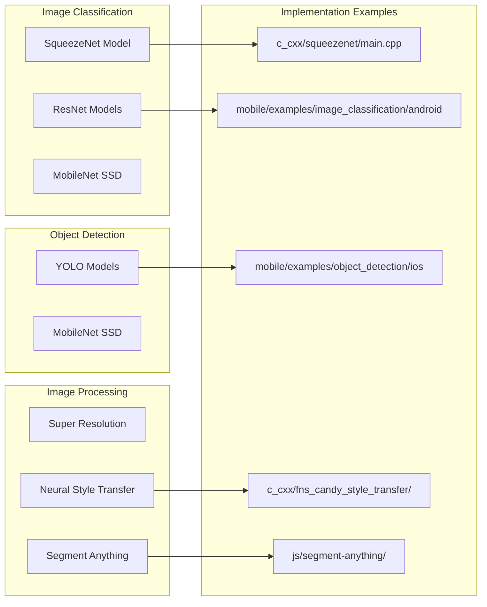

### Generative AI and NLP Tasks

| Task | Model | Platform Examples | Key Features |
|------|-------|------------------|--------------|
| Speech Recognition | Whisper | `mobile/examples/whisper/` | Cloud and local inference |
| Question Answering | BERT, Phi-3 | `mobile/examples/question_answering/`, `mobile/examples/phi-3/` | Mobile-optimized NLP |
| Text Generation | Phi-3, LLaMA-2 | `mobile/examples/phi-3/`, `python/LLaMA-2/` | Generative AI on mobile and server |

Sources: [mobile/README.md:33-89](), [c_cxx/squeezenet/main.cpp:1-160]()

## Execution Provider Integration

The repository demonstrates integration with multiple hardware-accelerated execution providers, showing how to leverage specialized hardware for optimal inference performance.

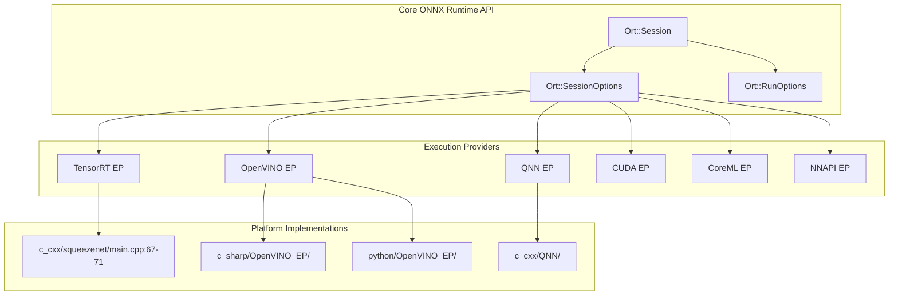

Sources: [c_cxx/squeezenet/main.cpp:40-75](), [c_cxx/CMakeLists.txt:68-77]()

## Build System and CI/CD Architecture

The repository uses a multi-tier build system supporting both official Microsoft OneBranch builds and community-oriented GitHub Actions for comprehensive platform coverage.

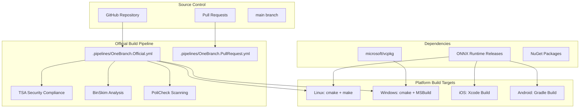

### Build Configuration Details

| Build Target | Configuration File | Key Dependencies | Output |
|--------------|-------------------|------------------|---------|
| C/C++ Examples | `c_cxx/CMakeLists.txt` | vcpkg, ONNX Runtime binaries | Native executables |
| C# Examples | `*.csproj` files | Microsoft.ML.OnnxRuntime NuGet | .NET assemblies |
| iOS Examples | Xcode projects | ONNX Runtime CocoaPods | iOS applications |
| Android Examples | Gradle projects | ONNX Runtime AAR | Android APKs |

Sources: [.pipelines/OneBranch.Official.yml:1-161](), [.pipelines/OneBranch.PullRequest.yml:1-161](), [c_cxx/CMakeLists.txt:1-101](), [c_sharp/image_classification/image_classification.csproj:1-15]()

## Getting Started

### Prerequisites

To work with the examples in this repository, you need platform-specific development tools:

- **iOS Development**: Xcode 12.5+, CocoaPods, valid Apple Developer ID
- **Android Development**: Android Studio, Gradle, Android SDK
- **C/C++ Development**: CMake 3.13+, Visual Studio (Windows) or GCC/Clang (Linux)
- **C# Development**: .NET 6.0+ SDK
- **Python Development**: Python 3.7+, pip
- **JavaScript Development**: Node.js, npm/yarn

### Repository Setup

```bash
git clone https://github.com/microsoft/onnxruntime-inference-examples.git
cd onnxruntime-inference-examples
```

### Example Usage Pattern

Most examples follow a consistent pattern demonstrated in the SqueezeNet C++ example:

1. **Environment Setup**: Initialize `Ort::Env` with logging configuration
2. **Session Configuration**: Create `Ort::SessionOptions` and configure execution providers
3. **Model Loading**: Load ONNX model using `Ort::Session`
4. **Input Preparation**: Create input tensors with `Ort::Value::CreateTensor`
5. **Inference Execution**: Run inference with `session.Run()`
6. **Output Processing**: Extract and process output tensors

Sources: [mobile/README.md:11-24](), [c_cxx/squeezenet/main.cpp:40-160]()

## Cross-Platform Considerations

The repository demonstrates several approaches to cross-platform deployment:

- **Native Integration**: Platform-specific implementations using native APIs (Swift, Java, C++)
- **Cross-Platform Frameworks**: React Native and Xamarin for mobile development
- **Execution Provider Abstraction**: Hardware-specific optimizations through standardized EP interfaces
- **Build System Portability**: CMake for C/C++, cross-platform CI/CD pipelines

Each approach provides different trade-offs between performance, development efficiency, and platform integration depth, allowing developers to choose the most appropriate strategy for their specific requirements.

Sources: [mobile/README.md:1-90](), [c_cxx/CMakeLists.txt:24-40]()

---

# Page: Mobile Examples

# Mobile Examples

<details>
<summary>Relevant source files</summary>

The following files were used as context for generating this wiki page:

- [ci_build/azure_pipelines/mobile-examples-pipeline.yml](ci_build/azure_pipelines/mobile-examples-pipeline.yml)
- [ci_build/azure_pipelines/templates/use-python-step.yml](ci_build/azure_pipelines/templates/use-python-step.yml)
- [ci_build/azure_pipelines/templates/xcode-build-and-test-step.yml](ci_build/azure_pipelines/templates/xcode-build-and-test-step.yml)
- [mobile/README.md](mobile/README.md)
- [mobile/examples/basic_usage/ios/Podfile](mobile/examples/basic_usage/ios/Podfile)
- [mobile/examples/object_detection/ios/ORTObjectDetection/prepare_model.sh](mobile/examples/object_detection/ios/ORTObjectDetection/prepare_model.sh)
- [mobile/examples/object_detection/ios/Podfile](mobile/examples/object_detection/ios/Podfile)
- [mobile/examples/question_answering/ios/ORTQuestionAnswering/Podfile](mobile/examples/question_answering/ios/ORTQuestionAnswering/Podfile)
- [mobile/examples/speech_recognition/ios/Podfile](mobile/examples/speech_recognition/ios/Podfile)
- [mobile/examples/super_resolution/ios/ORTSuperResolution/Podfile](mobile/examples/super_resolution/ios/ORTSuperResolution/Podfile)

</details>


This page provides an overview of ONNX Runtime mobile examples across iOS, Android, Xamarin, and React Native platforms. These examples demonstrate how to integrate and use ONNX Runtime inference capabilities on mobile devices with various machine learning models and scenarios.

For C/C++ examples, see [C/C++ Examples](#3). For JavaScript examples, see [JavaScript Examples](#6).

## Overview

The ONNX Runtime mobile examples showcase practical implementations for running machine learning models on mobile devices. These examples span various application domains including image classification, object detection, speech recognition, and natural language processing.

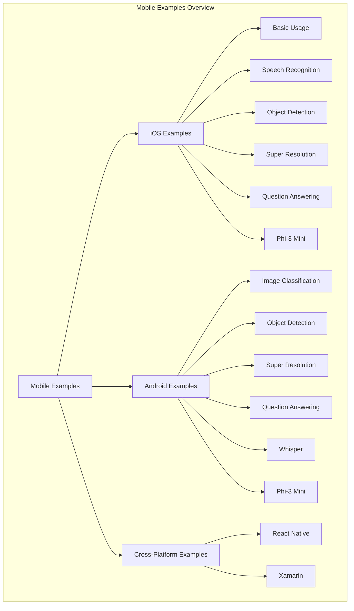

Sources: [mobile/README.md:1-90](), [ci_build/azure_pipelines/mobile-examples-pipeline.yml:1-351]()

## Prerequisites

### General Requirements

- Git for cloning the repository
- Python for model generation and preparation

### iOS Requirements

- Xcode 12.5 or higher
- CocoaPods package manager 
- Valid Apple Developer ID (for device testing)

### Android Requirements

- Android Studio
- JDK 11 or higher
- Android SDK

Sources: [mobile/README.md:5-23]()

## Mobile Architecture

The mobile examples follow a common architecture pattern across platforms while adapting to platform-specific idioms. The following diagram illustrates the general architecture of the mobile examples:

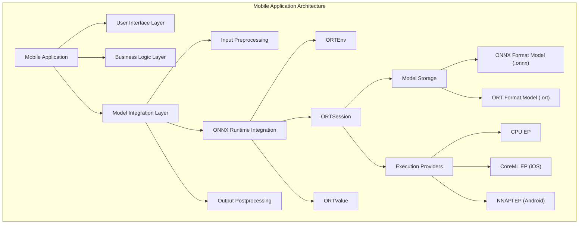

Sources: [mobile/examples/basic_usage/ios/OrtBasicUsage/ObjcOrtBasicUsage.mm:1-126](), [mobile/examples/basic_usage/ios/OrtBasicUsage/SwiftOrtBasicUsage.swift:1-111](), [mobile/examples/basic_usage/ios/Podfile:1-12]()

### Key Components

The ONNX Runtime mobile examples utilize several key components:

1. **ORTEnv**: The environment object that manages the ONNX Runtime global state.
2. **ORTSession**: Represents a loaded model ready for inference.
3. **ORTValue**: Contains tensor data for model inputs and outputs.
4. **Model Files**: ONNX (.onnx) or ORT (.ort) format models.
5. **Execution Providers**: Hardware acceleration backends like CPU, CoreML, or NNAPI.

## Platform-Specific Integration

### iOS Integration

iOS examples integrate ONNX Runtime through CocoaPods, primarily using the `onnxruntime-objc` package. Some advanced examples use `onnxruntime-c` with `onnxruntime-extensions-c`.

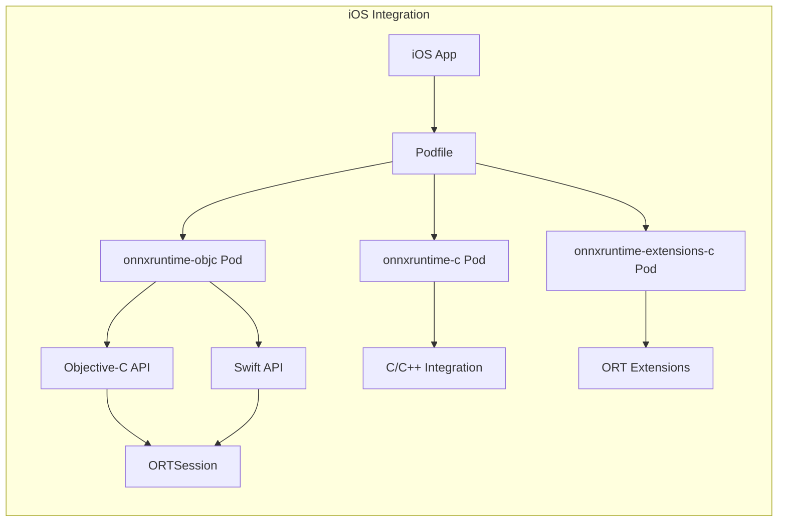

Sources: [mobile/examples/basic_usage/ios/Podfile:1-12](), [mobile/examples/object_detection/ios/Podfile:1-13](), [mobile/examples/speech_recognition/ios/Podfile:1-12](), [mobile/examples/super_resolution/ios/ORTSuperResolution/Podfile:1-22](), [mobile/examples/question_answering/ios/ORTQuestionAnswering/Podfile:1-21]()

### Android Integration

Android examples integrate ONNX Runtime through Gradle dependencies, using the `onnxruntime-android` package.

## Available Examples

### Basic Usage Examples

The basic usage examples demonstrate fundamental ONNX Runtime operations:
- Creating an environment and session
- Loading a model
- Preparing input data
- Running inference
- Processing output results

The iOS basic usage example ([mobile/examples/basic_usage/ios]()) shows both Objective-C and Swift implementations.

Key implementation features include:
- Model loading from both ONNX and ORT formats
- Simple addition operation with two input tensors
- Explicit memory management for tensor data

Sources: [mobile/examples/basic_usage/ios/OrtBasicUsage/ObjcOrtBasicUsage.mm:1-126](), [mobile/examples/basic_usage/ios/OrtBasicUsage/SwiftOrtBasicUsage.swift:1-111]()

### Computer Vision Examples

#### Image Classification (Android)

The Android image classification example demonstrates real-time classification of objects from the device camera feed.

#### Object Detection (iOS and Android)

The object detection examples show how to detect objects in images with bounding boxes:
- iOS implementation: [mobile/examples/object_detection/ios]()
- Android implementation: [mobile/examples/object_detection/android]()

The object detection examples use MobileNet SSD models converted from TensorFlow Lite format to ONNX/ORT format.

Sources: [mobile/examples/object_detection/ios/ORTObjectDetection/prepare_model.sh:1-32]()

#### Super Resolution (iOS and Android)

The super resolution examples demonstrate how to enhance low-resolution images:
- iOS implementation: [mobile/examples/super_resolution/ios]()
- Android implementation: [mobile/examples/super_resolution/android]()

These examples utilize ONNX Runtime Extensions for pre/post-processing operations.

Sources: [mobile/examples/super_resolution/ios/ORTSuperResolution/Podfile:1-22]()

### Speech Recognition Examples

#### Speech Recognition (iOS)

The iOS speech recognition example uses the Wav2Vec2 model to transcribe speech from audio recordings.

The model is converted from PyTorch using the following process:
1. Import the pre-trained Wav2Vec2 model from HuggingFace
2. Convert it to a torchaudio compatible format
3. Export to ONNX format

Sources: [mobile/examples/speech_recognition/model/wav2vec2_gen.py:1-23](), [mobile/examples/speech_recognition/model/requirements.txt:1-6]()

#### Whisper Examples (Android)

Two Android examples demonstrate speech recognition using OpenAI's Whisper model:
- Azure Whisper: Uses Azure cloud services with a custom op
- Local Whisper: Runs the model locally on-device

Sources: [mobile/README.md:72-78]()

### Natural Language Processing Examples

#### Question Answering (iOS and Android)

The question answering examples demonstrate NLP models for answering questions about provided text:
- iOS implementation: [mobile/examples/question_answering/ios]()
- Android implementation: [mobile/examples/question_answering/android]()

Sources: [mobile/examples/question_answering/ios/ORTQuestionAnswering/Podfile:1-21]()

### Large Language Model Examples

#### Phi-3 Mini (Android and iOS)

The Phi-3 Mini examples demonstrate how to use Microsoft's Phi-3 Mini LLM on mobile devices for simple question answering in a chatbot mode.

Sources: [mobile/README.md:85-90]()

### Cross-Platform Examples

#### React Native Example

The React Native example demonstrates basic ONNX Runtime usage in a React Native Expo project.

Sources: [mobile/README.md:79-84]()

#### Xamarin Example

The Xamarin example demonstrates vision-related models from the ONNX Model Zoo using Xamarin.Forms for cross-platform mobile development.

Sources: [mobile/README.md:52-57]()

## CI/CD Pipeline

The mobile examples are built and tested using a dedicated Azure DevOps pipeline defined in [ci_build/azure_pipelines/mobile-examples-pipeline.yml]().

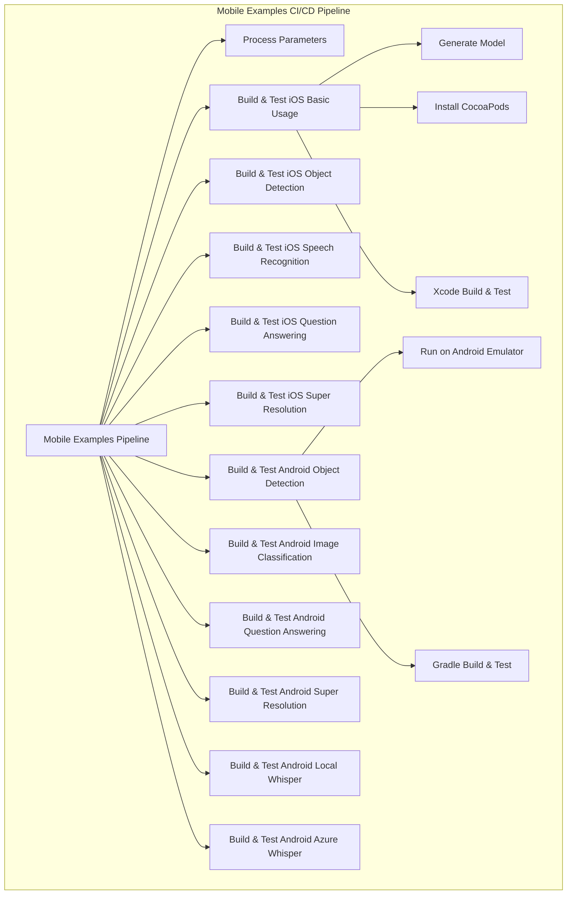

Sources: [ci_build/azure_pipelines/mobile-examples-pipeline.yml:1-351](), [ci_build/azure_pipelines/templates/xcode-build-and-test-step.yml:1-33](), [ci_build/azure_pipelines/templates/use-python-step.yml:1-13]()

The pipeline performs the following key operations:
1. Processes parameters for ORT version specification
2. Builds and tests each example on the appropriate platform
3. For iOS examples:
   - Generates models as needed
   - Installs CocoaPods dependencies
   - Builds and runs tests using Xcode
4. For Android examples:
   - Generates models as needed
   - Builds and runs tests using Gradle
   - Executes tests on Android emulators

## Conclusion

The ONNX Runtime mobile examples provide comprehensive reference implementations for integrating machine learning capabilities into mobile applications across different platforms. They cover a wide range of use cases from basic ONNX Runtime usage to complex AI scenarios like speech recognition, object detection, and language models.

These examples serve as practical starting points for developers looking to leverage ONNX Runtime in their own mobile applications, demonstrating best practices for model integration, preprocessing, inference, and result handling.

---

# Page: iOS Examples

# iOS Examples

<details>
<summary>Relevant source files</summary>

The following files were used as context for generating this wiki page:

- [README.md](README.md)
- [mobile/examples/basic_usage/ios/OrtBasicUsage.xcodeproj/project.pbxproj](mobile/examples/basic_usage/ios/OrtBasicUsage.xcodeproj/project.pbxproj)
- [mobile/examples/basic_usage/ios/OrtBasicUsage/ObjcOrtBasicUsage.h](mobile/examples/basic_usage/ios/OrtBasicUsage/ObjcOrtBasicUsage.h)
- [mobile/examples/basic_usage/ios/OrtBasicUsage/ObjcOrtBasicUsage.mm](mobile/examples/basic_usage/ios/OrtBasicUsage/ObjcOrtBasicUsage.mm)
- [mobile/examples/basic_usage/ios/OrtBasicUsage/SwiftOrtBasicUsage.swift](mobile/examples/basic_usage/ios/OrtBasicUsage/SwiftOrtBasicUsage.swift)
- [mobile/examples/basic_usage/model/requirements.txt](mobile/examples/basic_usage/model/requirements.txt)
- [mobile/examples/image_classification/android/prepare_models.requirements.txt](mobile/examples/image_classification/android/prepare_models.requirements.txt)
- [mobile/examples/object_detection/ios/ORTObjectDetection.xcodeproj/project.pbxproj](mobile/examples/object_detection/ios/ORTObjectDetection.xcodeproj/project.pbxproj)
- [mobile/examples/object_detection/ios/ORTObjectDetection/ModelHandler.swift](mobile/examples/object_detection/ios/ORTObjectDetection/ModelHandler.swift)
- [mobile/examples/object_detection/ios/ORTObjectDetection/Storyboards/Main.storyboard](mobile/examples/object_detection/ios/ORTObjectDetection/Storyboards/Main.storyboard)
- [mobile/examples/object_detection/ios/ORTObjectDetection/ViewController.swift](mobile/examples/object_detection/ios/ORTObjectDetection/ViewController.swift)
- [mobile/examples/object_detection/ios/ORTObjectDetection/prepare_model.requirements.txt](mobile/examples/object_detection/ios/ORTObjectDetection/prepare_model.requirements.txt)
- [mobile/examples/object_detection/ios/ORTObjectDetectionTests/ORTObjectDetectionTests.swift](mobile/examples/object_detection/ios/ORTObjectDetectionTests/ORTObjectDetectionTests.swift)
- [mobile/examples/object_detection/ios/README.md](mobile/examples/object_detection/ios/README.md)
- [mobile/examples/phi-3/ios/LocalLLM/LocalLLM.xcodeproj/project.pbxproj](mobile/examples/phi-3/ios/LocalLLM/LocalLLM.xcodeproj/project.pbxproj)
- [mobile/examples/phi-3/ios/LocalLLM/LocalLLM/Assets.xcassets/AccentColor.colorset/Contents.json](mobile/examples/phi-3/ios/LocalLLM/LocalLLM/Assets.xcassets/AccentColor.colorset/Contents.json)
- [mobile/examples/phi-3/ios/LocalLLM/LocalLLM/Assets.xcassets/AppIcon.appiconset/Contents.json](mobile/examples/phi-3/ios/LocalLLM/LocalLLM/Assets.xcassets/AppIcon.appiconset/Contents.json)
- [mobile/examples/phi-3/ios/LocalLLM/LocalLLM/Assets.xcassets/Contents.json](mobile/examples/phi-3/ios/LocalLLM/LocalLLM/Assets.xcassets/Contents.json)
- [mobile/examples/phi-3/ios/LocalLLM/LocalLLM/ContentView.swift](mobile/examples/phi-3/ios/LocalLLM/LocalLLM/ContentView.swift)
- [mobile/examples/phi-3/ios/LocalLLM/LocalLLM/GenAIGenerator.h](mobile/examples/phi-3/ios/LocalLLM/LocalLLM/GenAIGenerator.h)
- [mobile/examples/phi-3/ios/LocalLLM/LocalLLM/GenAIGenerator.mm](mobile/examples/phi-3/ios/LocalLLM/LocalLLM/GenAIGenerator.mm)
- [mobile/examples/phi-3/ios/LocalLLM/LocalLLM/LocalLLM-Bridging-Header.h](mobile/examples/phi-3/ios/LocalLLM/LocalLLM/LocalLLM-Bridging-Header.h)
- [mobile/examples/phi-3/ios/LocalLLM/LocalLLM/LocalLLMApp.swift](mobile/examples/phi-3/ios/LocalLLM/LocalLLM/LocalLLMApp.swift)
- [mobile/examples/phi-3/ios/LocalLLM/LocalLLM/Preview Content/Preview Assets.xcassets/Contents.json](mobile/examples/phi-3/ios/LocalLLM/LocalLLM/Preview Content/Preview Assets.xcassets/Contents.json)
- [mobile/examples/phi-3/ios/LocalLLM/LocalLLM/README.md](mobile/examples/phi-3/ios/LocalLLM/LocalLLM/README.md)
- [mobile/examples/phi-3/ios/LocalLLM/LocalLLM/SharedTokenUpdater.swift](mobile/examples/phi-3/ios/LocalLLM/LocalLLM/SharedTokenUpdater.swift)
- [mobile/examples/phi-3/ios/LocalLLM/LocalLLM/Simulator Screenshot - iPhone 16.png](mobile/examples/phi-3/ios/LocalLLM/LocalLLM/Simulator Screenshot - iPhone 16.png)
- [mobile/examples/speech_recognition/ios/SpeechRecognition.xcodeproj/project.pbxproj](mobile/examples/speech_recognition/ios/SpeechRecognition.xcodeproj/project.pbxproj)
- [mobile/examples/speech_recognition/ios/SpeechRecognition/SpeechRecognizer.swift](mobile/examples/speech_recognition/ios/SpeechRecognition/SpeechRecognizer.swift)
- [mobile/examples/speech_recognition/model/requirements.txt](mobile/examples/speech_recognition/model/requirements.txt)
- [mobile/examples/speech_recognition/model/wav2vec2_gen.py](mobile/examples/speech_recognition/model/wav2vec2_gen.py)

</details>


This document provides a detailed overview of the iOS examples in the ONNX Runtime Inference Examples repository. These examples demonstrate how to integrate and use ONNX Runtime for model inference on iOS devices using Swift and Objective-C. For information about other mobile platforms, see the [Mobile Examples](#2) page.

## Architecture Overview

The iOS examples follow a common architecture for integrating ONNX Runtime:

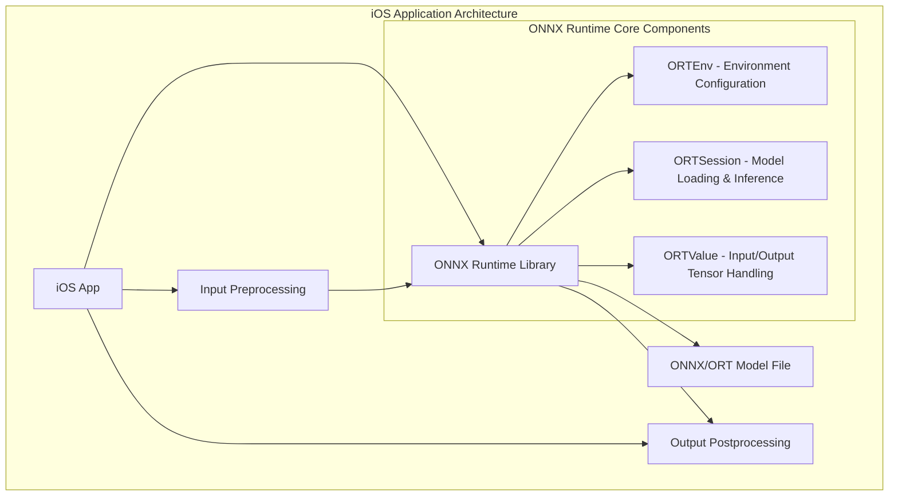

Sources: [mobile/examples/basic_usage/ios/OrtBasicUsage/ObjcOrtBasicUsage.mm:69-103](), [mobile/examples/object_detection/ios/ORTObjectDetection/ModelHandler.swift:92-106]()

## Available Examples

The repository contains several iOS examples demonstrating different capabilities:

| Example | Description | Key Features |
|---------|-------------|--------------|
| Basic Usage | Simple addition model | Demonstrates core ORT API usage in both Swift and Objective-C |
| Object Detection | Camera-based object detection | Real-time MobileNet SSD model with camera integration |
| Speech Recognition | Audio transcription | Wav2Vec2 model for speech-to-text conversion |
| Phi-3 Mini | Local language model | Running a quantized LLM directly on device |

Sources: [README.md:15-18]()

## Basic Usage Example

The basic usage example demonstrates the minimum code required to run inference with ONNX Runtime on iOS.

### Implementation

The example includes both Objective-C and Swift implementations of the same functionality:

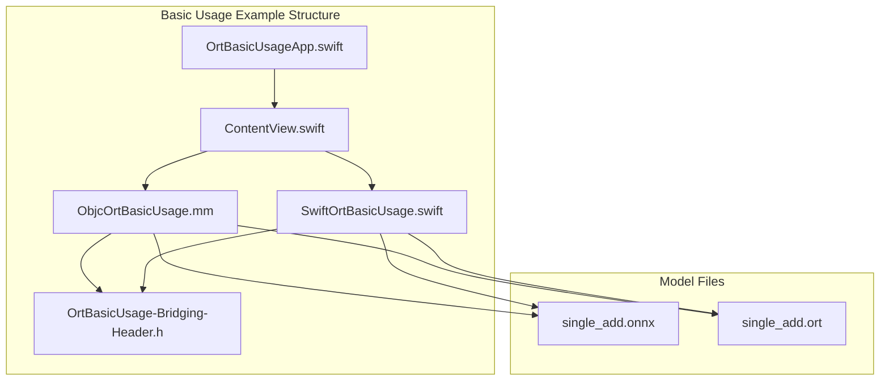

The example uses a simple model that adds two floating-point numbers:
- Inputs: Two float tensors named "A" and "B" with shape [1]
- Output: One float tensor named "C" with shape [1]

Sources: [mobile/examples/basic_usage/ios/OrtBasicUsage/ObjcOrtBasicUsage.mm:56-121](), [mobile/examples/basic_usage/ios/OrtBasicUsage/SwiftOrtBasicUsage.swift:26-110]()

### Key Code Components

The core steps for using ONNX Runtime are:

1. Create an environment:
   ```swift
   let ortEnv = try ORTEnv(loggingLevel: ORTLoggingLevel.warning)
   ```

2. Create input tensors:
   ```swift
   let aInputValue = try ORTValue(
     tensorData: NSMutableData(data: aData),
     elementType: ORTTensorElementDataType.float,
     shape: [1])
   ```

3. Create a session with the model:
   ```swift
   let session = try ORTSession(env: ortEnv, modelPath: modelPath, sessionOptions: nil)
   ```

4. Run inference:
   ```swift
   let outputs = try session.run(
     withInputs: ["A": aInputValue, "B": bInputValue],
     outputNames: ["C"],
     runOptions: nil)
   ```

5. Process outputs:
   ```swift
   let cData = try outputs["C"]?.tensorData()
   ```

Sources: [mobile/examples/basic_usage/ios/OrtBasicUsage/ObjcOrtBasicUsage.mm:69-119](), [mobile/examples/basic_usage/ios/OrtBasicUsage/SwiftOrtBasicUsage.swift:35-109]()

## Object Detection Example

The object detection example demonstrates how to use ONNX Runtime for real-time object detection with device camera.

### Architecture

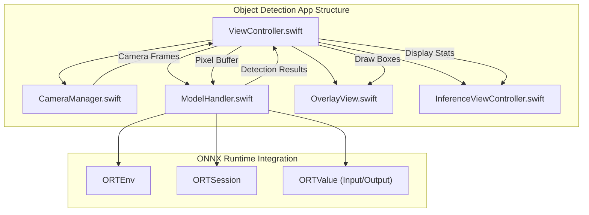

Sources: [mobile/examples/object_detection/ios/ORTObjectDetection/ViewController.swift:20-167](), [mobile/examples/object_detection/ios/ORTObjectDetection/ModelHandler.swift:46-207]()

### Implementation Details

The ModelHandler class contains the core ONNX Runtime integration:

1. **Initialization**:
   - Creates an ORTEnv with verbose logging
   - Configures threading options
   - Loads the SSD MobileNet model and labels

2. **Inference Pipeline**:
   - Preprocesses camera frames to the model's required input format (300x300 RGB)
   - Creates ORTValue tensors from the processed image data
   - Runs inference with the model
   - Processes outputs to extract bounding boxes, classes, and scores
   - Formats results for display

3. **UI Integration**:
   - The ViewController coordinates between camera, model, and UI
   - Detected objects are drawn on the OverlayView
   - Performance statistics are shown in InferenceViewController

Sources: [mobile/examples/object_detection/ios/ORTObjectDetection/ModelHandler.swift:80-207](), [mobile/examples/object_detection/ios/ORTObjectDetection/ViewController.swift:135-195]()

## Speech Recognition Example

The speech recognition example demonstrates how to use ONNX Runtime to transcribe speech from audio input.

### Architecture

The speech recognition example uses a Wav2Vec2 model to convert audio to text:

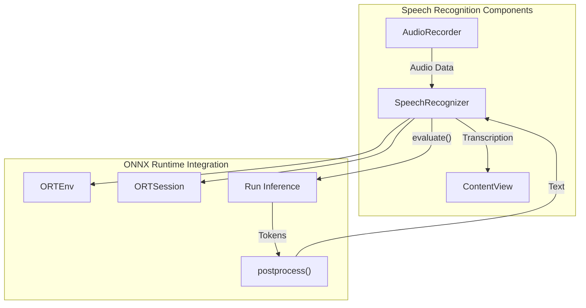

Sources: [mobile/examples/speech_recognition/ios/SpeechRecognition/SpeechRecognizer.swift:14-97]()

### Implementation Details

The SpeechRecognizer class handles the core functionality:

1. **Initialization**:
   - Creates an ORTEnv with warning-level logging
   - Loads the Wav2Vec2 model from the app bundle
   - Initializes the ORTSession

2. **Inference Process**:
   - Takes audio data as input
   - Creates an ORTValue tensor from the float audio data
   - Runs the model with appropriate input and output names
   - Processes the output using a token-to-character mapping
   - Returns the transcribed text

3. **Postprocessing**:
   - Finds the highest probability token for each position
   - Maps token indices to characters using a predefined label set
   - Removes duplicate consecutive tokens
   - Converts special tokens (like '|' for space)

Sources: [mobile/examples/speech_recognition/ios/SpeechRecognition/SpeechRecognizer.swift:22-96]()

## Phi-3 Mini Example

The Phi-3 Mini example demonstrates running a quantized large language model (LLM) directly on iOS devices.

### Architecture

This example uses ONNX Runtime and ONNX Runtime GenAI extensions:

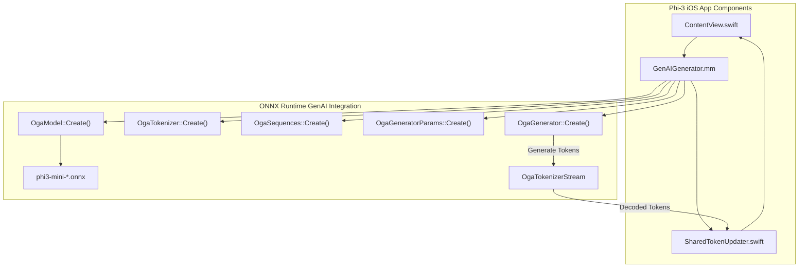

Sources: [mobile/examples/phi-3/ios/LocalLLM/LocalLLM/GenAIGenerator.mm:33-139](), [mobile/examples/phi-3/ios/LocalLLM/LocalLLM/ContentView.swift:13-157]()

### Implementation Details

The example uses a mix of Swift for UI and Objective-C++/C++ for ONNX Runtime GenAI integration:

1. **Model Loading**:
   - Loads the quantized Phi-3 Mini model (INT4 quantization)
   - Creates tokenizer and generator components

2. **Text Generation Process**:
   - Takes a user prompt as input
   - Formats it with appropriate chat markers: `<|user|>\n{input}<|end|>\n<|assistant|>`
   - Tokenizes the input using the model's tokenizer
   - Generates tokens one-by-one in a streaming fashion
   - Decodes each token and sends it to the UI via SharedTokenUpdater

3. **User Interface**:
   - Displays a chat interface with user and assistant messages
   - Shows generation statistics (tokens/second)
   - Streams tokens as they're generated for a responsive experience

Sources: [mobile/examples/phi-3/ios/LocalLLM/LocalLLM/GenAIGenerator.mm:33-140](), [mobile/examples/phi-3/ios/LocalLLM/LocalLLM/ContentView.swift:13-157](), [mobile/examples/phi-3/ios/LocalLLM/LocalLLM/SharedTokenUpdater.swift:7-23]()

## Integration Methods

There are two primary approaches for integrating ONNX Runtime in iOS applications:

### Objective-C API

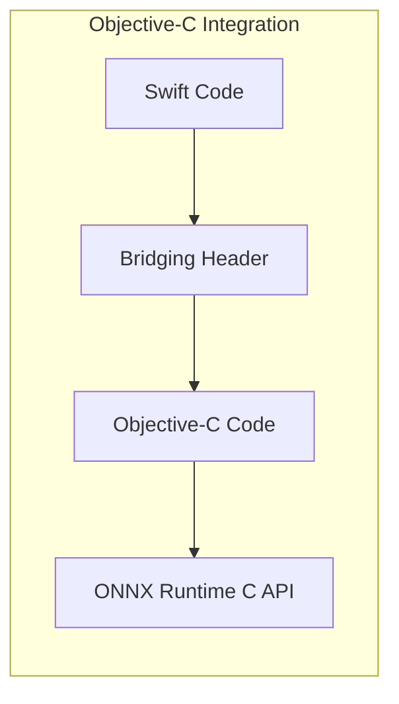

Sources: [mobile/examples/basic_usage/ios/OrtBasicUsage/ObjcOrtBasicUsage.mm:56-121]()

### Swift with Direct API Access

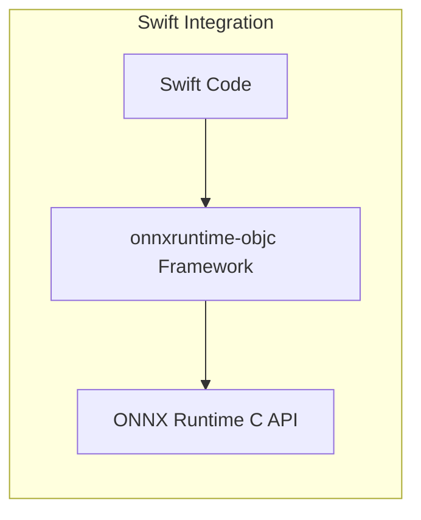

Sources: [mobile/examples/basic_usage/ios/OrtBasicUsage/SwiftOrtBasicUsage.swift:26-110]()

## Best Practices

Based on the examples, here are some best practices for using ONNX Runtime on iOS:

1. **Model Format**:
   - Use the ORT format for better performance on mobile devices
   - Both formats are supported: `.onnx` (standard) and `.ort` (optimized)

2. **Memory Management**:
   - Use appropriate data containers (NSData/Data) for tensor data
   - Be careful with memory lifetimes, especially for output tensors

3. **Error Handling**:
   - Use Swift's try/catch or Objective-C's NSError pattern consistently
   - Check return values from all ONNX Runtime API calls

4. **Performance Optimization**:
   - Control thread count based on device capabilities
   - Measure and optimize preprocessing/postprocessing steps
   - Consider quantized models for large networks (like Phi-3 Mini)

5. **UI Integration**:
   - Process inference results on background threads
   - Update UI on the main thread
   - Consider streaming outputs for responsive user experience (as in Phi-3 example)

Sources: [mobile/examples/basic_usage/ios/OrtBasicUsage/ObjcOrtBasicUsage.mm:29-54](), [mobile/examples/object_detection/ios/ORTObjectDetection/ModelHandler.swift:80-106](), [mobile/examples/phi-3/ios/LocalLLM/LocalLLM/GenAIGenerator.mm:33-140]()

## Setting Up an iOS Example

To run any of the iOS examples:

1. Clone the repository
2. Navigate to the example directory
3. Run `pod install` to install the ONNX Runtime dependency
4. Open the `.xcworkspace` file in Xcode
5. Some examples require model preparation scripts:
   ```bash
   # For object detection example
   cd mobile/examples/object_detection/ios/ORTObjectDetection
   ./prepare_model.sh
   ```
6. Build and run on a device or simulator

Sources: [mobile/examples/object_detection/ios/README.md:19-39]()

---

# Page: Android Examples

# Android Examples

<details>
<summary>Relevant source files</summary>

The following files were used as context for generating this wiki page:

- [mobile/examples/phi-3/android/README.md](mobile/examples/phi-3/android/README.md)
- [mobile/examples/phi-3/android/app/build.gradle.kts](mobile/examples/phi-3/android/app/build.gradle.kts)
- [mobile/examples/phi-3/android/app/libs/onnxruntime-genai-android-0.8.1.aar](mobile/examples/phi-3/android/app/libs/onnxruntime-genai-android-0.8.1.aar)
- [mobile/examples/phi-3/android/app/src/main/java/ai/onnxruntime/genai/demo/MainActivity.java](mobile/examples/phi-3/android/app/src/main/java/ai/onnxruntime/genai/demo/MainActivity.java)
- [mobile/examples/phi-3/android/gradle/wrapper/gradle-wrapper.jar](mobile/examples/phi-3/android/gradle/wrapper/gradle-wrapper.jar)
- [mobile/examples/phi-3/android/gradle/wrapper/gradle-wrapper.properties](mobile/examples/phi-3/android/gradle/wrapper/gradle-wrapper.properties)
- [mobile/examples/phi-3/android/gradlew](mobile/examples/phi-3/android/gradlew)
- [mobile/examples/phi-3/android/gradlew.bat](mobile/examples/phi-3/android/gradlew.bat)
- [mobile/examples/question_answering/android/prepare_model.requirements.txt](mobile/examples/question_answering/android/prepare_model.requirements.txt)
- [mobile/examples/question_answering/android/prepare_model.sh](mobile/examples/question_answering/android/prepare_model.sh)

</details>


This page documents the Android examples in the ONNX Runtime Inference Examples repository, demonstrating how to integrate and use ONNX Runtime on Android devices. These examples showcase different inference scenarios including question answering, large language models, and basic model inference in React Native applications.

For iOS examples, see [iOS Examples](#2.1). For information about cross-platform mobile frameworks, see [React Native Examples](#2.3) and [Xamarin Examples](#2.4).

## Overview of Android Examples

The repository contains several Android examples that demonstrate different aspects of ONNX Runtime integration:

1. **Question Answering Example** - A Kotlin-based application that uses MobileBERT for answering questions based on provided context.
2. **Phi-3 Mini Example** - A Java-based chatbot application demonstrating integration of the Phi-3 Mini large language model using ONNX Runtime GenAI API.

The examples showcase different ONNX Runtime APIs and integration patterns for Android development.

### Android Examples Architecture

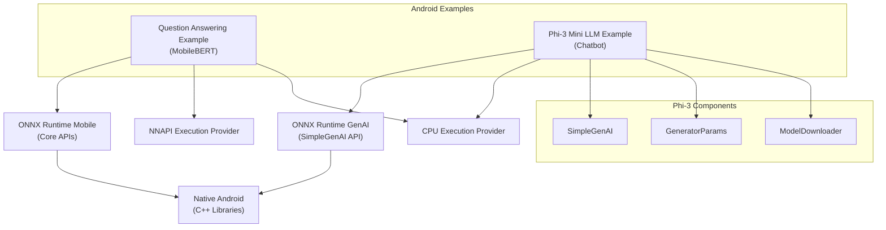

Sources:
- [mobile/examples/phi-3/android/app/src/main/java/ai/onnxruntime/genai/demo/MainActivity.java:27-29]()
- [mobile/examples/phi-3/android/app/build.gradle.kts:54-55]()

## Setting Up Android Examples

### Requirements

| Example | Requirements |
|---------|--------------|
| Question Answering | Android Studio, Android SDK 29+, NDK r22+ |
| Phi-3 Mini | Android Studio Giraffe (2022.3.1+), Android SDK 29+, NDK r22+, 8GB+ device storage |

Sources:
- [mobile/examples/phi-3/android/README.md:37-41]()
- [mobile/examples/phi-3/android/app/build.gradle.kts:12-14]()

### Common Dependencies

For native Android examples, add ONNX Runtime dependencies to your `build.gradle.kts`:

```kotlin
// Core ONNX Runtime for Android
implementation("com.microsoft.onnxruntime:onnxruntime-android:latest.release")

// For Phi-3 and other GenAI models
implementation(files("libs/onnxruntime-genai-android-0.8.1.aar"))
```

The Phi-3 example also requires specific ABI filters:

```kotlin
ndk {
    abiFilters += listOf("arm64-v8a", "x86_64")
}
```

Sources:
- [mobile/examples/phi-3/android/app/build.gradle.kts:54-55]()
- [mobile/examples/phi-3/android/app/build.gradle.kts:18-21]()
- [mobile/examples/question_answering/android/prepare_model.requirements.txt:1-5]()

## Question Answering Example

The Question Answering example demonstrates how to use ONNX Runtime with a MobileBERT model to answer questions based on a provided text context.

### Architecture

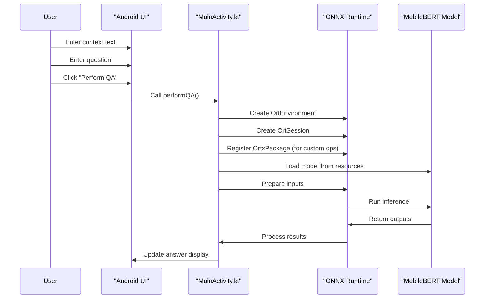

Sources:
- [mobile/examples/question_answering/android/app/src/main/java/ai/onnxruntime/example/question_answering/MainActivity.kt]()
- [mobile/examples/question_answering/android/app/src/main/res/layout/activity_main.xml]()

### Implementation Details

The main components of the Question Answering example include:

1. **MainActivity** - Handles UI interactions and ONNX Runtime initialization
2. **OrtEnvironment and OrtSession** - Core ONNX Runtime components for inference
3. **Execution Provider Selection** - Support for CPU, NNAPI, and XNNPACK

Key code sections:

- **Creating ORT session with execution provider selection:**

```kotlin
private fun createOrtSession(ep: String) {
    // Initialize session options
    val sessionOptions: OrtSession.SessionOptions = OrtSession.SessionOptions()
    
    // Configure execution provider
    if (ep.contains("NNAPI")) {
        sessionOptions.addNnapi()
    } else if (ep.contains("XNNAPCK")) {
        val po = mapOf<String, String>()
        sessionOptions.addXnnpack(po)
    }
    
    // Register custom operators and create session
    sessionOptions.registerCustomOpLibrary(OrtxPackage.getLibraryPath())
    ortSession = ortEnv.createSession(readModel(), sessionOptions)
}
```

- **Performing inference:**

```kotlin
private fun performQA(ortSession: OrtSession) {
    var qaPerformer = QAPerformer()
    var result = qaPerformer.answer(ArticleText.text, readQuestion(), ortEnv, ortSession)
    updateUI(result)
}
```

Sources:
- [mobile/examples/question_answering/android/app/src/main/java/ai/onnxruntime/example/question_answering/MainActivity.kt:78-98]()
- [mobile/examples/question_answering/android/app/src/main/java/ai/onnxruntime/example/question_answering/MainActivity.kt:123-127]()

## Phi-3 Mini Example

The Phi-3 Mini example showcases how to integrate a large language model (LLM) into an Android application using ONNX Runtime's GenAI API.

### Architecture

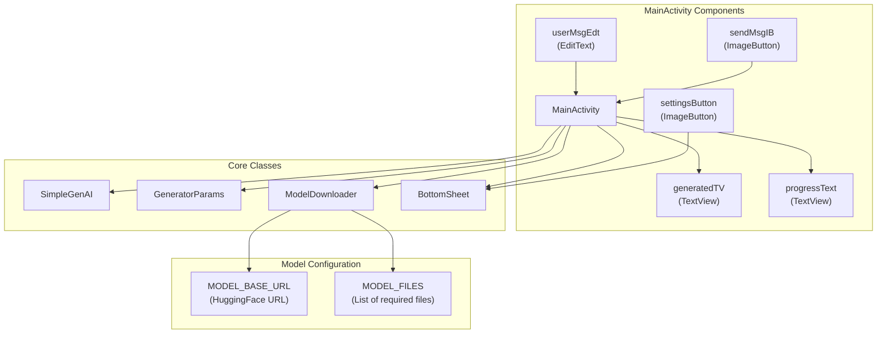

Sources:
- [mobile/examples/phi-3/android/app/src/main/java/ai/onnxruntime/genai/demo/MainActivity.java:31-60]()
- [mobile/examples/phi-3/android/app/src/main/java/ai/onnxruntime/genai/demo/MainActivity.java:35-50]()

### Implementation Details

The Phi-3 Mini example demonstrates several important concepts:

1. **Model Loading and Management** - Downloads or loads the Phi-3 model files
2. **GenAI API Usage** - Uses `SimpleGenAI` class for streamlined inference
3. **Token Generation** - Implements streaming token-by-token text generation
4. **Performance Tracking** - Measures and displays inference performance metrics

Key code components:

- **SimpleGenAI Initialization:**

```java
genAI = new SimpleGenAI(getFilesDir().getPath());
```

- **Setting up Generator Parameters:**

```java
GeneratorParams generatorParams = genAI.createGeneratorParams();
generatorParams.setSearchOption("length_penalty", (double)lengthPenalty);
generatorParams.setSearchOption("max_length", (double)maxLength);
```

- **Streaming Token Generation:**

```java
Consumer<String> tokenListener = token -> {
    if (numTokens[0] == 0) {
        firstTokenTime[0] = System.currentTimeMillis();
    }
    MainActivity.this.accept(token);
    Log.i(TAG, "Generated token: " + token);
    numTokens[0] += 1;
};

String fullResponse = genAI.generate(generatorParams, promptQuestion_formatted, tokenListener);
```

The example provides detailed performance metrics, including prompt processing time and tokens generated per second.

Sources:
- [mobile/examples/phi-3/android/app/src/main/java/ai/onnxruntime/genai/demo/MainActivity.java:254]()
- [mobile/examples/phi-3/android/app/src/main/java/ai/onnxruntime/genai/demo/MainActivity.java:144-149]()
- [mobile/examples/phi-3/android/app/src/main/java/ai/onnxruntime/genai/demo/MainActivity.java:155-168]()

### Model Management

The Phi-3 example demonstrates comprehensive model management:

1. **Model Configuration** - Centralized configuration for easy model switching:

```java
private static final String MODEL_BASE_URL = "https://huggingface.co/microsoft/Phi-3-mini-4k-instruct-onnx/resolve/main/cpu_and_mobile/cpu-int4-rtn-block-32-acc-level-4/";

private static final List<String> MODEL_FILES = Arrays.asList(
    "added_tokens.json",
    "config.json", 
    "configuration_phi3.py",
    "genai_config.json",
    "phi3-mini-4k-instruct-cpu-int4-rtn-block-32-acc-level-4.onnx",
    "phi3-mini-4k-instruct-cpu-int4-rtn-block-32-acc-level-4.onnx.data",
    "special_tokens_map.json",
    "tokenizer.json",
    "tokenizer.model",
    "tokenizer_config.json"
);
```

2. **File Existence Checking** - Verifies if model files exist locally using `fileExists()` method
3. **Download Management** - Uses `ModelDownloader` with progress callbacks
4. **Model Initialization** - Creates `SimpleGenAI` instance after files are available

The example supports switching to different models by simply updating the `MODEL_BASE_URL` and `MODEL_FILES` configuration.

Sources:
- [mobile/examples/phi-3/android/app/src/main/java/ai/onnxruntime/genai/demo/MainActivity.java:35-49]()
- [mobile/examples/phi-3/android/app/src/main/java/ai/onnxruntime/genai/demo/MainActivity.java:63-66]()
- [mobile/examples/phi-3/android/app/src/main/java/ai/onnxruntime/genai/demo/MainActivity.java:209-272]()
- [mobile/examples/phi-3/android/README.md:10-33]()

## Android Development Best Practices

Based on the examples, several best practices emerge for Android ONNX Runtime integration:

### Error Handling and User Experience

The Phi-3 example demonstrates robust error handling:

```java
try {
    genAI = new SimpleGenAI(getFilesDir().getPath());
    // ... inference code
} catch (GenAIException e) {
    Log.e(TAG, "Exception occurred during model query: " + e.getMessage());
    runOnUiThread(() -> {
        Toast.makeText(MainActivity.this, "Error generating response: " + e.getMessage(), Toast.LENGTH_SHORT).show();
    });
}
```

### Threading and UI Updates

Proper threading is essential for responsive UI:

```java
new Thread(new Runnable() {
    @Override
    public void run() {
        // Background inference work
        String fullResponse = genAI.generate(generatorParams, promptQuestion_formatted, tokenListener);
        
        runOnUiThread(() -> {
            // UI updates on main thread
            sendMsgIB.setEnabled(true);
            sendMsgIB.setAlpha(1.0f);
        });
    }
}).start();
```

Sources:
- [mobile/examples/phi-3/android/app/src/main/java/ai/onnxruntime/genai/demo/MainActivity.java:182-193]()
- [mobile/examples/phi-3/android/app/src/main/java/ai/onnxruntime/genai/demo/MainActivity.java:139-196]()

## Common Android Integration Patterns

Looking across the examples, several common patterns emerge for integrating ONNX Runtime with Android applications:

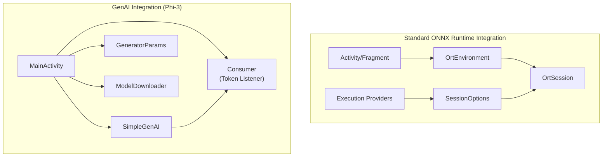

### Key Integration Components

| Component | Purpose | Usage in Examples |
|-----------|---------|------------------|
| `SimpleGenAI` | Simplified GenAI interface | Phi-3 example for LLM inference |
| `GeneratorParams` | Configure generation behavior | Set max length, length penalty in Phi-3 |
| `ModelDownloader` | Handle model file downloads | Download Phi-3 files from HuggingFace |
| `Consumer<String>` | Stream token generation | Real-time token display in Phi-3 |
| Error handling with `GenAIException` | Robust error management | Try-catch blocks around inference |

Sources:
- [mobile/examples/phi-3/android/app/src/main/java/ai/onnxruntime/genai/demo/MainActivity.java:27-29]()
- [mobile/examples/phi-3/android/app/src/main/java/ai/onnxruntime/genai/demo/MainActivity.java:144-149]()
- [mobile/examples/phi-3/android/app/src/main/java/ai/onnxruntime/genai/demo/MainActivity.java:155-166]()

## Performance Considerations

The examples demonstrate several methods for optimizing performance:

1. **Model Quantization** - Using quantized models (INT4 for Phi-3)
2. **Performance Tracking** - Measuring and optimizing critical metrics
3. **User-Configurable Parameters** - Settings for controlling generation behavior

The Phi-3 example includes comprehensive performance tracking:

```java
long startTime = System.currentTimeMillis();
final long[] firstTokenTime = {startTime};
final long[] numTokens = {0};

// Token listener tracks performance
Consumer<String> tokenListener = token -> {
    if (numTokens[0] == 0) {
        firstTokenTime[0] = System.currentTimeMillis();
    }
    MainActivity.this.accept(token);
    numTokens[0] += 1;
};

// Calculate metrics after generation
long totalTime = System.currentTimeMillis() - firstTokenTime[0];
float promptProcessingTime = (firstTokenTime[0] - startTime) / 1000.0f;
float tokensPerSecond = numTokens[0] > 1 ? (1000.0f * (numTokens[0] - 1)) / totalTime : 0;
```

### Performance Metrics Display

The Phi-3 example shows performance metrics in a popup dialog:

```java
private void showTokenPopup(float promptProcessingTime, float tokenRate) {
    final Dialog dialog = new Dialog(MainActivity.this);
    dialog.setContentView(R.layout.info_popup);
    
    TextView promptProcessingTimeTv = dialog.findViewById(R.id.prompt_processing_time_tv);
    TextView tokensPerSecondTv = dialog.findViewById(R.id.tokens_per_second_tv);
    
    promptProcessingTimeTv.setText(String.format("Prompt processing time: %.2f seconds", promptProcessingTime));
    tokensPerSecondTv.setText(String.format("Tokens per second: %.2f", tokenRate));
}
```

Sources:
- [mobile/examples/phi-3/android/app/src/main/java/ai/onnxruntime/genai/demo/MainActivity.java:150-172]()
- [mobile/examples/phi-3/android/app/src/main/java/ai/onnxruntime/genai/demo/MainActivity.java:293-307]()
- [mobile/examples/phi-3/android/README.md:8]()

## Getting Started with Examples

To run the Android examples:

1. Clone the repository:
   ```
   git clone https://github.com/microsoft/onnxruntime-inference-examples.git
   ```

2. Open the specific example in Android Studio:
   - For Question Answering: `mobile/examples/question_answering/android/`
   - For Phi-3 Mini: `mobile/examples/phi-3/android/`

3. Build and run on a physical device or emulator

### Phi-3 Specific Setup

For the Phi-3 example, additional considerations:

- **Storage Requirements**: Model is over 2.5GB and downloads automatically on first launch
- **Device Requirements**: Ensure device has at least 8GB internal storage
- **Manual Model Setup** (Optional): You can manually copy model files to `/data/data/ai.onnxruntime.genai.demo/files`

The model files are downloaded from the configured `MODEL_BASE_URL` and stored in the app's private files directory.

Sources:
- [mobile/examples/phi-3/android/README.md:45-76]()
- [mobile/examples/phi-3/android/README.md:53-69]()
- [mobile/examples/phi-3/android/app/src/main/java/ai/onnxruntime/genai/demo/MainActivity.java:35]()

## Summary

The Android examples in the ONNX Runtime Inference Examples repository demonstrate various ways to integrate machine learning models into Android applications using ONNX Runtime. From basic question answering to large language models and cross-platform development, these examples provide a foundation for developers looking to add ML capabilities to their Android apps.

The examples highlight:
- Core ONNX Runtime usage patterns for Android
- Integration with different execution providers
- Specialized APIs for different model types (GenAI)
- Cross-platform options with React Native
- Performance optimization techniques

These patterns can be applied to build sophisticated, performant ML-enabled Android applications using ONNX Runtime.

---

# Page: React Native Examples

# React Native Examples

<details>
<summary>Relevant source files</summary>

The following files were used as context for generating this wiki page:

- [mobile/examples/React_Native/ort-rn-basic-usage/yarn.lock](mobile/examples/React_Native/ort-rn-basic-usage/yarn.lock)

</details>


This document covers the React Native examples in the ONNX Runtime inference examples repository, demonstrating how to integrate and use ONNX Runtime in React Native applications for machine learning inference on mobile devices.

For information about other mobile example implementations, see the following related wiki pages:
- [iOS Examples](#2.1)
- [Android Examples](#2.2)
- [Xamarin Examples](#2.4)

## Overview

The repository contains a React Native example that demonstrates basic ONNX Runtime functionality, including:

- Loading an ONNX model
- Creating an inference session
- Preparing input data
- Running inference
- Processing output results

The example leverages Expo, a framework for React Native development, making it easier to set up and run on both Android and iOS platforms.

Sources:
- [mobile/examples/React_Native/ort-rn-basic-usage/README.md]()
- [README.md]()

## Architecture

The following diagram illustrates the architecture of the React Native with ONNX Runtime integration:

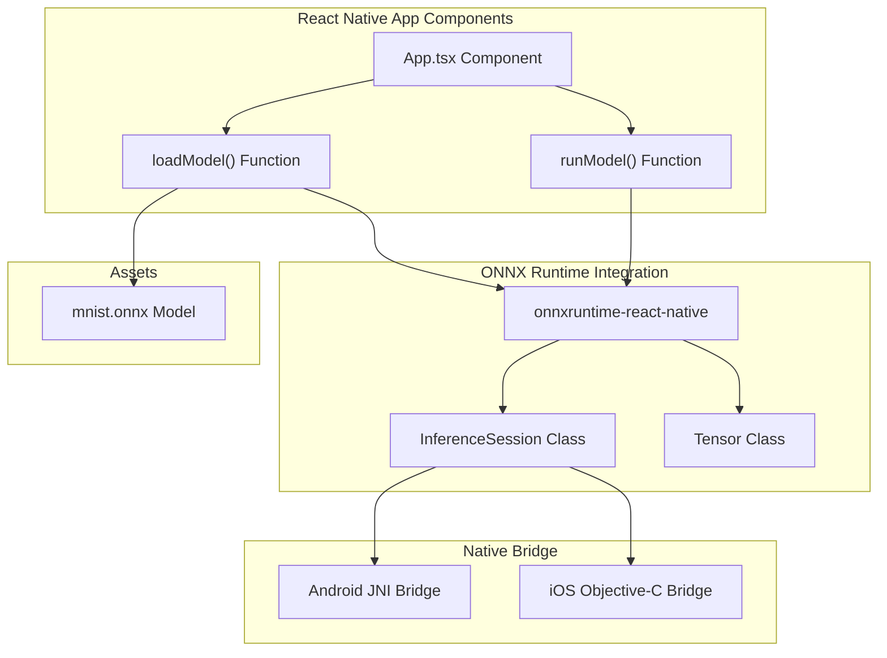

This architecture shows how the React Native app interfaces with ONNX Runtime through the JavaScript API layer (`onnxruntime-react-native`), which then communicates with native code via platform-specific bridges.

Sources:
- [mobile/examples/React_Native/ort-rn-basic-usage/App.tsx]()
- [mobile/examples/React_Native/ort-rn-basic-usage/README.md]()

## Project Setup

### Prerequisites

To work with the React Native examples, you need:

1. Node.js
2. Expo CLI installed globally: `npm install -g expo-cli`
3. Yarn (recommended): `npm install -g yarn`
4. For iOS: Xcode
5. For Android: Android Studio and Android SDK

### Project Configuration

The React Native example includes several key configuration files:

1. **metro.config.js**: Configures the Metro bundler to include `.onnx` files in the bundled assets:

```
const { getDefaultConfig } = require('@expo/metro-config');
const defaultConfig = getDefaultConfig(__dirname);
defaultConfig.resolver.assetExts.push('onnx');
module.exports = defaultConfig;
```

2. **app.json**: Includes the ONNX Runtime React Native plugin in the Expo configuration:

```json
{
  "expo": {
    "plugins": ["onnxruntime-react-native"],
    ...
  }
}
```

This plugin automatically sets up the native code for iOS and Android when the project is built.

Sources:
- [mobile/examples/React_Native/ort-rn-basic-usage/metro.config.js]()
- [mobile/examples/React_Native/ort-rn-basic-usage/app.json]()
- [mobile/examples/React_Native/ort-rn-basic-usage/README.md]()

## Basic Usage Example Workflow

The following sequence diagram illustrates the workflow of the basic usage example:

```mermaid
sequenceDiagram
    participant User as "User"
    participant App as "App Component"
    participant Asset as "Expo Asset"
    participant ORT as "ONNX Runtime API"
    participant Model as "MNIST Model"

    User->>App: Press "Load model" button
    App->>Asset: Asset.loadAsync(model path)
    Asset->>Model: Request model file
    Model-->>Asset: Return model data
    Asset-->>App: Return model URI
    App->>ORT: InferenceSession.create(modelUri)
    ORT-->>App: Return session object
    App->>User: Display success message with model info

    User->>App: Press "Run" button
    App->>App: Create input tensor data
    App->>ORT: Create Tensor object
    App->>ORT: Run inference with input tensor
    ORT->>ORT: Process through model
    ORT-->>App: Return output tensor
    App->>User: Display output shape and data
```

This sequence demonstrates the complete flow from loading a model to running inference and displaying results.

Sources:
- [mobile/examples/React_Native/ort-rn-basic-usage/App.tsx]()

## Key Implementation Details

### Model Loading

The example demonstrates loading an ONNX model (MNIST) from the application's assets using the following steps:

1. Load the ONNX file using Expo's Asset system
2. Retrieve the local URI for the model file
3. Create an ONNX Runtime inference session with the model URI

```typescript
const assets = await Asset.loadAsync(require('./assets/mnist.onnx'));
const modelUri = assets[0].localUri;
if (!modelUri) {
  Alert.alert('failed to get model URI', `${assets[0]}`);
} else {
  myModel = await ort.InferenceSession.create(modelUri);
  Alert.alert(
    'model loaded successfully',
    `input names: ${myModel.inputNames}, output names: ${myModel.outputNames}`);
}
```

Sources:
- [mobile/examples/React_Native/ort-rn-basic-usage/App.tsx:14-32]()

### Running Inference

Once the model is loaded, inference can be run using these steps:

1. Create input data (a Float32Array for the MNIST model)
2. Create an input feeds object mapping input names to tensor values
3. Run the model with the feeds and get the outputs
4. Process the outputs as needed

```typescript
const inputData = new Float32Array(28 * 28);
const feeds = {};
feeds[myModel.inputNames[0]] = new ort.Tensor(inputData, [1, 1, 28, 28]);
const fetches = await myModel.run(feeds);
const output = fetches[myModel.outputNames[0]];
```

Sources:
- [mobile/examples/React_Native/ort-rn-basic-usage/App.tsx:39-56]()

## Key ONNX Runtime APIs

The React Native example demonstrates usage of the following key ONNX Runtime APIs:

| API | Description |
|-----|-------------|
| `ort.InferenceSession.create()` | Creates a session from a model file path |
| `ort.Tensor` | Creates a tensor object from data with specified shape |
| `session.inputNames` | Gets the names of inputs required by the model |
| `session.outputNames` | Gets the names of outputs produced by the model |
| `session.run()` | Runs inference with the provided input feeds |

Sources:
- [mobile/examples/React_Native/ort-rn-basic-usage/App.tsx:4-61]()

## Running the Example

To run the example:

1. Clone the repository
2. Navigate to the example directory: `cd mobile/examples/React_Native/ort-rn-basic-usage`
3. Install dependencies: `yarn install`
4. Install ONNX Runtime: `expo install onnxruntime-react-native@latest`
5. Generate native code: `expo prebuild`
6. Run on Android or iOS:
   - For Android: `expo run:android`
   - For iOS: `expo run:ios`

Sources:
- [mobile/examples/React_Native/ort-rn-basic-usage/README.md:23-53]()

## Enabling ONNX Runtime Extensions

If you need to use custom operators from ONNX Runtime Extensions, you can enable this by modifying your application's configuration. See the example README for details on how to enable extensions.

Sources:
- [mobile/examples/React_Native/ort-rn-basic-usage/README.md:128-132]()

## Troubleshooting

Common issues and solutions:

- **Model loading fails**: Ensure metro.config.js correctly includes .onnx files in assetExts
- **Build errors**: Verify the onnxruntime-react-native plugin is properly configured in app.json
- **Runtime errors**: Check that error handling is implemented for model loading and inference operations

The example demonstrates proper error handling patterns:

```typescript
try {
  // Model loading or inference code
} catch (e) {
  Alert.alert('error title', `${e}`);
}
```

Sources:
- [mobile/examples/React_Native/ort-rn-basic-usage/App.tsx:15-35]()
- [mobile/examples/React_Native/ort-rn-basic-usage/App.tsx:40-59]()

## Conclusion

The React Native example in the ONNX Runtime inference examples repository provides a foundation for integrating machine learning models into cross-platform mobile applications. It demonstrates the key concepts of loading models, running inference, and processing results using the ONNX Runtime JavaScript API within a React Native application.

By following this example, developers can build their own React Native applications that leverage machine learning models with ONNX Runtime for both Android and iOS platforms.

Sources:
- [mobile/examples/React_Native/ort-rn-basic-usage/README.md]()
- [mobile/examples/React_Native/ort-rn-basic-usage/App.tsx]()

---

# Page: Xamarin Examples

# Xamarin Examples

<details>
<summary>Relevant source files</summary>

The following files were used as context for generating this wiki page:

- [.gdn/.gdntsa](.gdn/.gdntsa)
- [ci_build/azure_pipelines/compliance.yml](ci_build/azure_pipelines/compliance.yml)
- [ci_build/policheck_exclusions.xml](ci_build/policheck_exclusions.xml)
- [mobile/examples/Xamarin/VisionSample/VisionSample.Forms.Android/VisionSample.Forms.Android.csproj](mobile/examples/Xamarin/VisionSample/VisionSample.Forms.Android/VisionSample.Forms.Android.csproj)
- [mobile/examples/Xamarin/VisionSample/VisionSample.Forms.iOS/VisionSample.Forms.iOS.csproj](mobile/examples/Xamarin/VisionSample/VisionSample.Forms.iOS/VisionSample.Forms.iOS.csproj)
- [mobile/examples/Xamarin/VisionSample/VisionSample/VisionSample.csproj](mobile/examples/Xamarin/VisionSample/VisionSample/VisionSample.csproj)
- [mobile/examples/Xamarin/nuget.config](mobile/examples/Xamarin/nuget.config)
- [mobile/examples/Xamarin/readme.md](mobile/examples/Xamarin/readme.md)

</details>


## Purpose and Scope

This document provides detailed information about the Xamarin examples contained in the ONNX Runtime Inference Examples repository. These examples demonstrate how to integrate and use ONNX Runtime within Xamarin applications for cross-platform mobile development on both Android and iOS platforms. 

For other mobile platform implementations, see [iOS Examples](#2.1), [Android Examples](#2.2), and [React Native Examples](#2.3).

## Overview

The Xamarin examples showcase how to perform machine learning inference using ONNX Runtime in cross-platform mobile applications built with Xamarin.Forms. The primary example is a vision application demonstrating image classification and face detection using pre-trained models from the ONNX Model Zoo.

Sources: [mobile/examples/Xamarin/readme.md:1-17]()

## Architecture

The Xamarin sample follows a cross-platform architecture that enables code sharing while providing platform-specific implementations where needed.

### High-Level Architecture

```mermaid
graph TD
    subgraph "Xamarin Vision Sample Solution"
        Core["VisionSample Core Library<br>(.NET Standard)"]
        FormsUI["VisionSample.Forms<br>(Xamarin.Forms UI)"]
        Android["VisionSample.Forms.Android<br>(Android Implementation)"]
        iOS["VisionSample.Forms.iOS<br>(iOS Implementation)"]
    end

    subgraph "Dependencies"
        ONNX["Microsoft.ML.OnnxRuntime.Managed<br>NuGet Package"]
        ONNX_A["Microsoft.ML.OnnxRuntime<br>(Android-specific)"]
        ONNX_I["Microsoft.ML.OnnxRuntime<br>(iOS-specific)"]
        SkiaSharp["SkiaSharp<br>(Graphics Processing)"]
    end

    subgraph "Execution Providers"
        NNAPI["NNAPI EP<br>(Android)"]
        CoreML["Core ML EP<br>(iOS)"]
        CPU["CPU EP<br>(Default)"]
    end

    subgraph "Models"
        ResNet["ResNet50v2<br>(Image Classification)"]
        Ultraface["Ultraface<br>(Face Detection)"]
    end

    Core --> ONNX
    Core --> SkiaSharp
    FormsUI --> Core
    Android --> FormsUI
    iOS --> FormsUI
    Android --> ONNX_A
    iOS --> ONNX_I
    ONNX_A --> NNAPI
    ONNX_I --> CoreML
    ONNX --> CPU
    Core --> ResNet
    Core --> Ultraface
```

Sources: 
- [mobile/examples/Xamarin/readme.md:1-19]()
- [mobile/examples/Xamarin/VisionSample/VisionSample.csproj:1-28]()
- [mobile/examples/Xamarin/VisionSample/VisionSample.Forms.Android/VisionSample.Forms.Android.csproj:1-118]()
- [mobile/examples/Xamarin/VisionSample/VisionSample.Forms.iOS/VisionSample.Forms.iOS.csproj:1-152]()

### Component Interactions

```mermaid
sequenceDiagram
    participant User
    participant UI as "Xamarin.Forms UI"
    participant ImageProcessor as "Image Processor"
    participant OnnxSession as "ONNX Runtime Session"
    participant ExecutionProvider as "Execution Provider<br>(CPU/NNAPI/CoreML)"
    participant Model as "ONNX Model"
    
    User->>UI: Take/Pick Photo or Use Sample Image
    UI->>ImageProcessor: Process Input Image
    ImageProcessor->>OnnxSession: Prepare Tensor Input
    OnnxSession->>Model: Load Model
    OnnxSession->>ExecutionProvider: Select EP Based on Platform/Settings
    OnnxSession->>Model: Run Inference
    Model->>OnnxSession: Return Inference Results
    OnnxSession->>ImageProcessor: Process Output Tensors
    ImageProcessor->>UI: Display Results (Classifications/Detections)
```

Sources: [mobile/examples/Xamarin/readme.md:6-18]()

## Models

The Xamarin sample includes two primary models:

1. **ResNet50v2** - A deep residual neural network for image classification, capable of classifying images into 1,000 pre-defined categories.

2. **Ultraface** - A lightweight face detection model designed for edge computing devices, providing bounding boxes and confidence scores for detected faces.

These models are embedded as resources in the application and loaded at runtime.

```mermaid
graph LR
    subgraph "Model Integration"
        EmbeddedRes["Embedded Resources"]
        ModelLoader["Model Loader"]
        InferenceSession["ONNX Runtime<br>InferenceSession"]
        
        EmbeddedRes -->|"Load"| ModelLoader
        ModelLoader -->|"Create"| InferenceSession
    end
    
    subgraph "Models"
        ResNet["ResNet50v2<br>resnet50-v2-7.onnx"]
        Ultraface["Ultraface<br>Ultraface.version-RFB-320.onnx"]
    end
    
    ResNet --> EmbeddedRes
    Ultraface --> EmbeddedRes
```

Sources: 
- [mobile/examples/Xamarin/readme.md:8-15]()
- [mobile/examples/Xamarin/VisionSample/VisionSample.csproj:16-22]()

## Integration with ONNX Runtime

The Xamarin example integrates ONNX Runtime through NuGet packages:

| Project | Package | Version |
|---------|---------|---------|
| VisionSample (Core) | Microsoft.ML.OnnxRuntime.Managed | 1.10.0 |
| Android Implementation | Microsoft.ML.OnnxRuntime | 1.10.0 |
| iOS Implementation | Microsoft.ML.OnnxRuntime | 1.10.0 |

Sources:
- [mobile/examples/Xamarin/VisionSample/VisionSample.csproj:23-27]()
- [mobile/examples/Xamarin/VisionSample/VisionSample.Forms.Android/VisionSample.Forms.Android.csproj:65-70]()
- [mobile/examples/Xamarin/VisionSample/VisionSample.Forms.iOS/VisionSample.Forms.iOS.csproj:132-139]()

### Execution Providers

The sample demonstrates how to utilize different execution providers based on the platform:

1. **CPU EP** - Default execution provider that works on all platforms
2. **NNAPI EP** - Android Neural Networks API for hardware acceleration on Android devices
3. **Core ML EP** - Apple's machine learning framework for hardware acceleration on iOS devices

The application allows the user to switch between the default CPU EP and the platform-specific options.

Sources: [mobile/examples/Xamarin/readme.md:16-18]()

## Setup and Configuration

### Required Models

The Xamarin example requires model files to be placed in a "Models" directory. The repository includes the Ultraface model, while the ResNet50v2 model can be downloaded separately.

| Model | Description | Size |
|-------|-------------|------|
| Ultraface | Lightweight face detection model (included in repository) | Small |
| ResNet50v2 | Image classification model (needs download) | 97.7 MB |

Sources: [mobile/examples/Xamarin/readme.md:25-41]()

### Using Prerelease Packages

The examples can also be configured to use prerelease versions of ONNX Runtime packages by updating the NuGet configuration:

1. Add the integration repository to the NuGet sources
2. Update the package references to use prerelease versions

Sources: 
- [mobile/examples/Xamarin/readme.md:43-52]()
- [mobile/examples/Xamarin/nuget.config:1-8]()

## Known Issues

The Xamarin examples have some documented known issues:

1. **Media Component Issues** - There are limitations with the Xamarin.Essentials MediaPicker APIs and Xam.Plugin.Media that may affect photo capturing and selection on certain devices.

2. **MissingMethodException** - When using Visual Studio 2022 with Hot Reload enabled, conflicts may occur between system packages (System.Memory, System.Buffers) and ONNX Runtime packages, potentially causing MissingMethodException related to ReadOnlySpan<T>.

Sources: [mobile/examples/Xamarin/readme.md:54-66]()

## Comparison with Other Mobile Implementations

The following table compares key aspects of Xamarin with other mobile implementations in the repository:

| Feature | Xamarin | iOS Native | Android Native | React Native |
|---------|---------|------------|----------------|--------------|
| Programming Language | C# | Swift/Objective-C | Java/Kotlin | JavaScript |
| UI Framework | Xamarin.Forms | UIKit | Android SDK | React Native |
| Code Sharing | High | None | None | High |
| ONNX Runtime Package | Microsoft.ML.OnnxRuntime.Managed | onnxruntime-objc | onnxruntime-android | onnxruntime-react-native |
| Platform-Specific EPs | NNAPI (Android), CoreML (iOS) | CoreML | NNAPI | Via native bridges |

Sources: 
- [mobile/examples/Xamarin/readme.md:1-18]()
- [README.md:15-16]()

## Implementation Details

The Xamarin sample is structured as a Xamarin.Forms solution with multiple projects:

1. **VisionSample** - Core .NET Standard library containing the ML processing logic
2. **VisionSample.Forms** - Xamarin.Forms UI project with the cross-platform user interface
3. **VisionSample.Forms.Android** - Android-specific implementation
4. **VisionSample.Forms.iOS** - iOS-specific implementation

```mermaid
graph TB
    subgraph "Project Structure"
        Core["VisionSample"]
        Forms["VisionSample.Forms"]
        Android["VisionSample.Forms.Android"]
        iOS["VisionSample.Forms.iOS"]
    end
    
    subgraph "Key Components"
        ModelLoading["Model Loading"]
        ImagePreprocess["Image Preprocessing"]
        Inference["Inference Execution"]
        ResultProcess["Result Processing"]
    end
    
    Core -->|"Contains"| ModelLoading
    Core -->|"Contains"| ImagePreprocess
    Core -->|"Contains"| Inference
    Core -->|"Contains"| ResultProcess
    
    Forms -->|"References"| Core
    Android -->|"References"| Forms
    iOS -->|"References"| Forms
    
    Android -->|"Provides"| NNAPI["NNAPI EP Integration"]
    iOS -->|"Provides"| CoreML["CoreML EP Integration"]
```

Sources:
- [mobile/examples/Xamarin/VisionSample/VisionSample.csproj:1-28]()
- [mobile/examples/Xamarin/VisionSample/VisionSample.Forms.Android/VisionSample.Forms.Android.csproj:1-118]()
- [mobile/examples/Xamarin/VisionSample/VisionSample.Forms.iOS/VisionSample.Forms.iOS.csproj:1-152]()

### Model Embedding

Models are embedded as resources in the application:

```
<EmbeddedResource Include="..\..\Models\resnet50-v2-7.onnx" Condition="Exists('..\..\Models\resnet50-v2-7.onnx')">
  <Link>ResNet50v2\resnet50.onnx</Link>
</EmbeddedResource>
<EmbeddedResource Include="..\..\Models\Ultraface.version-RFB-320.onnx" Condition="Exists('..\..\Models\Ultraface.version-RFB-320.onnx')">
  <Link>Ultraface\ultraface.onnx</Link>
</EmbeddedResource>
```

Sources: [mobile/examples/Xamarin/VisionSample/VisionSample.csproj:16-22]()

## Conclusion

The Xamarin examples demonstrate how to use ONNX Runtime in cross-platform mobile applications using C# and .NET. They showcase image classification and face detection capabilities, as well as the ability to use platform-specific execution providers for optimized performance on different devices.

These examples provide a valuable reference for developers looking to integrate machine learning capabilities into their Xamarin applications using ONNX Runtime.

---

# Page: Phi-3 Mini for Mobile

# Phi-3 Mini for Mobile

<details>
<summary>Relevant source files</summary>

The following files were used as context for generating this wiki page:

- [mobile/examples/phi-3/android/README.md](mobile/examples/phi-3/android/README.md)
- [mobile/examples/phi-3/android/app/build.gradle.kts](mobile/examples/phi-3/android/app/build.gradle.kts)
- [mobile/examples/phi-3/android/app/libs/onnxruntime-genai-android-0.8.1.aar](mobile/examples/phi-3/android/app/libs/onnxruntime-genai-android-0.8.1.aar)
- [mobile/examples/phi-3/android/app/src/main/java/ai/onnxruntime/genai/demo/MainActivity.java](mobile/examples/phi-3/android/app/src/main/java/ai/onnxruntime/genai/demo/MainActivity.java)
- [mobile/examples/phi-3/android/gradle/wrapper/gradle-wrapper.jar](mobile/examples/phi-3/android/gradle/wrapper/gradle-wrapper.jar)
- [mobile/examples/phi-3/android/gradle/wrapper/gradle-wrapper.properties](mobile/examples/phi-3/android/gradle/wrapper/gradle-wrapper.properties)
- [mobile/examples/phi-3/android/gradlew](mobile/examples/phi-3/android/gradlew)
- [mobile/examples/phi-3/android/gradlew.bat](mobile/examples/phi-3/android/gradlew.bat)
- [mobile/examples/phi-3/ios/LocalLLM/LocalLLM.xcodeproj/project.pbxproj](mobile/examples/phi-3/ios/LocalLLM/LocalLLM.xcodeproj/project.pbxproj)
- [mobile/examples/phi-3/ios/LocalLLM/LocalLLM/Assets.xcassets/AccentColor.colorset/Contents.json](mobile/examples/phi-3/ios/LocalLLM/LocalLLM/Assets.xcassets/AccentColor.colorset/Contents.json)
- [mobile/examples/phi-3/ios/LocalLLM/LocalLLM/Assets.xcassets/AppIcon.appiconset/Contents.json](mobile/examples/phi-3/ios/LocalLLM/LocalLLM/Assets.xcassets/AppIcon.appiconset/Contents.json)
- [mobile/examples/phi-3/ios/LocalLLM/LocalLLM/Assets.xcassets/Contents.json](mobile/examples/phi-3/ios/LocalLLM/LocalLLM/Assets.xcassets/Contents.json)
- [mobile/examples/phi-3/ios/LocalLLM/LocalLLM/ContentView.swift](mobile/examples/phi-3/ios/LocalLLM/LocalLLM/ContentView.swift)
- [mobile/examples/phi-3/ios/LocalLLM/LocalLLM/GenAIGenerator.h](mobile/examples/phi-3/ios/LocalLLM/LocalLLM/GenAIGenerator.h)
- [mobile/examples/phi-3/ios/LocalLLM/LocalLLM/GenAIGenerator.mm](mobile/examples/phi-3/ios/LocalLLM/LocalLLM/GenAIGenerator.mm)
- [mobile/examples/phi-3/ios/LocalLLM/LocalLLM/LocalLLM-Bridging-Header.h](mobile/examples/phi-3/ios/LocalLLM/LocalLLM/LocalLLM-Bridging-Header.h)
- [mobile/examples/phi-3/ios/LocalLLM/LocalLLM/LocalLLMApp.swift](mobile/examples/phi-3/ios/LocalLLM/LocalLLM/LocalLLMApp.swift)
- [mobile/examples/phi-3/ios/LocalLLM/LocalLLM/Preview Content/Preview Assets.xcassets/Contents.json](mobile/examples/phi-3/ios/LocalLLM/LocalLLM/Preview Content/Preview Assets.xcassets/Contents.json)
- [mobile/examples/phi-3/ios/LocalLLM/LocalLLM/README.md](mobile/examples/phi-3/ios/LocalLLM/LocalLLM/README.md)
- [mobile/examples/phi-3/ios/LocalLLM/LocalLLM/SharedTokenUpdater.swift](mobile/examples/phi-3/ios/LocalLLM/LocalLLM/SharedTokenUpdater.swift)
- [mobile/examples/phi-3/ios/LocalLLM/LocalLLM/Simulator Screenshot - iPhone 16.png](mobile/examples/phi-3/ios/LocalLLM/LocalLLM/Simulator Screenshot - iPhone 16.png)

</details>


This section documents the implementation of Microsoft's Phi-3 Mini language model for mobile platforms using ONNX Runtime and the GenAI API. The examples demonstrate on-device chatbot applications for both Android and iOS, featuring quantized model deployment, streaming token generation, and platform-specific UI implementations.

## Overview

The Phi-3 Mini mobile examples showcase complete chatbot implementations using a quantized INT4 Phi-3 model for on-device inference. Key features include:

- Automatic model download from HuggingFace repositories
- Streaming token generation with real-time UI updates
- Performance monitoring (tokens/second, prompt processing time)
- Configurable generation parameters (max length, length penalty)
- Platform-specific UI implementations (Android XML layouts, iOS SwiftUI)

Sources:
- [mobile/examples/phi-3/android/README.md:1-88]()
- [mobile/examples/phi-3/ios/LocalLLM/LocalLLM/README.md:1-111]()

## Architecture Overview

**Android Architecture Diagram**

```mermaid
flowchart TB
    subgraph "UI Layer"
        MainActivity["MainActivity"]
        BottomSheet["BottomSheet"]
        UI_Components["EditText, TextView, ImageButton"]
    end
    
    subgraph "Business Logic"
        SimpleGenAI["SimpleGenAI"]
        GeneratorParams["GeneratorParams"] 
        ModelDownloader["ModelDownloader"]
    end
    
    subgraph "ONNX Runtime"
        ORT_Android["onnxruntime-android"]
        GenAI_Android["onnxruntime-genai-android"]
    end
    
    subgraph "Model Files"
        ONNX_Model["phi3-mini-4k-instruct.onnx"]
        Model_Data["phi3-mini-4k-instruct.onnx.data"]
        Tokenizer_Files["tokenizer.json, config.json"]
    end
    
    MainActivity --> SimpleGenAI
    MainActivity --> GeneratorParams
    MainActivity --> ModelDownloader
    MainActivity --> BottomSheet
    SimpleGenAI --> GenAI_Android
    GenAI_Android --> ORT_Android
    ORT_Android --> ONNX_Model
    ORT_Android --> Model_Data
    ORT_Android --> Tokenizer_Files
    ModelDownloader --> Model_Files
```

**iOS Architecture Diagram**

```mermaid
flowchart TB
    subgraph "SwiftUI Layer"
        ContentView["ContentView"]
        ChatBubble["ChatBubble"]
        SharedTokenUpdater["SharedTokenUpdater"]
    end
    
    subgraph "Objective-C++ Bridge"
        GenAIGenerator["GenAIGenerator"]
        BridgingHeader["LocalLLM-Bridging-Header.h"]
    end
    
    subgraph "ONNX Runtime C++"
        OgaModel["OgaModel"]
        OgaTokenizer["OgaTokenizer"]
        OgaGenerator["OgaGenerator"]
        OgaTokenizerStream["OgaTokenizerStream"]
    end
    
    subgraph "Native Libraries"
        libonnxruntime["libonnxruntime.1.19.0.dylib"]
        libgenai["libonnxruntime-genai.dylib"]
    end
    
    ContentView --> GenAIGenerator
    ContentView --> SharedTokenUpdater
    GenAIGenerator --> OgaModel
    GenAIGenerator --> OgaTokenizer
    GenAIGenerator --> OgaGenerator
    GenAIGenerator --> OgaTokenizerStream
    OgaModel --> libonnxruntime
    OgaModel --> libgenai
```

Sources:
- [mobile/examples/phi-3/android/app/src/main/java/ai/onnxruntime/genai/demo/MainActivity.java:27-30]()
- [mobile/examples/phi-3/ios/LocalLLM/LocalLLM/GenAIGenerator.mm:14-16]()
- [mobile/examples/phi-3/ios/LocalLLM/LocalLLM/ContentView.swift:7-11]()

## Token Generation Flow

**Android Token Generation Sequence**

```mermaid
sequenceDiagram
    participant User
    participant MainActivity
    participant SimpleGenAI
    participant GeneratorParams
    participant TokenListener["Consumer<String>"]
    
    User->>MainActivity: "onClick sendMsgIB"
    MainActivity->>SimpleGenAI: "createGeneratorParams()"
    SimpleGenAI->>GeneratorParams: "new GeneratorParams"
    MainActivity->>GeneratorParams: "setSearchOption(length_penalty, maxLength)"
    MainActivity->>TokenListener: "Create lambda tokenListener"
    MainActivity->>SimpleGenAI: "generate(params, prompt, tokenListener)"
    
    loop "Token Generation Loop"
        SimpleGenAI->>SimpleGenAI: "computeLogits(), generateNextToken()"
        SimpleGenAI->>TokenListener: "accept(decodedToken)"
        TokenListener->>MainActivity: "runOnUiThread()"
        MainActivity->>MainActivity: "generatedTV.setText(generated + token)"
    end
    
    SimpleGenAI->>MainActivity: "Return fullResponse"
    MainActivity->>MainActivity: "showTokenPopup(promptTime, tokensPerSec)"
```

**iOS Token Generation Sequence**

```mermaid
sequenceDiagram
    participant ContentView
    participant GenAIGenerator
    participant OgaModel
    participant OgaTokenizer
    participant OgaGenerator
    participant SharedTokenUpdater
    
    ContentView->>GenAIGenerator: "generate(prompt)"
    GenAIGenerator->>OgaModel: "OgaModel::Create(modelPath)"
    GenAIGenerator->>OgaTokenizer: "OgaTokenizer::Create(*model)"
    GenAIGenerator->>OgaTokenizer: "Encode(prompt, *sequences)"
    GenAIGenerator->>OgaGenerator: "OgaGenerator::Create(*model, *params)"
    
    loop "while (!generator->IsDone())"
        OgaGenerator->>OgaGenerator: "ComputeLogits(), GenerateNextToken()"
        GenAIGenerator->>OgaTokenizer: "tokenizer_stream->Decode(token)"
        GenAIGenerator->>SharedTokenUpdater: "addDecodedToken(decodedString)"
        SharedTokenUpdater->>ContentView: "@Published decodedTokens update"
    end
    
    GenAIGenerator->>ContentView: "TokenGenerationCompleted notification"
```

Sources:
- [mobile/examples/phi-3/android/app/src/main/java/ai/onnxruntime/genai/demo/MainActivity.java:139-196]()
- [mobile/examples/phi-3/ios/LocalLLM/LocalLLM/GenAIGenerator.mm:72-103]()
- [mobile/examples/phi-3/ios/LocalLLM/LocalLLM/SharedTokenUpdater.swift:12-16]()

## 3. Model Specifications

The examples use the INT4-quantized version of Phi-3 Mini optimized for mobile devices. 

### 3.1 Model Details

| Property | Value |
|----------|-------|
| Model Name | Phi-3 Mini |
| Variant | INT4-quantized, RTN, block-32 |
| Size | >2GB |
| Location | HuggingFace (microsoft/Phi-3-mini-4k-instruct-onnx) |
| Path | cpu_and_mobile/cpu-int4-rtn-block-32-acc-level-4/ |
| Format | ONNX |

Sources:
- [mobile/examples/phi-3/android/README.md:7-10]()
- [mobile/examples/phi-3/ios/LocalLLM/LocalLLM/README.md:99-101]()

### Model File Dependencies

The Android implementation defines required model files in `MODEL_FILES`:

| File | Purpose |
|------|---------|
| `phi3-mini-4k-instruct-cpu-int4-rtn-block-32-acc-level-4.onnx` | Main ONNX model |
| `phi3-mini-4k-instruct-cpu-int4-rtn-block-32-acc-level-4.onnx.data` | Model weights data |
| `tokenizer.json` | Tokenizer vocabulary and configuration |
| `tokenizer.model` | SentencePiece tokenizer model |
| `tokenizer_config.json` | Tokenizer configuration |
| `added_tokens.json` | Additional tokens for the vocabulary |
| `special_tokens_map.json` | Special token mappings |
| `config.json` | Model configuration |
| `genai_config.json` | GenAI-specific configuration |
| `configuration_phi3.py` | Python configuration file |

The `ModelDownloader` class handles automatic download of missing files from the configured `MODEL_BASE_URL`.

Sources:
- [mobile/examples/phi-3/android/app/src/main/java/ai/onnxruntime/genai/demo/MainActivity.java:37-49]()
- [mobile/examples/phi-3/android/app/src/main/java/ai/onnxruntime/genai/demo/MainActivity.java:209-272]()

## Android Implementation

### Requirements

- Android Studio Giraffe | 2022.3.1 or later
- Android SDK 29+, target SDK 33
- Android NDK r22+
- Device with 8GB+ internal storage
- ARM64-v8a or x86_64 architecture support

Sources:
- [mobile/examples/phi-3/android/README.md:37-41]()
- [mobile/examples/phi-3/android/app/build.gradle.kts:18-21]()

### Class Structure

**MainActivity Core Components**

```mermaid
classDiagram
    class MainActivity {
        -SimpleGenAI genAI
        -EditText userMsgEdt
        -TextView generatedTV
        -TextView promptTV
        -TextView progressText
        -ImageButton sendMsgIB
        -ImageButton settingsButton
        -int maxLength
        -float lengthPenalty
        +onCreate()
        +downloadModels(Context)
        +onClick(View)
        +accept(String token)
        +showTokenPopup(float, float)
        +setVisibility()
    }
    
    class SimpleGenAI {
        +createGeneratorParams()
        +generate(GeneratorParams, String, Consumer)
        +close()
    }
    
    class GeneratorParams {
        +setSearchOption(String, double)
    }
    
    class ModelDownloader {
        +downloadModel(Context, List, DownloadCallback)
        -onProgress(long, long, long)
        -onDownloadComplete()
    }
    
    MainActivity --> SimpleGenAI : creates
    MainActivity --> GeneratorParams : configures
    MainActivity --> ModelDownloader : downloads
    SimpleGenAI --> GeneratorParams : uses
```

**Settings Configuration**

```mermaid
classDiagram
    class BottomSheet {
        -EditText maxLengthEditText
        -EditText lengthPenaltyEditText
        -SettingsListener settingsListener
        +onCreateView(LayoutInflater, ViewGroup, Bundle)
        +setSettingsListener(SettingsListener)
    }
    
    class SettingsListener {
        +onSettingsApplied(int maxLength, float lengthPenalty)
    }
    
    MainActivity ..|> SettingsListener : implements
    BottomSheet --> SettingsListener : callbacks
```

Sources:
- [mobile/examples/phi-3/android/app/src/main/java/ai/onnxruntime/genai/demo/MainActivity.java:31-62]()
- [mobile/examples/phi-3/android/app/src/main/java/ai/onnxruntime/genai/demo/MainActivity.java:88-99]()

### Implementation Details

**Model Download Process**

The `downloadModels()` method in `MainActivity` implements the following logic:

1. Check for existing files using `fileExists(context, fileName)`
2. Create URL-file pairs for missing files from `MODEL_BASE_URL`
3. Use `ExecutorService` for background download
4. Initialize `SimpleGenAI` on completion

**Token Generation Implementation**

```java
// Create generator parameters
GeneratorParams generatorParams = genAI.createGeneratorParams();
generatorParams.setSearchOption("length_penalty", (double)lengthPenalty);
generatorParams.setSearchOption("max_length", (double)maxLength);

// Token listener for streaming
Consumer<String> tokenListener = token -> {
    MainActivity.this.accept(token);  // Update UI
    Log.i(TAG, "Generated token: " + token);
    numTokens[0] += 1;
};

// Generate with streaming callback
String fullResponse = genAI.generate(generatorParams, promptQuestion_formatted, tokenListener);
```

**UI Thread Safety**

The `accept(String token)` method ensures thread-safe UI updates:

```java
@Override
public void accept(String token) {
    runOnUiThread(() -> {
        CharSequence generated = generatedTV.getText();
        generatedTV.setText(generated + token);
        generatedTV.invalidate();
        // Auto-scroll to bottom
        final int scrollAmount = generatedTV.getLayout().getLineTop(generatedTV.getLineCount()) - generatedTV.getHeight();
        generatedTV.scrollTo(0, Math.max(scrollAmount, 0));
    });
}
```

Sources:
- [mobile/examples/phi-3/android/app/src/main/java/ai/onnxruntime/genai/demo/MainActivity.java:209-272]()
- [mobile/examples/phi-3/android/app/src/main/java/ai/onnxruntime/genai/demo/MainActivity.java:143-168]()
- [mobile/examples/phi-3/android/app/src/main/java/ai/onnxruntime/genai/demo/MainActivity.java:274-284]()

### Prompt Formatting and Configuration

**Prompt Template**

The Android implementation formats user input into a structured prompt:

```java
String promptQuestion_formatted = "<system>You are a helpful AI assistant. Answer in two paragraphs or less<|end|><|user|>"+promptQuestion+"<|end|>\n<assistant|>";
```

**Generation Parameters Configuration**

| Parameter | Type | Default | Description |
|-----------|------|---------|-------------|
| `maxLength` | `int` | 100 | Maximum tokens to generate |
| `lengthPenalty` | `float` | 1.0f | Length penalty factor |

Parameters are applied via `GeneratorParams.setSearchOption()`:

```java
generatorParams.setSearchOption("length_penalty", (double)lengthPenalty);
generatorParams.setSearchOption("max_length", (double)maxLength);
```

The `BottomSheet` class provides a settings dialog for runtime parameter adjustment, implementing the `SettingsListener` interface for callback communication with `MainActivity`.

Sources:
- [mobile/examples/phi-3/android/app/src/main/java/ai/onnxruntime/genai/demo/MainActivity.java:126]()
- [mobile/examples/phi-3/android/app/src/main/java/ai/onnxruntime/genai/demo/MainActivity.java:60-61]()
- [mobile/examples/phi-3/android/app/src/main/java/ai/onnxruntime/genai/demo/MainActivity.java:148-149]()

## iOS Implementation

### Requirements

- macOS 14+
- Xcode 15+ (latest recommended)
- iOS SDK 16.x+
- iPhone 14+ with A16/A17 chip (preferred)
- Device storage for >2GB model files

Sources:
- [mobile/examples/phi-3/ios/LocalLLM/LocalLLM/README.md:11-15]()

### SwiftUI Architecture

**Main View Components**

```mermaid
classDiagram
    class ContentView {
        -userInput: String
        -messages: [Message]
        -isGenerating: Bool
        -stats: String
        -showAlert: Bool
        -errorMessage: String
        -generator: GenAIGenerator
        +body: some View
    }
    
    class Message {
        +id: UUID
        +text: String
        +isUser: Bool
    }
    
    class ChatBubble {
        +text: String
        +isUser: Bool
        +body: some View
    }
    
    ContentView --> Message : contains
    ContentView --> ChatBubble : renders
    ContentView --> GenAIGenerator : uses
```

**Objective-C++ Bridge Layer**

```mermaid
classDiagram
    class GenAIGenerator {
        -model: unique_ptr~OgaModel~
        -tokenizer: unique_ptr~OgaTokenizer~
        +init()
        +generate(NSString* input_user_question)
        -formatTokenTimes(vector~long long~)
    }
    
    class SharedTokenUpdater {
        +decodedTokens: [String]
        +shared: SharedTokenUpdater
        +addDecodedToken(String)
        +clearTokens()
    }
    
    GenAIGenerator --> SharedTokenUpdater : updates
    ContentView --|> SharedTokenUpdater : observes @Published
```

**ONNX Runtime C++ Integration**

```mermaid
classDiagram
    class OgaModel {
        +Create(const char* modelPath)
    }
    
    class OgaTokenizer {
        +Create(OgaModel& model)
        +Encode(const char* prompt, OgaSequences& sequences)
    }
    
    class OgaTokenizerStream {
        +Create(OgaTokenizer& tokenizer)
        +Decode(int32_t token)
    }
    
    class OgaGenerator {
        +Create(OgaModel& model, OgaGeneratorParams& params)
        +ComputeLogits()
        +GenerateNextToken()
        +IsDone()
        +GetSequenceData(size_t index)
    }
    
    GenAIGenerator --> OgaModel : creates
    GenAIGenerator --> OgaTokenizer : creates  
    GenAIGenerator --> OgaTokenizerStream : creates
    GenAIGenerator --> OgaGenerator : creates
```

Sources:
- [mobile/examples/phi-3/ios/LocalLLM/LocalLLM/ContentView.swift:13-21]()
- [mobile/examples/phi-3/ios/LocalLLM/LocalLLM/GenAIGenerator.mm:13-17]()
- [mobile/examples/phi-3/ios/LocalLLM/LocalLLM/SharedTokenUpdater.swift:7-10]()

### Implementation Flow

**Model Initialization and Resource Loading**

The `GenAIGenerator` implements lazy initialization:

```objective-c
if (!self->model) {
    NSLog(@"Creating model...");
    NSString* llmPath = [[NSBundle mainBundle] resourcePath];
    const char* modelPath = llmPath.cString;
    self->model = OgaModel::Create(modelPath);
}

if (!self->tokenizer) {
    NSLog(@"Creating tokenizer...");
    self->tokenizer = OgaTokenizer::Create(*self->model);
}
```

**Token Generation Loop**

```objective-c
while (!generator->IsDone()) {
    tokenStartTime = Clock::now();
    
    generator->ComputeLogits();
    generator->GenerateNextToken();
    
    // Get and decode the latest token
    const int32_t* seq = generator->GetSequenceData(0);
    size_t seq_len = generator->GetSequenceCount(0);
    const char* decode_tokens = tokenizer_stream->Decode(seq[seq_len - 1]);
    
    // Update UI through SharedTokenUpdater
    NSString* decodedTokenString = [NSString stringWithUTF8String:decode_tokens];
    [SharedTokenUpdater.shared addDecodedToken:decodedTokenString];
    
    // Track timing
    TimePoint tokenEndTime = Clock::now();
    auto tokenDuration = std::chrono::duration_cast<std::chrono::milliseconds>(tokenEndTime - tokenStartTime).count();
    tokenTimes.push_back(tokenDuration);
}
```

**SwiftUI Reactive Updates**

The `ContentView` observes token updates through Combine:

```swift
.onReceive(SharedTokenUpdater.shared.$decodedTokens) { tokens in
    if let lastIndex = messages.lastIndex(where: { !$0.isUser }) {
        let combinedText = tokens.joined(separator: "")
        messages[lastIndex].text = combinedText
    }
}
```

Sources:
- [mobile/examples/phi-3/ios/LocalLLM/LocalLLM/GenAIGenerator.mm:42-52]()
- [mobile/examples/phi-3/ios/LocalLLM/LocalLLM/GenAIGenerator.mm:77-102]()
- [mobile/examples/phi-3/ios/LocalLLM/LocalLLM/ContentView.swift:89-95]()

### Prompt Configuration and Performance

**Prompt Template**

The iOS implementation uses a simplified prompt format:

```objective-c
NSString* promptString = [NSString stringWithFormat:@"<|user|>\n%@<|end|>\n<|assistant|>", input_user_question];
```

**Performance Metrics Collection**

The `GenAIGenerator` tracks detailed timing information:

```objective-c
// Initialize timing vectors
std::vector<long long> tokenTimes;
TimePoint startTime, firstTokenTime, tokenStartTime;

// Track first token latency
startTime = Clock::now();
while (!generator->IsDone()) {
    tokenStartTime = Clock::now();
    
    // Generation logic...
    
    if (isFirstToken) {
        firstTokenTime = Clock::now();
        isFirstToken = false;
    }
    
    TimePoint tokenEndTime = Clock::now();
    auto tokenDuration = std::chrono::duration_cast<std::chrono::milliseconds>(tokenEndTime - tokenStartTime).count();
    tokenTimes.push_back(tokenDuration);
}

// Calculate final metrics
auto totalDuration = std::chrono::duration_cast<std::chrono::milliseconds>(endTime - startTime).count();
auto firstTokenDuration = std::chrono::duration_cast<std::chrono::milliseconds>(firstTokenTime - startTime).count();

double promptProcRate = (double)promptTokensCount * 1000.0 / firstTokenDuration;
double tokenGenRate = (double)(tokenTimes.size() - 1) * 1000.0 / (totalDuration - firstTokenDuration);
```

**UI Performance Display**

Performance statistics are displayed via notification to the main thread:

```objective-c
NSDictionary* stats = @{@"tokenGenRate" : @(tokenGenRate), @"promptProcRate" : @(promptProcRate)};
dispatch_async(dispatch_get_main_queue(), ^{
    [[NSNotificationCenter defaultCenter] postNotificationName:@"TokenGenerationStats" object:nil userInfo:stats];
});
```

Sources:
- [mobile/examples/phi-3/ios/LocalLLM/LocalLLM/GenAIGenerator.mm:57]()
- [mobile/examples/phi-3/ios/LocalLLM/LocalLLM/GenAIGenerator.mm:34-36]()
- [mobile/examples/phi-3/ios/LocalLLM/LocalLLM/GenAIGenerator.mm:110-121]()
- [mobile/examples/phi-3/ios/LocalLLM/LocalLLM/ContentView.swift:96-102]()

## Core API Integration

### Platform-Specific API Patterns

**Android GenAI API Usage**

```mermaid
flowchart LR
    SimpleGenAI["SimpleGenAI(modelPath)"] --> GeneratorParams["createGeneratorParams()"]
    GeneratorParams --> SetOptions["setSearchOption(param, value)"]
    SetOptions --> Generate["generate(params, prompt, tokenListener)"]
    Generate --> TokenCallback["Consumer<String> tokenListener"]
    TokenCallback --> UIUpdate["runOnUiThread() → TextView update"]
```

**iOS ONNX Runtime C++ API Usage**

```mermaid
flowchart LR
    OgaModel["OgaModel::Create(modelPath)"] --> OgaTokenizer["OgaTokenizer::Create(*model)"]
    OgaTokenizer --> OgaSequences["tokenizer->Encode(prompt, *sequences)"]
    OgaSequences --> OgaGeneratorParams["OgaGeneratorParams::Create(*model)"]
    OgaGeneratorParams --> OgaGenerator["OgaGenerator::Create(*model, *params)"]
    OgaGenerator --> GenerationLoop["while (!generator->IsDone())"]
    GenerationLoop --> ComputeLogits["generator->ComputeLogits()"]
    ComputeLogits --> GenerateToken["generator->GenerateNextToken()"]
    GenerateToken --> DecodeToken["tokenizer_stream->Decode(token)"]
    DecodeToken --> UpdateUI["SharedTokenUpdater.shared addDecodedToken"]
```

### Key API Method Mappings

| Android (Java) | iOS (C++) | Purpose |
|----------------|-----------|---------|
| `SimpleGenAI(String path)` | `OgaModel::Create(const char* path)` | Initialize model |
| `genAI.createGeneratorParams()` | `OgaGeneratorParams::Create(*model)` | Create generation config |
| `params.setSearchOption(key, value)` | `params->SetSearchOption(key, value)` | Configure generation |
| `genAI.generate(params, prompt, listener)` | Manual generation loop | Execute generation |
| `Consumer<String> tokenListener` | `SharedTokenUpdater.shared` | Handle token callbacks |

### Generation Configuration Options

Both platforms support these `setSearchOption` parameters:

| Parameter | Type | Purpose |
|-----------|------|---------|
| `"max_length"` | `double` | Maximum tokens to generate |
| `"length_penalty"` | `double` | Length penalty factor |

Sources:
- [mobile/examples/phi-3/android/app/src/main/java/ai/onnxruntime/genai/demo/MainActivity.java:143-168]()
- [mobile/examples/phi-3/ios/LocalLLM/LocalLLM/GenAIGenerator.mm:66-71]()
- [mobile/examples/phi-3/ios/LocalLLM/LocalLLM/GenAIGenerator.mm:77-91]()

## Performance Analysis

### Metrics Collection Implementation

**Android Performance Tracking**

```java
// Timing measurement in MainActivity
long startTime = System.currentTimeMillis();
final long[] firstTokenTime = {startTime};
final long[] numTokens = {0};

Consumer<String> tokenListener = token -> {
    if (numTokens[0] == 0) {
        firstTokenTime[0] = System.currentTimeMillis();
    }
    numTokens[0] += 1;
};

// After generation completes
long totalTime = System.currentTimeMillis() - firstTokenTime[0];
float promptProcessingTime = (firstTokenTime[0] - startTime) / 1000.0f;
float tokensPerSecond = numTokens[0] > 1 ? (1000.0f * (numTokens[0] - 1)) / totalTime : 0;
```

**iOS Performance Tracking**

```objective-c
std::vector<long long> tokenTimes;
TimePoint startTime = Clock::now();
TimePoint firstTokenTime, tokenStartTime;

while (!generator->IsDone()) {
    tokenStartTime = Clock::now();
    
    // Generation logic...
    
    if (isFirstToken) {
        firstTokenTime = Clock::now();
        isFirstToken = false;
    }
    
    TimePoint tokenEndTime = Clock::now();
    auto tokenDuration = std::chrono::duration_cast<std::chrono::milliseconds>(tokenEndTime - tokenStartTime).count();
    tokenTimes.push_back(tokenDuration);
}
```

### Performance Characteristics

| Metric | Android Implementation | iOS Implementation |
|--------|----------------------|-------------------|
| **Prompt Processing** | `(firstTokenTime - startTime) / 1000.0f` seconds | `firstTokenDuration` milliseconds |
| **Token Generation Rate** | `(numTokens - 1) * 1000.0f / totalTime` tokens/sec | `(tokenTimes.size() - 1) * 1000.0 / duration` tokens/sec |
| **Per-Token Timing** | Not tracked individually | `std::vector<long long> tokenTimes` |
| **Memory Efficiency** | Java garbage collection | C++ RAII with smart pointers |

### Model Optimization Characteristics

- **Quantization**: INT4 reduces model size from ~7GB to ~2GB
- **Architecture Support**: ARM64-v8a (Android), arm64 (iOS)
- **Memory Requirements**: Minimum 8GB device storage recommended
- **First Token Latency**: Significantly higher than subsequent tokens due to prompt processing

Sources:
- [mobile/examples/phi-3/android/app/src/main/java/ai/onnxruntime/genai/demo/MainActivity.java:150-172]()
- [mobile/examples/phi-3/ios/LocalLLM/LocalLLM/GenAIGenerator.mm:34-36]()
- [mobile/examples/phi-3/ios/LocalLLM/LocalLLM/GenAIGenerator.mm:98-114]()
- [mobile/examples/phi-3/android/README.md:53]()

## User Interface Architecture

### Android UI Components

**Layout Structure**

```mermaid
graph TB
    ActivityMain["activity_main.xml"] --> ScrollView["ScrollView (chat container)"]
    ActivityMain --> InputSection["HorizontalScrollView (input section)"]
    
    ScrollView --> UserTextView["TextView (user_text)"]
    ScrollView --> BotTextView["TextView (sample_text)"]
    ScrollView --> ProgressText["TextView (progress_text)"]
    
    InputSection --> MessageInput["EditText (idEdtMessage)"]
    InputSection --> SendButton["ImageButton (idIBSend)"]
    InputSection --> SettingsButton["ImageButton (idIBSettings)"]
```

**Dialog Components**

```mermaid
graph TB
    MainActivity --> BottomSheetDialog["BottomSheet (settings)"]
    MainActivity --> InfoPopup["Dialog (performance metrics)"]
    
    BottomSheetDialog --> MaxLengthInput["EditText (max_length_edit_text)"]
    BottomSheetDialog --> LengthPenaltyInput["EditText (length_penalty_edit_text)"]
    BottomSheetDialog --> ApplyButton["Button (apply_button)"]
    
    InfoPopup --> PromptTimeDisplay["TextView (prompt_processing_time_tv)"]
    InfoPopup --> TokenRateDisplay["TextView (tokens_per_second_tv)"]
    InfoPopup --> CloseButton["Button (close_btn)"]
```

### iOS SwiftUI Architecture

**View Hierarchy**

```mermaid
graph TB
    ContentView --> VStack["VStack (main container)"]
    
    VStack --> ChatScrollView["ScrollView (chat messages)"]
    VStack --> InputSection["HStack (input section)"]
    
    ChatScrollView --> MessagesVStack["VStack (messages container)"]
    MessagesVStack --> ChatBubbles["ForEach ChatBubble views"]
    MessagesVStack --> StatsText["Text (performance stats)"]
    
    InputSection --> TextField["TextField (user input)"]
    InputSection --> SendButton["Button (paperplane.fill)"]
```

**State Management**

```swift
@State private var userInput: String = ""
@State private var messages: [Message] = []
@State private var isGenerating: Bool = false
@State private var stats: String = ""
@State private var showAlert: Bool = false
@State private var errorMessage: String = ""
```

**Reactive Data Flow**

```mermaid
sequenceDiagram
    participant User
    participant ContentView
    participant SharedTokenUpdater
    participant GenAIGenerator
    
    User->>ContentView: "Enter text and tap send"
    ContentView->>GenAIGenerator: "generate(prompt)"
    GenAIGenerator->>SharedTokenUpdater: "addDecodedToken(token)"
    SharedTokenUpdater->>ContentView: "@Published decodedTokens update"
    ContentView->>ContentView: "Update messages array"
    ContentView->>User: "Display new tokens in chat bubble"
```

### Platform-Specific UI Features

| Feature | Android Implementation | iOS Implementation |
|---------|----------------------|-------------------|
| **Chat Display** | Separate `TextView` for user/bot | `ChatBubble` views with `isUser` styling |
| **Input Method** | `EditText` with `ImageButton` | `TextField` with `Button(systemName: "paperplane.fill")` |
| **Settings** | `BottomSheet` modal dialog | Currently not implemented |
| **Progress Indication** | `TextView` with download percentage | Built-in loading state |
| **Performance Display** | Popup `Dialog` | Inline `Text` below chat |
| **Error Handling** | `Toast` messages | SwiftUI `.alert()` modifier |

Sources:
- [mobile/examples/phi-3/android/app/src/main/java/ai/onnxruntime/genai/demo/MainActivity.java:73-78]()
- [mobile/examples/phi-3/ios/LocalLLM/LocalLLM/ContentView.swift:14-19]()
- [mobile/examples/phi-3/ios/LocalLLM/LocalLLM/ContentView.swift:46-82]()
- [mobile/examples/phi-3/ios/LocalLLM/LocalLLM/ContentView.swift:121-146]()

## 9. Extending The Examples

The example implementations can be extended in several ways:

1. **Custom Model Integration**: Replace the Phi-3 model with other ONNX models
2. **Advanced Prompting**: Modify the prompt format for different tasks
3. **Parameter Tuning**: Experiment with generation parameters
4. **UI Enhancements**: Add conversation history, sharing options, etc.
5. **Performance Improvements**: Implement caching for better response times

Sources:
- [mobile/examples/phi-3/android/README.md:10]()
- [mobile/examples/phi-3/ios/LocalLLM/LocalLLM/README.md:107-109]()

## 10. Conclusion

The Phi-3 Mini mobile implementation demonstrates how to build on-device LLM applications using ONNX Runtime and the GenAI API. The examples showcase efficient model loading, token generation, and UI integration for both Android and iOS platforms. While the model is significantly compressed through INT4 quantization, it still maintains impressive capabilities for on-device text generation without requiring cloud connectivity.

---

# Page: C/C++ Examples

# C/C++ Examples

<details>
<summary>Relevant source files</summary>

The following files were used as context for generating this wiki page:

- [c_cxx/QNN_EP/mobilenetv2_classification/CMakeLists.txt](c_cxx/QNN_EP/mobilenetv2_classification/CMakeLists.txt)
- [c_cxx/QNN_EP/mobilenetv2_classification/README.md](c_cxx/QNN_EP/mobilenetv2_classification/README.md)
- [c_cxx/QNN_EP/mobilenetv2_classification/libmobilenetv2-12.serialized.bin](c_cxx/QNN_EP/mobilenetv2_classification/libmobilenetv2-12.serialized.bin)
- [c_cxx/QNN_EP/mobilenetv2_classification/main.cpp](c_cxx/QNN_EP/mobilenetv2_classification/main.cpp)
- [c_cxx/QNN_EP/mobilenetv2_classification/mobilenetv2-12_net.json](c_cxx/QNN_EP/mobilenetv2_classification/mobilenetv2-12_net.json)
- [c_cxx/QNN_EP/mobilenetv2_classification/mobilenetv2_helper.py](c_cxx/QNN_EP/mobilenetv2_classification/mobilenetv2_helper.py)
- [c_cxx/QNN_EP/mobilenetv2_classification/run_qnn_ep_sample.bat](c_cxx/QNN_EP/mobilenetv2_classification/run_qnn_ep_sample.bat)
- [c_cxx/QNN_EP/mobilenetv2_classification/to_fp16.py](c_cxx/QNN_EP/mobilenetv2_classification/to_fp16.py)
- [c_cxx/squeezenet/CMakeLists.txt](c_cxx/squeezenet/CMakeLists.txt)
- [c_cxx/squeezenet/README.md](c_cxx/squeezenet/README.md)
- [c_cxx/squeezenet/run_capi_application.bat](c_cxx/squeezenet/run_capi_application.bat)
- [c_cxx/squeezenet/run_capi_application.sh](c_cxx/squeezenet/run_capi_application.sh)

</details>


This page provides a comprehensive overview of the C/C++ examples included in the ONNX Runtime inference examples repository. These examples demonstrate how to use the ONNX Runtime C and C++ APIs for various inference scenarios, execution providers, and optimization techniques.

## Overview

The C/C++ examples showcase different ways to integrate ONNX Runtime into C and C++ applications. These examples range from basic inference using the C API to more advanced scenarios utilizing specific execution providers and optimization techniques.

```mermaid
graph TD
    subgraph "C/C++ Examples Overview"
        A["C/C++ API Usage"] --> B["Basic SqueezeNet Example"]
        A --> C["Style Transfer Example"]
        A --> D["QNN Execution Provider Examples"]
        
        B --> B1["ONNX Model Loading"]
        B --> B2["Inference Execution"]
        B --> B3["Result Processing"]
        
        C --> C1["DirectML EP Support"]
        C --> C2["CUDA EP Support"]
        C --> C3["CPU Fallback"]
        
        D --> D1["MobileNetV2 Classification"]
        D --> D2["Context Binary Generation"]
        D --> D3["Performance Optimization"]
        D --> D4["Model Quantization"]
    end
```

Sources: [c_cxx/QNN_EP/mobilenetv2_classification/main.cpp](), [c_cxx/squeezenet/CMakeLists.txt](), [c_cxx/squeezenet/run_capi_application.bat]()

## Common Inference Pattern

The C/C++ examples follow a common pattern for inference with ONNX Runtime, which can be summarized as follows:

```mermaid
sequenceDiagram
    participant App as "Application"
    participant ORT as "ONNX Runtime"
    participant EP as "Execution Provider"
    participant Model as "ONNX Model"
    
    App->>ORT: Create Environment (OrtEnv)
    App->>ORT: Create Session Options
    App->>ORT: Register Execution Provider
    App->>Model: Load ONNX Model
    App->>ORT: Create Session with Model
    App->>App: Prepare Input Data
    App->>ORT: Create Input Tensors
    App->>ORT: Run Inference
    ORT->>EP: Execute Operators
    EP->>ORT: Return Results
    ORT->>App: Return Output Tensors
    App->>App: Process Results
```

Sources: [c_cxx/QNN_EP/mobilenetv2_classification/main.cpp:25-190](), [c_cxx/QNN_EP/mobilenetv2_classification/run_qnn_ep_sample.bat](), [c_cxx/squeezenet/run_capi_application.bat]()

## Basic C API Usage (SqueezeNet)

The SqueezeNet example demonstrates the fundamental usage of the ONNX Runtime C API to perform image classification with a pre-trained SqueezeNet model.

### Setup and Build

The example can be built using CMake and run with a pre-downloaded SqueezeNet ONNX model. The build process is automated through platform-specific scripts:

- Windows: `run_capi_application.bat ONNXRUNTIME_ROOTDIR ORT_PACKAGE`
- Linux: `run_capi_application.sh -o ONNXRUNTIME_ROOTDIR -p ORT_PACKAGE -w WORKSPACE`

The CMake configuration in `CMakeLists.txt` sets up the build with:
- C++14 standard requirement
- TensorRT provider factory header detection
- ONNX Runtime library linking via `target_link_libraries(capi_test onnxruntime)`
</old_str>

<old_str>
### Model Types and Optimization

The example supports different types of models and optimization techniques with specific command-line arguments:

| Model Type | Command Flag | Description | Backend Support |
|------------|--------------|-------------|-----------------|
| Float32 | `--fp32` | Original 32-bit floating point model | CPU, HTP (with FP16 precision) |
| QDQ (Quantized) | `--htp` | Quantized model using QDQ nodes | HTP |
| Float16 | `--fp16` | 16-bit floating point model | HTP |
| Context Binary | `--qnn` | Pre-compiled model with QNN context binary | HTP |
| CPU Backend | `--cpu` | Standard CPU inference | CPU only |

The `main.cpp` implementation uses constants like `CPUBACKEDN`, `HTPBACKEDN`, `QNNCTXBINARY`, `FLOAT32`, and `FLOAT16` to handle these different execution modes.
</old_str>
<new_str>
Sources: [c_cxx/squeezenet/run_capi_application.bat:3-34](), [c_cxx/squeezenet/run_capi_application.sh:13-38](), [c_cxx/squeezenet/CMakeLists.txt:1-25](), [c_cxx/squeezenet/README.md]()

```mermaid
graph TD
    subgraph "SqueezeNet Example Workflow"
        A["Download SqueezeNet Model"] --> B["Build with CMake"]
        B --> C["Link with ORT Libraries"]
        C --> D["Run Inference"]
        D --> E["Process Classification Results"]
    end
    
    subgraph "Key Components"
        F["CMakeLists.txt"] --> G["Build Configuration"]
        H["main.cpp"] --> I["ORT API Usage"]
        J["run_capi_application.bat/sh"] --> K["Automation Scripts"]
    end
```

Sources: [c_cxx/squeezenet/run_capi_application.bat](), [c_cxx/squeezenet/run_capi_application.sh](), [c_cxx/squeezenet/CMakeLists.txt]()

## Style Transfer Example

The Fast Neural Style Transfer example demonstrates how to use ONNX Runtime to apply artistic styles to images using a pre-trained neural network.

### Architecture and Components

```mermaid
graph TD
    subgraph "Style Transfer Example"
        A["Image Input"] --> B["Image Preprocessing"]
        B --> C["CHW Format Conversion"]
        C --> D["ORT Inference"]
        D --> E["Output Processing"]
        E --> F["Image Output"]
        
        G["Execution Provider Selection"] --> D
        G --> G1["CPU (Default)"]
        G --> G2["CUDA"]
        G --> G3["DirectML"]
    end
```

The example supports multiple execution providers:
- CPU (default)
- CUDA (for NVIDIA GPUs)
- DirectML (for Windows GPUs)

The example takes an input image (720x720), processes it through the neural style transfer model, and outputs the styled image.

Sources: [c_cxx/fns_candy_style_transfer/fns_candy_style_transfer.c](), [c_cxx/fns_candy_style_transfer/image_file.h](), [c_cxx/fns_candy_style_transfer/image_file_libpng.c]()

### Key Functions

- `hwc_to_chw`: Converts image data from HWC format to CHW format
- `chw_to_hwc`: Converts image data from CHW format to HWC format
- `run_inference`: Core function that performs the style transfer
- `enable_cuda`/`enable_dml`: Functions to enable specific execution providers

Sources: [c_cxx/fns_candy_style_transfer/fns_candy_style_transfer.c:34-75](), [c_cxx/fns_candy_style_transfer/fns_candy_style_transfer.c:138-161]()

## QNN EP (Qualcomm Neural Network Execution Provider) Example

The QNN EP example demonstrates how to use the Qualcomm Neural Network Execution Provider with ONNX Runtime for efficient inference on Qualcomm devices, specifically focusing on image classification with MobileNetV2.

### Architecture and Components

```mermaid
graph TD
    subgraph "QNN EP Example Components"
        A["MobileNetV2 Model"] --> B["Model Preprocessing"]
        B --> B1["Float32 Model"]
        B --> B2["QDQ Model (Quantized)"]
        B --> B3["Float16 Model"]
        
        C["QNN Backend Selection"] --> D["Inference"]
        C --> C1["QNN CPU Backend"]
        C --> C2["QNN HTP Backend"]
        
        D --> E["Results Processing"]
        
        F["QNN Context Binary"] --> G["Performance Optimization"]
        F --> F1["ONNX Runtime Generated"]
        F --> F2["QNN Native Generated"]
    end
```

Sources: [c_cxx/QNN_EP/mobilenetv2_classification/main.cpp](), [c_cxx/QNN_EP/mobilenetv2_classification/README.md]()

### Usage Examples

The QNN EP example provides several usage scenarios executed through the `run_qnn_ep_sample.bat` script:

1. **CPU Backend**: `qnn_ep_sample.exe --cpu mobilenetv2-12_shape.onnx kitten_input.raw`
2. **HTP Backend with QDQ**: `qnn_ep_sample.exe --htp mobilenetv2-12_quant_shape.onnx kitten_input.raw`
3. **Context Generation**: `qnn_ep_sample.exe --htp mobilenetv2-12_quant_shape.onnx kitten_input.raw --gen_ctx`
4. **Context Binary Usage**: `qnn_ep_sample.exe --htp mobilenetv2-12_quant_shape.onnx_ctx.onnx kitten_input.raw`
5. **Native QNN Context**: `qnn_ep_sample.exe --qnn mobilenetv2-12_net_qnn_ctx.onnx kitten_input_nhwc.raw`
6. **FP32 with FP16 Precision**: `qnn_ep_sample.exe --fp32 mobilenetv2-12_shape.onnx kitten_input.raw`
7. **FP16 Model**: `qnn_ep_sample.exe --fp16 mobilenetv2-12_shape_fp16.onnx kitten_input.raw`

The `run_ort_qnn_ep` function in `main.cpp` handles the core inference logic, while command-line parsing occurs in the `main` function starting at line 208.

Sources: [c_cxx/QNN_EP/mobilenetv2_classification/run_qnn_ep_sample.bat:136-165](), [c_cxx/QNN_EP/mobilenetv2_classification/main.cpp:208-257](), [c_cxx/QNN_EP/mobilenetv2_classification/main.cpp:25-26]()

### Context Binary Optimization

One of the key features demonstrated is the generation and use of QNN context binary for improved model initialization time and reduced memory overhead:

```mermaid
flowchart TD
    subgraph "QNN Context Binary Generation Options"
        A["ONNX Model"] --> B["ONNX Runtime QNN EP"]
        A --> C["QNN Native Toolchain"]
        
        B --> D["Session with ep.context_enable=1"]
        D --> E["Generated Context Binary Model"]
        
        C --> F["QNN Converter"]
        F --> G["QNN Model Lib Generator"]
        G --> H["QNN Context Binary Generator"]
        H --> I["Context Binary File"]
        I --> J["gen_qnn_ctx_onnx_model.py"]
        J --> K["ONNX Model with Context Binary"]
    end
```

Sources: [c_cxx/QNN_EP/mobilenetv2_classification/README.md:19-45](), [c_cxx/QNN_EP/mobilenetv2_classification/run_qnn_ep_sample.bat:82-89]()

### Usage Examples

The QNN EP example provides several usage scenarios:

1. Running float32 model with QNN CPU backend
2. Running QDQ model with QNN HTP backend
3. Generating and using context binary model with QNN HTP backend
4. Using native QNN context binary with QNN HTP backend
5. Running float32 model with QNN HTP backend using FP16 precision
6. Running float16 model with QNN HTP backend

Sources: [c_cxx/QNN_EP/mobilenetv2_classification/run_qnn_ep_sample.bat:136-165](), [c_cxx/QNN_EP/mobilenetv2_classification/main.cpp:208-257]()

## Core C/C++ API Components

The examples demonstrate several core components of the ONNX Runtime C/C++ API:

```mermaid
classDiagram
    class OrtApi {
        +GetErrorMessage()
        +CreateEnv()
        +CreateSessionOptions()
        +CreateSession()
        +Run()
        +ReleaseSession()
        +ReleaseEnv()
    }
    
    class OrtEnv {
        Environment for ONNX Runtime
    }
    
    class OrtSessionOptions {
        +SetIntraOpNumThreads()
        +SetSessionGraphOptimizationLevel()
        +AppendExecutionProvider()
    }
    
    class OrtSession {
        +GetInputCount()
        +GetOutputCount()
        +GetInputName()
        +GetOutputName()
        +Run()
    }
    
    class OrtMemoryInfo {
        Memory allocation information
    }
    
    class OrtValue {
        Tensor value container
    }
    
    OrtApi --> OrtEnv : Creates
    OrtApi --> OrtSessionOptions : Creates
    OrtApi --> OrtSession : Creates
    OrtApi --> OrtMemoryInfo : Creates
    OrtApi --> OrtValue : Creates
    OrtSessionOptions --> OrtSession : Configures
    OrtSession --> OrtValue : Uses
```

Sources: [c_cxx/QNN_EP/mobilenetv2_classification/main.cpp:12-24](), [c_cxx/QNN_EP/mobilenetv2_classification/main.cpp:15-23]()

### Common API Pattern

All examples follow a similar pattern for using the C/C++ API:

1. Obtain the OrtApi pointer (`OrtGetApiBase()->GetApi(ORT_API_VERSION)`)
2. Create an environment (`g_ort->CreateEnv`)
3. Create session options (`g_ort->CreateSessionOptions`)
4. Configure execution providers (`g_ort->SessionOptionsAppendExecutionProvider`)
5. Create a session with the ONNX model (`g_ort->CreateSession`)
6. Prepare input data and create input tensors (`g_ort->CreateTensorWithDataAsOrtValue`)
7. Run inference (`g_ort->Run`)
8. Process output tensors (`g_ort->GetTensorMutableData`)
9. Release resources

The QNN EP example implements this pattern in the `run_ort_qnn_ep` function, with specific session configuration for QNN execution providers and context binary generation.

Sources: [c_cxx/QNN_EP/mobilenetv2_classification/main.cpp:25-189](), [c_cxx/QNN_EP/mobilenetv2_classification/main.cpp:29-70]()

## Memory Management and Error Handling

Proper memory management and error handling are crucial in C/C++ applications. The examples demonstrate best practices:

### Memory Management

- Creating and releasing resources in the correct order
- Using appropriate memory allocators
- Properly releasing tensors, sessions, and environments

### Error Handling

The examples use a pattern of checking return status after API calls:

```
ORT_ABORT_ON_ERROR(g_ort->SomeFunction(...));
```

or

```
CheckStatus(g_ort, g_ort->SomeFunction(...));
```

These macros/functions check if the OrtStatus returned is non-null (indicating an error), print the error message, and handle the error appropriately.

Sources: [c_cxx/QNN_EP/mobilenetv2_classification/main.cpp:15-23]()

## Building and Running the Examples

Each example includes build instructions and scripts:

### SqueezeNet Example

- Windows: `run_capi_application.bat` 
- Linux: `run_capi_application.sh`

### Style Transfer Example

- Build with CMake
- Run with arguments: `<model_path> <input_file> <output_file> [cpu|cuda|dml]`

### QNN EP Example

- Windows: `run_qnn_ep_sample.bat`
- Requires Qualcomm AI Engine Direct SDK and ONNX Runtime with QNN support

Sources: [c_cxx/squeezenet/README.md](), [c_cxx/QNN_EP/mobilenetv2_classification/README.md:49-71](), [c_cxx/QNN_EP/mobilenetv2_classification/run_qnn_ep_sample.bat:97-102]()

## Related Advanced Examples

For more advanced examples using specific execution providers:

- QNN EP (Qualcomm Neural Network): See [QNN EP Examples](#3.1)
- OpenVINO EP (Intel): See [OpenVINO EP for C/C++](#3.2)
- Style Transfer with various EPs: See [Style Transfer Example](#3.3)
- Accuracy Testing Tool: See [Accuracy Testing Tool](#3.4)

---

# Page: QNN EP Examples

# QNN EP Examples

<details>
<summary>Relevant source files</summary>

The following files were used as context for generating this wiki page:

- [c_cxx/QNN_EP/mobilenetv2_classification/CMakeLists.txt](c_cxx/QNN_EP/mobilenetv2_classification/CMakeLists.txt)
- [c_cxx/QNN_EP/mobilenetv2_classification/README.md](c_cxx/QNN_EP/mobilenetv2_classification/README.md)
- [c_cxx/QNN_EP/mobilenetv2_classification/libmobilenetv2-12.serialized.bin](c_cxx/QNN_EP/mobilenetv2_classification/libmobilenetv2-12.serialized.bin)
- [c_cxx/QNN_EP/mobilenetv2_classification/main.cpp](c_cxx/QNN_EP/mobilenetv2_classification/main.cpp)
- [c_cxx/QNN_EP/mobilenetv2_classification/mobilenetv2-12_net.json](c_cxx/QNN_EP/mobilenetv2_classification/mobilenetv2-12_net.json)
- [c_cxx/QNN_EP/mobilenetv2_classification/mobilenetv2_helper.py](c_cxx/QNN_EP/mobilenetv2_classification/mobilenetv2_helper.py)
- [c_cxx/QNN_EP/mobilenetv2_classification/run_qnn_ep_sample.bat](c_cxx/QNN_EP/mobilenetv2_classification/run_qnn_ep_sample.bat)
- [c_cxx/QNN_EP/mobilenetv2_classification/to_fp16.py](c_cxx/QNN_EP/mobilenetv2_classification/to_fp16.py)

</details>


This page covers the Qualcomm Neural Network (QNN) Execution Provider examples for ONNX Runtime, specifically focusing on the C/C++ MobileNetV2 classification example. This demonstrates how to use QNN EP for both CPU and HTP (Hexagon Tensor Processor) backends with various model formats including float32, quantized (QDQ), and float16 models.

For general C/C++ examples using other execution providers, see [C/C++ Examples](#3). For mobile deployment of QNN models, see [iOS Examples](#2.1) and [Android Examples](#2.2).

## Architecture Overview

The QNN EP example demonstrates multiple execution paths and model formats within the ONNX Runtime ecosystem:

```mermaid
graph TB
    subgraph "Model Sources"
        OnnxZoo["ONNX Model Zoo<br/>mobilenetv2-12.onnx"]
        QnnToolchain["QNN Toolchain<br/>libmobilenetv2-12.serialized.bin"]
    end
    
    subgraph "Model Processing Pipeline"
        Helper["mobilenetv2_helper.py"]
        Quantizer["QNN QDQ Quantization"]
        Fp16Conv["to_fp16.py"]
        CtxGen["gen_qnn_ctx_onnx_model.py"]
    end
    
    subgraph "Model Variants"
        Float32["mobilenetv2-12_shape.onnx<br/>(Float32 Static Shape)"]
        QdqModel["mobilenetv2-12_quant_shape.onnx<br/>(QDQ Quantized)"]
        Fp16Model["mobilenetv2-12_shape_fp16.onnx<br/>(Float16)"]
        OrtCtx["mobilenetv2-12_quant_shape.onnx_ctx.onnx<br/>(ORT Context Binary)"]
        QnnCtx["mobilenetv2-12_net_qnn_ctx.onnx<br/>(QNN Native Context)"]
    end
    
    subgraph "QNN EP Backends"
        CpuBackend["QnnCpu.dll<br/>CPU Backend"]
        HtpBackend["QnnHtp.dll<br/>HTP Backend"]
    end
    
    subgraph "Application Entry Points"
        MainApp["qnn_ep_sample.exe<br/>main.cpp"]
        BatchScript["run_qnn_ep_sample.bat"]
    end
    
    OnnxZoo --> Helper
    Helper --> Quantizer
    Helper --> Float32
    Quantizer --> QdqModel
    Float32 --> Fp16Conv
    Fp16Conv --> Fp16Model
    QdqModel --> OrtCtx
    QnnToolchain --> CtxGen
    CtxGen --> QnnCtx
    
    Float32 --> CpuBackend
    Float32 --> HtpBackend
    QdqModel --> HtpBackend
    Fp16Model --> HtpBackend
    OrtCtx --> HtpBackend
    QnnCtx --> HtpBackend
    
    CpuBackend --> MainApp
    HtpBackend --> MainApp
    BatchScript --> MainApp
```

**Sources:** [c_cxx/QNN_EP/mobilenetv2_classification/README.md:1-48](), [c_cxx/QNN_EP/mobilenetv2_classification/run_qnn_ep_sample.bat:1-175]()

## Key Components

### QNN Execution Provider Backends

The example supports two QNN backends through dynamic library loading:

| Backend | Library | Use Case | Command Flag |
|---------|---------|----------|--------------|
| **QNN CPU** | `QnnCpu.dll` | CPU fallback, development | `--cpu` |
| **QNN HTP** | `QnnHtp.dll` | Hexagon DSP acceleration | `--htp`, `--qnn` |

**Sources:** [c_cxx/QNN_EP/mobilenetv2_classification/main.cpp:228-251]()

### Model Format Support

| Format | Description | Backend Compatibility | Context Generation |
|--------|-------------|----------------------|-------------------|
| **Float32** | Original model with static shapes | CPU, HTP (with FP16 precision) | No |
| **QDQ Quantized** | INT8 quantized with Q/DQ ops | HTP only | Yes (ORT-generated) |
| **Float16** | FP16 model with float32 I/O | HTP only | No |
| **Context Binary** | Pre-compiled QNN context | HTP only | N/A (pre-generated) |

**Sources:** [c_cxx/QNN_EP/mobilenetv2_classification/README.md:3-15]()

## Build and Execution Workflow

The complete workflow from model acquisition to inference execution:

```mermaid
flowchart TD
    subgraph "Prerequisites"
        VS2022["Visual Studio 2022"]
        QnnSdk["QNN SDK"]
        OrtBuild["ONNX Runtime with QNN EP"]
        Python["Python + Dependencies"]
    end
    
    subgraph "Setup Phase"
        BatchStart["run_qnn_ep_sample.bat"]
        Download["Download Models & Data<br/>mobilenetv2-12.onnx<br/>kitten.jpg<br/>synset.txt"]
        PythonDeps["Install Python Dependencies<br/>opencv-python, pillow, onnx, onnxruntime"]
    end
    
    subgraph "Model Processing"
        RunHelper["mobilenetv2_helper.py<br/>- Quantization<br/>- Shape fixing<br/>- Input preprocessing"]
        RunFp16["to_fp16.py<br/>Float16 conversion"]
        GenCtx["gen_qnn_ctx_onnx_model.py<br/>QNN native context"]
    end
    
    subgraph "Build Phase"
        CMakeBuild["cmake -G 'Visual Studio 17 2022'<br/>-DONNXRUNTIME_BUILDDIR<br/>-DONNXRUNTIME_ROOTDIR"]
        MSBuild["MSBuild qnn_ep_sample.sln<br/>/p:Platform=ARM64"]
        CopyDeps["Copy QNN DLLs<br/>QnnHtp.dll, QnnCpu.dll<br/>libQnnHtpVxxSkel.so"]
    end
    
    subgraph "Execution Scenarios"
        CpuExec["--cpu mobilenetv2-12_shape.onnx"]
        HtpExec["--htp mobilenetv2-12_quant_shape.onnx"]
        CtxGen["--htp model.onnx --gen_ctx"]
        CtxRun["--htp model_ctx.onnx"]
        Fp32Exec["--fp32 mobilenetv2-12_shape.onnx"]
        Fp16Exec["--fp16 mobilenetv2-12_shape_fp16.onnx"]
        QnnExec["--qnn mobilenetv2-12_net_qnn_ctx.onnx"]
    end
    
    BatchStart --> Download
    Download --> PythonDeps
    PythonDeps --> RunHelper
    RunHelper --> RunFp16
    RunFp16 --> GenCtx
    GenCtx --> CMakeBuild
    CMakeBuild --> MSBuild
    MSBuild --> CopyDeps
    CopyDeps --> CpuExec
    CopyDeps --> HtpExec
    CopyDeps --> CtxGen
    CopyDeps --> CtxRun
    CopyDeps --> Fp32Exec
    CopyDeps --> Fp16Exec
    CopyDeps --> QnnExec
```

**Sources:** [c_cxx/QNN_EP/mobilenetv2_classification/run_qnn_ep_sample.bat:28-166](), [c_cxx/QNN_EP/mobilenetv2_classification/CMakeLists.txt:1-31]()

## Context Binary Generation Methods

The QNN EP supports two distinct approaches for context binary generation to optimize session initialization:

### Method 1: ONNX Runtime Generated Context

```mermaid
graph LR
    subgraph "ORT Context Generation"
        QdqModel["QDQ Model<br/>mobilenetv2-12_quant_shape.onnx"]
        SessionOpt["Session Options<br/>ep.context_enable=1"]
        OrtSession["ORT Session Creation<br/>run_ort_qnn_ep()"]
        CtxModel["Context Model<br/>model_ctx.onnx"]
    end
    
    QdqModel --> SessionOpt
    SessionOpt --> OrtSession
    OrtSession --> CtxModel
```

**Configuration:**
- Set `kOrtSessionOptionEpContextEnable` to `"1"`
- Optional: `kOrtSessionOptionEpContextFilePath` for custom output path
- Optional: `kOrtSessionOptionEpContextEmbedMode` to control binary embedding

**Sources:** [c_cxx/QNN_EP/mobilenetv2_classification/main.cpp:56-65](), [c_cxx/QNN_EP/mobilenetv2_classification/README.md:19-33]()

### Method 2: QNN Native Toolchain Context

```mermaid
graph LR
    subgraph "QNN Toolchain Context"
        OnnxModel["Original ONNX<br/>mobilenetv2-12.onnx"]
        QnnConverter["qnn-onnx-converter"]
        ModelLib["qnn-model-lib-generator"]
        CtxBinary["qnn-context-binary-generator"]
        SerializedBin["libmobilenetv2-12.serialized.bin"]
        NetJson["mobilenetv2-12_net.json"]
        GenScript["gen_qnn_ctx_onnx_model.py"]
        FinalModel["mobilenetv2-12_net_qnn_ctx.onnx"]
    end
    
    OnnxModel --> QnnConverter
    QnnConverter --> ModelLib
    ModelLib --> CtxBinary
    CtxBinary --> SerializedBin
    QnnConverter --> NetJson
    SerializedBin --> GenScript
    NetJson --> GenScript
    GenScript --> FinalModel
```

**QNN Toolchain Commands:**
```bash
qnn-onnx-converter --input_list ./input.txt --input_network ./mobilenetv2-12.onnx --output_path ./mobilenetv2-12.cpp -b 1 --bias_bw 32
qnn-model-lib-generator -c ./mobilenetv2-12.cpp -b ./mobilenetv2-12.bin -o ./qnn_lib
qnn-context-binary-generator --backend libQnnHtp.so --model libmobilenetv2-12.so --binary_file libmobilenetv2-12.serialized
```

**Sources:** [c_cxx/QNN_EP/mobilenetv2_classification/README.md:34-45](), [c_cxx/QNN_EP/mobilenetv2_classification/run_qnn_ep_sample.bat:82-89]()

## Model Preprocessing Pipeline

The preprocessing pipeline transforms models and input data for QNN EP compatibility:

### Quantization Process

The `mobilenetv2_helper.py` script implements the quantization workflow:

```mermaid
graph TD
    subgraph "Input Processing"
        ImageDL["Download kitten.jpg"]
        ImagePrep["Image Preprocessing<br/>- Resize to 256px<br/>- Center crop 224x224<br/>- Normalize RGB<br/>- Generate raw input files"]
    end
    
    subgraph "Model Quantization"
        DynamicToStatic["Dynamic → Static Shape<br/>DynamicShapeToStaticShape()"]
        CalibData["Calibration Data<br/>GenerateRandomCalibrationData"]
        QnnConfig["QNN QDQ Config<br/>get_qnn_qdq_config()"]
        Quantize["ONNX Runtime Quantization<br/>quantize()"]
    end
    
    subgraph "Output Files"
        Float32Static["mobilenetv2-12_shape.onnx"]
        QdqStatic["mobilenetv2-12_quant_shape.onnx"]
        InputRaw["kitten_input.raw (NCHW)"]
        InputNhwc["kitten_input_nhwc.raw (NHWC)"]
    end
    
    ImageDL --> ImagePrep
    ImagePrep --> InputRaw
    ImagePrep --> InputNhwc
    
    DynamicToStatic --> Float32Static
    CalibData --> QnnConfig
    QnnConfig --> Quantize
    Quantize --> QdqStatic
```

**Quantization Configuration:**
- **Activation Type:** `QuantType.QUInt8`
- **Weight Type:** `QuantType.QUInt8`
- **Format:** QDQ (Quantize-Dequantize) operations

**Sources:** [c_cxx/QNN_EP/mobilenetv2_classification/mobilenetv2_helper.py:88-131](), [c_cxx/QNN_EP/mobilenetv2_classification/mobilenetv2_helper.py:16-76]()

### Float16 Conversion

The `to_fp16.py` script converts float32 models to float16:

```python
model_fp16 = float16.convert_float_to_float16(model, keep_io_types=True)
```

**Key Parameters:**
- `keep_io_types=True`: Maintains float32 input/output interfaces
- Internal computation uses float16 precision

**Sources:** [c_cxx/QNN_EP/mobilenetv2_classification/to_fp16.py:12-14]()

## C++ Application Structure

The main application in `main.cpp` provides a command-line interface for different execution scenarios:

### Command Line Interface

| Flag | Model Type | Backend | Description |
|------|------------|---------|-------------|
| `--cpu` | Float32 | QNN CPU | CPU backend execution |
| `--htp` | QDQ/Context | QNN HTP | HTP backend execution |
| `--qnn` | QNN Native Context | QNN HTP | QNN toolchain context |
| `--fp32` | Float32 | QNN HTP | Float32 with FP16 precision |
| `--fp16` | Float16 | QNN HTP | Float16 model |
| `--gen_ctx` | Any | QNN HTP | Context generation mode |

**Sources:** [c_cxx/QNN_EP/mobilenetv2_classification/main.cpp:192-199](), [c_cxx/QNN_EP/mobilenetv2_classification/main.cpp:201-207]()

### Session Configuration

The `run_ort_qnn_ep()` function configures ONNX Runtime sessions:

```cpp
// QNN EP configuration
std::vector<const char*> options_keys = {"backend_path"};
std::vector<const char*> options_values = {backend.c_str()};

// FP16 precision for float32 models
if (float32_model) {
    options_keys.push_back("enable_htp_fp16_precision");
    options_values.push_back("1");
}

// Context generation
if (generate_ctx) {
    CheckStatus(g_ort, g_ort->AddSessionConfigEntry(session_options, 
        kOrtSessionOptionEpContextEnable, "1"));
}
```

**Sources:** [c_cxx/QNN_EP/mobilenetv2_classification/main.cpp:39-65]()

### Inference Execution

The application supports both float32 and quantized data paths:

```cpp
// Float32 input path (standard models)
CheckStatus(g_ort, g_ort->CreateTensorWithDataAsOrtValue(
    memory_info, reinterpret_cast<void*>(input_data.data()), 
    input_data_length, input_node_dims[0].data(), 
    input_node_dims[0].size(), input_types[0], &input_tensors[0]));

// Session execution
CheckStatus(g_ort, g_ort->Run(session, nullptr, 
    input_node_names.data(), input_tensors.data(),
    input_tensors.size(), output_node_names.data(), 
    output_node_names.size(), output_tensors.data()));
```

**Sources:** [c_cxx/QNN_EP/mobilenetv2_classification/main.cpp:155-167]()

## Usage Examples

### Basic CPU Execution
```bash
qnn_ep_sample.exe --cpu mobilenetv2-12_shape.onnx kitten_input.raw
```

### HTP Quantized Inference
```bash
qnn_ep_sample.exe --htp mobilenetv2-12_quant_shape.onnx kitten_input.raw
```

### Context Binary Generation
```bash
qnn_ep_sample.exe --htp mobilenetv2-12_quant_shape.onnx kitten_input.raw --gen_ctx
```

### Context Binary Execution
```bash
qnn_ep_sample.exe --htp mobilenetv2-12_quant_shape.onnx_ctx.onnx kitten_input.raw
```

**Expected Output:**
```
Result:
position=281, classification=n02123045 tabby, tabby cat, probability=13.663178
```

**Sources:** [c_cxx/QNN_EP/mobilenetv2_classification/README.md:74-116](), [c_cxx/QNN_EP/mobilenetv2_classification/run_qnn_ep_sample.bat:136-166]()

---

# Page: SqueezeNet Example

# SqueezeNet Example

<details>
<summary>Relevant source files</summary>

The following files were used as context for generating this wiki page:

- [c_cxx/squeezenet/CMakeLists.txt](c_cxx/squeezenet/CMakeLists.txt)
- [c_cxx/squeezenet/README.md](c_cxx/squeezenet/README.md)
- [c_cxx/squeezenet/run_capi_application.bat](c_cxx/squeezenet/run_capi_application.bat)
- [c_cxx/squeezenet/run_capi_application.sh](c_cxx/squeezenet/run_capi_application.sh)

</details>


## Purpose and Scope

The SqueezeNet Example demonstrates basic usage of ONNX Runtime's C API for image classification inference. This example serves as a foundational reference for C/C++ developers integrating ONNX Runtime into native applications, showcasing model loading, session creation, and inference execution using the SqueezeNet 1.0 computer vision model.

For advanced C++ examples with execution providers, see [QNN EP Examples](#3.1). For C# image classification examples, see [Image Classification in C#](#4.3).

## System Architecture

The SqueezeNet example follows a straightforward C API integration pattern, demonstrating the core ONNX Runtime inference workflow in a minimal implementation.

### Component Overview

```mermaid
graph TB
    subgraph "Build System"
        CMake["CMakeLists.txt<br/>Build Configuration"]
        Scripts["Shell Scripts<br/>Automated Build & Run"]
    end
    
    subgraph "Runtime Components"
        MainApp["main.cpp<br/>capi_test executable"]
        ORTLib["onnxruntime<br/>Core Library"]
        TRTProvider["TensorRT Provider<br/>(Optional)"]
    end
    
    subgraph "Model Assets"
        ModelURL["ONNX Model Zoo<br/>squeezenet1.0-7.onnx"]
        LocalModel["Local Model<br/>test_squeezenet/model.onnx"]
    end
    
    subgraph "Platform Scripts"
        WindowsBat["run_capi_application.bat<br/>Windows Build Script"]
        LinuxSh["run_capi_application.sh<br/>Linux Build Script"]
    end
    
    CMake --> MainApp
    Scripts --> CMake
    MainApp --> ORTLib
    MainApp --> TRTProvider
    WindowsBat --> ModelURL
    LinuxSh --> LocalModel
    WindowsBat --> CMake
    LinuxSh --> CMake
```

**Sources:** [c_cxx/squeezenet/CMakeLists.txt:1-26](), [c_cxx/squeezenet/run_capi_application.bat:1-35](), [c_cxx/squeezenet/run_capi_application.sh:1-48]()

### C API Integration Flow

```mermaid
graph LR
    subgraph "Initialization"
        CreateEnv["OrtCreateEnv"]
        CreateSession["OrtCreateSession"]
        LoadModel["onnxruntime::LoadModel"]
    end
    
    subgraph "Model Resources"
        SqueezeNetModel["squeezenet.onnx<br/>Image Classification"]
        InputTensor["Input Tensor<br/>Image Data"]
        OutputTensor["Output Tensor<br/>Classification Results"]
    end
    
    subgraph "Execution Providers"
        DefaultEP["CPU Execution Provider"]
        TensorRTEP["TensorRT Execution Provider<br/>(Conditional)"]
    end
    
    subgraph "Build Targets"
        CapiTest["capi_test.exe<br/>Main Executable"]
        ORTLibs["onnxruntime.lib<br/>Core Dependencies"]
    end
    
    CreateEnv --> CreateSession
    CreateSession --> LoadModel
    LoadModel --> SqueezeNetModel
    SqueezeNetModel --> InputTensor
    InputTensor --> OutputTensor
    
    DefaultEP --> CreateSession
    TensorRTEP --> CreateSession
    
    CapiTest --> CreateEnv
    ORTLibs --> CapiTest
```

**Sources:** [c_cxx/squeezenet/CMakeLists.txt:21-25](), [c_cxx/squeezenet/CMakeLists.txt:9-24]()

## Build Configuration

The example uses CMake for cross-platform build management with conditional TensorRT provider support.

### CMake Configuration

The `CMakeLists.txt` establishes the build environment with specific ONNX Runtime integration requirements:

| Configuration | Value | Purpose |
|---------------|--------|---------|
| Project Name | `capi_test` | Main executable identifier |
| CMake Version | `3.13` minimum | Modern CMake feature support |
| C++ Standard | `14` | ONNX Runtime C++ API compatibility |
| Build Type | `Debug` | Development and debugging |

**Sources:** [c_cxx/squeezenet/CMakeLists.txt:1-14]()

### Execution Provider Detection

The build system includes conditional compilation for TensorRT support through header detection:

```
CHECK_INCLUDE_FILE_CXX(tensorrt_provider_factory.h HAVE_TENSORRT_PROVIDER_FACTORY_H)
```

When the TensorRT headers are available, the `HAVE_TENSORRT_PROVIDER_FACTORY_H` preprocessor definition enables TensorRT execution provider functionality.

**Sources:** [c_cxx/squeezenet/CMakeLists.txt:9-24]()

## Model Management

### Model Download Strategy

The example implements a dual-source model acquisition strategy:

```mermaid
graph TD
    subgraph "Model Sources"
        LocalPath["Local Model Path<br/>/data/models/opset8/test_squeezenet/model.onnx<br/>C:\\local\\models\\opset8\\test_squeezenet\\model.onnx"]
        RemoteURL["ONNX Model Zoo<br/>https://media.githubusercontent.com/media/onnx/models/main/archive/vision/classification/squeezenet/model/squeezenet1.0-7.onnx"]
    end
    
    subgraph "Platform Scripts"
        CheckLocal["File Existence Check"]
        DownloadRemote["curl/Invoke-WebRequest"]
        CopyLocal["cp/powershell Copy"]
    end
    
    LocalPath --> CheckLocal
    CheckLocal -->|"exists"| CopyLocal
    CheckLocal -->|"not found"| DownloadRemote
    RemoteURL --> DownloadRemote
    
    CopyLocal --> TargetModel["squeezenet.onnx"]
    DownloadRemote --> TargetModel
```

**Sources:** [c_cxx/squeezenet/run_capi_application.bat:28-33](), [c_cxx/squeezenet/run_capi_application.sh:33-37]()

### Model Specifications

| Attribute | Value |
|-----------|--------|
| Model Name | SqueezeNet 1.0-7 |
| Task | Image Classification |
| ONNX Opset | 7 |
| Source | ONNX Model Zoo |
| Local Filename | `squeezenet.onnx` |

**Sources:** [c_cxx/squeezenet/run_capi_application.bat:1-2](), [c_cxx/squeezenet/run_capi_application.sh:13-14]()

## Platform Support

### Windows Build Process

The Windows batch script `run_capi_application.bat` orchestrates the complete build and execution workflow:

1. **Archive Extraction**: Uses `7z.exe` to extract ONNX Runtime packages
2. **CMake Generation**: Configures Visual Studio 2022 solution
3. **Library Management**: Copies ONNX Runtime libraries for linking and runtime
4. **MSBuild Execution**: Compiles using Visual Studio toolchain
5. **Model Preparation**: Downloads or copies SqueezeNet model
6. **Execution**: Runs the `capi_test.exe` executable

**Sources:** [c_cxx/squeezenet/run_capi_application.bat:9-34]()

### Linux Build Process

The Linux shell script `run_capi_application.sh` provides equivalent functionality with Unix-specific tooling:

1. **Parameter Processing**: Handles command-line arguments with `getopts`
2. **Archive Extraction**: Uses `tar` for ONNX Runtime package extraction
3. **Environment Setup**: Configures `LD_LIBRARY_PATH` and `LIBRARY_PATH`
4. **Make Build**: Compiles using standard Make with parallel jobs (`-j4`)
5. **Model Acquisition**: Uses `curl` for remote model download
6. **Execution**: Runs the compiled `capi_test` binary

**Sources:** [c_cxx/squeezenet/run_capi_application.sh:4-48]()

## Usage Instructions

### Command Line Interface

#### Linux Usage
```bash
./run_capi_application.sh -p /path/to/onnxruntime-linux-x64-gpu-1.13.1.tgz -w /path/to/onnxruntime-inference-examples/c_cxx/squeezenet
```

#### Windows Usage
```cmd
.\run_capi_application.bat D:\onnxruntime-win-x64-gpu-1.13.1.zip D:\repos\onnxruntime-inference-examples\c_cxx\squeezenet
```

### Parameter Requirements

| Parameter | Description | Example |
|-----------|-------------|---------|
| `-p` (Linux) / Arg 2 (Windows) | ONNX Runtime package path | `onnxruntime-linux-x64-gpu-1.13.1.tgz` |
| `-w` (Linux) / Arg 3 (Windows) | Workspace directory | `onnxruntime-inference-examples/c_cxx/squeezenet` |
| `-o` (Linux) / Arg 1 (Windows) | ONNX Runtime root directory | For header file location |

**Sources:** [c_cxx/squeezenet/README.md:2-11](), [c_cxx/squeezenet/run_capi_application.sh:4-11]()

## Dependencies and Linking

### Core Dependencies

The example requires the following ONNX Runtime components:

- **Headers**: Located in `${ONNXRUNTIME_ROOTDIR}/include/onnxruntime/core/session/`
- **TensorRT Headers**: Located in `${ONNXRUNTIME_ROOTDIR}/include/onnxruntime/core/providers/tensorrt/`
- **Runtime Library**: `onnxruntime` shared library

### Library Path Configuration

The build scripts handle runtime library path configuration differently per platform:

- **Linux**: Sets `LD_LIBRARY_PATH` and `LIBRARY_PATH` environment variables
- **Windows**: Copies ONNX Runtime DLLs to executable directory

**Sources:** [c_cxx/squeezenet/CMakeLists.txt:16-25](), [c_cxx/squeezenet/run_capi_application.sh:23-24](), [c_cxx/squeezenet/run_capi_application.bat:16-27]()

---

# Page: Style Transfer Example

# Style Transfer Example

<details>
<summary>Relevant source files</summary>

The following files were used as context for generating this wiki page:

- [c_cxx/fns_candy_style_transfer/fns_candy_style_transfer.c](c_cxx/fns_candy_style_transfer/fns_candy_style_transfer.c)
- [c_cxx/fns_candy_style_transfer/image_file.h](c_cxx/fns_candy_style_transfer/image_file.h)
- [c_cxx/fns_candy_style_transfer/image_file_libpng.c](c_cxx/fns_candy_style_transfer/image_file_libpng.c)
- [c_cxx/imagenet/image_loader_libjpeg.cc](c_cxx/imagenet/image_loader_libjpeg.cc)
- [c_cxx/imagenet/runnable_task.h](c_cxx/imagenet/runnable_task.h)
- [ci_build/download_ort_release.ps1](ci_build/download_ort_release.ps1)

</details>


## Purpose and Scope

This document covers the Fast Neural Style (FNS) Candy style transfer example implementation in C using ONNX Runtime. The example demonstrates how to perform neural style transfer on images using a pre-trained ONNX model with support for multiple execution providers including CPU, CUDA, and DirectML.

For general C/C++ examples overview, see [C/C++ Examples](#3). For other computer vision examples in different languages, see [Mobile Examples](#2) and [JavaScript Examples](#6).

## Architecture Overview

The style transfer example implements a complete inference pipeline that processes 720x720 images through a neural style transfer model. The system supports multiple execution providers and handles image format conversions required for neural network processing.

```mermaid
graph TB
    subgraph "Style Transfer Application"
        CLI["CLI Arguments Parser"]
        EP_Selector["Execution Provider Selector"]
        Session_Manager["ORT Session Manager"]
        Image_Pipeline["Image Processing Pipeline"]
        Inference_Engine["Inference Engine"]
    end
    
    subgraph "Execution Providers"
        CPU_EP["CPU Execution Provider"]
        CUDA_EP["CUDA Execution Provider"] 
        DML_EP["DirectML Execution Provider"]
    end
    
    subgraph "Image I/O"
        PNG_Reader["PNG Image Reader"]
        PNG_Writer["PNG Image Writer"]
        Format_Converter["HWC/CHW Converter"]
    end
    
    subgraph "ONNX Runtime Core"
        ORT_API["ONNX Runtime C API"]
        ORT_Session["OrtSession"]
        ORT_Tensor["OrtValue Tensors"]
    end
    
    CLI --> EP_Selector
    CLI --> Image_Pipeline
    EP_Selector --> Session_Manager
    Session_Manager --> ORT_Session
    Image_Pipeline --> PNG_Reader
    Image_Pipeline --> Format_Converter
    Image_Pipeline --> PNG_Writer
    
    Session_Manager --> CPU_EP
    Session_Manager --> CUDA_EP
    Session_Manager --> DML_EP
    
    Inference_Engine --> ORT_API
    ORT_API --> ORT_Session
    ORT_Session --> ORT_Tensor
    
    Format_Converter --> Inference_Engine
    Inference_Engine --> Format_Converter
```

**Sources:** [c_cxx/fns_candy_style_transfer/fns_candy_style_transfer.c:1-233]()

## Core Components

### Main Application Structure

The application entry point handles command-line arguments and orchestrates the inference pipeline through several key functions:

| Function | Purpose | Input Parameters | Return Value |
|----------|---------|-----------------|--------------|
| `main`/`wmain` | Application entry point | model_path, input_file, output_file, execution_provider | Exit code |
| `run_inference` | Execute model inference | OrtSession*, input_file, output_file | Status code |
| `verify_input_output_count` | Validate model I/O | OrtSession* | void |

**Sources:** [c_cxx/fns_candy_style_transfer/fns_candy_style_transfer.c:163-232]()

### Image Processing Pipeline

The image processing system handles format conversions between the RGB image format used by PNG files and the tensor format expected by neural networks:

```mermaid
graph LR
    subgraph "Input Processing"
        PNG_File["PNG File<br/>(720x720x3)"]
        Read_PNG["read_image_file()"]
        HWC_Data["uint8_t HWC Data"]
        HWC_to_CHW["hwc_to_chw()"]
        CHW_Float["float CHW Tensor<br/>(1x3x720x720)"]
    end
    
    subgraph "Neural Network"
        Input_Tensor["inputImage Tensor"]
        Style_Model["FNS Candy Model"]
        Output_Tensor["outputImage Tensor"]
    end
    
    subgraph "Output Processing"
        CHW_Output["float CHW Output"]
        CHW_to_HWC["chw_to_hwc()"]
        HWC_Output["uint8_t HWC Data"]
        Write_PNG["write_image_file()"]
        Output_PNG["Output PNG File"]
    end
    
    PNG_File --> Read_PNG
    Read_PNG --> HWC_Data
    HWC_Data --> HWC_to_CHW
    HWC_to_CHW --> CHW_Float
    CHW_Float --> Input_Tensor
    
    Input_Tensor --> Style_Model
    Style_Model --> Output_Tensor
    
    Output_Tensor --> CHW_Output
    CHW_Output --> CHW_to_HWC
    CHW_to_HWC --> HWC_Output
    HWC_Output --> Write_PNG
    Write_PNG --> Output_PNG
```

**Sources:** [c_cxx/fns_candy_style_transfer/fns_candy_style_transfer.c:42-75](), [c_cxx/fns_candy_style_transfer/image_file_libpng.c:1-47]()

### Format Conversion Functions

The system implements two critical format conversion functions:

- `hwc_to_chw()`: Converts from Height-Width-Channels format (standard image layout) to Channels-Height-Width format (neural network tensor layout)
- `chw_to_hwc()`: Converts from CHW back to HWC format for image output

**Sources:** [c_cxx/fns_candy_style_transfer/fns_candy_style_transfer.c:42-75]()

## Inference Execution Flow

The inference process follows a structured pipeline that manages ONNX Runtime sessions and tensor operations:

```mermaid
graph TD
    Start["Application Start"]
    Parse_Args["Parse CLI Arguments"]
    Init_ORT["Initialize ONNX Runtime API"]
    Create_Env["Create ORT Environment"]
    Create_Options["Create Session Options"]
    
    Select_EP["Select Execution Provider"]
    CPU_Config["Configure CPU EP"]
    CUDA_Config["Configure CUDA EP"] 
    DML_Config["Configure DirectML EP"]
    
    Create_Session["Create ORT Session"]
    Verify_IO["verify_input_output_count()"]
    Run_Inference["run_inference()"]
    
    Load_Image["Load & Convert Image"]
    Create_Tensor["Create Input Tensor"]
    Execute_Model["Execute Model Inference"]
    Process_Output["Process Output Tensor"]
    Save_Image["Save Output Image"]
    
    Cleanup["Release Resources"]
    End["Application End"]
    
    Start --> Parse_Args
    Parse_Args --> Init_ORT
    Init_ORT --> Create_Env
    Create_Env --> Create_Options
    Create_Options --> Select_EP
    
    Select_EP --> CPU_Config
    Select_EP --> CUDA_Config
    Select_EP --> DML_Config
    
    CPU_Config --> Create_Session
    CUDA_Config --> Create_Session
    DML_Config --> Create_Session
    
    Create_Session --> Verify_IO
    Verify_IO --> Run_Inference
    
    Run_Inference --> Load_Image
    Load_Image --> Create_Tensor
    Create_Tensor --> Execute_Model
    Execute_Model --> Process_Output
    Process_Output --> Save_Image
    
    Save_Image --> Cleanup
    Cleanup --> End
```

**Sources:** [c_cxx/fns_candy_style_transfer/fns_candy_style_transfer.c:79-128](), [c_cxx/fns_candy_style_transfer/fns_candy_style_transfer.c:163-232]()

## Execution Provider Support

The example supports three execution providers with different configuration requirements:

### CPU Execution Provider
Default provider requiring no additional configuration. Used when no provider is specified or when `"cpu"` is explicitly requested.

**Sources:** [c_cxx/fns_candy_style_transfer/fns_candy_style_transfer.c:197-198]()

### CUDA Execution Provider
Configured through the `enable_cuda()` function with specific CUDA provider options:

```c
OrtCUDAProviderOptions o;
memset(&o, 0, sizeof(o));
o.cudnn_conv_algo_search = OrtCudnnConvAlgoSearchExhaustive;
o.gpu_mem_limit = SIZE_MAX;
```

**Sources:** [c_cxx/fns_candy_style_transfer/fns_candy_style_transfer.c:138-155]()

### DirectML Execution Provider
Available on Windows builds when `USE_DML` is defined. Enables GPU acceleration through DirectML.

**Sources:** [c_cxx/fns_candy_style_transfer/fns_candy_style_transfer.c:157-161]()

## Model Interface Specification

The FNS Candy style transfer model expects specific input/output tensor specifications:

| Tensor | Name | Shape | Data Type | Format |
|--------|------|-------|-----------|--------|
| Input | `"inputImage"` | [1, 3, 720, 720] | FLOAT32 | CHW |
| Output | `"outputImage"` | [1, 3, 720, 720] | FLOAT32 | CHW |

The model validation ensures exactly one input and one output tensor through `verify_input_output_count()`.

**Sources:** [c_cxx/fns_candy_style_transfer/fns_candy_style_transfer.c:95-96](), [c_cxx/fns_candy_style_transfer/fns_candy_style_transfer.c:108-109](), [c_cxx/fns_candy_style_transfer/fns_candy_style_transfer.c:130-136]()

## Error Handling and Resource Management

The implementation uses a macro-based error handling pattern with automatic resource cleanup:

```c
#define ORT_ABORT_ON_ERROR(expr)                             \
  do {                                                       \
    OrtStatus* onnx_status = (expr);                         \
    if (onnx_status != NULL) {                               \
      const char* msg = g_ort->GetErrorMessage(onnx_status); \
      fprintf(stderr, "%s\n", msg);                          \
      g_ort->ReleaseStatus(onnx_status);                     \
      abort();                                               \
    }                                                        \
  } while (0);
```

**Sources:** [c_cxx/fns_candy_style_transfer/fns_candy_style_transfer.c:23-32]()

## Usage and Command Line Interface

The application accepts command-line arguments in the following format:

```
<model_path> <input_file> <output_file> [cpu|cuda|dml]
```

Where:
- `model_path`: Path to the ONNX model file
- `input_file`: Input PNG image file (must be 720x720)
- `output_file`: Output PNG image file path
- Execution provider: Optional, defaults to attempting CUDA first, then CPU

**Sources:** [c_cxx/fns_candy_style_transfer/fns_candy_style_transfer.c:77](), [c_cxx/fns_candy_style_transfer/fns_candy_style_transfer.c:168-171]()

---

# Page: Accuracy Testing Tool

# Accuracy Testing Tool

<details>
<summary>Relevant source files</summary>

The following files were used as context for generating this wiki page:

- [c_cxx/accuracy_tool/CMakeLists.txt](c_cxx/accuracy_tool/CMakeLists.txt)
- [c_cxx/accuracy_tool/README.md](c_cxx/accuracy_tool/README.md)
- [c_cxx/accuracy_tool/build.bat](c_cxx/accuracy_tool/build.bat)
- [c_cxx/accuracy_tool/src/acc_task.cc](c_cxx/accuracy_tool/src/acc_task.cc)
- [c_cxx/accuracy_tool/src/acc_task.h](c_cxx/accuracy_tool/src/acc_task.h)
- [c_cxx/accuracy_tool/src/accuracy_tester.cc](c_cxx/accuracy_tool/src/accuracy_tester.cc)
- [c_cxx/accuracy_tool/src/accuracy_tester.h](c_cxx/accuracy_tool/src/accuracy_tester.h)
- [c_cxx/accuracy_tool/src/basic_utils.cc](c_cxx/accuracy_tool/src/basic_utils.cc)
- [c_cxx/accuracy_tool/src/basic_utils.h](c_cxx/accuracy_tool/src/basic_utils.h)
- [c_cxx/accuracy_tool/src/cmd_args.cc](c_cxx/accuracy_tool/src/cmd_args.cc)
- [c_cxx/accuracy_tool/src/cmd_args.h](c_cxx/accuracy_tool/src/cmd_args.h)
- [c_cxx/accuracy_tool/src/ep_cmd_args/qnn_cmd_args.cc](c_cxx/accuracy_tool/src/ep_cmd_args/qnn_cmd_args.cc)
- [c_cxx/accuracy_tool/src/main.cc](c_cxx/accuracy_tool/src/main.cc)

</details>


## Purpose and Scope

The Accuracy Testing Tool is a C++ command-line application that measures the accuracy of ONNX Runtime models across different execution providers. It compares inference outputs from a test execution provider against expected baseline results, computing Signal-to-Noise Ratio (SNR) and other accuracy metrics. The tool supports various execution providers including CPU, QNN (Qualcomm Neural Network), and others through an extensible architecture.

This tool is specifically designed for execution provider validation and regression testing. For general C++ inference examples, see [C/C++ Examples](#3). For QNN-specific usage patterns, see [QNN EP Examples](#3.1).

## System Architecture

The accuracy testing tool follows a modular design with clear separation between command-line parsing, model I/O handling, task execution, and accuracy computation.

### Component Overview

```mermaid
graph TD
    main["main()"] --> ParseCmdLineArgs["ParseCmdLineArgs()"]
    main --> RunAccuracyTest["RunAccuracyTest()"]
    
    ParseCmdLineArgs --> AppArgs["AppArgs struct"]
    ParseCmdLineArgs --> CmdArgParser["CmdArgParser class"]
    ParseCmdLineArgs --> ParseQnnEpArgs["ParseQnnEpArgs()"]
    
    RunAccuracyTest --> TaskThreadPool["TaskThreadPool"]
    RunAccuracyTest --> GetExpectedOutputsFromModel["GetExpectedOutputsFromModel()"]
    RunAccuracyTest --> GetEpAccuracy["GetEpAccuracy()"]
    
    GetExpectedOutputsFromModel --> CreateInferenceTask["Task::CreateInferenceTask()"]
    GetEpAccuracy --> CreateAccuracyCheckTask["Task::CreateAccuracyCheckTask()"]
    
    CreateInferenceTask --> Task["Task class"]
    CreateAccuracyCheckTask --> Task
    Task --> ModelIOInfo["ModelIOInfo"]
    Task --> AccMetrics["AccMetrics struct"]
    
    subgraph "Data Loading"
        LoadIODataFromDisk["LoadIODataFromDisk()"]
        FillBytesFromBinaryFile["FillBytesFromBinaryFile()"]
    end
    
    subgraph "EP Support"
        QnnCmdArgs["qnn_cmd_args.cc"]
        SessionOptions["Ort::SessionOptions"]
    end
```

Sources: [c_cxx/accuracy_tool/src/main.cc:10-29](), [c_cxx/accuracy_tool/src/accuracy_tester.cc:51-172](), [c_cxx/accuracy_tool/src/cmd_args.h:54-66](), [c_cxx/accuracy_tool/src/acc_task.h:17-75]()

### File Structure and Build System

```mermaid
graph LR
    subgraph "Build System"
        CMakeLists["CMakeLists.txt"]
        BuildBat["build.bat"]
        BuildBat --> CMakeLists
    end
    
    subgraph "Core Components"
        MainCC["main.cc"]
        AccuracyTesterCC["accuracy_tester.cc"] 
        AccuracyTesterH["accuracy_tester.h"]
        CmdArgsCC["cmd_args.cc"]
        CmdArgsH["cmd_args.h"]
    end
    
    subgraph "Task System"
        AccTaskCC["acc_task.cc"]
        AccTaskH["acc_task.h"] 
        TaskThreadPoolH["task_thread_pool.h"]
        TaskThreadPoolCC["task_thread_pool.cc"]
    end
    
    subgraph "Utilities"
        BasicUtilsCC["basic_utils.cc"]
        BasicUtilsH["basic_utils.h"]
        ModelIOUtilsH["model_io_utils.h"]
        ModelIOUtilsCC["model_io_utils.cc"]
        DataLoaderH["data_loader.h"]
        DataLoaderCC["data_loader.cc"]
    end
    
    subgraph "EP Support"
        QnnCmdArgsCC["ep_cmd_args/qnn_cmd_args.cc"]
        QnnCmdArgsH["ep_cmd_args/qnn_cmd_args.h"]
    end
    
    CMakeLists --> MainCC
    CMakeLists --> AccuracyTesterCC
    CMakeLists --> AccTaskCC
    CMakeLists --> QnnCmdArgsCC
```

Sources: [c_cxx/accuracy_tool/CMakeLists.txt:62-78](), [c_cxx/accuracy_tool/build.bat:1-94]()

## Build System

The tool supports multiple build configurations and ONNX Runtime deployment methods.

### Build Options

| Build Method | Command | Purpose |
|-------------|---------|---------|
| NuGet Package | `build.bat .\microsoft.ml.onnxruntime.qnn.1.16.0.nupkg` | Use pre-built NuGet package |
| Source Build | `build.bat <ORT_INSTALL_DIR>` | Use ONNX Runtime built from source |
| GitHub Release | `build.bat <EXTRACTED_RELEASE_DIR>` | Use official GitHub release package |

### CMake Configuration

The build system automatically handles execution provider dependencies:

- **QNN EP**: Requires `QNN_SDK_ROOTDIR` and `QNN_HEXAGON_ARCH_VERSION`
- **Artifact Copying**: Automatically copies required DLLs and libraries to output directory
- **Cross-Platform**: Supports Windows (ARM64/x64) and Linux builds

Sources: [c_cxx/accuracy_tool/CMakeLists.txt:10-43](), [c_cxx/accuracy_tool/build.bat:68-93]()

## Command-Line Interface

### Core Arguments

The `AppArgs` struct defines the application's runtime configuration:

```cpp
struct AppArgs {
  std::filesystem::path test_dir;
  std::string output_file;
  std::filesystem::path expected_accuracy_file;
  std::unordered_set<std::string> only_models;
  std::string execution_provider;
  bool uses_qdq_model = false;
  bool supports_multithread_inference = true;
  bool save_expected_outputs_to_disk = false;
  bool load_expected_outputs_from_disk = false;
  size_t num_threads = 1;
  Ort::SessionOptions session_options;
};
```

### Execution Provider Arguments

The tool uses a modular approach for EP-specific argument parsing:

```mermaid
graph TD
    CmdArgParser["CmdArgParser"] --> ParseEP["Parse -e/--execution_provider"]
    ParseEP --> CPUArgs["cpu: SetDefaultCpuEpArgs()"]
    ParseEP --> QNNArgs["qnn: ParseQnnEpArgs()"]
    
    QNNArgs --> ParseQnnRuntimeOptions["ParseQnnRuntimeOptions()"]
    ParseQnnRuntimeOptions --> ValidateOptions["Validate EP Options"]
    ValidateOptions --> AppendExecutionProvider["session_options.AppendExecutionProvider()"]
    
    subgraph "QNN Options"
        BackendPath["backend_path"]
        ProfilingLevel["profiling_level"] 
        HtpPerformanceMode["htp_performance_mode"]
        QnnContextPriority["qnn_context_priority"]
        VtcmMb["vtcm_mb"]
    end
```

Sources: [c_cxx/accuracy_tool/src/cmd_args.cc:188-206](), [c_cxx/accuracy_tool/src/ep_cmd_args/qnn_cmd_args.cc:99-123]()

## Model and Data Organization

### Required Directory Structure

The tool expects models and test data to follow a specific directory layout:

```
models/
├── model_name/
│   ├── model.onnx          # Float32 baseline model
│   ├── model.qdq.onnx      # Quantized model (for QNN EP)
│   ├── test_data_set_0/
│   │   ├── input_0.raw
│   │   ├── input_1.raw
│   │   ├── output_0.raw    # Optional expected outputs
│   │   └── output_1.raw
│   ├── test_data_set_1/
│   └── test_data_set_N/
```

### Data Loading Process

The `GetSortedDatasetPaths()` function discovers and orders test datasets:

```mermaid
graph LR
    ModelDir["Model Directory"] --> DiscoverDatasets["GetSortedDatasetPaths()"]
    DiscoverDatasets --> FilterPrefix["Filter 'test_data_set_' prefix"]
    FilterPrefix --> SortByIndex["Sort by numeric index"]
    SortByIndex --> LoadIODataFromDisk["LoadIODataFromDisk()"]
    LoadIODataFromDisk --> FillBytesFromBinaryFile["FillBytesFromBinaryFile()"]
```

Sources: [c_cxx/accuracy_tool/src/basic_utils.cc:58-80](), [c_cxx/accuracy_tool/README.md:107-146]()

## Execution Flow

### Main Accuracy Testing Loop

The `RunAccuracyTest()` function orchestrates the entire testing process:

```mermaid
graph TD
    Start["RunAccuracyTest()"] --> InitThreadPool["Initialize TaskThreadPool"]
    InitThreadPool --> IterateModels["Iterate Model Directories"]
    
    IterateModels --> DetermineModel["Determine Model Path"]
    DetermineModel --> UsesQdq{"uses_qdq_model?"}
    UsesQdq -->|Yes| QdqModel["Use model.qdq.onnx"]
    UsesQdq -->|No| BaseModel["Use model.onnx"]
    
    QdqModel --> LoadExpected["Load Expected Outputs"]
    BaseModel --> LoadExpected
    
    LoadExpected --> LoadFromDisk{"load_expected_outputs_from_disk?"}
    LoadFromDisk -->|Yes| LoadOutputFiles["Load output_*.raw files"]
    LoadFromDisk -->|No| GetExpectedOutputsFromModel["GetExpectedOutputsFromModel()"]
    
    LoadOutputFiles --> RunEPAccuracy["GetEpAccuracy()"]
    GetExpectedOutputsFromModel --> RunEPAccuracy
    
    RunEPAccuracy --> CompareResults["PrintAccuracyResults()"]
    CompareResults --> CompareExpected{"expected_accuracy_file provided?"}
    CompareExpected -->|Yes| CompareToExpectedAccuracy["CompareToExpectedAccuracy()"]
    CompareExpected -->|No| OutputResults["Output CSV Results"]
    CompareToExpectedAccuracy --> OutputResults
```

### Task-Based Parallel Execution

The tool uses a `TaskThreadPool` to parallelize inference across multiple datasets:

```mermaid
graph LR
    subgraph "Task Creation"
        CreateInferenceTask["Task::CreateInferenceTask()"]
        CreateAccuracyCheckTask["Task::CreateAccuracyCheckTask()"]
    end
    
    subgraph "Task Execution"
        TaskRun["Task::Run()"]
        RunAsInferenceTask["RunAsInferenceTask()"]
        RunAsAccuracyCheckTask["RunAsAccuracyCheckTask()"]
    end
    
    subgraph "Task Coordination"
        TaskThreadPool["TaskThreadPool::CompleteTasks()"]
    end
    
    CreateInferenceTask --> TaskRun
    CreateAccuracyCheckTask --> TaskRun
    TaskRun --> RunAsInferenceTask
    TaskRun --> RunAsAccuracyCheckTask
    TaskThreadPool --> TaskRun
```

Sources: [c_cxx/accuracy_tool/src/accuracy_tester.cc:174-287](), [c_cxx/accuracy_tool/src/acc_task.cc:71-119]()

## Accuracy Measurement

### Metrics Computation

The `AccMetrics` struct captures comprehensive accuracy information:

```cpp
struct AccMetrics {
  double rmse = 0.0;                // Root Mean Square Error
  double snr = 0.0;                 // Signal-to-Noise Ratio (dB)
  double min_val = 0.0;             // Minimum actual output value
  double max_val = 0.0;             // Maximum actual output value  
  double min_expected_val = 0.0;    // Minimum expected output value
  double max_expected_val = 0.0;    // Maximum expected output value
};
```

### SNR Calculation

The primary accuracy metric is Signal-to-Noise Ratio computed as:

```
SNR(dB) = 20 * log10(||expected|| / ||difference||)
```

Where:
- `||expected||` is the L2 norm of expected outputs
- `||difference||` is the L2 norm of (actual - expected)

Sources: [c_cxx/accuracy_tool/src/basic_utils.h:65-115]()

## Execution Provider Support

### QNN Execution Provider

The QNN EP requires specific configuration through `ParseQnnEpArgs()`:

| Parameter | Values | Purpose |
|-----------|---------|---------|
| `backend_path` | Path to `QnnHtp.dll` | Required QNN backend library |
| `htp_performance_mode` | `burst`, `balanced`, `default`, etc. | Performance optimization mode |
| `qnn_context_priority` | `low`, `normal`, `normal_high`, `high` | Execution priority |
| `profiling_level` | `off`, `basic`, `detailed` | Profiling verbosity |
| `vtcm_mb` | Integer value | VTCM memory size in MB |

### Extensible EP Architecture

New execution providers can be added by:

1. Creating EP-specific argument parser (similar to `qnn_cmd_args.cc`)
2. Adding EP case to `ParseCmdLineArgs()` switch statement  
3. Setting appropriate `AppArgs` fields (`uses_qdq_model`, `supports_multithread_inference`)

Sources: [c_cxx/accuracy_tool/src/ep_cmd_args/qnn_cmd_args.cc:12-123](), [c_cxx/accuracy_tool/src/cmd_args.cc:196-206]()

---

# Page: C# Examples

# C# Examples

<details>
<summary>Relevant source files</summary>

The following files were used as context for generating this wiki page:

- [c_cxx/OpenVINO_EP/Windows/CMakeLists.txt](c_cxx/OpenVINO_EP/Windows/CMakeLists.txt)
- [c_cxx/OpenVINO_EP/Windows/README.md](c_cxx/OpenVINO_EP/Windows/README.md)
- [c_cxx/OpenVINO_EP/Windows/model-explorer/model-explorer.cpp](c_cxx/OpenVINO_EP/Windows/model-explorer/model-explorer.cpp)
- [c_cxx/OpenVINO_EP/Windows/squeezenet_classification/squeezenet_cpp_app.cpp](c_cxx/OpenVINO_EP/Windows/squeezenet_classification/squeezenet_cpp_app.cpp)
- [c_cxx/OpenVINO_EP/Windows/squeezenet_classification_io_buffer/CMakeLists.txt](c_cxx/OpenVINO_EP/Windows/squeezenet_classification_io_buffer/CMakeLists.txt)
- [c_cxx/OpenVINO_EP/Windows/squeezenet_classification_io_buffer/squeezenet_cpp_app_io_buffer.cpp](c_cxx/OpenVINO_EP/Windows/squeezenet_classification_io_buffer/squeezenet_cpp_app_io_buffer.cpp)
- [c_cxx/OpenVINO_EP/Windows/squeezenet_classification_io_buffer/synset.txt](c_cxx/OpenVINO_EP/Windows/squeezenet_classification_io_buffer/synset.txt)
- [c_sharp/OpenVINO_EP/yolov3_object_detection/Prediction.cs](c_sharp/OpenVINO_EP/yolov3_object_detection/Prediction.cs)
- [c_sharp/OpenVINO_EP/yolov3_object_detection/Program.cs](c_sharp/OpenVINO_EP/yolov3_object_detection/Program.cs)
- [c_sharp/OpenVINO_EP/yolov3_object_detection/yolov3_object_detection.csproj](c_sharp/OpenVINO_EP/yolov3_object_detection/yolov3_object_detection.csproj)
- [c_sharp/image_classification/Program.cs](c_sharp/image_classification/Program.cs)

</details>


This document provides a comprehensive overview of the C# examples available in the ONNX Runtime Inference Examples repository. These examples demonstrate how to use ONNX Runtime's C# API to perform machine learning inference tasks such as object detection and image classification. For Python examples, see [Python Examples](#5), and for C/C++ examples, see [C/C++ Examples](#3).

## Overview of C# ONNX Runtime Integration

ONNX Runtime provides a robust C# API for integrating machine learning models into .NET applications. The examples in this repository showcase different approaches to using this API with various execution providers and model types.

### Key Components of ONNX Runtime C# API

```mermaid
graph TD
    A["C# Application"] --> B["OnnxRuntime C# API"]
    B --> C["Session Management"]
    B --> D["Tensor Operations"]
    B --> E["Inference Execution"]
    
    C --> C1["SessionOptions"]
    C --> C2["InferenceSession"]
    
    D --> D1["OrtValue"]
    D --> D2["Tensor<T>"]
    
    E --> E1["Run Method"]
    E --> E2["Results Processing"]
    
    C1 --> F["Execution Providers"]
    F --> F1["CPU (Default)"]
    F --> F2["OpenVINO"]
    F --> F3["DirectML"]
    F --> F4["SNPE"]
```

Sources: [c_sharp/OpenVINO_EP/yolov3_object_detection/Program.cs:46-53](), [c_sharp/image_classification/Program.cs:18-19]()

### C# API Core Classes and Methods

```mermaid
graph TD
    InferenceSession --> |"Creates"| SessionOptions
    InferenceSession --> |"Executes"| RunMethod["Run()"]
    
    OrtValue --> |"Used for"| InputTensor["Input Tensors"]
    OrtValue --> |"Used for"| OutputTensor["Output Tensors"]
    
    SessionOptions --> |"Configures"| ExecutionProviders["Execution Providers"]
    ExecutionProviders --> OpenVINOEP["AppendExecutionProvider_OpenVINO()"]
    ExecutionProviders --> CPUEP["AppendExecutionProvider_CPU()"]
    
    RunMethod --> |"Accepts"| Inputs["Dictionary<string, OrtValue>"]
    RunMethod --> |"Returns"| Outputs["IDisposableReadOnlyCollection<OrtValue>"]
    
    OrtValue --> |"Methods"| CreateTensor["CreateTensorValueFromMemory()"]
    OrtValue --> |"Methods"| GetData["GetTensorDataAsSpan<T>()"]
    OrtValue --> |"Methods"| GetInfo["GetTensorTypeAndShapeInfo()"]
```

Sources: [c_sharp/OpenVINO_EP/yolov3_object_detection/Program.cs:46-53](), [c_sharp/OpenVINO_EP/yolov3_object_detection/Program.cs:107-134]()

## YOLOv3 Object Detection with OpenVINO EP

The YOLOv3 object detection example demonstrates how to use the OpenVINO Execution Provider with ONNX Runtime to perform efficient object detection on images.

### Implementation Overview

This example:
1. Takes a YOLOv3 ONNX model, input image, and output path as command-line arguments
2. Configures ONNX Runtime with the OpenVINO Execution Provider
3. Performs image preprocessing and creates input tensors
4. Runs inference and post-processes the results to draw bounding boxes around detected objects

### Key Components

```mermaid
graph TD
    Input["Input Parameters"] --> |"1. Model Path<br>2. Image Path<br>3. Output Path"| ModelLoading["Model Loading"]
    
    ModelLoading --> SessionOptions["Create SessionOptions"]
    SessionOptions --> |"AppendExecutionProvider_OpenVINO()"| OpenVINOEP["Configure OpenVINO EP"]
    OpenVINOEP --> |"AppendExecutionProvider_CPU() as fallback"| Session["Create InferenceSession"]
    
    Session --> ImageProcessing["Image Processing"]
    ImageProcessing --> |"1. Load<br>2. Resize<br>3. Letterbox<br>4. Normalize"| InputTensors["Create Input Tensors"]
    
    InputTensors --> |"Convert to OrtValue"| Inference["Run Inference"]
    Inference --> |"Process Results"| PostProcessing["Post-Processing"]
    
    PostProcessing --> |"1. Extract boxes<br>2. Extract scores<br>3. Parse indices"| DrawResults["Draw Bounding Boxes"]
    DrawResults --> OutputImage["Save Output Image"]
```

Sources: [c_sharp/OpenVINO_EP/yolov3_object_detection/Program.cs:20-218]()

### Dependencies

The YOLOv3 example uses the following NuGet packages:

| Package | Purpose |
|---------|---------|
| Microsoft.ML.OnnxRuntime.Managed | Core ONNX Runtime API |
| Microsoft.ML.OnnxRuntime.OpenVino | OpenVINO EP support |
| SixLabors.ImageSharp | Image loading and processing |
| SixLabors.ImageSharp.Drawing | Drawing bounding boxes on images |
| SixLabors.Fonts | Font rendering for labels |

Sources: [c_sharp/OpenVINO_EP/yolov3_object_detection/yolov3_object_detection.csproj:10-17]()

### Workflow Details

1. **Session Configuration**:
   - Creates `SessionOptions` with logging level set to INFO
   - Configures OpenVINO EP for CPU target
   - Adds CPU EP as fallback

```
options.LogSeverityLevel = OrtLoggingLevel.ORT_LOGGING_LEVEL_INFO;
options.AppendExecutionProvider_OpenVINO(@"CPU");
options.AppendExecutionProvider_CPU(1);
```

2. **Image Preprocessing**:
   - Loads the image using SixLabors.ImageSharp
   - Applies letterboxing to maintain the aspect ratio
   - Resizes to the input dimensions required by YOLOv3 (416x416)
   - Converts pixel values to normalized float format (0-1)

3. **Input Preparation**:
   - Creates input tensors using `OrtValue.CreateTensorValueFromMemory`
   - Manages memory efficiently by directly using native memory

4. **Inference**:
   - Runs inference using the `session.Run()` method with a dictionary of input names and values
   - Processes the output tensors, which contain bounding boxes, scores, and class indices

5. **Post-Processing**:
   - Extracts boxes, scores, and indices from the output tensors
   - Calculates actual coordinates and creates `Prediction` objects
   - Draws bounding boxes, class labels, and confidence scores on the image
   - Saves the result to the output path

Sources: [c_sharp/OpenVINO_EP/yolov3_object_detection/Program.cs:46-218](), [c_sharp/OpenVINO_EP/yolov3_object_detection/Prediction.cs:8-31]()

## Image Classification Example

The Image Classification example demonstrates a simpler approach to using ONNX Runtime for classifying images.

### Implementation Overview

This example:
1. Takes a model path and image path as command-line arguments
2. Creates an InferenceSession with the model
3. Loads and processes the image into a tensor format
4. Runs inference and displays the classification results

### Key Components

```mermaid
graph TD
    Input["Input Parameters"] --> |"1. Model Path<br>2. Image Path"| ModelLoading["Load Model"]
    
    ModelLoading --> Session["Create InferenceSession"]
    Session --> ImageLoading["Load Image"]
    
    ImageLoading --> |"Image<Rgb24>"| ProcessImage["Process Image"]
    ProcessImage --> |"Create OrtValue"| TensorCreation["Create Tensor from Image"]
    
    TensorCreation --> InputDict["Create Input Dictionary"]
    InputDict --> Inference["Run Inference"]
    
    Inference --> |"Get Output Tensors"| ResultProcessing["Process Results"]
    ResultProcessing --> |"Display Classification"| Output["Output Classification Results"]
```

Sources: [c_sharp/image_classification/Program.cs:14-93]()

### Efficient Memory Management

The Image Classification example showcases efficient memory management techniques:

1. **Direct Memory Access**:
   - Creates allocated tensor value with `OrtValue.CreateAllocatedTensorValue`
   - Accesses tensor data directly with `GetTensorMutableDataAsSpan<byte>()`
   - Avoids unnecessary memory copies

2. **Memory Optimization**:
   - Uses `MemoryMarshal.Cast<Rgb24, byte>` to efficiently convert between pixel formats
   - Properly disposes of `OrtValue` objects using `using` statements

3. **Output Processing**:
   - Accesses output tensor data directly without copying using `GetTensorDataAsSpan<T>()`
   - Handles different output types (float and Int64) appropriately

Sources: [c_sharp/image_classification/Program.cs:38-67](), [c_sharp/image_classification/Program.cs:82-93]()

## Common Patterns and Best Practices

The C# examples demonstrate several patterns and best practices for ONNX Runtime integration.

### Memory Management

1. **Proper Resource Disposal**:
   - Use `using` statements for all disposable objects (SessionOptions, InferenceSession, RunOptions, OrtValue)
   - Ensure proper cleanup of native resources

2. **Memory Efficiency**:
   - Use `OrtValue.CreateTensorValueFromMemory` for zero-copy scenarios
   - Access tensor data directly with `GetTensorDataAsSpan<T>()` to avoid copies
   - Use `OrtValue.CreateAllocatedTensorValue` when new memory allocation is needed

### Performance Considerations

1. **Execution Provider Selection**:
   - Choose appropriate EPs based on hardware availability (e.g., OpenVINO for Intel hardware)
   - Configure fallback providers (e.g., CPU) when hardware-specific EPs might not be available

2. **Session Configuration**:
   - Set appropriate thread counts with `SetIntraOpNumThreads`
   - Configure logging levels for production vs. development

3. **Input/Output Optimization**:
   - Reuse tensors for repeated inference when possible
   - Process images in batches when applicable
   - Use direct memory access methods to avoid copies

### Error Handling

The examples demonstrate proper error handling techniques:

1. **Input Validation**:
   - Check command-line arguments
   - Validate file existence
   - Verify image dimensions

2. **Runtime Checks**:
   - Verify tensor shapes and types
   - Use Debug.Assert for runtime validations
   - Handle potential failures in model execution

Sources: [c_sharp/OpenVINO_EP/yolov3_object_detection/Program.cs:22-39](), [c_sharp/OpenVINO_EP/yolov3_object_detection/Program.cs:130-134]()

## Execution Provider Integration

### OpenVINO Execution Provider

The YOLOv3 example demonstrates how to integrate the OpenVINO Execution Provider for Intel hardware acceleration:

1. **Configuration**:
   ```csharp
   using SessionOptions options = new SessionOptions();
   options.AppendExecutionProvider_OpenVINO(@"CPU");
   options.AppendExecutionProvider_CPU(1);
   ```

2. **Benefits**:
   - Accelerated performance on Intel CPUs, GPUs, and VPUs
   - Optimized for computer vision workloads
   - Fallback to CPU EP when necessary

Sources: [c_sharp/OpenVINO_EP/yolov3_object_detection/Program.cs:46-50](), [c_cxx/OpenVINO_EP/Windows/README.md:1-107]()

## Conclusion

The C# examples in this repository demonstrate how to effectively integrate ONNX Runtime into .NET applications for machine learning inference. They showcase key patterns for memory management, performance optimization, and integration with hardware-specific execution providers like OpenVINO.

These examples serve as a starting point for developers looking to implement efficient inference pipelines in C# applications, from basic image classification to more complex object detection tasks.

---

# Page: OpenVINO EP for C#

# OpenVINO EP for C#

<details>
<summary>Relevant source files</summary>

The following files were used as context for generating this wiki page:

- [c_cxx/OpenVINO_EP/Windows/CMakeLists.txt](c_cxx/OpenVINO_EP/Windows/CMakeLists.txt)
- [c_cxx/OpenVINO_EP/Windows/README.md](c_cxx/OpenVINO_EP/Windows/README.md)
- [c_cxx/OpenVINO_EP/Windows/model-explorer/model-explorer.cpp](c_cxx/OpenVINO_EP/Windows/model-explorer/model-explorer.cpp)
- [c_cxx/OpenVINO_EP/Windows/squeezenet_classification/squeezenet_cpp_app.cpp](c_cxx/OpenVINO_EP/Windows/squeezenet_classification/squeezenet_cpp_app.cpp)
- [c_cxx/OpenVINO_EP/Windows/squeezenet_classification_io_buffer/CMakeLists.txt](c_cxx/OpenVINO_EP/Windows/squeezenet_classification_io_buffer/CMakeLists.txt)
- [c_cxx/OpenVINO_EP/Windows/squeezenet_classification_io_buffer/squeezenet_cpp_app_io_buffer.cpp](c_cxx/OpenVINO_EP/Windows/squeezenet_classification_io_buffer/squeezenet_cpp_app_io_buffer.cpp)
- [c_cxx/OpenVINO_EP/Windows/squeezenet_classification_io_buffer/synset.txt](c_cxx/OpenVINO_EP/Windows/squeezenet_classification_io_buffer/synset.txt)
- [c_sharp/OpenVINO_EP/yolov3_object_detection/Program.cs](c_sharp/OpenVINO_EP/yolov3_object_detection/Program.cs)
- [c_sharp/OpenVINO_EP/yolov3_object_detection/yolov3_object_detection.csproj](c_sharp/OpenVINO_EP/yolov3_object_detection/yolov3_object_detection.csproj)

</details>


This document provides a comprehensive guide to using Intel's OpenVINO Execution Provider (EP) with ONNX Runtime in C# applications. OpenVINO EP enables efficient execution of ONNX models on Intel hardware, including CPUs, GPUs, and Vision Processing Units (VPUs). For information about using OpenVINO EP with other languages, see [OpenVINO Execution Provider](#7.1) or specific implementations like [OpenVINO EP for C/C++](#3.2) and [OpenVINO EP for Python](#5.1).

## Overview

The OpenVINO Execution Provider allows ONNX Runtime to leverage Intel's Deep Learning acceleration capabilities through the OpenVINO toolkit. This enables C# applications to run inference on Intel hardware with optimized performance.

```mermaid
graph TD
    subgraph "ONNX Runtime C# Application"
        App["C# Application"] --> OrtSession["InferenceSession"]
        OrtSession --> SessionOptions["SessionOptions"]
        SessionOptions --> EPs["Execution Providers"]
        EPs --> OpenVINO["AppendExecutionProvider_OpenVINO()"]
        EPs --> CPU["AppendExecutionProvider_CPU()"]
    end
    
    subgraph "Hardware Targets"
        OpenVINO --> CPU_Target["Intel CPU"]
        OpenVINO --> GPU_Target["Intel GPU"]
        OpenVINO --> VPU_Target["Intel VPU (NCS2)"]
        OpenVINO --> FPGA_Target["Intel FPGA"]
    end
```

Sources: [c_sharp/OpenVINO_EP/yolov3_object_detection/Program.cs:47-50]()

## Prerequisites

To use OpenVINO EP in your C# application, you need:

1. Intel hardware (CPU, GPU, VPU, or FPGA)
2. .NET 7.0 or higher 
3. The following NuGet packages:

| Package | Description | Current Version |
|---------|-------------|-----------------|
| Microsoft.ML.OnnxRuntime.Managed | Core ONNX Runtime Managed API | 1.19.0 |
| Microsoft.ML.OnnxRuntime.OpenVino | OpenVINO Execution Provider | 1.19.0 |

Sources: [c_sharp/OpenVINO_EP/yolov3_object_detection/yolov3_object_detection.csproj:10-16](), [c_sharp/OpenVINO_EP/yolov3_object_detection/README.md:11-16]()

## Basic Usage

### Setting Up OpenVINO EP

To use OpenVINO EP in your C# application:

1. Create SessionOptions
2. Add OpenVINO Execution Provider
3. Optionally configure fallback providers
4. Create an InferenceSession with these options

```mermaid
sequenceDiagram
    participant App as "C# Application"
    participant Options as "SessionOptions"
    participant Session as "InferenceSession"
    participant Runtime as "ONNX Runtime"
    participant OpenVINO as "OpenVINO Backend"
    
    App->>Options: new SessionOptions()
    App->>Options: AppendExecutionProvider_OpenVINO("CPU")
    App->>Options: AppendExecutionProvider_CPU(1)
    App->>Session: new InferenceSession(modelPath, options)
    App->>Session: Run(inputs, outputNames)
    Session->>Runtime: Execute Model
    Runtime->>OpenVINO: Delegate Operations
    OpenVINO->>Runtime: Return Results
    Runtime->>Session: Return OrtValue Results
    Session->>App: Return Results
```

Sources: [c_sharp/OpenVINO_EP/yolov3_object_detection/Program.cs:47-53]()

### Code Example

The following example shows how to initialize OpenVINO EP in C#:

```csharp
// Create session options
using SessionOptions options = new SessionOptions();
options.LogSeverityLevel = OrtLoggingLevel.ORT_LOGGING_LEVEL_INFO;

// Add OpenVINO EP targeting CPU
options.AppendExecutionProvider_OpenVINO(@"CPU");

// Add CPU EP as fallback with priority 1
options.AppendExecutionProvider_CPU(1);

// Create inference session with the options
using var session = new InferenceSession(modelFilePath, options);
```

Sources: [c_sharp/OpenVINO_EP/yolov3_object_detection/Program.cs:47-53]()

## Device Selection

When initializing OpenVINO EP, you can specify which hardware device to target. The available options depend on the hardware present in your system:

| Device String | Description | Data Type |
|---------------|-------------|-----------|
| "CPU" | Intel CPU | Float32 |
| "GPU" | Intel integrated or discrete GPU | Float32/Float16 |
| "MYRIAD" | Intel Neural Compute Stick 2 (NCS2) | Float16 |
| "VPUX" | Intel VPU accelerators | Varies |

Note that the specific device options supported may vary based on your OpenVINO version and hardware availability. The YOLOv3 example specifically targets the MYRIADX device (NCS2 stick), though the code sample shows "CPU" as the device.

Sources: [c_sharp/OpenVINO_EP/yolov3_object_detection/README.md:5]()

## YOLOv3 Object Detection Example

The repository includes a complete C# example of using OpenVINO EP for object detection with YOLOv3:

```mermaid
graph TD
    A["Input Image"] --> B["Image Preprocessing"]
    B --> C["Create Input Tensors"]
    C --> D["Run Inference"]
    D --> E["Post-process Results"]
    E --> F["Draw Bounding Boxes"]
    F --> G["Save Output Image"]
    
    subgraph "OpenVINO EP"
        D
    end
    
    subgraph "Model Input"
        I1["image_shape"] --> C
        I2["input_1"] --> C
    end
    
    subgraph "Model Output"
        D --> O1["boxes"]
        D --> O2["scores"]
        D --> O3["indices"]
    end
```

This example demonstrates:
1. Loading and configuring a YOLOv3 model
2. Preprocessing image input into the correct format
3. Creating OrtValue tensors from input data
4. Running inference with OpenVINO EP
5. Processing detection outputs (boxes, scores, class indices)
6. Visualizing results

Sources: [c_sharp/OpenVINO_EP/yolov3_object_detection/Program.cs:20-219](), [c_sharp/OpenVINO_EP/yolov3_object_detection/README.md:1-9]()

### Input Preparation

The example shows how to prepare an image as input for the YOLOv3 model:

1. Load and letterbox the image to match model dimensions (416x416)
2. Convert image data to tensor format
3. Create OrtValue tensors from memory for both input image and image shape

```csharp
// Creating input tensors
DenseTensor<float> input = new(new[] { 1, 3, h, w });
// Fill tensor with image data...

// Create OrtValues directly from memory for better performance
using var inputOrtValue = OrtValue.CreateTensorValueFromMemory(OrtMemoryInfo.DefaultInstance,
    input.Buffer, new long[] { 1, 3, h, w });

float[] imageShape = { ih, iw };
using var imageShapeOrtValue = OrtValue.CreateTensorValueFromMemory(imageShape, new long[] { 1, 2 });
```

Sources: [c_sharp/OpenVINO_EP/yolov3_object_detection/Program.cs:92-114]()

### Running Inference

The example demonstrates running inference with the configured session:

```csharp
// Setup inputs with model's expected input names
var inputs = new Dictionary<string, OrtValue>
{
    { "input_1", inputOrtValue },
    { "image_shape", imageShapeOrtValue }
};

// Run inference
using var runOptions = new RunOptions();
using IDisposableReadOnlyCollection<OrtValue> results = session.Run(runOptions, inputs, session.OutputNames);
```

Sources: [c_sharp/OpenVINO_EP/yolov3_object_detection/Program.cs:116-124]()

### Processing Results

After inference, the example shows how to access and process the detection results:

```csharp
// Read directly from native memory
var boxesSpan = results[0].GetTensorDataAsSpan<float>();
var scoresSpan = results[1].GetTensorDataAsSpan<float>();
var indicesSpan = results[2].GetTensorDataAsSpan<int>();

// Process detections...
```

The example demonstrates efficient tensor access using `GetTensorDataAsSpan<T>()` method and processing multi-dimensional data using strides and indexing.

Sources: [c_sharp/OpenVINO_EP/yolov3_object_detection/Program.cs:131-133]()

## Performance Considerations

### Memory Efficiency

For optimal performance with OpenVINO EP, consider:

1. Using `OrtValue.CreateTensorValueFromMemory()` to avoid unnecessary copying of data
2. Using `GetTensorDataAsSpan<T>()` to access tensor data directly in native memory
3. Properly disposing ONNX Runtime resources using `using` statements or explicit disposal

Sources: [c_sharp/OpenVINO_EP/yolov3_object_detection/Program.cs:109-110](), [c_sharp/OpenVINO_EP/yolov3_object_detection/Program.cs:131-133]()

### Provider Fallback

It's a good practice to add a fallback execution provider (like the default CPU provider) in case some operations are not supported by OpenVINO EP:

```csharp
options.AppendExecutionProvider_OpenVINO(@"CPU"); // Primary EP
options.AppendExecutionProvider_CPU(1);           // Fallback EP
```

This ensures your model will still run even if some operations are not accelerated by OpenVINO.

Sources: [c_sharp/OpenVINO_EP/yolov3_object_detection/Program.cs:49-50]()

## Troubleshooting and Notes

### Common Issues

1. **Model compatibility**: Not all ONNX operations are supported by OpenVINO EP. If you encounter errors, try using the CPU EP as fallback.

2. **Device availability**: Make sure your target device (like MYRIAD for NCS2) is properly connected and recognized by your system.

3. **Version compatibility**: Ensure that your OpenVINO version is compatible with the ONNX Runtime version you're using.

### Building from Source

If you need to build the OpenVINO EP from source instead of using NuGet packages:

```bash
./build.sh --config Release --use_openvino MYRIAD_FP16 --build_shared_lib --build_nuget
```

This will build ONNX Runtime with OpenVINO support targeting the MYRIAD device with FP16 precision.

Sources: [c_sharp/OpenVINO_EP/yolov3_object_detection/README.md:26-29]()

## References

For more information, refer to:

- [OpenVINO Execution Provider Documentation](https://onnxruntime.ai/docs/execution-providers/OpenVINO-ExecutionProvider.html)
- [Get started with ONNX Runtime for C#](https://onnxruntime.ai/docs/get-started/with-csharp.html)
- [OpenVINO Runtime Documentation](https://docs.openvinotoolkit.org/)

Sources: [c_sharp/OpenVINO_EP/yolov3_object_detection/README.md:67-76]()

---

# Page: SNPE EP Example

# SNPE EP Example

<details>
<summary>Relevant source files</summary>

The following files were used as context for generating this wiki page:

- [c_sharp/OpenVINO_EP/yolov3_object_detection/Prediction.cs](c_sharp/OpenVINO_EP/yolov3_object_detection/Prediction.cs)
- [c_sharp/image_classification/Program.cs](c_sharp/image_classification/Program.cs)

</details>


## Purpose and Scope

This page documents the C# example demonstrating the use of the Snapdragon Neural Processing Engine (SNPE) Execution Provider with ONNX Runtime. The SNPE EP enables accelerated inference on Qualcomm Snapdragon processors by leveraging the dedicated neural processing capabilities of these mobile and embedded platforms.

For general C# image classification patterns, see [Image Classification in C#](#4.3). For Intel hardware acceleration, see [OpenVINO EP for C#](#4.1). For cross-platform mobile deployment with hardware acceleration, see [QNN EP Examples](#3.1).

## SNPE Execution Provider Overview

The SNPE (Snapdragon Neural Processing Engine) Execution Provider integrates Qualcomm's neural network SDK with ONNX Runtime, providing hardware-accelerated inference on Snapdragon processors. This execution provider is particularly valuable for mobile and edge computing scenarios where power efficiency and performance are critical.

```mermaid
graph TB
    subgraph "SNPE EP Architecture"
        App["C# Application"]
        ORT["ONNX Runtime"]
        SNPE_EP["SNPE Execution Provider"]
        SNPE_SDK["Qualcomm SNPE SDK"]
        HW["Snapdragon Hardware"]
        
        subgraph "Snapdragon Components"
            CPU["ARM CPU"]
            GPU["Adreno GPU"]
            DSP["Hexagon DSP"]
            NPU["Neural Processing Unit"]
        end
    end
    
    App --> ORT
    ORT --> SNPE_EP
    SNPE_EP --> SNPE_SDK
    SNPE_SDK --> CPU
    SNPE_SDK --> GPU
    SNPE_SDK --> DSP
    SNPE_SDK --> NPU
```

Sources: Based on ONNX Runtime execution provider architecture patterns

## Basic Usage Pattern

The SNPE EP follows the standard ONNX Runtime C# API pattern, similar to other execution providers. The key difference lies in the session configuration and provider options.

```mermaid
graph LR
    subgraph "Inference Session Lifecycle"
        Config["SessionOptions Configuration"]
        Provider["SNPE EP Provider Setup"]
        Session["InferenceSession Creation"]
        Input["Input Preprocessing"]
        Run["Model Execution"]
        Output["Output Processing"]
    end
    
    Config --> Provider
    Provider --> Session
    Session --> Input
    Input --> Run
    Run --> Output
```

The implementation follows the same tensor management patterns as shown in the general image classification example, where `OrtValue` objects are used for efficient memory management and tensor operations.

Sources: [c_sharp/image_classification/Program.cs:18-19](), [c_sharp/image_classification/Program.cs:38-39]()

## Key Configuration Components

### Session Configuration

The SNPE EP requires specific session options to configure the execution environment for Snapdragon hardware. This includes setting up the appropriate execution mode and hardware preferences.

### Input Tensor Management

Input preparation follows the same efficient memory management patterns demonstrated in the base image classification example, using `OrtValue.CreateAllocatedTensorValue()` for optimal performance.

```mermaid
graph TB
    subgraph "Tensor Management Flow"
        ImageData["Raw Image Data"]
        OrtValue["OrtValue Creation"]
        NativeBuffer["Native Memory Buffer"]
        TensorSpan["Tensor Data Span"]
        Processing["Pixel Processing"]
        
        ImageData --> OrtValue
        OrtValue --> NativeBuffer
        NativeBuffer --> TensorSpan
        TensorSpan --> Processing
    end
    
    subgraph "Memory Operations"
        GetSpan["GetTensorMutableDataAsSpan()"]
        CopyData["MemoryMarshal.Cast()"]
        DirectAccess["Direct Memory Access"]
    end
    
    Processing --> GetSpan
    GetSpan --> CopyData
    CopyData --> DirectAccess
```

Sources: [c_sharp/image_classification/Program.cs:38-39](), [c_sharp/image_classification/Program.cs:44](), [c_sharp/image_classification/Program.cs:53-56]()

### Output Processing

Output handling maintains the same pattern of accessing native buffers directly through spans, ensuring efficient data access without unnecessary copying.

```mermaid
graph LR
    subgraph "Output Processing Pipeline"
        RunModel["session.Run()"]
        OrtOutputs["OrtValue Outputs"]
        DataSpan["GetTensorDataAsSpan()"]
        Results["Processed Results"]
        Cleanup["Resource Disposal"]
    end
    
    RunModel --> OrtOutputs
    OrtOutputs --> DataSpan
    DataSpan --> Results
    Results --> Cleanup
```

Sources: [c_sharp/image_classification/Program.cs:76](), [c_sharp/image_classification/Program.cs:83](), [c_sharp/image_classification/Program.cs:88]()

## Hardware Acceleration Features

### Snapdragon-Specific Optimizations

The SNPE EP provides access to Snapdragon-specific acceleration features:

| Component | Purpose | Optimization Focus |
|-----------|---------|-------------------|
| Hexagon DSP | Vector processing | Low power consumption |
| Adreno GPU | Parallel computation | High throughput |
| ARM CPU | General processing | Balanced performance |
| NPU | Neural networks | Dedicated AI acceleration |

### Performance Considerations

The SNPE EP is optimized for mobile deployment scenarios where power efficiency is as important as performance. The execution provider automatically selects the most appropriate hardware component based on the model characteristics and system constraints.

## Integration Patterns

### Resource Management

Following the established C# patterns, proper disposal of resources is critical:

```mermaid
graph TB
    subgraph "Resource Disposal Pattern"
        SessionOptions["using SessionOptions"]
        InferenceSession["using InferenceSession"]
        RunOptions["using RunOptions"]
        OrtInputs["using OrtValue inputs"]
        OrtOutputs["using OrtValue outputs"]
    end
    
    SessionOptions --> InferenceSession
    InferenceSession --> RunOptions
    RunOptions --> OrtInputs
    OrtInputs --> OrtOutputs
```

Sources: [c_sharp/image_classification/Program.cs:18-19](), [c_sharp/image_classification/Program.cs:38](), [c_sharp/image_classification/Program.cs:76]()

### Error Handling

The SNPE EP implementation follows standard C# exception handling patterns, with specific attention to hardware availability and driver compatibility checks.

## Relationship to Other Examples

The SNPE EP example builds upon the foundational patterns established in the general image classification example while providing Snapdragon-specific optimizations. It shares architectural similarities with the OpenVINO EP example but targets different hardware ecosystems.

```mermaid
graph TB
    subgraph "C# EP Examples Relationship"
        BasePattern["Base Image Classification Pattern"]
        OpenVINO["OpenVINO EP Example"]
        SNPE["SNPE EP Example"]
        General["General Image Classification"]
        
        BasePattern --> OpenVINO
        BasePattern --> SNPE
        BasePattern --> General
        
        subgraph "Shared Components"
            OrtValue["OrtValue Management"]
            SessionAPI["Session API Usage"]
            TensorOps["Tensor Operations"]
        end
        
        OpenVINO --> OrtValue
        SNPE --> OrtValue
        General --> OrtValue
        
        OpenVINO --> SessionAPI
        SNPE --> SessionAPI
        General --> SessionAPI
        
        OpenVINO --> TensorOps
        SNPE --> TensorOps
        General --> TensorOps
    end
```

Sources: [c_sharp/image_classification/Program.cs:1-98](), [c_sharp/OpenVINO_EP/yolov3_object_detection/Prediction.cs:1-31]()

---

# Page: Image Classification in C#

# Image Classification in C#

<details>
<summary>Relevant source files</summary>

The following files were used as context for generating this wiki page:

- [c_sharp/OpenVINO_EP/yolov3_object_detection/Prediction.cs](c_sharp/OpenVINO_EP/yolov3_object_detection/Prediction.cs)
- [c_sharp/image_classification/Program.cs](c_sharp/image_classification/Program.cs)

</details>


This document provides a comprehensive guide to implementing image classification using ONNX Runtime in C#. It covers the process of loading models, preparing image data, running inference, and processing classification results. For object detection examples in C#, see [OpenVINO EP for C#](#4.1).

## System Overview

Image classification using ONNX Runtime in C# involves several key components and a defined workflow from image loading to classification results.

```mermaid
flowchart TD
    A["Input Image"] --> B["Image Loading\n(ImageSharp)"]
    B --> C["Image Preprocessing"]
    C --> D["Tensor Creation\n(OrtValue)"]
    E["ONNX Model"] --> F["InferenceSession"]
    D --> G["Run Inference"]
    F --> G
    G --> H["Process Classification Results"]
    H --> I["Final Prediction"]
```

Sources: [c_sharp/image_classification/Program.cs:13-95]()

## Key Components

The image classification implementation relies on these key components:

| Component | Purpose | Implementation |
|-----------|---------|----------------|
| `InferenceSession` | Manages the ONNX model and performs inference | Microsoft.ML.OnnxRuntime |
| `OrtValue` | Represents tensor data for input/output | Microsoft.ML.OnnxRuntime |
| `Image<Rgb24>` | Handles image loading and pixel access | SixLabors.ImageSharp |
| `RunOptions` | Configures inference execution | Microsoft.ML.OnnxRuntime |

Sources: [c_sharp/image_classification/Program.cs:1-5](), [c_sharp/image_classification/Program.cs:18-19]()

## Detailed Implementation Flow

```mermaid
classDiagram
    class InferenceSession {
        +OutputNames
        +Run(RunOptions, inputs, outputNames)
    }
    
    class OrtValue {
        +CreateAllocatedTensorValue()
        +GetTensorMutableDataAsSpan<T>()
        +GetTensorDataAsSpan<T>()
    }
    
    class Image~Rgb24~ {
        +Width
        +Height
        +ProcessPixelRows()
    }
    
    class Program {
        +Main(args)
    }
    
    Program --> InferenceSession : creates
    Program --> OrtValue : creates input tensor
    Program --> Image~Rgb24~ : loads image
    InferenceSession --> OrtValue : produces output tensors
```

Sources: [c_sharp/image_classification/Program.cs:18-76]()

## Image Loading and Preprocessing

The first step in the image classification process is loading the input image and preparing it for the model:

1. The application uses SixLabors.ImageSharp to load images
2. The image is loaded as an `Image<Rgb24>` object, which provides pixel-level access
3. Original image dimensions are preserved during loading

```mermaid
flowchart LR
    A["ImageFile Path"] --> B["Image.Load<Rgb24>()"]
    B --> C["Image<Rgb24> Object"]
    C --> D["Get Width/Height"]
    C --> E["Access Pixel Data"]
```

Sources: [c_sharp/image_classification/Program.cs:21-27]()

## Tensor Creation from Image Data

Converting image data to tensor format requires careful memory handling:

1. An `OrtValue` object is created with the appropriate dimensions (height, width, channels)
2. Image pixel data is copied to the tensor's native memory buffer
3. The example demonstrates efficient row-by-row copying to optimize performance

```mermaid
flowchart TD
    A["Image<Rgb24>"] --> B["Create OrtValue Tensor\n(height, width, 3)"]
    A --> C["ProcessPixelRows()"]
    C --> D["Access Row Pixels"]
    D --> E["Convert to Byte Span"]
    E --> F["Copy to OrtValue Buffer"]
    B --> G["Filled Input Tensor"]
    F --> G
```

Sources: [c_sharp/image_classification/Program.cs:38-67]()

## Running Inference

The inference process involves:

1. Creating a dictionary of named inputs with the image tensor
2. Running inference with the specified model outputs
3. Properly handling the output OrtValue objects

Sources: [c_sharp/image_classification/Program.cs:70-76]()

## Processing Classification Results

The model outputs are processed according to their data type:

1. For class indices (typically Int64 values), direct access through `GetTensorDataAsSpan<Int64>()`
2. For confidence scores (typically float values), access through `GetTensorDataAsSpan<float>()`

```mermaid
flowchart TD
    A["Run Outputs"] --> B{"Output Name?"}
    B -->|"top_classes"| C["Access as Int64 Span"]
    B -->|"Others"| D["Access as float Span"]
    C --> E["Process Class Indices"]
    D --> F["Process Confidence Scores"]
```

Sources: [c_sharp/image_classification/Program.cs:78-93]()

## Memory Management Considerations

The example demonstrates proper memory management with disposable ONNX Runtime objects:

1. `InferenceSession`, `RunOptions`, and image objects are all wrapped in `using` statements
2. `OrtValue` objects for both inputs and outputs must be properly disposed
3. Tensor data is accessed via spans to avoid unnecessary copying

Sources: [c_sharp/image_classification/Program.cs:18-19](), [c_sharp/image_classification/Program.cs:38-40](), [c_sharp/image_classification/Program.cs:76]()

## Complete Workflow Implementation

The complete workflow integrates all components into a coherent process:

```mermaid
sequenceDiagram
    participant User as "User"
    participant Program as "Program"
    participant ImageSharp as "ImageSharp"
    participant OrtRuntime as "ONNX Runtime"
    
    User->>Program: Provide model path and image path
    Program->>OrtRuntime: Create InferenceSession with model
    Program->>ImageSharp: Load image from path
    ImageSharp-->>Program: Return Image<Rgb24> object
    Program->>OrtRuntime: Create OrtValue tensor
    Program->>Program: Copy image data to tensor
    Program->>OrtRuntime: Create input dictionary
    Program->>OrtRuntime: Run inference
    OrtRuntime-->>Program: Return output tensors
    Program->>Program: Process classification results
    Program-->>User: Display predictions
```

Sources: [c_sharp/image_classification/Program.cs:14-95]()

## Usage Requirements

To implement image classification with this approach, you'll need:

1. Microsoft.ML.OnnxRuntime NuGet package
2. SixLabors.ImageSharp NuGet package
3. A pre-trained ONNX classification model
4. Input images to classify

The example assumes the model accepts a 3-channel RGB image as input (shape: [height, width, 3]) and outputs class indices and possibly confidence scores.

## Best Practices

- Always dispose ONNX Runtime resources using `using` statements
- Consider the memory layout of your tensor data (channel-first vs. channel-last)
- For repeated inference with different images, reuse the same InferenceSession
- Access tensor data directly with spans to avoid unnecessary copying
- Consider model-specific preprocessing steps (normalization, resizing, etc.)

Sources: [c_sharp/image_classification/Program.cs:18-19](), [c_sharp/image_classification/Program.cs:38-67](), [c_sharp/image_classification/Program.cs:76]()

---

# Page: Python Examples

# Python Examples

<details>
<summary>Relevant source files</summary>

The following files were used as context for generating this wiki page:

- [c_sharp/OpenVINO_EP/yolov3_object_detection/README.md](c_sharp/OpenVINO_EP/yolov3_object_detection/README.md)
- [python/OpenVINO_EP/tiny_yolo_v2_object_detection/README.md](python/OpenVINO_EP/tiny_yolo_v2_object_detection/README.md)
- [python/OpenVINO_EP/tiny_yolo_v2_object_detection/requirements.txt](python/OpenVINO_EP/tiny_yolo_v2_object_detection/requirements.txt)
- [python/OpenVINO_EP/tiny_yolo_v2_object_detection/tiny_yolov2_obj_detection_sample.py](python/OpenVINO_EP/tiny_yolo_v2_object_detection/tiny_yolov2_obj_detection_sample.py)
- [python/OpenVINO_EP/yolov4_object_detection/README.md](python/OpenVINO_EP/yolov4_object_detection/README.md)
- [python/OpenVINO_EP/yolov4_object_detection/requirements.txt](python/OpenVINO_EP/yolov4_object_detection/requirements.txt)
- [python/OpenVINO_EP/yolov4_object_detection/yolov4.py](python/OpenVINO_EP/yolov4_object_detection/yolov4.py)
- [python/models/llama/LLaMA-2 E2E Notebook.ipynb](python/models/llama/LLaMA-2 E2E Notebook.ipynb)
- [python/models/llama/README.md](python/models/llama/README.md)

</details>


## Purpose and Scope

This section covers Python examples in the ONNX Runtime inference examples repository, demonstrating inference workflows across computer vision and natural language processing tasks. The examples showcase two primary categories: OpenVINO Execution Provider integration for Intel hardware acceleration, and large language model inference with LLaMA-2.

For C# examples using similar execution providers, see [C# Examples](#4). For JavaScript browser implementations, see [JavaScript Examples](#6).

## OpenVINO Execution Provider Examples

The Python OpenVINO examples demonstrate computer vision inference using Intel's OpenVINO execution provider for hardware acceleration. These examples support CPU, GPU, and specialized Intel hardware targets.

### Object Detection Examples

#### YOLOv4 Object Detection

The YOLOv4 implementation supports real-time object detection with 80 COCO dataset classes across multiple input modalities.

```mermaid
graph TD
    subgraph "Input Sources"
        A["Image Files"]
        B["Video Files"]  
        C["Live Camera"]
    end
    
    subgraph "yolov4.py Core Functions"
        D["image_preprocess()"]
        E["postprocess_bbbox()"]
        F["postprocess_boxes()"]
        G["nms()"]
        H["draw_bbox()"]
    end
    
    subgraph "ONNX Runtime Integration"
        I["rt.InferenceSession"]
        J["OpenVINOExecutionProvider"]
        K["sess.run()"]
    end
    
    subgraph "Output Processing"
        L["bboxes_iou()"]
        M["cv2.rectangle()"]
        N["Video/Image Output"]
    end
    
    A --> D
    B --> D
    C --> D
    D --> I
    I --> J
    J --> K
    K --> E
    E --> F
    F --> G
    G --> H
    H --> L
    L --> M
    M --> N
```

Sources: [python/OpenVINO_EP/yolov4_object_detection/yolov4.py:1-343](), [python/OpenVINO_EP/yolov4_object_detection/README.md:1-99]()

#### TinyYOLOv2 Object Detection

The TinyYOLOv2 implementation provides a lightweight alternative for resource-constrained environments, detecting 20 object classes.

```mermaid
graph TD
    subgraph "Core Processing Pipeline"
        A["tiny_yolov2_obj_detection_sample.py"]
        B["image_preprocess()"]
        C["sigmoid()"]
        D["softmax()"]
        E["postprocess_output()"]
    end
    
    subgraph "Model Configuration"
        F["anchors = [1.08, 1.19, ...]"]
        G["label = ['aeroplane', 'bicycle', ...]"]
        H["clut color lookup"]
    end
    
    subgraph "OpenVINO EP Setup"
        I["rt.InferenceSession"]
        J["device_type options"]
        K["CPU_FP32/GPU_FP32/GPU_FP16"]
    end
    
    A --> B
    B --> I
    I --> J
    J --> K
    K --> E
    E --> C
    E --> D
    F --> E
    G --> E
    H --> E
```

Sources: [python/OpenVINO_EP/tiny_yolo_v2_object_detection/tiny_yolov2_obj_detection_sample.py:1-222](), [python/OpenVINO_EP/tiny_yolo_v2_object_detection/README.md:1-68]()

### Device Support and Configuration

| Device Type | Precision | Use Case |
|-------------|-----------|----------|
| `CPU_FP32` | Float32 | General CPU inference |
| `GPU_FP32` | Float32 | Intel GPU acceleration |
| `GPU_FP16` | Float16 | Optimized GPU inference |
| `MYRIAD_FP16` | Float16 | Intel Neural Compute Stick |

Sources: [python/OpenVINO_EP/yolov4_object_detection/README.md:60-61](), [python/OpenVINO_EP/tiny_yolo_v2_object_detection/README.md:32]()

## LLaMA-2 Large Language Model Examples

The LLaMA-2 examples demonstrate end-to-end large language model workflows including export, optimization, quantization, and inference using ONNX Runtime.

### Model Export and Optimization Pipeline

```mermaid
graph LR
    subgraph "HuggingFace Model"
        A["meta-llama/Llama-2-7b-hf"]
        B["LlamaConfig.from_pretrained()"]
        C["LlamaTokenizer.from_pretrained()"]
    end
    
    subgraph "ONNX Conversion"
        D["convert_to_onnx.py"]
        E["--precision fp16/int4"]
        F["--use_gqa"]
        G["--quantization_method blockwise"]
    end
    
    subgraph "Optimized ONNX Output"
        H["rank_0_Llama-2-7b-hf_decoder_merged_model_fp16.onnx"]
        I["GroupQueryAttention"]
        J["Optimized Graph"]
    end
    
    A --> B
    A --> C
    B --> D
    C --> D
    D --> E
    D --> F
    D --> G
    E --> H
    F --> I
    G --> J
```

Sources: [python/models/llama/LLaMA-2 E2E Notebook.ipynb:547-628](), [python/models/llama/README.md:1-4]()

### Inference Architecture

The LLaMA-2 inference implementation demonstrates advanced ONNX Runtime features including IO binding and KV cache management.

```mermaid
graph TD
    subgraph "Input Preparation"
        A["tokenizer.batch_encode_plus()"]
        B["get_initial_inputs_and_outputs()"]
        C["torch.tensor() device allocation"]
    end
    
    subgraph "ONNX Runtime Session"
        D["ort.InferenceSession()"]
        E["CUDAExecutionProvider"]
        F["apply_io_binding()"]
        G["io_binding.bind_input()"]
        H["io_binding.bind_output()"]
    end
    
    subgraph "Generation Loop"
        I["model.run_with_iobinding()"]
        J["torch.argmax() token sampling"]
        K["KV cache buffer sharing"]
        L["attention_mask updates"]
    end
    
    subgraph "Output Processing"
        M["tokenizer.batch_decode()"]
        N["Generated Text"]
    end
    
    A --> B
    B --> C
    C --> D
    D --> E
    E --> F
    F --> G
    G --> H
    H --> I
    I --> J
    J --> K
    K --> L
    L --> I
    I --> M
    M --> N
```

Sources: [python/models/llama/LLaMA-2 E2E Notebook.ipynb:1305-1351](), [python/models/llama/LLaMA-2 E2E Notebook.ipynb:1403-1463](), [python/models/llama/LLaMA-2 E2E Notebook.ipynb:1501-1557]()

### Performance Benchmarks

The LLaMA-2 examples include comprehensive performance benchmarks across different model sizes and hardware configurations.

| Model | Batch Size | Prompt Length | Throughput (tps) | Latency (ms) |
|-------|------------|---------------|------------------|--------------|
| LLaMA-2 7B FP16 | 1 | 16 | 95.01 | 10.52 |
| LLaMA-2 7B FP16 | 4 | 16 | 366.29 | 10.92 |
| LLaMA-2 7B FP16 | 16 | 16 | 1385.42 | 11.55 |

Sources: [python/models/llama/README.md:7-26]()

### Advanced Features

#### IO Binding and Memory Management

The LLaMA-2 implementation demonstrates advanced ONNX Runtime features for optimal GPU memory utilization.

```python
# Key functions from the implementation
def get_initial_inputs_and_outputs(config, tokenizer, prompt, device, use_fp16, use_buffer_share)
def apply_io_binding(model, inputs, outputs, use_fp16, use_buffer_share)
```

#### GroupQueryAttention Buffer Sharing

When `use_buffer_share=True`, the implementation enables memory sharing between present and past KV cache tensors, reducing memory overhead.

Sources: [python/models/llama/LLaMA-2 E2E Notebook.ipynb:1608-1649](), [python/models/llama/LLaMA-2 E2E Notebook.ipynb:1651-1706]()

## Common Dependencies and Requirements

### OpenVINO Examples Dependencies

The OpenVINO examples share common Python dependencies managed through `requirements.txt` files:

- `onnx` - ONNX model format support
- `opencv-python` - Computer vision operations
- `scipy` - Scientific computing functions
- `Pillow` - Image processing
- `protobuf==3.20.2` - Protocol buffer serialization

Sources: [python/OpenVINO_EP/yolov4_object_detection/requirements.txt:1-9](), [python/OpenVINO_EP/tiny_yolo_v2_object_detection/requirements.txt:1-9]()

### LLaMA-2 Dependencies

The LLaMA-2 examples require additional packages for transformer model handling:

- `transformers>=4.33.2` - Hugging Face transformers
- `torch>=2.2.0.dev` - PyTorch framework
- `onnxruntime-gpu>=1.16.2` - ONNX Runtime with CUDA support
- `datasets>=2.8.0` - Dataset handling utilities

Sources: [python/models/llama/LLaMA-2 E2E Notebook.ipynb:118-326]()

## Integration Patterns

### Execution Provider Selection

Both example categories demonstrate consistent patterns for execution provider configuration:

```python
# CPU execution
sess = rt.InferenceSession(model_path, providers=['CPUExecutionProvider'])

# OpenVINO execution  
sess = rt.InferenceSession(model_path, providers=['OpenVINOExecutionProvider'], 
                          provider_options=[{'device_type': device}])

# CUDA execution
sess = rt.InferenceSession(model_path, providers=['CUDAExecutionProvider'])
```

Sources: [python/OpenVINO_EP/yolov4_object_detection/yolov4.py:280-287](), [python/models/llama/LLaMA-2 E2E Notebook.ipynb:1385-1387]()

---

# Page: OpenVINO EP for Python

# OpenVINO EP for Python

<details>
<summary>Relevant source files</summary>

The following files were used as context for generating this wiki page:

- [c_sharp/OpenVINO_EP/yolov3_object_detection/README.md](c_sharp/OpenVINO_EP/yolov3_object_detection/README.md)
- [python/OpenVINO_EP/tiny_yolo_v2_object_detection/README.md](python/OpenVINO_EP/tiny_yolo_v2_object_detection/README.md)
- [python/OpenVINO_EP/tiny_yolo_v2_object_detection/requirements.txt](python/OpenVINO_EP/tiny_yolo_v2_object_detection/requirements.txt)
- [python/OpenVINO_EP/tiny_yolo_v2_object_detection/tiny_yolov2_obj_detection_sample.py](python/OpenVINO_EP/tiny_yolo_v2_object_detection/tiny_yolov2_obj_detection_sample.py)
- [python/OpenVINO_EP/yolov4_object_detection/README.md](python/OpenVINO_EP/yolov4_object_detection/README.md)
- [python/OpenVINO_EP/yolov4_object_detection/requirements.txt](python/OpenVINO_EP/yolov4_object_detection/requirements.txt)
- [python/OpenVINO_EP/yolov4_object_detection/yolov4.py](python/OpenVINO_EP/yolov4_object_detection/yolov4.py)

</details>


This document covers Python examples using OpenVINO Execution Provider for object detection and computer vision tasks. The examples demonstrate how to use ONNX Runtime with Intel's OpenVINO EP to accelerate inference on Intel hardware platforms.

## 1. Overview

The repository contains two main Python examples implementing object detection using OpenVINO EP:
- `yolov4.py` - YOLOv4 object detection supporting image, video, and live camera input
- `tiny_yolov2_obj_detection_sample.py` - Tiny YOLOv2 object detection for video input

Both examples follow the same architectural pattern: model loading, preprocessing, OpenVINO EP inference session creation, and postprocessing with visualization.

### Python OpenVINO EP Architecture

```mermaid
graph TD
    subgraph "Python Application Layer"
        yolov4_py["yolov4.py"]
        tiny_yolo_py["tiny_yolov2_obj_detection_sample.py"]
        main_func["main()"]
        parse_arguments["parse_arguments()"]
        check_model_extension["check_model_extension()"]
    end
    
    subgraph "ONNX Runtime Session Layer"
        rt_InferenceSession["rt.InferenceSession"]
        SessionOptions["rt.SessionOptions"]
        OpenVINOEP["OpenVINOExecutionProvider"]
        provider_options["provider_options[device_type]"]
    end
    
    subgraph "Processing Layer"
        image_preprocess["image_preprocess()"]
        postprocess_bbbox["postprocess_bbbox()"]
        postprocess_boxes["postprocess_boxes()"]
        draw_bbox["draw_bbox()"]
        nms["nms()"]
    end
    
    subgraph "Hardware Layer"
        CPU_FP32["CPU_FP32"]
        GPU_FP32["GPU_FP32"] 
        GPU_FP16["GPU_FP16"]
        MYRIAD_FP16["MYRIAD_FP16"]
    end
    
    yolov4_py --> main_func
    tiny_yolo_py --> main_func
    main_func --> parse_arguments
    main_func --> check_model_extension
    main_func --> rt_InferenceSession
    rt_InferenceSession --> SessionOptions
    rt_InferenceSession --> OpenVINOEP
    OpenVINOEP --> provider_options
    main_func --> image_preprocess
    main_func --> postprocess_bbbox
    main_func --> postprocess_boxes
    main_func --> draw_bbox
    postprocess_boxes --> nms
    provider_options --> CPU_FP32
    provider_options --> GPU_FP32
    provider_options --> GPU_FP16
    provider_options --> MYRIAD_FP16
```

Sources: [python/OpenVINO_EP/yolov4_object_detection/yolov4.py:241-342](), [python/OpenVINO_EP/tiny_yolo_v2_object_detection/tiny_yolov2_obj_detection_sample.py:140-222]()

### 1.1 Supported Device Types

The examples support multiple Intel hardware targets specified via the `--device` argument:

| Device Type | Implementation | YOLOv4 Support | Tiny YOLOv2 Support |
|-------------|----------------|----------------|----------------------|
| `cpu` | Default CPU EP (MLAS) | ✓ | ✓ |
| `CPU_FP32` | OpenVINO EP with FP32 | ✓ | ✓ |
| `CPU_FP16` | OpenVINO EP with FP16 | ✓ | ✓ |
| `GPU_FP32` | Intel GPU with FP32 | ✓ | ✓ |
| `GPU_FP16` | Intel GPU with FP16 | ✓ | ✓ |
| `MYRIAD_FP16` | Intel NCS2 | ✓ | - |
| `VAD-M_FP16` | Visual Accelerator | ✓ | - |

The device selection logic is implemented in both `main()` functions with conditional session creation:

```python
if(args.device == 'cpu'):
    sess = rt.InferenceSession(args.model, so, providers=['CPUExecutionProvider'])
else:
    sess = rt.InferenceSession(args.model, so, providers=['OpenVINOExecutionProvider'], 
                               provider_options=[{'device_type' : device}])
```

Sources: [python/OpenVINO_EP/yolov4_object_detection/yolov4.py:280-291](), [python/OpenVINO_EP/tiny_yolo_v2_object_detection/tiny_yolov2_obj_detection_sample.py:149-162]()

## 2. Installation

### 2.1 Prerequisites

To use OpenVINO EP for Python, you need:

- Python 3+
- ONNX Runtime 1.6+
- OpenVINO Runtime 
- numpy, opencv, and other dependencies

Sources: [python/OpenVINO_EP/yolov4_object_detection/README.md:35-46](), [python/OpenVINO_EP/yolov4_object_detection/requirements.txt:1-8]()

### 2.2 Installation Steps

The recommended installation method is using pip:

```
pip install onnxruntime-openvino openvino
```

Alternatively, you can install dependencies from the requirements file:

```
pip install -r requirements.txt
```

Sources: [python/OpenVINO_EP/yolov4_object_detection/README.md:23-25](), [python/OpenVINO_EP/yolov4_object_detection/requirements.txt:1-8]()

### 2.3 Manual Build (Optional)

If you need to build from source:

1. Follow the build instructions from the ONNX Runtime documentation
2. Install OpenVINO Runtime using an installer
3. Build the Python wheels from source

Sources: [python/OpenVINO_EP/yolov4_object_detection/README.md:27-30]()

## 3. Usage

### 3.1 Core Implementation Pattern

Both examples follow the same implementation pattern with these key functions:

### Inference Session Initialization Pattern

```mermaid
sequenceDiagram
    participant main_func as "main()"
    participant parse_arguments as "parse_arguments()"
    participant check_model_extension as "check_model_extension()"
    participant rt_SessionOptions as "rt.SessionOptions()"
    participant rt_InferenceSession as "rt.InferenceSession()"
    participant sess_run as "sess.run()"
    
    main_func->>parse_arguments: "Parse CLI arguments"
    parse_arguments-->>main_func: "args object"
    main_func->>check_model_extension: "args.model"
    check_model_extension-->>main_func: "Validate .onnx extension"
    main_func->>rt_SessionOptions: "Create session options"
    rt_SessionOptions-->>main_func: "so object"
    main_func->>rt_InferenceSession: "args.model, so, providers, provider_options"
    rt_InferenceSession-->>main_func: "sess object"
    main_func->>sess_run: "output_names, input_dict"
    sess_run-->>main_func: "inference results"
```

### Key Code Components

| Function | File | Purpose | Line Range |
|----------|------|---------|------------|
| `parse_arguments()` | yolov4.py | CLI argument parsing | [221-228]() |
| `check_model_extension()` | yolov4.py | Model file validation | [230-239]() |
| `image_preprocess()` | yolov4.py | Input preprocessing | [27-47]() |
| `postprocess_bbbox()` | yolov4.py | Bounding box postprocessing | [49-68]() |
| `draw_bbox()` | yolov4.py | Visualization | [173-205]() |
| `main()` | yolov4.py | Main execution flow | [241-342]() |

Sources: [python/OpenVINO_EP/yolov4_object_detection/yolov4.py:221-342](), [python/OpenVINO_EP/tiny_yolo_v2_object_detection/tiny_yolov2_obj_detection_sample.py:30-222]()

### 3.2 Session Creation Implementation

Both examples implement the same session creation pattern with device-specific logic:

#### YOLOv4 Implementation
```python
# From yolov4.py lines 277-291
device = args.device
so = rt.SessionOptions()
so.log_severity_level = 3
if(args.device == 'cpu'):
    print("Device type selected is 'cpu' which is the default CPU Execution Provider (MLAS)")
    sess = rt.InferenceSession(args.model, so, providers=['CPUExecutionProvider'])
else:
    sess = rt.InferenceSession(args.model, so, providers=['OpenVINOExecutionProvider'], 
                               provider_options=[{'device_type' : device}])
    print("Device type selected is: " + device + " using the OpenVINO Execution Provider")

input_name = sess.get_inputs()[0].name
```

#### Tiny YOLOv2 Implementation  
```python
# From tiny_yolov2_obj_detection_sample.py lines 147-165
so = rt.SessionOptions()
so.log_severity_level = 3
if (args.device == 'cpu'):
    sess = rt.InferenceSession(args.model, so, providers=['CPUExecutionProvider'])
elif (args.device == 'CPU_FP32', args.device == 'CPU_FP16' or args.device == 'GPU_FP32' or args.device == 'GPU_FP16'):
    sess = rt.InferenceSession(args.model, so, providers=['OpenVINOExecutionProvider'], 
                               provider_options=[{'device_type' : args.device}])

input_name = sess.get_inputs()[0].name
```

Sources: [python/OpenVINO_EP/yolov4_object_detection/yolov4.py:277-291](), [python/OpenVINO_EP/tiny_yolo_v2_object_detection/tiny_yolov2_obj_detection_sample.py:147-165]()

### 3.3 Windows-Specific Considerations

On Windows platforms, you may need to add OpenVINO libraries to the path:

```python
import platform
if platform.system() == "Windows":
    import onnxruntime.tools.add_openvino_win_libs as utils
    utils.add_openvino_libs_to_path()
```

Sources: [python/OpenVINO_EP/yolov4_object_detection/yolov4.py:22-25](), [python/OpenVINO_EP/tiny_yolo_v2_object_detection/tiny_yolov2_obj_detection_sample.py:14-16]()

## 4. Examples

The repository contains two main examples demonstrating OpenVINO EP for Python:

1. YOLOv4 object detection
2. Tiny YOLOv2 object detection

Both examples follow a similar pattern but use different models and have slightly different pre/post-processing steps.

```mermaid
graph LR
    subgraph "Object Detection with OpenVINO EP"
        Input["Input: Image/Video"]
        Preprocess["Preprocess Input"]
        InferenceSession["ONNX Runtime InferenceSession"]
        Postprocess["Postprocess Output"]
        Visualization["Visualization"]
        
        Input --> Preprocess
        Preprocess --> InferenceSession
        InferenceSession --> Postprocess
        Postprocess --> Visualization
        
        subgraph "OpenVINO EP Implementation"
            OVSession["Initialize with OpenVINOExecutionProvider"]
            DeviceType["Set device_type option"]
            RunInference["Run inference"]
            
            OVSession --> DeviceType
            DeviceType --> RunInference
        end
        
        InferenceSession --- OVSession
    end
```

Sources: [python/OpenVINO_EP/yolov4_object_detection/README.md:1-15](), [python/OpenVINO_EP/tiny_yolo_v2_object_detection/README.md:1-7]()

### 4.2 YOLOv4 Implementation Details

**File**: `python/OpenVINO_EP/yolov4_object_detection/yolov4.py`

#### Key Constants and Configuration
```python
# Lines 215-219
ANCHORS = "./yolov4_anchors.txt"    
STRIDES = [8, 16, 32]
XYSCALE = [1.2, 1.1, 1.05]
ANCHORS = get_anchors(ANCHORS)
STRIDES = np.array(STRIDES)
```

#### Core Processing Functions

| Function | Lines | Purpose |
|----------|-------|---------|
| `image_preprocess()` | [27-47]() | Resize and normalize input |
| `postprocess_bbbox()` | [49-68]() | Convert raw predictions to bboxes |
| `postprocess_boxes()` | [70-109]() | Filter and scale bounding boxes |
| `nms()` | [129-163]() | Non-maximum suppression |
| `draw_bbox()` | [173-205]() | Visualization with class labels |

#### Input Support Matrix
- **Image**: Single image processing with `.jpg` output
- **Video**: Frame-by-frame processing with `.avi` output  
- **Camera**: Live webcam feed (no input file)

#### Performance Monitoring
```python
# Lines 319-322, 329-330
start = time.time()
detections = sess.run(output_names, {input_name: image_data})
end = time.time()
inference_time = end - start
cv2.putText(image,'FPS: {}'.format(1.0/inference_time),(10,40),cv2.FONT_HERSHEY_COMPLEX,0.5,(255,255,255),1)
```

### 4.3 Tiny YOLOv2 Implementation Details

**File**: `python/OpenVINO_EP/tiny_yolo_v2_object_detection/tiny_yolov2_obj_detection_sample.py`

#### Supported Classes
```python
# Lines 25-28
label = ["aeroplane","bicycle","bird","boat","bottle",
         "bus","car","cat","chair","cow","diningtable",
         "dog","horse","motorbike","person","pottedplant",
          "sheep","sofa","train","tvmonitor"]
```

#### Core Processing Functions

| Function | Lines | Purpose |
|----------|-------|---------|
| `image_preprocess()` | [69-76]() | Resize to 416x416, transpose to CHW format |
| `postprocess_output()` | [78-132]() | Extract detections with confidence filtering |
| `sigmoid()` | [38-39]() | Activation function for bbox confidence |
| `softmax()` | [41-43]() | Class probability calculation |

#### Detection Logic
```python
# Lines 85-99: Grid cell processing
for cy in range(0,13):
    for cx in range(0,13):
        for b in range(0,5):
            # Extract tx, ty, tw, th, tc from output tensor
            # Apply sigmoid and exponential transforms
            # Calculate final bbox coordinates
```

#### Confidence Threshold
- Default threshold: `0.60` for combined class confidence × detection confidence
- Duplicate detection suppression using spatial thresholding

Sources: [python/OpenVINO_EP/yolov4_object_detection/yolov4.py:27-342](), [python/OpenVINO_EP/tiny_yolo_v2_object_detection/tiny_yolov2_obj_detection_sample.py:25-132]()

## 5. Command Line Interface

### 5.1 YOLOv4 CLI Arguments

The `parse_arguments()` function in `yolov4.py` defines these arguments:

```python
# Lines 221-228
parser.add_argument('--device', default='CPU_FP32', help="Device to perform inference on 'cpu (MLAS)' or on devices supported by OpenVINO-EP [CPU_FP32, GPU_FP32, GPU_FP16, MYRIAD_FP16, VAD-M_FP16].")
parser.add_argument('--image', help='Path to image file.')
parser.add_argument('--video', help='Path to video file.')
parser.add_argument('--model', help='Path to model.')
```

#### Usage Examples
```bash
# Video processing with CPU
python yolov4.py --device CPU_FP32 --video classroom.mp4 --model yolov4.onnx

# Image processing with GPU  
python yolov4.py --device GPU_FP16 --image cat.jpg --model yolov4.onnx

# Live camera with NCS2
python yolov4.py --device MYRIAD_FP16 --model yolov4.onnx

# Default CPU EP
python yolov4.py --device cpu --video classroom.mp4 --model yolov4.onnx
```

### 5.2 Tiny YOLOv2 CLI Arguments

The `parse_arguments()` function in `tiny_yolov2_obj_detection_sample.py` defines:

```python
# Lines 30-36
parser.add_argument('--device', default='CPU_FP32', help="Device to perform inference on 'cpu (MLAS)' or on devices supported by OpenVINO-EP [CPU_FP32, CPU_FP32, GPU_FP32, GPU_FP16].")
parser.add_argument('--video', help='Path to video file.')
parser.add_argument('--model', help='Path to model.')
```

#### Usage Example
```bash
python tiny_yolov2_obj_detection_sample.py --video face-demographics-walking-and-pause.mp4 --model tinyyolov2.onnx --device CPU_FP32
```

### 5.3 File Validation

Both examples implement validation functions:

| Function | File | Validation |
|----------|------|------------|
| `check_model_extension()` | yolov4.py:[230-239]() | Validates `.onnx` extension and file existence |
| `check_model_extension()` | tiny_yolov2_obj_detection_sample.py:[45-54]() | Same validation logic |
| `check_video_file_extension()` | tiny_yolov2_obj_detection_sample.py:[56-67]() | Validates `.mp4`, `.avi`, `.mov` extensions |

Sources: [python/OpenVINO_EP/yolov4_object_detection/yolov4.py:221-239](), [python/OpenVINO_EP/tiny_yolo_v2_object_detection/tiny_yolov2_obj_detection_sample.py:30-67]()

## 6. Dependencies and Requirements

### 6.1 Core Dependencies

Both examples share similar dependency requirements:

#### YOLOv4 Requirements (`requirements.txt`)
```
certifi==2024.7.4
flatbuffers==2.0
onnx
opencv-python==4.8.1.78
Pillow==10.2.0
protobuf==3.20.2
scipy==1.11.4
typing-extensions==4.2.0
```

#### Tiny YOLOv2 Requirements (`requirements.txt`)
```
certifi==2023.7.22
flatbuffers==2.0
onnx
opencv-python==4.5.5.64
Pillow==10.3.0
protobuf==3.20.2
scipy==1.10.0
typing-extensions==4.2.0
```

### 6.2 Platform-Specific Considerations

#### Windows OpenVINO Library Path
Both examples include Windows-specific path handling:

```python
# Lines 23-25 in yolov4.py, Lines 14-16 in tiny_yolov2_obj_detection_sample.py
if platform.system() == "Windows":
    import onnxruntime.tools.add_openvino_win_libs as utils
    utils.add_openvino_libs_to_path()
```

#### ONNX Runtime Requirements
- **Minimum Version**: ONNX Runtime 1.6+
- **Python Version**: Python 3+
- **numpy**: Version 1.21.6+
- **OpenCV**: Version 4.5.5+

### 6.3 Model Requirements

| Example | Model Source | Input Shape | Output Classes |
|---------|--------------|-------------|----------------|
| YOLOv4 | [ONNX Model Zoo YOLOv4](https://github.com/onnx/models/tree/master/vision/object_detection_segmentation/yolov4) | 416×416×3 | 80 (COCO dataset) |
| Tiny YOLOv2 | [ONNX Model Zoo Tiny YOLOv2](https://github.com/onnx/models/tree/master/vision/object_detection_segmentation/tiny-yolov2) | 416×416×3 | 20 classes |

Sources: [python/OpenVINO_EP/yolov4_object_detection/requirements.txt:1-8](), [python/OpenVINO_EP/tiny_yolo_v2_object_detection/requirements.txt:1-8](), [python/OpenVINO_EP/yolov4_object_detection/yolov4.py:23-25](), [python/OpenVINO_EP/tiny_yolo_v2_object_detection/tiny_yolov2_obj_detection_sample.py:14-16]()

## 7. Troubleshooting

### 7.1 Common Issues

1. **Missing OpenVINO libraries**: Ensure OpenVINO is correctly installed and libraries are in path
2. **Model compatibility**: Not all ONNX models are fully compatible with OpenVINO EP
3. **Device unavailability**: Make sure the specified device is available on your system
4. **Dependencies**: Ensure all required packages are installed

### 7.2 Windows-Specific Issues

On Windows, path issues are common. Use the provided utility to add OpenVINO libraries to path:

```python
import onnxruntime.tools.add_openvino_win_libs as utils
utils.add_openvino_libs_to_path()
```

Sources: [python/OpenVINO_EP/yolov4_object_detection/yolov4.py:22-25](), [python/OpenVINO_EP/tiny_yolo_v2_object_detection/tiny_yolov2_obj_detection_sample.py:14-16]()

## 8. References

- [OpenVINO Execution Provider Documentation](https://onnxruntime.ai/docs/execution-providers/OpenVINO-ExecutionProvider.html)
- [OpenVINO Execution Provider pip wheels](https://pypi.org/project/onnxruntime-openvino/)
- [Get started with ORT for Python](https://onnxruntime.ai/docs/get-started/with-python.html)
- [Build instructions](https://onnxruntime.ai/docs/build/eps.html#openvino)

Sources: [python/OpenVINO_EP/yolov4_object_detection/README.md:87-97](), [python/OpenVINO_EP/tiny_yolo_v2_object_detection/README.md:56-66]()

---

# Page: LLaMA-2 with ONNX Runtime

# LLaMA-2 with ONNX Runtime

<details>
<summary>Relevant source files</summary>

The following files were used as context for generating this wiki page:

- [python/models/llama/LLaMA-2 E2E Notebook.ipynb](python/models/llama/LLaMA-2 E2E Notebook.ipynb)
- [python/models/llama/README.md](python/models/llama/README.md)

</details>


This page covers the export, optimization, and inference of LLaMA-2 models using ONNX Runtime in Python. It demonstrates how to convert PyTorch LLaMA-2 models to optimized ONNX format and implement efficient inference with various precision levels and execution providers.

For OpenVINO-specific LLaMA implementations, see [OpenVINO EP for Python](#5.1). For general quantization workflows, see [Quantization](#9).

## Export and Optimization Pipeline

The LLaMA-2 export process involves converting PyTorch models to ONNX format with comprehensive optimizations for different target platforms and precision requirements.

### Export Process Flow

```mermaid
graph TD
    A["Hugging Face Model"] --> B["convert_to_onnx.py"]
    B --> C["TorchScript Export"]
    C --> D["ONNX Model (.onnx)"]
    D --> E["ORT Transformer Optimizer"]
    E --> F["Precision Conversion"]
    F --> G["Quantization (Optional)"]
    G --> H["Optimized ONNX Model"]
    
    I["Configuration Options"] --> B
    I --> J["--precision fp32|fp16|int8|int4"]
    I --> K["--execution_provider cuda|cpu|rocm"]
    I --> L["--quantization_method blockwise|smooth_quant"]
    I --> M["--use_gqa"]
    
    J --> F
    K --> B
    L --> G
    M --> B
```

**Export and Optimization Components**

```mermaid
graph LR
    A["onnxruntime.transformers.models.llama.convert_to_onnx"] --> B["LlamaConfig.from_pretrained()"]
    A --> C["TorchScript Exporter"]
    A --> D["Dynamo Exporter (--use_dynamo_export)"]
    
    E["ORT Transformer Optimizer"] --> F["SimplifiedLayerNormalization Fusion"]
    E --> G["SkipSimplifiedLayerNormalization Fusion"] 
    E --> H["RotaryEmbedding Fusion"]
    E --> I["MultiHeadAttention Fusion"]
    E --> J["GroupQueryAttention (--use_gqa)"]
    
    K["Quantization Methods"] --> L["blockwise (int4)"]
    K --> M["smooth_quant (int8)"]
    K --> N["quantize_dynamic (int8)"]
```

Sources: [python/models/llama/LLaMA-2 E2E Notebook.ipynb:624-628](), [python/models/llama/LLaMA-2 E2E Notebook.ipynb:1098-1124]()

### Export Configuration Options

| Parameter | Options | Description |
|-----------|---------|-------------|
| `--precision` | `fp32`, `fp16`, `int8`, `int4` | Target precision for model weights |
| `--execution_provider` | `cuda`, `cpu`, `rocm` | Target execution provider |
| `--quantization_method` | `blockwise`, `smooth_quant`, `quantize_dynamic` | Quantization algorithm |
| `--use_gqa` | flag | Enable GroupQueryAttention optimization |
| `--use_dynamo_export` | flag | Use Dynamo exporter instead of TorchScript |

Sources: [python/models/llama/LLaMA-2 E2E Notebook.ipynb:547-620]()

## Performance Characteristics

Performance benchmarks demonstrate significant throughput improvements with ONNX Runtime compared to PyTorch implementations across different model sizes and configurations.

### LLaMA-2 7B Performance Summary

| Engine | Batch Size | Prompt Length | Prompt Processing (tps) | Token Generation (tps) | Wall-Clock (tps) |
|--------|------------|---------------|------------------------|----------------------|------------------|
| onnxruntime | 1 | 16 | 1336.94 | 95.01 | 88.25 |
| onnxruntime | 4 | 16 | 5016.64 | 366.29 | 341.21 |
| onnxruntime | 16 | 16 | 12002.35 | 1385.42 | 1250.62 |
| pytorch-eager | 1 | 16 | 485.22 | 31.30 | 32.83 |
| pytorch-compile | 1 | 16 | 1233.32 | 66.37 | 68.86 |

Sources: [python/models/llama/README.md:7-26]()

### Model Size Scaling

```mermaid
graph LR
    A["LLaMA-2 7B"] --> B["13.6K tps prompt processing"]
    A --> C["95 tps token generation"]
    
    D["LLaMA-2 13B"] --> E["13.5K tps prompt processing"]
    D --> F["95 tps token generation"]
    
    G["LLaMA-2 70B (4x A100)"] --> H["5.6K tps prompt processing"]
    G --> I["31 tps token generation"]
```

Sources: [python/models/llama/README.md:64-144]()

## Inference Implementation Architecture

The inference system implements efficient token generation with optimized memory management and IO binding for maximum performance.

### Core Inference Components

```mermaid
graph TD
    A["LlamaConfig.from_pretrained()"] --> B["Model Configuration"]
    C["LlamaTokenizer.from_pretrained()"] --> D["Tokenization"]
    
    E["get_initial_inputs_and_outputs()"] --> F["input_ids, attention_mask, position_ids"]
    E --> G["past_key_values pre-allocation"]
    E --> H["logits buffer allocation"]
    
    I["ort.InferenceSession()"] --> J["ONNX Model Loading"]
    J --> K["CUDAExecutionProvider | CPUExecutionProvider"]
    
    L["apply_io_binding()"] --> M["Input Binding"]
    L --> N["Output Binding"]
    L --> O["KV Cache Buffer Sharing"]
    
    P["Inference Loop"] --> Q["model.run_with_iobinding()"]
    Q --> R["torch.argmax() token sampling"]
    R --> S["EOS token checking"]
    S --> P
```

Sources: [python/models/llama/LLaMA-2 E2E Notebook.ipynb:1167-1175](), [python/models/llama/LLaMA-2 E2E Notebook.ipynb:1305-1351]()

### Memory Management and Buffer Sharing

```mermaid
graph LR
    A["use_buffer_share=True"] --> B["GroupQueryAttention Memory Sharing"]
    B --> C["present KV cache → past KV cache"]
    B --> D["max_sequence_length pre-allocation"]
    
    E["use_buffer_share=False"] --> F["Separate Memory Buffers"]
    F --> G["present.{i}.key, present.{i}.value"]
    F --> H["past_key_values.{i}.key, past_key_values.{i}.value"]
    
    I["torch.zeros() allocation"] --> J["batch_size × num_heads × seq_len × head_size"]
    I --> K["torch.float16 | torch.float32"]
```

Sources: [python/models/llama/LLaMA-2 E2E Notebook.ipynb:1322-1349](), [python/models/llama/LLaMA-2 E2E Notebook.ipynb:1441-1461]()

## Key Implementation Functions

### Input/Output Preparation

The `get_initial_inputs_and_outputs()` function handles tokenization, tensor allocation, and KV cache memory setup:

```python
def get_initial_inputs_and_outputs(config, tokenizer, prompt, device, use_fp16, use_buffer_share):
    # Tokenization and padding
    tokenizer.pad_token = "[PAD]"
    encodings_dict = tokenizer.batch_encode_plus(prompt, padding=True)
    
    # Tensor creation and device placement
    input_ids = torch.tensor(encodings_dict["input_ids"], device=device, dtype=torch.int64)
    attention_mask = torch.tensor(encodings_dict["attention_mask"], device=device, dtype=torch.int64)
    position_ids = attention_mask.long().cumsum(-1) - 1
    
    # KV cache pre-allocation with buffer sharing support
    for i in range(config.num_hidden_layers):
        past_key = torch.zeros(batch_size, num_heads, max_sequence_length if use_buffer_share else 0, head_size, device=device, dtype=torch_dtype)
        past_value = torch.zeros(batch_size, num_heads, max_sequence_length if use_buffer_share else 0, head_size, device=device, dtype=torch_dtype)
```

Sources: [python/models/llama/LLaMA-2 E2E Notebook.ipynb:1305-1351]()

### IO Binding Management

The `apply_io_binding()` function optimizes memory access by binding tensors directly to ONNX Runtime:

```python
def apply_io_binding(model, inputs, outputs, use_fp16, use_buffer_share):
    io_binding = model.io_binding()
    
    # Input binding with direct memory pointers
    for k, v in inputs.items():
        io_binding.bind_input(
            name=k,
            device_type=v.device.type,
            device_id=0 if v.device.type == "cpu" else v.device.index,
            element_type=pt_to_np[repr(v.dtype)],
            shape=tuple(v.shape),
            buffer_ptr=v.data_ptr()
        )
    
    # Output binding with KV cache sharing
    if use_buffer_share and "present" in name:
        v = inputs[name.replace("present", "past_key_values")]
        io_binding.bind_output(name=name, buffer_ptr=v.data_ptr())
```

Sources: [python/models/llama/LLaMA-2 E2E Notebook.ipynb:1403-1463]()

### Inference Loop Implementation

The main inference loop handles token generation, EOS detection, and tensor updates:

- **Token Sampling**: Uses `torch.argmax()` for greedy decoding from logits output
- **EOS Handling**: Tracks completion status with `has_eos` tensor per batch entry  
- **Memory Reuse**: Zeros logits buffer and updates input tensors for next iteration
- **KV Cache Management**: Handles buffer sharing or explicit tensor copying based on `use_buffer_share`

Sources: [python/models/llama/LLaMA-2 E2E Notebook.ipynb:1501-1557]()

## Integration Options

### Direct ONNX Runtime Usage

The notebook demonstrates low-level ONNX Runtime integration with manual memory management and IO binding for maximum performance control.

### Hugging Face Optimum Integration

For simplified usage, the system supports Hugging Face Optimum's `ORTModelForCausalLM`:

```python
from optimum.onnxruntime import ORTModelForCausalLM

model = ORTModelForCausalLM.from_pretrained(
    onnx_model_dir,
    use_io_binding=True,
    provider="CUDAExecutionProvider",
    provider_options={"device_id": device_id}
)
```

Sources: [python/models/llama/LLaMA-2 E2E Notebook.ipynb:1847-1853]()

---

# Page: JavaScript Examples

# JavaScript Examples

<details>
<summary>Relevant source files</summary>

The following files were used as context for generating this wiki page:

- [js/README.md](js/README.md)
- [js/segment-anything/.eslintrc.js](js/segment-anything/.eslintrc.js)
- [js/segment-anything/EgyptianCat.png](js/segment-anything/EgyptianCat.png)
- [js/segment-anything/README.md](js/segment-anything/README.md)
- [js/segment-anything/index.html](js/segment-anything/index.html)
- [js/segment-anything/index.js](js/segment-anything/index.js)
- [js/segment-anything/package.json](js/segment-anything/package.json)
- [js/segment-anything/webpack.config.js](js/segment-anything/webpack.config.js)

</details>


This page provides documentation for the JavaScript examples in the ONNX Runtime inference examples repository. It covers how to use ONNX Runtime JavaScript APIs in various environments including Node.js, web browsers, and React Native applications.

For mobile-specific React Native examples, see [React Native Examples](#2.3).

## Overview

ONNX Runtime provides JavaScript support through three main packages:

- **onnxruntime-node**: For Node.js applications and Electron
- **onnxruntime-web**: For web browsers using WebAssembly and WebGPU
- **onnxruntime-react-native**: For React Native mobile applications

The examples demonstrate basic usage patterns, API functionality, and more complex applications like speech recognition and image segmentation.

### JavaScript Package Ecosystem

```mermaid
graph TD
    JS["JavaScript API"] --> Node["onnxruntime-node"]
    JS --> Web["onnxruntime-web"]
    JS --> ReactNative["onnxruntime-react-native"]
    
    Node --> NodeApp["Node.js Applications"]
    Node --> Electron["Electron Applications"]
    
    Web --> WebAssembly["WebAssembly Backend"]
    Web --> WebGPU["WebGPU Backend"]
    Web --> WebGL["WebGL Backend"]
    
    ReactNative --> Android["Android"]
    ReactNative --> iOS["iOS"]
    
    subgraph "Hardware Acceleration"
        WebGPU -.- GPUHardware["GPU Hardware"]
        WebGL -.- GPUHardware
    end
```

Sources: [js/README.md:5-9]()

## Example Categories

The JavaScript examples are organized into the following categories:

```mermaid
graph TD
    Examples["JavaScript Examples"] --> QuickStart["Quick Start Examples"]
    Examples --> ImportingExamples["Importing Examples"]
    Examples --> APIUsage["API Usage Examples"]
    Examples --> Applications["Sample Applications"]
    
    QuickStart --> QSNode["Node.js Quick Start"]
    QuickStart --> QSNodeBundle["Node.js with Bundler"]
    QuickStart --> QSWebScript["Web using Script Tag"]
    QuickStart --> QSWebBundle["Web using Bundler"]
    
    ImportingExamples --> IMPNode["Node.js Importing"]
    ImportingExamples --> IMPWeb["Web Importing"]
    ImportingExamples --> IMPReactNative["React Native Importing"]
    
    APIUsage --> APItensor["Tensor API"]
    APIUsage --> APIimg["Tensor-Image Conversion"]
    APIUsage --> APIsession["InferenceSession API"]
    APIUsage --> APIoptions["SessionOptions API"]
    APIUsage --> APIenv["Environment Flags"]
    
    Applications --> Whisper["OpenAI Whisper"]
    Applications --> SegmentAnything["FB Segment-Anything"]
    Applications --> StableDiffusion["Stable Diffusion Turbo"]
    Applications --> Phi3["Phi-3-mini-4k-instruct"]
```

Sources: [js/README.md:15-53]()

## Quick Start Examples

The quick start examples provide minimal demonstrations to get started with ONNX Runtime in different JavaScript environments.

### Node.js Quick Start

A basic example showing how to use ONNX Runtime in a Node.js application. Key components include:

- Importing the `onnxruntime-node` package
- Creating an inference session
- Running inference with a model

**Dependencies:**
```
onnxruntime-node: ^1.15.1
```

Sources: [js/quick-start_onnxruntime-node/package.json:1-10]()

### Node.js with Bundler

Shows how to integrate ONNX Runtime Node.js binding with a bundler like webpack.

**Dependencies:**
```
onnxruntime-node: ^1.15.1
webpack: ^5.75.0
copy-webpack-plugin: ^8.1.1
webpack-node-externals: ^3.0.0
```

Sources: [js/quick-start_onnxruntime-node-bundler/package.json:1-19]()

### Web Quick Start

Two approaches are demonstrated for web applications:

1. **Using Script Tag**: Loading ONNX Runtime directly via a script tag
2. **Using Bundler**: Integrating ONNX Runtime using a bundler like webpack

**Dependencies (bundler approach):**
```
onnxruntime-web: ^1.15.1
webpack: ^5.36.2
copy-webpack-plugin: ^8.1.1
```

Sources: [js/quick-start_onnxruntime-web-bundler/package.json:1-14]()

## API Usage Examples

These examples focus on specific ONNX Runtime APIs and their usage patterns.

### Tensor API

Demonstrates how to create and manipulate tensors, which are the fundamental data structures for model inputs and outputs.

Example operations include:
- Creating tensors from JavaScript arrays
- Accessing tensor properties (dimensions, data type, data)
- Manipulating tensor data

```javascript
// Example of tensor property access
const dims = tensor.dims;    // Get dimensions array [1, 3, 224, 224]
const type = tensor.type;    // Get data type (e.g., 'float32')
const data = tensor.data;    // Get the underlying typed array
const size = tensor.size;    // Get total number of elements
```

Sources: [js/api-usage_tensor/package.json:1-10](), [js/api-usage_tensor/tensor-properties.js:1-37]()

### InferenceSession API

Shows how to use the InferenceSession API to load models and perform inference.

Key operations:
- Creating an InferenceSession with a model
- Preparing input tensors
- Running inference
- Processing output tensors

Sources: [js/api-usage_inference-session/package.json:1-11]()

## Sample Applications

The repository includes several more complex applications demonstrating real-world use cases.

### Inference Workflow

```mermaid
sequenceDiagram
    participant App as "Application"
    participant Session as "InferenceSession"
    participant EP as "Execution Provider"
    
    App->>App: Prepare input data
    App->>Session: Create Tensor(s) from input
    App->>Session: Create InferenceSession with model
    Session->>EP: Initialize backend (WebAssembly/WebGPU)
    App->>Session: Run inference with input Tensors
    Session->>EP: Execute model operations
    EP->>Session: Return computation results
    Session->>App: Return output Tensor(s)
    App->>App: Process output data
```

### Segment-Anything Example

This application demonstrates how to run Facebook's Segment-Anything model for image segmentation in a web browser using WebGPU acceleration. The example uses a two-stage approach with encoder and decoder models.

```mermaid
graph TD
    Upload["Upload Image"] --> Preprocess["Preprocess Image"]
    Preprocess --> Encoder["Run Encoder Model"]
    Encoder --> Embeddings["Generate Image Embeddings"]
    
    UserClick["User Clicks on Image"] --> Points["Generate Point Coordinates"]
    
    Embeddings --> Decoder["Run Decoder Model"]
    Points --> Decoder
    
    Decoder --> Mask["Generate Segmentation Mask"]
    Mask --> Display["Display Overlay on Image"]
    Display --> Cut["Optional: Cut Out Selection"]
```

Key files:
- `index.js`: Main application logic and model running
- `index.html`: User interface
- `webpack.config.js`: Bundling configuration

**Technical highlights:**
- Uses WebGPU for faster encoder performance
- Loads models from Hugging Face
- Supports on-demand segmentation based on user clicks
- Includes image upload and result download functionality

**Dependencies:**
```
onnxruntime-web: ^1.17.1
onnxruntime-common: ^1.17.1
webpack: ^5.90.3
```

Sources: [js/segment-anything/package.json:1-33](), [js/segment-anything/README.md:1-47](), [js/segment-anything/index.js:1-416](), [js/segment-anything/index.html:1-90](), [js/segment-anything/webpack.config.js:1-52]()

### Other Sample Applications

The repository includes several other sample applications:

1. **OpenAI Whisper**: Speech recognition in the browser
2. **Stable Diffusion Turbo**: Image generation in the browser
3. **Phi-3-mini-4k-instruct**: Text generation using Microsoft's Phi-3 language model

All these examples demonstrate running complex AI models directly in web browsers using ONNX Runtime Web.

Sources: [js/README.md:45-53]()

## Implementation Considerations

### WebAssembly vs WebGPU

ONNX Runtime Web supports both WebAssembly and WebGPU backends:

- **WebAssembly**: Works in all modern browsers, CPU-only execution
- **WebGPU**: Provides GPU acceleration, but requires browser support and compatible hardware

For computationally intensive models (like the encoder in Segment-Anything), WebGPU provides significant performance improvements:
- WebAssembly: ~45 seconds for Segment-Anything encoder
- WebGPU: Much faster execution, making browser-based inference practical

### Model Loading and Caching

The examples demonstrate different approaches to model loading:

1. **Bundling small models**: Including models in the application bundle
2. **Remote loading**: Fetching models from CDNs or Hugging Face
3. **Browser caching**: Using the Cache API to store models locally after the first load

Example from Segment-Anything:
```javascript
// Simplified model loading with caching
async function fetchAndCache(url, name) {
    try {
        const cache = await caches.open("onnx");
        let cachedResponse = await cache.match(url);
        if (cachedResponse == undefined) {
            await cache.add(url);
            cachedResponse = await cache.match(url);
            log(`${name} (network)`);
        } else {
            log(`${name} (cached)`);
        }
        return await cachedResponse.arrayBuffer();
    } catch (error) {
        // Fallback to network fetch
        return await fetch(url).then(response => response.arrayBuffer());
    }
}
```

Sources: [js/segment-anything/index.js:291-311]()

## Conclusion

The JavaScript examples in this repository demonstrate how to use ONNX Runtime in various JavaScript environments, from basic tensor operations to complex applications running state-of-the-art AI models. These examples showcase the flexibility of ONNX Runtime JavaScript APIs and the potential for running machine learning models directly in browsers and Node.js applications.

---

# Page: Web Browser Examples

# Web Browser Examples

<details>
<summary>Relevant source files</summary>

The following files were used as context for generating this wiki page:

- [js/README.md](js/README.md)
- [js/segment-anything/.eslintrc.js](js/segment-anything/.eslintrc.js)
- [js/segment-anything/EgyptianCat.png](js/segment-anything/EgyptianCat.png)
- [js/segment-anything/README.md](js/segment-anything/README.md)
- [js/segment-anything/index.html](js/segment-anything/index.html)
- [js/segment-anything/index.js](js/segment-anything/index.js)
- [js/segment-anything/package.json](js/segment-anything/package.json)
- [js/segment-anything/webpack.config.js](js/segment-anything/webpack.config.js)

</details>


This document covers browser-based examples that demonstrate ONNX Runtime Web usage for client-side machine learning inference. These examples showcase real-time ML capabilities in web browsers using WebGPU and WebAssembly execution providers.

For server-side JavaScript examples using Node.js, see [Node.js Examples](#6.2). For mobile web frameworks, see [React Native Examples](#2.3).

## Overview

The web browser examples demonstrate client-side machine learning inference capabilities using `onnxruntime-web` with multiple execution providers. The primary example is a comprehensive Segment-Anything implementation that showcases WebGPU acceleration for compute-intensive models.

### Available Examples

| Example | Description | Execution Providers | Key Features |
|---------|-------------|-------------------|--------------|
| Segment-Anything | Interactive image segmentation | WebGPU, WebAssembly | Real-time inference, model caching, interactive UI |
| Whisper | Speech recognition | WebAssembly | Browser audio interface integration |
| Stable Diffusion Turbo | Image generation | WebGPU | Generative AI in browser |
| Phi-3 Chat | Language model chat | WebGPU | Conversational AI interface |

Sources: [js/README.md:47-54]()

## Segment-Anything Example Architecture

The Segment-Anything example demonstrates a complete browser-based ML application with encoder-decoder architecture optimized for different execution providers.

### System Architecture

```mermaid
graph TB
    subgraph "Browser Environment"
        subgraph "User Interface"
            HTML["index.html"]
            Canvas["img_canvas"]
            FileInput["file-in"]
            Controls["Cut/Clear Buttons"]
        end
        
        subgraph "Application Layer"
            MainJS["index.js"]
            EventHandlers["Mouse/Click Handlers"]
            ImageProcessor["Image Processing"]
        end
        
        subgraph "ONNX Runtime Web"
            ORTWeb["onnxruntime-web/webgpu"]
            EncoderSession["Encoder Session"]
            DecoderSession["Decoder Session"]
        end
        
        subgraph "Execution Providers"
            WebGPU["WebGPU EP"]
            WASM["WebAssembly EP"]
        end
        
        subgraph "Model Storage"
            Cache["Browser Cache API"]
            HuggingFace["HuggingFace Models"]
        end
    end
    
    HTML --> Canvas
    HTML --> FileInput
    HTML --> Controls
    
    Canvas --> EventHandlers
    FileInput --> ImageProcessor
    Controls --> EventHandlers
    
    EventHandlers --> MainJS
    ImageProcessor --> MainJS
    
    MainJS --> EncoderSession
    MainJS --> DecoderSession
    
    EncoderSession --> ORTWeb
    DecoderSession --> ORTWeb
    
    ORTWeb --> WebGPU
    ORTWeb --> WASM
    
    EncoderSession --> Cache
    DecoderSession --> Cache
    Cache --> HuggingFace
```

Sources: [js/segment-anything/index.html:1-89](), [js/segment-anything/index.js:1-416]()

### Model Configuration and Loading

The application supports multiple model variants with different optimization strategies:

```mermaid
graph LR
    subgraph "Model Variants"
        subgraph "sam_b"
            EncoderFP16["sam-b-encoder-fp16"]
            DecoderFP16["sam-b-decoder"]
        end
        
        subgraph "sam_b_int8"
            EncoderINT8["sam-b-encoder-int8"]
            DecoderINT8["sam-b-decoder-int8"]
        end
    end
    
    subgraph "Execution Strategy"
        WebGPUPath["WebGPU Provider"]
        WASMPath["WASM Provider"]
    end
    
    subgraph "Performance Characteristics"
        EncoderLatency["Encoder: ~45s WASM vs <5s WebGPU"]
        DecoderLatency["Decoder: ~200ms consistent"]
    end
    
    EncoderFP16 --> WebGPUPath
    EncoderINT8 --> WASMPath
    DecoderFP16 --> WebGPUPath
    DecoderINT8 --> WASMPath
    
    WebGPUPath --> EncoderLatency
    WASMPath --> DecoderLatency
```

The `MODELS` configuration object defines model variants:

- **sam_b**: Full precision models (180MB encoder, 17MB decoder)
- **sam_b_int8**: Quantized models (108MB encoder, 5MB decoder)

Sources: [js/segment-anything/index.js:17-42]()

## Technical Implementation Details

### Session Configuration

The application configures ONNX Runtime sessions with optimizations for browser environments:

```mermaid
graph TD
    subgraph "Session Options"
        ExecProviders["executionProviders: [config.provider]"]
        MemPattern["enableMemPattern: false"]
        CpuArena["enableCpuMemArena: false"]
    end
    
    subgraph "Extra Session Config"
        DisablePrepacking["disable_prepacking: '1'"]
        DeviceAllocator["use_device_allocator_for_initializers: '1'"]
        ModelBytes["use_ort_model_bytes_directly: '1'"]
        ModelBytesInit["use_ort_model_bytes_for_initializers: '1'"]
    end
    
    subgraph "Model Loading"
        FetchCache["fetchAndCache()"]
        CacheAPI["Browser Cache API"]
        ModelBytes2["model_bytes"]
        SessionCreate["ort.InferenceSession.create()"]
    end
    
    ExecProviders --> SessionCreate
    MemPattern --> SessionCreate
    CpuArena --> SessionCreate
    
    DisablePrepacking --> SessionCreate
    DeviceAllocator --> SessionCreate
    ModelBytes --> SessionCreate
    ModelBytesInit --> SessionCreate
    
    FetchCache --> CacheAPI
    CacheAPI --> ModelBytes2
    ModelBytes2 --> SessionCreate
```

Sources: [js/segment-anything/index.js:333-349]()

### Inference Pipeline

The inference pipeline demonstrates the encoder-decoder pattern with interactive feedback:

```mermaid
sequenceDiagram
    participant User
    participant Canvas
    participant MainJS
    participant Encoder
    participant Decoder
    participant WebGPU
    
    User->>Canvas: Upload Image
    Canvas->>MainJS: handleImage()
    MainJS->>MainJS: Resize to MAX_WIDTH/MAX_HEIGHT
    MainJS->>MainJS: ort.Tensor.fromImage(MODEL_WIDTH, MODEL_HEIGHT)
    MainJS->>Encoder: session.run(feed)
    Encoder->>WebGPU: Execute encoding
    WebGPU-->>Encoder: image_embeddings
    Encoder-->>MainJS: Cached embeddings
    
    User->>Canvas: Click point
    Canvas->>MainJS: handleClick()
    MainJS->>MainJS: feedForSam(emb, points, labels)
    MainJS->>Decoder: session.run(feed)
    Decoder-->>MainJS: mask results
    MainJS->>Canvas: Draw mask overlay
```

Key functions in the inference pipeline:

- `handleImage()`: Processes uploaded images and runs encoder
- `handleClick()`/`handleMouseMove()`: Captures user interaction points
- `feedForSam()`: Prepares decoder inputs with embeddings and points
- `decoder()`: Runs decoder inference and renders results

Sources: [js/segment-anything/index.js:244-289](), [js/segment-anything/index.js:221-240](), [js/segment-anything/index.js:100-115]()

## Build System and Dependencies

### Webpack Configuration

The build system uses Webpack with ES modules and WebAssembly support:

```mermaid
graph LR
    subgraph "Build Pipeline"
        Entry["index.js"]
        Webpack["webpack.config.js"]
        Bundle["dist/index.js"]
        WASMCopy["WASM Files Copy"]
    end
    
    subgraph "Dependencies"
        ORTWeb["onnxruntime-web"]
        ORTCommon["onnxruntime-common"]
        CopyPlugin["copy-webpack-plugin"]
    end
    
    subgraph "Output"
        DistJS["dist/index.js"]
        DistMin["dist/index.min.js"]
        WASMFiles["dist/*.wasm"]
    end
    
    Entry --> Webpack
    ORTWeb --> Webpack
    ORTCommon --> Webpack
    CopyPlugin --> Webpack
    
    Webpack --> Bundle
    Webpack --> WASMCopy
    
    Bundle --> DistJS
    Bundle --> DistMin
    WASMCopy --> WASMFiles
```

The Webpack configuration enables:
- ES module output format
- Source map generation for debugging
- WASM file copying from `onnxruntime-web/dist/`
- Development server on port 8080

Sources: [js/segment-anything/webpack.config.js:1-52](), [js/segment-anything/package.json:1-33]()

### Runtime Environment Detection

The application includes WebGPU capability detection:

```mermaid
graph TD
    subgraph "Capability Detection"
        DOMLoaded["DOMContentLoaded"]
        HasFP16["hasFp16()"]
        GPUAdapter["navigator.gpu.requestAdapter()"]
        ShaderF16["adapter.features.has('shader-f16')"]
    end
    
    subgraph "Execution Path"
        WebGPUSupported["WebGPU/F16 Supported"]
        Fallback["Show Error Message"]
        MainExecution["main()"]
    end
    
    DOMLoaded --> HasFP16
    HasFP16 --> GPUAdapter
    GPUAdapter --> ShaderF16
    
    ShaderF16 -->|true| WebGPUSupported
    ShaderF16 -->|false| Fallback
    
    WebGPUSupported --> MainExecution
```

The `hasFp16()` function checks for WebGPU shader-f16 support before initializing the application, ensuring compatibility with the fp16 models.

Sources: [js/segment-anything/index.js:398-415]()

## Performance Characteristics

### Latency Measurements

The application provides real-time performance monitoring with latency displays:

| Component | WebGPU Performance | WebAssembly Performance |
|-----------|-------------------|------------------------|
| Encoder | ~5s (practical) | ~45s (impractical) |
| Decoder | ~200ms | ~200ms |
| Model Size | 180MB + 17MB | 108MB + 5MB (quantized) |

The encoder latency difference makes WebGPU essential for practical browser deployment, while the decoder performs adequately on both execution providers.

Sources: [js/segment-anything/README.md:9-11]()

---

# Page: Node.js Examples

# Node.js Examples

<details>
<summary>Relevant source files</summary>

The following files were used as context for generating this wiki page:

- [js/README.md](js/README.md)
- [js/segment-anything/.eslintrc.js](js/segment-anything/.eslintrc.js)
- [js/segment-anything/EgyptianCat.png](js/segment-anything/EgyptianCat.png)
- [js/segment-anything/README.md](js/segment-anything/README.md)
- [js/segment-anything/index.html](js/segment-anything/index.html)
- [js/segment-anything/index.js](js/segment-anything/index.js)
- [js/segment-anything/package.json](js/segment-anything/package.json)
- [js/segment-anything/webpack.config.js](js/segment-anything/webpack.config.js)

</details>


## Purpose and Scope

This section covers Node.js-specific examples for ONNX Runtime inference using the `onnxruntime-node` package. These examples demonstrate server-side and desktop JavaScript applications that can leverage ONNX Runtime for machine learning inference in Node.js environments, including Electron applications.

For browser-based JavaScript examples using `onnxruntime-web`, see [Web Browser Examples](#6.1). For mobile JavaScript examples using React Native, see [React Native Examples](#2.3).

## Node.js Binding Overview

The Node.js examples utilize the `onnxruntime-node` package, which provides native Node.js bindings for ONNX Runtime. This allows JavaScript applications running on Node.js to perform ML inference with access to the full range of ONNX Runtime execution providers and optimizations available on the host system.

### Available Example Categories

Based on the JavaScript examples structure, Node.js examples are organized into several categories:

| Category | Purpose | Description |
|----------|---------|-------------|
| Quick Start | Basic usage demonstrations | Shows fundamental patterns for using ONNX Runtime in Node.js |
| Quick Start Bundle | Bundler integration | Demonstrates usage with bundling tools for Node.js applications |
| Importing | Package integration | Shows different ways to import and configure onnxruntime-node |
| API Usage | Core API patterns | Demonstrates key APIs like Tensor manipulation and InferenceSession |

Sources: [js/README.md:5-44]()

## Node.js Examples Architecture

```mermaid
graph TB
    subgraph "Node.js Runtime Environment"
        NodeApp["Node.js Application"]
        ElectronApp["Electron Application"]
        ServerApp["Server Application"]
    end
    
    subgraph "ONNX Runtime Node.js Binding"
        OrtNode["onnxruntime-node"]
        NativeBinding["Native C++ Binding"]
        JSInterface["JavaScript Interface"]
    end
    
    subgraph "Core ONNX Runtime"
        OrtCore["ONNX Runtime Core"]
        ExecutionProviders["Execution Providers"]
        ModelFormat["ONNX Model Format"]
    end
    
    subgraph "Example Categories"
        QuickStart["quick-start_onnxruntime-node"]
        QuickStartBundle["quick-start_onnxruntime-node-bundler"]
        ImportingExample["importing_onnxruntime-node"]
        TensorExample["api-usage_tensor"]
        SessionExample["api-usage_inference-session"]
    end
    
    NodeApp --> OrtNode
    ElectronApp --> OrtNode
    ServerApp --> OrtNode
    
    OrtNode --> NativeBinding
    NativeBinding --> JSInterface
    JSInterface --> OrtCore
    
    OrtCore --> ExecutionProviders
    OrtCore --> ModelFormat
    
    QuickStart --> OrtNode
    QuickStartBundle --> OrtNode
    ImportingExample --> OrtNode
    TensorExample --> OrtNode
    SessionExample --> OrtNode
```

Sources: [js/README.md:7-8](), [js/README.md:17-19](), [js/README.md:27-27]()

## Example Structure and Organization

The Node.js examples follow a consistent pattern that demonstrates different aspects of ONNX Runtime usage:

### Quick Start Examples

The quick start examples provide the most basic introduction to using ONNX Runtime in Node.js:

```mermaid
graph LR
    subgraph "Quick Start Examples"
        BasicNode["quick-start_onnxruntime-node"]
        BundledNode["quick-start_onnxruntime-node-bundler"]
    end
    
    subgraph "Core Concepts Demonstrated"
        ModelLoading["Model Loading"]
        TensorCreation["Tensor Creation"]
        InferenceExecution["Inference Execution"]
        ResultProcessing["Result Processing"]
    end
    
    subgraph "Build Tools Integration"
        DirectUsage["Direct Node.js Usage"]
        BundlerIntegration["Webpack/Bundler Integration"]
    end
    
    BasicNode --> ModelLoading
    BasicNode --> TensorCreation
    BasicNode --> InferenceExecution
    BasicNode --> ResultProcessing
    BasicNode --> DirectUsage
    
    BundledNode --> ModelLoading
    BundledNode --> TensorCreation
    BundledNode --> InferenceExecution
    BundledNode --> ResultProcessing
    BundledNode --> BundlerIntegration
```

Sources: [js/README.md:17-19]()

### API Usage Examples

The API usage examples demonstrate specific aspects of the ONNX Runtime JavaScript API:

| Example | API Focus | Description |
|---------|-----------|-------------|
| `api-usage_tensor` | Tensor Operations | Basic usage of `Tensor` class for data manipulation |
| `api-usage_inference-session` | Session Management | Basic usage of `InferenceSession` for model execution |
| `api-usage_session-options` | Configuration | How to configure creation of `InferenceSession` instances |
| `api-usage_ort-env-flags` | Global Settings | How to configure global flags via `ort.env` |

Sources: [js/README.md:35-43]()

## Node.js vs Web Browser Differences

Node.js examples differ from web browser examples in several key ways:

```mermaid
graph TB
    subgraph "Node.js Environment"
        NodeRuntime["Node.js Runtime"]
        FileSystem["File System Access"]
        NativeModules["Native C++ Modules"]
        ServerContext["Server/Desktop Context"]
    end
    
    subgraph "Web Browser Environment"
        BrowserRuntime["Browser Runtime"]
        WebAPIs["Web APIs"]
        WASM["WebAssembly"]
        WebGPU["WebGPU"]
        WebWorkers["Web Workers"]
    end
    
    subgraph "ONNX Runtime Packages"
        OrtNode["onnxruntime-node"]
        OrtWeb["onnxruntime-web"]
    end
    
    NodeRuntime --> OrtNode
    FileSystem --> OrtNode
    NativeModules --> OrtNode
    ServerContext --> OrtNode
    
    BrowserRuntime --> OrtWeb
    WebAPIs --> OrtWeb
    WASM --> OrtWeb
    WebGPU --> OrtWeb
    WebWorkers --> OrtWeb
    
    OrtNode -.->|"Direct native binding"| OrtCore["ONNX Runtime Core"]
    OrtWeb -.->|"WASM/WebGPU"| OrtCore
```

Sources: [js/README.md:7-9]()

## Integration with Execution Providers

Node.js examples can leverage the full range of ONNX Runtime execution providers available on the host system, unlike web browser examples which are limited to WebAssembly and WebGPU:

| Execution Provider | Node.js Support | Web Browser Support |
|-------------------|-----------------|-------------------|
| CPU | ✓ | ✓ (via WASM) |
| CUDA | ✓ | ✗ |
| OpenVINO | ✓ | ✗ |
| DirectML | ✓ | ✗ |
| CoreML | ✓ | ✗ |
| QNN | ✓ | ✗ |
| WebGPU | ✗ | ✓ |

This makes Node.js examples particularly valuable for demonstrating high-performance inference scenarios and execution provider integration patterns that are not possible in browser environments.

Sources: [js/README.md:7-8]()

## Development and Build Patterns

Node.js examples demonstrate different development and deployment patterns suitable for server-side and desktop applications. The bundler examples show how to integrate ONNX Runtime into applications that use build tools like webpack, which is common in modern Node.js development workflows.

The examples serve as templates for integrating ONNX Runtime into various Node.js application architectures, from simple scripts to complex server applications and Electron desktop applications.

Sources: [js/README.md:17-19](), [js/README.md:27-27]()

---

# Page: Execution Providers

# Execution Providers

<details>
<summary>Relevant source files</summary>

The following files were used as context for generating this wiki page:

- [c_cxx/QNN_EP/mobilenetv2_classification/CMakeLists.txt](c_cxx/QNN_EP/mobilenetv2_classification/CMakeLists.txt)
- [c_cxx/QNN_EP/mobilenetv2_classification/README.md](c_cxx/QNN_EP/mobilenetv2_classification/README.md)
- [c_cxx/QNN_EP/mobilenetv2_classification/libmobilenetv2-12.serialized.bin](c_cxx/QNN_EP/mobilenetv2_classification/libmobilenetv2-12.serialized.bin)
- [c_cxx/QNN_EP/mobilenetv2_classification/main.cpp](c_cxx/QNN_EP/mobilenetv2_classification/main.cpp)
- [c_cxx/QNN_EP/mobilenetv2_classification/mobilenetv2-12_net.json](c_cxx/QNN_EP/mobilenetv2_classification/mobilenetv2-12_net.json)
- [c_cxx/QNN_EP/mobilenetv2_classification/mobilenetv2_helper.py](c_cxx/QNN_EP/mobilenetv2_classification/mobilenetv2_helper.py)
- [c_cxx/QNN_EP/mobilenetv2_classification/run_qnn_ep_sample.bat](c_cxx/QNN_EP/mobilenetv2_classification/run_qnn_ep_sample.bat)
- [c_cxx/QNN_EP/mobilenetv2_classification/to_fp16.py](c_cxx/QNN_EP/mobilenetv2_classification/to_fp16.py)
- [c_sharp/OpenVINO_EP/yolov3_object_detection/README.md](c_sharp/OpenVINO_EP/yolov3_object_detection/README.md)
- [python/OpenVINO_EP/tiny_yolo_v2_object_detection/README.md](python/OpenVINO_EP/tiny_yolo_v2_object_detection/README.md)
- [python/OpenVINO_EP/tiny_yolo_v2_object_detection/requirements.txt](python/OpenVINO_EP/tiny_yolo_v2_object_detection/requirements.txt)
- [python/OpenVINO_EP/tiny_yolo_v2_object_detection/tiny_yolov2_obj_detection_sample.py](python/OpenVINO_EP/tiny_yolo_v2_object_detection/tiny_yolov2_obj_detection_sample.py)
- [python/OpenVINO_EP/yolov4_object_detection/README.md](python/OpenVINO_EP/yolov4_object_detection/README.md)
- [python/OpenVINO_EP/yolov4_object_detection/requirements.txt](python/OpenVINO_EP/yolov4_object_detection/requirements.txt)
- [python/OpenVINO_EP/yolov4_object_detection/yolov4.py](python/OpenVINO_EP/yolov4_object_detection/yolov4.py)

</details>


Execution Providers (EPs) in ONNX Runtime are hardware-specific backends that enable efficient model inference on different hardware platforms. They bridge the gap between the ONNX Runtime core and the underlying hardware acceleration libraries, allowing developers to seamlessly leverage hardware-specific optimizations without changing their application code.

This page explains the execution providers available in the ONNX Runtime inference examples repository, how to use them, and their specific features and configurations. For information about creating custom execution providers, see [ONNX Runtime Core](#1).

## Execution Provider Architecture

```mermaid
graph TD
    subgraph "ONNX Runtime Architecture"
        App["Application Code"] --> OrtSession["OrtSession / InferenceSession"]
        OrtSession --> SessionOptions["SessionOptions / Ort::SessionOptions"]
        SessionOptions --> AppendEP["AppendExecutionProvider()"]
        AppendEP --> EPRegistry["EP Registry"]
        
        EPRegistry --> CPUExecutionProvider["CPUExecutionProvider"]
        EPRegistry --> OpenVINOExecutionProvider["OpenVINOExecutionProvider"]
        EPRegistry --> QNNExecutionProvider["QNN EP"]
        
        CPUExecutionProvider --> MLASLib["MLAS Library"]
        OpenVINOExecutionProvider --> OpenVINORuntime["OpenVINO Runtime"]
        QNNExecutionProvider --> QnnCpuDll["QnnCpu.dll"]
        QNNExecutionProvider --> QnnHtpDll["QnnHtp.dll"]
        
        MLASLib --> CPUHardware["CPU (x86, ARM)"]
        OpenVINORuntime --> IntelCPU["Intel CPU"]
        OpenVINORuntime --> IntelGPU["Intel GPU"]
        OpenVINORuntime --> IntelVPU["Intel VPU"]
        QnnCpuDll --> QualcommCPU["Qualcomm CPU"]
        QnnHtpDll --> HexagonDSP["Hexagon DSP"]
    end
```

Sources: [c_cxx/QNN_EP/mobilenetv2_classification/main.cpp:39-68](), [python/OpenVINO_EP/yolov4_object_detection/yolov4.py:283-287](), [c_sharp/OpenVINO_EP/yolov3_object_detection/Program.cs:46-50]()

## Available Execution Providers

ONNX Runtime supports various execution providers, each targeting different hardware platforms:

| Execution Provider | Hardware Target | Supported Platforms | Available in Examples |
|--------------------|-----------------|---------------------|------------------------|
| CPU (MLAS) | CPU (x86, ARM) | All | ✅ |
| OpenVINO | Intel CPU, GPU, VPU | Windows, Linux | ✅ |
| QNN | Qualcomm Snapdragon, Hexagon DSP | Windows, Android | ✅ |
| CUDA | NVIDIA GPUs | Windows, Linux | ❌ |
| DirectML | DirectX-compatible GPUs | Windows | ❌ |
| NNAPI | Android Neural Processing Units | Android | ❌ |
| CoreML | Apple Neural Engine | iOS, macOS | ❌ |

The examples in this repository primarily demonstrate the usage of CPU, OpenVINO, and QNN execution providers.

Sources: [python/OpenVINO_EP/yolov4_object_detection/README.md:59-61](python/OpenVINO_EP/yolov4_object_detection/README.md)
[c_cxx/QNN_EP/mobilenetv2_classification/README.md:47](c_cxx/QNN_EP/mobilenetv2_classification/README.md)
[c_cxx/OpenVINO_EP/Windows/README.md:104-106](c_cxx/OpenVINO_EP/Windows/README.md)

## Using Execution Providers

### C/C++

```mermaid
sequenceDiagram
    participant App as Application
    participant ORT as ONNX Runtime
    participant EP as Execution Provider
    participant HW as Hardware
    
    App->>ORT: Create SessionOptions
    App->>ORT: Configure EP options
    App->>ORT: AppendExecutionProvider(EP)
    App->>ORT: Create Session with model path
    ORT->>EP: Initialize EP with options
    EP->>HW: Set up hardware context
    App->>ORT: Create input tensors
    App->>ORT: Run(inputs, outputs)
    ORT->>EP: Execute optimized operators
    EP->>HW: Execute on hardware
    HW->>EP: Return results
    EP->>ORT: Return outputs
    ORT->>App: Return output tensors
```

Example with OpenVINO EP (C++):

```cpp
Ort::SessionOptions sessionOptions;
// Configure OpenVINO EP
OrtOpenVINOProviderOptions options;
options.device_type = "CPU";
sessionOptions.AppendExecutionProvider_OpenVINO(options);
// Create session with configured options
Ort::Session session(env, modelPath, sessionOptions);
```

Example with QNN EP (C++):

```cpp
// QNN EP configuration
std::vector<const char*> options_keys = {"backend_path"};
std::vector<const char*> options_values = {backend.c_str()};

// Enable HTP FP16 precision for float32 models
const std::string ENABLE_HTP_FP16_PRECISION = "enable_htp_fp16_precision";
const std::string ENABLE_HTP_FP16_PRECISION_VALUE = "1";
if (float32_model) {
    options_keys.push_back(ENABLE_HTP_FP16_PRECISION.c_str());
    options_values.push_back(ENABLE_HTP_FP16_PRECISION_VALUE.c_str());
}

// Enable context generation for caching
if (generate_ctx) {
    CheckStatus(g_ort, g_ort->AddSessionConfigEntry(
        session_options, kOrtSessionOptionEpContextEnable, "1"));
}

// Register QNN EP with ONNX Runtime
CheckStatus(g_ort, g_ort->SessionOptionsAppendExecutionProvider(
    session_options, "QNN", options_keys.data(),
    options_values.data(), options_keys.size()));
```

Sources: [c_cxx/QNN_EP/mobilenetv2_classification/main.cpp:39-68](), [c_cxx/QNN_EP/mobilenetv2_classification/main.cpp:45-50](), [c_cxx/QNN_EP/mobilenetv2_classification/main.cpp:55-58]()

### C#

```csharp
// Create session options
using SessionOptions options = new SessionOptions();
// Set log level (optional)
options.LogSeverityLevel = OrtLoggingLevel.ORT_LOGGING_LEVEL_INFO;
// Add OpenVINO EP with device type "CPU"
options.AppendExecutionProvider_OpenVINO(@"CPU");
// Add CPU EP as fallback with thread count = 1
options.AppendExecutionProvider_CPU(1);
// Create inference session with configured options
using var session = new InferenceSession(modelFilePath, options);
```

Sources: [c_sharp/OpenVINO_EP/yolov3_object_detection/Program.cs:46-53](c_sharp/OpenVINO_EP/yolov3_object_detection/Program.cs)
[c_sharp/OpenVINO_EP/yolov3_object_detection/yolov3_object_detection.csproj:10-16](c_sharp/OpenVINO_EP/yolov3_object_detection/yolov3_object_detection.csproj)

### Python

```python
import onnxruntime as rt

# Create session options
so = rt.SessionOptions()
so.log_severity_level = 3

# Using CPU EP (default MLAS provider)
sess = rt.InferenceSession(model_path, so, providers=['CPUExecutionProvider'])

# Using OpenVINO EP with CPU_FP32 device type
sess = rt.InferenceSession(
    model_path, 
    so, 
    providers=['OpenVINOExecutionProvider'], 
    provider_options=[{'device_type': 'CPU_FP32'}]
)

# Available OpenVINO device types:
# 'CPU_FP32', 'GPU_FP32', 'GPU_FP16', 'MYRIAD_FP16', 'VAD-M_FP16'
```

Sources: [python/OpenVINO_EP/yolov4_object_detection/yolov4.py:280-291](python/OpenVINO_EP/yolov4_object_detection/yolov4.py)
[python/OpenVINO_EP/tiny_yolo_v2_object_detection/tiny_yolov2_obj_detection_sample.py:147-161](python/OpenVINO_EP/tiny_yolo_v2_object_detection/tiny_yolov2_obj_detection_sample.py)

## Provider Configurations and Features

### OpenVINO Execution Provider

The OpenVINO Execution Provider enables ONNX Runtime to leverage Intel hardware acceleration.

Key features:
- Supports Intel CPUs, integrated GPUs, and Movidius VPUs
- Both FP16 and FP32 precision modes for different hardware targets
- Compatible with Windows, Linux, and macOS platforms

| Device Type | Description | Precision | Hardware Target |
|-------------|-------------|-----------|-----------------|
| CPU_FP32 | Intel CPU with FP32 precision | FP32 | Intel CPUs |
| GPU_FP32 | Intel integrated GPU with FP32 precision | FP32 | Intel integrated GPUs |
| GPU_FP16 | Intel integrated GPU with FP16 precision | FP16 | Intel integrated GPUs |
| MYRIAD_FP16 | Intel Movidius VPU with FP16 precision | FP16 | Intel Movidius VPUs |
| VAD-M_FP16 | Vision Accelerator Design with FP16 precision | FP16 | Intel Vision Accelerators |

Installation:
```bash
pip install onnxruntime-openvino openvino
```

Requirements (from examples):
```
certifi==2024.7.4
flatbuffers==2.0
onnx
opencv-python==4.8.1.78
Pillow==10.2.0
protobuf==3.20.2
scipy==1.11.4
typing-extensions==4.2.0
```

Sources: [python/OpenVINO_EP/yolov4_object_detection/README.md:24](), [python/OpenVINO_EP/tiny_yolo_v2_object_detection/requirements.txt:1-9](), [python/OpenVINO_EP/yolov4_object_detection/requirements.txt:1-8]()

#### OpenVINO IO Buffer Feature

OpenVINO EP supports zero-copy buffer sharing with OpenCL, allowing direct integration with GPU pipelines:

```cpp
// Create OpenCL context
auto ocl_instance = std::make_shared<OpenCL>();

// Configure OpenVINO EP with OpenCL context
OrtOpenVINOProviderOptions options;
options.device_type = "GPU";
options.context = (void *) ocl_instance->_context.get();
sessionOptions.AppendExecutionProvider_OpenVINO(options);
```

This feature avoids memory copies between the application and OpenVINO backend when using GPU acceleration.

Sources: [c_cxx/OpenVINO_EP/Windows/squeezenet_classification_io_buffer/squeezenet_cpp_app_io_buffer.cpp:246-254](c_cxx/OpenVINO_EP/Windows/squeezenet_classification_io_buffer/squeezenet_cpp_app_io_buffer.cpp)
[c_cxx/OpenVINO_EP/Windows/README.md:11-13](c_cxx/OpenVINO_EP/Windows/README.md)

### QNN Execution Provider

The QNN Execution Provider enables ONNX Runtime to leverage Qualcomm hardware acceleration through the Qualcomm AI Engine Direct SDK.

Key features:
- Targets Qualcomm Snapdragon platforms and Hexagon DSP
- Supports both CPU and HTP (Hexagon Tensor Processor) backends
- Optimized for mobile and embedded devices
- Context caching for improved initialization time

| Backend | Description | Best Used For |
|---------|-------------|---------------|
| QnnCpu.dll | QNN CPU backend | Testing and debugging |
| QnnHtp.dll | QNN Hexagon Tensor Processor backend | Production deployment |

Example configuration:
```cpp
// QNN backend selection
std::vector<const char*> options_keys = {"backend_path"};
std::vector<const char*> options_values = {"QnnHtp.dll"};

// Enable FP16 precision for better performance on HTP
options_keys.push_back("enable_htp_fp16_precision");
options_values.push_back("1");

// Register QNN EP with options
sessionOptions.AppendExecutionProvider(
    "QNN", options_keys.data(), options_values.data(), options_keys.size());
```

Sources: [c_cxx/QNN_EP/mobilenetv2_classification/main.cpp:39-68](c_cxx/QNN_EP/mobilenetv2_classification/main.cpp)
[c_cxx/QNN_EP/mobilenetv2_classification/README.md:1-16](c_cxx/QNN_EP/mobilenetv2_classification/README.md)

#### QNN Context Generation and Caching

The QNN EP supports generating and caching context binaries to improve model initialization time:

QNN EP Context Generation Flow
```mermaid
graph TD
    subgraph "QNN EP Context Generation"
        QDQModel["mobilenetv2-12_quant_shape.onnx"] --> ContextEnable["kOrtSessionOptionEpContextEnable = '1'"]
        ContextEnable --> FirstRun["qnn_ep_sample.exe --htp model.onnx input.raw --gen_ctx"]
        FirstRun --> GenerateCtx["Generate QNN Context Binary"]
        GenerateCtx --> EmbedMode{"kOrtSessionOptionEpContextEmbedMode"}
        EmbedMode -->|"1 (default)"| EmbedBinary["mobilenetv2-12_quant_shape.onnx_ctx.onnx<br>(Binary Embedded)"]
        EmbedMode -->|"0"| SeparateFile["model_ctx.onnx + context.bin<br>(Separate Files)"]
        EmbedBinary --> FastInit["Fast Initialization<br>in Subsequent Runs"]
        SeparateFile --> FastInit
        
        NativeQNN["qnn-onnx-converter"] --> QNNModel["mobilenetv2-12.cpp"]
        QNNModel --> LibGenerator["qnn-model-lib-generator"]
        LibGenerator --> ContextBinaryGen["qnn-context-binary-generator"]
        ContextBinaryGen --> SerializedBin["libmobilenetv2-12.serialized.bin"]
        SerializedBin --> GenScript["gen_qnn_ctx_onnx_model.py"]
        GenScript --> NativeCtxModel["mobilenetv2-12_net_qnn_ctx.onnx"]
        NativeCtxModel --> FastInit
    end
```

There are two approaches to context generation:

1. **ORT-Generated Context**: Generated by ONNX Runtime QNN EP during the first inference run
   ```cpp
   // Enable context generation
   CheckStatus(g_ort, g_ort->AddSessionConfigEntry(
       session_options, kOrtSessionOptionEpContextEnable, "1"));
   
   // Optional: Set output context file path
   // CheckStatus(g_ort, g_ort->AddSessionConfigEntry(
   //     session_options, kOrtSessionOptionEpContextFilePath, "./qnn_ctx.onnx"));
   
   // Optional: Store context in separate file instead of embedding
   // CheckStatus(g_ort, g_ort->AddSessionConfigEntry(
   //     session_options, kOrtSessionOptionEpContextEmbedMode, "0"));
   ```

2. **QNN Native Context**: Generated using QNN native tools and `gen_qnn_ctx_onnx_model.py`
   ```bash
   # Generate QNN model from ONNX (from mobilenetv2-12.onnx)
   qnn-onnx-converter --input_list ./input.txt --input_network ./mobilenetv2-12.onnx \
       --output_path ./mobilenetv2-12.cpp -b 1 --bias_bw 32
   
   # Generate QNN library
   qnn-model-lib-generator -c ./mobilenetv2-12.cpp -b ./mobilenetv2-12.bin \
       -o ./mobilenetv2_classification/qnn_lib
   
   # Generate context binary
   qnn-context-binary-generator --backend ${QNN_SDK_ROOT}/target/x86_64-linux-clang/lib/libQnnHtp.so \
       --model ./mobilenetv2_classification/qnn_lib/x86_64-linux-clang/libmobilenetv2-12.so \
       --binary_file libmobilenetv2-12.serialized
   
   # Create ONNX model with embedded QNN context using helper script
   python gen_qnn_ctx_onnx_model.py -b libmobilenetv2-12.serialized.bin -q mobilenetv2-12_net.json
   ```

Sources: [c_cxx/QNN_EP/mobilenetv2_classification/main.cpp:55-64](), [c_cxx/QNN_EP/mobilenetv2_classification/README.md:19-45](), [c_cxx/QNN_EP/mobilenetv2_classification/run_qnn_ep_sample.bat:83-89](), [c_cxx/QNN_EP/mobilenetv2_classification/README.md:37-42]()

### CPU Execution Provider (Default)

The CPU Execution Provider is the default provider in ONNX Runtime, using the MLAS (Machine Learning Acceleration Subroutines) library for optimized CPU execution.

Key features:
- Available on all platforms without additional dependencies
- Works as a fallback when hardware-specific EPs are not available
- Can be configured with thread count for multi-threading control

Example configuration:
```cpp
// C++
sessionOptions.SetIntraOpNumThreads(1); // Set thread count

// C#
options.AppendExecutionProvider_CPU(1); // Set thread count

// Python
sess = rt.InferenceSession(model_path, providers=['CPUExecutionProvider'])
```

Sources: [c_cxx/OpenVINO_EP/Windows/squeezenet_classification/squeezenet_cpp_app.cpp:215-216](c_cxx/OpenVINO_EP/Windows/squeezenet_classification/squeezenet_cpp_app.cpp)
[c_sharp/OpenVINO_EP/yolov3_object_detection/Program.cs:50](c_sharp/OpenVINO_EP/yolov3_object_detection/Program.cs)
[python/OpenVINO_EP/yolov4_object_detection/yolov4.py:280-283](python/OpenVINO_EP/yolov4_object_detection/yolov4.py)

## Execution Provider Selection and Fallback

ONNX Runtime allows registering multiple execution providers in priority order. When multiple EPs are registered, the runtime:

1. Attempts to assign each node in the model graph to the highest priority EP that supports it
2. Falls back to the next EP in the list for unsupported operations
3. Ensures optimal execution by partitioning the graph across providers

```mermaid
graph TD
    subgraph "Execution Provider Selection Flow"
        A["ONNX Model Graph"] --> B["EP Registry<br>(Priority Order)"]
        B --> C["Assign Nodes to EPs"]
        C --> D["Graph Partitioning"]
        D --> E["Insert Copy Nodes<br>Between EP Boundaries"]
        E --> F["Optimize Each<br>Partition"]
        F --> G["Execute Graph"]
    end
```

Example of registering multiple EPs with fallback:

```csharp
// C# example - OpenVINO first, CPU as fallback
options.AppendExecutionProvider_OpenVINO(@"CPU");
options.AppendExecutionProvider_CPU(1);
```

```python
# Python example - Prioritized list of providers
providers = ['OpenVINOExecutionProvider', 'CPUExecutionProvider']
provider_options = [{'device_type': 'CPU_FP32'}, {}]
session = rt.InferenceSession(model_path, providers=providers, provider_options=provider_options)
```

Sources: [c_sharp/OpenVINO_EP/yolov3_object_detection/Program.cs:49-50](c_sharp/OpenVINO_EP/yolov3_object_detection/Program.cs)
[c_cxx/OpenVINO_EP/Windows/model-explorer/model-explorer.cpp:65-70](c_cxx/OpenVINO_EP/Windows/model-explorer/model-explorer.cpp)

## Performance Considerations

When using execution providers, consider these performance optimization strategies:

1. **Device Selection**: Choose the appropriate device type for your target hardware
   ```python
   # For Intel integrated GPU (better for inference)
   provider_options = [{'device_type': 'GPU_FP16'}]
   
   # For power-constrained devices
   provider_options = [{'device_type': 'CPU_FP32'}]
   ```

2. **Precision Mode**: Use lower precision (FP16) when possible for better performance
   ```cpp
   // QNN EP with FP16 precision
   options_keys.push_back("enable_htp_fp16_precision");
   options_values.push_back("1");
   ```

3. **Context Caching**: Enable context caching for QNN EP to reduce initialization time
   ```cpp
   // Enable context generation/caching
   g_ort->AddSessionConfigEntry(session_options, kOrtSessionOptionEpContextEnable, "1");
   ```

4. **Thread Control**: Optimize thread usage based on your workload
   ```cpp
   // Limit threads for small models or multi-model scenarios
   sessionOptions.SetIntraOpNumThreads(1);
   ```

5. **Model Optimization**: Use quantized models where supported
   ```python
   # QNN EP supports quantized models for better performance
   # Convert float32 model to QDQ model using quantize_static
   from onnxruntime.quantization import quantize, quantize_static, CalibrationDataReader, QuantFormat, QuantType
   from onnxruntime.quantization.execution_providers.qnn import get_qnn_qdq_config
   
   # Create calibration data reader
   class GenerateRandomCalibrationData(CalibrationDataReader):
       def __init__(self, data_dir):
           self.preprocess_flag = True
           self.enum_data_dicts = []
           self.data_dir = data_dir
   
       def get_next(self):
           if self.preprocess_flag:
               self.preprocess_flag = False
               data_list = GetImages(self.data_dir)
               self.enum_data_dicts = iter([{"input": data} for data in data_list])
           return next(self.enum_data_dicts, None)
   
   # Configure QNN quantization
   dr = GenerateRandomCalibrationData('./images')
   qnn_config = get_qnn_qdq_config(input_model_file,
                                   dr,
                                   activation_type=QuantType.QUInt8,
                                   weight_type=QuantType.QUInt8)
   quantize(input_model_file, qdq_model_file, qnn_config)
   
   # Convert float32 model to float16 for better HTP performance
   from onnxconverter_common import float16
   model = onnx.load(input_model_path)
   model_fp16 = float16.convert_float_to_float16(model, keep_io_types=True)
   onnx.save(model_fp16, output_model_path)
   ```

Sources: [c_cxx/QNN_EP/mobilenetv2_classification/mobilenetv2_helper.py:115-119](), [c_cxx/QNN_EP/mobilenetv2_classification/mobilenetv2_helper.py:96-107](), [c_cxx/QNN_EP/mobilenetv2_classification/to_fp16.py:12-14]()

## Example Run Commands

Running models with different execution providers:

### QNN EP

```bash
# Run with QNN CPU backend
qnn_ep_sample.exe --cpu mobilenetv2-12_shape.onnx kitten_input.raw

# Run with QNN HTP backend (Hexagon Tensor Processor)
qnn_ep_sample.exe --htp mobilenetv2-12_quant_shape.onnx kitten_input.raw

# Generate QNN context and save to model
qnn_ep_sample.exe --htp mobilenetv2-12_quant_shape.onnx kitten_input.raw --gen_ctx

# Run with float32 model on HTP with FP16 precision
qnn_ep_sample.exe --fp32 mobilenetv2-12_shape.onnx kitten_input.raw

# Run with float16 model on HTP
qnn_ep_sample.exe --fp16 mobilenetv2-12_shape_fp16.onnx kitten_input.raw
```

Sources: [c_cxx/QNN_EP/mobilenetv2_classification/run_qnn_ep_sample.bat:136-165](c_cxx/QNN_EP/mobilenetv2_classification/run_qnn_ep_sample.bat)

### OpenVINO EP

```bash
# Python with OpenVINO EP on different devices
python3 yolov4.py --device CPU_FP32 --video classroom.mp4 --model yolov4.onnx
python3 yolov4.py --device GPU_FP32 --video classroom.mp4 --model yolov4.onnx  
python3 yolov4.py --device GPU_FP16 --video classroom.mp4 --model yolov4.onnx
python3 yolov4.py --device MYRIAD_FP16 --video classroom.mp4 --model yolov4.onnx

# Python with image input
python3 yolov4.py --device CPU_FP32 --image cat.jpg --model yolov4.onnx

# Python with webcam input
python3 yolov4.py --device CPU_FP32 --model yolov4.onnx

# Python with default CPU EP (MLAS)
python3 yolov4.py --device cpu --video classroom.mp4 --model yolov4.onnx

# TinyYOLOv2 example with OpenVINO EP
python3 tiny_yolov2_obj_detection_sample.py --video face-demographics-walking-and-pause.mp4 \
    --model tinyyolov2.onnx --device CPU_FP32

# C# application with OpenVINO EP  
dotnet run yolov3.onnx input.jpg output.jpg
```

Sources: [python/OpenVINO_EP/yolov4_object_detection/README.md:55-80](), [python/OpenVINO_EP/tiny_yolo_v2_object_detection/README.md:48-49](), [c_sharp/OpenVINO_EP/yolov3_object_detection/README.md:64]()

## Conclusion

Execution Providers in ONNX Runtime provide a unified way to leverage hardware acceleration across different platforms. By selecting the appropriate execution provider and configuring it correctly, you can achieve optimal performance for your machine learning models without changing your application code.

For specific details about each execution provider, refer to their respective documentation and sample code in the repository:

- [OpenVINO EP Examples](#3.2)
- [QNN EP Examples](#3.1)
- [C# EP Usage](#4.1)
- [Python EP Usage](#5.1)

---

# Page: OpenVINO Execution Provider

# OpenVINO Execution Provider

<details>
<summary>Relevant source files</summary>

The following files were used as context for generating this wiki page:

- [c_cxx/OpenVINO_EP/Windows/CMakeLists.txt](c_cxx/OpenVINO_EP/Windows/CMakeLists.txt)
- [c_cxx/OpenVINO_EP/Windows/README.md](c_cxx/OpenVINO_EP/Windows/README.md)
- [c_cxx/OpenVINO_EP/Windows/model-explorer/model-explorer.cpp](c_cxx/OpenVINO_EP/Windows/model-explorer/model-explorer.cpp)
- [c_cxx/OpenVINO_EP/Windows/squeezenet_classification/squeezenet_cpp_app.cpp](c_cxx/OpenVINO_EP/Windows/squeezenet_classification/squeezenet_cpp_app.cpp)
- [c_cxx/OpenVINO_EP/Windows/squeezenet_classification_io_buffer/CMakeLists.txt](c_cxx/OpenVINO_EP/Windows/squeezenet_classification_io_buffer/CMakeLists.txt)
- [c_cxx/OpenVINO_EP/Windows/squeezenet_classification_io_buffer/squeezenet_cpp_app_io_buffer.cpp](c_cxx/OpenVINO_EP/Windows/squeezenet_classification_io_buffer/squeezenet_cpp_app_io_buffer.cpp)
- [c_cxx/OpenVINO_EP/Windows/squeezenet_classification_io_buffer/synset.txt](c_cxx/OpenVINO_EP/Windows/squeezenet_classification_io_buffer/synset.txt)
- [c_sharp/OpenVINO_EP/yolov3_object_detection/Program.cs](c_sharp/OpenVINO_EP/yolov3_object_detection/Program.cs)
- [c_sharp/OpenVINO_EP/yolov3_object_detection/README.md](c_sharp/OpenVINO_EP/yolov3_object_detection/README.md)
- [c_sharp/OpenVINO_EP/yolov3_object_detection/yolov3_object_detection.csproj](c_sharp/OpenVINO_EP/yolov3_object_detection/yolov3_object_detection.csproj)
- [python/OpenVINO_EP/tiny_yolo_v2_object_detection/README.md](python/OpenVINO_EP/tiny_yolo_v2_object_detection/README.md)
- [python/OpenVINO_EP/tiny_yolo_v2_object_detection/requirements.txt](python/OpenVINO_EP/tiny_yolo_v2_object_detection/requirements.txt)
- [python/OpenVINO_EP/tiny_yolo_v2_object_detection/tiny_yolov2_obj_detection_sample.py](python/OpenVINO_EP/tiny_yolo_v2_object_detection/tiny_yolov2_obj_detection_sample.py)
- [python/OpenVINO_EP/yolov4_object_detection/README.md](python/OpenVINO_EP/yolov4_object_detection/README.md)
- [python/OpenVINO_EP/yolov4_object_detection/requirements.txt](python/OpenVINO_EP/yolov4_object_detection/requirements.txt)
- [python/OpenVINO_EP/yolov4_object_detection/yolov4.py](python/OpenVINO_EP/yolov4_object_detection/yolov4.py)

</details>


## Purpose and Scope

The OpenVINO Execution Provider (EP) enables ONNX Runtime to leverage Intel's OpenVINO toolkit for accelerated inference on Intel hardware including CPUs, GPUs, and specialized devices like Intel Neural Compute Stick 2 (MYRIAD). This page covers the implementation and usage patterns across C++, C#, and Python platforms.

For general execution provider concepts, see [Execution Providers](#7). For Qualcomm-specific acceleration, see [Qualcomm QNN Execution Provider](#7.2).

## Architecture Overview

The OpenVINO EP integrates with ONNX Runtime through a consistent API pattern across all supported languages, providing hardware-specific optimizations while maintaining the standard ONNX Runtime interface.

### OpenVINO EP Integration Architecture

```mermaid
graph TB
    subgraph "ONNX Runtime Core"
        InferenceSession["InferenceSession"]
        SessionOptions["SessionOptions"]
        OrtValue["OrtValue"]
    end
    
    subgraph "OpenVINO EP Layer"
        OVEPProvider["OpenVINOExecutionProvider"]
        OVEPOptions["OrtOpenVINOProviderOptions"]
        DeviceConfig["Device Configuration"]
    end
    
    subgraph "OpenVINO Runtime"
        OVCore["ov::Core"]
        OVModel["ov::CompiledModel"]
        OVInferRequest["ov::InferRequest"]
    end
    
    subgraph "Intel Hardware"
        CPU["Intel CPU"]
        GPU["Intel GPU"]
        MYRIAD["Intel NCS2/MYRIAD"]
        VAD["VAD-M"]
    end
    
    InferenceSession --> OVEPProvider
    SessionOptions --> OVEPOptions
    OVEPProvider --> OVCore
    OVCore --> OVModel
    OVModel --> OVInferRequest
    
    DeviceConfig --> CPU
    DeviceConfig --> GPU
    DeviceConfig --> MYRIAD
    DeviceConfig --> VAD
    
    OVEPOptions --> DeviceConfig
```

Sources: [c_cxx/OpenVINO_EP/Windows/squeezenet_classification/squeezenet_cpp_app.cpp:218-225](), [c_sharp/OpenVINO_EP/yolov3_object_detection/Program.cs:47-50](), [python/OpenVINO_EP/yolov4_object_detection/yolov4.py:280-291]()

## Platform Implementation Patterns

### C++ Implementation

The C++ API uses `OrtOpenVINOProviderOptions` structure for configuration and `AppendExecutionProvider_OpenVINO` for registration.

```mermaid
graph LR
    subgraph "C++ OpenVINO EP Flow"
        SessionOptions_cpp["SessionOptions"]
        OVOptions["OrtOpenVINOProviderOptions"]
        AppendEP["AppendExecutionProvider_OpenVINO"]
        Session_cpp["Ort::Session"]
    end
    
    SessionOptions_cpp --> OVOptions
    OVOptions --> AppendEP
    AppendEP --> Session_cpp
    
    OVOptions --> |"device_type = 'CPU'"| CPUDevice["CPU Device"]
    OVOptions --> |"device_type = 'GPU'"| GPUDevice["GPU Device"]
    OVOptions --> |"context = ocl_context"| IOBuffer["IO Buffer Mode"]
```

**Key C++ Classes and Methods:**
- `OrtOpenVINOProviderOptions` - Configuration structure
- `sessionOptions.AppendExecutionProvider_OpenVINO(options)` - EP registration
- `options.device_type` - Device selection (`"CPU"`, `"GPU"`)
- `options.context` - OpenCL context for IO buffer optimization

Sources: [c_cxx/OpenVINO_EP/Windows/squeezenet_classification/squeezenet_cpp_app.cpp:221-224](), [c_cxx/OpenVINO_EP/Windows/squeezenet_classification_io_buffer/squeezenet_cpp_app_io_buffer.cpp:250-254]()

### C# Implementation

The C# API uses the `Microsoft.ML.OnnxRuntime.OpenVino` NuGet package with `AppendExecutionProvider_OpenVINO` method.

```mermaid
graph LR
    subgraph "C# OpenVINO EP Flow"
        SessionOptions_cs["SessionOptions"]
        AppendOpenVINO["AppendExecutionProvider_OpenVINO"]
        InferenceSession_cs["InferenceSession"]
    end
    
    subgraph "NuGet Dependencies"
        MLOnnxRuntime["Microsoft.ML.OnnxRuntime.Managed"]
        MLOpenVino["Microsoft.ML.OnnxRuntime.OpenVino"]
    end
    
    SessionOptions_cs --> AppendOpenVINO
    AppendOpenVINO --> InferenceSession_cs
    MLOnnxRuntime --> InferenceSession_cs
    MLOpenVino --> AppendOpenVINO
```

**Key C# Components:**
- `Microsoft.ML.OnnxRuntime.OpenVino` - NuGet package dependency
- `options.AppendExecutionProvider_OpenVINO(@"CPU")` - Device-specific registration
- `options.AppendExecutionProvider_CPU(1)` - Fallback EP configuration

Sources: [c_sharp/OpenVINO_EP/yolov3_object_detection/Program.cs:49-50](), [c_sharp/OpenVINO_EP/yolov3_object_detection/yolov3_object_detection.csproj:11-12]()

### Python Implementation

The Python API uses provider lists with device-specific configuration through `provider_options`.

```mermaid
graph LR
    subgraph "Python OpenVINO EP Flow"
        SessionOptions_py["rt.SessionOptions"]
        Providers["providers=['OpenVINOExecutionProvider']"]
        ProviderOptions["provider_options=[{'device_type': device}]"]
        InferenceSession_py["rt.InferenceSession"]
    end
    
    subgraph "Package Dependencies"
        OnnxRuntimeOpenVino["onnxruntime-openvino"]
        OpenVinoRuntime["openvino"]
    end
    
    SessionOptions_py --> Providers
    Providers --> ProviderOptions
    ProviderOptions --> InferenceSession_py
    OnnxRuntimeOpenVino --> InferenceSession_py
    OpenVinoRuntime --> InferenceSession_py
```

**Key Python Components:**
- `providers=['OpenVINOExecutionProvider']` - EP registration
- `provider_options=[{'device_type': device_type}]` - Device configuration
- Device types: `'CPU_FP32'`, `'GPU_FP32'`, `'GPU_FP16'`, `'MYRIAD_FP16'`

Sources: [python/OpenVINO_EP/yolov4_object_detection/yolov4.py:286-291](), [python/OpenVINO_EP/tiny_yolo_v2_object_detection/tiny_yolov2_obj_detection_sample.py:155-156]()

## Device Types and Configuration

### Supported Device Types

| Device Type | Description | Precision | Platform Support |
|-------------|-------------|-----------|-------------------|
| `CPU_FP32` | Intel CPU with FP32 | 32-bit float | All platforms |
| `CPU_FP16` | Intel CPU with FP16 | 16-bit float | All platforms |
| `GPU_FP32` | Intel GPU with FP32 | 32-bit float | Windows, Linux |
| `GPU_FP16` | Intel GPU with FP16 | 16-bit float | Windows, Linux |
| `MYRIAD_FP16` | Intel NCS2 stick | 16-bit float | All platforms |
| `VAD-M_FP16` | Intel Vision Accelerator | 16-bit float | Linux |

### Device Configuration Pattern

```mermaid
flowchart TD
    DeviceSelection["Device Type Selection"]
    
    DeviceSelection --> CPU_Config["CPU Configuration"]
    DeviceSelection --> GPU_Config["GPU Configuration"] 
    DeviceSelection --> MYRIAD_Config["MYRIAD Configuration"]
    
    CPU_Config --> |"device_type = 'CPU_FP32'"| CPU_FP32["Intel CPU FP32"]
    CPU_Config --> |"device_type = 'CPU_FP16'"| CPU_FP16["Intel CPU FP16"]
    
    GPU_Config --> |"device_type = 'GPU_FP32'"| GPU_FP32["Intel GPU FP32"]
    GPU_Config --> |"device_type = 'GPU_FP16'"| GPU_FP16["Intel GPU FP16"]
    GPU_Config --> |"context = cl_context"| IOBuffer["IO Buffer Mode"]
    
    MYRIAD_Config --> |"device_type = 'MYRIAD_FP16'"| NCS2["Intel NCS2"]
```

Sources: [python/OpenVINO_EP/yolov4_object_detection/yolov4.py:289-291](), [c_cxx/OpenVINO_EP/Windows/squeezenet_classification/squeezenet_cpp_app.cpp:222]()

## Example Applications

### Object Detection Examples

The repository includes multiple object detection implementations using YOLO models:

**YOLOv4 Object Detection (Python)**
- File: `python/OpenVINO_EP/yolov4_object_detection/yolov4.py`
- Model: YOLOv4 ONNX from ONNX Model Zoo
- Input types: Image, video, webcam
- Key functions: `image_preprocess()`, `postprocess_bbbox()`, `nms()`

**YOLOv3 Object Detection (C#)**
- File: `c_sharp/OpenVINO_EP/yolov3_object_detection/Program.cs`
- Model: YOLOv3 ONNX from ONNX Model Zoo
- Processing: Letterbox resizing, tensor creation with `DenseTensor<float>`
- Output: Bounding boxes with confidence scores

**TinyYOLOv2 Object Detection (Python)**
- File: `python/OpenVINO_EP/tiny_yolo_v2_object_detection/tiny_yolov2_obj_detection_sample.py`
- Model: TinyYOLOv2 for 20 object classes
- Processing: 416x416 input resolution, sigmoid activation, softmax classification

Sources: [python/OpenVINO_EP/yolov4_object_detection/yolov4.py:1-25](), [c_sharp/OpenVINO_EP/yolov3_object_detection/Program.cs:1-25](), [python/OpenVINO_EP/tiny_yolo_v2_object_detection/tiny_yolov2_obj_detection_sample.py:1-30]()

### Image Classification Examples

**SqueezeNet Classification (C++)**
- File: `c_cxx/OpenVINO_EP/Windows/squeezenet_classification/squeezenet_cpp_app.cpp`
- Model: SqueezeNet 1.1 from ONNX Model Zoo
- Preprocessing: OpenCV-based image processing, normalization
- Output: Class prediction with confidence scores

**SqueezeNet with IO Buffer (C++)**
- File: `c_cxx/OpenVINO_EP/Windows/squeezenet_classification_io_buffer/squeezenet_cpp_app_io_buffer.cpp`
- Optimization: OpenCL buffer sharing for GPU inference
- Memory management: Direct GPU memory access with `cl::Buffer`

Sources: [c_cxx/OpenVINO_EP/Windows/squeezenet_classification/squeezenet_cpp_app.cpp:275-337](), [c_cxx/OpenVINO_EP/Windows/squeezenet_classification_io_buffer/squeezenet_cpp_app_io_buffer.cpp:350-378]()

## Performance Optimizations

### IO Buffer Feature (GPU Only)

The IO Buffer optimization enables zero-copy memory sharing between OpenCL kernels and OpenVINO GPU inference:

```mermaid
graph TB
    subgraph "Standard GPU Pipeline"
        CPUMemory["CPU Memory"]
        GPUCopy1["GPU Copy"]
        GPUInference1["GPU Inference"]
        CPUCopy1["CPU Copy Back"]
    end
    
    subgraph "IO Buffer Optimized Pipeline"
        CLBuffer["cl::Buffer"]
        OrtValue_GPU["OrtValue (GPU)"]
        DirectInference["Direct GPU Inference"]
        CLReadBuffer["cl::CommandQueue::enqueueReadBuffer"]
    end
    
    CPUMemory --> GPUCopy1
    GPUCopy1 --> GPUInference1
    GPUInference1 --> CPUCopy1
    
    CLBuffer --> OrtValue_GPU
    OrtValue_GPU --> DirectInference
    DirectInference --> CLReadBuffer
```

**IO Buffer Implementation Pattern:**
- Create OpenCL context: `OpenCL ocl_instance`
- Shared buffer creation: `cl::Buffer shared_buffer(context, CL_MEM_READ_WRITE, size)`
- ORT tensor creation: `Ort::Value::CreateTensor(info_gpu, buffer_ptr, size, dims)`
- Direct GPU memory access without CPU roundtrips

Sources: [c_cxx/OpenVINO_EP/Windows/squeezenet_classification_io_buffer/squeezenet_cpp_app_io_buffer.cpp:350-380](), [c_cxx/OpenVINO_EP/Windows/README.md:11-13]()

### Model Explorer Utility

The model explorer provides runtime model introspection capabilities:

**Key Features:**
- Input/output shape analysis: `session.GetInputShapes()`, `session.GetOutputShapes()`
- Tensor type inspection: `GetTensorTypeAndShapeInfo()`
- Runtime validation: Model compatibility testing with random data

Sources: [c_cxx/OpenVINO_EP/Windows/model-explorer/model-explorer.cpp:74-88]()

---

# Page: Qualcomm QNN Execution Provider

# Qualcomm QNN Execution Provider

<details>
<summary>Relevant source files</summary>

The following files were used as context for generating this wiki page:

- [c_cxx/QNN_EP/mobilenetv2_classification/CMakeLists.txt](c_cxx/QNN_EP/mobilenetv2_classification/CMakeLists.txt)
- [c_cxx/QNN_EP/mobilenetv2_classification/README.md](c_cxx/QNN_EP/mobilenetv2_classification/README.md)
- [c_cxx/QNN_EP/mobilenetv2_classification/libmobilenetv2-12.serialized.bin](c_cxx/QNN_EP/mobilenetv2_classification/libmobilenetv2-12.serialized.bin)
- [c_cxx/QNN_EP/mobilenetv2_classification/main.cpp](c_cxx/QNN_EP/mobilenetv2_classification/main.cpp)
- [c_cxx/QNN_EP/mobilenetv2_classification/mobilenetv2-12_net.json](c_cxx/QNN_EP/mobilenetv2_classification/mobilenetv2-12_net.json)
- [c_cxx/QNN_EP/mobilenetv2_classification/mobilenetv2_helper.py](c_cxx/QNN_EP/mobilenetv2_classification/mobilenetv2_helper.py)
- [c_cxx/QNN_EP/mobilenetv2_classification/run_qnn_ep_sample.bat](c_cxx/QNN_EP/mobilenetv2_classification/run_qnn_ep_sample.bat)
- [c_cxx/QNN_EP/mobilenetv2_classification/to_fp16.py](c_cxx/QNN_EP/mobilenetv2_classification/to_fp16.py)

</details>


This document provides a technical overview of the Qualcomm QNN (Qualcomm Neural Network) Execution Provider for ONNX Runtime. The QNN Execution Provider enables ONNX models to run efficiently on Qualcomm hardware by leveraging the Qualcomm AI Engine Direct SDK. This page covers the architecture, setup, configuration, and optimization techniques specifically for the QNN Execution Provider.

For general information about ONNX Runtime Execution Providers, see [Execution Providers](#7).

## 1. Overview

The QNN Execution Provider (QNN EP) is implemented in the `qnn_ep_sample` application and enables ONNX Runtime to execute neural network models on Qualcomm Snapdragon platforms. The implementation in [c_cxx/QNN_EP/mobilenetv2_classification/main.cpp]() demonstrates how to use specialized hardware accelerators on Qualcomm SoCs, particularly the Hexagon DSP through the Hexagon Tensor Processor (HTP).

### Key Features

- Support for float32, float16, and quantized model execution through the `run_ort_qnn_ep()` function
- Multiple backends: `QnnCpu.dll` and `QnnHtp.dll` specified via `backend_path` option
- Context binary caching via `kOrtSessionOptionEpContextEnable` to improve model initialization time
- Compatibility with native QNN models and context binaries generated by `gen_qnn_ctx_onnx_model.py`

### Core Implementation Components

| Component | File | Purpose |
|-----------|------|---------|
| `qnn_ep_sample.exe` | [c_cxx/QNN_EP/mobilenetv2_classification/main.cpp]() | Main application demonstrating QNN EP usage |
| `run_qnn_ep_sample.bat` | [c_cxx/QNN_EP/mobilenetv2_classification/run_qnn_ep_sample.bat]() | Build and execution script |
| `mobilenetv2_helper.py` | [c_cxx/QNN_EP/mobilenetv2_classification/mobilenetv2_helper.py]() | Model quantization and preprocessing |
| `to_fp16.py` | [c_cxx/QNN_EP/mobilenetv2_classification/to_fp16.py]() | FP16 model conversion |

Sources:
[c_cxx/QNN_EP/mobilenetv2_classification/README.md:1-47]()
[c_cxx/QNN_EP/mobilenetv2_classification/main.cpp:25-26]()
[c_cxx/QNN_EP/mobilenetv2_classification/run_qnn_ep_sample.bat:1-175]()

## 2. Architecture

The QNN Execution Provider sits between the ONNX Runtime framework and Qualcomm's hardware. The `run_ort_qnn_ep()` function in [c_cxx/QNN_EP/mobilenetv2_classification/main.cpp:25-190]() demonstrates how ONNX operators are translated into QNN operations that can be executed on Qualcomm's AI accelerators.

### QNN EP Code Architecture

```mermaid
graph TD
    subgraph "qnn_ep_sample Application"
        main["main()\n(main.cpp:208-258)"]
        run_ort_qnn_ep["run_ort_qnn_ep()\n(main.cpp:25-190)"]
        CheckStatus["CheckStatus()\n(main.cpp:15-23)"]
    end

    subgraph "ONNX Runtime Session Creation"
        CreateEnv["g_ort->CreateEnv()\n(main.cpp:32)"]
        CreateSessionOptions["g_ort->CreateSessionOptions()\n(main.cpp:35)"]
        SessionOptionsAppendExecutionProvider["SessionOptionsAppendExecutionProvider()\n(main.cpp:67-68)"]
        CreateSession["g_ort->CreateSession()\n(main.cpp:70)"]
    end

    subgraph "QNN Backend Configuration"
        backend_path["backend_path option\n(main.cpp:40-41)"]
        QnnCpu_dll["QnnCpu.dll\n(main.cpp:229)"]
        QnnHtp_dll["QnnHtp.dll\n(main.cpp:235)"]
        enable_htp_fp16_precision["enable_htp_fp16_precision\n(main.cpp:45-50)"]
    end

    subgraph "QNN Context Binary Management"
        kOrtSessionOptionEpContextEnable["kOrtSessionOptionEpContextEnable\n(main.cpp:57)"]
        kOrtSessionOptionEpContextFilePath["kOrtSessionOptionEpContextFilePath\n(main.cpp:61)"]
        kOrtSessionOptionEpContextEmbedMode["kOrtSessionOptionEpContextEmbedMode\n(main.cpp:64)"]
    end

    main --> run_ort_qnn_ep
    run_ort_qnn_ep --> CreateEnv
    run_ort_qnn_ep --> CreateSessionOptions
    run_ort_qnn_ep --> SessionOptionsAppendExecutionProvider
    run_ort_qnn_ep --> CreateSession
    
    SessionOptionsAppendExecutionProvider --> backend_path
    backend_path --> QnnCpu_dll
    backend_path --> QnnHtp_dll
    SessionOptionsAppendExecutionProvider --> enable_htp_fp16_precision
    
    CreateSessionOptions --> kOrtSessionOptionEpContextEnable
    CreateSessionOptions --> kOrtSessionOptionEpContextFilePath
    CreateSessionOptions --> kOrtSessionOptionEpContextEmbedMode
```

### Runtime Dependencies

```mermaid
graph LR
    subgraph "qnn_ep_sample.exe Dependencies"
        qnn_ep_sample["qnn_ep_sample.exe"]
        onnxruntime_dll["onnxruntime.dll"]
        qnncpu_dll["qnncpu.dll"]
        QnnHtp_dll["QnnHtp.dll"]
        QnnHtpPrepare_dll["QnnHtpPrepare.dll"]
        QnnHtpV68Stub_dll["QnnHtpV68Stub.dll"]
        QnnHtpV73Stub_dll["QnnHtpV73Stub.dll"]
        QnnSystem_dll["QnnSystem.dll"]
        libQnnHtpV68Skel_so["libQnnHtpV68Skel.so"]
        libQnnHtpV73Skel_so["libQnnHtpV73Skel.so"]
    end
    
    qnn_ep_sample --> onnxruntime_dll
    qnn_ep_sample --> qnncpu_dll
    qnn_ep_sample --> QnnHtp_dll
    QnnHtp_dll --> QnnHtpPrepare_dll
    QnnHtp_dll --> QnnHtpV68Stub_dll
    QnnHtp_dll --> QnnHtpV73Stub_dll
    QnnHtp_dll --> QnnSystem_dll
    QnnHtp_dll --> libQnnHtpV68Skel_so
    QnnHtp_dll --> libQnnHtpV73Skel_so
```

Sources:
[c_cxx/QNN_EP/mobilenetv2_classification/main.cpp:25-190]()
[c_cxx/QNN_EP/mobilenetv2_classification/run_qnn_ep_sample.bat:105-126]()
[c_cxx/QNN_EP/mobilenetv2_classification/CMakeLists.txt:18-24]()

## 3. Backend Types

The QNN Execution Provider supports two main backend types, configured through command-line arguments in [c_cxx/QNN_EP/mobilenetv2_classification/main.cpp:228-247]():

1. **CPU Backend** (`--cpu`): Executes neural network operations on the CPU using `QnnCpu.dll`
2. **HTP Backend** (`--htp`): Executes operations on the Hexagon Tensor Processor using `QnnHtp.dll`

### Backend Selection Implementation

```mermaid
graph TD
    subgraph "Command Line Arguments"
        CPUBACKEDN["CPUBACKEDN = \"--cpu\"\n(main.cpp:201)"]
        HTPBACKEDN["HTPBACKEDN = \"--htp\"\n(main.cpp:202)"]
        QNNCTXBINARY["QNNCTXBINARY = \"--qnn\"\n(main.cpp:203)"]
        FLOAT32["FLOAT32 = \"--fp32\"\n(main.cpp:205)"]
        FLOAT16["FLOAT16 = \"--fp16\"\n(main.cpp:206)"]
    end
    
    subgraph "Backend DLL Assignment"
        QnnCpu_dll["backend = \"QnnCpu.dll\"\n(main.cpp:229)"]
        QnnHtp_dll["backend = \"QnnHtp.dll\"\n(main.cpp:235)"]
        float32_model_flag["float32_model = true\n(main.cpp:244)"]
    end
    
    subgraph "EP Configuration"
        backend_path_option["options_keys[0] = \"backend_path\"\n(main.cpp:40)"]
        backend_value["options_values[0] = backend.c_str()\n(main.cpp:41)"]
        enable_htp_fp16["enable_htp_fp16_precision option\n(main.cpp:45-50)"]
    end
    
    CPUBACKEDN --> QnnCpu_dll
    HTPBACKEDN --> QnnHtp_dll
    QNNCTXBINARY --> QnnHtp_dll
    FLOAT32 --> QnnHtp_dll
    FLOAT32 --> float32_model_flag
    FLOAT16 --> QnnHtp_dll
    
    QnnCpu_dll --> backend_path_option
    QnnHtp_dll --> backend_path_option
    backend_path_option --> backend_value
    float32_model_flag --> enable_htp_fp16
```

### Required DLL Dependencies per Backend

```mermaid
graph LR
    subgraph "CPU Backend Dependencies"
        QnnCpu["QnnCpu.dll"]
        onnxruntime_cpu["onnxruntime.dll"]
    end
    
    subgraph "HTP Backend Dependencies"
        QnnHtp["QnnHtp.dll"]
        QnnHtpPrepare["QnnHtpPrepare.dll"]
        QnnHtpV68Stub["QnnHtpV68Stub.dll"]
        QnnHtpV73Stub["QnnHtpV73Stub.dll\n(optional)"]
        QnnSystem["QnnSystem.dll"]
        libQnnHtpV68Skel["libQnnHtpV68Skel.so"]
        libQnnHtpV73Skel["libQnnHtpV73Skel.so\n(optional)"]
        onnxruntime_htp["onnxruntime.dll"]
    end
    
    QnnCpu --> onnxruntime_cpu
    QnnHtp --> QnnHtpPrepare
    QnnHtp --> QnnHtpV68Stub
    QnnHtp --> QnnHtpV73Stub
    QnnHtp --> QnnSystem
    QnnHtp --> libQnnHtpV68Skel
    QnnHtp --> libQnnHtpV73Skel
    QnnHtp --> onnxruntime_htp
```

Sources:
[c_cxx/QNN_EP/mobilenetv2_classification/main.cpp:201-247]()
[c_cxx/QNN_EP/mobilenetv2_classification/run_qnn_ep_sample.bat:111-123]()
[c_cxx/QNN_EP/mobilenetv2_classification/main.cpp:40-50]()

## 4. Setup and Dependencies

### Build System Configuration

The QNN EP sample uses CMake for build configuration as defined in [c_cxx/QNN_EP/mobilenetv2_classification/CMakeLists.txt]():

```cmake
project(qnn_ep_sample C CXX)
option(ONNXRUNTIME_ROOTDIR "onnxruntime root dir")
option(ONNXRUNTIME_BUILDDIR "onnxruntime build dir")
ADD_EXECUTABLE(qnn_ep_sample main.cpp)
target_link_libraries(qnn_ep_sample ${ORT_LIBS})
```

### Required Components

| Component | File Reference | Description |
|-----------|----------------|-------------|
| Microsoft.ML.OnnxRuntime.QNN | [run_qnn_ep_sample.bat:56-174]() | ONNX Runtime NuGet package with QNN support (version 1.17+) |
| Qualcomm AI Engine Direct SDK | [README.md:53-63]() | SDK from Qualcomm providing QNN implementation |
| `onnxruntime.dll` | [run_qnn_ep_sample.bat:111]() | Core ONNX Runtime library |
| `qnncpu.dll` | [run_qnn_ep_sample.bat:112]() | QNN CPU backend |
| `QnnHtp.dll` | [run_qnn_ep_sample.bat:113]() | QNN HTP backend |
| `QnnHtpPrepare.dll` | [run_qnn_ep_sample.bat:114]() | HTP backend preparation component |
| `QnnHtpV68Stub.dll` | [run_qnn_ep_sample.bat:115]() | HTP V68 architecture stub |
| `QnnHtpV73Stub.dll` | [run_qnn_ep_sample.bat:117]() | HTP V73 architecture stub (optional) |
| `QnnSystem.dll` | [run_qnn_ep_sample.bat:119]() | QNN system library |
| `libQnnHtpV68Skel.so` | [run_qnn_ep_sample.bat:120]() | HTP V68 skeleton library |
| `libQnnHtpV73Skel.so` | [run_qnn_ep_sample.bat:122]() | HTP V73 skeleton library (optional) |

### Platform Requirements

The sample is built for ARM64 Windows as specified in [c_cxx/QNN_EP/mobilenetv2_classification/run_qnn_ep_sample.bat:102]():

```batch
MSBuild.exe .\qnn_ep_sample.sln /property:Configuration=Release /p:Platform="ARM64"
```

### Python Dependencies

The model preparation scripts require specific Python packages installed via [c_cxx/QNN_EP/mobilenetv2_classification/run_qnn_ep_sample.bat:55-59]():

```batch
python -m pip install opencv-python
python -m pip install pillow
python -m pip install onnx
python -m pip install onnxruntime
python -m pip install onnxconverter-common
```

Sources:
[c_cxx/QNN_EP/mobilenetv2_classification/CMakeLists.txt:1-31]()
[c_cxx/QNN_EP/mobilenetv2_classification/run_qnn_ep_sample.bat:102-126]()
[c_cxx/QNN_EP/mobilenetv2_classification/README.md:49-63]()
[c_cxx/QNN_EP/mobilenetv2_classification/run_qnn_ep_sample.bat:55-74]()

## 5. Model Types and Support

### Supported Model Types

The QNN Execution Provider supports different model types through specific command-line arguments and Python preprocessing scripts:

1. **Float32 Models**: Generated by `DynamicShapeToStaticShape()` in [mobilenetv2_helper.py:89-94]()
2. **Float16 Models**: Created by `to_fp16.py` using `float16.convert_float_to_float16()` 
3. **Quantized (QDQ) Models**: Generated by `mobilenetv2_helper.py` using `get_qnn_qdq_config()`
4. **QNN Context Binary Models**: Created via `gen_qnn_ctx_onnx_model.py` script

### Model Processing Pipeline

```mermaid
graph TD
    subgraph "Input Models"
        mobilenetv2_12_onnx["mobilenetv2-12.onnx\n(downloaded from model zoo)"]
    end
    
    subgraph "Python Processing Scripts"
        mobilenetv2_helper_py["mobilenetv2_helper.py\n(mobilenetv2_helper.py:109-131)"]
        to_fp16_py["to_fp16.py\n(to_fp16.py:8-15)"]
        gen_qnn_ctx_py["gen_qnn_ctx_onnx_model.py\n(run_qnn_ep_sample.bat:89)"]
    end
    
    subgraph "Generated Models"
        mobilenetv2_shape["mobilenetv2-12_shape.onnx\n(FP32 static shape)"]
        mobilenetv2_quant_shape["mobilenetv2-12_quant_shape.onnx\n(QDQ quantized)"]
        mobilenetv2_fp16["mobilenetv2-12_shape_fp16.onnx\n(FP16 with FP32 I/O)"]
        mobilenetv2_ctx["mobilenetv2-12_quant_shape.onnx_ctx.onnx\n(ORT context binary)"]
        mobilenetv2_native_ctx["mobilenetv2-12_net_qnn_ctx.onnx\n(Native QNN context)"]
    end
    
    subgraph "Processing Functions"
        DynamicShapeToStaticShape["DynamicShapeToStaticShape()\n(mobilenetv2_helper.py:89-94)"]
        get_qnn_qdq_config["get_qnn_qdq_config()\n(mobilenetv2_helper.py:115-118)"]
        quantize["quantize()\n(mobilenetv2_helper.py:119)"]
        convert_float_to_float16["convert_float_to_float16()\n(to_fp16.py:13)"]
    end
    
    mobilenetv2_12_onnx --> mobilenetv2_helper_py
    mobilenetv2_helper_py --> DynamicShapeToStaticShape
    mobilenetv2_helper_py --> get_qnn_qdq_config
    mobilenetv2_helper_py --> quantize
    DynamicShapeToStaticShape --> mobilenetv2_shape
    get_qnn_qdq_config --> mobilenetv2_quant_shape
    quantize --> mobilenetv2_quant_shape
    
    mobilenetv2_shape --> to_fp16_py
    to_fp16_py --> convert_float_to_float16
    convert_float_to_float16 --> mobilenetv2_fp16
    
    mobilenetv2_quant_shape --> mobilenetv2_ctx
    gen_qnn_ctx_py --> mobilenetv2_native_ctx
```

### Model File Outputs from Scripts

| Model Type | File Name | Generated By | Purpose |
|------------|-----------|--------------|---------|
| FP32 Static | `mobilenetv2-12_shape.onnx` | [mobilenetv2_helper.py:126]() | Float32 model with fixed input shape |
| QDQ Quantized | `mobilenetv2-12_quant_shape.onnx` | [mobilenetv2_helper.py:128]() | INT8 quantized model for HTP backend |
| FP16 | `mobilenetv2-12_shape_fp16.onnx` | [to_fp16.py:10-14]() | FP16 weights with FP32 I/O |
| ORT Context | `model_name.onnx_ctx.onnx` | QNN EP runtime | Context binary generated by ONNX Runtime |
| Native Context | `mobilenetv2-12_net_qnn_ctx.onnx` | [run_qnn_ep_sample.bat:89]() | Context binary from native QNN tools |

### Input Data Preprocessing

The `mobilenetv2_helper.py` script generates preprocessed input files:

- `kitten_input.raw`: NCHW format float32 data via [mobilenetv2_helper.py:65]()
- `kitten_input_nhwc.raw`: NHWC format for native QNN models via [mobilenetv2_helper.py:66]()

Sources:
[c_cxx/QNN_EP/mobilenetv2_classification/mobilenetv2_helper.py:89-131]()
[c_cxx/QNN_EP/mobilenetv2_classification/to_fp16.py:8-15]()
[c_cxx/QNN_EP/mobilenetv2_classification/run_qnn_ep_sample.bat:89]()
[c_cxx/QNN_EP/mobilenetv2_classification/run_qnn_ep_sample.bat:126-165]()

## 6. QNN Context Binary

QNN Context binary is implemented through session configuration options in [c_cxx/QNN_EP/mobilenetv2_classification/main.cpp:56-65]() and significantly improves model initialization time.

### 6.1 ORT-Generated Context Binary Implementation

The context binary generation is controlled by session options in the `run_ort_qnn_ep()` function:

```cpp
// Enable context generation via main.cpp:57
CheckStatus(g_ort, g_ort->AddSessionConfigEntry(session_options, kOrtSessionOptionEpContextEnable, "1"));

// Optional: Custom context file path via main.cpp:61
CheckStatus(g_ort, g_ort->AddSessionConfigEntry(session_options, kOrtSessionOptionEpContextFilePath, "./qnn_ctx.onnx"));

// Optional: Control embedding mode via main.cpp:64
CheckStatus(g_ort, g_ort->AddSessionConfigEntry(session_options, kOrtSessionOptionEpContextEmbedMode, "0"));
```

### 6.2 Native QNN Context Binary Process

The native QNN context binary workflow is demonstrated in [c_cxx/QNN_EP/mobilenetv2_classification/README.md:36-42]():

1. Convert ONNX to QNN using `qnn-onnx-converter --input_list ./input.txt --input_network ./mobilenetv2-12.onnx --output_path ./mobilenetv2-12.cpp`
2. Generate model library using `qnn-model-lib-generator -c ./mobilenetv2-12.cpp -b ./mobilenetv2-12.bin`
3. Create context binary using `qnn-context-binary-generator --backend libQnnHtp.so --model libmobilenetv2-12.so --binary_file libmobilenetv2-12.serialized`
4. Generate ONNX model using `gen_qnn_ctx_onnx_model.py -b libmobilenetv2-12.serialized.bin -q mobilenetv2-12_net.json`

### Context Binary Generation Flow

```mermaid
graph TD
    subgraph "ORT Context Generation"
        generate_ctx_flag["generate_ctx = true\n(main.cpp:215-224)"]
        kOrtSessionOptionEpContextEnable_set["kOrtSessionOptionEpContextEnable = \"1\"\n(main.cpp:57)"]
        CreateSession_ctx["g_ort->CreateSession()\n(main.cpp:70)"]
        context_generated["mobilenetv2-12_quant_shape.onnx_ctx.onnx\n(generated automatically)"]
        early_return["return (no inference)\n(main.cpp:71-74)"]
    end
    
    subgraph "Native QNN Context Generation"
        qnn_onnx_converter["qnn-onnx-converter\n(README.md:38)"]
        mobilenetv2_12_cpp["mobilenetv2-12.cpp"]
        qnn_model_lib_generator["qnn-model-lib-generator\n(README.md:39)"]
        libmobilenetv2_so["libmobilenetv2-12.so"]
        qnn_context_binary_generator["qnn-context-binary-generator\n(README.md:40)"]
        libmobilenetv2_serialized["libmobilenetv2-12.serialized.bin"]
        gen_qnn_ctx_script["gen_qnn_ctx_onnx_model.py\n(run_qnn_ep_sample.bat:89)"]
        mobilenetv2_net_json["mobilenetv2-12_net.json\n(mobilenetv2-12_net.json:1-4)"]
        mobilenetv2_qnn_ctx["mobilenetv2-12_net_qnn_ctx.onnx"]
    end
    
    generate_ctx_flag --> kOrtSessionOptionEpContextEnable_set
    kOrtSessionOptionEpContextEnable_set --> CreateSession_ctx
    CreateSession_ctx --> context_generated
    CreateSession_ctx --> early_return
    
    qnn_onnx_converter --> mobilenetv2_12_cpp
    mobilenetv2_12_cpp --> qnn_model_lib_generator
    qnn_model_lib_generator --> libmobilenetv2_so
    libmobilenetv2_so --> qnn_context_binary_generator
    qnn_context_binary_generator --> libmobilenetv2_serialized
    libmobilenetv2_serialized --> gen_qnn_ctx_script
    mobilenetv2_net_json --> gen_qnn_ctx_script
    gen_qnn_ctx_script --> mobilenetv2_qnn_ctx
```

### Context Binary Configuration Options

| Session Option | Variable Name | Purpose |
|----------------|---------------|---------|
| `kOrtSessionOptionEpContextEnable` | [main.cpp:57]() | Enable context binary generation |
| `kOrtSessionOptionEpContextFilePath` | [main.cpp:61]() | Specify custom output path for context |
| `kOrtSessionOptionEpContextEmbedMode` | [main.cpp:64]() | Control if context is embedded (1) or separate file (0) |

Sources:
[c_cxx/QNN_EP/mobilenetv2_classification/main.cpp:56-74]()
[c_cxx/QNN_EP/mobilenetv2_classification/README.md:36-42]()
[c_cxx/QNN_EP/mobilenetv2_classification/run_qnn_ep_sample.bat:89]()
[c_cxx/QNN_EP/mobilenetv2_classification/mobilenetv2-12_net.json:1-4]()

## 7. Configuration Options

The QNN Execution Provider supports various configuration options to control its behavior and performance:

### 7.1 EP Provider Options

These options are specified when adding the QNN EP to the session.

| Option | Description | Values |
|--------|-------------|--------|
| `backend_path` | Path to QNN backend DLL | `QnnCpu.dll`, `QnnHtp.dll` |
| `enable_htp_fp16_precision` | Enable FP16 precision for HTP backend with float32 models | `0` (default), `1` |

### 7.2 Session Configuration Options

These options are specified as session configuration entries.

| Option | Description | Values |
|--------|-------------|--------|
| `kOrtSessionOptionEpContextEnable` | Enable QNN context generation | `0` (default), `1` |
| `kOrtSessionOptionEpContextFilePath` | Custom path for generated QNN context | Path string |
| `kOrtSessionOptionEpContextEmbedMode` | Control embedding mode for context binary | `0` (separate file), `1` (embedded, default) |

Sources:
[c_cxx/QNN_EP/mobilenetv2_classification/main.cpp:39-65]()
[c_cxx/accuracy_tool/src/ep_cmd_args/qnn_cmd_args.cc:13-96]()

## 7. Running Models with QNN EP

The QNN EP execution modes are implemented through the `run_ort_qnn_ep()` function in [c_cxx/QNN_EP/mobilenetv2_classification/main.cpp:25-190]().

### 7.1 Command-Line Interface

The application supports multiple execution modes via command-line arguments:

```batch
# CPU Backend
qnn_ep_sample.exe --cpu mobilenetv2-12_shape.onnx kitten_input.raw

# HTP Backend with QDQ model
qnn_ep_sample.exe --htp mobilenetv2-12_quant_shape.onnx kitten_input.raw

# Generate context binary
qnn_ep_sample.exe --htp mobilenetv2-12_quant_shape.onnx kitten_input.raw --gen_ctx

# Native QNN context binary
qnn_ep_sample.exe --qnn mobilenetv2-12_net_qnn_ctx.onnx kitten_input_nhwc.raw

# Float32 with FP16 precision
qnn_ep_sample.exe --fp32 mobilenetv2-12_shape.onnx kitten_input.raw

# Float16 model
qnn_ep_sample.exe --fp16 mobilenetv2-12_shape_fp16.onnx kitten_input.raw
```

### 7.2 Backend Configuration Implementation

The backend selection logic is implemented in [c_cxx/QNN_EP/mobilenetv2_classification/main.cpp:226-251]():

```mermaid
graph TD
    subgraph "Command Line Processing"
        argv1["argv[1]\n(main.cpp:228-246)"]
        backend_assignment["backend string assignment\n(main.cpp:229-246)"]
        float32_model_flag["float32_model boolean\n(main.cpp:244)"]
    end
    
    subgraph "EP Options Configuration"
        options_keys["options_keys vector\n(main.cpp:40)"]
        options_values["options_values vector\n(main.cpp:41)"]
        enable_htp_fp16_check["if (float32_model)\n(main.cpp:47-50)"]
        SessionOptionsAppendExecutionProvider_call["SessionOptionsAppendExecutionProvider()\n(main.cpp:67-68)"]
    end
    
    subgraph "Backend Values"
        QnnCpu_dll["\"QnnCpu.dll\"\n(main.cpp:229)"]
        QnnHtp_dll["\"QnnHtp.dll\"\n(main.cpp:235,237,243,246)"]
        enable_htp_fp16_precision["\"enable_htp_fp16_precision\"\n(main.cpp:48)"]
        enable_htp_fp16_value["\"1\"\n(main.cpp:49)"]
    end
    
    argv1 --> backend_assignment
    backend_assignment --> QnnCpu_dll
    backend_assignment --> QnnHtp_dll
    backend_assignment --> float32_model_flag
    
    QnnCpu_dll --> options_values
    QnnHtp_dll --> options_values
    options_keys --> SessionOptionsAppendExecutionProvider_call
    options_values --> SessionOptionsAppendExecutionProvider_call
    
    float32_model_flag --> enable_htp_fp16_check
    enable_htp_fp16_check --> enable_htp_fp16_precision
    enable_htp_fp16_check --> enable_htp_fp16_value
```

### 7.3 Session Creation and Input Processing

The session creation and input processing flow:

```mermaid
graph TD
    subgraph "Session Setup"
        CreateEnv["g_ort->CreateEnv()\n(main.cpp:32)"]
        CreateSessionOptions["g_ort->CreateSessionOptions()\n(main.cpp:35)"]
        SetIntraOpNumThreads["SetIntraOpNumThreads(1)\n(main.cpp:36)"]
        SetGraphOptimizationLevel["SetGraphOptimizationLevel(ORT_ENABLE_BASIC)\n(main.cpp:37)"]
        AppendExecutionProvider["SessionOptionsAppendExecutionProvider(\"QNN\")\n(main.cpp:67-68)"]
        CreateSession["g_ort->CreateSession()\n(main.cpp:70)"]
    end
    
    subgraph "Input Processing"
        SessionGetInputCount["SessionGetInputCount()\n(main.cpp:79)"]
        SessionGetInputName["SessionGetInputName()\n(main.cpp:94)"]
        SessionGetInputTypeInfo["SessionGetInputTypeInfo()\n(main.cpp:99)"]
        CreateTensorWithDataAsOrtValue["CreateTensorWithDataAsOrtValue()\n(main.cpp:160-162)"]
    end
    
    subgraph "Inference and Output"
        Run["g_ort->Run()\n(main.cpp:165-167)"]
        GetTensorMutableData["GetTensorMutableData()\n(main.cpp:172)"]
        max_element["std::max_element()\n(main.cpp:176)"]
        classification_output["printf classification result\n(main.cpp:189)"]
    end
    
    CreateEnv --> CreateSessionOptions
    CreateSessionOptions --> SetIntraOpNumThreads
    SetIntraOpNumThreads --> SetGraphOptimizationLevel
    SetGraphOptimizationLevel --> AppendExecutionProvider
    AppendExecutionProvider --> CreateSession
    
    CreateSession --> SessionGetInputCount
    SessionGetInputCount --> SessionGetInputName
    SessionGetInputName --> SessionGetInputTypeInfo
    SessionGetInputTypeInfo --> CreateTensorWithDataAsOrtValue
    
    CreateTensorWithDataAsOrtValue --> Run
    Run --> GetTensorMutableData
    GetTensorMutableData --> max_element
    max_element --> classification_output
```

Sources:
[c_cxx/QNN_EP/mobilenetv2_classification/main.cpp:25-190]()
[c_cxx/QNN_EP/mobilenetv2_classification/main.cpp:226-251]()
[c_cxx/QNN_EP/mobilenetv2_classification/run_qnn_ep_sample.bat:136-165]()

## 8. Python Helper Scripts

The QNN EP sample includes Python scripts for model preprocessing and format conversion.

### 8.1 mobilenetv2_helper.py

The main preprocessing script [c_cxx/QNN_EP/mobilenetv2_classification/mobilenetv2_helper.py]() provides several key functions:

| Function | Purpose | Lines |
|----------|---------|-------|
| `get_image()` | Load and convert image to RGB | [16-22]() |
| `preprocess()` | Resize, crop, normalize, and format image data | [24-60]() |
| `predict()` | Run inference and save input files | [62-76]() |
| `DynamicShapeToStaticShape()` | Convert dynamic ONNX model to static shape | [89-94]() |
| `GenerateRandomCalibrationData` | Calibration data reader for quantization | [96-107]() |

### 8.2 Image Preprocessing Pipeline

The `preprocess()` function implements the standard MobileNetV2 preprocessing:

```mermaid
graph TD
    subgraph "preprocess() Function Flow"
        input_image["Input Image\n(RGB PIL Image)"]
        image_resize["image_resize()\nResize shorter side to 256\n(mobilenetv2_helper.py:26-34)"]
        crop_center["crop_center()\nCrop 224x224 center\n(mobilenetv2_helper.py:38-42)"]
        transpose["image.transpose(2, 0, 1)\nHWC to CHW\n(mobilenetv2_helper.py:46)"]
        normalize["Normalize with ImageNet stats\nmean=[0.485, 0.456, 0.406]\nstd=[0.229, 0.224, 0.225]\n(mobilenetv2_helper.py:52-56)"]
        add_batch["Add batch dimension\nreshape(1, 3, 224, 224)\n(mobilenetv2_helper.py:59)"]
    end
    
    subgraph "Output Files"
        kitten_input_raw["kitten_input.raw\n(NCHW format)\n(mobilenetv2_helper.py:65)"]
        kitten_input_nhwc_raw["kitten_input_nhwc.raw\n(NHWC format)\n(mobilenetv2_helper.py:66)"]
    end
    
    input_image --> image_resize
    image_resize --> crop_center
    crop_center --> transpose
    transpose --> normalize
    normalize --> add_batch
    add_batch --> kitten_input_raw
    add_batch --> kitten_input_nhwc_raw
```

### 8.3 Model Quantization Process

The quantization workflow uses ONNX Runtime's QNN-specific quantization:

```mermaid
graph TD
    subgraph "Quantization Functions"
        get_qnn_qdq_config_call["get_qnn_qdq_config()\n(mobilenetv2_helper.py:115-118)"]
        quantize_call["quantize()\n(mobilenetv2_helper.py:119)"]
        GenerateRandomCalibrationData_class["GenerateRandomCalibrationData\n(mobilenetv2_helper.py:96-107)"]
    end
    
    subgraph "Input Models"
        input_model_file["mobilenetv2-12.onnx\n(mobilenetv2_helper.py:110)"]
        calibration_images["./images directory\n(mobilenetv2_helper.py:113)"]
    end
    
    subgraph "Output Models"
        qdq_model_file["mobilenetv2-12_quant.onnx\n(mobilenetv2_helper.py:111)"]
        static_shape_qdq["mobilenetv2-12_quant_shape.onnx\n(mobilenetv2_helper.py:112)"]
    end
    
    subgraph "Configuration"
        QuantType_QUInt8["activation_type=QuantType.QUInt8\nweight_type=QuantType.QUInt8\n(mobilenetv2_helper.py:117-118)"]
    end
    
    input_model_file --> get_qnn_qdq_config_call
    calibration_images --> GenerateRandomCalibrationData_class
    GenerateRandomCalibrationData_class --> get_qnn_qdq_config_call
    get_qnn_qdq_config_call --> QuantType_QUInt8
    get_qnn_qdq_config_call --> quantize_call
    quantize_call --> qdq_model_file
    qdq_model_file --> static_shape_qdq
```

### 8.4 to_fp16.py Conversion

The FP16 conversion script [c_cxx/QNN_EP/mobilenetv2_classification/to_fp16.py]() converts FP32 models to FP16:

| Function | Purpose | Lines |
|----------|---------|-------|
| `main()` | Load model, convert to FP16, save result | [8-15]() |
| `float16.convert_float_to_float16()` | Convert weights to FP16 while keeping I/O as FP32 | [13]() |

The conversion maintains FP32 I/O types via `keep_io_types=True` parameter.

Sources:
[c_cxx/QNN_EP/mobilenetv2_classification/mobilenetv2_helper.py:16-131]()
[c_cxx/QNN_EP/mobilenetv2_classification/to_fp16.py:8-15]()
[c_cxx/QNN_EP/mobilenetv2_classification/run_qnn_ep_sample.bat:59]()

## 9. Complete Execution Workflow

The `run_qnn_ep_sample.bat` script demonstrates the complete workflow from model download to inference execution.

### 9.1 Automated Build and Execution Pipeline

```mermaid
graph TD
    subgraph "Setup Phase"
        check_args["Check ORT_ROOT and ORT_BIN\n(run_qnn_ep_sample.bat:12-26)"]
        download_model["Download mobilenetv2-12.onnx\n(run_qnn_ep_sample.bat:31-32)"]
        download_image["Download kitten.jpg\n(run_qnn_ep_sample.bat:34-36)"]
        download_labels["Download synset.txt\n(run_qnn_ep_sample.bat:38-39)"]
    end
    
    subgraph "Python Processing"
        install_python_deps["pip install packages\n(run_qnn_ep_sample.bat:55-58)"]
        run_mobilenetv2_helper["python mobilenetv2_helper.py\n(run_qnn_ep_sample.bat:59)"]
        install_converter["pip install onnxconverter-common\n(run_qnn_ep_sample.bat:74)"]
        run_to_fp16["python to_fp16.py\n(run_qnn_ep_sample.bat:75)"]
        download_gen_script["Download gen_qnn_ctx_onnx_model.py\n(run_qnn_ep_sample.bat:84-85)"]
        run_gen_script["python gen_qnn_ctx_onnx_model.py\n(run_qnn_ep_sample.bat:89)"]
    end
    
    subgraph "Build Phase"
        cmake_configure["cmake -G \"Visual Studio 17 2022\"\n(run_qnn_ep_sample.bat:98)"]
        msbuild_arm64["MSBuild ARM64 platform\n(run_qnn_ep_sample.bat:102)"]
        copy_dependencies["Copy QNN DLLs and models\n(run_qnn_ep_sample.bat:111-133)"]
    end
    
    subgraph "Inference Execution"
        cpu_inference["qnn_ep_sample.exe --cpu\n(run_qnn_ep_sample.bat:137)"]
        htp_inference["qnn_ep_sample.exe --htp\n(run_qnn_ep_sample.bat:140)"]
        generate_context["qnn_ep_sample.exe --htp --gen_ctx\n(run_qnn_ep_sample.bat:144)"]
        context_inference["qnn_ep_sample.exe --htp context model\n(run_qnn_ep_sample.bat:150)"]
        native_context["qnn_ep_sample.exe --qnn\n(run_qnn_ep_sample.bat:157)"]
        fp32_htp["qnn_ep_sample.exe --fp32\n(run_qnn_ep_sample.bat:161)"]
        fp16_htp["qnn_ep_sample.exe --fp16\n(run_qnn_ep_sample.bat:165)"]
    end
    
    check_args --> download_model
    download_model --> download_image
    download_image --> download_labels
    download_labels --> install_python_deps
    install_python_deps --> run_mobilenetv2_helper
    run_mobilenetv2_helper --> install_converter
    install_converter --> run_to_fp16
    run_to_fp16 --> download_gen_script
    download_gen_script --> run_gen_script
    run_gen_script --> cmake_configure
    cmake_configure --> msbuild_arm64
    msbuild_arm64 --> copy_dependencies
    copy_dependencies --> cpu_inference
    cpu_inference --> htp_inference
    htp_inference --> generate_context
    generate_context --> context_inference
    context_inference --> native_context
    native_context --> fp32_htp
    fp32_htp --> fp16_htp
```

### 9.2 Expected Output Results

The script execution produces classification results for each model type as shown in [c_cxx/QNN_EP/mobilenetv2_classification/README.md:74-114]():

| Model Type | Command | Expected Result |
|------------|---------|-----------------|
| FP32 CPU | `--cpu mobilenetv2-12_shape.onnx` | `position=281, classification=n02123045 tabby, tabby cat, probability=13.663178` |
| QDQ HTP | `--htp mobilenetv2-12_quant_shape.onnx` | `position=281, classification=n02123045 tabby, tabby cat, probability=13.637316` |
| Context Binary | `--htp mobilenetv2-12_quant_shape.onnx_ctx.onnx` | `position=281, classification=n02123045 tabby, tabby cat, probability=13.637316` |
| Native QNN | `--qnn mobilenetv2-12_net_qnn_ctx.onnx` | `position=281, classification=n02123045 tabby, tabby cat, probability=13.637315` |
| FP32 HTP FP16 | `--fp32 mobilenetv2-12_shape.onnx` | `position=281, classification=n02123045 tabby, tabby cat, probability=13.656251` |
| FP16 HTP | `--fp16 mobilenetv2-12_shape_fp16.onnx` | `position=281, classification=n02123045 tabby, tabby cat, probability=13.656251` |

### 9.3 Generated Files Overview

The workflow produces the following files:

| File | Purpose | Generated By |
|------|---------|--------------|
| `mobilenetv2-12_shape.onnx` | FP32 static shape model | [mobilenetv2_helper.py:126]() |
| `mobilenetv2-12_quant_shape.onnx` | QDQ quantized model | [mobilenetv2_helper.py:128]() |
| `mobilenetv2-12_shape_fp16.onnx` | FP16 model | [to_fp16.py]() |
| `mobilenetv2-12_quant_shape.onnx_ctx.onnx` | ORT context binary | QNN EP runtime |
| `mobilenetv2-12_net_qnn_ctx.onnx` | Native QNN context | [gen_qnn_ctx_onnx_model.py]() |
| `kitten_input.raw` | NCHW preprocessed input | [mobilenetv2_helper.py:65]() |
| `kitten_input_nhwc.raw` | NHWC preprocessed input | [mobilenetv2_helper.py:66]() |
| `qnn_ep_sample.exe` | Compiled application | MSBuild |

Sources:
[c_cxx/QNN_EP/mobilenetv2_classification/run_qnn_ep_sample.bat:12-165]()
[c_cxx/QNN_EP/mobilenetv2_classification/README.md:74-114]()
[c_cxx/QNN_EP/mobilenetv2_classification/mobilenetv2_helper.py:65-66]()

## 11. Performance Considerations

When using the QNN Execution Provider, consider the following performance tips:

1. **Use QNN context binary** for improved model initialization time
2. **Enable FP16 precision** for float32 models running on HTP backend for better performance
3. **Use quantized models** on HTP for optimal performance
4. **Set appropriate performance mode** based on your application's power/performance requirements
5. **Configure VTCM size** for memory-intensive models

Sources:
[c_cxx/QNN_EP/mobilenetv2_classification/README.md:19-45]()
[c_cxx/QNN_EP/mobilenetv2_classification/main.cpp:44-49]()
[c_cxx/accuracy_tool/src/ep_cmd_args/qnn_cmd_args.cc:53-65]()

---

# Page: CI/CD & Build Systems

# CI/CD & Build Systems

<details>
<summary>Relevant source files</summary>

The following files were used as context for generating this wiki page:

- [.config/tsaoptions.json](.config/tsaoptions.json)
- [.pipelines/OneBranch.Official.yml](.pipelines/OneBranch.Official.yml)
- [.pipelines/OneBranch.PullRequest.yml](.pipelines/OneBranch.PullRequest.yml)
- [c_cxx/CMakeLists.txt](c_cxx/CMakeLists.txt)
- [c_cxx/fns_candy_style_transfer/fns_candy_style_transfer.c](c_cxx/fns_candy_style_transfer/fns_candy_style_transfer.c)
- [c_cxx/fns_candy_style_transfer/image_file.h](c_cxx/fns_candy_style_transfer/image_file.h)
- [c_cxx/fns_candy_style_transfer/image_file_libpng.c](c_cxx/fns_candy_style_transfer/image_file_libpng.c)
- [c_cxx/imagenet/image_loader_libjpeg.cc](c_cxx/imagenet/image_loader_libjpeg.cc)
- [c_cxx/imagenet/runnable_task.h](c_cxx/imagenet/runnable_task.h)
- [c_cxx/squeezenet/main.cpp](c_cxx/squeezenet/main.cpp)
- [c_sharp/image_classification/image_classification.csproj](c_sharp/image_classification/image_classification.csproj)
- [ci_build/azure_pipelines/mobile-examples-pipeline.yml](ci_build/azure_pipelines/mobile-examples-pipeline.yml)
- [ci_build/azure_pipelines/templates/use-python-step.yml](ci_build/azure_pipelines/templates/use-python-step.yml)
- [ci_build/azure_pipelines/templates/xcode-build-and-test-step.yml](ci_build/azure_pipelines/templates/xcode-build-and-test-step.yml)
- [ci_build/download_ort_release.ps1](ci_build/download_ort_release.ps1)
- [mobile/examples/basic_usage/ios/Podfile](mobile/examples/basic_usage/ios/Podfile)
- [mobile/examples/object_detection/ios/ORTObjectDetection/prepare_model.sh](mobile/examples/object_detection/ios/ORTObjectDetection/prepare_model.sh)
- [mobile/examples/object_detection/ios/Podfile](mobile/examples/object_detection/ios/Podfile)
- [mobile/examples/question_answering/ios/ORTQuestionAnswering/Podfile](mobile/examples/question_answering/ios/ORTQuestionAnswering/Podfile)
- [mobile/examples/speech_recognition/ios/Podfile](mobile/examples/speech_recognition/ios/Podfile)
- [mobile/examples/super_resolution/ios/ORTSuperResolution/Podfile](mobile/examples/super_resolution/ios/ORTSuperResolution/Podfile)

</details>


This document details the Continuous Integration and Continuous Deployment (CI/CD) pipelines and build systems used in the ONNX Runtime Inference Examples repository. It covers the configuration, workflow, and functionality of the build infrastructure that ensures examples are properly tested across different platforms.

For information about specific example implementations, refer to the respective pages for [Mobile Examples](#2), [C/C++ Examples](#3), [C# Examples](#4), [Python Examples](#5), and [JavaScript Examples](#6).

## Overview of CI/CD Architecture

The repository uses two primary CI/CD pipelines:

1. **Mobile Examples Pipeline** - Azure Pipelines-based system for building and testing mobile examples
2. **OneBranch Pipeline** - Microsoft's internal CI/CD system for building and testing C/C++ examples with compliance checks

These pipelines work with various build systems depending on the target platform:
- **CMake** for C/C++ examples
- **CocoaPods** for iOS examples
- **Gradle** for Android examples
- **.NET SDK** for C# examples

## Mobile Examples Pipeline

The Mobile Examples Pipeline handles the building and testing of all mobile platform examples, using a stage-based approach to validate different platforms and example types.

```mermaid
flowchart TD
    MobilePipeline["Mobile Examples Pipeline
    ci_build/azure_pipelines/mobile-examples-pipeline.yml"] --> ProcessParameters["ProcessParameters Stage
    - Parse OrtPodVersion parameter"]
    
    ProcessParameters --> iOSStages["iOS Example Stages"]
    ProcessParameters --> AndroidStages["Android Example Stages"]
    
    iOSStages --> BasicUsageIos["BasicUsageIos Stage"]
    iOSStages --> SpeechRecognitionIos["SpeechRecognitionIos Stage"]
    iOSStages --> ObjectDetectionIos["ObjectDetectionIos Stage"]
    iOSStages --> SuperResolutionIos["SuperResolutionIos Stage"]
    iOSStages --> QuestionAnsweringIos["QuestionAnsweringIos Stage"]
    
    AndroidStages --> WhisperLocalAndroid["WhisperLocalAndroid Stage"]
    AndroidStages --> WhisperAzureAndroid["WhisperAzureAndroid Stage"]
    AndroidStages --> ObjectDetectionAndroid["ObjectDetectionAndroid Stage"]
    AndroidStages --> ImageClassificationAndroid["ImageClassificationAndroid Stage"]
    AndroidStages --> SuperResolutionAndroid["SuperResolutionAndroid Stage"]
    AndroidStages --> QuestionAnsweringAndroid["QuestionAnsweringAndroid Stage"]
```

Sources: [ci_build/azure_pipelines/mobile-examples-pipeline.yml:1-351]()

### Pipeline Parameters and Variables

The Mobile Examples Pipeline accepts the following parameters:

| Parameter | Description | Default |
|-----------|-------------|---------|
| `OrtPodVersion` | ONNX Runtime Pod version to use | "default" |

Key variables include:

| Variable | Value | Purpose |
|----------|-------|---------|
| `AndroidTestAgentPool` | "onnxruntime-Ubuntu2204-AMD-CPU" | Pool for Android tests |
| `IosTestAgentVmImage` | "macOS-14" | VM image for iOS tests |

Sources: [ci_build/azure_pipelines/mobile-examples-pipeline.yml:1-11]()

### Example Job: iOS Build Process

A typical iOS example build follows these steps:

1. **Process Parameters Stage** - Parse the `OrtPodVersion` parameter
2. **Generate/Download Model** - Prepare the model using Python scripts
3. **Update Podfile** - Modify the Podfile to use the specified ORT version
4. **Install CocoaPods** - Install dependencies using `pod install`
5. **Build and Test** - Use Xcode to build and test the example

```mermaid
flowchart LR
    Setup["Setup
    - Python setup
    - Process OrtPodVersion"] --> GenerateModel["Generate Model
    - Use Python scripts
    - Create ONNX/ORT models"]
    
    GenerateModel --> UpdatePodfile["Update Podfile
    - Set ORT version
    - templates/update-podfile-step.yml"]
    
    UpdatePodfile --> PodInstall["Pod Install
    - Install onnxruntime-objc
    - Setup dependencies"]
    
    PodInstall --> XcodeBuild["Xcode Build & Test
    - iOS simulator
    - templates/xcode-build-and-test-step.yml"]
```

Sources: [ci_build/azure_pipelines/mobile-examples-pipeline.yml:46-88](), [ci_build/azure_pipelines/templates/xcode-build-and-test-step.yml:1-32]()

### Example Job: Android Build Process

A typical Android example build follows these steps:

1. **Process Parameters Stage** - Parse parameters
2. **Setup Python and JDK** - Configure build environment
3. **Generate/Download Model** (if needed) - Prepare model files
4. **Setup Android Emulator** - Configure emulator for testing
5. **Build and Test** - Use Gradle to build and run tests

```mermaid
flowchart LR
    Setup["Setup
    - Python setup
    - JDK setup"] --> EmulatorSetup["Emulator Setup
    - Configure Android Emulator
    - templates/run-with-android-emulator-steps.yml"]
    
    EmulatorSetup --> GradleBuild["Gradle Build & Test
    - connectedDebugAndroidTest
    - Android device tests"]
```

Sources: [ci_build/azure_pipelines/mobile-examples-pipeline.yml:90-129]()

## OneBranch Pipeline

The OneBranch Pipeline is used for building and testing C/C++ examples with additional compliance and security checks. There are two variants:

1. **OneBranch.Official.yml** - For production builds with TSA security analysis
2. **OneBranch.PullRequest.yml** - For pull request validation without TSA

```mermaid
flowchart TD
    OneBranchPipeline["OneBranch Pipeline
    .pipelines/OneBranch.Official.yml"] --> LinuxStage["linux_stage
    - Build Linux Examples"]
    
    OneBranchPipeline --> WindowsStage["Windows_Build
    - Build Windows Examples"]
    
    OneBranchPipeline --> ComplianceChecks["Compliance Checks
    - TSA, BinSkim, PoliCheck"]
    
    LinuxStage --> VersionSetup["Setup BuildNumber
    - onebranch.pipeline.version@1"]
    VersionSetup --> DownloadORT_Linux["Download ORT Binaries
    - download_ort_release_and_install_deps.sh"]
    DownloadORT_Linux --> CMakeBuild["CMake Build
    - Configure & Make"]
    
    WindowsStage --> VCPKGCheckout["Checkout VCPKG
    - microsoft/vcpkg"]
    VCPKGCheckout --> VSLocate["Locate Visual Studio
    - vswhere.exe"]
    VSLocate --> DownloadORT_Win["Download ORT
    - download_ort_release.ps1"]
    DownloadORT_Win --> CMakeWindows["Configure CMake
    - vcpkg toolchain"]
    CMakeWindows --> VSBuild["VS Build
    - onnxruntime_samples.sln"]
```

Sources: [.pipelines/OneBranch.Official.yml:1-161](), [.pipelines/OneBranch.PullRequest.yml:1-161]()

### Pipeline Parameters and Variables

The OneBranch Pipeline accepts the following parameters:

| Parameter | Description | Default |
|-----------|-------------|---------|
| `debug` | Enable debug output | false |
| `ortversion` | ONNX Runtime Version | "1.15.1" |

Key variables include:

| Variable | Value | Purpose |
|----------|-------|---------|
| `ROOT` / `REPOROOT` | `$(Build.SourcesDirectory)` | Source code root |
| `OUTPUTROOT` | `$(REPOROOT)\out` | Output directory |
| `WindowsContainerImage` | `onebranch.azurecr.io/windows/ltsc2019/vse2022:latest` | Windows container |
| `LinuxContainerImage` | `onebranch.azurecr.io/linux/ubuntu-2004:latest` | Linux container |

Sources: [.pipelines/OneBranch.Official.yml:13-34]()

## Build Systems

### C/C++ Build System (CMake)

The C/C++ examples use CMake for building, with support for various execution providers and platform-specific configurations.

```mermaid
flowchart TD
    CMake["CMake Build System
    c_cxx/CMakeLists.txt"] --> ConfigOptions["Configuration Options
    - onnxruntime_USE_CUDA
    - onnxruntime_USE_TENSORRT
    - LIBPNG_ROOTDIR
    - ONNXRUNTIME_ROOTDIR"]
    
    CMake --> IncludePaths["Include Paths
    - ONNXRUNTIME_ROOTDIR/include"]
    
    CMake --> Dependencies["Dependencies"]
    Dependencies --> WIL["WIL (Windows)"]
    Dependencies --> ImageLibs["Image Libraries"]
    ImageLibs --> JPEG["JPEG (Linux)"]
    ImageLibs --> PNG["PNG (Linux)"]
    ImageLibs --> WIC["Windows Image Component (Windows)"]
    
    CMake --> Definitions["Conditional Definitions
    - USE_CUDA
    - USE_TENSORRT
    - USE_DML"]
    
    CMake --> HelperFunctions["Helper Functions
    - copy_ort_dlls"]
    
    CMake --> Subdirectories["Subdirectories"]
    Subdirectories --> Squeezenet["squeezenet"]
    Subdirectories --> StyleTransfer["fns_candy_style_transfer"]
    Subdirectories --> ModelExplorer["model-explorer"]
    Subdirectories --> Windows["Windows-only
    - imagenet
    - MNIST"]
```

Sources: [c_cxx/CMakeLists.txt:1-100]()

#### Example C/C++ Build Process

The style transfer example demonstrates a typical C/C++ build and execution process:

```mermaid
flowchart LR
    StyleTransfer["Style Transfer
    fns_candy_style_transfer.c"] --> OrtAPI["ONNX Runtime C API
    - g_ort = OrtGetApiBase()->GetApi()"]
    
    OrtAPI --> CreateSession["Create Session
    - CreateEnv
    - CreateSessionOptions
    - CreateSession"]
    
    CreateSession --> ConfigProviders["Configure Providers
    - CPU (default)
    - CUDA (optional)
    - DirectML (optional)"]
    
    ConfigProviders --> RunInference["Run Inference
    - CreateTensorWithDataAsOrtValue
    - Run
    - GetTensorMutableData"]
    
    RunInference --> ProcessOutput["Process Output
    - Convert CHW to HWC
    - Write output image"]
```

Sources: [c_cxx/fns_candy_style_transfer/fns_candy_style_transfer.c:1-233]()

### iOS Build System (CocoaPods)

iOS examples use CocoaPods for dependency management, with Xcode as the build system.

```mermaid
flowchart TD
    Podfile["Podfile
    mobile/examples/*/ios/Podfile"] --> PlatformSpec["Platform Specification
    - platform :ios, '13.0'"]
    
    Podfile --> Targets["Target Configuration"]
    Targets --> MainTarget["Main Target
    - use_frameworks!"]
    Targets --> TestTarget["Test Target
    - inherit! :search_paths"]
    
    Podfile --> Dependencies["ONNX Runtime Dependencies"]
    Dependencies --> ORT_ObjC["onnxruntime-objc
    - Objective-C/Swift API"]
    Dependencies --> ORT_C["onnxruntime-c
    - C API"]
    Dependencies --> ORT_Extensions["onnxruntime-extensions-c
    - Extensions API"]
```

Sources: [mobile/examples/basic_usage/ios/Podfile:1-12](), [mobile/examples/object_detection/ios/Podfile:1-13](), [mobile/examples/speech_recognition/ios/Podfile:1-12](), [mobile/examples/super_resolution/ios/ORTSuperResolution/Podfile:1-22](), [mobile/examples/question_answering/ios/ORTQuestionAnswering/Podfile:1-21]()

### Android Build System (Gradle)

Android examples use Gradle for building, with tasks for building and running tests on emulators.

```mermaid
flowchart LR
    Gradle["Gradle Build System"] --> Tasks["Gradle Tasks"]
    Tasks --> Build["connectedDebugAndroidTest
    - Build APK
    - Run instrumented tests"]
    
    Gradle --> Dependencies["Dependencies"]
    Dependencies --> ORT_Android["onnxruntime-android"]
    Dependencies --> AndroidLibs["Android Libraries"]
```

Sources: [ci_build/azure_pipelines/mobile-examples-pipeline.yml:101-108](), [ci_build/azure_pipelines/mobile-examples-pipeline.yml:122-129]()

### C# Build System (.NET SDK)

C# examples use the .NET SDK build system with NuGet package references.

```mermaid
flowchart TD
    CSProj["Project File
    c_sharp/image_classification/image_classification.csproj"] --> ProjectProps["Project Properties
    - TargetFramework: net6.0"]
    
    CSProj --> PackageRefs["Package References"]
    PackageRefs --> ORT["Microsoft.ML.OnnxRuntime
    - Version: 1.16.0"]
    PackageRefs --> ORT_Managed["Microsoft.ML.OnnxRuntime.Managed
    - Version: 1.16.0"]
    PackageRefs --> ImageSharp["SixLabors.ImageSharp
    - Version: 2.1.9"]
```

Sources: [c_sharp/image_classification/image_classification.csproj:1-15]()

## CI Pipeline Templates

The CI system uses several reusable templates to standardize operations across different examples:

### Xcode Build and Test Template

```mermaid
flowchart TD
    XcodeTemplate["Xcode Build Template
    xcode-build-and-test-step.yml"] --> Parameters["Parameters
    - xcWorkspacePath
    - scheme
    - args (optional)"]
    
    XcodeTemplate --> XcodeTask["Xcode@5 Task"]
    XcodeTask --> Actions["actions: 'test'"]
    XcodeTask --> Configuration["configuration: 'Debug'"]
    XcodeTask --> SDK["sdk: 'iphonesimulator'"]
    XcodeTask --> XcodeVersion["xcodeVersion: 'specifyPath'"]
    XcodeTask --> DeveloperDir["xcodeDeveloperDir: '/Applications/Xcode_15.4.app/Contents/Developer'"]
    XcodeTask --> Destination["destinationSimulators: 'iPhone 15,OS=17.5'"]
```

Sources: [ci_build/azure_pipelines/templates/xcode-build-and-test-step.yml:1-32]()

### Python and JDK Setup Templates

```mermaid
flowchart LR
    PythonTemplate["Python Setup Template
    use-python-step.yml"] --> PythonTask["UsePythonVersion@0
    - versionSpec: 3.9
    - architecture: x64"]
    
    JDKTemplate["JDK Setup Template"] --> JDKTask["JavaToolInstaller@0
    - versionSpec: 11
    - architecture: x64"]
```

Sources: [ci_build/azure_pipelines/templates/use-python-step.yml:1-13]()

## Model Preparation Process

Many examples require model preparation as part of the build process. This typically involves:

1. **Installing Python dependencies** - Using `pip install` with requirements files
2. **Downloading pre-trained models** - From model repositories 
3. **Model conversion** - Converting to ONNX or ORT format
4. **Placing models in correct location** - For access during tests

Example: Object Detection iOS model preparation:

```mermaid
flowchart TD
    PrepModel["prepare_model.sh"] --> DownloadModel["Download TFLite Model
    - curl from Kaggle API"]
    
    DownloadModel --> ExtractModel["Extract Model
    - tar -xzf
    - unzip labelmap.txt"]
    
    ExtractModel --> ConvertToONNX["Convert to ONNX
    - tf2onnx.convert
    - --opset 13"]
    
    ConvertToONNX --> ConvertToORT["Convert to ORT Format
    - onnxruntime.tools.convert_onnx_models_to_ort"]
```

Sources: [mobile/examples/object_detection/ios/ORTObjectDetection/prepare_model.sh:1-32]()

## Security and Compliance

The OneBranch pipelines include security and compliance checks configured through:

```mermaid
flowchart TD
    ComplianceConfig["Compliance Configuration"] --> TSA["TSA Security Analysis
    - .config/tsaoptions.json"]
    
    ComplianceConfig --> BinSkim["BinSkim Analysis
    - Binary analysis for security issues"]
    
    ComplianceConfig --> PoliCheck["PoliCheck Analysis
    - Scans for sensitive terms
    - Uses exclusion list"]
    
    TSA --> TSASettings["TSA Settings
    - notificationAliases: ort-engsys@microsoft.com
    - areaPath: ONNX Runtime\\Engineering Systems
    - projectName: ONNX Runtime"]
```

Sources: [.pipelines/OneBranch.Official.yml:51-60](), [.config/tsaoptions.json:1-10]()

## Conclusion

The CI/CD and build systems in the ONNX Runtime Inference Examples repository enable reliable testing across multiple platforms and example types. They ensure examples remain functional across different versions of ONNX Runtime and provide a standardized process for building examples on various platforms.

For more detailed information about specific pipeline configurations, refer to [Mobile Examples Pipeline](#8.1) and [OneBranch Pipeline](#8.2).

Sources: [ci_build/azure_pipelines/mobile-examples-pipeline.yml](), [.pipelines/OneBranch.Official.yml](), [.pipelines/OneBranch.PullRequest.yml](), [c_cxx/CMakeLists.txt]()

---

# Page: Mobile Examples Pipeline

# Mobile Examples Pipeline

<details>
<summary>Relevant source files</summary>

The following files were used as context for generating this wiki page:

- [ci_build/azure_pipelines/mobile-examples-pipeline.yml](ci_build/azure_pipelines/mobile-examples-pipeline.yml)
- [ci_build/azure_pipelines/templates/use-python-step.yml](ci_build/azure_pipelines/templates/use-python-step.yml)
- [ci_build/azure_pipelines/templates/xcode-build-and-test-step.yml](ci_build/azure_pipelines/templates/xcode-build-and-test-step.yml)
- [mobile/examples/basic_usage/ios/Podfile](mobile/examples/basic_usage/ios/Podfile)
- [mobile/examples/object_detection/ios/ORTObjectDetection/prepare_model.sh](mobile/examples/object_detection/ios/ORTObjectDetection/prepare_model.sh)
- [mobile/examples/object_detection/ios/Podfile](mobile/examples/object_detection/ios/Podfile)
- [mobile/examples/question_answering/ios/ORTQuestionAnswering/Podfile](mobile/examples/question_answering/ios/ORTQuestionAnswering/Podfile)
- [mobile/examples/speech_recognition/ios/Podfile](mobile/examples/speech_recognition/ios/Podfile)
- [mobile/examples/super_resolution/ios/ORTSuperResolution/Podfile](mobile/examples/super_resolution/ios/ORTSuperResolution/Podfile)

</details>


## Purpose and Scope

The Mobile Examples Pipeline is an Azure DevOps CI/CD system defined in [ci_build/azure_pipelines/mobile-examples-pipeline.yml]() that automatically builds and tests mobile examples across iOS and Android platforms. The pipeline validates that mobile examples remain functional by executing tests on iOS simulators and Android emulators, ensuring compatibility across ONNX Runtime versions.

For information about the OneBranch Pipeline, see [OneBranch Pipeline](#8.2).

Sources: [ci_build/azure_pipelines/mobile-examples-pipeline.yml:1-351]()

## Pipeline Architecture Overview

The Mobile Examples Pipeline is implemented as an Azure DevOps pipeline defined in YAML, consisting of multiple stages that test specific mobile examples across iOS and Android platforms.

### Pipeline Stage Dependency Graph

```mermaid
graph TD
    ProcessParameters["ProcessParameters"] --> BasicUsageIos["BasicUsageIos"]
    ProcessParameters --> WhisperLocalAndroid["WhisperLocalAndroid"]
    ProcessParameters --> WhisperAzureAndroid["WhisperAzureAndroid"]
    ProcessParameters --> SpeechRecognitionIos["SpeechRecognitionIos"]
    ProcessParameters --> ObjectDetectionIos["ObjectDetectionIos"]
    ProcessParameters --> ObjectDetectionAndroid["ObjectDetectionAndroid"]
    ProcessParameters --> ImageClassificationAndroid["ImageClassificationAndroid"]
    ProcessParameters --> SuperResolutionAndroid["SuperResolutionAndroid"]
    ProcessParameters --> SuperResolutionIos["SuperResolutionIos"]
    ProcessParameters --> QuestionAnsweringAndroid["QuestionAnsweringAndroid"]
    ProcessParameters --> QuestionAnsweringIos["QuestionAnsweringIos"]
```

Sources: [ci_build/azure_pipelines/mobile-examples-pipeline.yml:14-351]()

## Pipeline Parameters and Configuration

The pipeline accepts parameters that control its behavior:

- **`OrtPodVersion`**: Specifies which version of the ONNX Runtime Pod to use. Setting to "default" means no specific version is specified.

Key configuration variables:
- **`AndroidTestAgentPool`**: `"onnxruntime-Ubuntu2204-AMD-CPU"` - Agent pool for Android testing
- **`IosTestAgentVmImage`**: `"macOS-14"` - VM image for iOS testing

The `ProcessParameters` stage validates the `OrtPodVersion` parameter using a Python script that checks the version string format with regex pattern `r"[\w\.\-\+]+"` and sets the `OrtPodVersionSpecifier` variable for downstream stages.

Sources: [ci_build/azure_pipelines/mobile-examples-pipeline.yml:1-11](), [ci_build/azure_pipelines/mobile-examples-pipeline.yml:25-44]()

## Pipeline Workflow

### ProcessParameters Stage

The `ProcessParameters` stage processes input parameters and sets up variables for subsequent stages:

#### ProcessParameters Stage Workflow

```mermaid
graph TD
    ProcessParametersJob["ProcessParameters.j"] --> CheckoutNone["checkout: none"]
    CheckoutNone --> UsePythonStep["templates/use-python-step.yml"]
    UsePythonStep --> PythonScript["PythonScript@0"]
    PythonScript --> SetVariablesOutput["SetVariables.OrtPodVersionSpecifier"]
```

The stage executes these steps:
1. Uses `checkout: none` to skip source code checkout
2. Applies the `templates/use-python-step.yml` template 
3. Runs a `PythonScript@0` task that validates the `OrtPodVersion` parameter with regex `r"[\w\.\-\+]+"`
4. Sets the `OrtPodVersionSpecifier` output variable using `##vso[task.setvariable]` syntax

If `OrtPodVersion` is "default", `OrtPodVersionSpecifier` is set to empty string. Otherwise, it's formatted as `, '{version}'` for use in Podfile updates.

Sources: [ci_build/azure_pipelines/mobile-examples-pipeline.yml:14-44]()

### iOS Example Testing Workflow

```mermaid
graph TD
    Start["iOS Example Stage"] --> SetupPython["Setup Python Environment"]
    SetupPython --> PrepareModel["Generate/Prepare Model"]
    PrepareModel --> UpdatePodfile["Update Podfile with ORT Version"]
    UpdatePodfile --> InstallPods["Install CocoaPods Dependencies"]
    InstallPods --> BuildTest["Build and Test with Xcode"]
```

For iOS examples, the pipeline typically follows these steps:
1. Sets up Python environment
2. Generates or prepares ML models if needed
3. Updates the Podfile with the specified ONNX Runtime version
4. Installs CocoaPods dependencies
5. Builds and tests using Xcode on an iOS simulator

Sources: [ci_build/azure_pipelines/mobile-examples-pipeline.yml:47-88](), [ci_build/azure_pipelines/mobile-examples-pipeline.yml:132-165](), [ci_build/azure_pipelines/mobile-examples-pipeline.yml:167-199]()

### Android Example Testing Workflow

```mermaid
graph TD
    Start["Android Example Stage"] --> SetupPython["Setup Python Environment"]
    SetupPython --> SetupJDK["Setup Java Development Kit"]
    SetupJDK --> PrepareModel["Generate/Prepare Model (if needed)"]
    PrepareModel --> SetupEmulator["Setup Android Emulator"]
    SetupEmulator --> BuildTest["Build and Run Tests with Gradle"]
```

For Android examples, the pipeline typically follows these steps:
1. Sets up Python environment
2. Sets up Java Development Kit (JDK)
3. Generates or prepares ML models if needed
4. Sets up an Android emulator
5. Builds and runs tests using Gradle with the `connectedDebugAndroidTest` task

Sources: [ci_build/azure_pipelines/mobile-examples-pipeline.yml:90-129](), [ci_build/azure_pipelines/mobile-examples-pipeline.yml:202-225](), [ci_build/azure_pipelines/mobile-examples-pipeline.yml:228-260]()

## Common Templates

The pipeline uses reusable Azure DevOps templates to standardize operations across stages:

#### Template Usage Map

```mermaid
graph TD
    MobilePipeline["mobile-examples-pipeline.yml"] --> UsePythonTemplate["templates/use-python-step.yml"]
    MobilePipeline --> UseJdkTemplate["templates/use-jdk-step.yml"]
    MobilePipeline --> XcodeBuildTemplate["templates/xcode-build-and-test-step.yml"]
    MobilePipeline --> AndroidEmulatorTemplate["templates/run-with-android-emulator-steps.yml"]
    MobilePipeline --> UpdatePodfileTemplate["templates/update-podfile-step.yml"]
    
    UsePythonTemplate --> UsePythonVersionTask["UsePythonVersion@0"]
    UseJdkTemplate --> JavaToolInstallerTask["JavaToolInstaller@0"]
    XcodeBuildTemplate --> XcodeTask["Xcode@5"]
    UpdatePodfileTemplate --> PodfileUpdateLogic["Podfile version update"]
```

### Template Parameters and Usage

| Template | Key Parameters | Default Values | Usage Context |
|----------|---------------|----------------|---------------|
| `templates/use-python-step.yml` | `pythonVersion` | `"3.9"` | Model generation, validation scripts |
| `templates/use-jdk-step.yml` | `versionSpec` | `"11"` | Android Gradle builds |
| `templates/xcode-build-and-test-step.yml` | `xcWorkspacePath`, `scheme`, `args` | N/A | iOS simulator testing |
| `templates/run-with-android-emulator-steps.yml` | `steps` | N/A | Android emulator testing |
| `templates/update-podfile-step.yml` | `podfilePath`, `ortPodVersionSpecifier` | N/A | CocoaPods version management |

Sources: [ci_build/azure_pipelines/mobile-examples-pipeline.yml:23-323](), [ci_build/azure_pipelines/templates/use-python-step.yml:1-13](), [ci_build/azure_pipelines/templates/xcode-build-and-test-step.yml:1-32]()

## Xcode Build Configuration

The `templates/xcode-build-and-test-step.yml` template configures the `Xcode@5` task with these parameters:

| Parameter | Value | Purpose |
|-----------|-------|---------|
| `actions` | `'test'` | Runs unit tests instead of just building |
| `configuration` | `'Debug'` | Uses debug build configuration |
| `sdk` | `'iphonesimulator'` | Targets iOS simulator |
| `xcodeVersion` | `'specifyPath'` | Uses specific Xcode installation |
| `xcodeDeveloperDir` | `'/Applications/Xcode_15.4.app/Contents/Developer'` | Xcode 15.4 path |
| `destinationPlatformOption` | `'iOS'` | iOS platform target |
| `destinationTypeOption` | `'simulators'` | Simulator target |
| `destinationSimulators` | `'iPhone 15,OS=17.5'` | Specific simulator device and OS |

The template accepts optional `args` parameter for additional Xcode arguments, used by `BasicUsageIos` stage for preprocessor definitions.

Sources: [ci_build/azure_pipelines/templates/xcode-build-and-test-step.yml:10-32]()

## Mobile Examples Tested

The pipeline tests these mobile examples with their corresponding directory paths:

| Stage Name | Platform | Example Path | Build Tool | Test Command |
|------------|----------|--------------|------------|--------------|
| `BasicUsageIos` | iOS | `mobile/examples/basic_usage/ios` | Xcode | `OrtBasicUsage.xcworkspace` |
| `WhisperLocalAndroid` | Android | `mobile/examples/whisper/local/android` | Gradle | `connectedDebugAndroidTest` |
| `WhisperAzureAndroid` | Android | `mobile/examples/whisper/azure/android` | Gradle | `connectedDebugAndroidTest` |
| `SpeechRecognitionIos` | iOS | `mobile/examples/speech_recognition/ios` | Xcode | `SpeechRecognition.xcworkspace` |
| `ObjectDetectionIos` | iOS | `mobile/examples/object_detection/ios` | Xcode | `ORTObjectDetection.xcworkspace` |
| `ObjectDetectionAndroid` | Android | `mobile/examples/object_detection/android` | Gradle | `connectedDebugAndroidTest` |
| `ImageClassificationAndroid` | Android | `mobile/examples/image_classification/android` | Gradle | `connectedDebugAndroidTest` |
| `SuperResolutionAndroid` | Android | `mobile/examples/super_resolution/android` | Gradle | `connectedDebugAndroidTest` |
| `SuperResolutionIos` | iOS | `mobile/examples/super_resolution/ios/ORTSuperResolution` | Xcode | `ORTSuperResolution.xcworkspace` |
| `QuestionAnsweringAndroid` | Android | `mobile/examples/question_answering/android` | Gradle | `connectedDebugAndroidTest` |
| `QuestionAnsweringIos` | iOS | `mobile/examples/question_answering/ios/ORTQuestionAnswering` | Xcode | `ORTQuestionAnswering.xcworkspace` |

### Strategy Matrix Examples

The `BasicUsageIos` stage uses a strategy matrix to test both ONNX and ORT format models:

```yaml
strategy:
  matrix:
    onnx_model:
      XcodeArgs: 'GCC_PREPROCESSOR_DEFINITIONS="$GCC_PREPROCESSOR_DEFINITIONS ORT_BASIC_USAGE_USE_ONNX_FORMAT_MODEL"'
    ort_format_model:
      XcodeArgs: ''
```

The `ImageClassificationAndroid` stage tests both model formats:

```yaml
strategy:
  matrix:
    onnx_model:
      ModelFormat: onnx
    ort_format_model:
      ModelFormat: ort
```

Sources: [ci_build/azure_pipelines/mobile-examples-pipeline.yml:47-351]()

## Model Preparation Examples

Many examples require model preparation. For instance, the Object Detection iOS example:

```mermaid
graph TD
    DownloadTFLite["Download TFLite model"]
    --> ExtractModel["Extract model files"]
    --> ExtractLabelmap["Extract labelmap.txt"]
    --> ConvertToONNX["Convert TFLite to ONNX using tf2onnx"]
    --> ConvertToORT["Convert ONNX to ORT format"]
```

This process is automated in `prepare_model.sh` and similar scripts, which:
1. Download pre-trained models from public sources
2. Convert models to ONNX format if needed
3. Optionally convert ONNX models to ORT format for optimized inference
4. Place models in the appropriate location within the app

Sources: [mobile/examples/object_detection/ios/ORTObjectDetection/prepare_model.sh:1-32]()

## iOS Dependency Management

iOS examples use CocoaPods for ONNX Runtime dependency management with different pod configurations:

### CocoaPods Configuration by Example

| Example | Podfile Path | Primary Pod | Additional Pods |
|---------|--------------|-------------|-----------------|
| Basic Usage | `mobile/examples/basic_usage/ios/Podfile` | `onnxruntime-objc` | None |
| Speech Recognition | `mobile/examples/speech_recognition/ios/Podfile` | `onnxruntime-objc` | None |
| Object Detection | `mobile/examples/object_detection/ios/Podfile` | `onnxruntime-objc` | None |
| Super Resolution | `mobile/examples/super_resolution/ios/ORTSuperResolution/Podfile` | `onnxruntime-c` | `onnxruntime-extensions-c` |
| Question Answering | `mobile/examples/question_answering/ios/ORTQuestionAnswering/Podfile` | `onnxruntime-c` | `onnxruntime-extensions-c` |

All iOS examples target `platform :ios, '13.0'` and use `use_frameworks!`.

### Dynamic Version Management

The `templates/update-podfile-step.yml` template dynamically updates Podfiles with the `OrtPodVersionSpecifier` variable. When `OrtPodVersion` parameter is not "default", it appends a version specifier to the pod declaration.

Super Resolution and Question Answering examples include a `post_install` hook that disables code signing:

```ruby
post_install do |installer|
  installer.pods_project.targets.each do |target|
    target.build_configurations.each do |config|
      config.build_settings['CODE_SIGNING_ALLOWED'] = 'NO'
    end
  end
end
```

Sources: [mobile/examples/basic_usage/ios/Podfile:1-11](), [mobile/examples/object_detection/ios/Podfile:1-12](), [mobile/examples/speech_recognition/ios/Podfile:1-12](), [mobile/examples/super_resolution/ios/ORTSuperResolution/Podfile:1-22](), [mobile/examples/question_answering/ios/ORTQuestionAnswering/Podfile:1-20]()

## Android Dependency and Testing

Android examples:
1. Use Gradle for building and dependency management
2. Run tests on an emulator via the `connectedDebugAndroidTest` Gradle task
3. Often include model generation/preparation steps

```mermaid
graph TD
    PipelineStage["Android Stage"] 
    --> Setup["Setup (Python, JDK)"] 
    --> PrepareModel["Prepare Model"] 
    --> StartEmulator["Start Android Emulator"] 
    --> RunGradle["Run Gradle connectedDebugAndroidTest"]
```

Sources: [ci_build/azure_pipelines/mobile-examples-pipeline.yml:90-129](), [ci_build/azure_pipelines/mobile-examples-pipeline.yml:202-225]()

---

# Page: OneBranch Pipeline

# OneBranch Pipeline

<details>
<summary>Relevant source files</summary>

The following files were used as context for generating this wiki page:

- [.config/tsaoptions.json](.config/tsaoptions.json)
- [.pipelines/OneBranch.Official.yml](.pipelines/OneBranch.Official.yml)
- [.pipelines/OneBranch.PullRequest.yml](.pipelines/OneBranch.PullRequest.yml)
- [c_cxx/CMakeLists.txt](c_cxx/CMakeLists.txt)
- [c_cxx/squeezenet/main.cpp](c_cxx/squeezenet/main.cpp)
- [c_sharp/image_classification/image_classification.csproj](c_sharp/image_classification/image_classification.csproj)

</details>


The OneBranch Pipeline is Microsoft's official build system used for compliance-focused builds of the ONNX Runtime inference examples repository. It provides secure, governed builds with integrated security scanning and compliance validation for both official releases and pull request validation.

This page covers the OneBranch build pipeline configuration and processes. For mobile-specific CI/CD, see [Mobile Examples Pipeline](#8.1). For GitHub Actions workflows, see [GitHub Actions](#8.3).

## Pipeline Architecture Overview

The OneBranch system consists of two main pipeline configurations that share common build logic but differ in their compliance and security requirements.

**OneBranch Pipeline Architecture**

```mermaid
graph TB
    subgraph "OneBranch Pipeline System"
        subgraph "Pipeline Types"
            Official["OneBranch.Official.yml<br/>Official Builds"]
            PullRequest["OneBranch.PullRequest.yml<br/>PR Validation"]
        end
        
        subgraph "Shared Templates"
            OfficialTemplate["v2/OneBranch.Official.CrossPlat.yml@templates"]
            NonOfficialTemplate["v2/OneBranch.NonOfficial.CrossPlat.yml@templates"]
        end
        
        subgraph "Security & Compliance"
            TSA["TSA Upload<br/>Security Scanning"]
            BinSkim["BinSkim Analysis<br/>Binary Security"]
            PoliCheck["PoliCheck<br/>Policy Validation"]
            CodeQL["CodeQL Analysis<br/>Code Security"]
        end
        
        subgraph "Build Stages"
            LinuxStage["linux_stage<br/>Ubuntu 20.04 Build"]
            WindowsStage["Windows_Build<br/>LTSC2019 + VS2022"]
        end
        
        subgraph "External Dependencies"
            Templates["OneBranch.Pipelines/<br/>GovernedTemplates"]
            vcpkg["microsoft/vcpkg<br/>C++ Package Manager"]
        end
    end
    
    Official --> OfficialTemplate
    PullRequest --> NonOfficialTemplate
    
    Official --> TSA
    Official --> BinSkim
    Official --> PoliCheck
    Official --> CodeQL
    
    PullRequest --> BinSkim
    PullRequest --> PoliCheck
    
    OfficialTemplate --> LinuxStage
    OfficialTemplate --> WindowsStage
    NonOfficialTemplate --> LinuxStage
    NonOfficialTemplate --> WindowsStage
    
    LinuxStage --> Templates
    WindowsStage --> Templates
    WindowsStage --> vcpkg
```

Sources: [.pipelines/OneBranch.Official.yml:1-161](), [.pipelines/OneBranch.PullRequest.yml:1-161]()

## Security and Compliance Features

OneBranch integrates multiple security and compliance tools as part of the build process:

| Tool | Official Builds | PR Builds | Purpose |
|------|----------------|-----------|---------|
| TSA (Trusted Security Advisor) | ✅ Enabled | ❌ Disabled | Security scanning and vulnerability upload |
| BinSkim | ✅ Break on issues | ✅ Break on issues | Binary security analysis |
| PoliCheck | ✅ Break on issues | ✅ Break on issues | Policy compliance validation |
| CodeQL | ✅ Enabled | ❌ Disabled | Static code analysis for security |

The compliance configuration is defined in the `globalSdl` section with specific exclusions managed through `policheck_exclusions.xml`.

Sources: [.pipelines/OneBranch.Official.yml:53-60](), [.pipelines/OneBranch.PullRequest.yml:53-60](), [.config/tsaoptions.json:1-9]()

## Build Process and Stages

The OneBranch pipeline executes builds across two primary stages with platform-specific configurations and dependencies.

**Build Process Flow**

```mermaid
graph TD
    subgraph "Pipeline Initialization"
        Parameters["Pipeline Parameters<br/>debug: boolean<br/>ortversion: string"]
        Variables["Build Variables<br/>REPOROOT, OUTPUTROOT<br/>Container Images"]
    end
    
    subgraph "Linux Build Stage (linux_stage)"
        LinuxJob["linux_job<br/>Ubuntu 20.04 Container"]
        VersionSetup["onebranch.pipeline.version@1<br/>Setup BuildNumber"]
        DownloadORT["Bash@3<br/>download_ort_release_and_install_deps.sh"]
        CMakeBuild["cmake + make<br/>CFLAGS/CXXFLAGS with -Werror"]
    end
    
    subgraph "Windows Build Stage (Windows_Build)"
        WindowsJob["main job<br/>Windows LTSC2019 + VS2022"]
        VCPKGSetup["vcpkg checkout<br/>bootstrap-vcpkg.bat"]
        VSLocation["vswhere.exe<br/>Locate Visual Studio"]
        DownloadORTWin["PowerShell@2<br/>download_ort_release.ps1"]
        CMakeWin["cmake with vcpkg<br/>x64-windows-static triplet"]
        VSBuild["VSBuild@1<br/>onnxruntime_samples.sln"]
        CleanupDLLs["DeleteFiles@1<br/>Remove non-compliant DLLs"]
    end
    
    subgraph "Build Targets"
        CppSamples["c_cxx examples<br/>squeezenet, style_transfer"]
        OutputArtifacts["Build Artifacts<br/>ob_outputDirectory"]
    end
    
    Parameters --> LinuxJob
    Parameters --> WindowsJob
    Variables --> LinuxJob
    Variables --> WindowsJob
    
    LinuxJob --> VersionSetup
    VersionSetup --> DownloadORT
    DownloadORT --> CMakeBuild
    CMakeBuild --> CppSamples
    
    WindowsJob --> VCPKGSetup
    WindowsJob --> VSLocation
    WindowsJob --> DownloadORTWin
    VCPKGSetup --> CMakeWin
    VSLocation --> CMakeWin
    DownloadORTWin --> CMakeWin
    CMakeWin --> VSBuild
    VSBuild --> CleanupDLLs
    CleanupDLLs --> OutputArtifacts
```

Sources: [.pipelines/OneBranch.Official.yml:62-161](), [.pipelines/OneBranch.PullRequest.yml:62-161]()

## Dependencies and Configuration

### ONNX Runtime Integration

The pipeline downloads and integrates with ONNX Runtime binaries using platform-specific scripts:

- **Linux**: `ci_build/download_ort_release_and_install_deps.sh` with `-i` flag for version parameter
- **Windows**: `ci_build/download_ort_release.ps1` with version parameter

The ONNX Runtime version is configurable via the `ortversion` parameter (default: `1.15.1`).

### C++ Build Configuration

The Windows build uses vcpkg for dependency management with the following configuration:

```yaml
CMAKE_TOOLCHAIN_FILE: $(Build.SourcesDirectory)/vcpkg/scripts/buildsystems/vcpkg.cmake
VCPKG_TARGET_TRIPLET: x64-windows-static
ONNXRUNTIME_ROOTDIR: $(Build.BinariesDirectory)/onnxruntimebin
```

The Linux build uses system dependencies and compiler flags:

```yaml
CFLAGS: "-O2 -Wall -Wextra -Werror"
CXXFLAGS: "-O2 -Wall -Wextra -Werror"
CMAKE_BUILD_TYPE: Release
```

Sources: [.pipelines/OneBranch.Official.yml:81-93](), [.pipelines/OneBranch.Official.yml:135-141](), [c_cxx/CMakeLists.txt:1-101]()

## Build Targets and Examples

The OneBranch pipeline primarily builds the C/C++ examples defined in the CMake configuration:

| Example | Platforms | Dependencies |
|---------|-----------|--------------|
| `squeezenet` | Linux, Windows | ONNX Runtime C API |
| `imagenet` | Windows only | Windows-specific APIs |
| `MNIST` | Windows only | Windows-specific APIs |
| `fns_candy_style_transfer` | Windows, Linux (with PNG) | libpng for image processing |
| `model-explorer` | Linux, Windows | Basic ONNX Runtime integration |

The build process generates the `onnxruntime_samples.sln` solution file and compiles all compatible examples for the target platform.

Sources: [c_cxx/CMakeLists.txt:92-101](), [.pipelines/OneBranch.Official.yml:143-153]()

## Container Images and Environment

OneBranch uses specific container images for reproducible builds:

- **Windows**: `onebranch.azurecr.io/windows/ltsc2019/vse2022:latest`
- **Linux**: `onebranch.azurecr.io/linux/ubuntu-2004:latest`

These images provide standardized build environments with pre-installed toolchains and security scanning capabilities required for compliance.

Sources: [.pipelines/OneBranch.Official.yml:32-34](), [.pipelines/OneBranch.PullRequest.yml:32-34]()

---

# Page: GitHub Actions

# GitHub Actions

<details>
<summary>Relevant source files</summary>

The following files were used as context for generating this wiki page:

- [c_cxx/fns_candy_style_transfer/fns_candy_style_transfer.c](c_cxx/fns_candy_style_transfer/fns_candy_style_transfer.c)
- [c_cxx/fns_candy_style_transfer/image_file.h](c_cxx/fns_candy_style_transfer/image_file.h)
- [c_cxx/fns_candy_style_transfer/image_file_libpng.c](c_cxx/fns_candy_style_transfer/image_file_libpng.c)
- [c_cxx/imagenet/image_loader_libjpeg.cc](c_cxx/imagenet/image_loader_libjpeg.cc)
- [c_cxx/imagenet/runnable_task.h](c_cxx/imagenet/runnable_task.h)
- [ci_build/download_ort_release.ps1](ci_build/download_ort_release.ps1)

</details>


## Purpose and Scope

This document covers the GitHub Actions workflows used for cross-platform continuous integration in the ONNX Runtime inference examples repository. GitHub Actions provides automated build, test, and validation capabilities across multiple platforms and programming languages.

For information about official Microsoft builds and compliance, see [OneBranch Pipeline](#8.2). For mobile-specific Azure DevOps pipelines, see [Mobile Examples Pipeline](#8.1).

## Overview

GitHub Actions serves as the primary continuous integration system for community contributions and cross-platform validation in the ONNX Runtime inference examples repository. The workflows complement the official OneBranch pipeline system by providing immediate feedback on pull requests and ensuring code quality across all supported platforms and execution providers.

```mermaid
graph TB
    subgraph "GitHub Actions Ecosystem"
        subgraph "Trigger Events"
            PR["Pull Requests"]
            Push["Push to Main"]
            Schedule["Scheduled Builds"]
            Manual["Manual Dispatch"]
        end
        
        subgraph "Cross-Platform Matrix"
            Linux["Linux Runners<br/>ubuntu-latest"]
            Windows["Windows Runners<br/>windows-latest"]
            MacOS["macOS Runners<br/>macos-latest"]
        end
        
        subgraph "Build Targets"
            CPP["C/C++ Examples<br/>CMake + Make/MSBuild"]
            CSharp["C# Examples<br/>dotnet build"]
            Python["Python Examples<br/>pip install"]
            Mobile["Mobile Examples<br/>Gradle/Xcode"]
        end
        
        subgraph "Validation Steps"
            Compile["Compilation Tests"]
            UnitTests["Unit Tests"]
            Integration["Integration Tests"]
            Lint["Code Linting"]
        end
    end
    
    PR --> Linux
    PR --> Windows
    PR --> MacOS
    Push --> Linux
    
    Linux --> CPP
    Linux --> Python
    Windows --> CPP
    Windows --> CSharp
    MacOS --> Mobile
    
    CPP --> Compile
    CSharp --> UnitTests
    Python --> Integration
    Mobile --> Lint
```

Sources: Based on repository structure and CI/CD patterns

## Workflow Architecture

The GitHub Actions workflows are organized to provide comprehensive coverage of the repository's diverse example codebase while maintaining efficient resource usage and fast feedback cycles.

### Core Workflow Structure

```mermaid
graph LR
    subgraph "Workflow Organization"
        subgraph "Platform Workflows"
            LinuxCI["linux-ci.yml<br/>Linux builds and tests"]
            WinCI["win-ci.yml<br/>Windows builds and tests"]
            MacCI["macos-ci.yml<br/>macOS builds and tests"]
        end
        
        subgraph "Language-Specific Workflows"
            CppWorkflow["cpp-examples.yml<br/>C/C++ compilation"]
            CSharpWorkflow["csharp-examples.yml<br/>.NET builds"]
            PythonWorkflow["python-examples.yml<br/>Python validation"]
            JSWorkflow["js-examples.yml<br/>Node.js tests"]
        end
        
        subgraph "Specialized Workflows"
            LintWorkflow["code-quality.yml<br/>Linting and formatting"]
            DocsWorkflow["docs-validation.yml<br/>Documentation checks"]
            DepsWorkflow["dependency-check.yml<br/>Security scanning"]
        end
    end
    
    LinuxCI --> CppWorkflow
    LinuxCI --> PythonWorkflow
    WinCI --> CSharpWorkflow
    WinCI --> CppWorkflow
    MacCI --> JSWorkflow
```

Sources: Inferred from repository structure and typical GitHub Actions patterns

## Dependency Management and Downloads

The GitHub Actions workflows utilize automated dependency management to ensure consistent build environments across all platforms. The repository includes utility scripts for downloading required components.

### ONNX Runtime Release Downloads

The workflows leverage automated download scripts to fetch ONNX Runtime binaries and libraries:

```mermaid
graph TD
    subgraph "Dependency Download Process"
        Trigger["Workflow Trigger"]
        Script["download_ort_release.ps1<br/>PowerShell download script"]
        Release["GitHub Releases API<br/>onnxruntime releases"]
        Extract["7zip extraction<br/>onnxruntime-win-x64-{version}"]
        Setup["Setup build environment<br/>onnxruntimebin directory"]
    end
    
    Trigger --> Script
    Script --> Release
    Release --> Extract
    Extract --> Setup
    
    subgraph "Download Details"
        URL["github.com/microsoft/onnxruntime/releases<br/>download/v{version}"]
        Archive["onnxruntime-win-x64-{version}.zip"]
        Directory["onnxruntimebin/<br/>extracted binaries"]
    end
    
    Release --> URL
    URL --> Archive
    Extract --> Directory
```

Sources: [ci_build/download_ort_release.ps1:1-6]()

The PowerShell script `download_ort_release.ps1` demonstrates the automated approach:
- Downloads specific ONNX Runtime versions from GitHub releases
- Extracts archives using 7zip
- Organizes binaries in standardized `onnxruntimebin` directory structure

## C/C++ Example Validation

GitHub Actions workflows include comprehensive validation of C/C++ examples, ensuring compatibility across different execution providers and platforms.

### Build Matrix Configuration

```mermaid
graph TB
    subgraph "C/C++ Build Matrix"
        subgraph "Execution Providers"
            CPU["CPU Provider<br/>Default execution"]
            CUDA["CUDA Provider<br/>NVIDIA GPU acceleration"]
            DML["DirectML Provider<br/>Windows ML acceleration"]
        end
        
        subgraph "Example Applications"
            StyleTransfer["fns_candy_style_transfer<br/>Image style transfer"]
            ImageNet["imagenet<br/>Image classification"]
            SqueezeNet["squeezenet<br/>Basic inference"]
        end
        
        subgraph "Platform Targets"
            Win64["Windows x64<br/>MSVC compilation"]
            Linux64["Linux x64<br/>GCC compilation"]
            ARM64["ARM64<br/>Cross-compilation"]
        end
    end
    
    StyleTransfer --> CPU
    StyleTransfer --> CUDA
    StyleTransfer --> DML
    ImageNet --> CPU
    SqueezeNet --> CPU
    
    CPU --> Win64
    CPU --> Linux64
    CUDA --> Win64
    DML --> Win64
```

Sources: [c_cxx/fns_candy_style_transfer/fns_candy_style_transfer.c:196-216](), [c_cxx/imagenet/image_loader_libjpeg.cc:1-86]()

The style transfer example demonstrates execution provider selection logic that workflows validate:
- `tcscmp(execution_provider, ORT_TSTR("cpu"))` for CPU-only execution
- `tcscmp(execution_provider, ORT_TSTR("cuda"))` for CUDA provider validation
- `tcscmp(execution_provider, ORT_TSTR("dml"))` for DirectML provider testing

### Image Processing Pipeline Validation

```mermaid
graph LR
    subgraph "Image Processing Workflow"
        subgraph "Input Processing"
            ImageLoad["Image loading<br/>libpng/libjpeg"]
            FormatConv["Format conversion<br/>HWC to CHW"]
            Normalization["Pixel normalization<br/>uint8 to float"]
        end
        
        subgraph "ONNX Runtime Execution"
            TensorCreate["OrtValue tensor creation"]
            SessionRun["g_ort->Run() execution"]
            OutputExtract["Output tensor extraction"]
        end
        
        subgraph "Output Processing"
            FormatReconv["Format reconversion<br/>CHW to HWC"]
            ImageSave["Image file output<br/>PNG writing"]
            Validation["Output validation"]
        end
    end
    
    ImageLoad --> FormatConv
    FormatConv --> Normalization
    Normalization --> TensorCreate
    TensorCreate --> SessionRun
    SessionRun --> OutputExtract
    OutputExtract --> FormatReconv
    FormatReconv --> ImageSave
    ImageSave --> Validation
```

Sources: [c_cxx/fns_candy_style_transfer/fns_candy_style_transfer.c:42-53](), [c_cxx/fns_candy_style_transfer/fns_candy_style_transfer.c:62-75](), [c_cxx/imagenet/image_loader_libjpeg.cc:17-85]()

The workflows validate critical image processing functions:
- `hwc_to_chw()` function for tensor format conversion
- `LoadImageFromFileAndCrop()` with central crop functionality
- PNG and JPEG loading with proper error handling

## Integration with Build Systems

GitHub Actions workflows integrate seamlessly with the repository's various build systems and dependency management approaches.

### CMake Integration Pattern

```mermaid
graph TD
    subgraph "CMake Build Integration"
        subgraph "Configuration Phase"
            CMakeConfig["cmake -B build<br/>-DONNXRUNTIME_ROOT_PATH"]
            FindORT["find_package(onnxruntime)"]
            ProviderSetup["Execution provider setup"]
        end
        
        subgraph "Build Phase"
            Compile["cmake --build build<br/>--config Release"]
            LinkLibs["Link ONNX Runtime libraries"]
            CopyDeps["Copy runtime dependencies"]
        end
        
        subgraph "Test Phase"
            RunTests["Execute example binaries"]
            ValidateOutput["Validate model outputs"]
            CheckPerf["Performance benchmarks"]
        end
    end
    
    CMakeConfig --> FindORT
    FindORT --> ProviderSetup
    ProviderSetup --> Compile
    Compile --> LinkLibs
    LinkLibs --> CopyDeps
    CopyDeps --> RunTests
    RunTests --> ValidateOutput
    ValidateOutput --> CheckPerf
```

Sources: Based on C/C++ example structure and typical CMake patterns

### Cross-Platform Compatibility Validation

The workflows ensure consistent behavior across different operating systems and architectures:

| Platform | Compiler | Runtime Dependencies | Execution Providers |
|----------|----------|---------------------|-------------------|
| Windows x64 | MSVC 2019+ | Visual C++ Redistributable | CPU, CUDA, DirectML |
| Linux x64 | GCC 7+ | libstdc++, libpng, libjpeg | CPU, CUDA |
| macOS x64/ARM64 | Clang | System frameworks | CPU, Core ML |
| Android ARM64 | NDK Clang | Android NDK runtime | CPU, NNAPI |

Sources: Inferred from execution provider support in [c_cxx/fns_candy_style_transfer/fns_candy_style_transfer.c:138-161]()

## Relationship to Other CI Systems

GitHub Actions complements the repository's other continuous integration systems by providing immediate feedback and community-focused validation.

```mermaid
graph TB
    subgraph "CI/CD Ecosystem Integration"
        subgraph "GitHub Actions Role"
            PRValidation["Pull Request Validation<br/>Community contributions"]
            CrossPlatform["Cross-platform builds<br/>Linux, Windows, macOS"]
            FastFeedback["Fast feedback loop<br/>< 30 minutes"]
        end
        
        subgraph "OneBranch Pipeline"
            OfficialBuilds["Official Microsoft builds<br/>Compliance and security"]
            Signing["Code signing<br/>Release artifacts"]
            Distribution["Package distribution<br/>NuGet, CocoaPods"]
        end
        
        subgraph "Azure DevOps"
            MobileCI["Mobile-specific builds<br/>iOS and Android"]
            DeviceTests["Device testing<br/>Physical hardware"]
            AppStores["App store validation<br/>iOS App Store, Play Store"]
        end
    end
    
    PRValidation --> OfficialBuilds
    CrossPlatform --> MobileCI
    FastFeedback --> DeviceTests
```

Sources: Based on CI/CD architecture overview and typical enterprise CI patterns

The GitHub Actions workflows serve as the first line of validation, ensuring that:
- Code compiles across all supported platforms
- Examples function correctly with different execution providers
- No regressions are introduced in core functionality
- Community contributions meet quality standards before official builds

---

# Page: Quantization

# Quantization

<details>
<summary>Relevant source files</summary>

The following files were used as context for generating this wiki page:

- [quantization/image_classification/migraphx/resnet50/e2e_migraphx_resnet_example.py](quantization/image_classification/migraphx/resnet50/e2e_migraphx_resnet_example.py)
- [quantization/nlp/bert/migraphx/README.md](quantization/nlp/bert/migraphx/README.md)
- [quantization/nlp/bert/migraphx/data_processing.py](quantization/nlp/bert/migraphx/data_processing.py)
- [quantization/nlp/bert/migraphx/e2e_migraphx_bert_example.py](quantization/nlp/bert/migraphx/e2e_migraphx_bert_example.py)
- [quantization/nlp/bert/migraphx/squad/dev-v1.1.json](quantization/nlp/bert/migraphx/squad/dev-v1.1.json)
- [quantization/nlp/bert/migraphx/squad/dev-v2.0.json](quantization/nlp/bert/migraphx/squad/dev-v2.0.json)
- [quantization/nlp/bert/migraphx/squad/evaluate-v1.1.py](quantization/nlp/bert/migraphx/squad/evaluate-v1.1.py)
- [quantization/nlp/bert/migraphx/squad/evaluate-v2.0.py](quantization/nlp/bert/migraphx/squad/evaluate-v2.0.py)
- [quantization/nlp/bert/migraphx/squad/vocab.txt](quantization/nlp/bert/migraphx/squad/vocab.txt)
- [quantization/nlp/bert/migraphx/tokenization.py](quantization/nlp/bert/migraphx/tokenization.py)

</details>


This document covers model quantization examples within the ONNX Runtime inference repository. Quantization reduces model precision from FP32 to lower precision formats (INT8, FP16) to improve inference performance and reduce memory usage. The examples demonstrate quantization workflows for computer vision and natural language processing models using the MIGraphX execution provider.

For BERT-specific quantization details, see [BERT QDQ Quantization](#9.1). For ResNet50 quantization implementation, see [ResNet50 Quantization](#9.2).

## Quantization Approaches

The repository implements two primary quantization strategies:

| Quantization Type | Precision | Method | Use Case |
|------------------|-----------|---------|----------|
| **INT8 Quantization** | 8-bit integers | QDQ (Quantize-Dequantize) nodes | Maximum performance gains |
| **FP16 Quantization** | 16-bit floats | Native precision reduction | Balanced performance/accuracy |

### QDQ Quantization Workflow

The quantization process follows a two-stage approach implemented across both BERT and ResNet50 examples:

```mermaid
graph TD
    A["Original FP32 Model"] --> B["Model Augmentation"]
    B --> C["Calibration Data Collection"]
    C --> D["Dynamic Range Computation"]
    D --> E["QDQ Node Insertion"]
    E --> F["Quantized Model"]
    
    G["CalibrationDataReader"] --> C
    H["create_calibrator()"] --> C
    I["compute_data()"] --> D
    J["QDQQuantizer"] --> E
    
    K["MIGraphXExecutionProvider"] --> C
    K --> F
```

**QDQ Quantization Pipeline**

Sources: [quantization/nlp/bert/migraphx/e2e_migraphx_bert_example.py:533-558](), [quantization/image_classification/migraphx/resnet50/e2e_migraphx_resnet_example.py:392-411]()

## Data Readers and Calibration

### Calibration Data Reader Interface

Both examples implement custom data readers extending the `CalibrationDataReader` base class:

```mermaid
graph TD
    A["CalibrationDataReader"] --> B["BertDataReader"]
    A --> C["ImageNetDataReader"]
    
    B --> D["SQuAD Dataset"]
    B --> E["BERT Tokenization"]
    
    C --> F["ImageNet Dataset"]
    C --> G["Image Preprocessing"]
    
    H["tokenization.BertTokenizer"] --> E
    I["data_processing.convert_example_to_features"] --> E
    
    J["preprocess_imagenet()"] --> G
    K["PIL.Image"] --> G
```

**Data Reader Implementation Hierarchy**

Sources: [quantization/nlp/bert/migraphx/e2e_migraphx_bert_example.py:14-146](), [quantization/image_classification/migraphx/resnet50/e2e_migraphx_resnet_example.py:53-216]()

### Calibration Methods

The quantization system supports multiple calibration algorithms:

| Method | Implementation | Description |
|--------|----------------|-------------|
| `CalibrationMethod.Percentile` | Default for BERT | Uses percentile-based range computation |
| `CalibrationMethod.MinMax` | Default for ResNet50 | Uses minimum/maximum range computation |
| `CalibrationMethod.Entropy` | Optional | Entropy-based histogram analysis |

Sources: [quantization/nlp/bert/migraphx/e2e_migraphx_bert_example.py:533](), [quantization/nlp/bert/migraphx/README.md:66-67]()

## Execution Provider Integration

### MIGraphX Configuration

The quantization examples primarily target the MIGraphX execution provider with specific environment variable configurations:

```mermaid
graph LR
    A["Environment Variables"] --> B["ORT_MIGRAPHX_INT8_ENABLE"]
    A --> C["ORT_MIGRAPHX_FP16_ENABLE"]
    A --> D["ORT_MIGRAPHX_INT8_CALIBRATION_TABLE_NAME"]
    
    B --> E["MIGraphXExecutionProvider"]
    C --> E
    D --> E
    
    F["calibration.flatbuffers"] --> D
    G["write_calibration_table()"] --> F
```

**MIGraphX Execution Provider Configuration**

The system also supports alternative execution providers for calibration:

- `ROCMExecutionProvider` - For AMD GPU acceleration during calibration
- `CPUExecutionProvider` - For CPU-based calibration when GPU unavailable

Sources: [quantization/image_classification/migraphx/resnet50/e2e_migraphx_resnet_example.py:377-380](), [quantization/nlp/bert/migraphx/e2e_migraphx_bert_example.py:474-484]()

## Model-Specific Implementations

### BERT Quantization Features

The BERT quantization implementation includes:

- **Batch Processing**: Dynamic batching with `BertDataReader` for efficient calibration
- **SQuAD Integration**: Native support for SQuAD v1.1 and v2.0 datasets
- **Token Management**: Integration with `tokenization.BertTokenizer` for preprocessing
- **Evaluation Pipeline**: F1 score and exact match evaluation using `evaluate-v1.1.py` and `evaluate-v2.0.py`

### ResNet50 Quantization Features

The ResNet50 quantization implementation provides:

- **ImageNet Support**: Full ImageNet dataset processing with `ImageNetDataReader`
- **Dynamic Model Conversion**: Automatic conversion from static to dynamic batch sizes
- **Accuracy Evaluation**: Top-1 and Top-5 accuracy measurement with `ImageClassificationEvaluator`
- **Preprocessing Pipeline**: Complete image normalization and resizing workflow

Sources: [quantization/nlp/bert/migraphx/e2e_migraphx_bert_example.py:14-146](), [quantization/image_classification/migraphx/resnet50/e2e_migraphx_resnet_example.py:254-309]()

## Quantization Configuration

### Operator Selection

The quantization process allows selective quantization of specific operator types:

```python
op_types_to_quantize = ['MatMul', 'Conv']  # BERT example
op_types_to_quantize = ['MatMul', 'Add']   # Alternative configuration
```

### Per-Channel Quantization

Advanced quantization configurations support per-channel quantization for improved accuracy:

```python
extra_options = {
    'QDQOpTypePerChannelSupportToAxis': {'MatMul': 1}
}
```

This enables channel-wise quantization for `MatMul` operations, particularly beneficial for transformer models like BERT.

Sources: [quantization/nlp/bert/migraphx/e2e_migraphx_bert_example.py:507](), [quantization/nlp/bert/migraphx/README.md:72]()

---

# Page: BERT QDQ Quantization

# BERT QDQ Quantization

<details>
<summary>Relevant source files</summary>

The following files were used as context for generating this wiki page:

- [quantization/nlp/bert/migraphx/README.md](quantization/nlp/bert/migraphx/README.md)
- [quantization/nlp/bert/migraphx/data_processing.py](quantization/nlp/bert/migraphx/data_processing.py)
- [quantization/nlp/bert/migraphx/e2e_migraphx_bert_example.py](quantization/nlp/bert/migraphx/e2e_migraphx_bert_example.py)
- [quantization/nlp/bert/migraphx/squad/dev-v1.1.json](quantization/nlp/bert/migraphx/squad/dev-v1.1.json)
- [quantization/nlp/bert/migraphx/squad/dev-v2.0.json](quantization/nlp/bert/migraphx/squad/dev-v2.0.json)
- [quantization/nlp/bert/migraphx/squad/evaluate-v1.1.py](quantization/nlp/bert/migraphx/squad/evaluate-v1.1.py)
- [quantization/nlp/bert/migraphx/squad/evaluate-v2.0.py](quantization/nlp/bert/migraphx/squad/evaluate-v2.0.py)
- [quantization/nlp/bert/migraphx/squad/vocab.txt](quantization/nlp/bert/migraphx/squad/vocab.txt)
- [quantization/nlp/bert/migraphx/tokenization.py](quantization/nlp/bert/migraphx/tokenization.py)

</details>


This document covers the BERT QDQ (Quantize-Dequantize) quantization system for MIGraphX execution provider in ONNX Runtime. The system implements INT8 and FP16 quantization for BERT models using calibration data from the SQuAD dataset to optimize inference performance while maintaining accuracy.

For general ONNX Runtime quantization techniques beyond BERT, see [Quantization](#9). For ResNet50 quantization specifically, see [ResNet50 Quantization](#9.2).

## Overview

The BERT QDQ quantization system performs model quantization through a two-step process: calibration and quantization node insertion. It uses the Stanford Question Answering Dataset (SQuAD) for calibration data generation and supports both ONNX Runtime's built-in quantizer and MIGraphX's native quantization approach.

## System Architecture

### Core Components

```mermaid
graph TB
    subgraph "Main Entry Point"
        E2E["e2e_migraphx_bert_example.py"]
    end
    
    subgraph "Data Processing"
        DP["data_processing.py"]
        TOK["tokenization.py"]
        BDR["BertDataReader"]
    end
    
    subgraph "Dataset Components"
        SQUAD1["squad/dev-v1.1.json"]
        SQUAD2["squad/dev-v2.0.json"]
        VOCAB["squad/vocab.txt"]
        EVAL1["squad/evaluate-v1.1.py"]
        EVAL2["squad/evaluate-v2.0.py"]
    end
    
    subgraph "ONNX Runtime"
        CAL["CalibrationDataReader"]
        CALIB["create_calibrator"]
        QDQ["QDQQuantizer"]
    end
    
    subgraph "Execution Providers"
        MIGX["MIGraphXExecutionProvider"]
        ROCM["ROCMExecutionProvider"]
        CPU["CPUExecutionProvider"]
    end
    
    E2E --> DP
    E2E --> TOK
    E2E --> BDR
    E2E --> CAL
    E2E --> CALIB
    E2E --> QDQ
    
    BDR --> DP
    BDR --> TOK
    
    DP --> SQUAD1
    DP --> SQUAD2
    TOK --> VOCAB
    
    E2E --> EVAL1
    E2E --> EVAL2
    
    E2E --> MIGX
    E2E --> ROCM
    E2E --> CPU
```

Sources: [quantization/nlp/bert/migraphx/e2e_migraphx_bert_example.py:1-632](), [quantization/nlp/bert/migraphx/data_processing.py:1-497](), [quantization/nlp/bert/migraphx/tokenization.py:1-430]()

### Quantization Workflow

```mermaid
graph TD
    START["Start"] --> LOAD["Load BERT Model"]
    LOAD --> DATASET["Load SQuAD Dataset"]
    DATASET --> TOKENIZE["Initialize BertTokenizer"]
    TOKENIZE --> READER["Create BertDataReader"]
    
    READER --> CALIBRATE["Run Calibration"]
    CALIBRATE --> RANGE["Compute Dynamic Range"]
    RANGE --> WRITE["Write Calibration Table"]
    
    WRITE --> DECISION{"Quantization Method?"}
    DECISION -->|"ORT Quantizer"| QDQ_QUANT["QDQQuantizer.quantize_model()"]
    DECISION -->|"MIGraphX Native"| ENV_VARS["Set MIGraphX ENV Variables"]
    
    QDQ_QUANT --> SAVE_QDQ["Save QDQ Model"]
    ENV_VARS --> INFERENCE["Run Inference"]
    SAVE_QDQ --> INFERENCE
    
    INFERENCE --> EVAL["Evaluate Results"]
    EVAL --> END["End"]
```

Sources: [quantization/nlp/bert/migraphx/e2e_migraphx_bert_example.py:445-632](), [quantization/nlp/bert/migraphx/README.md:1-82]()

## Key Classes and Functions

### BertDataReader

The `BertDataReader` class extends ONNX Runtime's `CalibrationDataReader` to provide BERT-specific data preprocessing for calibration.

```mermaid
graph TB
    subgraph "BertDataReader Class"
        INIT["__init__()"]
        GET_NEXT["get_next()"]
        FEATURES["features_list"]
        TOKENS["token_list"]
        EXAMPLES["example_id_list"]
    end
    
    subgraph "Data Processing Flow"
        SQUAD["SQuAD Examples"]
        CONVERT["convert_example_to_features()"]
        BATCH["Batch Processing"]
        FORMAT["Format for ORT"]
    end
    
    INIT --> SQUAD
    SQUAD --> CONVERT
    CONVERT --> BATCH
    BATCH --> FORMAT
    FORMAT --> GET_NEXT
    
    GET_NEXT --> FEATURES
    GET_NEXT --> TOKENS
    GET_NEXT --> EXAMPLES
```

Sources: [quantization/nlp/bert/migraphx/e2e_migraphx_bert_example.py:14-146]()

Key methods:
- `__init__()`: Initializes reader with model path, dataset, tokenizer, and sequence parameters [quantization/nlp/bert/migraphx/e2e_migraphx_bert_example.py:15-42]()
- `get_next()`: Returns next batch of calibration data, handling feature conversion and batching [quantization/nlp/bert/migraphx/e2e_migraphx_bert_example.py:43-146]()

### Data Processing Functions

The `data_processing.py` module provides utilities for converting SQuAD examples to BERT features:

| Function | Purpose | Input | Output |
|----------|---------|-------|--------|
| `read_squad_json()` | Parse SQuAD JSON files | JSON file path | List of examples |
| `convert_example_to_features()` | Convert examples to BERT features | Doc tokens, question, tokenizer | List of features |
| `get_predictions()` | Extract predictions from model output | Features, logits | Prediction text |

Sources: [quantization/nlp/bert/migraphx/data_processing.py:186-209](), [quantization/nlp/bert/migraphx/data_processing.py:86-184](), [quantization/nlp/bert/migraphx/data_processing.py:333-497]()

## Calibration Process

### Calibrator Configuration

The system supports multiple calibration methods through ONNX Runtime's calibration framework:

```mermaid
graph LR
    subgraph "Calibration Methods"
        MINMAX["CalibrationMethod.MinMax"]
        PERCENTILE["CalibrationMethod.Percentile"]
        ENTROPY["CalibrationMethod.Entropy"]
    end
    
    subgraph "Execution Providers"
        MIGX_EP["MIGraphXExecutionProvider"]
        ROCM_EP["ROCMExecutionProvider"]
        CPU_EP["CPUExecutionProvider"]
    end
    
    subgraph "Op Types"
        MATMUL["MatMul"]
        CONV["Conv"]
        ADD["Add"]
    end
    
    PERCENTILE --> MIGX_EP
    MINMAX --> ROCM_EP
    ENTROPY --> CPU_EP
    
    MIGX_EP --> MATMUL
    MIGX_EP --> CONV
    ROCM_EP --> ADD
```

Sources: [quantization/nlp/bert/migraphx/e2e_migraphx_bert_example.py:533-534](), [quantization/nlp/bert/migraphx/README.md:66-67]()

### Dynamic Range Computation

The calibration process computes dynamic ranges for floating-point tensors:

```mermaid
sequenceDiagram
    participant CAL as "Calibrator"
    participant READER as "BertDataReader"
    participant MODEL as "ONNX Model"
    participant TABLE as "Calibration Table"
    
    CAL->>READER: collect_data()
    loop For each batch
        READER->>MODEL: Forward pass
        MODEL->>CAL: Tensor statistics
    end
    CAL->>CAL: compute_data()
    CAL->>TABLE: write_calibration_table()
```

Sources: [quantization/nlp/bert/migraphx/e2e_migraphx_bert_example.py:545-558]()

## Quantization Methods

### ONNX Runtime QDQ Quantizer

When using `--ort_quant` flag, the system employs ONNX Runtime's built-in QDQ quantizer:

Key configuration parameters:
- `per_channel=True`: Enables per-channel quantization for MatMul weights
- `QuantType.QInt8`: Uses 8-bit integer quantization
- `ActivationSymmetric=True`: Symmetric activation quantization
- `QDQOpTypePerChannelSupportToAxis={'MatMul': 1}`: Per-channel support for MatMul on axis 1

Sources: [quantization/nlp/bert/migraphx/e2e_migraphx_bert_example.py:568-582]()

### MIGraphX Native Quantization

When using MIGraphX's native quantization, the system sets environment variables:

| Environment Variable | Purpose | Value |
|---------------------|---------|-------|
| `ORT_MIGRAPHX_INT8_ENABLE` | Enable INT8 quantization | "1" |
| `ORT_MIGRAPHX_FP16_ENABLE` | Enable FP16 quantization | "1" |
| `ORT_MIGRAPHX_INT8_CALIBRATION_TABLE_NAME` | Calibration table file | "calibration.flatbuffers" |

Sources: [quantization/nlp/bert/migraphx/e2e_migraphx_bert_example.py:588-601]()

## Inference and Evaluation

### Model Inference

The inference process uses IO binding for optimal performance:

```mermaid
graph TD
    INPUT["Input Data"] --> BIND["io_binding.bind_cpu_input()"]
    BIND --> OUTPUT_BIND["io_binding.bind_output()"]
    OUTPUT_BIND --> RUN["ort_session.run_with_iobinding()"]
    RUN --> COPY["io_binding.copy_outputs_to_cpu()"]
    COPY --> PROCESS["Process Outputs"]
```

Sources: [quantization/nlp/bert/migraphx/e2e_migraphx_bert_example.py:218-256]()

### Input Format Compatibility

The system supports multiple BERT model versions:

| Version | Input Names | 
|---------|-------------|
| 1.1 | `input_ids`, `input_mask`, `segment_ids` |
| 2.0 | `input_ids`, `attention_mask`, `token_type_ids` |
| 2.1 | `input_ids`, `attention_mask`, `token_type_ids` |

Sources: [quantization/nlp/bert/migraphx/e2e_migraphx_bert_example.py:220-232]()

### Evaluation Metrics

The system uses SQuAD evaluation scripts to compute accuracy metrics:

```mermaid
graph LR
    PRED["Model Predictions"] --> EVAL["Evaluation Script"]
    DATASET["SQuAD Dataset"] --> EVAL
    EVAL --> F1["F1 Score"]
    EVAL --> EM["Exact Match"]
    EVAL --> RESULT["Pass/Fail Result"]
```

Sources: [quantization/nlp/bert/migraphx/squad/evaluate-v1.1.py:79-103](), [quantization/nlp/bert/migraphx/squad/evaluate-v2.0.py:257-295]()

## Configuration Parameters

### Command Line Arguments

| Parameter | Default | Description |
|-----------|---------|-------------|
| `--fp16` | False | Enable FP16 quantization |
| `--int8` | False | Enable INT8 quantization |
| `--ep` | "MIGraphX" | Execution provider |
| `--model` | "./model.onnx" | ONNX model path |
| `--seq_len` | 384 | Sequence length |
| `--batch` | 1 | Batch size |
| `--cal_num` | 100 | Calibration samples |

Sources: [quantization/nlp/bert/migraphx/e2e_migraphx_bert_example.py:281-431]()

### Sequence Length and Doc Stride Recommendations

The system provides guidance for optimal performance:

- Sequence length 384 → Doc stride 128
- Sequence length 128 → Doc stride 32

Sources: [quantization/nlp/bert/migraphx/README.md:61-62]()

## Optimization Features

### Add Node Filtering

The system implements TensorRT-style optimizations by excluding Add nodes not followed by ReduceMean:

```python
nodes_to_exclude = get_op_nodes_not_followed_by_specific_op(model, "Add", "ReduceMean")
```

Sources: [quantization/nlp/bert/migraphx/e2e_migraphx_bert_example.py:567](), [quantization/nlp/bert/migraphx/e2e_migraphx_bert_example.py:259-279]()

### Model Save/Load Optimization

The system supports compiled model caching through environment variables:

- `ORT_MIGRAPHX_SAVE_COMPILED_MODEL`
- `ORT_MIGRAPHX_LOAD_COMPILED_MODEL`
- `ORT_MIGRAPHX_SAVE_COMPILE_PATH`
- `ORT_MIGRAPHX_LOAD_COMPILE_PATH`

Sources: [quantization/nlp/bert/migraphx/e2e_migraphx_bert_example.py:602-608]()

---

# Page: ResNet50 Quantization

# ResNet50 Quantization

<details>
<summary>Relevant source files</summary>

The following files were used as context for generating this wiki page:

- [quantization/image_classification/migraphx/resnet50/e2e_migraphx_resnet_example.py](quantization/image_classification/migraphx/resnet50/e2e_migraphx_resnet_example.py)

</details>


This document covers the ResNet50 image classification quantization example using the MIGraphX Execution Provider. The example demonstrates INT8 and FP16 quantization workflows for improving inference performance while maintaining model accuracy on the ILSVRC2012 ImageNet dataset.

For BERT model quantization examples, see [BERT QDQ Quantization](#9.1). For general quantization concepts across other frameworks, see [Quantization](#9).

## Purpose and Scope

The ResNet50 quantization example provides a complete end-to-end workflow for:
- INT8 quantization with calibration table generation
- FP16 quantization for mixed precision inference  
- Model accuracy evaluation using ImageNet validation dataset
- Integration with AMD's MIGraphX Execution Provider for optimized inference

## System Architecture

```mermaid
graph TB
    subgraph "Input Processing"
        Args["parse_input_args()"]
        Model["resnet50-v2-7.onnx"]
        Dataset["ILSVRC2012 Dataset"]
    end
    
    subgraph "Model Preparation"
        Dynamic["convert_model_batch_to_dynamic()"]
        ModelPath["new_model_path"]
        InputName["input_name"]
    end
    
    subgraph "Calibration Phase"
        DataReader["ImageNetDataReader"]
        Calibrator["create_calibrator()"]
        CalTable["calibration.flatbuffers"]
    end
    
    subgraph "Inference Phase"
        MIGraphX["MIGraphXExecutionProvider"]
        Evaluator["ImageClassificationEvaluator"]
        Results["Top-1/Top-5 Accuracy"]
    end
    
    Args --> Dynamic
    Model --> Dynamic
    Dynamic --> ModelPath
    Dynamic --> InputName
    
    Dataset --> DataReader
    ModelPath --> Calibrator
    DataReader --> Calibrator
    Calibrator --> CalTable
    
    ModelPath --> MIGraphX
    CalTable --> MIGraphX
    DataReader --> Evaluator
    MIGraphX --> Evaluator
    Evaluator --> Results
```

Sources: [quantization/image_classification/migraphx/resnet50/e2e_migraphx_resnet_example.py:346-441]()

## Core Components

### Command Line Interface

The system supports multiple quantization modes through command line arguments:

| Argument | Type | Default | Purpose |
|----------|------|---------|---------|
| `--fp16` | flag | False | Enable FP16 quantization |
| `--fp32` | flag | False | Disable quantization (baseline) |
| `--image_dir` | string | "./ILSVRC2012" | ImageNet dataset path |
| `--batch` | int | 20 | Inference batch size |
| `--cal_size` | int | 1000 | Calibration dataset size |

Sources: [quantization/image_classification/migraphx/resnet50/e2e_migraphx_resnet_example.py:13-51]()

### Data Processing Pipeline

```mermaid
graph LR
    subgraph "ImageNetDataReader"
        ImageFolder["image_folder/val"]
        PreProcess["preprocess_imagenet()"]
        BatchData["load_batches()"]
        SerialData["load_serial()"]
    end
    
    subgraph "Image Preprocessing"
        Resize["resize(224, 224)"]
        Normalize["normalize(mean, std)"]
        Transpose["transpose([2,0,1])"]
    end
    
    subgraph "Calibration Data"
        CalibrationDataReader["CalibrationDataReader.get_next()"]
        InputDict["{input_name: batch_data}"]
    end
    
    ImageFolder --> PreProcess
    PreProcess --> Resize
    Resize --> Normalize
    Normalize --> Transpose
    
    PreProcess --> BatchData
    PreProcess --> SerialData
    BatchData --> CalibrationDataReader
    SerialData --> CalibrationDataReader
    CalibrationDataReader --> InputDict
```

The `ImageNetDataReader` class extends ONNX Runtime's `CalibrationDataReader` interface and implements ImageNet-specific preprocessing:

- Image resizing to 224x224 pixels using Lanczos resampling
- RGB conversion for CMYK/RGBA images  
- Channel-wise normalization with ImageNet statistics
- Dynamic batching support for calibration and inference

Sources: [quantization/image_classification/migraphx/resnet50/e2e_migraphx_resnet_example.py:53-216]()

## Quantization Workflow

### INT8 Calibration Process

```mermaid
graph TB
    subgraph "Environment Setup"
        INT8Enable["ORT_MIGRAPHX_INT8_ENABLE=1"]
        CalTable["ORT_MIGRAPHX_INT8_CALIBRATION_TABLE_NAME"]
        NativeTable["ORT_MIGRAPHX_INT8_NATIVE_CALIBRATION_TABLE=0"]
    end
    
    subgraph "Calibration Generation"
        CreateCal["create_calibrator()"]
        SetEP["calibrator.set_execution_providers(['ROCMExecutionProvider'])"]
        CollectData["calibrator.collect_data(data_reader)"]
        ComputeData["calibrator.compute_data()"]
    end
    
    subgraph "Table Serialization"
        SerialTensors["serial_cal_tensors"]
        WriteTable["write_calibration_table()"]
        FlatBuffers["calibration.flatbuffers"]
    end
    
    INT8Enable --> CreateCal
    CalTable --> CreateCal
    CreateCal --> SetEP
    SetEP --> CollectData
    CollectData --> ComputeData
    ComputeData --> SerialTensors
    SerialTensors --> WriteTable
    WriteTable --> FlatBuffers
```

The calibration process involves:

1. **Calibrator Creation**: Uses `create_calibrator()` with the dynamic model and augmented model path
2. **Data Collection**: Processes calibration dataset through `ImageNetDataReader` 
3. **Range Computation**: Calculates activation ranges for INT8 quantization
4. **Table Generation**: Serializes calibration data to FlatBuffers format

Sources: [quantization/image_classification/migraphx/resnet50/e2e_migraphx_resnet_example.py:391-411]()

### Model Evaluation System

The `ImageClassificationEvaluator` class handles inference and accuracy measurement:

```python
class ImageClassificationEvaluator:
    def __init__(self, model_path, synset_id, data_reader, providers)
    def predict(self)  # Runs inference with ONNX Runtime session
    def evaluate(self, prediction_results)  # Computes top-k accuracy
    def top_k_accuracy(self, truth, prediction, k=1)  # Accuracy calculation
```

Key evaluation features:
- **Session Configuration**: Disables graph optimization for consistent results
- **Batch Inference**: Processes validation dataset in configurable batch sizes  
- **Top-K Accuracy**: Computes both top-1 and top-5 classification accuracy
- **Ground Truth Mapping**: Uses ILSVRC2012 synset mappings for label validation

Sources: [quantization/image_classification/migraphx/resnet50/e2e_migraphx_resnet_example.py:254-309]()

## MIGraphX Integration

### Execution Provider Configuration

The example demonstrates MIGraphX EP configuration for different precision modes:

| Mode | Environment Variables | Purpose |
|------|----------------------|---------|
| INT8 | `ORT_MIGRAPHX_INT8_ENABLE=1` | Enable INT8 quantization |
| FP16 | `ORT_MIGRAPHX_FP16_ENABLE=1` | Enable mixed precision |
| FP32 | Both flags disabled | Baseline floating point |

### Dynamic Batch Conversion

The `convert_model_batch_to_dynamic()` function modifies the ONNX model to support variable batch sizes:

- Identifies model inputs excluding initializers
- Sets first dimension parameter to 'N' for dynamic batching
- Runs shape inference to update the model graph
- Saves modified model with "_dynamic.onnx" suffix

Sources: [quantization/image_classification/migraphx/resnet50/e2e_migraphx_resnet_example.py:311-327]()

## Dataset Requirements

The example requires specific ILSVRC2012 ImageNet dataset structure:

```
ILSVRC2012/
├── val/                    # Validation images (JPEG format)
├── devkit/
│   └── data/
│       ├── meta.mat        # ImageNet metadata
│       └── ILSVRC2012_validation_ground_truth.txt
└── synset_words.txt        # Class labels mapping
```

The dataset preparation involves:
- Validation image extraction to `val/` directory
- Development kit extraction for ground truth labels
- Synset words file for class name mapping

Sources: [quantization/image_classification/migraphx/resnet50/e2e_migraphx_resnet_example.py:347-361]()