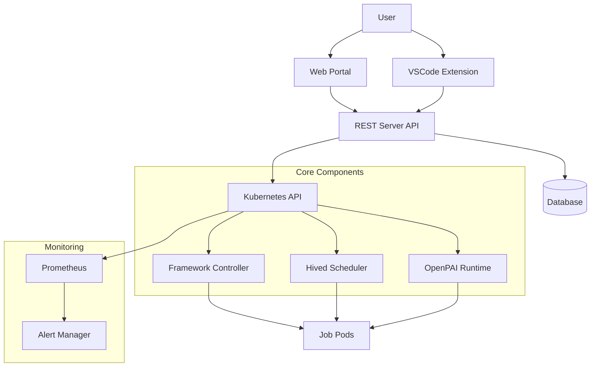
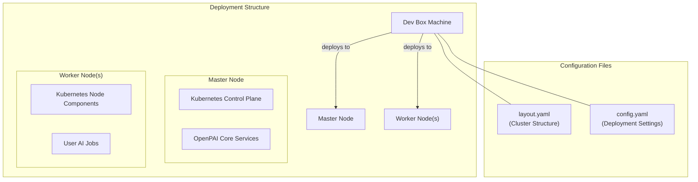
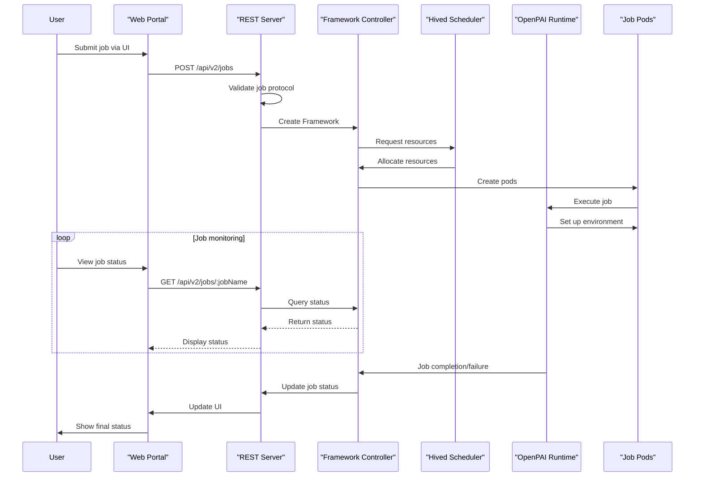
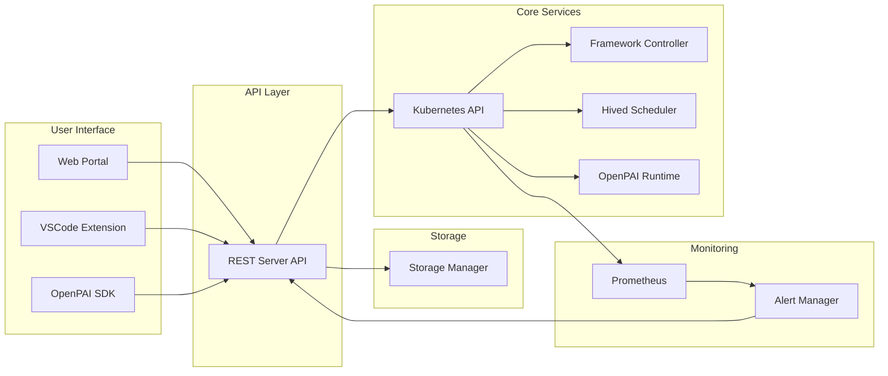

<!-- source: DeepWiki mcp.deepwiki.com · repo microsoft/pai · page 1 Overview · fetched 2026-10-26 -->

# Overview

Relevant source files

The following files were used as context for generating this wiki page:

- [README.md](README.md)
- [RELEASE_NOTE.md](RELEASE_NOTE.md)
- [contrib/debug-tools/docs/remote-debug-pai-job_zh_CN.md](contrib/debug-tools/docs/remote-debug-pai-job_zh_CN.md)
- [contrib/kubespray/config/config.yaml](contrib/kubespray/config/config.yaml)
- [docs/manual/cluster-admin/installation-guide.md](docs/manual/cluster-admin/installation-guide.md)
- [docs_zh_CN/manual/cluster-admin/installation-guide.md](docs_zh_CN/manual/cluster-admin/installation-guide.md)
- [version/K8S.VERSION](version/K8S.VERSION)
- [version/PAI.VERSION](version/PAI.VERSION)

OpenPAI (Open Platform for AI) is an open-source platform designed to manage AI workloads on Kubernetes. It provides a comprehensive solution for organizations to efficiently share and utilize computing resources (particularly GPU farms), manage AI assets, and simplify IT operations for AI workloads.

This documentation covers the OpenPAI system architecture, core components, installation requirements, and operational flows. For deployment instructions, refer to [Installation and Deployment](#2).

## What is OpenPAI?

OpenPAI is a full-stack solution that enables:

- Sharing powerful AI computing resources (GPU/FPGA farms) among teams
- Sharing and reusing common AI assets (models, data, environments)
- Easy IT operations platform for AI workloads
- Running complete training pipelines in one place

As of version 1.8.1 (current stable version), OpenPAI uses a pure Kubernetes-based architecture, having transitioned from its previous architecture that used Kubernetes combined with Hadoop YARN.

Sources: [README.md:79-84](), [README.md:228-230](), [version/PAI.VERSION:1-2]()

## System Architecture

OpenPAI follows a modular architecture with distinct components handling different aspects of the platform. Below is a high-level overview of the system architecture:

Sources: [README.md:11-12](), [README.md:154-163]()

### Core Components

OpenPAI consists of one main repository along with 7 standalone component repositories:

1. **hivedscheduler**: A specialized scheduler for multi-tenant GPU clusters, providing resource isolation, GPU topology guarantees, and efficient gang scheduling
2. **frameworkcontroller**: Orchestrates applications on Kubernetes with a single controller
3. **openpai-protocol**: Defines the job protocol specification for OpenPAI
4. **openpai-runtime**: Provides runtime support for the protocol, including error pattern classification
5. **openpaisdk**: JavaScript SDK for developers building upon OpenPAI
6. **openpaimarketplace**: Stores job examples and templates for sharing
7. **openpaivscode**: VSCode extension for connecting to OpenPAI clusters

Sources: [README.md:154-163](), [README.md:234-247]()

### Deployment Architecture

OpenPAI requires at least 3 separate machines for a minimal deployment:

- **Dev Box**: Controls masters and workers through SSH during installation and management
- **Master**: Runs Kubernetes control plane and core OpenPAI services (currently only one master supported)
- **Worker**: Executes user jobs with specialized hardware (GPU, CPU, etc.)

Sources: [docs/manual/cluster-admin/installation-guide.md:9-146]()

## Job Lifecycle

The following sequence diagram illustrates how a job flows through the OpenPAI system:

Sources: [README.md:143-151]()

## Supported Features

OpenPAI provides a range of features for both users and administrators:

### For Cluster Users

- **Job Management**: Submit and monitor AI jobs through Web Portal or SDK
- **Resource Allocation**: Access to specialized computing resources (GPU, CPU, etc.)
- **Data Management**: Use cluster-provisioned storage or custom storage
- **Collaboration**: Share job templates through marketplace
- **Tools**: Web Portal, VSCode extension, and command-line tools

### For Cluster Administrators

- **Cluster Management**: Add/remove nodes, monitor services
- **User Management**: Manage users and permissions
- **Resource Isolation**: Create virtual clusters for teams
- **Monitoring & Alerts**: Track cluster health and usage
- **Customization**: Extend functionality through plugins

Sources: [README.md:102-151]()

## Infrastructure Support

OpenPAI supports various types of computing hardware:

- CPU workers
- NVIDIA GPU workers
- AMD GPU workers
- Enflame DTU workers
- Other specialized computing hardware (TPU, NPU, etc.)

OpenPAI also supports two schedulers:
- **Hived Scheduler** (default): Supports virtual cluster division, topology-aware resource guarantee
- **Kubernetes Default Scheduler**: Used for specialized hardware beyond CPU/NVIDIA GPU

Sources: [docs/manual/cluster-admin/installation-guide.md:67-79]()

## Component Interaction

The following diagram illustrates how different components of OpenPAI interact with each other:

Sources: [README.md:17-55]()

## Installation Overview

The installation of OpenPAI involves three main steps:

1. **Preparation**: Create configuration files (`layout.yaml` and `config.yaml`)
2. **Kubernetes Installation**: Deploy Kubernetes using Kubespray
3. **OpenPAI Services Installation**: Deploy OpenPAI services on Kubernetes

The installation requires careful configuration of the dev box, master node, and worker nodes, with specific hardware and software requirements for each.

For detailed installation instructions, refer to [Installation and Deployment](#2).

Sources: [docs/manual/cluster-admin/installation-guide.md:148-153](), [docs/manual/cluster-admin/installation-guide.md:401-411]()

## Version History

OpenPAI has gone through significant changes over time. The current stable version is v1.8.1 (released December 2021).

Key architectural changes:

| Component | Before v1.0.0 | v1.0.0 and later |
|-----------|---------------|------------------|
| Architecture | Kubernetes + Hadoop YARN | Pure Kubernetes |
| Scheduler | YARN Scheduler | HiveD / K8S default |
| Job Orchestrating | YARN Framework Launcher | Framework Controller |
| Storage | Team-wise storage plugin | PV/PVC storage sharing |
| API | v1 + v2 | Pure v2 |

For complete release notes, refer to the [RELEASE_NOTE.md]() file.

Sources: [docs/manual/cluster-admin/installation-guide.md:3-4](), [docs/manual/cluster-admin/installation-guide.md:121-129](), [RELEASE_NOTE.md:3-8]()

## Current Status

As of the release of v1.8.1, OpenPAI has entered stable mode with no major feature releases planned. The repository is in read-only mode, and for collaboration, users should contact repository administrators directly.

Sources: [README.md:9-10]()

---

