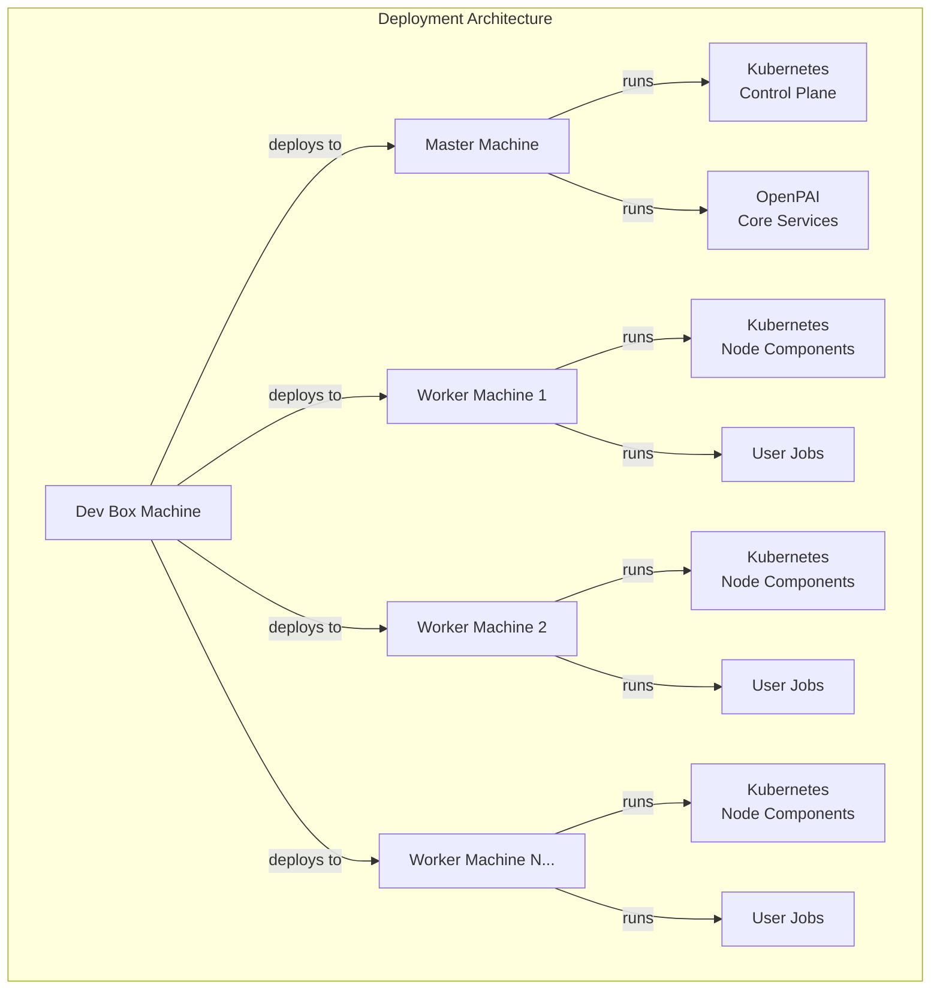
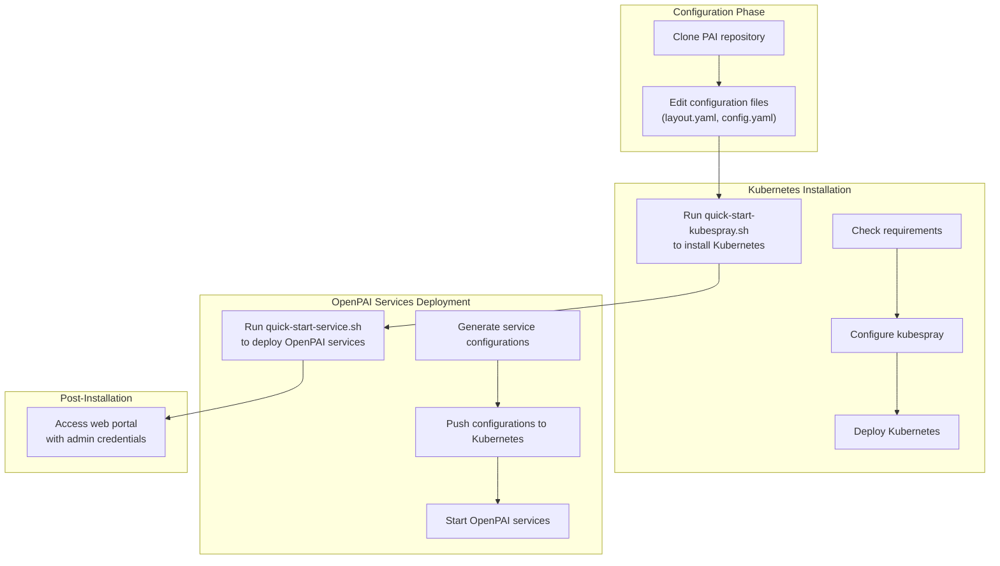
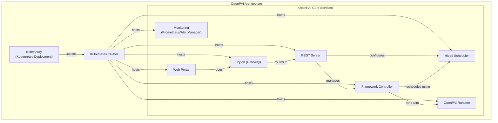

<!-- source: DeepWiki mcp.deepwiki.com · repo microsoft/pai · page 2 Installation and Deployment · fetched 2026-10-26 -->

# Installation and Deployment

<details>
<summary>Relevant source files</summary>

The following files were used as context for generating this wiki page:

- [README.md](README.md)
- [RELEASE_NOTE.md](RELEASE_NOTE.md)
- [contrib/debug-tools/docs/remote-debug-pai-job_zh_CN.md](contrib/debug-tools/docs/remote-debug-pai-job_zh_CN.md)
- [contrib/kubespray/config/config.yaml](contrib/kubespray/config/config.yaml)
- [contrib/kubespray/pre-installation.yml](contrib/kubespray/pre-installation.yml)
- [contrib/kubespray/quick-start-service.sh](contrib/kubespray/quick-start-service.sh)
- [contrib/kubespray/requirement.sh](contrib/kubespray/requirement.sh)
- [contrib/kubespray/roles/kubectl/tasks/main.yml](contrib/kubespray/roles/kubectl/tasks/main.yml)
- [contrib/kubespray/roles/pre-installation/defaults/main.yml](contrib/kubespray/roles/pre-installation/defaults/main.yml)
- [contrib/kubespray/roles/pre-installation/tasks/main.yml](contrib/kubespray/roles/pre-installation/tasks/main.yml)
- [contrib/kubespray/roles/set-python3/defaults/main.yml](contrib/kubespray/roles/set-python3/defaults/main.yml)
- [contrib/kubespray/roles/set-python3/tasks/main.yml](contrib/kubespray/roles/set-python3/tasks/main.yml)
- [contrib/kubespray/script/__init__.py](contrib/kubespray/script/__init__.py)
- [contrib/kubespray/script/configuration-kubespray.sh](contrib/kubespray/script/configuration-kubespray.sh)
- [contrib/kubespray/script/kubernetes-boot.sh](contrib/kubespray/script/kubernetes-boot.sh)
- [contrib/kubespray/script/requirements.txt](contrib/kubespray/script/requirements.txt)
- [contrib/kubespray/script/service-boot.sh](contrib/kubespray/script/service-boot.sh)
- [contrib/kubespray/script/start-service-in-dev-box.sh](contrib/kubespray/script/start-service-in-dev-box.sh)
- [contrib/kubespray/set-host-daemon-port-range.yml](contrib/kubespray/set-host-daemon-port-range.yml)
- [contrib/kubespray/set-kubectl.yml](contrib/kubespray/set-kubectl.yml)
- [docs/manual/cluster-admin/installation-guide.md](docs/manual/cluster-admin/installation-guide.md)
- [docs_zh_CN/manual/cluster-admin/installation-guide.md](docs_zh_CN/manual/cluster-admin/installation-guide.md)
- [src/dev-box/build/dev-box.common.dockerfile](src/dev-box/build/dev-box.common.dockerfile)
- [src/pylon/build/pylon.common.dockerfile](src/pylon/build/pylon.common.dockerfile)
- [version/K8S.VERSION](version/K8S.VERSION)
- [version/PAI.VERSION](version/PAI.VERSION)

</details>


This document provides a comprehensive guide on how to install and deploy OpenPAI (Platform for AI) on a cluster of machines. OpenPAI is designed to help organizations manage AI computing resources and run deep learning workloads efficiently.

## Overview

Since version 1.0.0, OpenPAI has adopted a pure Kubernetes-based architecture, moving away from the previous Yarn and Kubernetes hybrid approach. This guide focuses on deploying this modern version of OpenPAI.

The installation process consists of three main steps:
1. Preparing configuration files
2. Starting Kubernetes
3. Deploying OpenPAI services

## Installation Requirements

The deployment of OpenPAI requires at least 3 separate machines:



Sources: [docs/manual/cluster-admin/installation-guide.md:9-146]()), [contrib/kubespray/script/service-boot.sh:1-58]()

### Machine Requirements

#### Dev Box Machine

| Hardware Requirements | Software Requirements |
|------------------------|------------------------|
| - Ability to communicate with all other machines<br>- Separate from the cluster<br>- Internet access (particularly Docker Hub) | - Ubuntu 16.04 (18.04, 20.04 should work)<br>- SSH service enabled<br>- Passwordless SSH to all other machines<br>- Docker installed |

#### Master Machine

| Hardware Requirements | Software Requirements |
|------------------------|------------------------|
| - At least 40GB of free memory<br>- Static LAN IP address<br>- Communication with all other machines<br>- Internet access | - Ubuntu 16.04 (18.04, 20.04 should work)<br>- SSH service enabled<br>- Same username/password as worker machines<br>- Docker installed<br>- NTP service enabled<br>- Dedicated for OpenPAI |

#### Worker Machines

OpenPAI supports various types of worker machines:

| Worker Type | Hardware Requirements | Additional Software Requirements |
|-------------|------------------------|----------------------------------|
| CPU Worker | - At least 16GB of free memory<br>- Static LAN IP address<br>- Internet access | Same as master |
| NVIDIA GPU Worker | Same as CPU worker | - NVIDIA GPU Driver<br>- nvidia-container-runtime (configured as Docker default runtime) |
| Other Computing Devices<br>(TPU, NPU, etc.) | Same as CPU worker | - Device driver<br>- Container runtime for the device<br>- Device plugin for Kubernetes |

Sources: [docs/manual/cluster-admin/installation-guide.md:9-146]()

## Installation Process

### 1. Prepare Configuration Files

First, clone the OpenPAI repository and switch to the desired version:

```bash
git clone https://github.com/microsoft/pai.git
cd pai
git checkout v1.8.1
```

Edit the following configuration files in the `<pai-code-dir>/contrib/kubespray/config` directory:

#### layout.yaml

This file defines your cluster's machine layout:

```yaml
machine-sku:
  master-machine:
    mem: 60Gi
    cpu:
      vcore: 24
  gpu-machine:
    computing-device:
      type: nvidia.com/gpu
      model: K80
      count: 4
    mem: 220Gi
    cpu:
      vcore: 24

machine-list:
  - hostname: pai-master
    hostip: 10.0.0.1
    machine-type: master-machine
    pai-master: "true"
  - hostname: pai-worker1
    hostip: 10.0.0.2
    machine-type: gpu-machine
    pai-worker: "true"
  - hostname: pai-worker2
    hostip: 10.0.0.3
    machine-type: gpu-machine
    pai-worker: "true"
```

#### config.yaml

This file contains configuration settings for both Kubernetes and OpenPAI:

```yaml
user: username
password: password
docker_image_tag: v1.8.1

# Optional settings can be uncommented and modified as needed
# enable_hived_scheduler: true
# enable_docker_cache: true
# openpai_kube_network_plugin: calico
```

Sources: [docs/manual/cluster-admin/installation-guide.md:154-323]()), [contrib/kubespray/config/config.yaml:1-96]()

### 2. Start Kubernetes

Navigate to the Kubespray directory and run the installation script:

```bash
cd <pai-code-dir>/contrib/kubespray
/bin/bash quick-start-kubespray.sh
```

This script performs several key actions:
1. Validates your environment requirements
2. Creates Kubernetes configuration based on your files
3. Uses Kubespray to install Kubernetes on all machines

If successful, you'll see output indicating how to set up kubectl:

```
You can run the following commands to set up kubectl on your localhost:
ansible-playbook -i ${HOME}/pai-deploy/kubespray/inventory/pai/hosts.yml set-kubectl.yml --ask-become-pass
```

The Kubernetes configuration file will be placed at `~/pai-deploy/kube/config`.

Sources: [docs/manual/cluster-admin/installation-guide.md:324-376]()), [contrib/kubespray/script/kubernetes-boot.sh:1-15]()

### 3. Deploy OpenPAI Services

After Kubernetes is successfully installed, deploy OpenPAI services:

```bash
/bin/bash quick-start-service.sh
```

This script will:
1. Save your configuration files to the deployment directory
2. Generate OpenPAI service configurations
3. Start all OpenPAI services on the Kubernetes cluster

If successful, you'll see output similar to:

```
Kubernetes cluster config :     ~/pai-deploy/kube/config
OpenPAI cluster config    :     ~/pai-deploy/cluster-cfg
OpenPAI cluster ID        :     pai
Default username          :     admin
Default password          :     admin-password

You can go to http://<your-master-ip>, then use the default username and password to log in.
```

Sources: [docs/manual/cluster-admin/installation-guide.md:377-397]()), [contrib/kubespray/quick-start-service.sh:1-16]()), [contrib/kubespray/script/service-boot.sh:1-58](), [contrib/kubespray/script/start-service-in-dev-box.sh:1-17]()

## Installation Flow Diagram



Sources: [docs/manual/cluster-admin/installation-guide.md:148-410]()), [contrib/kubespray/script/start-service-in-dev-box.sh:1-17]()

## Component Architecture



Sources: [README.md:1-221]()), [docs/manual/cluster-admin/installation-guide.md:67-78]()

## Post-Installation

After successful installation, you should:

1. Keep the `~/pai-deploy` folder for future maintenance and operations
2. Record your OpenPAI cluster ID (default is `pai`)
3. Access the web portal at `http://<master-ip>` with the default credentials:
   - Username: `admin`
   - Password: `admin-password`

The most important files in the deployment folder are:
- Kubernetes cluster config (`~/pai-deploy/kube/config`)
- OpenPAI cluster config (`~/pai-deploy/cluster-cfg`)

Sources: [docs/manual/cluster-admin/installation-guide.md:399-410](), [contrib/kubespray/script/service-boot.sh:47-57]()

## Special Considerations

### For Azure Users
If deploying on Azure, uncomment and change the network plugin configuration:
```yaml
openpai_kube_network_plugin: weave
```
This is because Azure doesn't support Calico networking.

### For Chinese Users
If deploying in mainland China, you may encounter network issues. Refer to [this issue](https://github.com/microsoft/pai/issues/5592) for special configuration options, including:
- Docker registry mirrors
- Kubernetes image repositories

### For Non-Standard Computing Devices
When using worker types other than CPU or NVIDIA GPU:
1. Set `enable_hived_scheduler: false` in your config
2. Manually deploy the appropriate device plugin after Kubernetes installation

Sources: [docs/manual/cluster-admin/installation-guide.md:321-323]()), [docs/manual/cluster-admin/installation-guide.md:172-173]()), [docs/manual/cluster-admin/installation-guide.md:313-314]()), [docs/manual/cluster-admin/installation-guide.md:398]()

## Troubleshooting

If you encounter issues during installation:

1. Verify that all installation requirements are met using:
   ```bash
   /bin/bash requirement.sh -l config/layout.yaml -c config/config.yaml
   ```

2. Check network connectivity, especially to Docker Hub and other required services

3. Refer to the [installation FAQs and troubleshooting guide](#7.1) for common issues and solutions

4. For network-related issues, search for solutions combining the error with "kubespray" as a keyword

Sources: [docs/manual/cluster-admin/installation-guide.md:354-366]()), [contrib/kubespray/requirement.sh:1-32]()

---

