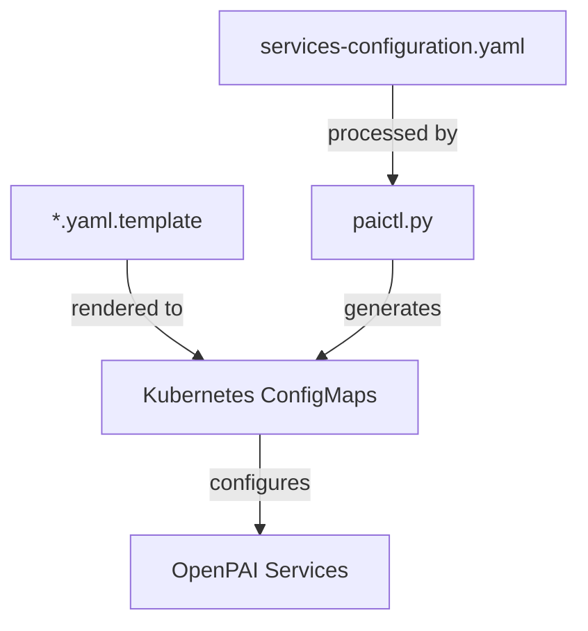
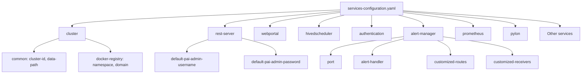
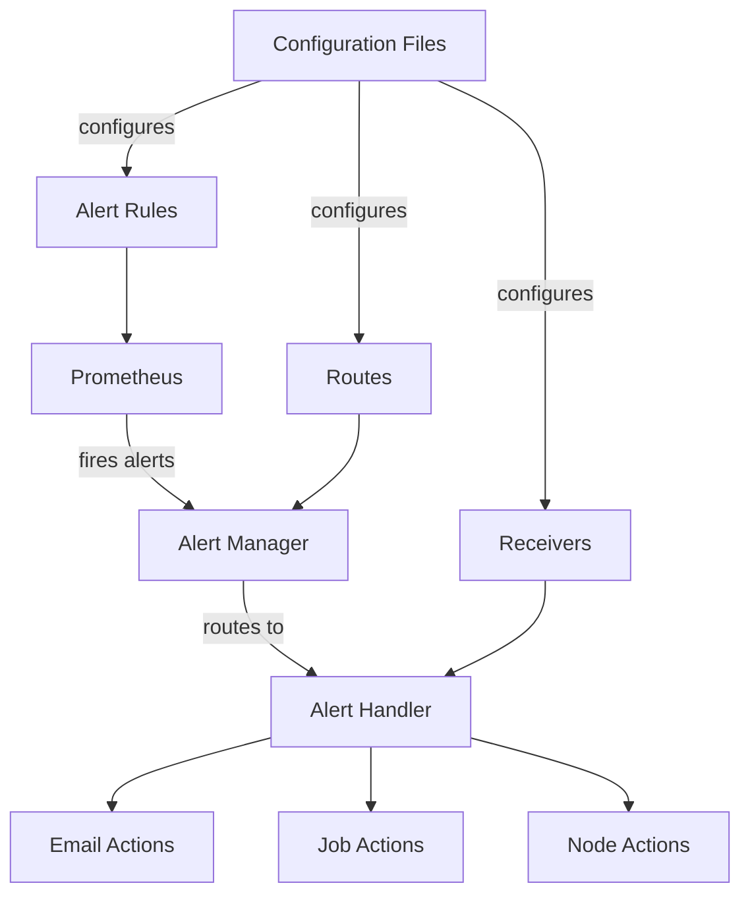
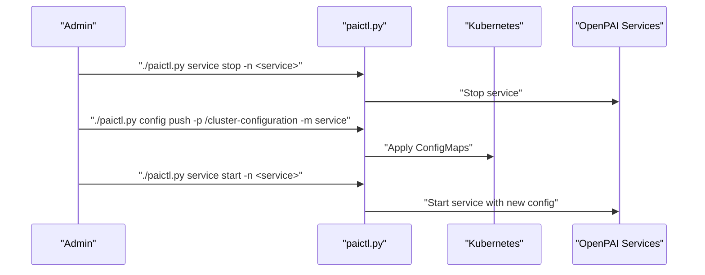
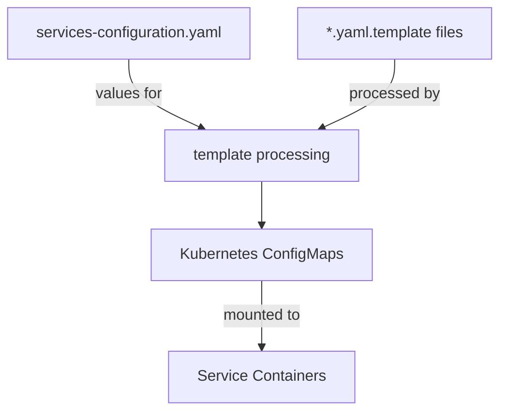

<!-- source: DeepWiki mcp.deepwiki.com · repo microsoft/pai · page 2.1 Configuration Files · fetched 2026-10-26 -->

# Configuration Files

<details>
<summary>Relevant source files</summary>

The following files were used as context for generating this wiki page:

- [contrib/kubespray/quick-start/services-configuration.yaml.template](contrib/kubespray/quick-start/services-configuration.yaml.template)
- [deployment/quick-start/services-configuration.yaml.template](deployment/quick-start/services-configuration.yaml.template)
- [docs/manual/cluster-admin/how-to-use-alert-system.md](docs/manual/cluster-admin/how-to-use-alert-system.md)
- [docs_zh_CN/manual/cluster-admin/how-to-use-alert-system.md](docs_zh_CN/manual/cluster-admin/how-to-use-alert-system.md)
- [examples/cluster-configuration/services-configuration.yaml](examples/cluster-configuration/services-configuration.yaml)
- [src/alert-manager/build/alert-handler.common.dockerfile](src/alert-manager/build/alert-handler.common.dockerfile)
- [src/alert-manager/build/build-pre.sh](src/alert-manager/build/build-pre.sh)
- [src/alert-manager/build/cert-expiration-checker.common.dockerfile](src/alert-manager/build/cert-expiration-checker.common.dockerfile)
- [src/alert-manager/build/cluster-utilization.common.dockerfile](src/alert-manager/build/cluster-utilization.common.dockerfile)
- [src/alert-manager/build/job-status-change-notification.common.dockerfile](src/alert-manager/build/job-status-change-notification.common.dockerfile)
- [src/alert-manager/build/nvidia-gpu-low-perf-fixer.common.dockerfile](src/alert-manager/build/nvidia-gpu-low-perf-fixer.common.dockerfile)
- [src/alert-manager/config/alert-manager.md](src/alert-manager/config/alert-manager.md)
- [src/alert-manager/config/alert-manager.yaml](src/alert-manager/config/alert-manager.yaml)
- [src/alert-manager/config/alert_manager.py](src/alert-manager/config/alert_manager.py)
- [src/alert-manager/deploy/alert-manager-configmap.yaml.template](src/alert-manager/deploy/alert-manager-configmap.yaml.template)
- [src/alert-manager/deploy/alert-manager-deployment.yaml.template](src/alert-manager/deploy/alert-manager-deployment.yaml.template)
- [src/alert-manager/deploy/service.yaml](src/alert-manager/deploy/service.yaml)
- [src/alert-manager/deploy/start.sh.template](src/alert-manager/deploy/start.sh.template)
- [src/alert-manager/deploy/stop.sh](src/alert-manager/deploy/stop.sh)
- [src/alert-manager/src/alert-handler/controllers/mail.js](src/alert-manager/src/alert-handler/controllers/mail.js)
- [src/alert-manager/src/alert-handler/index.js](src/alert-manager/src/alert-handler/index.js)
- [src/alert-manager/src/cert-expiration-checker/__init__.py](src/alert-manager/src/cert-expiration-checker/__init__.py)
- [src/alert-manager/src/cert-expiration-checker/pylintrc](src/alert-manager/src/cert-expiration-checker/pylintrc)
- [src/alert-manager/src/cert-expiration-checker/requirements.txt](src/alert-manager/src/cert-expiration-checker/requirements.txt)
- [src/alert-manager/src/cert-expiration-checker/send_alert.py](src/alert-manager/src/cert-expiration-checker/send_alert.py)
- [src/alert-manager/src/job-status-change-notification/.editorconfig](src/alert-manager/src/job-status-change-notification/.editorconfig)
- [src/alert-manager/src/job-status-change-notification/.eslintrc.js](src/alert-manager/src/job-status-change-notification/.eslintrc.js)
- [src/alert-manager/src/job-status-change-notification/controllers/alert.js](src/alert-manager/src/job-status-change-notification/controllers/alert.js)
- [src/alert-manager/src/job-status-change-notification/controllers/framework.js](src/alert-manager/src/job-status-change-notification/controllers/framework.js)
- [src/rest-server/src/config/index.js](src/rest-server/src/config/index.js)

</details>


This document details the configuration files in OpenPAI that control deployment, service behavior, and system settings. Configuration files are central to the installation, customization, and maintenance of an OpenPAI cluster.

## Core Configuration Files

OpenPAI uses YAML-based configuration files to control system behavior. The primary files are:

- `services-configuration.yaml` - Main configuration file for all services
- Template files (e.g., `services-configuration.yaml.template`) - Used during deployment
- Service-specific configuration maps (e.g., `alert-manager-configmap.yaml.template`)



Sources: [contrib/kubespray/quick-start/services-configuration.yaml.template](), [examples/cluster-configuration/services-configuration.yaml](), [deployment/quick-start/services-configuration.yaml.template]()

## Configuration Structure

The main `services-configuration.yaml` file is organized into sections for individual services:



Sources: [contrib/kubespray/quick-start/services-configuration.yaml.template:1-317]()

## Key Configuration Sections

### Cluster Configuration

The `cluster` section defines basic cluster settings and Docker registry configuration:

```yaml
cluster:
  common:
    cluster-id: pai
    cluster-type: k8s
    data-path: "/datastorage"
    
  docker-registry:
    namespace: openpai
    domain: docker.io
    tag: latest
    secret-name: pai-secret
```

Sources: [contrib/kubespray/quick-start/services-configuration.yaml.template:1-37]()

### REST Server Configuration

The `rest-server` section configures the REST API server:

```yaml
rest-server:
  default-pai-admin-username: admin
  default-pai-admin-password: admin-password
```

Sources: [contrib/kubespray/quick-start/services-configuration.yaml.template:64-70]()

### Authentication Configuration

The `authentication` section configures authentication methods and user group management:

```yaml
authentication:
  OIDC: false
  # OIDC settings when enabled
  
  group-manager:
    group-data-source: basic
    admin-group:
      groupname: admingroup
      description: "admin's group"
```

Sources: [contrib/kubespray/quick-start/services-configuration.yaml.template:130-196]()

## Alert System Configuration

The alert system is one of the most complex configuration areas in OpenPAI. It consists of several components that work together.

### Alert System Architecture



Sources: [docs/manual/cluster-admin/how-to-use-alert-system.md:5-21]()

### Alert Configuration Components

The alert system has three main configuration components:

1. **Alert Rules** (in Prometheus configuration):
   ```yaml
   prometheus:
     customized-alerts: |
       groups:
       - name: customized-alerts
         rules:
         - alert: PAIJobGpuPercentLowerThan0_3For1h
           expr: avg(task_gpu_percent{virtual_cluster=~"default"}) by (job_name, username) < 0.3
           for: 1h
           labels:
             severity: warn
   ```

2. **Alert Routes** (in Alert Manager configuration):
   ```yaml
   alert-manager:
     customized-routes:
       routes:
       - receiver: pai-email-admin-user-and-stop-job
         match:
           alertname: PAIJobGpuPercentLowerThan0_3For1h
   ```

3. **Alert Receivers** (in Alert Manager configuration):
   ```yaml
   alert-manager:
     customized-receivers:
     - name: "pai-email-admin-user-and-stop-job"
       actions:
         email-admin:
         email-user:
           template: 'kill-low-efficiency-job-alert'
         stop-jobs:
         tag-jobs:
           tags:
           - 'stopped-by-alert-manager'
   ```

Sources: [contrib/kubespray/quick-start/services-configuration.yaml.template:215-255](), [docs/manual/cluster-admin/how-to-use-alert-system.md:35-53]()

### Alert Action Dependencies

Different alert actions have different configuration dependencies:

| Action | Requires `email-configs` | Requires `pai-bearer-token` |
|--------|--------------------------|----------------------------|
| cordon-nodes | No | No |
| email-admin | Yes | No |
| email-user | Yes | Yes |
| stop-jobs | No | Yes |
| tag-jobs | No | Yes |
| fix-nvidia-gpu-low-perf | No | No |

Sources: [src/alert-manager/config/alert_manager.py:77-83](), [docs/manual/cluster-admin/how-to-use-alert-system.md:112-128]()

### Email Configuration

To enable email notifications for alerts, configure the `email-configs` section:

```yaml
alert-manager:
  alert-handler:
    email-configs:
      admin-receiver: addr-of-admin-receiver@example.com
      smtp-host: smtp.office365.com
      smtp-port: 587
      smtp-from: alert-sender@example.com
      smtp-auth-username: alert-sender@example.com
      smtp-auth-password: password-for-alert-sender
```

Sources: [src/alert-manager/deploy/alert-manager-deployment.yaml.template:83-95](), [src/alert-manager/src/alert-handler/controllers/mail.js:25-33]()

## HiveD Scheduler Configuration

The `hivedscheduler` section configures the resource scheduler that manages GPU allocation:

```yaml
hivedscheduler:
  config: |
    physicalCluster:
      skuTypes:
        gpu-type:
          gpu: 1
          cpu: 5
          memory: 40Gi
      cellTypes:
        gpu-type-NODE:
          childCellType: gpu-type
          childCellNumber: 4
          isNodeLevel: true
    virtualClusters:
      default:
        virtualCells:
        - cellType: gpu-type-NODE
          cellNumber: 2
```

Sources: [contrib/kubespray/quick-start/services-configuration.yaml.template:78-126]()

## Configuration Deployment Process

The configuration deployment process involves updating configuration files and applying them to the cluster:



Example for updating alert-manager configuration:

```bash
./paictl.py service stop -n alert-manager
./paictl.py config push -p /cluster-configuration -m service
./paictl.py service start -n alert-manager
```

Sources: [docs/manual/cluster-admin/how-to-use-alert-system.md:60-65]()

## Configuration Files Generated During Deployment

During deployment, template files are processed to generate actual configuration files. For example, the `alert-manager-configmap.yaml.template` is processed to create ConfigMaps in Kubernetes:



Sources: [src/alert-manager/deploy/alert-manager-configmap.yaml.template](), [src/alert-manager/deploy/start.sh.template:20-41]()

## Prometheus Configuration

The `prometheus` section configures the monitoring system and alert rules:

```yaml
prometheus:
  port: 9091
  scrape_interval: 30
  customized-alerts: |
    groups:
    - name: customized-alerts
      rules:
      - alert: PAIJobGpuPercentLowerThan0_3For1h
        expr: avg(task_gpu_percent{virtual_cluster=~"default"}) by (job_name, username) < 0.3
        for: 1h
        labels:
          severity: warn
```

Sources: [contrib/kubespray/quick-start/services-configuration.yaml.template:260-275]()

## Handling Service-Specific Configuration Changes

To apply configuration changes to a specific service:

1. **Stop the service**:
   ```bash
   ./paictl.py service stop -n <service-name>
   ```

2. **Push the updated configuration**:
   ```bash
   ./paictl.py config push -p /cluster-configuration -m service
   ```

3. **Start the service**:
   ```bash
   ./paictl.py service start -n <service-name>
   ```

Sources: [docs/manual/cluster-admin/how-to-use-alert-system.md:199-206]()

## Common Configuration Scenarios

### Adding a Customized Alert

```yaml
prometheus:
  customized-alerts: |
    groups:
    - name: customized-alerts
      rules:
      - alert: PAIJobGpuPercentLowerThan0_3For1h
        expr: avg(task_gpu_percent{virtual_cluster=~"default"}) by (job_name, username) < 0.3
        for: 1h
        labels:
          severity: warn
        annotations:
          summary: "{{$labels.job_name}} has a job gpu percent lower than 30% for 1 hour"
```

Sources: [docs/manual/cluster-admin/how-to-use-alert-system.md:40-53]()

### Configuring Alert Actions

```yaml
alert-manager:
  customized-receivers:
  - name: "pai-email-admin-user-and-stop-job"
    actions:
      email-admin:
      email-user:
        template: 'kill-low-efficiency-job-alert'
      stop-jobs:
      tag-jobs:
        tags:
        - 'stopped-by-alert-manager'
```

Sources: [docs/manual/cluster-admin/how-to-use-alert-system.md:160-171]()

### Setting Up OIDC Authentication

```yaml
authentication:
  OIDC: true
  OIDC-type: AAD
  
  AAD:
    wellKnownURL: https://login.microsoftonline.com/{tenantID}/v2.0/.well-known/openid-configuration
    tenantID: <your-tenant-id>
    clientID: <your-client-id>
    clientSecret: '<your-client-secret>'
```

Sources: [contrib/kubespray/quick-start/services-configuration.yaml.template:134-152]()

## Conclusion

OpenPAI's configuration files, particularly `services-configuration.yaml`, provide comprehensive control over all aspects of the system. Understanding these files is essential for deploying, customizing, and maintaining an OpenPAI cluster. This document has covered the key configuration sections, their purpose, and how to apply configuration changes.

For more details on service-specific configurations, refer to the documentation for individual services, such as the [Alert System](2.3).

---

