<!-- source: DeepWiki mcp.deepwiki.com · repo microsoft/pai · page 3 System Architecture · fetched 2026-10-26 -->

# System Architecture

Relevant source files

The following files were used as context for generating this wiki page:

- [README.md](README.md)
- [RELEASE_NOTE.md](RELEASE_NOTE.md)
- [contrib/debug-tools/docs/remote-debug-pai-job_zh_CN.md](contrib/debug-tools/docs/remote-debug-pai-job_zh_CN.md)
- [contrib/kubespray/config/config.yaml](contrib/kubespray/config/config.yaml)
- [docs/manual/cluster-admin/installation-guide.md](docs/manual/cluster-admin/installation-guide.md)
- [docs_zh_CN/manual/cluster-admin/installation-guide.md](docs_zh_CN/manual/cluster-admin/installation-guide.md)
- [src/database-controller/src/write-merger/app.js](src/database-controller/src/write-merger/app.js)
- [src/rest-server/config/rest-server.md](src/rest-server/config/rest-server.md)
- [src/rest-server/config/rest-server.yaml](src/rest-server/config/rest-server.yaml)
- [src/rest-server/config/rest_server.py](src/rest-server/config/rest_server.py)
- [src/rest-server/deploy/rest-server.yaml.template](src/rest-server/deploy/rest-server.yaml.template)
- [src/rest-server/docs/swagger.yaml](src/rest-server/docs/swagger.yaml)
- [src/rest-server/package.json](src/rest-server/package.json)
- [src/rest-server/src/config/express.js](src/rest-server/src/config/express.js)
- [src/rest-server/src/config/launcher.js](src/rest-server/src/config/launcher.js)
- [src/rest-server/src/config/schedule-port.js](src/rest-server/src/config/schedule-port.js)
- [src/rest-server/src/controllers/internal/tail-log.js](src/rest-server/src/controllers/internal/tail-log.js)
- [src/rest-server/src/controllers/v2/job.js](src/rest-server/src/controllers/v2/job.js)
- [src/rest-server/src/controllers/v2/task.js](src/rest-server/src/controllers/v2/task.js)
- [src/rest-server/src/models/v2/job/index.js](src/rest-server/src/models/v2/job/index.js)
- [src/rest-server/src/models/v2/job/k8s.js](src/rest-server/src/models/v2/job/k8s.js)
- [src/rest-server/src/models/v2/job/log.js](src/rest-server/src/models/v2/job/log.js)
- [src/rest-server/src/models/v2/task.js](src/rest-server/src/models/v2/task.js)
- [src/rest-server/src/models/v2/utils/frameworkConverter.js](src/rest-server/src/models/v2/utils/frameworkConverter.js)
- [src/rest-server/src/models/v2/utils/name.js](src/rest-server/src/models/v2/utils/name.js)
- [src/rest-server/src/routes/internal/index.js](src/rest-server/src/routes/internal/index.js)
- [src/rest-server/src/routes/internal/tail-log.js](src/rest-server/src/routes/internal/tail-log.js)
- [src/rest-server/src/routes/v2/job.js](src/rest-server/src/routes/v2/job.js)
- [src/rest-server/src/utils/error.d.ts](src/rest-server/src/utils/error.d.ts)
- [src/rest-server/test/setup.js](src/rest-server/test/setup.js)
- [src/rest-server/yarn.lock](src/rest-server/yarn.lock)
- [tests/jenkins/test_rest_server_js_sdk.sh](tests/jenkins/test_rest_server_js_sdk.sh)
- [version/K8S.VERSION](version/K8S.VERSION)
- [version/PAI.VERSION](version/PAI.VERSION)

This document provides a comprehensive overview of OpenPAI's system architecture - a platform for running AI workloads on Kubernetes. It covers the core components, their interactions, and the underlying infrastructure that enables job submission, scheduling, execution, and monitoring.

## Overview

OpenPAI has evolved from a Yarn and Kubernetes-based architecture to a pure Kubernetes-based architecture since v1.0.0. This architecture provides better modularity, extensibility, and resource management capabilities.

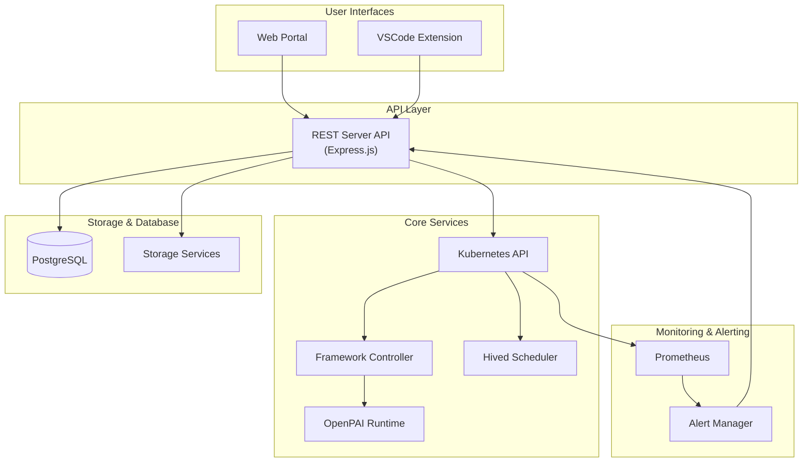

Sources:
- [README.md:10-57]()
- [src/rest-server/src/config/express.js:1-54]()
- [src/rest-server/src/controllers/v2/job.js:1-40]()
- [src/rest-server/package.json:1-92]()

## Core Components

OpenPAI consists of several core components that work together to provide a complete AI platform:

### REST Server

The REST Server is the central API service that handles all client requests. It processes job submissions, manages user authentication, and communicates with the Kubernetes API.

The REST server is implemented as an Express.js application and exposes APIs for:
- Job management (submit, list, get, delete)
- User and authentication management
- Virtual cluster management
- Storage management
- Monitoring and alerting

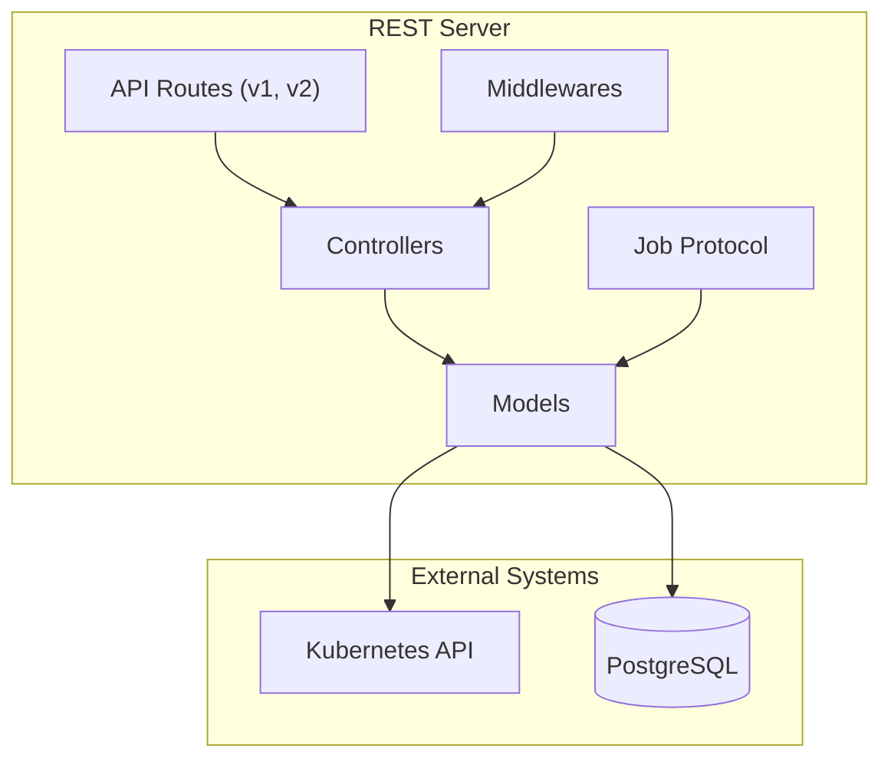

Sources:
- [src/rest-server/src/config/express.js:18-54]()
- [src/rest-server/src/controllers/v2/job.js:1-355]()
- [src/rest-server/src/routes/v2/job.js:1-108]()
- [src/rest-server/src/models/v2/job/k8s.js:1-150]()

### Framework Controller

The Framework Controller is a Kubernetes extension that orchestrates the execution of complex jobs with multiple task roles. It manages the lifecycle of jobs and handles retries, completions, and failures.

Key features:
- Supports gang scheduling
- Handles job retries
- Provides job status tracking
- Manages pod lifecycle

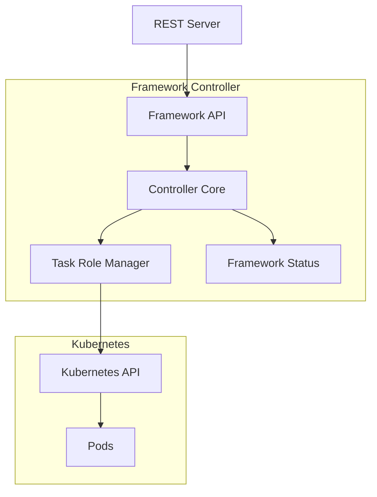

Sources:
- [src/rest-server/src/models/v2/job/k8s.js:351-805]()
- [README.md:40-42]()

### Hived Scheduler

Hived Scheduler is a specialized Kubernetes scheduler designed for deep learning workloads. It provides:
- GPU topology-aware scheduling
- Multi-level resource quota management (virtual clusters)
- Gang scheduling capabilities
- Support for heterogeneous hardware

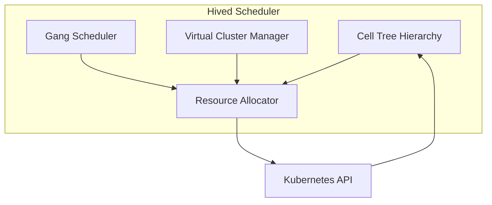

Sources:
- [src/rest-server/src/models/v2/job/k8s.js:650-674]()
- [README.md:43-45]()
- [docs/manual/cluster-admin/installation-guide.md:70-74]()

### OpenPAI Runtime

OpenPAI Runtime is responsible for setting up the execution environment for jobs within containers. It:
- Prepares the running environment for tasks
- Sets up storage mounts
- Handles logging and monitoring
- Manages the lifecycle of the actual user code

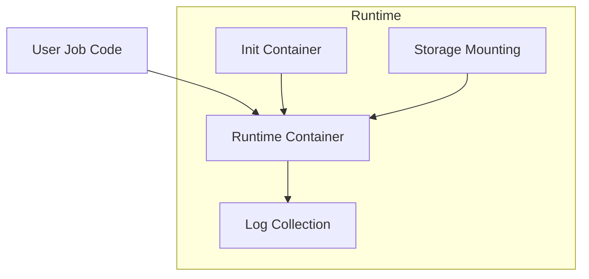

Sources:
- [src/rest-server/src/models/v2/job/k8s.js:435-476]()
- [src/rest-server/src/models/v2/job/k8s.js:479-534]()
- [README.md:47-49]()

## Job Lifecycle

The job lifecycle in OpenPAI involves several stages from submission to completion:

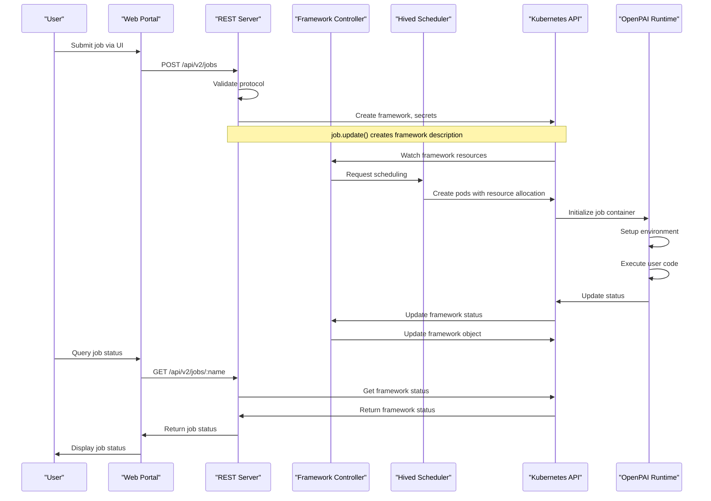

Sources:
- [src/rest-server/src/controllers/v2/job.js:177-229]()
- [src/rest-server/src/models/v2/job/k8s.js:679-805]()
- [src/rest-server/src/models/v2/job/k8s.js:351-618]()

## System Components and Data Flow

### REST Server API Flow

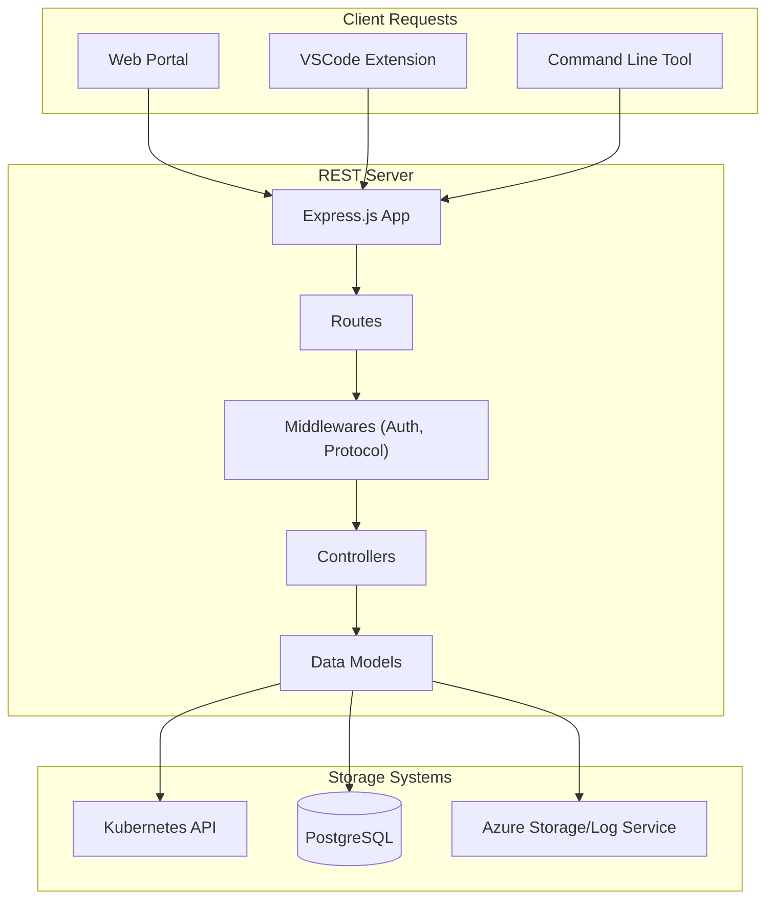

Sources:
- [src/rest-server/src/config/express.js:1-54]()
- [src/rest-server/src/routes/v2/job.js:1-108]()
- [src/rest-server/src/controllers/v2/job.js:1-355]()
- [src/rest-server/src/models/v2/job/k8s.js:1-100]()

### Job Submission and Execution Flow

```mermaid
flowchart LR
    subgraph "Job Submission Flow"
        UserProtocol["User Job Protocol"]
        ProtocolValid["Protocol Validation"]
        FrameworkGen["Framework Generation"]
        K8sObjects["K8s Objects Creation"]
    end
    
    subgraph "Execution Flow"
        FCWatch["Framework Controller Watch"]
        Scheduling["Scheduling (HivedScheduler)"]
        PodCreation["Pod Creation"]
        ContainerRun["Container Runtime Execution"]
    end
    
    subgraph "Status Flow"
        PodStatus["Pod Status Updates"]
        FCStatus["Framework Status Updates"]
        DBStatus["Database Status Records"]
        UserQuery["User Status Query"]
    end
    
    UserProtocol --> ProtocolValid
    ProtocolValid --> FrameworkGen
    FrameworkGen --> K8sObjects
    
    K8sObjects --> FCWatch
    FCWatch --> Scheduling
    Scheduling --> PodCreation
    PodCreation --> ContainerRun
    
    ContainerRun --> PodStatus
    PodStatus --> FCStatus
    FCStatus --> DBStatus
    DBStatus --> UserQuery
```

Sources:
- [src/rest-server/src/controllers/v2/job.js:185-205]()
- [src/rest-server/src/models/v2/job/k8s.js:679-805]()
- [src/rest-server/src/models/v2/job/k8s.js:962-1026]()

## Storage and Logging Architecture

OpenPAI provides storage and logging capabilities for jobs:

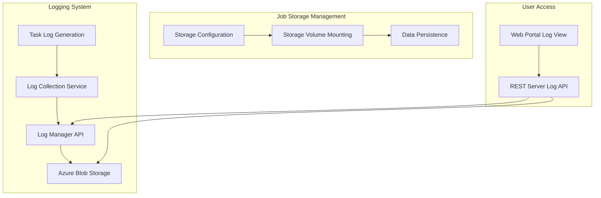

Sources:
- [src/rest-server/src/models/v2/job/k8s.js:599-617]()
- [src/rest-server/src/models/v2/job/log.js:1-90]()
- [src/rest-server/src/controllers/v2/job.js:320-341]()

## Monitoring and Alerting Architecture

OpenPAI includes monitoring and alerting capabilities:

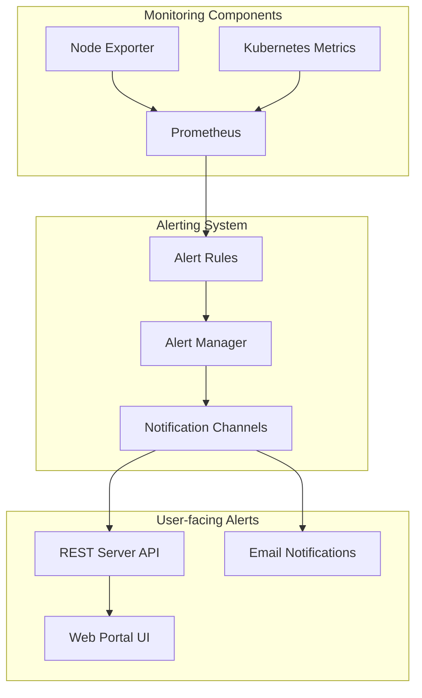

Sources:
- [src/rest-server/src/config/launcher.js:132-138]()
- [src/rest-server/config/rest-server.yaml:41-46]()
- [src/rest-server/deploy/rest-server.yaml.template:151-152]()

## Integration with Kubernetes

OpenPAI is deeply integrated with Kubernetes:

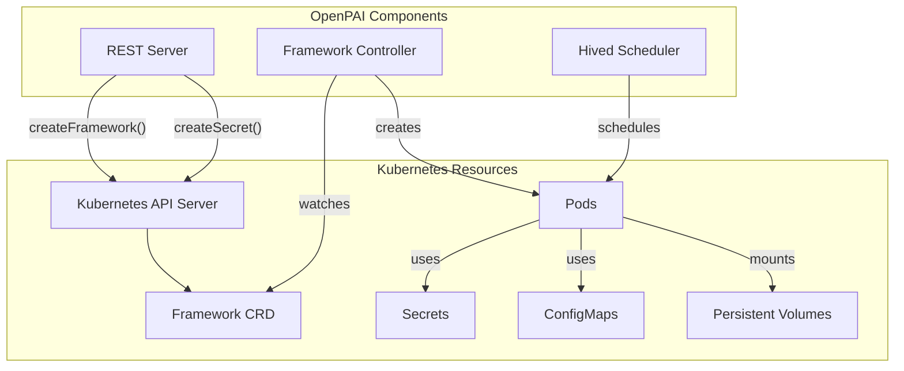

Sources:
- [src/rest-server/src/models/v2/job/k8s.js:694-805]()
- [src/rest-server/src/models/v2/job/k8s.js:822-885]()
- [src/rest-server/deploy/rest-server.yaml.template:18-188]()

## Database Schema

OpenPAI uses PostgreSQL for storing job information, user data, and other persistent information:

| Table | Description | Key Columns |
|-------|-------------|-------------|
| Framework | Stores job framework information | name, username, jobName, state, subState, executionType |
| FrameworkHistory | Stores historical job attempts | frameworkName, attemptIndex, snapshot |
| Tag | Stores tags associated with jobs | name, frameworkName |
| User | Stores user information | username, password, admin, email |
| Group | Stores group information | groupname, description |
| Namespace | Stores virtual cluster information | name, description |
| Storage | Stores storage configuration | name, mountPath, share |

Sources:
- [src/rest-server/src/models/v2/job/k8s.js:933-961]()
- [src/rest-server/package.json:58-61]()
- [src/rest-server/src/config/launcher.js:98-101]()

## Security and Authentication

OpenPAI supports multiple authentication methods:

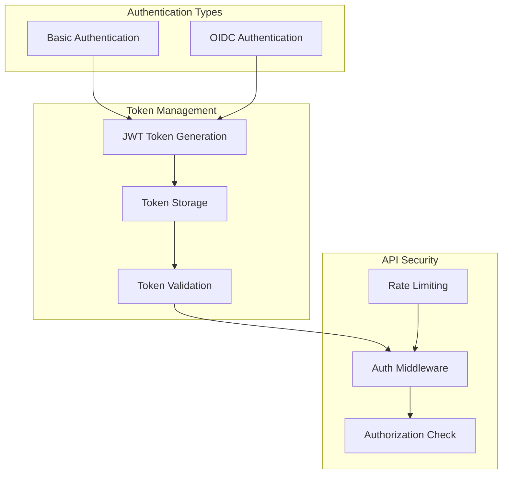

Sources:
- [src/rest-server/docs/swagger.yaml:77-278]()
- [src/rest-server/config/rest-server.yaml:25-35]()
- [src/rest-server/deploy/rest-server.yaml.template:98-120]()

## Conclusion

OpenPAI has a modular architecture built on Kubernetes that enables efficient management and execution of AI workloads. The REST Server provides the central API interface, while specialized components like Framework Controller and Hived Scheduler handle job orchestration and resource allocation. Storage, logging, monitoring, and security systems are integrated to provide a complete platform for AI development and execution.

---

