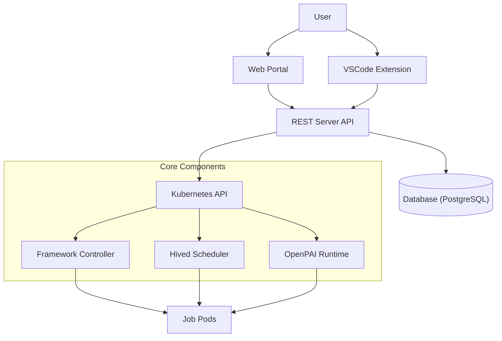
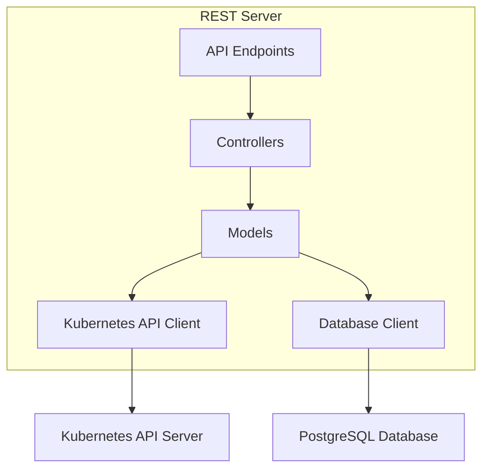
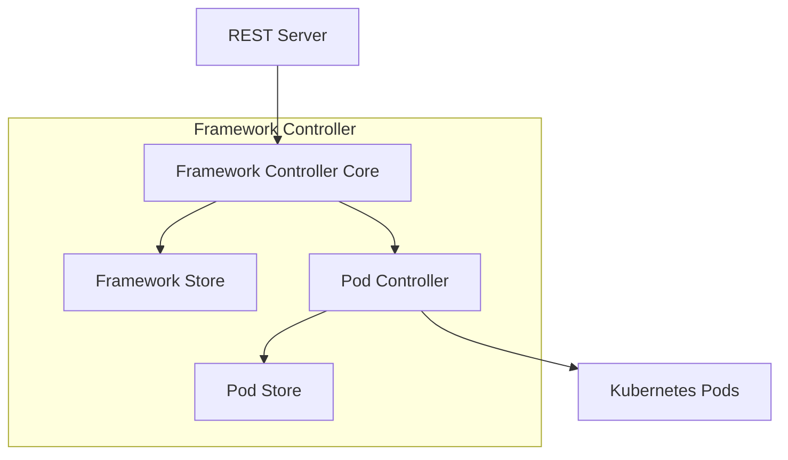
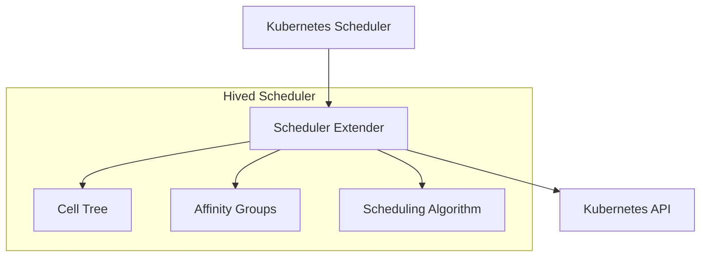
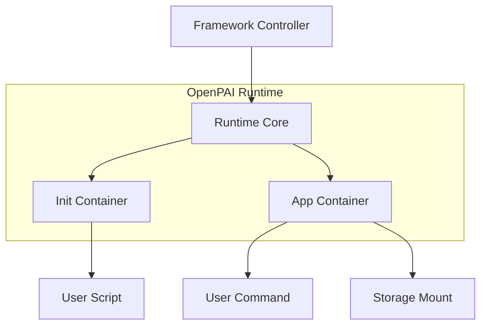
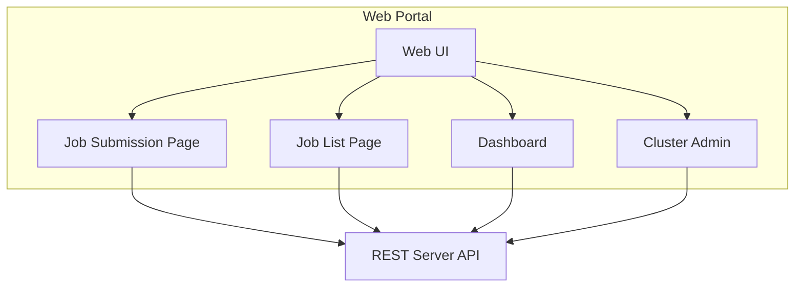
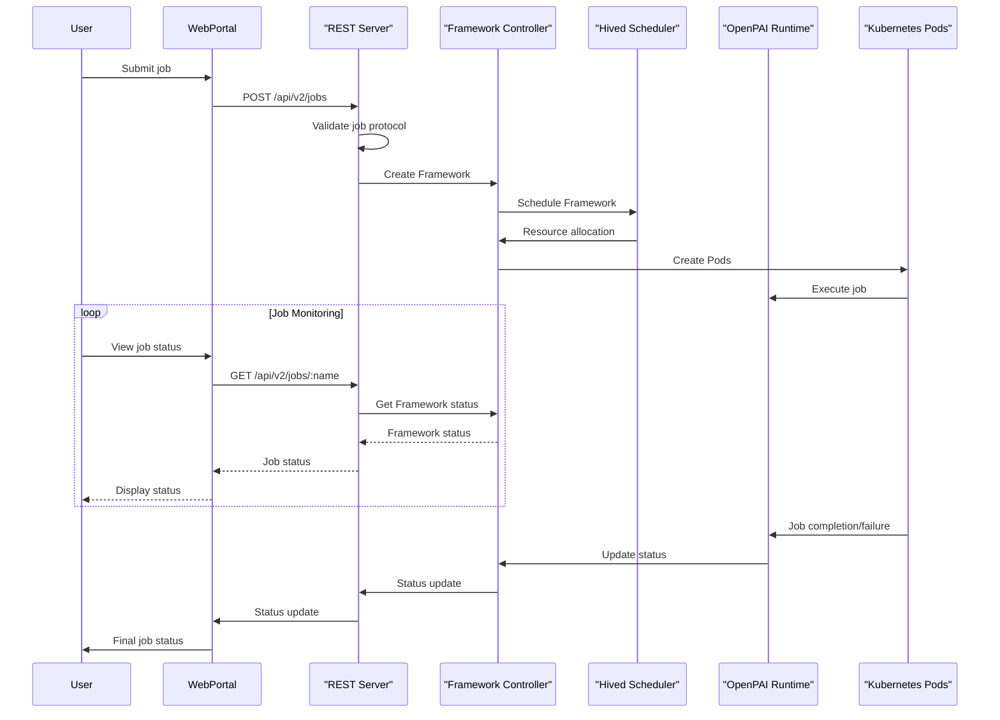
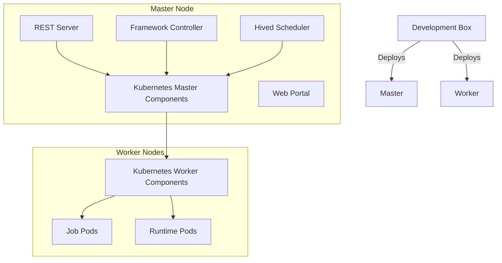

<!-- source: DeepWiki mcp.deepwiki.com · repo microsoft/pai · page 3.1 Core Components · fetched 2026-10-26 -->

# Core Components

Relevant source files

The following files were used as context for generating this wiki page:

- [README.md](README.md)
- [RELEASE_NOTE.md](RELEASE_NOTE.md)
- [contrib/debug-tools/docs/remote-debug-pai-job_zh_CN.md](contrib/debug-tools/docs/remote-debug-pai-job_zh_CN.md)
- [contrib/kubespray/config/config.yaml](contrib/kubespray/config/config.yaml)
- [contrib/submit-job-v2/README.md](contrib/submit-job-v2/README.md)
- [contrib/submit-job-v2/package.json](contrib/submit-job-v2/package.json)
- [contrib/submit-job-v2/src/App/ProtocolForm.tsx](contrib/submit-job-v2/src/App/ProtocolForm.tsx)
- [contrib/submit-job-v2/src/App/TensorBoard.tsx](contrib/submit-job-v2/src/App/TensorBoard.tsx)
- [contrib/submit-job-v2/src/index.ts](contrib/submit-job-v2/src/index.ts)
- [contrib/submit-job-v2/webpack.config.js](contrib/submit-job-v2/webpack.config.js)
- [contrib/submit-job-v2/yarn.lock](contrib/submit-job-v2/yarn.lock)
- [docs/manual/cluster-admin/installation-guide.md](docs/manual/cluster-admin/installation-guide.md)
- [docs_zh_CN/manual/cluster-admin/installation-guide.md](docs_zh_CN/manual/cluster-admin/installation-guide.md)
- [src/database-controller/src/write-merger/app.js](src/database-controller/src/write-merger/app.js)
- [src/rest-server/config/rest-server.md](src/rest-server/config/rest-server.md)
- [src/rest-server/config/rest-server.yaml](src/rest-server/config/rest-server.yaml)
- [src/rest-server/config/rest_server.py](src/rest-server/config/rest_server.py)
- [src/rest-server/deploy/rest-server.yaml.template](src/rest-server/deploy/rest-server.yaml.template)
- [src/rest-server/docs/swagger.yaml](src/rest-server/docs/swagger.yaml)
- [src/rest-server/package.json](src/rest-server/package.json)
- [src/rest-server/src/config/express.js](src/rest-server/src/config/express.js)
- [src/rest-server/src/config/launcher.js](src/rest-server/src/config/launcher.js)
- [src/rest-server/src/config/schedule-port.js](src/rest-server/src/config/schedule-port.js)
- [src/rest-server/src/controllers/internal/tail-log.js](src/rest-server/src/controllers/internal/tail-log.js)
- [src/rest-server/src/controllers/v2/job.js](src/rest-server/src/controllers/v2/job.js)
- [src/rest-server/src/controllers/v2/task.js](src/rest-server/src/controllers/v2/task.js)
- [src/rest-server/src/models/v2/job/index.js](src/rest-server/src/models/v2/job/index.js)
- [src/rest-server/src/models/v2/job/k8s.js](src/rest-server/src/models/v2/job/k8s.js)
- [src/rest-server/src/models/v2/job/log.js](src/rest-server/src/models/v2/job/log.js)
- [src/rest-server/src/models/v2/task.js](src/rest-server/src/models/v2/task.js)
- [src/rest-server/src/models/v2/utils/frameworkConverter.js](src/rest-server/src/models/v2/utils/frameworkConverter.js)
- [src/rest-server/src/models/v2/utils/name.js](src/rest-server/src/models/v2/utils/name.js)
- [src/rest-server/src/routes/internal/index.js](src/rest-server/src/routes/internal/index.js)
- [src/rest-server/src/routes/internal/tail-log.js](src/rest-server/src/routes/internal/tail-log.js)
- [src/rest-server/src/routes/v2/job.js](src/rest-server/src/routes/v2/job.js)
- [src/rest-server/src/utils/error.d.ts](src/rest-server/src/utils/error.d.ts)
- [src/rest-server/test/setup.js](src/rest-server/test/setup.js)
- [src/rest-server/yarn.lock](src/rest-server/yarn.lock)
- [src/webportal/config/webpack.common.js](src/webportal/config/webpack.common.js)
- [src/webportal/package.json](src/webportal/package.json)
- [src/webportal/yarn.lock](src/webportal/yarn.lock)
- [tests/jenkins/test_rest_server_js_sdk.sh](tests/jenkins/test_rest_server_js_sdk.sh)
- [version/K8S.VERSION](version/K8S.VERSION)
- [version/PAI.VERSION](version/PAI.VERSION)

This page provides a detailed technical overview of the core components that make up the OpenPAI platform. It describes the main architectural components, their relationships, and how they work together to provide a comprehensive platform for AI workloads on Kubernetes.

## Architecture Overview

OpenPAI is a platform for AI that has evolved from a Yarn-based architecture to a pure Kubernetes-based architecture since v1.0.0. The platform consists of several core components that work together to provide a comprehensive solution for managing AI workloads.

*Diagram: High-level component architecture of OpenPAI*

Sources:
- [README.md:16-57]()
- [docs/manual/cluster-admin/installation-guide.md:1-89]()

## REST Server

The REST Server is a central component that provides RESTful APIs for interacting with OpenPAI. It handles requests from clients (Web Portal and VSCode Extension) and translates them into operations on the Kubernetes cluster.

### Key Features

- **Job Management**: Submit, list, get, stop, and delete jobs
- **User Authentication**: Basic and OIDC authentication methods
- **User and Group Management**: Manage users, groups, and permissions
- **Virtual Cluster Management**: Create and manage virtual clusters for resource isolation
- **Storage Management**: Manage shared storage for jobs

### Implementation Details

The REST server is implemented in Node.js and Express. It follows a modular architecture with controllers, models, and middleware.

*Diagram: REST Server internal architecture*

Sources:
- [src/rest-server/package.json:1-93]()
- [src/rest-server/src/controllers/v2/job.js:1-323]()
- [src/rest-server/src/models/v2/job/k8s.js:1-100]()
- [src/rest-server/src/routes/v2/job.js:1-50]()
- [src/rest-server/src/config/express.js:1-150]()

### API Endpoints

The REST server provides a comprehensive set of API endpoints for managing various aspects of the OpenPAI platform.

| API Category | Description | Key Endpoints |
|--------------|-------------|--------------|
| Authentication | User login/logout | `/api/v2/authn/basic/login`, `/api/v2/authn/oidc/login` |
| Job | Job lifecycle management | `/api/v2/jobs`, `/api/v2/jobs/:jobName`, `/api/v2/jobs/:jobName/executionType` |
| User | User management | `/api/v2/users`, `/api/v2/users/:username` |
| Virtual Cluster | Virtual cluster management | `/api/v2/virtual-clusters`, `/api/v2/virtual-clusters/:vcName` |
| Storage | Storage management | `/api/v2/storages`, `/api/v2/storages/:storageName` |

Sources:
- [src/rest-server/docs/swagger.yaml:1-450]()

## Framework Controller

Framework Controller is a Kubernetes extension for orchestrating stateful applications with instance type requirements. In OpenPAI, it's responsible for managing the lifecycle of job frameworks.

### Key Features

- **Job Orchestration**: Creates and manages Kubernetes pods for job execution
- **Task Role Management**: Handles multiple task roles within a job
- **Retry Mechanisms**: Implements sophisticated retry policies for failed tasks
- **Status Tracking**: Maintains and reports detailed job status information

*Diagram: Framework Controller architecture*

Sources:
- [README.md:40-42]()
- [README.md:157-157]()
- [src/rest-server/src/models/v2/job/k8s.js:351-677]()

### Job Lifecycle Management

Framework Controller handles the job lifecycle through a series of states:

1. **AttemptCreationPending**: Framework is being created
2. **AttemptCreationRequested**: Framework creation has been requested
3. **AttemptPreparing**: Resources are being prepared
4. **AttemptRunning**: Job is running
5. **AttemptDeletionPending**: Job is being deleted
6. **AttemptDeletionRequested**: Job deletion has been requested
7. **AttemptDeleting**: Job is being deleted
8. **AttemptCompleted**: Job has completed (successfully or unsuccessfully)

Sources:
- [src/rest-server/src/models/v2/job/k8s.js:154-349]()
- [src/rest-server/src/models/v2/utils/frameworkConverter.js:1-100]()

## Hived Scheduler

Hived Scheduler is a Kubernetes scheduler extension for hierarchical resource management in AI clusters. It provides advanced scheduling capabilities beyond what the default Kubernetes scheduler offers.

### Key Features

- **Hierarchical Resource Management**: Organizes resources in a tree-like structure
- **Virtual Clusters**: Provides resource isolation through virtual clusters
- **Topology-aware Scheduling**: Optimizes job placement based on hardware topology
- **Gang Scheduling**: Ensures all tasks of a job start together
- **GPU Allocation**: Sophisticated management of GPU resources

*Diagram: Hived Scheduler architecture*

Sources:
- [README.md:43-45]()
- [README.md:158-158]()
- [src/rest-server/src/config/launcher.js:22-77]()
- [src/rest-server/src/models/v2/job/k8s.js:646-674]()

### Virtual Clusters

Hived Scheduler organizes resources into virtual clusters to provide isolation and quota management:

| Feature | Description |
|---------|-------------|
| Cell Structure | Resources are organized in a hierarchical tree of cells |
| Resource Types | Supports CPU, GPU, and other compute resources |
| Affinity Groups | Groups resources based on hardware topology for optimal performance |
| Preemption | Supports preemptive scheduling for priority jobs |

Sources:
- [docs/manual/cluster-admin/installation-guide.md:70-74]()

## OpenPAI Runtime

OpenPAI Runtime is responsible for setting up the execution environment for jobs and managing the job execution process.

### Key Features

- **Environment Setup**: Prepares container environments for job execution
- **Task Execution**: Runs user-specified commands in containers
- **Resource Allocation**: Allocates resources (CPU, memory, GPU, etc.) to tasks
- **Log Management**: Collects and manages job logs
- **Storage Mounting**: Mounts shared storage into job containers

*Diagram: OpenPAI Runtime architecture*

Sources:
- [README.md:47-49]()
- [README.md:160-160]()
- [src/rest-server/src/models/v2/job/k8s.js:435-459]()
- [src/rest-server/src/models/v2/job/k8s.js:479-535]()

### Container Setup

The runtime creates two containers for each task:

1. **Init Container**: Sets up the environment, downloads necessary files, and prepares the task
2. **App Container**: Runs the actual user command with the allocated resources

This two-container approach provides a clean separation between setup and execution.

Sources:
- [src/rest-server/src/models/v2/job/k8s.js:435-459]()
- [src/rest-server/src/models/v2/job/k8s.js:479-535]()

## Web Portal

The Web Portal provides a user-friendly interface for interacting with OpenPAI. It allows users to submit jobs, monitor job status, and manage resources.

### Key Features

- **Job Submission**: Interface for submitting jobs with various parameters
- **Job Monitoring**: Dashboard for monitoring job status and performance
- **Cluster Overview**: Visualization of cluster resource usage
- **User Management**: Interface for user and group management
- **Storage Management**: Interface for managing shared storage

*Diagram: Web Portal architecture*

Sources:
- [src/webportal/package.json:1-143]()
- [README.md:17-27]()

## Job Lifecycle Flow

The following diagram illustrates the complete job lifecycle in OpenPAI, showing how the different components interact:

*Diagram: Job lifecycle flow in OpenPAI*

Sources:
- [src/rest-server/src/models/v2/job/k8s.js:679-880]()
- [src/rest-server/src/controllers/v2/job.js:27-323]()

## Component Dependencies

The following table summarizes the dependencies between the core components:

| Component | Depends On | Description |
|-----------|------------|-------------|
| Web Portal | REST Server | Uses REST APIs to interact with the cluster |
| REST Server | Kubernetes API, PostgreSQL | Manages jobs through Kubernetes API and stores data in PostgreSQL |
| Framework Controller | Kubernetes API | Extends Kubernetes with framework management capabilities |
| Hived Scheduler | Kubernetes Scheduler | Extends Kubernetes scheduler with hierarchical resource management |
| OpenPAI Runtime | Kubernetes Pods | Runs in Kubernetes pods to execute user jobs |

Sources:
- [README.md:153-163]()
- [src/rest-server/src/models/v2/job/k8s.js:1-100]()

## Deployment Architecture

In a typical deployment, OpenPAI components are deployed as Kubernetes services across master and worker nodes:

*Diagram: Deployment architecture of OpenPAI*

Sources:
- [docs/manual/cluster-admin/installation-guide.md:9-74]()
- [src/rest-server/deploy/rest-server.yaml.template:1-157]()

## Conclusion

The core components of OpenPAI work together to provide a comprehensive platform for AI workloads. The REST Server provides the API interface, the Web Portal offers a user-friendly UI, the Framework Controller orchestrates jobs, the Hived Scheduler manages resources, and the OpenPAI Runtime executes jobs. This architecture leverages Kubernetes while adding specialized components for AI workload management.

---

