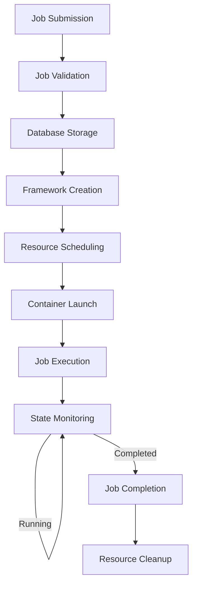
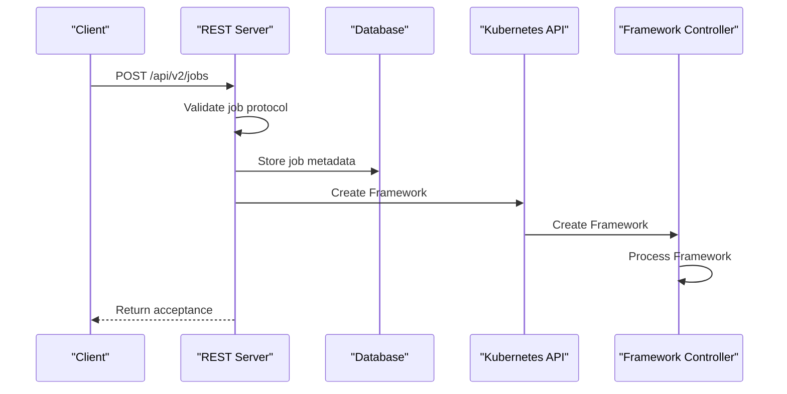
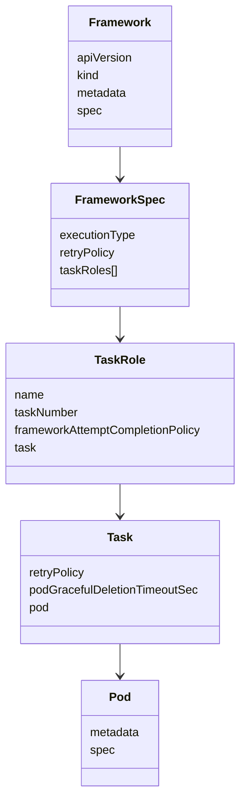
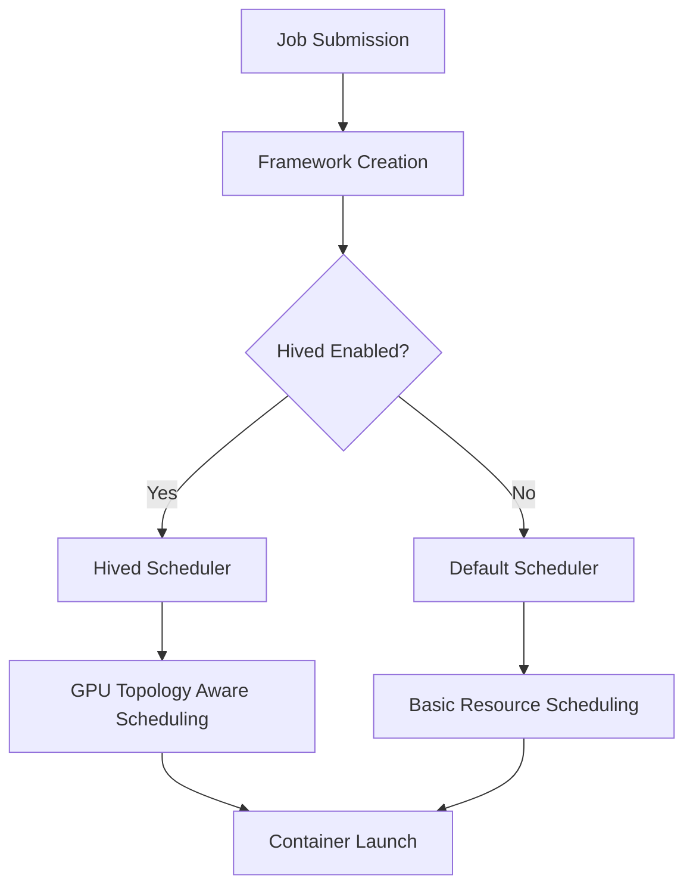
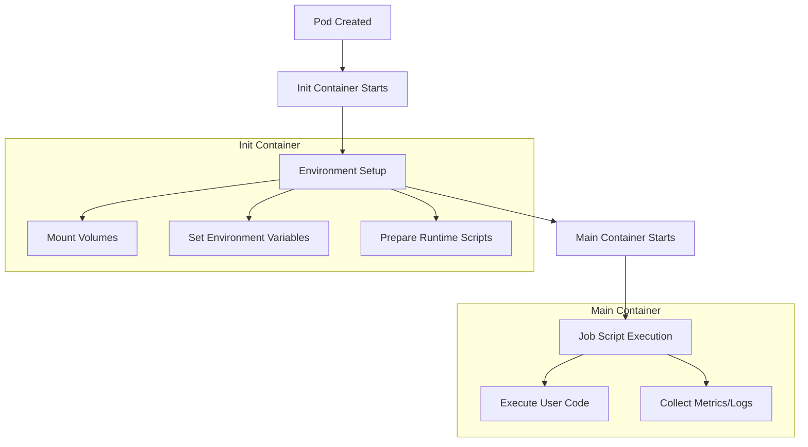
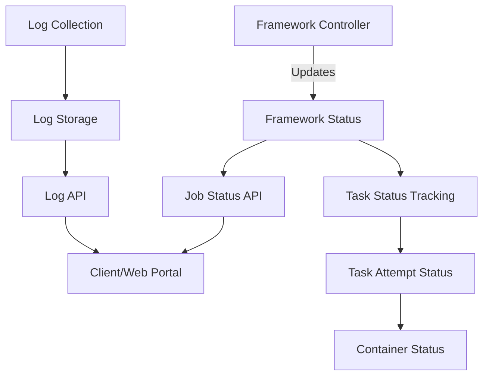
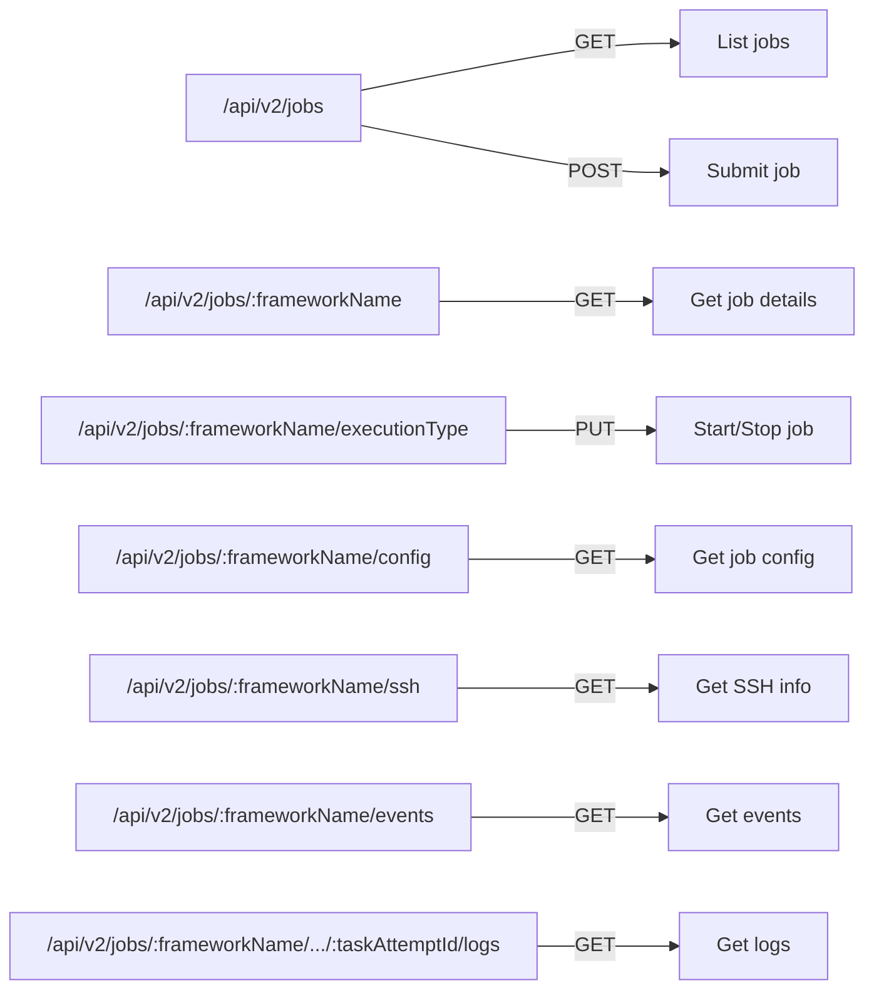
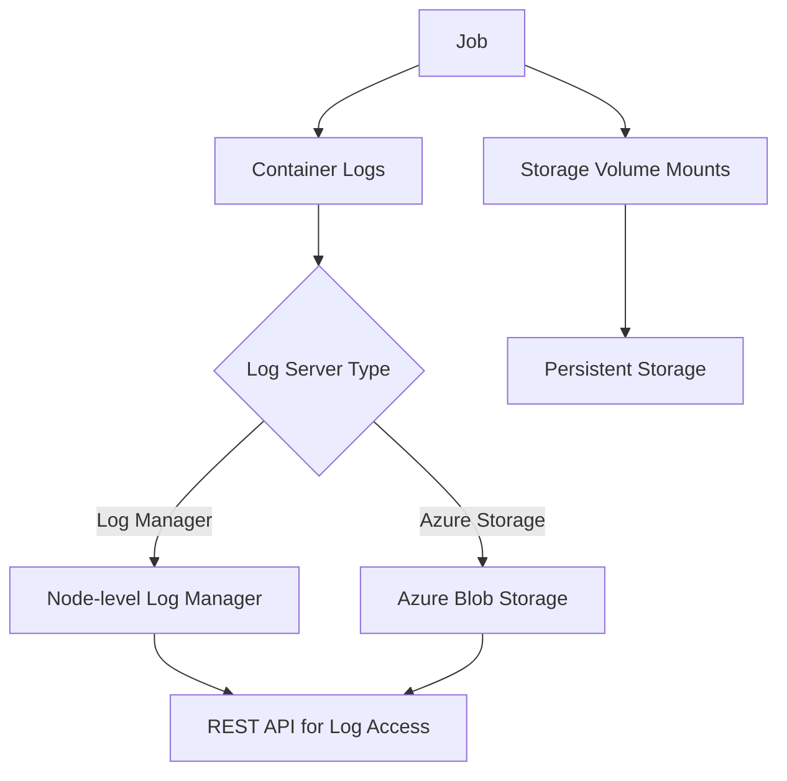
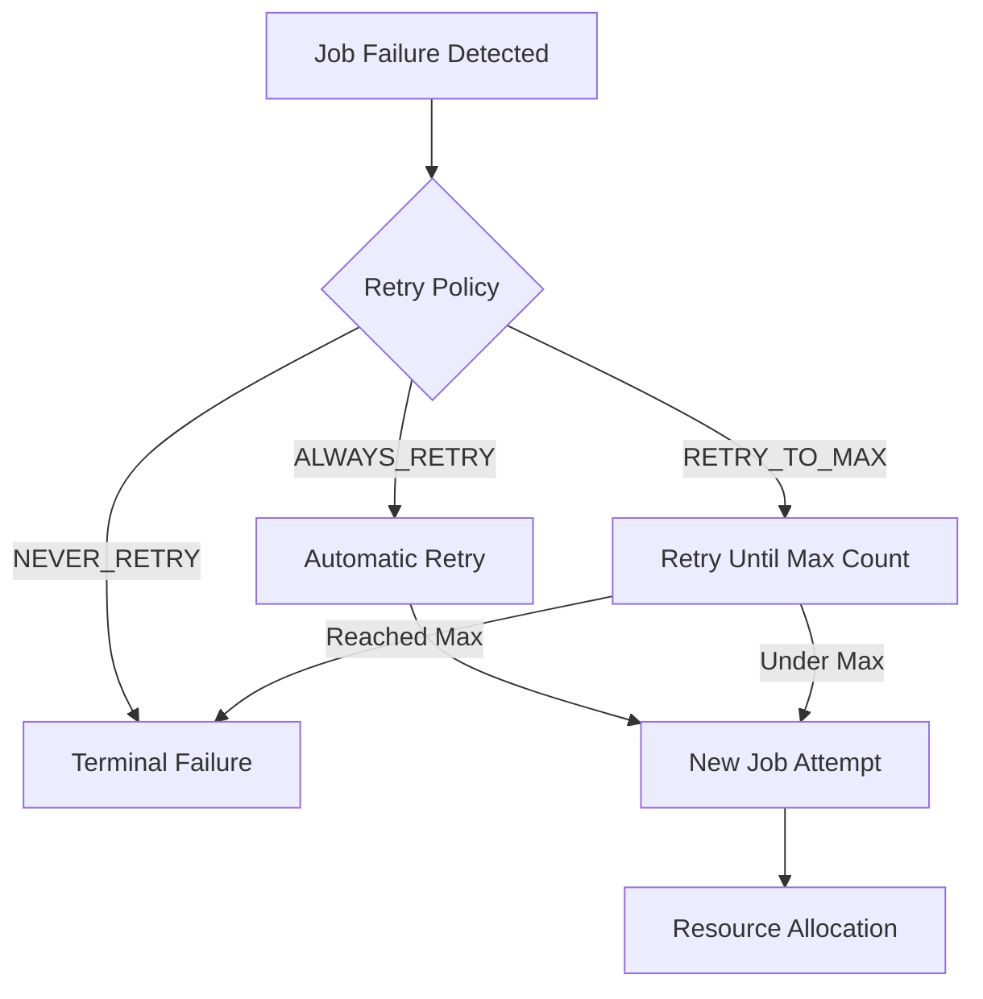
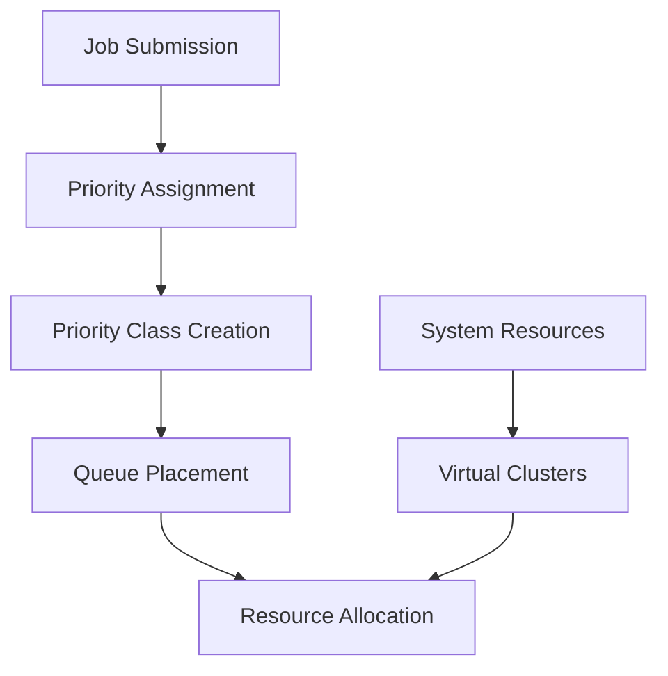

<!-- source: DeepWiki mcp.deepwiki.com · repo microsoft/pai · page 3.2 Job Lifecycle · fetched 2026-10-26 -->

# Job Lifecycle

<details>
<summary>Relevant source files</summary>

The following files were used as context for generating this wiki page:

- [src/database-controller/src/write-merger/app.js](src/database-controller/src/write-merger/app.js)
- [src/frameworkcontroller/deploy/frameworkcontroller-config.yaml.template](src/frameworkcontroller/deploy/frameworkcontroller-config.yaml.template)
- [src/frameworkcontroller/deploy/frameworkcontroller.yaml.template](src/frameworkcontroller/deploy/frameworkcontroller.yaml.template)
- [src/frameworkcontroller/deploy/refresh.sh](src/frameworkcontroller/deploy/refresh.sh)
- [src/k8s-job-exit-spec/config/k8s-job-exit-spec.yaml](src/k8s-job-exit-spec/config/k8s-job-exit-spec.yaml)
- [src/openpai-runtime/build/openpai-runtime.k8s.dockerfile](src/openpai-runtime/build/openpai-runtime.k8s.dockerfile)
- [src/openpai-runtime/deploy/runtime-exit-spec.yaml.template](src/openpai-runtime/deploy/runtime-exit-spec.yaml.template)
- [src/rest-server/config/rest-server.md](src/rest-server/config/rest-server.md)
- [src/rest-server/config/rest-server.yaml](src/rest-server/config/rest-server.yaml)
- [src/rest-server/config/rest_server.py](src/rest-server/config/rest_server.py)
- [src/rest-server/deploy/rest-server.yaml.template](src/rest-server/deploy/rest-server.yaml.template)
- [src/rest-server/docs/swagger.yaml](src/rest-server/docs/swagger.yaml)
- [src/rest-server/package.json](src/rest-server/package.json)
- [src/rest-server/src/config/express.js](src/rest-server/src/config/express.js)
- [src/rest-server/src/config/launcher.js](src/rest-server/src/config/launcher.js)
- [src/rest-server/src/config/schedule-port.js](src/rest-server/src/config/schedule-port.js)
- [src/rest-server/src/controllers/internal/tail-log.js](src/rest-server/src/controllers/internal/tail-log.js)
- [src/rest-server/src/controllers/v2/job.js](src/rest-server/src/controllers/v2/job.js)
- [src/rest-server/src/controllers/v2/task.js](src/rest-server/src/controllers/v2/task.js)
- [src/rest-server/src/models/v2/job/index.js](src/rest-server/src/models/v2/job/index.js)
- [src/rest-server/src/models/v2/job/k8s.js](src/rest-server/src/models/v2/job/k8s.js)
- [src/rest-server/src/models/v2/job/log.js](src/rest-server/src/models/v2/job/log.js)
- [src/rest-server/src/models/v2/task.js](src/rest-server/src/models/v2/task.js)
- [src/rest-server/src/models/v2/utils/frameworkConverter.js](src/rest-server/src/models/v2/utils/frameworkConverter.js)
- [src/rest-server/src/models/v2/utils/name.js](src/rest-server/src/models/v2/utils/name.js)
- [src/rest-server/src/routes/internal/index.js](src/rest-server/src/routes/internal/index.js)
- [src/rest-server/src/routes/internal/tail-log.js](src/rest-server/src/routes/internal/tail-log.js)
- [src/rest-server/src/routes/v2/job.js](src/rest-server/src/routes/v2/job.js)
- [src/rest-server/src/utils/error.d.ts](src/rest-server/src/utils/error.d.ts)
- [src/rest-server/test/setup.js](src/rest-server/test/setup.js)
- [src/rest-server/yarn.lock](src/rest-server/yarn.lock)
- [src/webportal/src/app/job/job-view/fabric/JobList/utils.js](src/webportal/src/app/job/job-view/fabric/JobList/utils.js)
- [tests/jenkins/test_rest_server_js_sdk.sh](tests/jenkins/test_rest_server_js_sdk.sh)

</details>


This document explains the complete lifecycle of a job in OpenPAI from submission to completion. It covers how jobs are submitted, scheduled, executed, monitored, and terminated in the OpenPAI platform. For API-specific details, refer to [API Reference](#4.1).

## Overview of Job Lifecycle

The job lifecycle in OpenPAI follows a well-defined path through several components of the platform, with jobs transitioning through various states from creation to completion.



Sources:
- [src/rest-server/src/models/v2/job/k8s.js:100-350]()
- [src/rest-server/src/controllers/v2/job.js:177-183]()
- [src/rest-server/src/routes/v2/job.js:30-55]()

## Job States and Transitions

Jobs in OpenPAI can exist in various states. Understanding these states and the transitions between them is essential for tracking and managing job execution.

```mermaid
stateDiagram-v2
    [*] --> "Waiting"
    "Waiting" --> "Running": Resource allocation successful
    "Waiting" --> "Failed": Resource allocation failed
    "Running" --> "Succeeded": Job completed successfully
    "Running" --> "Failed": Job exited with error
    "Running" --> "Stopping": User requested stop
    "Stopping" --> "Stopped": Stop completed
    "Failed" --> [*]
    "Succeeded" --> [*]
    "Stopped" --> [*]
```

The state of a job is determined by the underlying Framework status in Kubernetes and is converted to user-friendly states through the `convertState` function.

Sources:
- [src/rest-server/src/models/v2/utils/frameworkConverter.js:156-200]()
- [src/webportal/src/app/job/job-view/fabric/JobList/utils.js:23-39]()

## Job Submission Process

The job submission process involves several steps from API request to the creation of a Framework in Kubernetes.



When a job is submitted, the REST server:
1. Validates the job protocol
2. Checks for duplicate job names
3. Generates a framework description
4. Creates necessary Kubernetes resources (secrets, priority classes)
5. Submits the framework to Kubernetes via Framework Controller

Sources:
- [src/rest-server/src/controllers/v2/job.js:185-210]()
- [src/rest-server/src/models/v2/job/k8s.js:679-805]()

## Framework Generation

OpenPAI translates job configurations into Kubernetes Frameworks with the following structure:



The framework includes:
- Task roles specified in the job
- Container specifications
- Resource requirements
- Environment variables
- Storage configurations
- Retry policies

Sources:
- [src/rest-server/src/models/v2/job/k8s.js:351-677]()
- [src/frameworkcontroller/deploy/frameworkcontroller.yaml.template:17-42]()

## Resource Scheduling

Resource scheduling for jobs is handled by either:
1. **Default Scheduler** - for basic scheduling needs
2. **Hived Scheduler** - for advanced GPU topology-aware scheduling



For Hived Scheduler:
- Jobs specify `hivedPodSpec` that defines GPU requirements
- OpenPAI sets scheduling annotations in the pod metadata
- The scheduler selects the appropriate nodes based on GPU topology

Sources:
- [src/rest-server/src/models/v2/job/k8s.js:651-674]()
- [src/rest-server/src/config/launcher.js:92-102]()

## Container Environment Setup

Once resources are allocated, OpenPAI sets up the container environment for job execution:



Key aspects of the container setup:
- Runtime image is specified via `LAUNCHER_RUNTIME_IMAGE`
- Environment variables include PAI_CURRENT_TASK_ROLE_NAME, GPU visibility settings
- Storage volumes are mounted
- Shared memory configuration
- Network ports allocation

Sources:
- [src/rest-server/src/models/v2/job/k8s.js:435-475]()
- [src/openpai-runtime/build/openpai-runtime.k8s.dockerfile:18-19]()

## Job and Task Monitoring

OpenPAI continuously monitors the status of jobs and their constituent tasks:



Monitoring components:
- Framework Controller provides status updates on jobs and tasks
- Task status includes state, container info, and completion status
- Exit diagnostics are generated for completed tasks
- Logs are collected and made available through the API

Sources:
- [src/rest-server/src/models/v2/job/k8s.js:155-349]()
- [src/rest-server/src/controllers/v2/job.js:320-341]()

## Exit Codes and Diagnostics

OpenPAI employs a comprehensive exit code system to diagnose job failures:

| Exit Code Range | Owner       | Description                  |
|-----------------|-------------|------------------------------|
| 0               | USER        | Success                      |
| -999 to -1      | PAI_FC      | Framework controller failures|
| -1099 to -1000  | PAI_K8S     | Kubernetes failures         |
| -2000+          | Various     | Other component failures     |
| 1-255           | USER        | User application failures    |

The exit diagnostics contain:
- Exit code and phrase
- Causer and issuer information
- Detailed error messages
- Suggested solutions

Sources:
- [src/k8s-job-exit-spec/config/k8s-job-exit-spec.yaml:17-167]()
- [src/rest-server/src/models/v2/utils/frameworkConverter.js:32-112]()

## API Interaction

The REST server exposes several endpoints for job lifecycle management:



Key API functionalities:
- Job submission and retrieval
- Job execution control (start/stop)
- Task-level monitoring
- Log access

Sources:
- [src/rest-server/src/routes/v2/job.js:32-105]()
- [src/rest-server/src/controllers/v2/job.js:27-341]()
- [src/rest-server/docs/swagger.yaml:40-116]()

## Storage and Logging

OpenPAI provides mechanisms for persistent storage and comprehensive logging:



Log handling includes:
- Runtime logs collection
- Standard output and error streams
- Log storage in either local log manager or Azure Blob Storage
- API access to logs including streaming capability

Sources:
- [src/rest-server/src/models/v2/job/log.js:17-295]()
- [src/rest-server/src/controllers/internal/tail-log.js:18-61]()

## Job Retries and Fault Tolerance

OpenPAI includes mechanisms for handling job failures and retries:



Retry policy is based on the:
- Nature of the failure (transient vs. permanent)
- Failure source (platform vs. user code)
- Configuration in the job specification
- Exit code classification

Sources:
- [src/k8s-job-exit-spec/config/k8s-job-exit-spec.yaml:96-116]()
- [src/rest-server/src/models/v2/job/k8s.js:387-394]()

## Job Priority and Resource Management

OpenPAI supports job prioritization and resource management:



Priority management includes:
- Job priority specification in job configuration
- Priority class creation in Kubernetes
- Preemption policies based on priority
- Virtual cluster resource allocation

Sources:
- [src/rest-server/src/models/v2/job/k8s.js:807-820]()
- [src/rest-server/src/controllers/v2/job.js:84-97]()

## Conclusion

The job lifecycle in OpenPAI encompasses a complex but well-structured flow from submission to completion. By leveraging Kubernetes through the Framework Controller and specialized scheduling with the Hived Scheduler, OpenPAI provides a robust platform for running AI workloads with advanced resource management, monitoring, and fault tolerance capabilities.

Understanding this lifecycle is essential for effectively using, troubleshooting, and optimizing jobs in an OpenPAI cluster.

---

