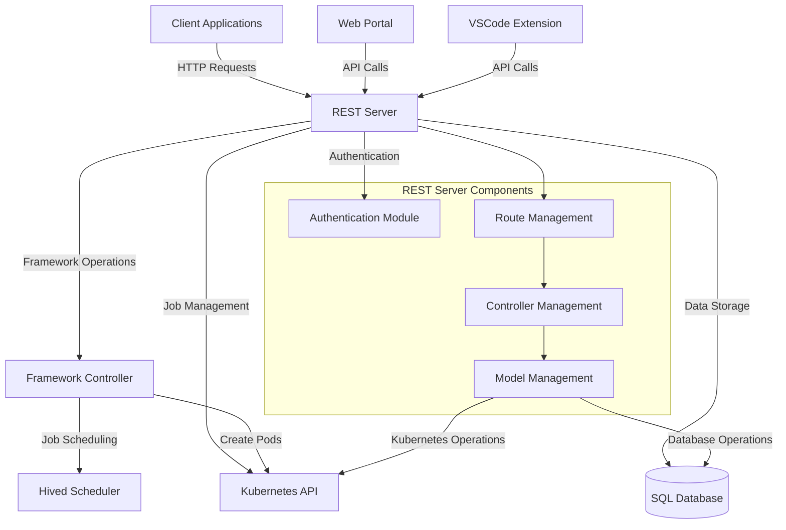
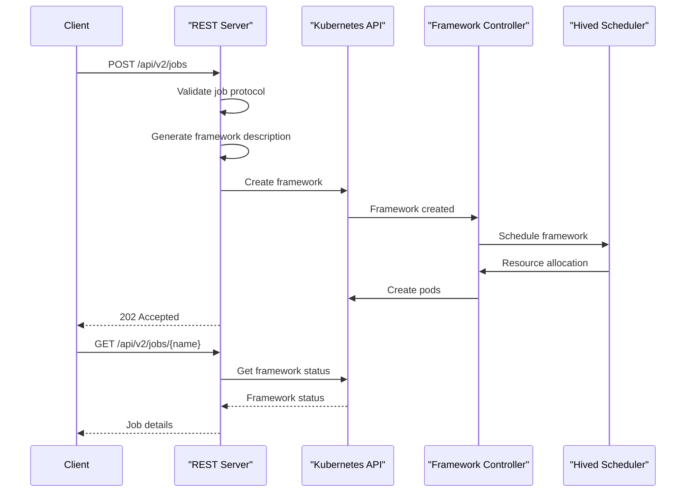
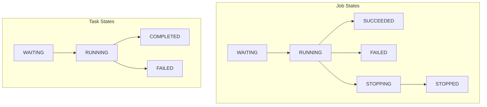
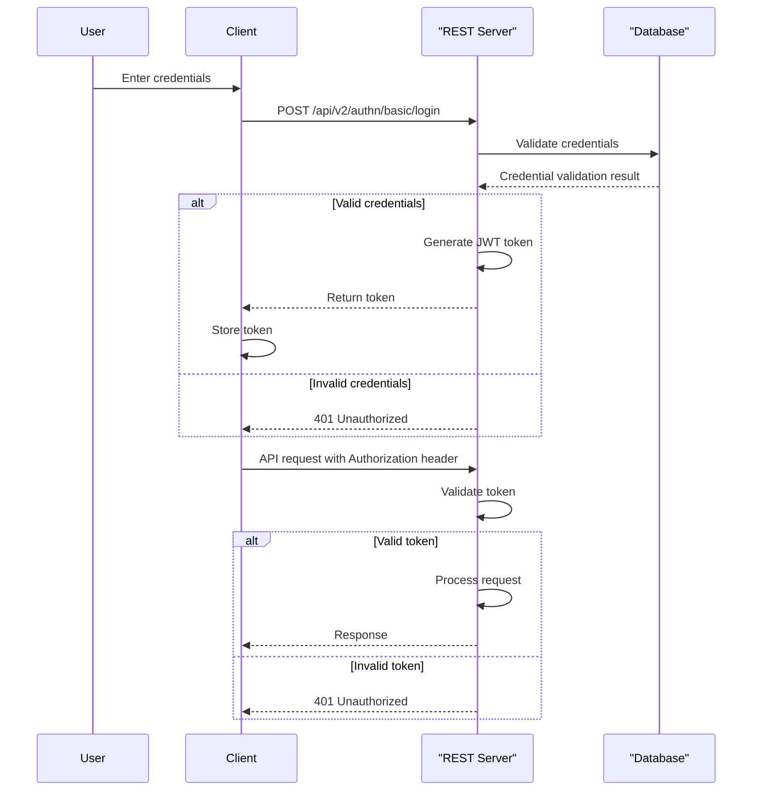
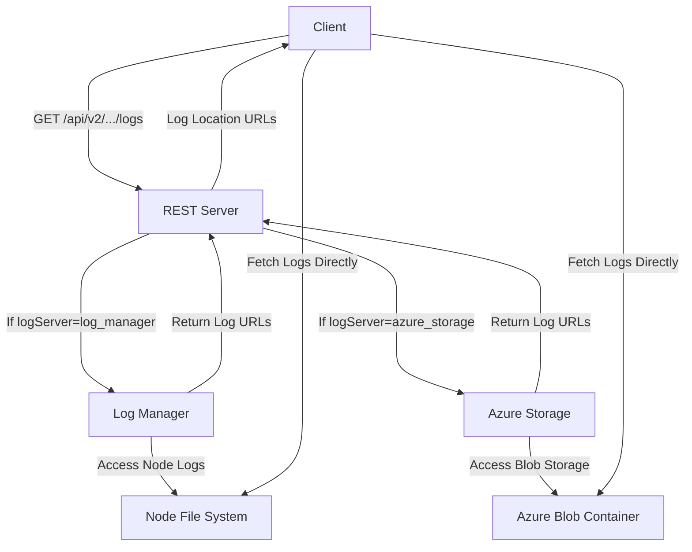

<!-- source: DeepWiki mcp.deepwiki.com · repo microsoft/pai · page 4 REST Server · fetched 2026-10-26 -->

# REST Server

<details>
<summary>Relevant source files</summary>

The following files were used as context for generating this wiki page:

- [src/database-controller/src/write-merger/app.js](src/database-controller/src/write-merger/app.js)
- [src/rest-server/config/rest-server.md](src/rest-server/config/rest-server.md)
- [src/rest-server/config/rest-server.yaml](src/rest-server/config/rest-server.yaml)
- [src/rest-server/config/rest_server.py](src/rest-server/config/rest_server.py)
- [src/rest-server/deploy/rest-server.yaml.template](src/rest-server/deploy/rest-server.yaml.template)
- [src/rest-server/docs/swagger.yaml](src/rest-server/docs/swagger.yaml)
- [src/rest-server/package.json](src/rest-server/package.json)
- [src/rest-server/src/config/express.js](src/rest-server/src/config/express.js)
- [src/rest-server/src/config/launcher.js](src/rest-server/src/config/launcher.js)
- [src/rest-server/src/config/schedule-port.js](src/rest-server/src/config/schedule-port.js)
- [src/rest-server/src/controllers/internal/tail-log.js](src/rest-server/src/controllers/internal/tail-log.js)
- [src/rest-server/src/controllers/v2/job.js](src/rest-server/src/controllers/v2/job.js)
- [src/rest-server/src/controllers/v2/task.js](src/rest-server/src/controllers/v2/task.js)
- [src/rest-server/src/models/v2/job/index.js](src/rest-server/src/models/v2/job/index.js)
- [src/rest-server/src/models/v2/job/k8s.js](src/rest-server/src/models/v2/job/k8s.js)
- [src/rest-server/src/models/v2/job/log.js](src/rest-server/src/models/v2/job/log.js)
- [src/rest-server/src/models/v2/task.js](src/rest-server/src/models/v2/task.js)
- [src/rest-server/src/models/v2/utils/frameworkConverter.js](src/rest-server/src/models/v2/utils/frameworkConverter.js)
- [src/rest-server/src/models/v2/utils/name.js](src/rest-server/src/models/v2/utils/name.js)
- [src/rest-server/src/routes/internal/index.js](src/rest-server/src/routes/internal/index.js)
- [src/rest-server/src/routes/internal/tail-log.js](src/rest-server/src/routes/internal/tail-log.js)
- [src/rest-server/src/routes/v2/job.js](src/rest-server/src/routes/v2/job.js)
- [src/rest-server/src/utils/error.d.ts](src/rest-server/src/utils/error.d.ts)
- [src/rest-server/test/setup.js](src/rest-server/test/setup.js)
- [src/rest-server/yarn.lock](src/rest-server/yarn.lock)
- [tests/jenkins/test_rest_server_js_sdk.sh](tests/jenkins/test_rest_server_js_sdk.sh)

</details>


The REST Server is a central component in OpenPAI that provides RESTful APIs for clients to interact with the platform. It handles job submission, management, authentication, user management, virtual cluster management, and various other platform operations. This component serves as the primary interface between users (through the Web Portal or API clients) and the underlying Kubernetes infrastructure.

## Overview



The REST Server provides APIs for various operations including:
- Job submission and management
- User authentication and authorization
- User management
- Virtual cluster management
- Job log retrieval
- Storage management
- Alert management

Sources: [src/rest-server/src/config/express.js:37-62](), [src/rest-server/docs/swagger.yaml:28-50](), [src/rest-server/src/routes/v2/index.js]()

## Architecture

The REST Server is built on Node.js using the Express.js framework. It follows a traditional web service architecture with routes, controllers, and models.

```mermaid
classDiagram
    class "Express App" {
        +routes
        +middleware
        +errorHandlers
    }
    
    class "API Routes" {
        +v1Routes
        +v2Routes
        +internalRoutes
    }
    
    class "Controllers" {
        +jobController
        +userController
        +authController
        +taskController
        +vcController
    }
    
    class "Models" {
        +jobModel
        +userModel
        +authModel
        +k8sModel
    }
    
    class "Config" {
        +launcherConfig
        +authConfig
        +k8sConfig
    }
    
    class "Middleware" {
        +tokenMiddleware
        +asyncHandler
        +paramValidator
        +protocolMiddleware
    }
    
    "Express App" --> "API Routes"
    "API Routes" --> "Controllers"
    "Controllers" --> "Models"
    "Models" --> "Config"
    "Express App" --> "Middleware"
    "Controllers" --> "Middleware"
```

Sources: [src/rest-server/src/config/express.js](), [src/rest-server/src/routes/v2/index.js](), [src/rest-server/src/controllers/v2/job.js](), [src/rest-server/src/models/v2/job/index.js]()

### Key Components

1. **Routes**: Define API endpoints and map them to controllers
2. **Controllers**: Handle HTTP requests, validate input, and call models
3. **Models**: Implement business logic and interact with databases and external services
4. **Middleware**: Provide common functionality like authentication, error handling, and request processing

## Job Management

One of the primary functions of the REST Server is job management. It handles the submission, execution, monitoring, and termination of jobs.

### Job Submission Flow



Sources: [src/rest-server/src/controllers/v2/job.js:177-183](), [src/rest-server/src/controllers/v2/job.js:185-210](), [src/rest-server/src/models/v2/job/k8s.js:679-805]()

### Job Framework Conversion

The REST Server converts user job requests into Kubernetes framework definitions. This involves:

1. **Protocol Validation**: Ensuring the job request adheres to the OpenPAI protocol
2. **Framework Generation**: Converting the protocol to a Kubernetes framework object
3. **Resource Allocation**: Specifying CPU, memory, GPU, and other resource requirements
4. **Environment Setup**: Setting up the job environment with necessary variables

Sources: [src/rest-server/src/models/v2/job/k8s.js:351-677](), [src/rest-server/src/models/v2/job/k8s.js:806-885]()

### Job Status and Monitoring

The REST Server provides APIs to monitor job status:



Sources: [src/rest-server/src/models/v2/utils/frameworkConverter.js:156-184](), [src/rest-server/src/models/v2/utils/frameworkConverter.js:186-214]()

## Job API Endpoints

The REST Server provides several API endpoints for job management:

| Endpoint | Method | Description |
|----------|--------|-------------|
| `/api/v2/jobs` | GET | List jobs with filtering and pagination |
| `/api/v2/jobs` | POST | Submit a new job |
| `/api/v2/jobs/{name}` | GET | Get job details |
| `/api/v2/jobs/{name}/config` | GET | Get job configuration |
| `/api/v2/jobs/{name}/ssh` | GET | Get job SSH information |
| `/api/v2/jobs/{name}/executionType` | PUT | Start or stop a job |
| `/api/v2/jobs/{name}/attempts/{id}` | GET | Get specific job attempt |
| `/api/v2/jobs/{name}/events` | GET | Get job events |
| `/api/v2/jobs/{name}/tag` | PUT/DELETE | Add or delete a job tag |

Sources: [src/rest-server/src/routes/v2/job.js:32-105](), [src/rest-server/docs/swagger.yaml:52-654]()

## Authentication

The REST Server supports multiple authentication methods:

1. **Basic Authentication**: Username and password
2. **OIDC Authentication**: OAuth/OpenID Connect
3. **Token-based Authentication**: JWT tokens for API access



Sources: [src/rest-server/docs/swagger.yaml:177-280](), [src/rest-server/src/config/express.js:69-80]()

## Virtual Cluster Management

The REST Server provides APIs to manage virtual clusters, which are logical groupings of resources:

1. **List Virtual Clusters**: View available virtual clusters
2. **Get Virtual Cluster**: View details of a specific virtual cluster
3. **Create Virtual Cluster**: Create a new virtual cluster
4. **Update Virtual Cluster**: Modify virtual cluster configuration
5. **Delete Virtual Cluster**: Remove a virtual cluster

Virtual clusters help in resource isolation and quota management across different user groups.

## Log Management

The REST Server provides APIs to access job logs. It supports multiple log storage backends:

1. **Log Manager**: Logs stored on the node running the job
2. **Azure Storage**: Logs stored in Azure Blob Storage



Sources: [src/rest-server/src/models/v2/job/log.js:34-308](), [src/rest-server/src/controllers/v2/job.js:320-341]()

## Deployment

The REST Server is deployed as a DaemonSet in Kubernetes. The deployment configuration includes:

1. **Environment Variables**: Configuration for various components
2. **Volume Mounts**: Access to configuration files and logs
3. **Resource Limits**: CPU and memory allocations
4. **Ports**: Exposed service ports

Sources: [src/rest-server/deploy/rest-server.yaml.template:18-188]()

## Configuration Options

The REST Server can be configured through various parameters:

| Parameter | Description | Default |
|-----------|-------------|---------|
| `server-port` | REST server listening port | 9186 |
| `jwt-secret` | Secret for JWT token generation | pai-secret |
| `jwt-expire-time` | JWT token expiration time | 7d |
| `default-pai-admin-username` | Default admin username | - |
| `default-pai-admin-password` | Default admin password | - |
| `schedule-port-start` | Starting port for job scheduling | 15000 |
| `schedule-port-end` | Ending port for job scheduling | 40000 |
| `sql-max-connection` | Max SQL database connections | 50 |
| `log-server` | Log server type (log_manager or azure_storage) | log_manager |

Sources: [src/rest-server/config/rest-server.yaml:18-46](), [src/rest-server/config/rest-server.md:40-51]()

## Error Handling

The REST Server uses a standardized error format for API responses:

```json
{
  "code": "ErrorCode",
  "message": "Detailed error message"
}
```

Common error codes include:
- `NoJobError`: Job not found
- `ConflictJobError`: Job already exists
- `ForbiddenUserError`: User not authorized
- `NoTaskLogError`: Task logs not found

Sources: [src/rest-server/src/utils/error.d.ts:20-54](), [src/rest-server/src/config/express.js:83-96]()

## Integration Points

The REST Server integrates with several OpenPAI components:

1. **Framework Controller**: Job scheduling and management
2. **Hived Scheduler**: Resource allocation for GPU workloads
3. **PostgreSQL Database**: Storage for user and job information
4. **Alert Manager**: System alerting and notification
5. **Kubernetes API**: Container orchestration

Sources: [src/rest-server/src/config/launcher.js:81-152](), [src/rest-server/package.json:26-66]()

---

