<!-- source: DeepWiki mcp.deepwiki.com · repo microsoft/pai · page 4.2 Job Management · fetched 2026-10-26 -->

# Job Management

Relevant source files

The following files were used as context for generating this wiki page:

- [src/database-controller/src/write-merger/app.js](src/database-controller/src/write-merger/app.js)
- [src/frameworkcontroller/deploy/frameworkcontroller-config.yaml.template](src/frameworkcontroller/deploy/frameworkcontroller-config.yaml.template)
- [src/frameworkcontroller/deploy/frameworkcontroller.yaml.template](src/frameworkcontroller/deploy/frameworkcontroller.yaml.template)
- [src/frameworkcontroller/deploy/refresh.sh](src/frameworkcontroller/deploy/refresh.sh)
- [src/k8s-job-exit-spec/config/k8s-job-exit-spec.yaml](src/k8s-job-exit-spec/config/k8s-job-exit-spec.yaml)
- [src/openpai-runtime/build/openpai-runtime.k8s.dockerfile](src/openpai-runtime/build/openpai-runtime.k8s.dockerfile)
- [src/openpai-runtime/deploy/runtime-exit-spec.yaml.template](src/openpai-runtime/deploy/runtime-exit-spec.yaml.template)
- [src/rest-server/config/rest-server.md](src/rest-server/config/rest-server.md)
- [src/rest-server/config/rest-server.yaml](src/rest-server/config/rest-server.yaml)
- [src/rest-server/config/rest_server.py](src/rest-server/config/rest_server.py)
- [src/rest-server/deploy/rest-server.yaml.template](src/rest-server/deploy/rest-server.yaml.template)
- [src/rest-server/docs/swagger.yaml](src/rest-server/docs/swagger.yaml)
- [src/rest-server/package.json](src/rest-server/package.json)
- [src/rest-server/src/config/express.js](src/rest-server/src/config/express.js)
- [src/rest-server/src/config/launcher.js](src/rest-server/src/config/launcher.js)
- [src/rest-server/src/config/schedule-port.js](src/rest-server/src/config/schedule-port.js)
- [src/rest-server/src/controllers/internal/tail-log.js](src/rest-server/src/controllers/internal/tail-log.js)
- [src/rest-server/src/controllers/v2/job.js](src/rest-server/src/controllers/v2/job.js)
- [src/rest-server/src/controllers/v2/task.js](src/rest-server/src/controllers/v2/task.js)
- [src/rest-server/src/models/v2/job/index.js](src/rest-server/src/models/v2/job/index.js)
- [src/rest-server/src/models/v2/job/k8s.js](src/rest-server/src/models/v2/job/k8s.js)
- [src/rest-server/src/models/v2/job/log.js](src/rest-server/src/models/v2/job/log.js)
- [src/rest-server/src/models/v2/task.js](src/rest-server/src/models/v2/task.js)
- [src/rest-server/src/models/v2/utils/frameworkConverter.js](src/rest-server/src/models/v2/utils/frameworkConverter.js)
- [src/rest-server/src/models/v2/utils/name.js](src/rest-server/src/models/v2/utils/name.js)
- [src/rest-server/src/routes/internal/index.js](src/rest-server/src/routes/internal/index.js)
- [src/rest-server/src/routes/internal/tail-log.js](src/rest-server/src/routes/internal/tail-log.js)
- [src/rest-server/src/routes/v2/job.js](src/rest-server/src/routes/v2/job.js)
- [src/rest-server/src/utils/error.d.ts](src/rest-server/src/utils/error.d.ts)
- [src/rest-server/test/setup.js](src/rest-server/test/setup.js)
- [src/rest-server/yarn.lock](src/rest-server/yarn.lock)
- [src/webportal/src/app/job/job-view/fabric/JobList/utils.js](src/webportal/src/app/job/job-view/fabric/JobList/utils.js)
- [tests/jenkins/test_rest_server_js_sdk.sh](tests/jenkins/test_rest_server_js_sdk.sh)

This document explains how OpenPAI's REST server handles job management operations, including job submission, monitoring, updating, and execution. It covers the lifecycle of jobs from submission to completion, the API endpoints for job management, and the various components involved in processing jobs.

For information about job submission through the web portal, see [Job Submission](#5.1).

## Job Management Overview

The OpenPAI job management system provides a set of REST APIs to manage AI jobs running on Kubernetes. It allows users to submit, monitor, control, and retrieve information about their jobs.

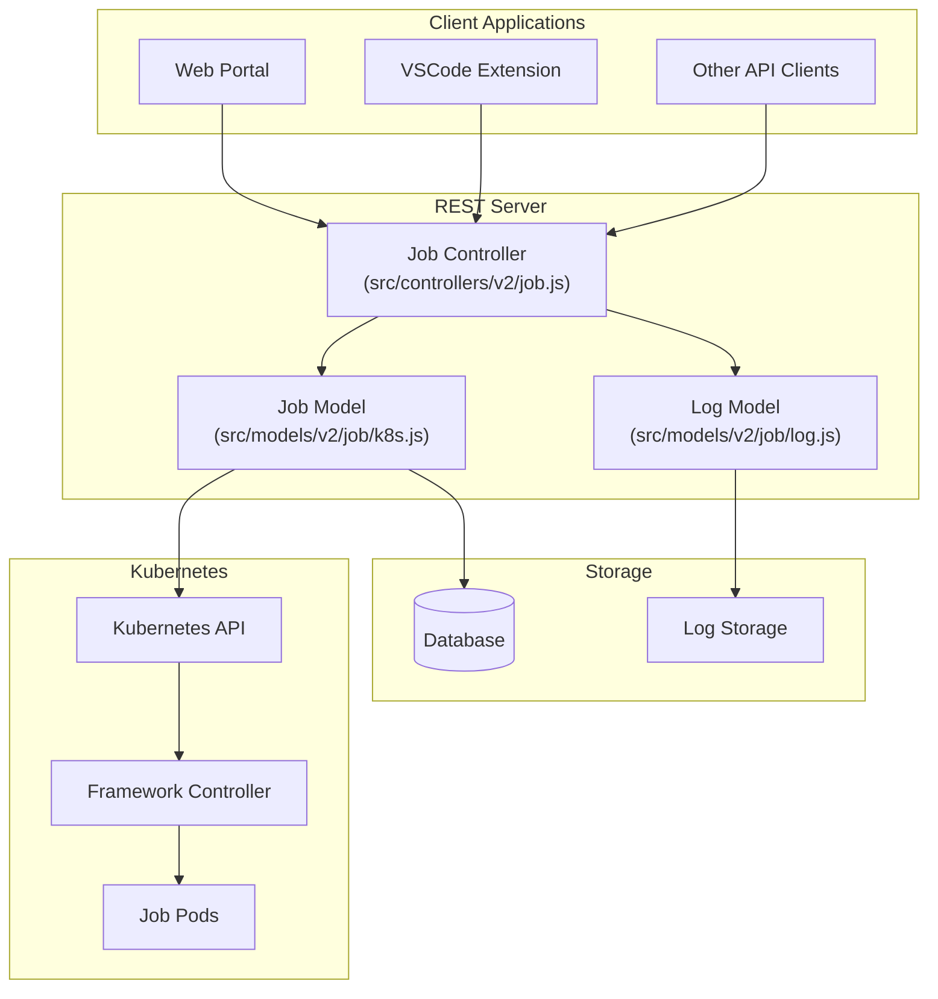

Sources:
- [src/rest-server/src/controllers/v2/job.js:1-355]()
- [src/rest-server/src/models/v2/job/k8s.js:1-1175]()
- [src/rest-server/src/models/v2/job/log.js:1-363]()
- [src/rest-server/src/routes/v2/job.js:1-108]()

## Job Lifecycle

A job in OpenPAI goes through several states from submission to completion:

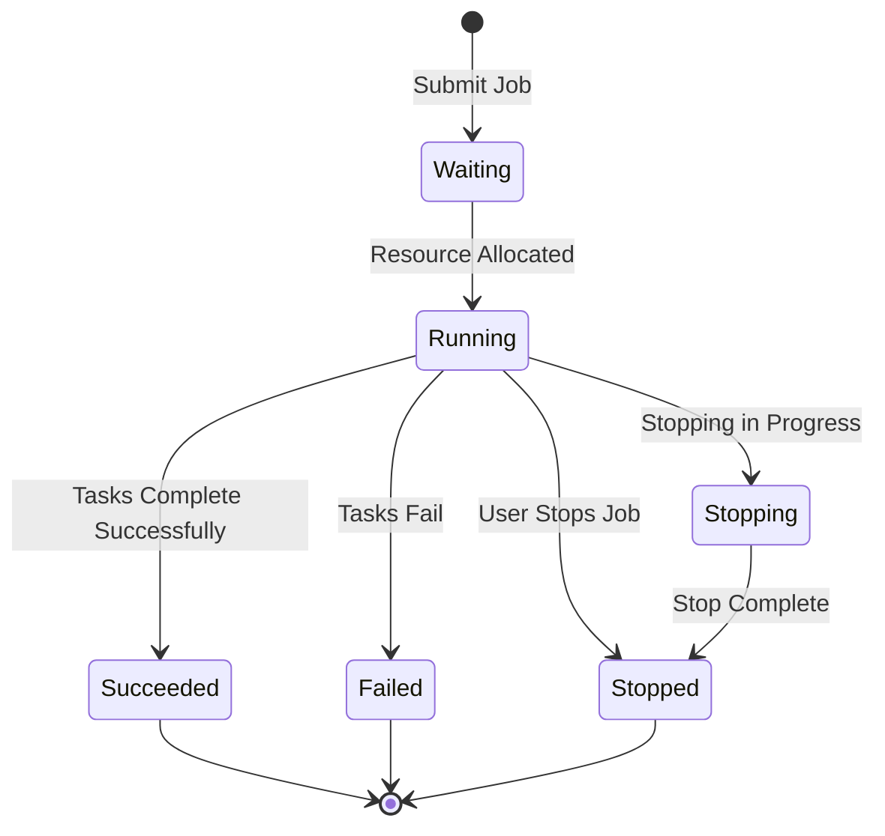

Sources:
- [src/webportal/src/app/job/job-view/fabric/JobList/utils.js:23-39]()
- [src/rest-server/src/models/v2/utils/frameworkConverter.js:156-223]()

## Job Management API

The REST API provides endpoints for managing jobs:

| Endpoint | Method | Description |
|----------|--------|-------------|
| `/api/v2/jobs` | GET | List jobs with filtering and pagination |
| `/api/v2/jobs` | POST | Submit a new job |
| `/api/v2/jobs/:frameworkName` | GET | Get job details |
| `/api/v2/jobs/:frameworkName/executionType` | PUT | Start or stop a job |
| `/api/v2/jobs/:frameworkName/config` | GET | Get job configuration |
| `/api/v2/jobs/:frameworkName/ssh` | GET | Get SSH information for job |
| `/api/v2/jobs/:frameworkName/tag` | PUT | Add a tag to a job |
| `/api/v2/jobs/:frameworkName/tag` | DELETE | Remove a tag from a job |
| `/api/v2/jobs/:frameworkName/events` | GET | Get events related to a job |
| `/api/v2/jobs/:frameworkName/attempts/:jobAttemptId` | GET | Get specific job attempt details |
| `/api/v2/jobs/:frameworkName/attempts/:jobAttemptId/taskRoles/:taskRoleName/taskIndex/:taskIndex/attempts/:taskAttemptId/logs` | GET | Get logs for a specific task |

Sources:
- [src/rest-server/src/routes/v2/job.js:32-105]()
- [src/rest-server/docs/swagger.yaml:42-1078]()

## Job Submission and Processing Flow

When a job is submitted, it goes through several processing steps before execution:

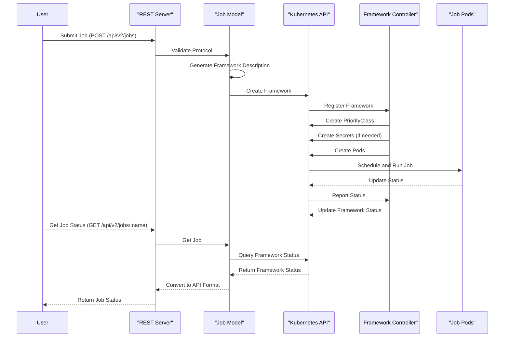

Sources:
- [src/rest-server/src/models/v2/job/k8s.js:351-804]()
- [src/rest-server/src/controllers/v2/job.js:177-229]()

## Job Model Structure

The job management system uses several data structures to represent jobs:

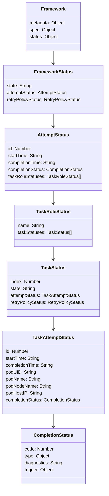

Sources:
- [src/rest-server/src/models/v2/job/k8s.js:80-348]()
- [src/rest-server/src/models/v2/utils/frameworkConverter.js:1-223]()

## Job Configuration

Jobs are configured using a protocol specification that defines resource requirements, Docker images, commands to run, and other settings. The configuration is converted into a Kubernetes framework.

Key configuration components include:

1. **Task Roles**: Each job consists of one or more task roles, which are sets of identical tasks.
2. **Resources**: CPU, memory, and GPU requirements for each task role.
3. **Docker Images**: Container images to be used for the tasks.
4. **Commands**: Commands to run inside the containers.
5. **Retries**: Number of times to retry a failed task or job.

### Framework Generation

The system generates a framework description from the job configuration:

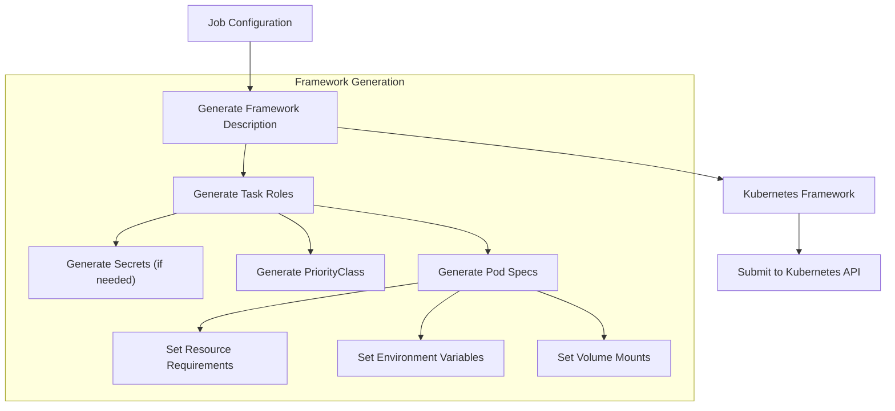

Sources:
- [src/rest-server/src/models/v2/job/k8s.js:679-805]()
- [src/rest-server/src/models/v2/job/k8s.js:351-677]()

## Job Operations

### Listing Jobs

The `list` function retrieves jobs with filtering, sorting, and pagination:

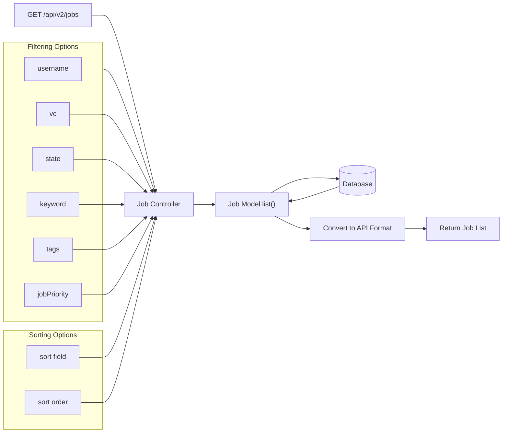

Sources:
- [src/rest-server/src/controllers/v2/job.js:27-175]()
- [src/rest-server/src/models/v2/job/k8s.js:886-961]()

### Getting Job Details

The `get` function retrieves details for a specific job:

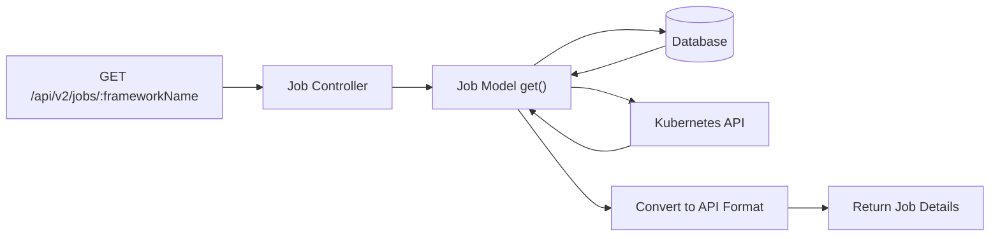

Sources:
- [src/rest-server/src/controllers/v2/job.js:177-183]()
- [src/rest-server/src/models/v2/job/k8s.js:963-1026]()

### Executing Job Actions

The `execute` function allows starting or stopping a job:

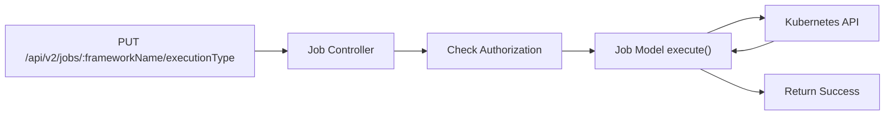

Sources:
- [src/rest-server/src/controllers/v2/job.js:212-229]()
- [src/rest-server/src/models/v2/job/k8s.js:1027-1175]()

### Getting Job Logs

The `getLogs` function retrieves logs for a specific task:

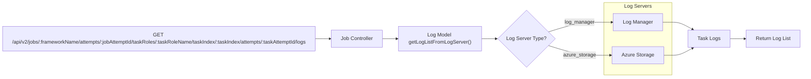

Sources:
- [src/rest-server/src/controllers/v2/job.js:320-341]()
- [src/rest-server/src/models/v2/job/log.js:44-294]()

## Job Error Handling

The system provides detailed error diagnostics for failed jobs using exit codes and completion statuses:

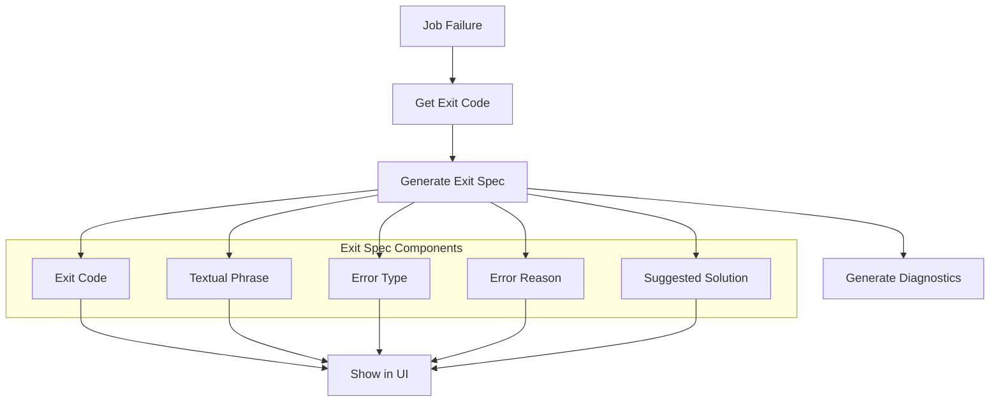

Sources:
- [src/k8s-job-exit-spec/config/k8s-job-exit-spec.yaml:13-1115]()
- [src/rest-server/src/models/v2/utils/frameworkConverter.js:73-112]()
- [src/rest-server/src/models/v2/utils/frameworkConverter.js:134-154]()

## Job Database Integration

The job management system integrates with a PostgreSQL database to persist job information:

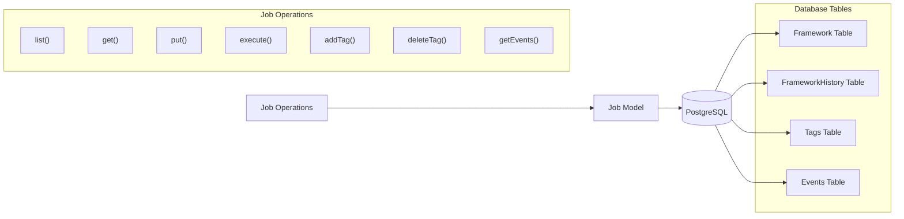

Sources:
- [src/rest-server/src/models/v2/job/k8s.js:886-1026]()
- [src/rest-server/config/rest-server.yaml:1-46]()
- [src/rest-server/package.json:57-60]()

## Configuration Components

The job management system relies on several configuration components:

| Component | Description |
|-----------|-------------|
| Launcher Config | Configures the framework controller, API paths, and runtime |
| Schedule Port | Defines port range for job containers |
| Kubernetes Config | Configures access to the Kubernetes API |
| Exit Spec | Defines exit codes and their meanings |
| Log Server | Configures access to log storage |

Sources:
- [src/rest-server/src/config/launcher.js:22-155]()
- [src/rest-server/config/rest-server.yaml:20-46]()
- [src/rest-server/src/config/schedule-port.js:1-46]()

## Rate Limiting

The job management system applies rate limits to API calls to prevent overloading the system:

| API | Rate Limit |
|-----|------------|
| General API | 600 requests per minute |
| List Jobs | 120 requests per minute |
| Submit Jobs | 3600 requests per hour |

Sources:
- [src/rest-server/config/rest-server.yaml:21-23]()
- [src/rest-server/src/config/express.js:50-50]()

## Security and Permissions

The job management system implements authorization to ensure users can only manage their own jobs unless they have admin privileges:

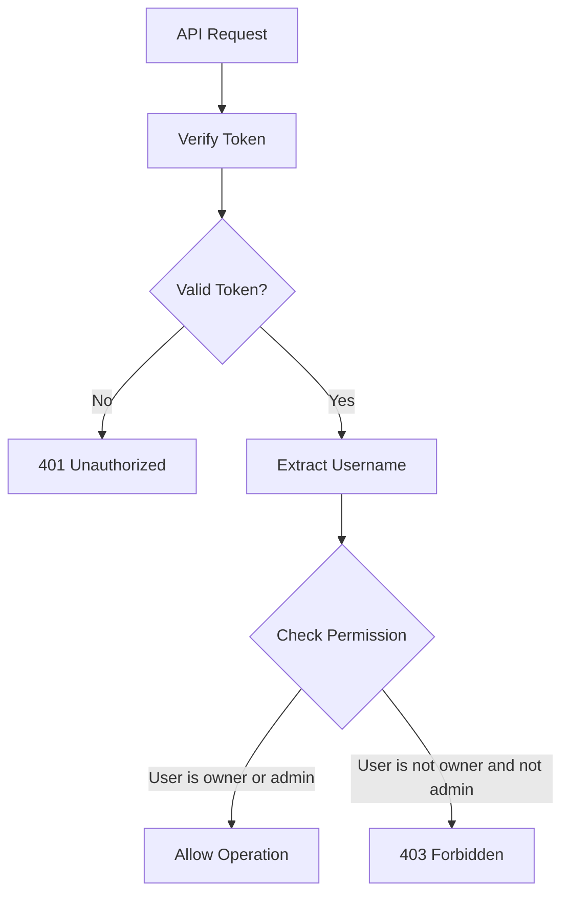

Sources:
- [src/rest-server/src/controllers/v2/job.js:212-229]()
- [src/rest-server/src/controllers/v2/job.js:253-288]()

## Integration with Framework Controller

The job management system uses the Framework Controller to manage job lifecycle in Kubernetes:

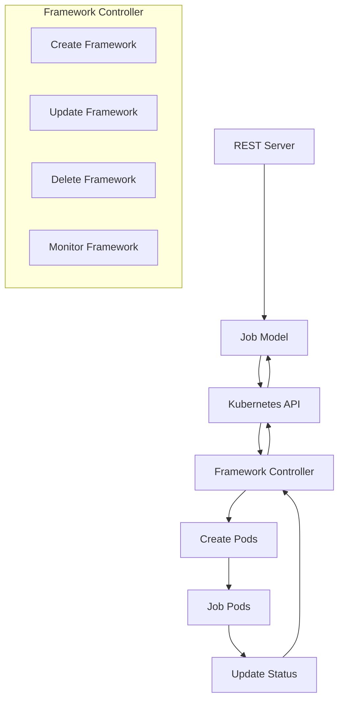

Sources:
- [src/frameworkcontroller/deploy/frameworkcontroller.yaml.template:1-53]()
- [src/frameworkcontroller/deploy/frameworkcontroller-config.yaml.template:1-134]()
- [src/rest-server/src/models/v2/job/index.js:19-43]()

## Job Runtime Environment

The OpenPAI runtime environment is responsible for executing jobs in the container:

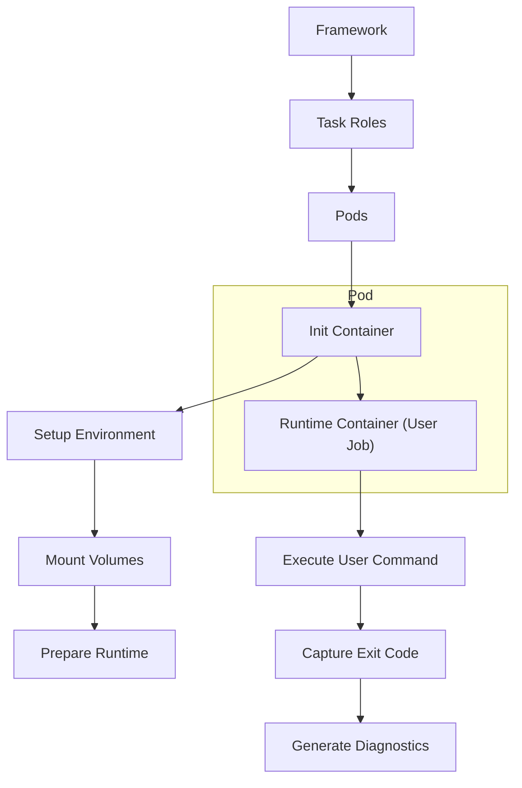

Sources:
- [src/openpai-runtime/build/openpai-runtime.k8s.dockerfile:1-20]()
- [src/openpai-runtime/deploy/runtime-exit-spec.yaml.template:1-38]()
- [src/rest-server/src/models/v2/job/k8s.js:412-477]()

## Job Output and Artifacts

Job outputs and artifacts include:

1. **Logs**: Standard output and error logs from the job.
2. **Exit Codes**: The exit status of the job, indicating success or failure.
3. **Metrics**: Resource usage metrics for the job.
4. **Output Files**: Files generated by the job, stored in mounted volumes.

The system provides APIs to access these outputs and artifacts.

Sources:
- [src/rest-server/src/models/v2/job/log.js:1-363]()
- [src/rest-server/src/routes/v2/job.js:58-61]()
- [src/rest-server/src/controllers/v2/job.js:320-341]()

## Conclusion

The job management system in OpenPAI provides a comprehensive set of APIs and tools for submitting, monitoring, and controlling AI jobs. It integrates with Kubernetes through the Framework Controller, manages job lifecycle, and provides detailed diagnostics for job failures.

The system's architecture allows for scalability, reliability, and detailed control over job execution, making it suitable for running complex AI workloads in a cluster environment.

---

