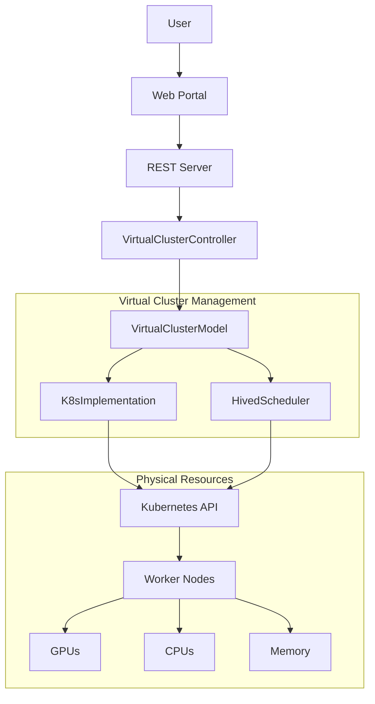
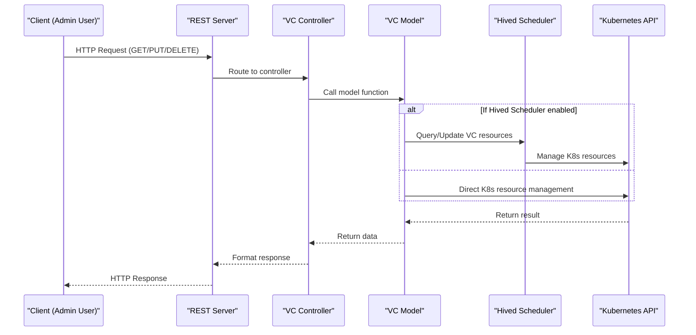
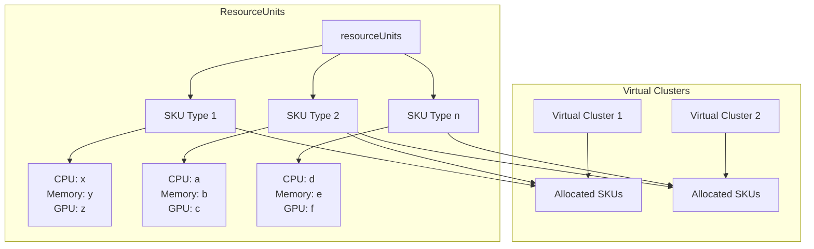
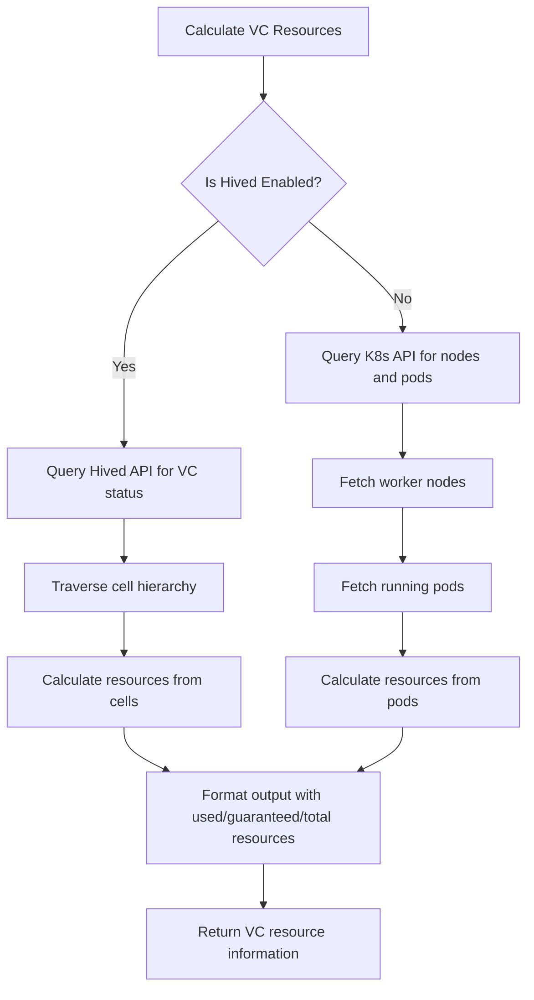
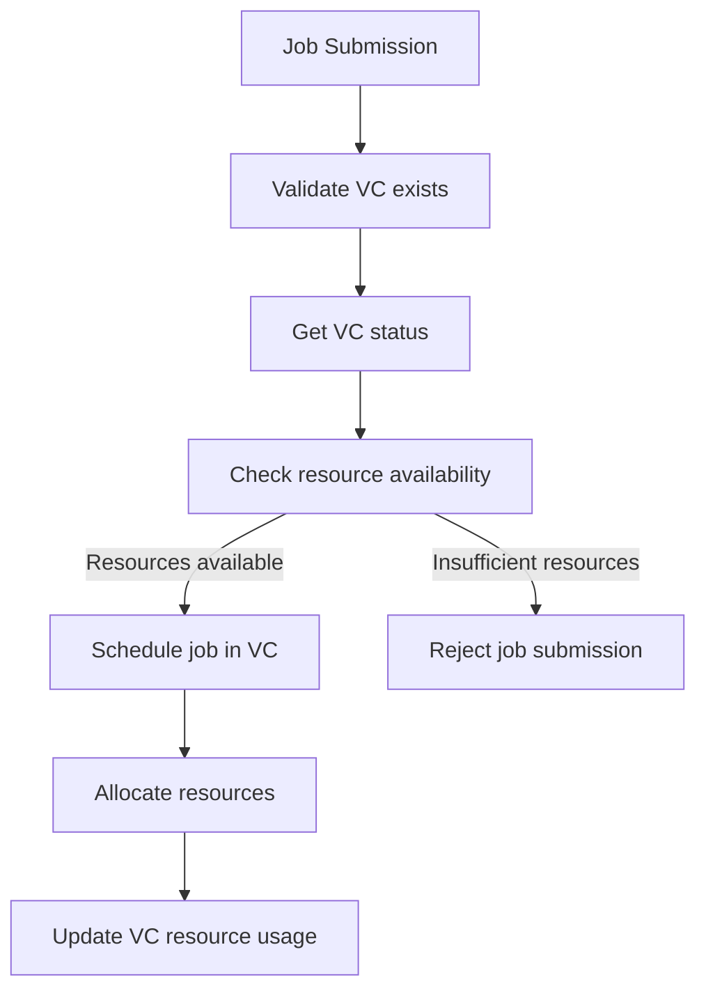

<!-- source: DeepWiki mcp.deepwiki.com · repo microsoft/pai · page 4.3 Virtual Cluster Management · fetched 2026-10-26 -->

# Virtual Cluster Management

<details>
<summary>Relevant source files</summary>

The following files were used as context for generating this wiki page:

- [src/rest-server/src/config/v2/hived.js](src/rest-server/src/config/v2/hived.js)
- [src/rest-server/src/config/vc.js](src/rest-server/src/config/vc.js)
- [src/rest-server/src/controllers/v2/alert.js](src/rest-server/src/controllers/v2/alert.js)
- [src/rest-server/src/controllers/v2/virtual-cluster.js](src/rest-server/src/controllers/v2/virtual-cluster.js)
- [src/rest-server/src/middlewares/v2/hived.js](src/rest-server/src/middlewares/v2/hived.js)
- [src/rest-server/src/models/v2/alert.js](src/rest-server/src/models/v2/alert.js)
- [src/rest-server/src/models/v2/virtual-cluster/index.js](src/rest-server/src/models/v2/virtual-cluster/index.js)
- [src/rest-server/src/models/v2/virtual-cluster/k8s.js](src/rest-server/src/models/v2/virtual-cluster/k8s.js)
- [src/rest-server/src/routes/v2/alert.js](src/rest-server/src/routes/v2/alert.js)
- [src/rest-server/src/routes/v2/index.js](src/rest-server/src/routes/v2/index.js)
- [src/rest-server/src/routes/v2/virtual-cluster.js](src/rest-server/src/routes/v2/virtual-cluster.js)
- [src/rest-server/src/utils/k8sUtils.js](src/rest-server/src/utils/k8sUtils.js)

</details>


## 1. Introduction

Virtual Cluster (VC) Management in OpenPAI provides administrators with the ability to partition and allocate cluster resources among different user groups. This document covers the architecture, API, and operations related to virtual cluster management in OpenPAI.

For information about job management within virtual clusters, see [Job Management](#4.2).

## 2. Architecture

Virtual clusters in OpenPAI serve as logical partitions of the physical Kubernetes cluster. Each virtual cluster is allocated a portion of the cluster's resources and can be assigned to specific user groups.



Sources: [src/rest-server/src/routes/v2/index.js:14-14](), [src/rest-server/src/controllers/v2/virtual-cluster.js](), [src/rest-server/src/models/v2/virtual-cluster/k8s.js]()

### 2.1 Key Components

The virtual cluster management system consists of the following key components:

1. **REST Server API**: Exposes endpoints for virtual cluster operations
2. **Virtual Cluster Controller**: Handles API requests and responses
3. **Virtual Cluster Model**: Implements the business logic for virtual cluster operations
4. **Hived Scheduler**: A Kubernetes scheduler extension that manages resource allocation



Sources: [src/rest-server/src/routes/v2/virtual-cluster.js](), [src/rest-server/src/controllers/v2/virtual-cluster.js](), [src/rest-server/src/models/v2/virtual-cluster/k8s.js]()

## 3. Resource Allocation

Virtual clusters manage three types of resources:

| Resource Type | Description |
|---------------|-------------|
| CPU (vCores)  | Allocatable CPU cores for computation |
| Memory        | RAM in MB available to applications |
| GPU           | Number of GPU units available |

Each virtual cluster has the following resource metrics:

| Metric | Description |
|--------|-------------|
| resourcesTotal | Total resources allocated to the virtual cluster |
| resourcesGuaranteed | Resources guaranteed to be available |
| resourcesUsed | Currently consumed resources by running jobs |
| capacity | Percentage of total cluster GPUs allocated to this VC |
| usedCapacity | Percentage of total cluster GPUs currently in use |

Sources: [src/rest-server/src/models/v2/virtual-cluster/k8s.js:204-347]()

### 3.1 Resource Units

The Hived Scheduler uses the concept of "resource units" (or SKUs) to define standard resource allocations. Each resource unit specifies a combination of CPU, memory, and GPU resources.



Sources: [src/rest-server/src/config/vc.js:42-66](), [src/rest-server/src/middlewares/v2/hived.js:118-134]()

## 4. Virtual Cluster API

The REST server exposes the following endpoints for virtual cluster management:

| Method | Path | Description |
|--------|------|-------------|
| GET | /api/v2/virtual-clusters | List all virtual clusters |
| GET | /api/v2/virtual-clusters/:vcName | Get details of a specific virtual cluster |
| PUT | /api/v2/virtual-clusters/:vcName | Create or update a virtual cluster |
| DELETE | /api/v2/virtual-clusters/:vcName | Remove a virtual cluster |
| PUT | /api/v2/virtual-clusters/:vcName/status | Change virtual cluster status (running/stopped) |

Sources: [src/rest-server/src/routes/v2/virtual-cluster.js:27-56]()

### 4.1 API Request and Response Format

#### 4.1.1 Listing Virtual Clusters

**Request:**
```
GET /api/v2/virtual-clusters
```

**Response:**
```json
{
  "default": {
    "capacity": 100,
    "usedCapacity": 30,
    "dedicated": false,
    "resourcesUsed": {
      "cpu": 10,
      "memory": 20480,
      "gpu": 4,
      "vCores": 10,
      "GPUs": 4
    },
    "resourcesGuaranteed": {
      "cpu": 32,
      "memory": 61440,
      "gpu": 8,
      "vCores": 32,
      "GPUs": 8
    },
    "resourcesTotal": {
      "cpu": 32,
      "memory": 61440,
      "gpu": 8,
      "vCores": 32,
      "GPUs": 8
    }
  },
  "vc1": {
    /* Similar structure */
  }
}
```

Sources: [src/rest-server/src/models/v2/virtual-cluster/k8s.js:203-348]()

#### 4.1.2 Creating/Updating a Virtual Cluster

**Request:**
```
PUT /api/v2/virtual-clusters/new-vc
Content-Type: application/json

{
  "vcCapacity": 20,
  "vcMaxCapacity": 30,
  "description": "A virtual cluster for AI training",
  "externalName": "AI Training Cluster"
}
```

**Response:**
```json
{
  "status": 201,
  "message": "Create virtual cluster new-vc to capacity 20 successfully."
}
```

Sources: [src/rest-server/src/controllers/v2/virtual-cluster.js:59-121](), [src/rest-server/src/config/vc.js:26-33]()

## 5. Implementation Details

### 5.1 Resource Calculation

The system calculates resource usage and allocation using the following approach:

1. For clusters with Hived Scheduler enabled:
   - Query the Hived Scheduler for virtual cluster status
   - Traverse the cell hierarchy to calculate resources
   - Map each resource unit to corresponding CPU, memory, and GPU allocations

2. For clusters without Hived Scheduler:
   - Directly query Kubernetes for node and pod information
   - Calculate resource usage based on running pods' resource requests



Sources: [src/rest-server/src/models/v2/virtual-cluster/k8s.js:122-201](), [src/rest-server/src/models/v2/virtual-cluster/k8s.js:218-316]()

### 5.2 Virtual Cluster Integration with Job Submission

When a job is submitted to OpenPAI, it is assigned to a specific virtual cluster. The job submission process includes validation of resource requests against the virtual cluster's available resources.



Sources: [src/rest-server/src/middlewares/v2/hived.js:77-283]()

#### 5.2.1 Hived Scheduler Integration

The Hived Scheduler plays a crucial role in job scheduling within virtual clusters. It:

1. Validates job resource requests against virtual cluster capacity
2. Maps requested resources to appropriate SKU types
3. Handles affinity groups for gang scheduling
4. Manages job priorities within virtual clusters

Job priority classes in Hived Scheduler:

| Priority Class | Value | Description |
|----------------|-------|-------------|
| crit | 120 | Critical priority |
| prod | 100 | Production priority |
| test | 10 | Testing priority (default) |
| oppo | -1 | Opportunistic priority |

Sources: [src/rest-server/src/middlewares/v2/hived.js:27-37](), [src/rest-server/src/middlewares/v2/hived.js:77-98]()

## 6. Troubleshooting

Common issues that may occur when managing virtual clusters:

| Issue | Possible Cause | Resolution |
|-------|----------------|------------|
| Cannot create VC | Invalid VC name format | VC names must contain only alphanumeric and underscore characters |
| Cannot update default VC | Operation not allowed | The default VC has special protection and cannot be modified |
| Cannot allocate resources | Insufficient cluster resources | Check the physical cluster resource availability |
| Resource calculation discrepancy | Hived Scheduler state inconsistency | Restart the Hived Scheduler pod |

Sources: [src/rest-server/src/controllers/v2/virtual-cluster.js:26-42](), [src/rest-server/src/controllers/v2/virtual-cluster.js:148-166]()

## 7. Limitations

Current implementation has the following limitations:

1. Some operations (`updateVc`, `stopVc`, `activeVc`, and `removeVc`) are not fully implemented in the Kubernetes version of the virtual cluster manager.
2. The `default` virtual cluster cannot be modified or removed.
3. When Hived Scheduler is not enabled, resource allocation accuracy may be lower.

Sources: [src/rest-server/src/models/v2/virtual-cluster/k8s.js:362-392](), [src/rest-server/src/controllers/v2/virtual-cluster.js:33-38]()

---

