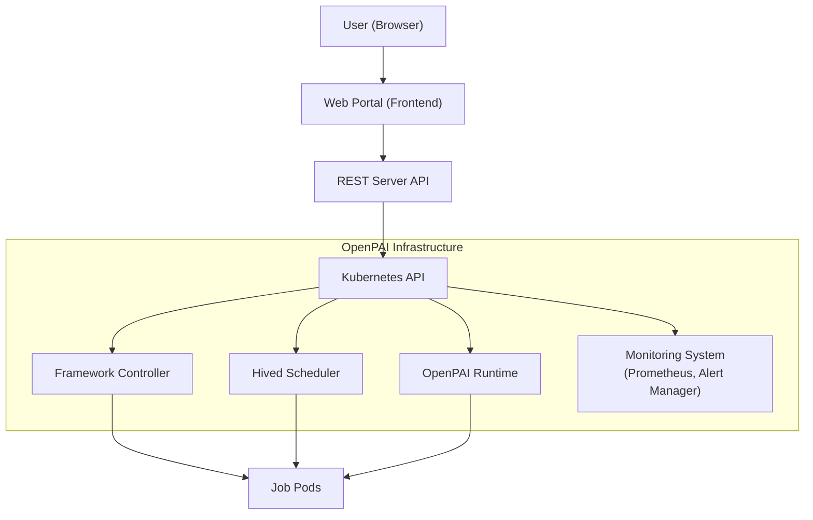
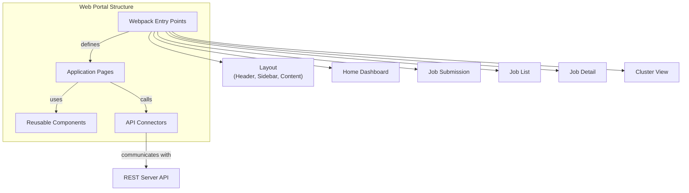
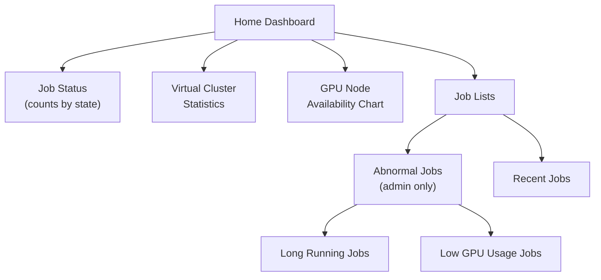
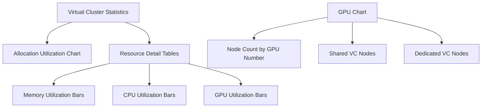
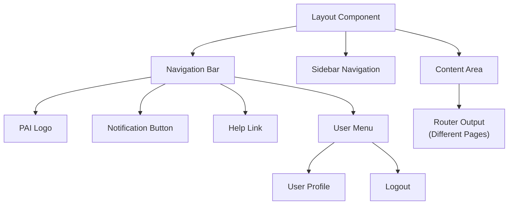
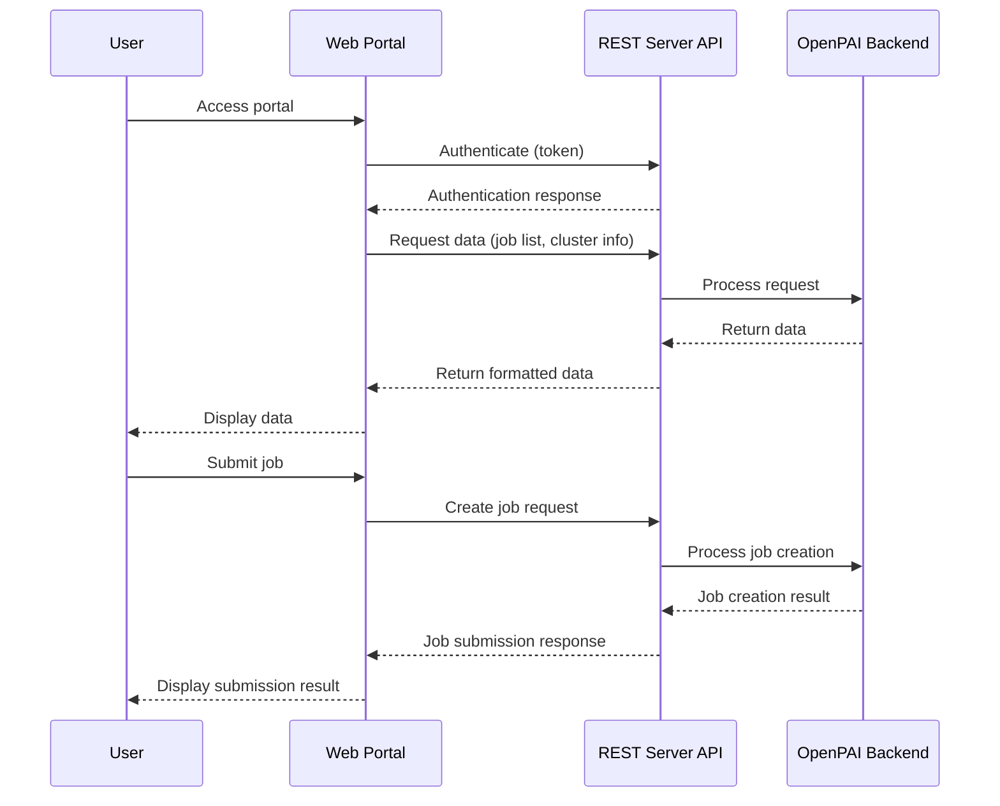
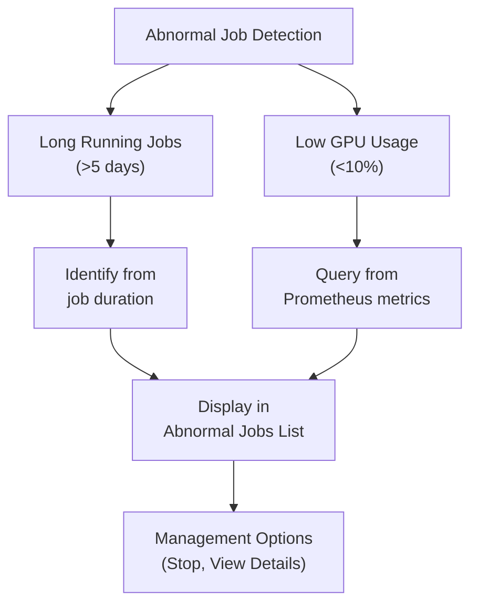

<!-- source: DeepWiki mcp.deepwiki.com · repo microsoft/pai · page 5 Web Portal · fetched 2026-10-26 -->

# Web Portal

Relevant source files

The following files were used as context for generating this wiki page:

- [contrib/submit-job-v2/README.md](contrib/submit-job-v2/README.md)
- [contrib/submit-job-v2/package.json](contrib/submit-job-v2/package.json)
- [contrib/submit-job-v2/src/App/ProtocolForm.tsx](contrib/submit-job-v2/src/App/ProtocolForm.tsx)
- [contrib/submit-job-v2/src/App/TensorBoard.tsx](contrib/submit-job-v2/src/App/TensorBoard.tsx)
- [contrib/submit-job-v2/src/index.ts](contrib/submit-job-v2/src/index.ts)
- [contrib/submit-job-v2/webpack.config.js](contrib/submit-job-v2/webpack.config.js)
- [contrib/submit-job-v2/yarn.lock](contrib/submit-job-v2/yarn.lock)
- [src/webportal/config/webpack.common.js](src/webportal/config/webpack.common.js)
- [src/webportal/package.json](src/webportal/package.json)
- [src/webportal/src/app/components/util/job.js](src/webportal/src/app/components/util/job.js)
- [src/webportal/src/app/home/home.jsx](src/webportal/src/app/home/home.jsx)
- [src/webportal/src/app/home/home/abnormal-job-list.jsx](src/webportal/src/app/home/home/abnormal-job-list.jsx)
- [src/webportal/src/app/home/home/c3.scss](src/webportal/src/app/home/home/c3.scss)
- [src/webportal/src/app/home/home/conn.js](src/webportal/src/app/home/home/conn.js)
- [src/webportal/src/app/home/home/gpu-chart.jsx](src/webportal/src/app/home/home/gpu-chart.jsx)
- [src/webportal/src/app/home/home/header.jsx](src/webportal/src/app/home/home/header.jsx)
- [src/webportal/src/app/home/home/job-status.jsx](src/webportal/src/app/home/home/job-status.jsx)
- [src/webportal/src/app/home/home/recent-job-list.jsx](src/webportal/src/app/home/home/recent-job-list.jsx)
- [src/webportal/src/app/home/home/resource-bar.jsx](src/webportal/src/app/home/home/resource-bar.jsx)
- [src/webportal/src/app/home/home/util.js](src/webportal/src/app/home/home/util.js)
- [src/webportal/src/app/home/home/utilization-chart.jsx](src/webportal/src/app/home/home/utilization-chart.jsx)
- [src/webportal/src/app/home/home/virtual-cluster-statistics.jsx](src/webportal/src/app/home/home/virtual-cluster-statistics.jsx)
- [src/webportal/src/app/home/index/bottom.jsx](src/webportal/src/app/home/index/bottom.jsx)
- [src/webportal/src/app/home/index/jumbotron.jsx](src/webportal/src/app/home/index/jumbotron.jsx)
- [src/webportal/src/app/layout/components/navbar.jsx](src/webportal/src/app/layout/components/navbar.jsx)
- [src/webportal/src/assets/img/sign-in-background.svg](src/webportal/src/assets/img/sign-in-background.svg)
- [src/webportal/yarn.lock](src/webportal/yarn.lock)

The Web Portal is the main user interface component of OpenPAI (Platform for AI), providing a browser-based application for users and administrators to interact with the platform. It offers a comprehensive interface for job submission, monitoring, and management, as well as cluster resource visualization and administration.

## Architecture Overview

The Web Portal connects users with the underlying OpenPAI infrastructure by communicating with the REST Server API. It provides various views including a home dashboard, job submission forms, job lists, and detailed monitoring interfaces.

Sources:
- [src/webportal/src/app/home/home.jsx:27-38]()
- [src/webportal/src/app/home/home/conn.js:4-17]()
- [src/webportal/package.json:33-96]()

## Technical Implementation

The Web Portal is built as a modern single-page application using React, with the following key technologies:

- **React**: The primary UI framework
- **Office UI Fabric React**: Microsoft's component library providing UI elements
- **Webpack**: Module bundler for application building
- **OpenPAI JS SDK**: JavaScript SDK for communicating with the REST API

The application is organized into multiple pages, each focusing on specific functionality, with a modular architecture that loads components as needed.

Sources:
- [src/webportal/config/webpack.common.js:60-85]()
- [src/webportal/package.json:33-96]()
- [src/webportal/src/app/home/home/conn.js:4-17]()

## Main Pages and Features

### Home Dashboard

The home dashboard provides a comprehensive overview of the system status, displaying:

1. **Job Status Panel**: Summary of job statuses (waiting, running, stopped, failed, succeeded)
2. **Virtual Cluster Statistics**: Resource utilization for each virtual cluster
3. **GPU Node Availability**: Chart showing available GPU nodes  
4. **Job Lists**:
   - For administrators: Abnormal jobs list and recent jobs
   - For regular users: Recent jobs list

Sources:
- [src/webportal/src/app/home/home.jsx:49-214]()
- [src/webportal/src/app/home/home/job-status.jsx:79-159]()
- [src/webportal/src/app/home/home/virtual-cluster-statistics.jsx:246-295]()
- [src/webportal/src/app/home/home/gpu-chart.jsx:45-302]()
- [src/webportal/src/app/home/home/abnormal-job-list.jsx:51-218]()
- [src/webportal/src/app/home/home/recent-job-list.jsx:139-170]()

### Job Submission

The portal provides interfaces for submitting jobs to the OpenPAI platform:

1. **Job Submission Form**: User-friendly form to configure and submit jobs
2. **Protocol YAML Editor**: Advanced editor for directly editing job protocol YAML
3. **Marketplace Integration**: Option to choose templates from the marketplace

Users can submit jobs using different methods:
- Through a structured form interface
- By uploading protocol YAML files 
- By selecting and customizing templates from the marketplace

Sources:
- [contrib/submit-job-v2/src/App/ProtocolForm.tsx:150-1041]()
- [contrib/submit-job-v2/README.md:1-53]()
- [src/webportal/config/webpack.common.js:69-71]()

### Job List and Management

The job list view provides:

1. **Filterable Table**: List of jobs with sorting and filtering capabilities
2. **Status Visualization**: Visual indicators of job statuses
3. **Management Actions**: Options to stop, view details, or manage jobs
4. **Search and Filter**: Capabilities to find specific jobs

The interface allows users to view their own jobs, while administrators can see and manage all jobs in the system.

Sources:
- [src/webportal/config/webpack.common.js:72-76]()
- [src/webportal/src/app/home/home/recent-job-list.jsx:89-170]()
- [src/webportal/src/app/home/home/abnormal-job-list.jsx:56-176]()

### Resource Monitoring

The portal provides visualizations for monitoring cluster resources:

1. **Virtual Cluster Utilization**: Charts showing memory, CPU, and GPU usage for each virtual cluster
2. **GPU Allocation**: Visualization of GPU allocation across nodes
3. **Resource Bars**: Intuitive progress bars showing resource utilization percentages

Sources:
- [src/webportal/src/app/home/home/virtual-cluster-statistics.jsx:205-295]()
- [src/webportal/src/app/home/home/gpu-chart.jsx:45-302]()
- [src/webportal/src/app/home/home/resource-bar.jsx:16-79]()
- [src/webportal/src/app/home/home/utilization-chart.jsx:28-101]()

## User Interface Components

### Layout Components

The Web Portal uses a consistent layout structure with:

1. **Navigation Bar**: Top navigation with user menu and notifications
2. **Sidebar**: Left sidebar for navigation between different sections
3. **Content Area**: Main content area for displaying page content

The UI is built with responsive design, adapting to different screen sizes using media queries.

Sources:
- [src/webportal/src/app/layout/components/navbar.jsx:28-197]()
- [src/webportal/config/webpack.common.js:65]()

### Data Visualization Components

The Web Portal uses various visualization components:

1. **C3.js Charts**: For GPU utilization and cluster statistics
2. **Resource Bars**: Custom progress bars showing resource utilization
3. **Status Badges**: Visual indicators of job statuses
4. **Detail Lists**: Office UI Fabric DetailsList components for tabular data

These components provide intuitive visualizations of complex system data.

Sources:
- [src/webportal/src/app/home/home/utilization-chart.jsx:28-101]()
- [src/webportal/src/app/home/home/resource-bar.jsx:16-79]()
- [src/webportal/src/app/home/home/c3.scss:1-312]()

## Data Flow

The Web Portal interacts with the REST API to retrieve and manipulate data. The general flow is:

1. **User Authentication**: User logs in and receives an authentication token
2. **Data Fetching**: Components request data from the REST API using the token
3. **Data Display**: Retrieved data is processed and displayed in the UI
4. **User Actions**: User actions (e.g., submitting a job) are sent to the REST API
5. **Feedback**: Results of actions are displayed to the user

Sources:
- [src/webportal/src/app/home/home.jsx:60-89]()
- [src/webportal/src/app/home/home/conn.js:26-151]()
- [src/webportal/src/app/components/util/job.js:23-150]()

## Admin vs. User Views

The Web Portal provides different views based on user roles:

### Administrator View
- Complete job list for all users
- Abnormal job monitoring and management
- Cluster resource management
- Virtual cluster administration

### Regular User View
- Personal job list and management
- Virtual clusters assigned to the user
- Resource usage for accessible virtual clusters

The role-based views ensure appropriate access control while providing the necessary functionality for each user type.

Sources:
- [src/webportal/src/app/home/home.jsx:58-203]()
- [src/webportal/src/app/home/home/virtual-cluster-statistics.jsx:46-203]()
- [src/webportal/src/app/home/home/job-status.jsx:79-159]()

## Special Features

### Abnormal Job Detection

The Web Portal includes intelligent detection of abnormal jobs:

1. **Long-Running Jobs**: Jobs that have been running for an unusually long time (over 5 days)
2. **Low GPU Usage Jobs**: Running jobs with GPU utilization below 10%

Administrators can easily identify and manage these jobs to improve cluster efficiency.

Sources:
- [src/webportal/src/app/components/util/job.js:21-150]()
- [src/webportal/src/app/home/home/conn.js:123-144]()
- [src/webportal/src/app/home/home/abnormal-job-list.jsx:51-218]()

### Resource Visualization

The portal provides detailed visualizations of cluster resources:

1. **Virtual Cluster Statistics**: Shows used vs. total resources for each virtual cluster
2. **GPU Node Distribution**: Chart showing the distribution of nodes by number of GPUs
3. **Resource Utilization Bars**: Visual indicators of resource usage percentages

These visualizations help users and administrators understand the current state of the cluster and make informed decisions.

Sources:
- [src/webportal/src/app/home/home/virtual-cluster-statistics.jsx:29-203]()
- [src/webportal/src/app/home/home/gpu-chart.jsx:45-302]()
- [src/webportal/src/app/home/home/resource-bar.jsx:16-79]()

## Summary

The OpenPAI Web Portal provides a comprehensive user interface for interacting with the OpenPAI platform. It offers intuitive visualizations, efficient job management, and resource monitoring capabilities. The modular, React-based architecture allows for easy extension and maintenance, while the responsive design ensures usability across various devices.

---

