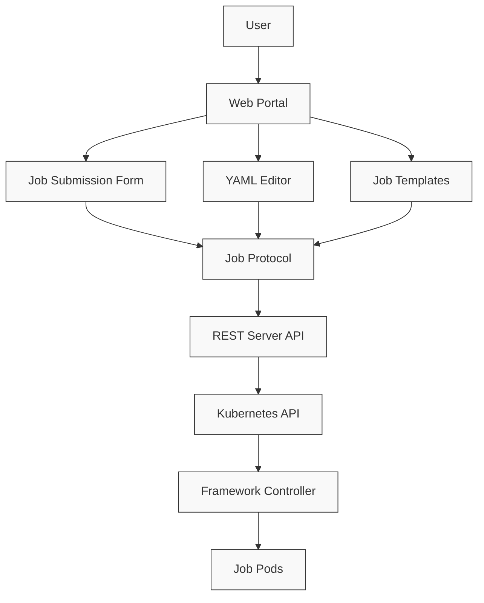
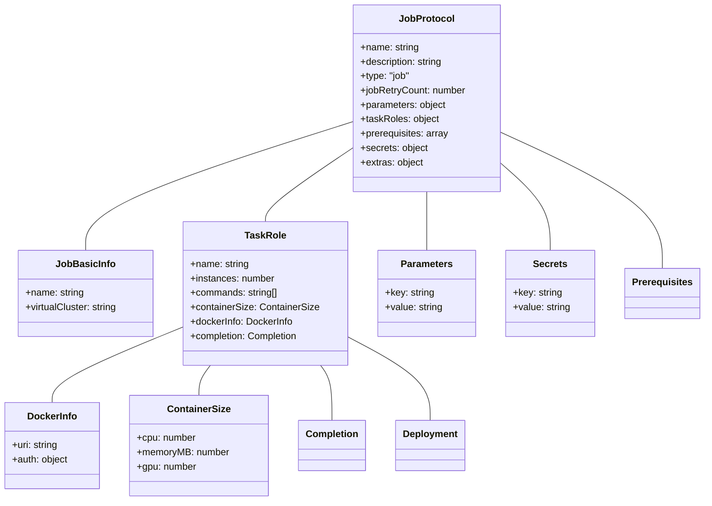
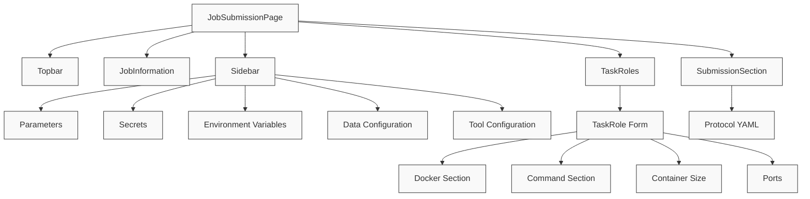
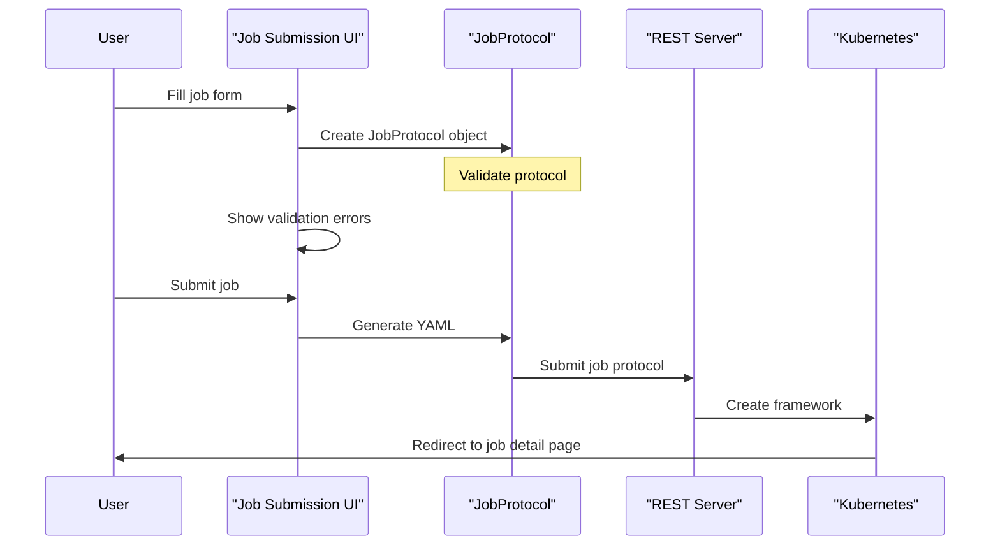
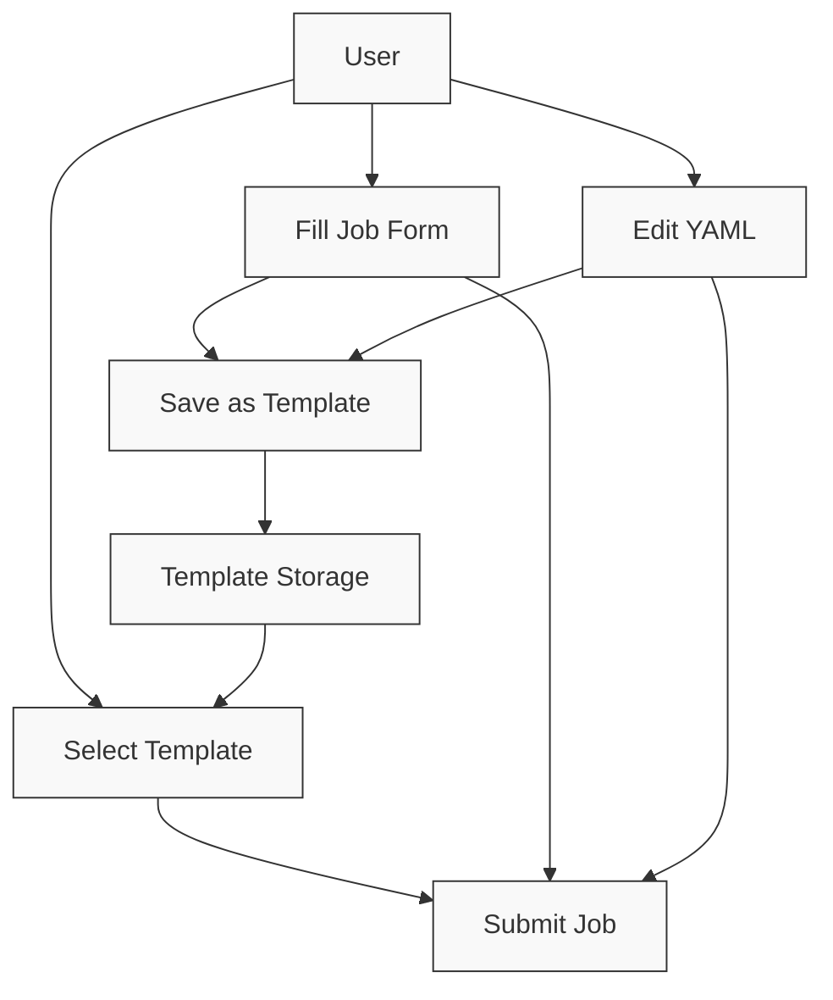

<!-- source: DeepWiki mcp.deepwiki.com · repo microsoft/pai · page 5.1 Job Submission · fetched 2026-10-26 -->

# Job Submission

<details>
<summary>Relevant source files</summary>

The following files were used as context for generating this wiki page:

- [contrib/submit-job-v2/README.md](contrib/submit-job-v2/README.md)
- [contrib/submit-job-v2/package.json](contrib/submit-job-v2/package.json)
- [contrib/submit-job-v2/src/App/ProtocolForm.tsx](contrib/submit-job-v2/src/App/ProtocolForm.tsx)
- [contrib/submit-job-v2/src/App/TensorBoard.tsx](contrib/submit-job-v2/src/App/TensorBoard.tsx)
- [contrib/submit-job-v2/src/index.ts](contrib/submit-job-v2/src/index.ts)
- [contrib/submit-job-v2/webpack.config.js](contrib/submit-job-v2/webpack.config.js)
- [contrib/submit-job-v2/yarn.lock](contrib/submit-job-v2/yarn.lock)
- [src/rest-server/src/controllers/v2/cluster.js](src/rest-server/src/controllers/v2/cluster.js)
- [src/rest-server/src/routes/v2/cluster.js](src/rest-server/src/routes/v2/cluster.js)
- [src/webportal/config/webpack.common.js](src/webportal/config/webpack.common.js)
- [src/webportal/package.json](src/webportal/package.json)
- [src/webportal/src/app/job-submission/components/basic-section.jsx](src/webportal/src/app/job-submission/components/basic-section.jsx)
- [src/webportal/src/app/job-submission/components/context.jsx](src/webportal/src/app/job-submission/components/context.jsx)
- [src/webportal/src/app/job-submission/components/controls/tooltip-icon.jsx](src/webportal/src/app/job-submission/components/controls/tooltip-icon.jsx)
- [src/webportal/src/app/job-submission/components/customized-components.jsx](src/webportal/src/app/job-submission/components/customized-components.jsx)
- [src/webportal/src/app/job-submission/components/docker-section.jsx](src/webportal/src/app/job-submission/components/docker-section.jsx)
- [src/webportal/src/app/job-submission/components/form-text-field.jsx](src/webportal/src/app/job-submission/components/form-text-field.jsx)
- [src/webportal/src/app/job-submission/components/job-information.jsx](src/webportal/src/app/job-submission/components/job-information.jsx)
- [src/webportal/src/app/job-submission/components/sidebar/sidebar-card.jsx](src/webportal/src/app/job-submission/components/sidebar/sidebar-card.jsx)
- [src/webportal/src/app/job-submission/components/submission-section.jsx](src/webportal/src/app/job-submission/components/submission-section.jsx)
- [src/webportal/src/app/job-submission/components/tab-form-content.jsx](src/webportal/src/app/job-submission/components/tab-form-content.jsx)
- [src/webportal/src/app/job-submission/components/task-role/completion-policy.jsx](src/webportal/src/app/job-submission/components/task-role/completion-policy.jsx)
- [src/webportal/src/app/job-submission/job-submission-page.jsx](src/webportal/src/app/job-submission/job-submission-page.jsx)
- [src/webportal/src/app/job-submission/job-submission.jsx](src/webportal/src/app/job-submission/job-submission.jsx)
- [src/webportal/src/app/job-submission/models/completion.js](src/webportal/src/app/job-submission/models/completion.js)
- [src/webportal/src/app/job-submission/models/docker-info.js](src/webportal/src/app/job-submission/models/docker-info.js)
- [src/webportal/src/app/job-submission/models/job-protocol.js](src/webportal/src/app/job-submission/models/job-protocol.js)
- [src/webportal/src/app/job-submission/models/job-task-role.js](src/webportal/src/app/job-submission/models/job-task-role.js)
- [src/webportal/src/app/job-submission/models/protocol-schema.js](src/webportal/src/app/job-submission/models/protocol-schema.js)
- [src/webportal/src/app/job-submission/utils/conn.js](src/webportal/src/app/job-submission/utils/conn.js)
- [src/webportal/src/app/job-submission/utils/constants.js](src/webportal/src/app/job-submission/utils/constants.js)
- [src/webportal/src/app/job-submission/utils/task-roles-manager.js](src/webportal/src/app/job-submission/utils/task-roles-manager.js)
- [src/webportal/src/app/job-submission/utils/utils.js](src/webportal/src/app/job-submission/utils/utils.js)
- [src/webportal/yarn.lock](src/webportal/yarn.lock)

</details>


This page explains the job submission functionality in OpenPAI, which allows users to define and submit AI workloads to be executed on the cluster. It covers the job submission interface, configuration options, and submission process. For information on monitoring and managing submitted jobs, see the [Job List View](#5.2) and [Job Detail View](#5.3) pages.

## 1. Job Submission Overview

The job submission feature provides a user-friendly interface for defining and submitting jobs to the OpenPAI platform. Users can create job configurations either through a form-based interface or by directly editing YAML configurations.

### Job Submission Flow



Sources:
- [src/webportal/src/app/job-submission/job-submission-page.jsx:73-106](src/webportal/src/app/job-submission/job-submission-page.jsx:73-106)
- [src/webportal/src/app/job-submission/components/submission-section.jsx:225-236](src/webportal/src/app/job-submission/components/submission-section.jsx:225-236)
- [src/webportal/src/app/job-submission/utils/conn.js:44-47](src/webportal/src/app/job-submission/utils/conn.js:44-47)

## 2. Job Protocol Structure

All jobs in OpenPAI are defined using a protocol schema. The job protocol represents the complete job configuration, including task roles, resource requirements, commands to execute, and more.

### Key Protocol Components



Sources:
- [src/webportal/src/app/job-submission/models/protocol-schema.js:29-190](src/webportal/src/app/job-submission/models/protocol-schema.js:29-190)
- [src/webportal/src/app/job-submission/models/job-protocol.js:35-189](src/webportal/src/app/job-submission/models/job-protocol.js:35-189)
- [src/webportal/src/app/job-submission/models/job-task-role.js:38-209](src/webportal/src/app/job-submission/models/job-task-role.js:38-209)

## 3. Job Submission Interface

The job submission interface consists of several key components that allow users to configure their jobs.

### Interface Components



Sources:
- [src/webportal/src/app/job-submission/job-submission-page.jsx:420-552](src/webportal/src/app/job-submission/job-submission-page.jsx:420-552)
- [src/webportal/config/webpack.common.js:67-70](src/webportal/config/webpack.common.js:67-70)

### Form Sections

#### 1. Job Information

The job information section allows users to specify basic job information:

- **Job name**: A unique identifier for the job (must match pattern `/^[A-Za-z0-9\-._~]+$/`)
- **Virtual cluster**: The virtual cluster to run the job on
- **Retry count**: (Advanced) Number of times to retry the job if it fails

Sources:
- [src/webportal/src/app/job-submission/components/job-information.jsx:67-94](src/webportal/src/app/job-submission/components/job-information.jsx:67-94)
- [src/webportal/src/app/job-submission/components/job-information.jsx:36-37](src/webportal/src/app/job-submission/components/job-information.jsx:36-37)

#### 2. Task Roles

Task roles define the individual components of a job. Each task role can have:

- **Task role name**: Identifier for the task role (must match pattern `/^[a-z0-9]{1,63}$/`)
- **Instances**: Number of instances of this task role to create
- **Docker image**: Container image to use for the task
- **Commands**: Shell commands to execute in the container
- **Resource requirements**: CPU, memory, GPU allocation
- **Ports**: Port mappings for the container
- **Completion policy**: Rules for job completion based on task status

Sources:
- [src/webportal/src/app/job-submission/components/tab-form-content.jsx:44-185](src/webportal/src/app/job-submission/components/tab-form-content.jsx:44-185)
- [src/webportal/src/app/job-submission/models/job-task-role.js:38-209](src/webportal/src/app/job-submission/models/job-task-role.js:38-209)

#### 3. Docker Settings

Docker settings allow users to configure the container environment:

- **Pre-defined images**: Select from common AI frameworks (PyTorch, TensorFlow, etc.)
- **Custom image**: Specify a custom Docker image URI
- **Authentication**: Provide credentials for private Docker registries

Sources:
- [src/webportal/src/app/job-submission/components/docker-section.jsx:26-208](src/webportal/src/app/job-submission/components/docker-section.jsx:26-208)
- [src/webportal/src/app/job-submission/utils/constants.js:116-169](src/webportal/src/app/job-submission/utils/constants.js:116-169)

#### 4. Parameters and Secrets

- **Parameters**: Key-value pairs that can be referenced in commands
- **Secrets**: Sensitive values (passwords, tokens) that are securely stored

Sources:
- [src/webportal/src/app/job-submission/components/sidebar/parameters.jsx](src/webportal/src/app/job-submission/components/sidebar/parameters.jsx)
- [src/webportal/src/app/job-submission/components/sidebar/secrets.jsx](src/webportal/src/app/job-submission/components/sidebar/secrets.jsx)

#### 5. Data and Tools

- **Data mounts**: Configure data sources to be mounted in the job containers
- **Tool configurations**: Set up debugging tools like SSH and TensorBoard

Sources:
- [src/webportal/src/app/job-submission/components/data/data-component.jsx](src/webportal/src/app/job-submission/components/data/data-component.jsx)
- [src/webportal/src/app/job-submission/components/tools/tool-component.jsx](src/webportal/src/app/job-submission/components/tools/tool-component.jsx)

## 4. Job Submission Process

### Form to Protocol Conversion

When a user configures a job using the form interface, the UI components create a structured job protocol object that is then converted to YAML format for submission.



Sources:
- [src/webportal/src/app/job-submission/components/submission-section.jsx:99-119](src/webportal/src/app/job-submission/components/submission-section.jsx:99-119)
- [src/webportal/src/app/job-submission/components/submission-section.jsx:225-236](src/webportal/src/app/job-submission/components/submission-section.jsx:225-236)
- [src/webportal/src/app/job-submission/utils/conn.js:44-47](src/webportal/src/app/job-submission/utils/conn.js:44-47)

### Protocol Validation

The job protocol is validated against a schema before submission to ensure it meets all requirements.

```javascript
// Schema validation process
const valid = JobProtocol.validateFromYaml(text);
setValidationMsg(valid);
```

If validation fails, error messages are displayed, and submission is prevented.

Sources:
- [src/webportal/src/app/job-submission/components/submission-section.jsx:182-194](src/webportal/src/app/job-submission/components/submission-section.jsx:182-194)
- [src/webportal/src/app/job-submission/models/job-protocol.js:75-106](src/webportal/src/app/job-submission/models/job-protocol.js:75-106)

## 5. Advanced Features

### Job Templates

Users can save and reuse job configurations as templates, making it easy to launch similar jobs in the future.



Sources:
- [src/webportal/src/app/job-submission/job-submission-page.jsx:383-404](src/webportal/src/app/job-submission/job-submission-page.jsx:383-404)
- [src/webportal/src/app/job-submission/components/submission-section.jsx:197-223](src/webportal/src/app/job-submission/components/submission-section.jsx:197-223)
- [src/webportal/src/app/job-submission/utils/conn.js:129-172](src/webportal/src/app/job-submission/utils/conn.js:129-172)

### Environment Variables

OpenPAI provides predefined environment variables that can be referenced in job commands:

| Variable | Description |
|----------|-------------|
| PAI_JOB_NAME | Job name in config file |
| PAI_USER_NAME | User who submitted the job |
| PAI_DEFAULT_FS_URI | Default file system URI in PAI |
| PAI_TASK_ROLE_COUNT | Total number of task roles |
| PAI_TASK_ROLE_LIST | Comma-separated task role names |
| PAI_TASK_ROLE_TASK_COUNT_$taskRole | Task count of the task role |
| PAI_HOST_IP_$taskRole_$taskIndex | The host IP for a specific task |
| PAI_RESOURCE_$taskRole | Resource requirement in "gpuNumber,cpuNumber,memMB,shmMB" format |

Sources:
- [src/webportal/src/app/job-submission/utils/constants.js:31-85](src/webportal/src/app/job-submission/utils/constants.js:31-85)

### Direct YAML Editing

Advanced users can directly edit the job protocol YAML for fine-grained control over the job configuration.

Sources:
- [src/webportal/src/app/job-submission/components/submission-section.jsx:121-180](src/webportal/src/app/job-submission/components/submission-section.jsx:121-180)

## 6. Implementation Details

### Main Components

The job submission feature is implemented primarily in React, with the following key components:

| Component | Purpose |
|-----------|---------|
| JobSubmissionPage | Main container for the submission interface |
| JobInformation | Form for job basic information |
| TaskRoles | Management of task role configurations |
| SubmissionSection | Job submission controls and YAML editor |
| Parameters/Secrets | Sidebar components for parameter/secret management |
| DockerSection | Docker image configuration |
| CommandSection | Command input for task roles |

Sources:
- [src/webportal/src/app/job-submission/job-submission.jsx:35-77](src/webportal/src/app/job-submission/job-submission.jsx:35-77)
- [src/webportal/src/app/job-submission/job-submission-page.jsx:73-552](src/webportal/src/app/job-submission/job-submission-page.jsx:73-552)

### Protocol Models

The submission interface uses several model classes to represent job components:

| Model | Description |
|-------|-------------|
| JobProtocol | Represents the full job protocol and handles validation |
| JobBasicInfo | Stores basic job information (name, VC, etc.) |
| JobTaskRole | Represents a task role configuration |
| DockerInfo | Contains Docker image settings |
| Completion | Defines job completion policies |

Sources:
- [src/webportal/src/app/job-submission/models/job-protocol.js:35-189](src/webportal/src/app/job-submission/models/job-protocol.js:35-189)
- [src/webportal/src/app/job-submission/models/job-task-role.js:38-209](src/webportal/src/app/job-submission/models/job-task-role.js:38-209)
- [src/webportal/src/app/job-submission/models/docker-info.js:1-200](src/webportal/src/app/job-submission/models/docker-info.js:1-200)

### API Connectivity

The job submission page communicates with the OpenPAI REST API to:

1. Fetch available virtual clusters
2. Retrieve storage configurations
3. List available Kubernetes SKU types
4. Submit jobs
5. Fetch and save templates

Sources:
- [src/webportal/src/app/job-submission/utils/conn.js:14-172](src/webportal/src/app/job-submission/utils/conn.js:14-172)

## 7. Additional Resources

- The job protocol schema is documented at: https://github.com/microsoft/openpai-protocol/blob/master/schemas/v2/schema.yaml
- For information about monitoring jobs after submission, see the [Job List View](#5.2) and [Job Detail View](#5.3) pages.
- For debugging jobs, see the [Job Event](#5.3) and [Task Attempt](#5.3) pages.

---

