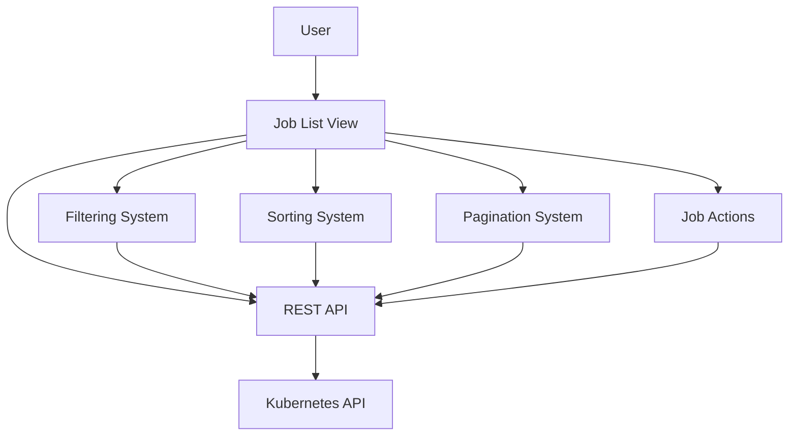
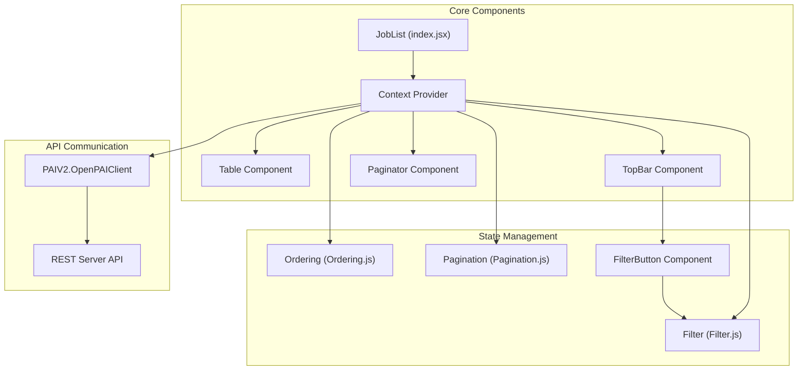
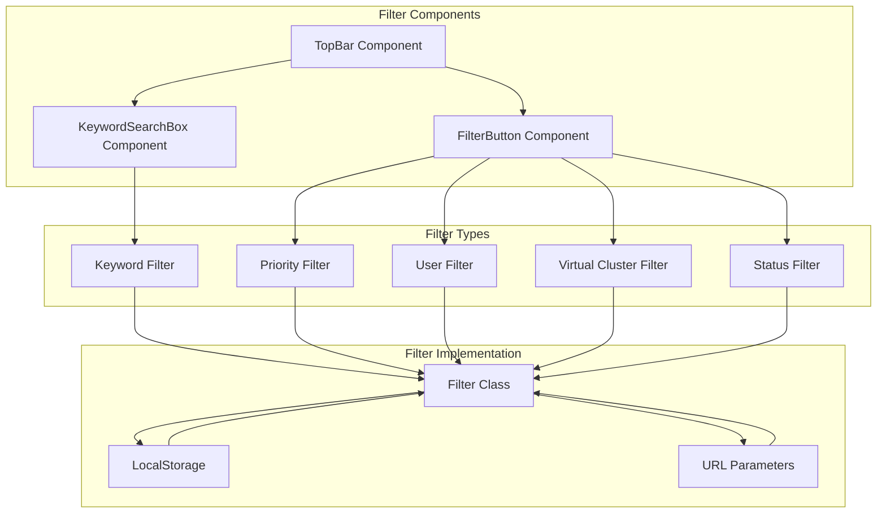
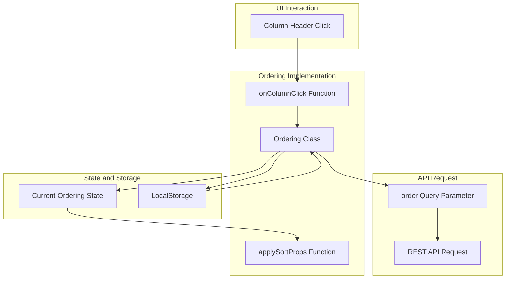
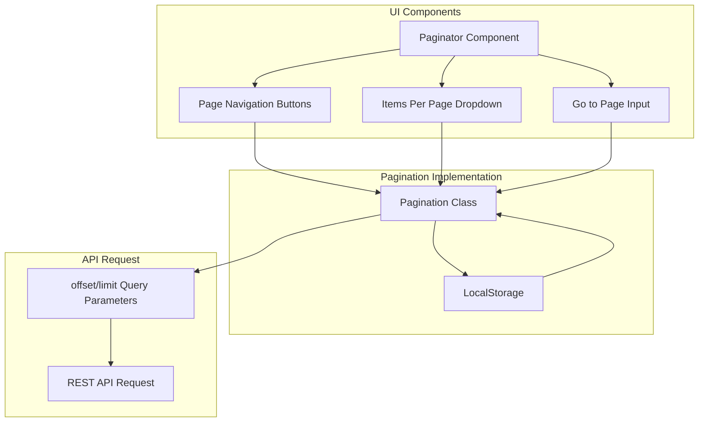
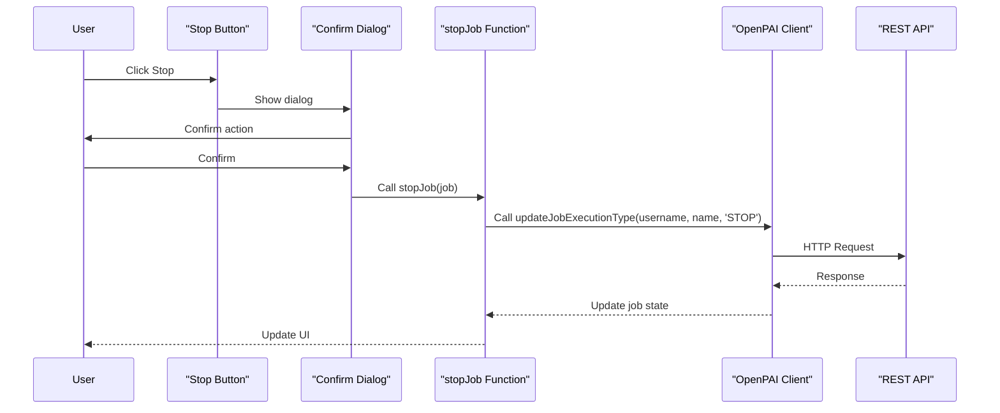
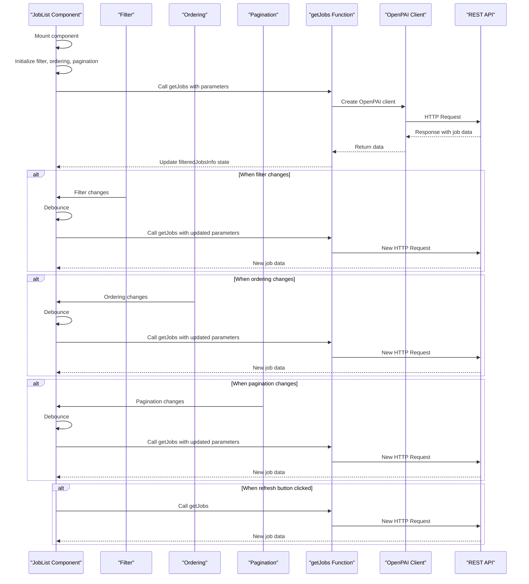

<!-- source: DeepWiki mcp.deepwiki.com · repo microsoft/pai · page 5.2 Job List View · fetched 2026-10-26 -->

# Job List View

Relevant source files

The following files were used as context for generating this wiki page:

- [src/webportal/src/app/job/job-view/fabric/JobList/Context.js](src/webportal/src/app/job/job-view/fabric/JobList/Context.js)
- [src/webportal/src/app/job/job-view/fabric/JobList/Filter.js](src/webportal/src/app/job/job-view/fabric/JobList/Filter.js)
- [src/webportal/src/app/job/job-view/fabric/JobList/FilterButton.jsx](src/webportal/src/app/job/job-view/fabric/JobList/FilterButton.jsx)
- [src/webportal/src/app/job/job-view/fabric/JobList/Ordering.js](src/webportal/src/app/job/job-view/fabric/JobList/Ordering.js)
- [src/webportal/src/app/job/job-view/fabric/JobList/Pagination.js](src/webportal/src/app/job/job-view/fabric/JobList/Pagination.js)
- [src/webportal/src/app/job/job-view/fabric/JobList/Paginator.jsx](src/webportal/src/app/job/job-view/fabric/JobList/Paginator.jsx)
- [src/webportal/src/app/job/job-view/fabric/JobList/Table.jsx](src/webportal/src/app/job/job-view/fabric/JobList/Table.jsx)
- [src/webportal/src/app/job/job-view/fabric/JobList/TopBar.jsx](src/webportal/src/app/job/job-view/fabric/JobList/TopBar.jsx)
- [src/webportal/src/app/job/job-view/fabric/JobList/index.jsx](src/webportal/src/app/job/job-view/fabric/JobList/index.jsx)

The Job List View provides a comprehensive interface for users to view, filter, sort, and manage jobs in the OpenPAI platform. This page documents the functionality and implementation of the job listing interface, which serves as the central dashboard for monitoring and managing all jobs in the system.

For information about submitting new jobs, see [Job Submission](#5.1). For detailed information about a specific job, see [Job Detail View](#5.3).

## Overview

The Job List View displays all jobs in a tabular format with extensive filtering, sorting, and pagination capabilities. It allows users to:

- View all jobs or filter by various criteria
- Sort jobs by different attributes
- Navigate through pages of job results
- Stop running jobs
- Access detailed information about specific jobs

Sources: 
- [src/webportal/src/app/job/job-view/fabric/JobList/index.jsx:38-336]()
- [src/webportal/src/app/job/job-view/fabric/JobList/Table.jsx:40-345]()

## Component Architecture

The Job List View is built using React with a component-based architecture. It uses React Context for state management and communicates with the OpenPAI REST API to fetch and manipulate job data.

Sources:
- [src/webportal/src/app/job/job-view/fabric/JobList/index.jsx:25-36]()
- [src/webportal/src/app/job/job-view/fabric/JobList/Context.js:1-42]()

## User Interface

The Job List View interface consists of several key sections:

1. **Top Bar**: Contains action buttons (Stop, New, Refresh) and filter controls
2. **Filter Panel**: Expandable panel with filters for Priority, User, Virtual Cluster, and Status
3. **Job Table**: Displays jobs with multiple columns for different job attributes
4. **Pagination Controls**: Navigation controls for moving through pages of results

### Job Table Columns

The table displays the following information for each job:

| Column | Description | Sortable |
|--------|-------------|----------|
| Name | Job name (links to Job Detail) | Yes |
| Submission Time | When the job was submitted | Yes |
| User | Job owner username | Yes |
| Duration | Job running time | No |
| Virtual Cluster | Virtual cluster the job runs on | Yes |
| Retries | Number of retries | Yes |
| Tasks | Number of tasks in the job | Yes |
| GPUs | Number of GPUs used | Yes |
| Priority | Job priority (Default, Product, Test, Opportunistic) | Yes |
| Status | Current job status | Yes |
| Actions | Available actions (e.g., Stop) | No |

Sources:
- [src/webportal/src/app/job/job-view/fabric/JobList/Table.jsx:100-284]()
- [src/webportal/src/app/job/job-view/fabric/JobList/TopBar.jsx:72-423]()

## Filtering System

The Job List View provides comprehensive filtering capabilities through multiple mechanisms:

1. **Keyword Search**: Filter jobs by a text keyword
2. **Priority Filter**: Filter by job priority (Default, Product, Test, Opportunistic)
3. **User Filter**: Filter by job owner
4. **Virtual Cluster Filter**: Filter by the virtual cluster
5. **Status Filter**: Filter by job status (Waiting, Running, Succeeded, Failed, Stopped)

The filter state is persisted in local storage, so user preferences are remembered between sessions. URL parameters can also be used to apply filters directly.

Sources:
- [src/webportal/src/app/job/job-view/fabric/JobList/Filter.js:6-106]()
- [src/webportal/src/app/job/job-view/fabric/JobList/TopBar.jsx:40-70]()
- [src/webportal/src/app/job/job-view/fabric/JobList/FilterButton.jsx:30-182]()

## Sorting System

The Job List View allows sorting jobs by various columns. Sorting is handled by the `Ordering` class, which manages the sort field and direction. Clicking a column header toggles between ascending, descending, and no sorting.

The sort state is persisted in local storage, so user preferences are remembered between sessions.

Sources:
- [src/webportal/src/app/job/job-view/fabric/JobList/Ordering.js:6-88]()
- [src/webportal/src/app/job/job-view/fabric/JobList/Table.jsx:77-98]()

## Pagination System

The Job List View uses pagination to manage large sets of job results. The pagination is implemented with the `Pagination` class and the `Paginator` component, which provide controls for:

1. Setting the number of items per page (20, 50, or 100)
2. Navigating between pages
3. Jumping to a specific page

The pagination state is persisted in local storage, so user preferences are remembered between sessions.

Sources:
- [src/webportal/src/app/job/job-view/fabric/JobList/Pagination.js:6-47]()
- [src/webportal/src/app/job/job-view/fabric/JobList/Paginator.jsx:51-197]()

## Job Actions

The Job List View allows users to perform actions on jobs, primarily stopping running jobs. This functionality is implemented in the following way:

1. **Stop Button**: Each job row has a Stop button if the job is in a stoppable state
2. **Multi-Select**: Users can select multiple jobs and stop them all at once
3. **Confirmation Dialog**: A confirmation dialog is shown before stopping jobs

Sources:
- [src/webportal/src/app/job/job-view/fabric/JobList/index.jsx:173-209]()
- [src/webportal/src/app/job/job-view/fabric/JobList/Table.jsx:237-284]()

## Data Fetching and Refresh

The Job List View fetches job data from the OpenPAI REST API. The data fetching is implemented with the following features:

1. **Initial Load**: Jobs are loaded when the component mounts
2. **Refresh Button**: Users can manually refresh the job list
3. **Filter/Sort/Paginate**: Jobs are re-fetched when filter, sort, or pagination changes
4. **Debouncing**: Changes to filters are debounced to prevent excessive API calls

Sources:
- [src/webportal/src/app/job/job-view/fabric/JobList/index.jsx:116-257]()
- [src/webportal/src/app/job/job-view/fabric/JobList/TopBar.jsx:219-231]()

## Error Handling

The Job List View includes error handling for various scenarios:

1. **API Errors**: Errors from the REST API are caught and displayed to the user
2. **Authentication Errors**: If the user's token is invalid, they are redirected to login
3. **No Results**: A friendly message is shown when no jobs match the current filters

Sources:
- [src/webportal/src/app/job/job-view/fabric/JobList/index.jsx:129-135]()
- [src/webportal/src/app/job/job-view/fabric/JobList/Table.jsx:300-324]()

## State Persistence

The Job List View persists user preferences across sessions using local storage. This includes:

1. **Filter State**: The current filters are saved to local storage
2. **Ordering State**: The current sort field and direction are saved
3. **Pagination State**: The current page and items per page are saved

This allows users to maintain their view preferences between visits to the page.

Sources:
- [src/webportal/src/app/job/job-view/fabric/JobList/Filter.js:28-65]()
- [src/webportal/src/app/job/job-view/fabric/JobList/Ordering.js:16-57]()
- [src/webportal/src/app/job/job-view/fabric/JobList/Pagination.js:16-37]()

## Configuration and Customization

The Job List View can be accessed via URL parameters to customize the initial view. Supported parameters include:

- `vcName`: Filter by virtual cluster
- `status`: Filter by job status
- `user`: Filter by username
- `jobPriority`: Filter by job priority
- `keyword`: Filter by keyword
- `field`: Sort by field
- `descending`: Sort direction
- `pageIndex`: Initial page
- `itemsPerPage`: Items per page

This allows creating links to specific filtered views of the job list.

Sources:
- [src/webportal/src/app/job/job-view/fabric/JobList/index.jsx:45-105]()

---

